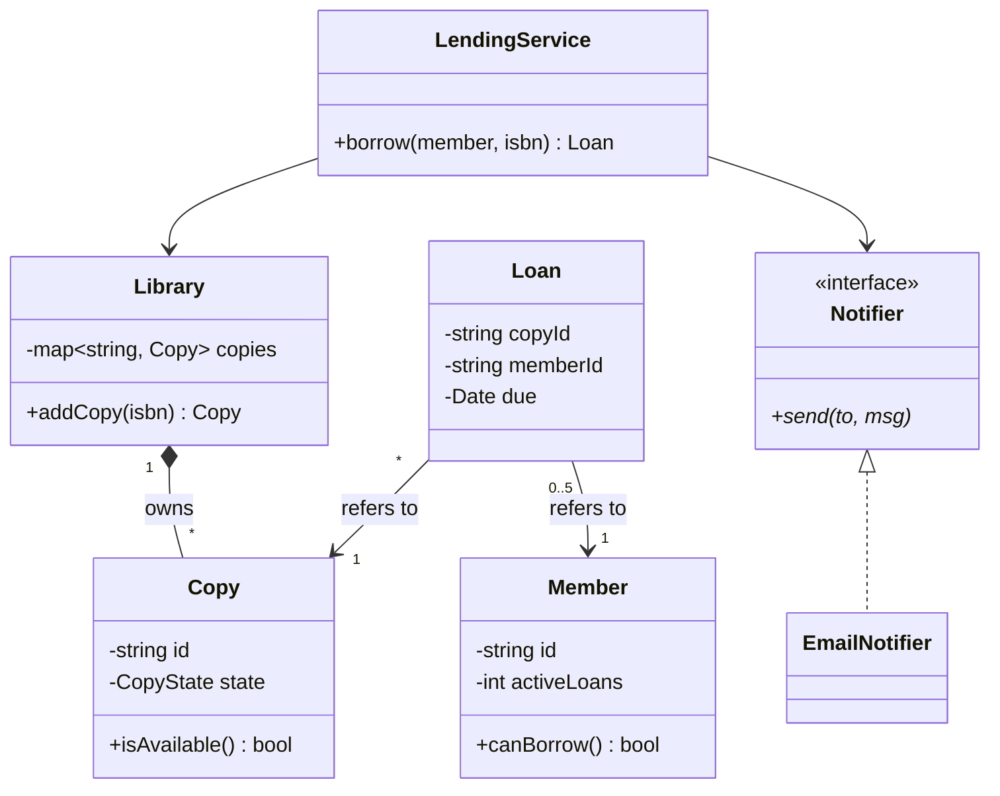
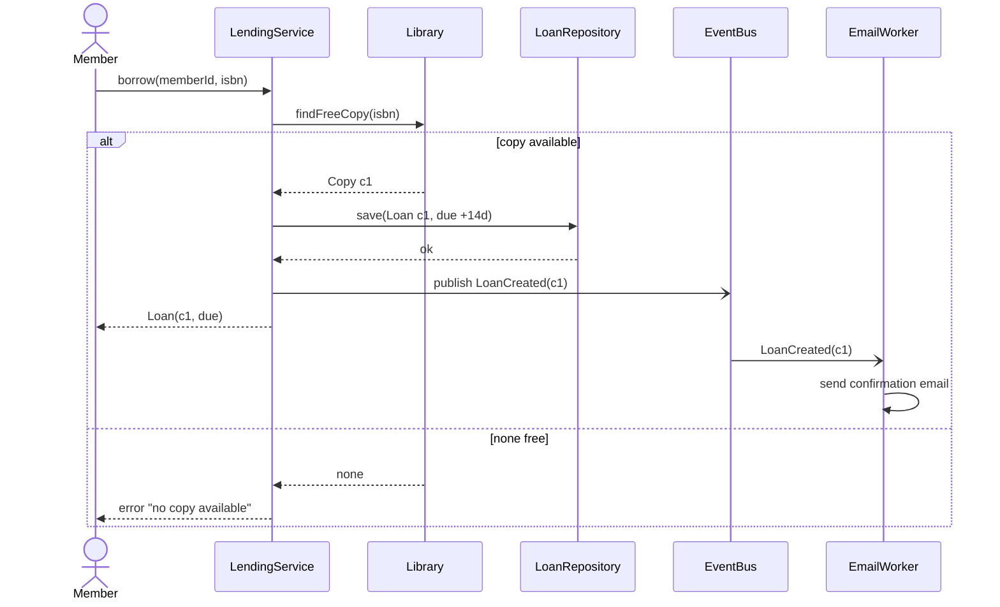
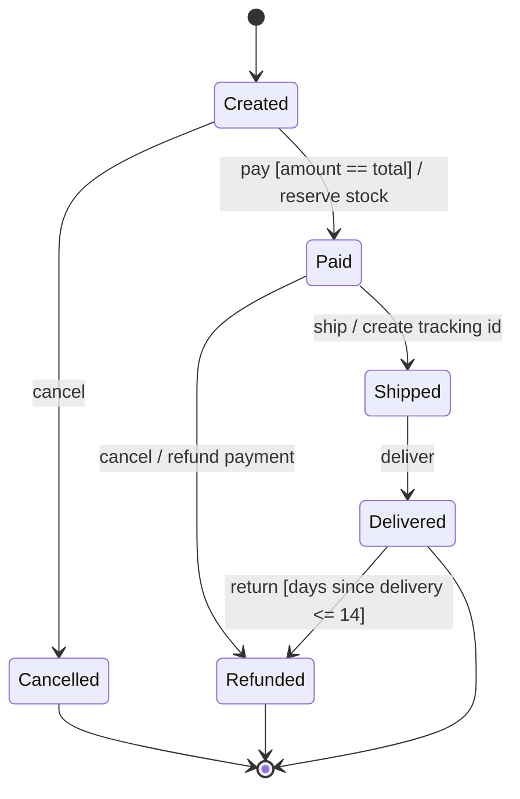

# UML and Communication — Class, Sequence and State Diagrams, and Talking Through Trade-offs

> **What you'll learn:** the small part of UML you actually need in an interview — **class diagrams** (association, aggregation, composition, inheritance), **sequence diagrams** (calls, boundaries, async events) and **state machine diagrams** (transitions, guards, terminal states) — and how to **explain trade-offs** while you iterate on the model with the interviewer. Diagrams are written in **Mermaid**, which GitHub renders, and each one is matched with the C++ it describes.
>
> **Prerequisites:** [Requirements and Domain Modeling](./Requirements-and-Domain-Modeling.md).

## Table of Contents
1. [Class diagrams: associations, aggregation, composition, inheritance](#1-class-diagrams-associations-aggregation-composition-inheritance)
2. [Explain trade-offs while iterating the model with an interviewer](#2-explain-trade-offs-while-iterating-the-model-with-an-interviewer)
3. [Sequence diagrams: method calls, boundaries, and async events](#3-sequence-diagrams-method-calls-boundaries-and-async-events)
4. [State machine diagrams: transitions, guards, and terminal states](#4-state-machine-diagrams-transitions-guards-and-terminal-states)
5. [Cheat sheet](#cheat-sheet)

---

## 1. Class diagrams: associations, aggregation, composition, inheritance

**In one sentence:** a class diagram shows **classes** (name, key fields, key methods) and the **lines between them**, where the line style says the relationship: plain **association**, hollow-diamond **aggregation**, filled-diamond **composition**, hollow-triangle **inheritance**, and dashed-triangle **interface realization**.

### In plain words
It's the floor plan of your code. You don't draw every pipe — just the rooms (classes) and the doors (relationships), so everyone can talk about the same picture.

### How it works
| Relationship | Notation | Meaning | Example | C++ |
|---|---|---|---|---|
| **Association** | `A --> B` (line, arrow = navigable direction) | A knows / uses B | Loan → Member | reference, pointer or ID |
| **Aggregation** | `A o-- B` (hollow diamond at A) | A **has** B, but B can exist alone | Team ◇— Player | non-owning pointer / IDs |
| **Composition** | `A *-- B` (filled diamond at A) | A **owns** B; B dies with A | Order ◆— OrderLine | member / `unique_ptr` / `vector<B>` |
| **Inheritance** | `Base <|-- Derived` | Derived **is a** Base | Account ◁— Savings | `class Savings : public Account` |
| **Realization** | `Interface <|.. Impl` (dashed) | implements an interface | Notifier ◁┄ EmailNotifier | pure virtual base |
| **Dependency** | `A ..> B` (dashed arrow) | A uses B temporarily (parameter, local) | Service ┄> Clock | function parameter |

- **Multiplicity** on the ends: `1`, `0..1`, `*`, `1..*` ("a member has 0..5 loans").
- **Visibility:** `+` public, `-` private, `#` protected. Show only what matters for the discussion.
- **In an interview:** draw 5–8 boxes, the key fields, the 2–3 important methods each, and the relationships. Skip getters and setters.

#### Mermaid class diagram


#### Modern C++ example — the same diagram in code
```cpp
// g++ -std=c++20 main.cpp && ./a.out
#include <iostream>
#include <map>
#include <memory>
#include <string>

class Notifier {                                    // <<interface>>
public:
    virtual ~Notifier() = default;
    virtual void send(const std::string& to, const std::string& msg) = 0;
};
class EmailNotifier : public Notifier {             // realization  Notifier <|.. EmailNotifier
public:
    void send(const std::string& to, const std::string& msg) override { std::cout << "email " << to << ": " << msg << '\n'; }
};

struct Copy { std::string id; bool lent = false; bool is_available() const { return !lent; } };
struct Member { std::string id; int active_loans = 0; bool can_borrow() const { return active_loans < 5; } };
struct Loan { std::string copy_id, member_id; };    // association by ID (no ownership)

class Library {                                     // composition: Library *-- Copy
public:
    Copy& add_copy(const std::string& id) { return copies_[id] = Copy{id}; }
    Copy* find_free() { for (auto& [id, c] : copies_) if (c.is_available()) return &c; return nullptr; }
private:
    std::map<std::string, Copy> copies_;
};

class LendingService {                              // associations to Library and Notifier
public:
    LendingService(Library& lib, Notifier& n) : lib_(lib), notifier_(n) {}
    bool borrow(Member& m) {
        Copy* c = m.can_borrow() ? lib_.find_free() : nullptr;
        if (!c) return false;
        c->lent = true; ++m.active_loans;
        Loan loan{c->id, m.id};
        notifier_.send(m.id, "you borrowed " + loan.copy_id);
        return true;
    }
private:
    Library& lib_;
    Notifier& notifier_;
};

int main() {
    Library lib;
    lib.add_copy("c1");
    EmailNotifier email;
    LendingService svc(lib, email);
    Member m{"m42"};
    std::cout << std::boolalpha << svc.borrow(m) << ' ' << svc.borrow(m) << '\n';
}
```

**Output:**
```text
email m42: you borrowed c1
true false
```

### Interview answer
"I draw only the classes and fields that matter, and use the line types to say ownership: a filled diamond for composition where the part dies with the whole — `Library` owns its `Copy` objects — a hollow diamond for aggregation, a plain arrow for association, a triangle for inheritance and a dashed triangle for implementing an interface. Multiplicities on the ends capture rules like 'a member has at most five loans'."

---

## 2. Explain trade-offs while iterating the model with an interviewer

**In one sentence:** treat the design as a **conversation**: propose a simple first version, **name the trade-off** of each decision ("I chose X because…, the cost is…"), invite feedback, and **iterate** when the interviewer adds a requirement — instead of silently drawing a "perfect" design.

### In plain words
A good tour guide doesn't just walk; they say "we're taking the stairs because the lift is slow, but if anyone needs the lift, we can switch". The interviewer is grading your **thinking**, and they can only grade what you say out loud.

### How it works
**A simple rhythm for each decision**
1. **Option:** "I'll store loans in a map keyed by copy ID."
2. **Why:** "Return is the hot path, and that makes it O(1)."
3. **Cost:** "Finding all loans of a member is O(n); if that matters I'd add a second index."
4. **Check in:** "Does that match what you expect usage to look like?"

**Common LLD trade-offs to talk about**
| Decision | Option A | Option B |
|---|---|---|
| Polymorphism | virtual interface (open to new types) | `enum`/`variant` (closed set, exhaustive checks) |
| Relationships | object pointers (fast navigation) | IDs (no dangling, easy persistence) |
| State | `enum` + transition table (compact) | State pattern (per-state behaviour) |
| Concurrency | one coarse lock (simple, correct) | fine-grained locks (faster, deadlock risk) |
| Validation | exceptions (can't be ignored) | `std::expected`/error codes (explicit, cheap) |
| Extensibility | add an interface now | keep concrete, extract later (YAGNI) |

**When the interviewer changes a requirement:** don't restart. Say what changes, which class absorbs it, and what stays the same. That shows the design is **resilient**.

**Phrases that help:** "Let me start simple and refine." · "The trade-off here is…" · "If we expect X, I'd change this to Y." · "I'm assuming…, correct me if not." · "Let me sanity-check this against the use case."

#### Modern C++ example — one decision, two designs, measured trade-off
Talking about trade-offs is stronger with numbers. Here: "find a member's loans" with one index vs. two.

```cpp
// g++ -std=c++20 main.cpp && ./a.out
#include <iostream>
#include <map>
#include <set>
#include <string>
#include <unordered_map>

struct Loan { std::string copy, member; };

class LoansV1 {                                           // one index: fast return, slow "loans of member"
public:
    void add(const Loan& l) { by_copy_[l.copy] = l; }
    void remove(const std::string& copy) { by_copy_.erase(copy); }
    int count_for(const std::string& member, long& steps) const {
        int n = 0;
        for (const auto& [c, l] : by_copy_) { ++steps; n += l.member == member; }   // O(total loans)
        return n;
    }
private:
    std::unordered_map<std::string, Loan> by_copy_;
};

class LoansV2 {                                           // two indexes: both fast, more memory + must stay in sync
public:
    void add(const Loan& l) { by_copy_[l.copy] = l; by_member_[l.member].insert(l.copy); }
    void remove(const std::string& copy) {
        auto it = by_copy_.find(copy);
        if (it == by_copy_.end()) return;
        by_member_[it->second.member].erase(copy);        // the price: two structures to update
        by_copy_.erase(it);
    }
    int count_for(const std::string& member, long& steps) const {
        ++steps;
        auto it = by_member_.find(member);
        return it == by_member_.end() ? 0 : static_cast<int>(it->second.size());   // O(1) + O(k)
    }
private:
    std::unordered_map<std::string, Loan> by_copy_;
    std::unordered_map<std::string, std::set<std::string>> by_member_;
};

int main() {
    LoansV1 v1; LoansV2 v2;
    for (int i = 0; i < 100000; ++i) {
        Loan l{"c" + std::to_string(i), "m" + std::to_string(i % 20000)};
        v1.add(l); v2.add(l);
    }
    v1.remove("c7"); v2.remove("c7");
    long s1 = 0, s2 = 0;
    int a = v1.count_for("m7", s1), b = v2.count_for("m7", s2);
    std::cout << "loans of m7: v1=" << a << " (" << s1 << " steps), v2=" << b << " (" << s2 << " step)\n";
}
```

**Output:**
```text
loans of m7: v1=4 (99999 steps), v2=4 (1 step)
```

Now you can say: "V2 makes 'my loans' O(1) at the cost of a second index that every add and remove must keep in sync. With 100k loans that's worth it; with a few hundred I'd keep V1."

### Interview answer
"I narrate decisions as option, reason, cost, and a check-in question, start with a simple version and refine it, and when the interviewer adds a requirement I say which class absorbs the change and what stays the same. Typical trade-offs I call out are virtual versus variant, pointers versus IDs, one lock versus many, and extracting an interface now versus later."

---

## 3. Sequence diagrams: method calls, boundaries, and async events

**In one sentence:** a sequence diagram shows **objects as columns** and **messages as arrows down the page in time order**, so you can check that one use case flows correctly across objects and **system boundaries**, including **synchronous calls**, **returns** and **asynchronous events**.

### In plain words
It's a comic strip of one scenario: "the member taps Borrow → the service asks the library for a copy → the library answers → the service records a loan → later, an email goes out".

### How it works
| Element | Mermaid | Meaning |
|---|---|---|
| Participant | `participant S as LendingService` | an object or component (a column) |
| Actor | `actor M as Member` | a person or external system |
| Sync call | `A->>B: borrow(isbn)` | A waits for B |
| Return | `B-->>A: Loan` | the answer (dashed) |
| Async message | `A-)B: LoanCreated` | fire and forget; A doesn't wait |
| Alternative | `alt ... else ... end` | if / else branches |
| Loop / optional | `loop`, `opt` | repetition / optional step |
| Boundary | `box` or a participant named for the external system | where your code calls the outside world |

- Use it to find **who owns each step**, **where errors appear**, and **where boundaries are** (database, payment API, message queue) — the places for interfaces, timeouts and retries.
- Async events decouple slow work (email, analytics) from the user's request; show them clearly so the interviewer sees the design choice.

#### Mermaid sequence diagram


#### Modern C++ example — the same scenario: sync calls, then an async event
```cpp
// g++ -std=c++20 -pthread main.cpp && ./a.out
#include <condition_variable>
#include <functional>
#include <iostream>
#include <mutex>
#include <optional>
#include <queue>
#include <string>
#include <thread>

class EventBus {                                       // async boundary: publish returns immediately
public:
    void publish(std::string e) { { std::scoped_lock l(m_); q_.push(std::move(e)); } cv_.notify_one(); }
    std::optional<std::string> next() {
        std::unique_lock l(m_);
        cv_.wait(l, [&] { return !q_.empty() || closed_; });
        if (q_.empty()) return std::nullopt;
        auto e = q_.front(); q_.pop(); return e;
    }
    void close() { { std::scoped_lock l(m_); closed_ = true; } cv_.notify_all(); }
private:
    std::mutex m_; std::condition_variable cv_; std::queue<std::string> q_; bool closed_ = false;
};

struct Library { int free = 1; std::optional<std::string> find_free_copy() { if (!free) return std::nullopt; --free; return "c1"; } };
struct LoanRepository { void save(const std::string& copy) { std::cout << "  repo: saved loan " << copy << '\n'; } };

class LendingService {
public:
    LendingService(Library& l, LoanRepository& r, EventBus& b) : lib_(l), repo_(r), bus_(b) {}
    std::string borrow(const std::string& member) {
        std::cout << member << " -> borrow\n";
        auto copy = lib_.find_free_copy();                       // sync call
        if (!copy) return "error: no copy available";             // alt branch
        repo_.save(*copy);                                        // sync call across a boundary
        bus_.publish("LoanCreated(" + *copy + ", " + member + ")");   // async: don't wait for email
        return "loan " + *copy;
    }
private:
    Library& lib_; LoanRepository& repo_; EventBus& bus_;
};

int main() {
    Library lib; LoanRepository repo; EventBus bus;
    std::mutex out;
    std::thread email_worker([&] {
        while (auto e = bus.next()) { std::scoped_lock l(out); std::cout << "  email worker: confirmation for " << *e << '\n'; }
    });
    LendingService svc(lib, repo, bus);
    std::string r1 = svc.borrow("m42");
    std::string r2 = svc.borrow("m7");
    bus.close();
    email_worker.join();
    std::cout << "m42 got: " << r1 << "\nm7 got: " << r2 << '\n';
}
```

**Output:**
```text
m42 -> borrow
  repo: saved loan c1
m7 -> borrow
  email worker: confirmation for LoanCreated(c1, m42)
m42 got: loan c1
m7 got: error: no copy available
```

The user's answer doesn't wait for the email: the worker can print its line at any point after the event is published (the exact interleaving may vary between runs).

### Interview answer
"I use a sequence diagram to walk one use case through the objects in time order: solid arrows for synchronous calls, dashed arrows for returns, half-arrows for async events, and `alt` blocks for failure branches. It shows who owns each step and where the boundaries are — database, payment API, event bus — which is where I put interfaces, timeouts and retries, and where I move slow work like email to async events."

---

## 4. State machine diagrams: transitions, guards, and terminal states

**In one sentence:** a state machine diagram shows the **states** an object can be in, the **events** that move it between states, **guards** (`[condition]`) that must be true for a transition, **actions** done on the transition, and the **start** and **terminal** states.

### In plain words
A traffic light, an order, a vending machine: each is always in exactly one state, and only certain events can move it. A **guard** is a condition — "you can only pay **if** the cart is not empty". A **terminal state** is the end — a cancelled order never comes back.

### How it works
- Notation: `[*] --> Created` (start), `Created --> Paid : pay [amount == total] / reserve stock` (event `[guard]` / action), `Delivered --> [*]` (terminal).
- **Every state should answer:** which events are allowed? What happens on an event that's **not** allowed — ignore, error, or log?
- **Terminal states** accept no events; model "can't refund after 30 days" as a guard, not as hidden `if`s in random places.
- In code: an `enum class` + a **transition function** with the guards, or the **State pattern** if behaviour per state is large.
- Interview uses: order lifecycle, vending machine, elevator, parking ticket, ATM session, document approval, TCP connection states.

#### Mermaid state diagram


#### Modern C++ example — the order state machine with guards, actions and terminal states
```cpp
// g++ -std=c++20 main.cpp && ./a.out
#include <iostream>
#include <string>

enum class S { Created, Paid, Shipped, Delivered, Cancelled, Refunded };
const char* name(S s) {
    switch (s) { case S::Created: return "Created"; case S::Paid: return "Paid"; case S::Shipped: return "Shipped";
                 case S::Delivered: return "Delivered"; case S::Cancelled: return "Cancelled"; case S::Refunded: return "Refunded"; }
    return "?";
}

class Order {
public:
    explicit Order(long total) : total_(total) {}
    bool pay(long amount) {
        return go(state_ == S::Created && amount == total_, S::Paid, "pay", "reserve stock");
    }
    bool ship() { return go(state_ == S::Paid, S::Shipped, "ship", "create tracking id"); }
    bool deliver(int day) { if (go(state_ == S::Shipped, S::Delivered, "deliver", "")) { delivered_day_ = day; return true; } return false; }
    bool cancel() {
        if (state_ == S::Created) return go(true, S::Cancelled, "cancel", "");
        return go(state_ == S::Paid, S::Refunded, "cancel", "refund payment");
    }
    bool return_item(int today) {
        return go(state_ == S::Delivered && today - delivered_day_ <= 14, S::Refunded, "return", "refund payment");   // guard
    }
    bool terminal() const { return state_ == S::Cancelled || state_ == S::Refunded; }
private:
    bool go(bool allowed, S to, const char* event, const char* action) {
        if (terminal() || !allowed) {
            std::cout << "  " << event << " rejected in " << name(state_) << (terminal() ? " (terminal)" : "") << '\n';
            return false;
        }
        std::cout << "  " << name(state_) << " --" << event << "--> " << name(to) << (*action ? std::string(" / ") + action : "") << '\n';
        state_ = to;
        return true;
    }
    S state_ = S::Created;
    long total_;
    int delivered_day_ = 0;
};

int main() {
    std::cout << "order A:\n";
    Order a(500);
    a.pay(400);                 // guard fails: wrong amount
    a.pay(500); a.ship(); a.deliver(10);
    a.return_item(30);          // guard fails: 20 days > 14
    a.return_item(20);
    a.ship();                   // terminal
    std::cout << "order B:\n";
    Order b(100);
    b.cancel(); b.pay(100);
}
```

**Output:**
```text
order A:
  pay rejected in Created
  Created --pay--> Paid / reserve stock
  Paid --ship--> Shipped / create tracking id
  Shipped --deliver--> Delivered
  return rejected in Delivered
  Delivered --return--> Refunded / refund payment
  ship rejected in Refunded (terminal)
order B:
  Created --cancel--> Cancelled
  pay rejected in Cancelled (terminal)
```

### Interview answer
"For any object with a lifecycle I draw its states, the events between them, guards in square brackets and actions after a slash, plus the start and terminal states. In code all transitions go through one function that checks the current state and the guard, so illegal moves — like shipping a refunded order or returning after 14 days — are rejected in one place. If per-state behaviour grows, I switch to the State pattern."

---

## Cheat sheet

| Diagram | Use it to | Key notation |
|---|---|---|
| Class | show structure and ownership | `*--` composition · `o--` aggregation · `-->` association · `<|--` inheritance · `<|..` interface · multiplicities |
| Sequence | walk one use case through objects | `->>` sync call · `-->>` return · `-)` async · `alt/else`, `loop`, `opt` |
| State machine | show a lifecycle | `[*]` start/end · `event [guard] / action` · terminal states accept nothing |
| Talking | make your thinking gradable | option → why → cost → check in; start simple, iterate; absorb new requirements without restarting |
| In an interview | draw only what matters | 5–8 classes, key fields and methods, skip getters/setters |
