# Machine Learning Interviews Book (Chip Huyen): all questions

> Copied from <https://huyenchip.com/ml-interviews-book/> (by Chip Huyen; see the repository). Questions and answers are the source's own; nothing was answered or rewritten here. The book publishes questions only: its answers folder is empty, so there are no official answers to copy.


### About the answers

I started the book with the naive optimism that I’d write the answers for every question in this book. It turned out writing detailed answers to 300+ technical questions -- while juggling a full-time job, a teaching gig, a raging pandemic with a couple of family members in the hospital -- is a lot.

Given the slow progress I’ve been making, I’ve decided that publishing the draft then continuing writing/crowdsourcing the answers might be more productive. The first draft of the book has the answers for about 10% of all the questions. These existing answers, while I believe to be sufficiently mathematically rigorous, prioritize intuitive explanations over mathematical equations. The answers for the questions will be continually updated. Answer contribution via [the book’s GitHub repository](https://github.com/chiphuyen) is much appreciated.

Hiring is a process, and questions aren’t evaluated in isolation. Your answer to each question is evaluated as part of your performance during the entire process. A candidate who claims to work with computer vision and fails to answer a question about techniques typically used for computer vision tasks is going to be evaluated differently from a candidate who doesn’t work with computer vision at all. Interviewers often care more about your approach than the actual objective correctness of your answers.

### About the questions

The questions in this book were selected out of thousands of questions, most have been asked in actual interviews for machine learning roles. You will find several questions that are technically incorrect or ambiguous. This is on purpose. Sometimes, interviewers ask these questions to see whether candidates will correct them, point out the edge cases, or ask for clarification. For these questions, the accompanying hints should help clarify the ambiguity or technical incorrectness.

Machine learning is a tool, and to effectively use any tool, we should know how, why, or when to use it on top of knowing what it is. Because the “what” questions can be easily found online, and if something can be easily acquired, it isn’t worth testing for. This book focuses on the “how”, “why”, and “when” questions. For example, instead of asking for the exact algorithm for K-means clustering, the question asks in what scenarios K-means doesn’t work. You don’t need to understand K-means to cite its definition, but you do need to know when not to use it.

Still, this book contains a small number of “what” questions. While they aren’t good interview questions, they are good for interview preparation.

### 5.1 Algebra and (little) calculus

_If some characters seem to be missing, it's because MathJax is not loaded correctly. Refreshing the page should fix it._

#### 5.1.1 Vectors

_If some characters seem to be missing, it's because MathJax is not loaded correctly. Refreshing the page should fix it._

1. Dot product
    1. [E] What’s the geometric interpretation of the dot product of two vectors?
    2. [E] Given a vector $u$, find vector $v$ of unit length such that the dot product of $u$ and $v$ is maximum.

2. Outer product
    1. [E] Given two vectors $a = [3, 2, 1]$ and  $b = [-1, 0, 1]$. Calculate the outer product $a^Tb$?
    1. [M] Give an example of how the outer product can be useful in ML.

3. [E] What does it mean for two vectors to be linearly independent?
4. [M] Given two sets of vectors $A = {a_1, a_2, a_3, ..., a_n}$ and $B = {b_1, b_2, b_3, ... , b_m}$. How do you check that they share the same basis?
5. [M] Given $n$ vectors, each of $d$ dimensions. What is the dimension of their span?
6. Norms and metrics
	1. [E] What's a norm? What is $L_0, L_1, L_2, L_{norm}$?
	1. [M] How do norm and metric differ? Given a norm, make a metric. Given a metric, can we make a norm?

#### 5.1.2 Matrices

_If some characters seem to be missing, it's because MathJax is not loaded correctly. Refreshing the page should fix it._

1. [E] Why do we say that matrices are linear transformations?
2. [E] What’s the inverse of a matrix? Do all matrices have an inverse? Is the inverse of a matrix always unique?
3. [E] What does the determinant of a matrix represent?
4. [E] What happens to the determinant of a matrix if we multiply one of its rows by a scalar $t \times R$?
5. [M] A $4 \times 4$ matrix has four eigenvalues $3, 3, 2, -1$. What can we say about the trace and the determinant of this matrix?
6. [M] Given the following matrix:<br>
	$
	\begin{bmatrix}
		1 & 4 & -2 \\
		-1 & 3 & 2 \\
		3 & 5 & -6
	\end{bmatrix}
	$

	Without explicitly using the equation for calculating determinants, what can we say about this matrix’s determinant?

	**Hint**: rely on a property of this matrix to determine its determinant.
7. [M] What’s the difference between the covariance matrix $A^TA$ and the Gram matrix $AA^T$?
8. Given $A \in R^{n \times m}$ and $b \in R^n$
	1. [M] Find $x$ such that: $Ax = b$.
	1. [E] When does this have a unique solution?
	1. [M] Why is it when A has more columns than rows, $Ax = b$ has multiple solutions?
	1. [M] Given a matrix A with no inverse. How would you solve the equation $Ax = b$? What is the pseudoinverse and how to calculate it?

9. Derivative is the backbone of gradient descent.
	1. [E] What does derivative represent?
	1. [M] What’s the difference between derivative, gradient, and Jacobian?
10. [H] Say we have the weights $w \in R^{d \times m}$ and a mini-batch $x$ of $n$ elements, each element is of the shape $1 \times d$ so that $x \in R^{n \times d}$. We have the output $y = f(x; w) = xw$. What’s the dimension of the Jacobian $\frac{\delta y}{\delta x}$?
11. [H] Given a very large symmetric matrix A that doesn’t fit in memory, say $A \in R^{1M \times 1M}$ and a function $f$ that can quickly compute $f(x) = Ax$ for $x \in R^{1M}$. Find the unit vector $x$ so that $x^TAx$ is minimal.
	
	**Hint**: Can you frame it as an optimization problem and use gradient descent to find an approximate solution?

#### 5.1.3 Dimensionality reduction

_If some characters seem to be missing, it's because MathJax is not loaded correctly. Refreshing the page should fix it._

1. [E] Why do we need dimensionality reduction?
2. [E] Eigendecomposition is a common factorization technique used for dimensionality reduction. Is the eigendecomposition of a matrix always unique?
3. [M] Name some applications of eigenvalues and eigenvectors.
4. [M] We want to do PCA on a dataset of multiple features in different ranges. For example, one is in the range 0-1 and one is in the range 10 - 1000. Will PCA work on this dataset?
5. [H] Under what conditions can one apply eigendecomposition? What about SVD?
    1. What is the relationship between SVD and eigendecomposition?
    1. What’s the relationship between PCA and SVD?
6. [H] How does t-SNE (T-distributed Stochastic Neighbor Embedding) work? Why do we need it?


> **In case you need a refresh on PCA, here's an explanation without any math.**

> Assume that your grandma likes wine and would like to find characteristics that best describe wine bottles sitting in her cellar. There are many characteristics we can use to describe a bottle of wine including age, price, color, alcoholic content, sweetness, acidity, etc. Many of these characteristics are related and therefore redundant. Is there a way we can choose fewer characteristics to describe our wine and answer questions such as: which two bottles of wine differ the most?

> PCA is a technique to construct new characteristics out of the existing characteristics. For example, a new characteristic might be computed as `age - acidity + price` or something like that, which we call a linear combination.

> To differentiate our wines, we'd like to find characteristics that strongly differ across wines. If we find a new characteristic that is the same for most of the wines, then it wouldn't be very useful. PCA looks for characteristics that show as much variation across wines as possible, out of all linear combinations of existing characteristics. These constructed characteristics are principal components of our wines.

> If you want to see a more detailed, intuitive explanation of PCA with visualization, check out [amoeba's answer on StackOverflow](https://stats.stackexchange.com/questions/2691/making-sense-of-principal-component-analysis-eigenvectors-eigenvalues/140579#140579). This is possibly the best PCA explanation I've ever read.

#### 5.1.4 Calculus and convex optimization

_If some characters seem to be missing, it's because MathJax is not loaded correctly. Refreshing the page should fix it._

1. Differentiable functions
    1. [E] What does it mean when a function is differentiable?
    1. [E] Give an example of when a function doesn’t have a derivative at a point.
    1. [M] Give an example of non-differentiable functions that are frequently used in machine learning. How do we do backpropagation if those functions aren’t differentiable?
2. Convexity
    1. [E] What does it mean for a function to be convex or concave? Draw it.
    1. [E] Why is convexity desirable in an optimization problem?
    1. [M] Show that the cross-entropy loss function is convex.
3. Given a logistic discriminant classifier:
    
    $
        p(y=1|x) = \sigma (w^Tx)
    $
    
    where the sigmoid function is given by:

    $
        \sigma(z) = (1 + \exp(-z))^{-1}
    $

    The logistic loss for a training sample $x_i$ with class label $y_i$ is given by:
    
    $
        L(y_i, x_i;w) = -\log p(y_i|x_i)
    $

    1. Show that $p(y=-1|x) = \sigma(-w^Tx)$.
    1. Show that $\Delta_wL(y_i, x_i; w) = -y_i(1-p(y_i|x_i))x_i$.
    1. Show that $\Delta_wL(y_i, x_i; w)$ is convex.

4. Most ML algorithms we use nowadays use first-order derivatives (gradients) to construct the next training iteration.
    1. [E] How can we use second-order derivatives for training models?
    1. [M] Pros and cons of second-order optimization.
    1. [M] Why don’t we see more second-order optimization in practice?
5. [M] How can we use the Hessian (second derivative matrix) to test for critical points? 
6. [E] Jensen’s inequality forms the basis for many algorithms for probabilistic inference, including Expectation-Maximization and variational inference.. Explain what Jensen’s inequality is.
7. [E] Explain the chain rule.
8. [M] Let $x \in R_n$, $L = crossentropy(softmax(x), y)$ in which $y$ is a one-hot vector. Take the derivative of $L$ with respect to $x$.
9. [M] Given the function $f(x, y) = 4x^2 - y$ with the constraint $x^2 + y^2 =1$. Find the function’s maximum and minimum values.

----
> On convex optimization

Convex optimization is important because it's the only type of optimization that we more or less understand. Some might argue that since many of the common objective functions in deep learning aren't convex, we don't need to know about convex optimization. However, even when the functions aren't convex, analyzing them as if they were convex often gives us meaningful bounds. If an algorithm doesn't work assuming that a loss function is convex, it definitely doesn't work when the loss function is non-convex.

Convexity is the exception, not the rule. If you're asked whether a function is convex and it isn't already in the list of commonly known convex functions, there's a good chance that it isn't convex. If you want to learn about convex optimization, check out [Stephen Boyd's textbook](http://cs229.stanford.edu/section/cs229-cvxopt.pdf).

----
> On Hessian matrix

The Hessian matrix or Hessian is a square matrix of second-order partial derivatives of a scalar-valued function. 

Given a function $f : ℝn → ℝ$. If all second partial derivatives of f exist and are continuous over the domain of the function, then the Hessian matrix H of f is a square nn matrix such that: $H_{ij}=\frac{\delta f}{\delta x_i\delta x_j}$.

<center>
    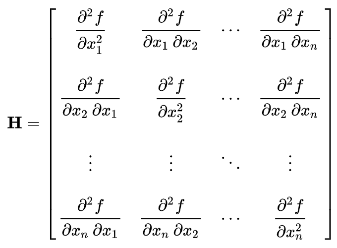
</center>

The Hessian is used for large-scale optimization problems within Newton-type methods and quasi-Newton methods. It is also commonly used for expressing image processing operators in image processing and computer vision for tasks such as blob detection and multi-scale signal representation.

### 5.2 Probability and statistics

A [Reddit user](https://www.reddit.com/r/statistics/comments/91f4wm/how_is_the_transition_from_pure_math_to_stats/e2xu2x2?utm_source=share&utm_medium=web2x&context=3) once said: “Data science is just doing statistics on a Mac.” Knowledge of probability and statistics is extremely important in ML and data science. If you don’t understand cross-entropy, KL divergence, or just general probability distribution, most of the objective functions in ML will statistically make little sense.

#### 5.2.1 Probability

A likely question would be to explain any of the common distributions and write out its equation, draw its probability mass function (PMF) if it’s discrete and the probability density function (PDF) if it’s continuous. It’d be useful to review all the common distributions.

##### 5.2.1.1 Basic concepts to review

_If some characters seem to be missing, it's because MathJax is not loaded correctly. Refreshing the page should fix it._

###### Random variable
Formally, a random variable is a measurable function $X: \Omega \rightarrow  E$ from a set of possible outcomes $\Omega$ to a measurable space $E$. The probability that $X$ takes on a value in a measurable set $S \subseteq E$ is written as:

$P(X \in S) = P({\omega \in \Omega | X(\omega) \in S})$, where $P$ is the probability measure on $(\Omega, F)$. 

The randomness comes from the randomness of the outcomes in $\Omega$.

Informally, a random variable is a variable that probabilistically takes on different values. You can think of a random variable as being like a variable in a programming language. They take on values, have types, and have domains over which they are applicable.

_Random variable_ is a general concept. Almost everything in life can be described using a random variable. The time it takes you to commute to work is a normal random variable. The number of people you date before finding your life partner is a geometric random variable.

###### Probability distribution
A probability distribution is a function that describes possible outcomes of a random variable along with its corresponding probabilities.

###### Normal random variable
Also known as the Gaussian random variable, this is the single most important random variable. It's parameterized by a random variable, parametrized by a mean $\mu$ and variance $\sigma^2$.

$
	X \sim N(\mu, \sigma^2) \\
	f(x) = \frac{1}{\sigma\sqrt{2\pi}}\exp(-\frac{(x-\mu)^2}{2\sigma^2})
$

The term we want to go over in this function is $-\frac{(x-\mu)^2}{2\sigma^2}$. Intuitively, it punishes the value far away from the mean, but the punishment is less when the variance is high. The term $\frac{1}{\sigma\sqrt{2\pi}}$ is normalization so that it integrates to 1.

$
	E[X] = \mu \\
	Var(X) = \sigma^2
$

Here is the PDF of the normal distribution with different parameters.

<center>
	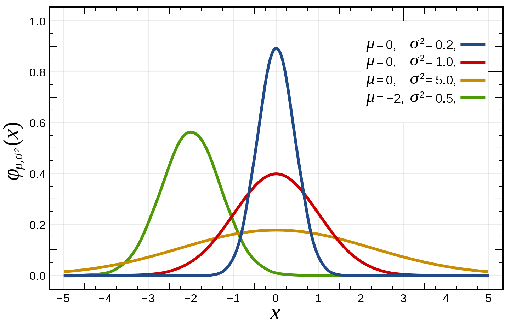
</center>

###### Categorical distribution
Also known as the multinoulli distribution, the categorical distribution is a generalization of the Bernoulli distribution. It describes the possible results of a random variable that can take on one of $k$ possible categories, with the probability of each category separately specified.

$
	X \in \text{Cat}(\phi); \phi = (p_1, p_2, ..., p_k) \text{ and }\sum_{i=1}^kp_i = 1
$

###### Binomial random variable
A binomial random variable represents the number of successes in n successive independent trials, each succeeding with probability $p$ and failing with probability $1-p$. One example is the number of heads in $n$ coin flips, each with a 0.5 probability of landing head. The binomial distribution is the basis for the binomial test for statistical significance. When there's only 1 trial, it's known as the Bernoulli distribution.
$
	X \sim \text{Bin}(n, p) \\
	P(X=k) = {n \choose k} p^k(1-p)^{n-k} \\
	E[X] = np \\
	Var(X) = np(1-p)
$

Below is the PMF of the binomial distribution with different parameters.

<center>
	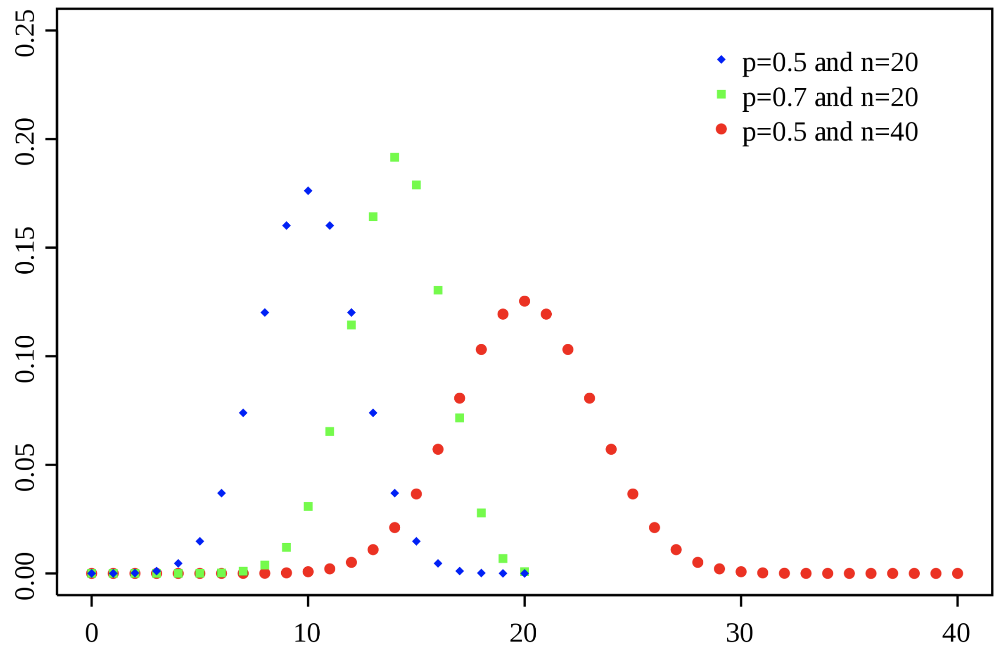
</center>

###### Multinomial random variable
The multinomial random variable is a generalization of the binomial distribution. Instead of having only two outcomes like with a coin flip, it can have multiple outcomes like with a k-sided die. When the number of trials is 1, it's the categorical distribution.
$
	X \sim \text{Multi}(n, \pi) \text{ with } \pi = (p_1,p_2, ..., p_k ) \text{ and }\sum_{i=1}^kp_i = 1 \\
	P(X=(x_1, x_2, ..., x_k)) = \frac{n!}{x_1!x_2! ... x_k!} \prod_{i=1}^kp_i{x_i} \text{ with } n = \sum_i^kx_i \\
	E[X_i] = np_i \\
	Var(X_i) = np_i(1-p_i)
$

###### Poisson random variable
The Poisson distribution is, in my opinion, among the more interesting distributions. It expresses the probability of a given number of events occurring in a fixed interval if these events occur with a known constant rate. This rate is denoted as $\lambda$. Note that the Poisson distribution is _memoryless_, which means the probability that an event occurs is independent of the time since the last event.

One pretty neat perspective is to see the Poisson distribution as an approximation of the Binomial where $n$ is large, $p$ is small, and $\lambda = np$. For example, a Binomial random variable of 10000 trials with the success rate of 0.01 can be seen as a Poisson random variable of events happening every 10000 * 0.01 = 100 trials.

$
	X \sim \text{Poi}(\lambda) \\
	P(X=i) = \frac{\lambda^i}{i!}e^{-\lambda} \\
	E[X] = \lambda \\
	Var(X) = \lambda \\
$

Below is the PMF of the Poisson distribution with different values of $\lambda$, made by Skbkekas.

<center>
	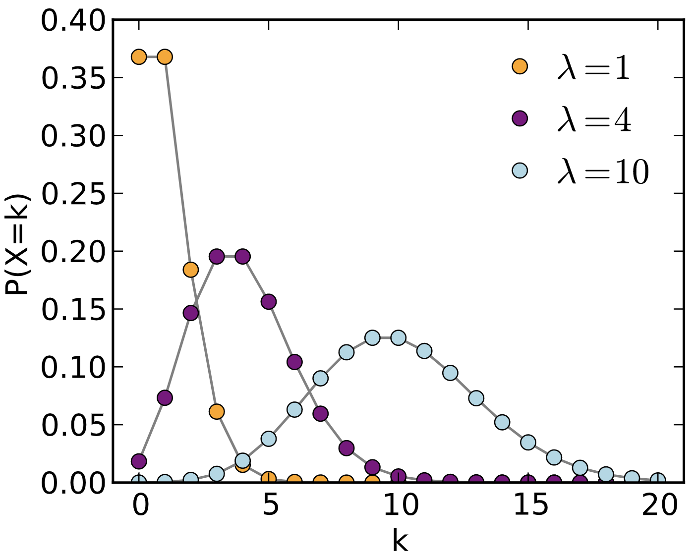
</center>


> **Poisson vs binomial according to [Data Science Central](https://www.statisticshowto.datasciencecentral.com/poisson-distribution/)**:

> If your question has an average probability of an event happening per unit (i.e. per unit of time, cycle, event) and you want to find the probability of a certain number of events happening in a period of time (or a number of events), then use the Poisson Distribution.

> If you are given an exact probability and you want to find the probability of the event happening a certain number of times out of x (i.e. 10 times out of 100, or 99 times out of 1000), use the Binomial Distribution formula.

###### Geometric random variable
If each trial has the probability of success of p, then the geometric random variable represents the number of independent trials until the first success. One example is the number of candidates you have to interview until you hire someone.

$
	X \sim \text{Geo}(p) \\
	P(X=n) =(1-p)^{n-1}p \\
	E[X] = \frac{1}{p} \\
	Var(X) = \frac{1-p}{p^2} \\
$

Below is the PMF of the geometric distribution with different values of $p$, made by Skbkekas.

<center>
	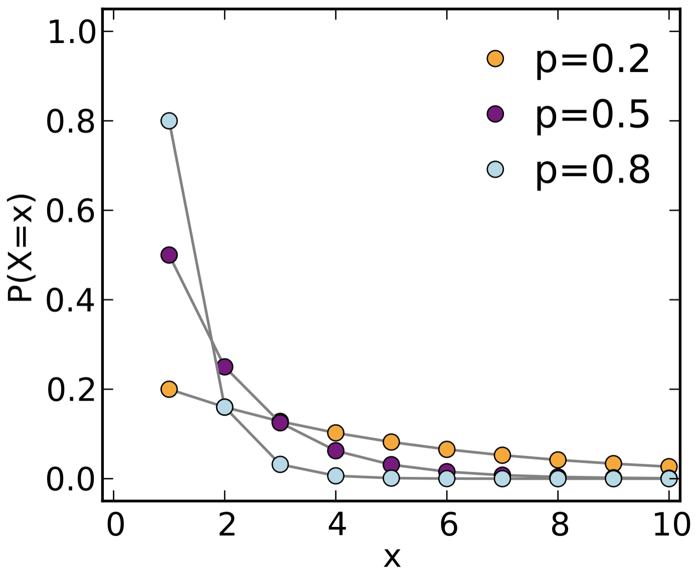
</center>

###### Beta random variable
Beta is my favorite distribution (what do you mean you don't have a favorite distribution?). It's a random variable that estimates another random variable.

Say, we have a coin with an unknown probability of turning heads. Let $p$ represent this probability. After $n + m$ flips, we get $n$ heads and $m$ tails. We might want to estimate that $p = \frac{n}{n+m}$. However, this is unreliable, especially if $n+m$ is small. We'd like to say something like this: $p$ can also be more than, less than, or equal to $\frac{n}{n+m}$, the values further away from $\frac{n}{n+m}$ having a smaller probability. And the higher the value of $n+m$, the higher the probability of $p$ being $\frac{n}{n+m}$. The beta distribution allows you to do that.

The beta random variable is represented using two variables: $\alpha$ to represent the number of successes and $\beta$ to represent the number of failures. The beta distribution can represent beyond coin flips. In fact, $\alpha$ and $\beta$ can rerepsent continuous value (though they can't be non-positive).

$
	x \sim \text{Beta}(\alpha, \beta) \text{ with } 0 < \alpha, \beta \\
	f(x; \alpha, \beta) = \frac{\Gamma(\alpha + \beta)}{\Gamma(\alpha)\Gamma(\beta)}x^{\alpha-1}(1-x)^{\beta-1}  \text{ with }  0 \leq x \leq 1 
$

$\Gamma$ is the Gamma function: $\Gamma(n) = (n-1)!$. The term $\frac{\Gamma(\alpha + \beta)}{\Gamma(\alpha)\Gamma(\beta)}$ is the normalization constant so that the expression integrates to 1.

$
	E[X] = \frac{\alpha}{\alpha + \beta} \\
	Var(X) = \frac{\alpha\beta}{(\alpha + \beta)^2(\alpha + \beta + 1)}
$

We can also incorporate a priori belief in the beta distribution. For example, if before even flipping the coin, we believe that the coin has a moderate chance of being biased towards heads, we can set the a priori to be $\text{Beta}(4, 2)$. Then after 10 coin flips of which 7 are heads and 3 are tails, we can update the distribution to be $\text{Beta}(4 + 7, 2 + 3) = \text{Beta}(11, 5)$. In fact, in Bayesian inference, the beta distribution is the conjugate prior probability distribution for Bernoulli, binomial, negative binomial, and geometric distributions.

Below is the PDF of the geometric distribution with different parameters.

<center>
	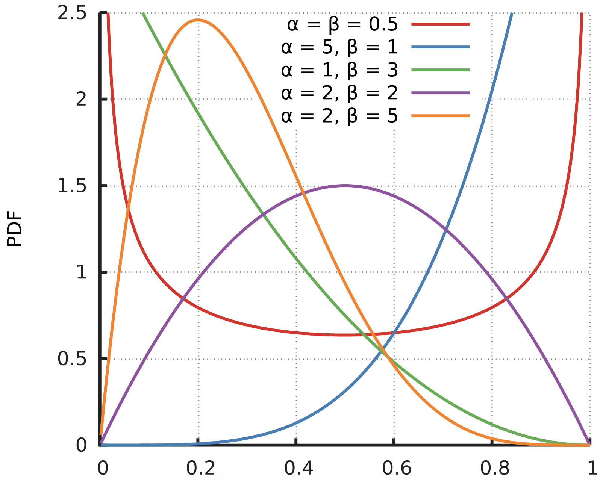
</center>

The multivariate generalization of the beta random variable is called Dirichlet.

###### Exponential family of distributions
A class of distributions is in the exponential family if it can be written in the form:

$
	p(x; \eta) = h(x)\exp(B(\eta)T(x) - a(\eta))
$
where:
1. $\eta$ is the parameter of the distribution, e.g. if it's the normal distribution then $\eta = (\mu, \sigma)$.
1. $T(x)$ is the sufficient statistic. For most distributions, $T(x) = x$. For the beta distribution, $T(x) = (\log x, \log(1-x))$.
1. $a(\eta)$ is the normalization constant so that the expression integrates to 1.

The exponential family of distribution is important because it provides a general framework for working with many of the most common distributions, including the Bernoulli, binomial, Poisson, normal, and more.

You can write the PMF and PDF of those distributions to match the form defined above. For example, given the Poisson random variable $\text{Poi}(\lambda)$, with $f(x) = \frac{\lambda^x}{x!}\exp(-\lambda)$, belongs to the exponential family because $f(x)$ can be written in the form $h(x)\exp(B(\eta)T(x) - a(\eta))$.
$
	f(x) = \frac{\lambda^x}{x!}\exp(-\lambda) = \frac{1}{x!}\exp(\log(\lambda)x - \lambda) \\
	\eta = \lambda \\
	h(x) = \frac{1}{x!} \\
	B(\eta) = \log(\eta) \\
	T(x) = x \\
	a(\eta) = \lambda
$

More examples that show that other distributions belong to the exponential family can be found [here](https://www2.stat.duke.edu/courses/Spring11/sta114/lec/expofam.pdf) and [here](http://cs229.stanford.edu/notes/cs229-notes1.pdf).

###### Marginal distribution, joint distribution, conditional distribution
A joint probability distribution gives the probability of two or more events happening at the same time. For example, given two discrete random variables $X$ and $Y$, the joint probability distribution of $X$ and $Y$ gives the probability of $P(X=x, Y=y)$ for any combination of value $x \in X$ and value $y \in Y$.

A marginal distribution gives the probabilities of various values of a subset of variables without reference to the values of the other variables. For example, given the joint distribution of $X$ and $Y$, we want to have a marginal probability distribution of $X$ without reference to $Y$. 

$
	P(X=x) = \sum_yP(X=x, Y=y)
$

A conditional probability distribution gives the probability of a subset of events occurring assuming that other events also occur. One example is $P(X|Y)$.

---
*This book was created by [Chip Huyen](https://huyenchip.com) with the help of wonderful friends. For feedback, errata, and suggestions, the author can be reached [here](https://huyenchip.com/communication/). Copyright ©2021 Chip Huyen.*

##### 5.2.1.2 Questions

_If some characters seem to be missing, it's because MathJax is not loaded correctly. Refreshing the page should fix it._

1. [E] Given a uniform random variable $X$ in the range of $[0, 1]$ inclusively. What’s the probability that $X=0.5$?
2. [E] Can the values of PDF be greater than 1? If so, how do we interpret PDF?
3. [E] What’s the difference between multivariate distribution and multimodal distribution?
4. [E] What does it mean for two variables to be independent?
5. [E] It’s a common practice to assume an unknown variable to be of the normal distribution. Why is that?
6. [E] How would you turn a probabilistic model into a deterministic model?
7. [H] Is it possible to transform non-normal variables into normal variables? How?
8. [M] When is the t-distribution useful?
9. Assume you manage an unreliable file storage system that crashed 5 times in the last year, each crash happens independently.
	1. [M] What's the probability that it will crash in the next month?
	1. [M] What's the probability that it will crash at any given moment?
10. [M] Say you built a classifier to predict the outcome of football matches. In the past, it's made 10 wrong predictions out of 100. Assume all predictions are made independently, what's the probability that the next 20 predictions are all correct?
11. [M] Given two random variables $X$ and $Y$. We have the values $P(X|Y)$ and $P(Y)$ for all values of $X$ and $Y$. How would you calculate $P(X)$?
12. [M] You know that your colleague Jason has two children and one of them is a boy. What’s the probability that Jason has two sons? Hint: it’s not $\frac{1}{2}$.
13. There are only two electronic chip manufacturers: A and B, both manufacture the same amount of chips. A makes defective chips with a probability of 30%, while B makes defective chips with a probability of 70%.
	1. [E] If you randomly pick a chip from the store, what is the probability that it is defective?
	1. [M] Suppose you now get two chips coming from the same company, but you don’t know which one. When you test the first chip, it appears to be functioning. What is the probability that the second electronic chip is also good?
14. There’s a rare disease that only 1 in 10000 people get. Scientists have developed a test to diagnose the disease with the false positive rate and false negative rate of 1%.
	1. [E] Given a person is diagnosed positive, what’s the probability that this person actually has the disease?
	1. [M] What’s the probability that a person has the disease if two independent tests both come back positive?
15. [M] A dating site allows users to select 10 out of 50 adjectives to describe themselves. Two users are said to match if they share at least 5 adjectives. If Jack and Jin randomly pick adjectives, what is the probability that they match?
16. [M] Consider a person A whose sex we don’t know. We know that for the general human height, there are two distributions: the height of males follows $h_m = N(\mu_m, \sigma_m^2)$ and the height of females follows $h_j = N(\mu_j, \sigma_j^2)$ . Derive a probability density function to describe A’s height.
17. [H] There are three weather apps, each the probability of being wrong ⅓ of the time. What’s the probability that it will be foggy in San Francisco tomorrow if all the apps predict that it’s going to be foggy in San Francisco tomorrow and during this time of the year, San Francisco is foggy 50% of the time?
	
	**Hint**: you’d need to consider both the cases where all the apps are independent and where they are dependent.
18. [M] Given $n$ samples from a uniform distribution $[0, d]$. How do you estimate $d$? (Also known as the German tank problem)
19. [M] You’re drawing from a random variable that is normally distributed, $X \sim N(0,1)$, once per day. What is the expected number of days that it takes to draw a value that’s higher than 0.5?
20. [M] You’re part of a class. How big the class has to be for the probability of at least a person sharing the same birthday with you is greater than 50%?
21. [H] You decide to fly to Vegas for a weekend. You pick a table that doesn’t have a bet limit, and for each game, you have the probability $p$ of winning, which doubles your bet, and $1-p$ of losing your bet. Assume that you have unlimited money (e.g.  you bought Bitcoin when it was 10 cents), is there a betting strategy that has a guaranteed positive payout, regardless of the value of $p$?
22. [H] Given a fair coin, what’s the number of flips you have to do to get two consecutive heads?
23. [H] In national health research in the US, the results show that the top 3 cities with the lowest rate of kidney failure are cities with populations under 5,000. Doctors originally thought that there must be something special about small town diets, but when they looked at the top 3 cities with the highest rate of kidney failure, they are also very small cities. What might be a probabilistic explanation for this phenomenon?

	**Hint**: The law of small numbers.
24. [M] Derive the maximum likelihood estimator of an exponential distribution.

---
*This book was created by [Chip Huyen](https://huyenchip.com) with the help of wonderful friends. For feedback, errata, and suggestions, the author can be reached [here](https://huyenchip.com/communication/). Copyright ©2021 Chip Huyen.*

#### 5.2.2 Stats

<center>
    
</center>


From [xkcd](https://xkcd.com/552/). To distract yourself from interviewing stress, [here](https://stats.stackexchange.com/questions/1337/statistics-jokes) are more statistics jokes.

1. [E] Explain frequentist vs. Bayesian statistics.
2. [E] Given the array $[1, 5, 3, 2, 4, 4]$, find its mean, median, variance, and standard deviation.
3. [M] When should we use median instead of mean? When should we use mean instead of median?
4. [M] What is a moment of function? Explain the meanings of the zeroth to fourth moments.
5. [M] Are independence and zero covariance the same? Give a counterexample if not.
6. [E] Suppose that you take 100 random newborn puppies and determine that the average weight is 1 pound with the population standard deviation of 0.12 pounds. Assuming the weight of newborn puppies follows a normal distribution, calculate the 95% confidence interval for the average weight of all newborn puppies.
7. [M] Suppose that we examine 100 newborn puppies and the 95% confidence interval for their average weight is $[0.9, 1.1]$ pounds. Which of the following statements is true?
    1. Given a random newborn puppy, its weight has a 95% chance of being between 0.9 and 1.1 pounds.
    1. If we examine another 100 newborn puppies, their mean has a 95% chance of being in that interval.
    1. We're 95% confident that this interval captured the true mean weight.
    
    Hint: This is a subtle point that many people misunderstand. If you struggle with the answer, Khan Academy has [a great article on it](https://www.khanacademy.org/math/ap-statistics/estimating-confidence-ap/introduction-confidence-intervals/a/interpreting-confidence-levels-and-confidence-intervals). 
8. [H] Suppose we have a random variable $X$ supported on $[0, 1]$ from which we can draw samples. How can we come up with an unbiased estimate of the median of $X$?
9. [H] Can correlation be greater than 1? Why or why not? How to interpret a correlation value of 0.3?
10. The weight of newborn puppies is roughly symmetric with a mean of 1 pound and a standard deviation of 0.12. Your favorite newborn puppy weighs 1.1 pounds.
    1. [E] Calculate your puppy’s z-score (standard score).
    1. [E] How much does your newborn puppy have to weigh to be in the top 10% in terms of weight?
    1. [M] Suppose the weight of newborn puppies followed a skew distribution. Would it still make sense to calculate z-scores?
11. [H] Tossing a coin ten times resulted in 10 heads and 5 tails. How would you analyze whether a coin is fair?
12. Statistical significance.
    1. [E] How do you assess the statistical significance of a pattern whether it is a meaningful pattern or just by chance?
    1. [E] What’s the distribution of p-values?
    1. [H] Recently, a lot of scientists started a war against statistical significance. What do we need to keep in mind when using p-value and statistical significance?
13. Variable correlation.
    1. [M] What happens to a regression model if two of their supposedly independent variables are strongly correlated?
    1. [M] How do we test for independence between two categorical variables?
    1. [H] How do we test for independence between two continuous variables?
14. [E] A/B testing is a method of comparing two versions of a solution against each other to determine which one performs better. What are some of the pros and cons of A/B testing?
15. [M] You want to test which of the two ad placements on your website is better. How many visitors and/or how many times each ad is clicked do we need so that we can be 95% sure that one placement is better?
16. [M] Your company runs a social network whose revenue comes from showing ads in newsfeed. To double revenue, your coworker suggests that you should just double the number of ads shown. Is that a good idea? How do you find out?
17. Imagine that you have the prices of 10,000 stocks over the last 24 month period and you only have the price at the end of each month, which means you have 24 price points for each stock. After calculating the correlations of 10,000 * 9,9992 pairs of stock, you found a pair that has the correlation to be above 0.8.
    1. [E] What’s the probability that this happens by chance?
    1. [M] How to avoid this kind of accidental patterns?
    
    **Hint**: Check out [the curse of big data](https://web.archive.org/web/20210926153005/https://www.analyticbridge.datasciencecentral.com/profiles/blogs/the-curse-of-big-data).
18. [H] How are sufficient statistics and Information Bottleneck Principle used in machine learning?

---
*This book was created by [Chip Huyen](https://huyenchip.com) with the help of wonderful friends. For feedback, errata, and suggestions, the author can be reached [here](https://huyenchip.com/communication/).*

### 6.1 Algorithms

_If some characters seem to be missing, it's because MathJax is not loaded correctly. Refreshing the page should fix it._

Examples of classic algorithms you should know include various sorting algorithms (quicksort, radix sort), shortest path algorithms (Dijkstra’s, A\*), tree algorithms (pre-, in-, post-order traversal), and solutions to popular problems such as the stable marriage problem and traveling salesman problem. You will probably never have to implement them since there already exist many efficient implementations, but it’s important to understand their underlying design principles and implementation tradeoffs in case you have to make similar decisions in your job.

There are also programming techniques that you should be comfortable with, such as dynamic programming, recursions, string manipulation, matrix multiplication, regular expression, and memory allocation. Below are some of the questions that you might want to go over to refresh your memory. 


1. Write a Python function to recursively read a JSON file.
2. Implement an $O(N\log N)$ sorting algorithm, preferably quick sort or merge sort.
3. Find the longest increasing subsequence in a string.
4. Find the longest common subsequence between two strings.
5. Traverse a tree in pre-order, in-order, and post-order.
6. Given an array of integers and an integer k, find the total number of continuous subarrays whose sum equals $k$. The solution should have $O(N)$ runtime.
7. There are two sorted arrays $nums1$ and $nums2$ with $m$ and $n$ elements respectively. Find the median of the two sorted arrays. The solution should have $O(\log(m+n))$ runtime.
8. Write a program to solve a Sudoku puzzle by filling the empty cells. The board is of the size $9 \times 9$. It contains only 1-9 numbers. Empty cells are denoted with *. Each board has one unique solution.
9. Given a memory block represented by an empty array, write a program to manage the dynamic allocation of that memory block. The program should support two methods: `malloc()` to allocate memory and `free()` to free a memory block.
10. Given a string of mathematical expression, such as `10 * 4 + (4 + 3) / (2 - 1)`, calculate it. It should support four operators `+`, `-`, `:`, `/`, and the brackets `()`.
11. Given a directory path, descend into that directory and find all the files with duplicated content.
12. In Google Docs, you have the `Justify alignment` option that spaces your text to align with both left and right margins. Write a function to print out a given text line-by-line (except the last line) in Justify alignment format. The length of a line should be configurable.
13. You have 1 million text files, each is a news article scraped from various news sites. Since news sites often report the same news, even the same articles, many of the files have content very similar to each other. Write a program to filter out these files so that the end result contains only files that are sufficiently different from each other in the language of your choice. You’re free to choose a metric to define the “similarity” of content between files.

### 6.2 Complexity and numerical analysis

_If some characters seem to be missing, it's because MathJax is not loaded correctly. Refreshing the page should fix it._

Given that most of the recent breakthroughs in machine learning come from bigger models that require massive memory and computational power, it’s important to not only know how to implement a model but also how to scale it. To scale a model, we’d need to be able to estimate memory requirement and computational cost, as well as mitigate numerical instability when training and serving machine learning models. Here are some of the questions that can be asked to evaluate your understanding of numerical stability and scalability.


1. Matrix multiplication
    1. [E] You have three matrices: $A \in R^{100 \times 5}, B \in R^{5 \times 200}, C \in R^{200 \times 20}$ and you need to calculate the product $ABC$. In what order would you perform your multiplication and why?
    1. [M] Now you need to calculate the product of $N$ matrices $A_1A_2...A_n$. How would you determine the order in which to perform the multiplication?
2. [E] What are some of the causes for numerical instability in deep learning?
3. [E] In many machine learning techniques (e.g. batch norm), we often see a small term $\epsilon$ added to the calculation. What’s the purpose of that term?
4. [E] What made GPUs popular for deep learning? How are they compared to TPUs?
5. [M] What does it mean when we say a problem is intractable?
6. [H] What are the time and space complexity for doing backpropagation on a recurrent neural network?
7. [H] Is knowing a model’s architecture and its hyperparameters enough to calculate the memory requirements for that model?
8. [H] Your model works fine on a single GPU but gives poor results when you train it on 8 GPUs. What might be the cause of this? What would you do to address it?
9. [H] What benefits do we get from reducing the precision of our model? What problems might we run into? How to solve these problems?
10. [H] How to calculate the average of 1M floating-point numbers with minimal loss of precision?
11. [H] How should we implement batch normalization if a batch is spread out over multiple GPUs?
12. [M] Given the following code snippet. What might be a problem with it? How would you improve it? **Hint**: this is an actual question asked on [StackOverflow](https://stackoverflow.com/questions/39667089/python-vectorizing-nested-for-loops/39667342).

```
import numpy as np

def within_radius(a, b, radius):
    if np.linalg.norm(a - b) < radius:
        return 1
    return 0

def make_mask(volume, roi, radius):
    mask = np.zeros(volume.shape)
    for x in range(volume.shape[0]):
        for y in range(volume.shape[1]):
            for z in range(volume.shape[2]):
                mask[x, y, z] = within_radius((x, y, z), roi, radius)
    return mask
```

### 6.3 Data

In an academic or research setting, you likely only work with clean, readily available datasets and therefore can afford to spend most of your time on modeling. In production, it’s likely that you will spend most of your time on the data pipeline. The ability to manage, process, and monitor data will make you attractive to potential employers.

In your interviews, you might be asked questions that evaluate how comfortable you are with working with data. At a high level, you should be familiar with reading, writing, and serializing different types of data. You should have your go-to library for dataframe manipulation: `pandas` is popular for general data applications, and `dask` is a good option if you want something GPU-compatible. You should be comfortable with at least a visualization library such as `seaborn`, `matplotlib`, `Tableau`, or `ggplot`.

If you want to work with big data, it doesn’t hurt to familiarize yourself with distributed data management systems such as Spark and Hadoop.

Beyond Python, SQL is still ubiquitous for all applications that require persistent databases, and while R isn’t the sexiest language, it’s handy for quick data analytics.

#### 6.3.1 Data structures

If our world is run by data, then data structures are what keep us from descending into chaos. From the dawn of the digital age, the best minds of computer science have kept themselves up at night thinking of efficient ways to store and manipulate data. Data structures are even more important in machine learning as the field is fueled by big data.

While there are classical data structures that have stood the test of time, developing new data structures and improving on the existing ones are never-ending battles as new formats are introduced and new data are generated at a scale never seen before. Your familiarity with existing data structures, understanding of how they are implemented, and intuition on what data structures to use and when to use them will be highly valuable.

Some of the data structures whose runtime complexities you should know and that you should be able to implement in at least one language:


*   Trees: binary search tree, heap, trie (prefix and suffix tree)
*   Queues, stacks, priority queues
*   Linked lists
*   HashMap and HashTable

We don’t have questions about those data structures here, but you should try to implement them yourself, either on a coding exercise website or locally, and compare with known implementation.

You should be comfortable with manipulating popular data formats such as the ubiquitous CSV format and web- and serialization-friendly JSON format. Both CSV and JSON are examples of the traditional row-based file formats: data is stored and often indexed row-by-row.

In recent years, the column-based format has become more and more common, as it allows big data applications to quickly extract one feature from all the data points by calling the column corresponding to that feature. Popular data frameworks for machine learning include `pandas` and `dask` are optimized for column-based operations. The two common column-based file formats are Parquet, championed by Apache Hadoop, and ORC, championed by Apache Hive.

Row-based data formats are more efficient for writing while column-based formats are more efficient for reading. If your data is write-once-read-many, use column-based. If it requires regular rewriting, opt for row-based.

For more detail on data engineering for machine learning, check out [the lecture note on Data Engineering for the course Machine Learning Systems Design](https://docs.google.com/document/d/1b9iuZiDEGVLHyMmnf6w2y1aN6yWQhAyqk3GHlpI9q6M/edit?usp=sharing).

### 7.1 Basics

1. [E] Explain supervised, unsupervised, weakly supervised, semi-supervised, and active learning.
2. Empirical risk minimization.
    1. [E] What’s the risk in empirical risk minimization?
    2. [E] Why is it empirical?
    3. [E] How do we minimize that risk?
3. [E] Occam's razor states that when the simple explanation and complex explanation both work equally well, the simple explanation is usually correct.  How do we apply this principle in ML?
4. [E] What are the conditions that allowed deep learning to gain popularity in the last decade?
5. [M] If we have a wide NN and a deep NN with the same number of parameters, which one is more expressive and why?
6. [H] The Universal Approximation Theorem states that a neural network with 1 hidden layer can approximate any continuous function for inputs within a specific range. Then why can’t a simple neural network reach an arbitrarily small positive error?
7. [E] What are saddle points and local minima? Which are thought to cause more problems for training large NNs?
8. Hyperparameters.
    4. [E] What are the differences between parameters and hyperparameters?
    5. [E] Why is hyperparameter tuning important?
    6. [M] Explain algorithm for tuning hyperparameters.
9. Classification vs. regression.
    7. [E] What makes a classification problem different from a regression problem?
    8. [E] Can a classification problem be turned into a regression problem and vice versa?
10. Parametric vs. non-parametric methods.
    9. [E] What’s the difference between parametric methods and non-parametric methods? Give an example of each method.
    10. [H] When should we use one and when should we use the other?
11. [M] Why does ensembling independently trained models generally improve performance?
12. [M] Why does L1 regularization tend to lead to sparsity while L2 regularization pushes weights closer to 0?
13. [E] Why does an ML model’s performance degrade in production?
14. [M] What problems might we run into when deploying large machine learning models?
15. Your model performs really well on the test set but poorly in production.
    11. [M] What are your hypotheses about the causes?
    12. [H] How do you validate whether your hypotheses are correct?
    13. [M] Imagine your hypotheses about the causes are correct. What would you do to address them?

### 7.2 Sampling and creating training data

1. [E] If you have 6 shirts and 4 pairs of pants, how many ways are there to choose 2 shirts and 1 pair of pants?
2. [M] What is the difference between sampling with vs. without replacement? Name an example of when you would use one rather than the other?
3. [M] Explain Markov chain Monte Carlo sampling.
4. [M] If you need to sample from high-dimensional data, which sampling method would you choose?
5. [H] Suppose we have a classification task with many classes. An example is when you have to predict the next word in a sentence -- the next word can be one of many, many possible words. If we have to calculate the probabilities for all classes, it’ll be prohibitively expensive. Instead, we can calculate the probabilities for a small set of candidate classes. This method is called candidate sampling. Name and explain some of the candidate sampling algorithms.

    **Hint**: check out this great [article](https://www.tensorflow.org/extras/candidate_sampling.pdf) on candidate sampling by the TensorFlow team.

6. Suppose you want to build a model to classify whether a Reddit comment violates the website’s rule. You have 10 million unlabeled comments from 10K users over the last 24 months and you want to label 100K of them.
    1. [M] How would you sample 100K comments to label?
    1. [M] Suppose you get back 100K labeled comments from 20 annotators and you want to look at some labels to estimate the quality of the labels. How many labels would you look at? How would you sample them?

    **Hint**: This [article](https://www.cloudresearch.com/resources/guides/sampling/pros-cons-of-different-sampling-methods/) on different sampling methods and their use cases might help.

7. [M] Suppose you work for a news site that historically has translated only 1% of all its articles. Your coworker argues that we should translate more articles into Chinese because translations help with the readership. On average, your translated articles have twice as many views as your non-translated articles. What might be wrong with this argument?

    **Hint**: think about selection bias.

8. [M] How to determine whether two sets of samples (e.g. train and test splits) come from the same distribution?
9. [H] How do you know you’ve collected enough samples to train your ML model?
10. [M] How to determine outliers in your data samples? What to do with them?
11. Sample duplication
    1. [M] When should you remove duplicate training samples? When shouldn’t you?
    1. [M] What happens if we accidentally duplicate every data point in your train set or in your test set?
12. Missing data
    1. [H] In your dataset, two out of 20 variables have more than 30% missing values. What would you do?
    1. [M] How might techniques that handle missing data make selection bias worse? How do you handle this bias?
13. [M] Why is randomization important when designing experiments (experimental design)?
14. Class imbalance.
    1. [E] How would class imbalance affect your model?
    1. [E] Why is it hard for ML models to perform well on data with class imbalance?
    1. [M] Imagine you want to build a model to detect skin legions from images. In your training dataset, only 1% of your images shows signs of legions. After training, your model seems to make a lot more false negatives than false positives. What are some of the techniques you'd use to improve your model?
15. Training data leakage.
    1. [M] Imagine you're working with a binary task where the positive class accounts for only 1% of your data. You decide to oversample the rare class then split your data into train and test splits. Your model performs well on the test split but poorly in production. What might have happened?
    1. [M] You want to build a model to classify whether a comment is spam or not spam. You have a dataset of a million comments over the period of 7 days. You decide to randomly split all your data into the train and test splits. Your co-worker points out that this can lead to data leakage. How?

    **Hint**: You might want to clarify what oversampling here means. Oversampling can be as simple as dupplicating samples from the rare class.

16. [M] How does data sparsity affect your models?
    
    **Hint**: Sparse data is different from missing data.

17. Feature leakage
    26. [E] What are some causes of feature leakage?
    27. [E] Why does normalization help prevent feature leakage?
    28. [M] How do you detect feature leakage?
18. [M] Suppose you want to build a model to classify whether a tweet spreads misinformation. You have 100K labeled tweets over the last 24 months. You decide to randomly shuffle on your data and pick 80% to be the train split, 10% to be the valid split, and 10% to be the test split. What might be the problem with this way of partitioning?
19. [M] You’re building a neural network and you want to use both numerical and textual features. How would you process those different features?
20. [H] Your model has been performing fairly well using just a subset of features available in your data. Your boss decided that you should use all the features available instead. What might happen to the training error? What might happen to the test error?

    **Hint**: Think about the curse of dimensionality: as we use more dimensions to describe our data, the more sparse space becomes, and the further are data points from each other.

---
*This book was created by [Chip Huyen](https://huyenchip.com) with the help of wonderful friends. For feedback, errata, and suggestions, the author can be reached [here](https://huyenchip.com/communication/). Copyright ©2021 Chip Huyen.*

### 7.3 Objective functions, metrics, and evaluation

1. Convergence.
    1. [E] When we say an algorithm converges, what does convergence mean?
    1. [E] How do we know when a model has converged?
1. [E] Draw the loss curves for overfitting and underfitting.
1. Bias-variance trade-off
    1. [E] What’s the bias-variance trade-off?
    1. [M] How’s this tradeoff related to overfitting and underfitting?
    1. [M] How do you know that your model is high variance, low bias? What would you do in this case?
    1. [M] How do you know that your model is low variance, high bias? What would you do in this case?
1. Cross-validation.
    1. [E] Explain different methods for cross-validation.
    1. [M] Why don’t we see more cross-validation in deep learning? 
1. Train, valid, test splits.
    1. [E] What’s wrong with training and testing a model on the same data?
    1. [E] Why do we need a validation set on top of a train set and a test set?
    1. [M] Your model’s loss curves on the train, valid, and test sets look like this. What might have been the cause of this? What would you do?

  <center>
    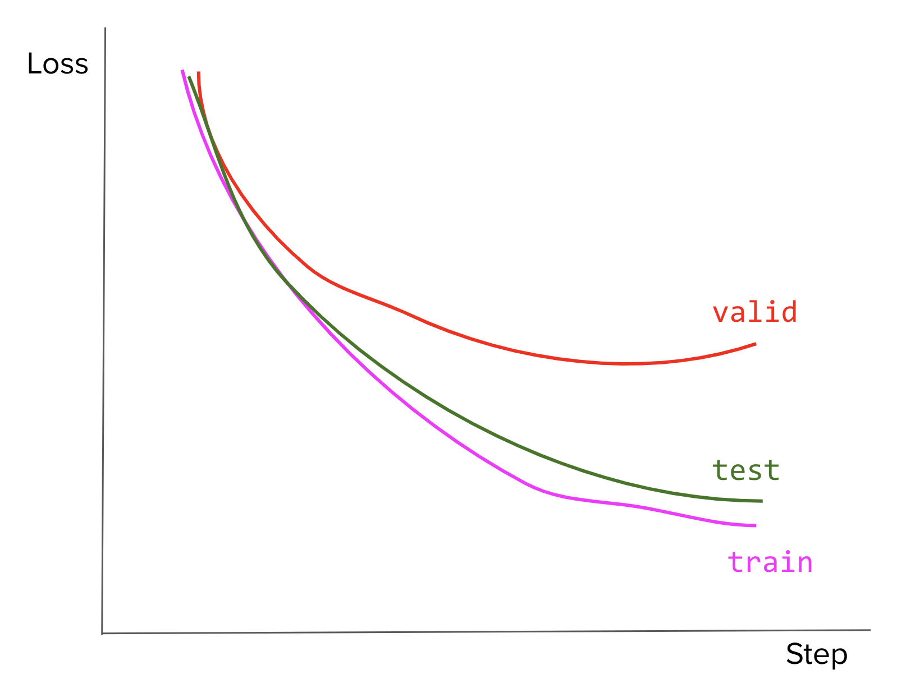
  </center>

1. [E] Your team is building a system to aid doctors in predicting whether a patient has cancer or not from their X-ray scan. Your colleague announces that the problem is solved now that they’ve built a system that can predict with 99.99% accuracy. How would you respond to that claim?
1. F1 score.
    1. [E] What’s the benefit of F1 over the accuracy?
    1. [M] Can we still use F1 for a problem with more than two classes. How?
1. Given a binary classifier that outputs the following confusion matrix.
  <table>
    <tr>
     <td>
     </td>
     <td>
  Predicted True
     </td>
     <td>Predicted False
     </td>
    </tr>
    <tr>
     <td>Actual True
     </td>
     <td>30
     </td>
     <td>20
     </td>
    </tr>
    <tr>
     <td>Actual False
     </td>
     <td>5
     </td>
     <td>40
     </td>
    </tr>
  </table>

  1. [E] Calculate the model’s precision, recall, and F1.
  1. [M] What can we do to improve the model’s performance?
1. Consider a classification where 99% of data belongs to class A and 1% of data belongs to class B.
    1. [M] If your model predicts A 100% of the time, what would the F1 score be? **Hint**: The F1 score when A is mapped to 0 and B to 1 is different from the F1 score when A is mapped to 1 and B to 0.
    1. [M] If we have a model that predicts A and B at a random (uniformly), what would the expected F1 be?
1. [M] For logistic regression, why is log loss recommended over MSE (mean squared error)?
1. [M] When should we use RMSE (Root Mean Squared Error) over MAE (Mean Absolute Error) and vice versa?
1. [M] Show that the negative log-likelihood and cross-entropy are the same for binary classification tasks.
1. [M] For classification tasks with more than two labels (e.g. MNIST with 10 labels), why is cross-entropy a better loss function than MSE?
1. [E] Consider a language with an alphabet of 27 characters. What would be the maximal entropy of this language?
1. [E] A lot of machine learning models aim to approximate probability distributions. Let’s say P is the distribution of the data and Q is the distribution learned by our model. How do measure how close Q is to P?
1. MPE (Most Probable Explanation) vs. MAP (Maximum A Posteriori)
    1. [E] How do MPE and MAP differ?
    1. [H] Give an example of when they would produce different results.
1. [E] Suppose you want to build a model to predict the price of a stock in the next 8 hours and that the predicted price should never be off more than 10% from the actual price. Which metric would you use?

    **Hint**: check out MAPE.

---
> In case you need a refresh on information entropy, here's an explanation without any math.

> Your parents are finally letting you adopt a pet! They spend the entire weekend taking you to various pet shelters to find a pet.

> The first shelter has only dogs. Your mom covers your eyes when your dad picks out an animal for you. You don't need to open your eyes to know that this animal is a dog. It isn't hard to guess.

> The second shelter has both dogs and cats. Again your mom covers your eyes and your dad picks out an animal. This time, you have to think harder to guess which animal is that. You make a guess that it's a dog, and your dad says no. So you guess it's a cat and you're right. It takes you two guesses to know for sure what animal it is.

> The next shelter is the biggest one of them all. They have so many different kinds of animals: dogs, cats, hamsters, fish, parrots, cute little pigs, bunnies, ferrets, hedgehogs, chickens, even the exotic bearded dragons! There must be close to a hundred different types of pets. Now it's really hard for you to guess which one your dad brings you. It takes you a dozen guesses to guess the right animal.

> Entropy is a measure of the "spread out" in diversity. The more spread out the diversity, the harder it is to guess an item correctly. The first shelter has very low entropy. The second shelter has a little bit higher entropy. The third shelter has the highest entropy.

### 8.1 Classical machine learning

#### 8.1.2 Questions

1. [E] What are the basic assumptions to be made for linear regression?
2. [E] What happens if we don’t apply feature scaling to logistic regression?
3. [E] What are the algorithms you’d use when developing the prototype of a fraud detection model?
4. Feature selection.
    1. [E] Why do we use feature selection?
    2. [M] What are some of the algorithms for feature selection? Pros and cons of each.
5. k-means clustering.
    1. [E] How would you choose the value of k?
    1. [E] If the labels are known, how would you evaluate the performance of your k-means clustering algorithm?
    1. [M] How would you do it if the labels aren’t known?
    1. [H] Given the following dataset, can you predict how K-means clustering works on it? Explain.

    <center>
      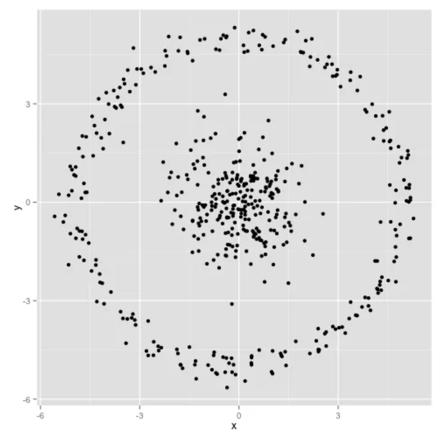
    </center>
6. k-nearest neighbor classification.
    1. [E] How would you choose the value of k?
    1. [E] What happens when you increase or decrease the value of k?
    1. [M] How does the value of k impact the bias and variance?
7. k-means and GMM are both powerful clustering algorithms.
    1. [M] Compare the two.
    1. [M] When would you choose one over another?
    
    **Hint**: Here’s an example of how K-means and GMM algorithms perform on the artificial mouse dataset.

    <center>
      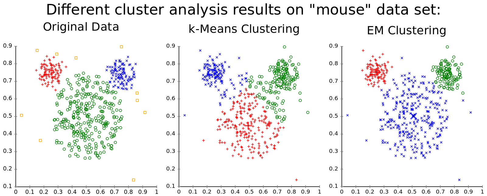<br>
      Image from <a href="https://www.mghassany.com/MLcourse/gaussian-mixture-models-em.html">Mohamad Ghassany’s course on Machine Learning</a>
    </center>
8. Bagging and boosting are two popular ensembling methods. Random forest is a bagging example while XGBoost is a boosting example.
    1. [M] What are some of the fundamental differences between bagging and boosting algorithms?
    1. [M] How are they used in deep learning?
9. Given this directed graph.
    <center>
      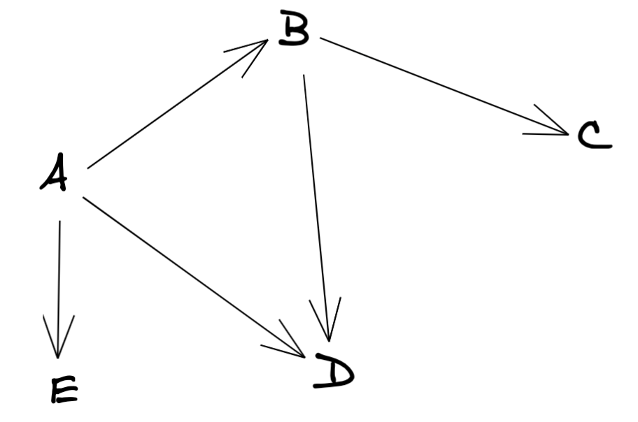<br>
    </center>
    1. [E] Construct its adjacency matrix.
    1. [E] How would this matrix change if the graph is now undirected?
    1. [M] What can you say about the adjacency matrices of two isomorphic graphs?
10. Imagine we build a user-item collaborative filtering system to recommend to each user items similar to the items they’ve bought before.
    1. [M] You can build either a user-item matrix or an item-item matrix. What are the pros and cons of each approach?
    1. [E] How would you handle a new user who hasn’t made any purchases in the past?
11. [E] Is feature scaling necessary for kernel methods?
12. Naive Bayes classifier.
    19. [E] How is Naive Bayes classifier naive?
    20. [M] Let’s try to construct a Naive Bayes classifier to classify whether a tweet has a positive or negative sentiment. We have four training samples:

      <table>
        <tr>
         <td>
      <strong>Tweet</strong>
         </td>
         <td><strong>Label</strong>
         </td>
        </tr>
        <tr>
         <td>This makes me so upset
         </td>
         <td>Negative
         </td>
        </tr>
        <tr>
         <td>This puppy makes me happy
         </td>
         <td>Positive
         </td>
        </tr>
        <tr>
         <td>Look at this happy hamster
         </td>
         <td>Positive
         </td>
        </tr>
        <tr>
         <td>No hamsters allowed in my house
         </td>
         <td>Negative
         </td>
        </tr>
      </table>

    According to your classifier, what's sentiment of the sentence `The hamster is upset with the puppy`?

13. Two popular algorithms for winning Kaggle solutions are Light GBM and XGBoost. They are both gradient boosting algorithms.
    1. [E] What is gradient boosting?
    1. [M] What problems is gradient boosting good for?
14. SVM.
    1. [E] What’s linear separation? Why is it desirable when we use SVM?
    1. [M] How well would vanilla SVM work on this dataset?

      <center>
        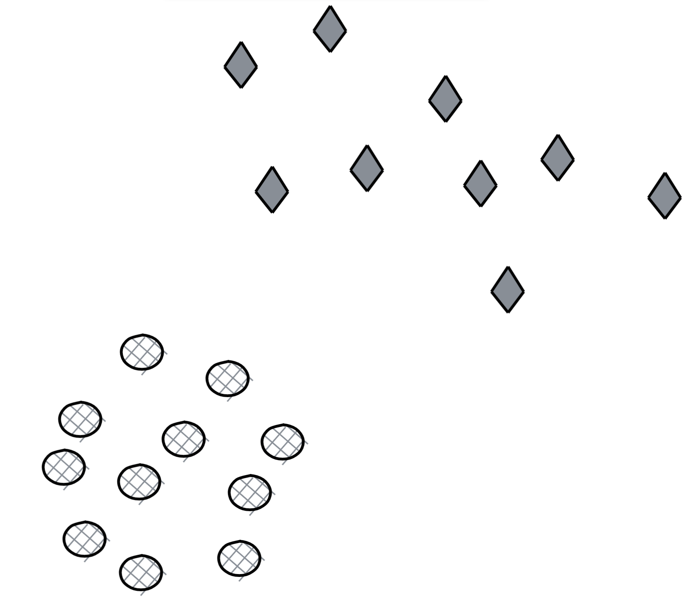<br>
      </center>

    1. [M] How well would vanilla SVM work on this dataset?

      <center>
        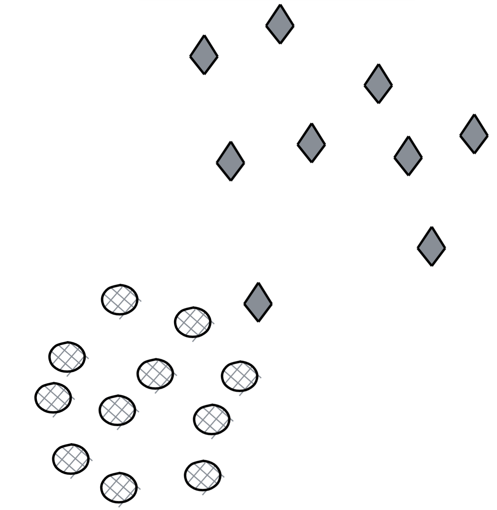<br>
      </center>

    1. [M] How well would vanilla SVM work on this dataset?
      <center>
        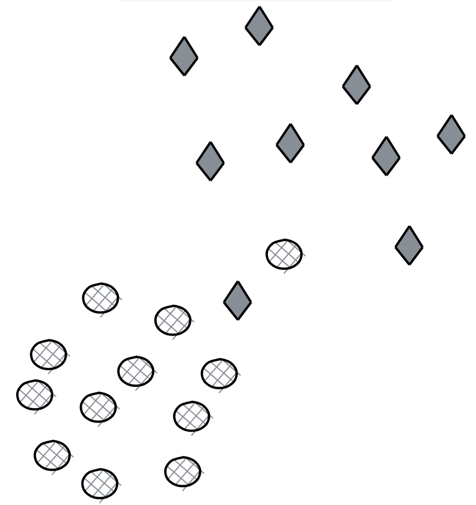<br>
      </center>

*This book was created by [Chip Huyen](https://huyenchip.com) with the help of wonderful friends. For feedback, errata, and suggestions, the author can be reached [here](https://huyenchip.com/communication/). Copyright ©2021 Chip Huyen.*

### 8.2 Deep learning architectures and applications

There are three main subfields in machine learning: speech and natural language processing (NLP), computer vision, and reinforcement learning. NLP has been successfully applied in business intelligence, voice assistant, machine translation, autocompletion and autocorrection, automated customer services, etc.

Computer vision is the core technology in self-driving cars, security (surveillance cameras, facial recognition), photo/video generation (which are terrifyingly good), and other entertainment services such as photo editing, photo filters, face swap.

Reinforcement learning is harder to deploy as the real-world environment is so much more complex than simulation, but we’ve seen the use of RL in ads bidding optimization, unmanned aerial vehicles (such as drones), and various robotic applications such as warehouse and production robots. 

A company or a team might focus on a subfield. For example, the Siri team at Apple might focus on speech and natural language understanding, and the Autopilot team at Tesla might be more interested in computer vision. However, techniques in one subfield can be used for another, and there are tasks that have components from different subfields. There’s undoubtedly value in being a world-class expert in your niche subfield, but to get there, you might need to have knowledge of other subfields.

#### 8.2.1 Natural language processing

1. RNNs
    1. [E] What’s the motivation for RNN?
    1. [E] What’s the motivation for LSTM?
    1. [M] How would you do dropouts in an RNN?
2. [E] What’s density estimation? Why do we say a language model is a density estimator?
3. [M] Language models are often referred to as unsupervised learning, but some say its mechanism isn’t that different from supervised learning. What are your thoughts?
4. Word embeddings.
    1. [M] Why do we need word embeddings?
    1. [M] What’s the difference between count-based and prediction-based word embeddings?
    1. [H] Most word embedding algorithms are based on the assumption that words that appear in similar contexts have similar meanings. What are some of the problems with context-based word embeddings?
5. Given 5 documents:
		D1: The duck loves to eat the worm
		D2: The worm doesn’t like the early bird
		D3: The bird loves to get up early to get the worm
		D4: The bird gets the worm from the early duck
		D5: The duck and the birds are so different from each other but one thing they have in common is that they both get the worm
    1. [M] Given a query Q: “The early bird gets the worm”, find the two top-ranked documents according to the TF/IDF rank using the cosine similarity measure and the term set {bird, duck, worm, early, get, love}.  Are the top-ranked documents relevant to the query?
    1. [M] Assume that document D5 goes on to tell more about the duck and the bird and mentions “bird” three times, instead of just once. What happens to the rank of D5? Is this change in the ranking of D5 a desirable property of TF/IDF? Why?
6. [E] Your client wants you to train a language model on their dataset but their dataset is very small with only about 10,000 tokens. Would you use an n-gram or a neural language model?
7. [E] For n-gram language models, does increasing the context length (n) improve the model’s performance? Why or why not?
8. [M] What problems might we encounter when using softmax as the last layer for word-level language models? How do we fix it?
9. [E] What's the Levenshtein distance of the two words “doctor” and “bottle”?
10. [M] BLEU is a popular metric for machine translation. What are the pros and cons of BLEU?
11. [H] On the same test set, LM model A has a character-level entropy of 2 while LM model A has a word-level entropy of 6. Which model would you choose to deploy?
12. [M] Imagine you have to train a NER model on the text corpus A. Would you make A case-sensitive or case-insensitive?
13. [M] Why does removing stop words sometimes hurt a sentiment analysis model?
14. [M] Many models use relative position embedding instead of absolute position embedding. Why is that?
15. [H] Some NLP models use the same weights for both the embedding layer and the layer just before softmax. What’s the purpose of this?

#### 8.2.2 Computer vision

1. [M] For neural networks that work with images like VGG-19, InceptionNet, you often see a visualization of what type of features each filter captures. How are these visualizations created?

    **Hint**: check out this Distill post on [Feature Visualization](https://distill.pub/2017/feature-visualization/).
1. Filter size.
    1. [M] How are your model’s accuracy and computational efficiency affected when you decrease or increase its filter size?
    1. [E] How do you choose the ideal filter size?
1. [M] Convolutional layers are also known as “locally connected.” Explain what it means.
1. [M] When we use CNNs for text data, what would the number of channels be for the first conv layer?
1. [E] What is the role of zero padding?
1. [E] Why do we need upsampling? How to do it?
1. [M] What does a 1x1 convolutional layer do?
1. Pooling.
    1. [E] What happens when you use max-pooling instead of average pooling?
    1. [E] When should we use one instead of the other?
    1. [E] What happens when pooling is removed completely?
    1. [M] What happens if we replace a 2 x 2 max pool layer with a conv layer of stride 2?
1. [M] When we replace a normal convolutional layer with a depthwise separable convolutional layer, the number of parameters can go down. How does this happen? Give an example to illustrate this.
1. [M] Can you use a base model trained on ImageNet (image size 256 x 256) for an object classification task on images of size 320 x 360? How?
1. [H] How can a fully-connected layer be converted to a convolutional layer?
1. [H] Pros and cons of FFT-based convolution and Winograd-based convolution.

    **Hint**: [Read Fast Algorithms for Convolutional Neural Networks](https://arxiv.org/pdf/1509.09308.pdf) (Andrew Lavin and Scott Gray, 2015)

#### 8.2.3 Reinforcement learning

> 🌳 **Tip** 🌳<br>
To refresh your knowledge on deep RL, checkout [Spinning Up in Deep RL](https://spinningup.openai.com/en/latest/) (OpenAI)


28. [E] Explain the explore vs exploit tradeoff with examples.
29. [E] How would a finite or infinite horizon affect our algorithms?
30. [E] Why do we need the discount term for objective functions?
31. [E] Fill in the empty circles using the minimax algorithm.

	<center>
		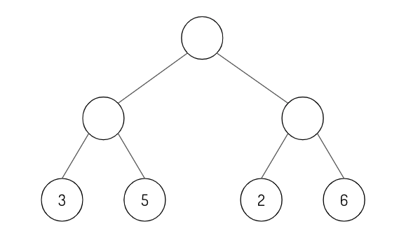
	</center>

32. [M] Fill in the alpha and beta values as you traverse the minimax tree from left to right.

    <center>
		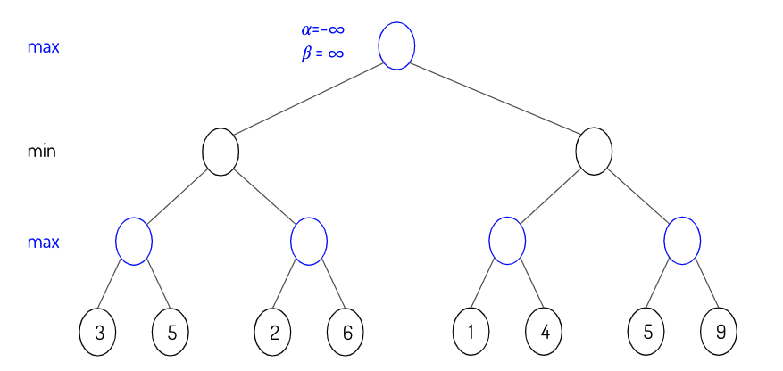
	</center>

33. [E] Given a policy, derive the reward function.
34. [M] Pros and cons of on-policy vs. off-policy.
35. [M] What’s the difference between model-based and model-free? Which one is more data-efficient?

#### 8.2.4 Other

36. [M] An autoencoder is a neural network that learns to copy its input to its output. When would this be useful?
37. Self-attention.
    15. [E] What’s the motivation for self-attention?
    16. [E] Why would you choose a self-attention architecture over RNNs or CNNs?
    17. [M] Why would you need multi-headed attention instead of just one head for attention?
    18. [M] How would changing the number of heads in multi-headed attention affect the model’s performance?
38. Transfer learning
    19. [E] You want to build a classifier to predict sentiment in tweets but you have very little labeled data (say 1000). What do you do?
    20. [M] What’s gradual unfreezing? How might it help with transfer learning?
39. Bayesian methods.
    21. [M] How do Bayesian methods differ from the mainstream deep learning approach?
    22. [M] How are the pros and cons of Bayesian neural networks compared to the mainstream neural networks?
    23. [M] Why do we say that Bayesian neural networks are natural ensembles?
40. GANs.
    24. [E] What do GANs converge to?
    25. [M] Why are GANs so hard to train?

### 8.3 Training neural networks

> 🌳 **Tip** 🌳<br>
For more tips on training neural networks, check out:
- [A Recipe for Training Neural Networks](http://karpathy.github.io/2019/04/25/recipe/) (Karpathy 2019)
- [NLP's Clever Hans Moment has Arrived](https://thegradient.pub/nlps-clever-hans-moment-has-arrived/) (Heinzerling 2019): an excellent writeup on trying to understand what exactly your neural network learns, and techniques to ensure that your model works correctly with textual data.
- [An overview of gradient descent optimization algorithms](http://ruder.io/optimizing-gradient-descent/index.html) (Ruder 2016)

41. [E] When building a neural network, should you overfit or underfit it first?
42. [E] Write the vanilla gradient update.
43. Neural network in simple Numpy.
    26. [E] Write in plain NumPy the forward and backward pass for a two-layer feed-forward neural network with a ReLU layer in between.
    27. [M] Implement vanilla dropout for the forward and backward pass in NumPy.
44. Activation functions.
    28. [E] Draw the graphs for sigmoid, tanh, ReLU, and leaky ReLU.
    29. [E] Pros and cons of each activation function.
    30. [E] Is ReLU differentiable? What to do when it’s not differentiable?
    31. [M] Derive derivatives for sigmoid function $\sigma(x)$ when $x$ is a vector.
45. [E] What’s the motivation for skip connection in neural works?
46. Vanishing and exploding gradients.
    32. [E] How do we know that gradients are exploding? How do we prevent it?
    33. [E] Why are RNNs especially susceptible to vanishing and exploding gradients?
47. [M] Weight normalization separates a weight vector’s norm from its gradient. How would it help with training?
48. [M] When training a large neural network, say a language model with a billion parameters, you evaluate your model on a validation set at the end of every epoch. You realize that your validation loss is often lower than your train loss. What might be happening?
49. [E] What criteria would you use for early stopping?
50. [E] Gradient descent vs SGD vs mini-batch SGD.
51. [H] It’s a common practice to train deep learning models using epochs: we sample batches from data **without** replacement. Why would we use epochs instead of just sampling data **with** replacement?
52. [M] Your model’ weights fluctuate a lot during training. How does that affect your model’s performance? What to do about it?
53. Learning rate.
    34. [E] Draw a graph number of training epochs vs training error for when the learning rate is:
        1. too high
        2. too low
        3. acceptable.
    35. [E] What’s learning rate warmup? Why do we need it?
54. [E] Compare batch norm and layer norm.
55. [M] Why is squared L2 norm sometimes preferred to L2 norm for regularizing neural networks?
56. [E] Some models use weight decay: after each gradient update, the weights are multiplied by a factor slightly less than 1. What is this useful for?
57. It’s a common practice for the learning rate to be reduced throughout the training.
    36. [E] What’s the motivation?
    37. [M] What might be the exceptions?
58. Batch size.
    38. [E] What happens to your model training when you decrease the batch size to 1?
    39. [E] What happens when you use the entire training data in a batch?
    40. [M] How should we adjust the learning rate as we increase or decrease the batch size?
59. [M] Why is Adagrad sometimes favored in problems with sparse gradients?
60. Adam vs. SGD.
    41. [M] What can you say about the ability to converge and generalize of Adam vs. SGD?
    42. [M] What else can you say about the difference between these two optimizers? 
61. [M] With model parallelism, you might update your model weights using the gradients from each machine asynchronously or synchronously. What are the pros and cons of asynchronous SGD vs. synchronous SGD?
62. [M] Why shouldn’t we have two consecutive linear layers in a neural network?
63. [M] Can a neural network with only RELU (non-linearity) act as a linear classifier?
64. [M] Design the smallest neural network that can function as an XOR gate.
65. [E] Why don’t we just initialize all weights in a neural network to zero?
66. Stochasticity.
    43. [M] What are some sources of randomness in a neural network?
    44. [M] Sometimes stochasticity is desirable when training neural networks. Why is that?
67. Dead neuron.
    45. [E] What’s a dead neuron?
    46. [E] How do we detect them in our neural network?
    47. [M] How to prevent them?
68. Pruning.
    48. [M] Pruning is a popular technique where certain weights of a neural network are set to 0. Why is it desirable?
    49. [M] How do you choose what to prune from a neural network?
69. [H] Under what conditions would it be possible to recover training data from the weight checkpoints?
70. [H] Why do we try to reduce the size of a big trained model through techniques such as knowledge distillation instead of just training a small model from the beginning?

---
*This book was created by [Chip Huyen](https://huyenchip.com) with the help of wonderful friends. For feedback, errata, and suggestions, the author can be reached [here](https://huyenchip.com/communication/). Copyright ©2021 Chip Huyen.*
