# GeeksforGeeks: C++ interview questions

> Copied from <https://www.geeksforgeeks.org/cpp/cpp-interview-questions/>. Questions and answers are the source's own; nothing was answered or rewritten here. Each answer is written right under its question, as on the site.

C++ is a widely used programming language known for its performance, flexibility, and object-oriented features. It remains highly relevant and is used by top tech companies for system-level and high-performance applications. This article presents the top 50+ C++ interview questions to help you prepare effectively.

- Covers beginner, intermediate, and advanced-level questions
- Helps you build confidence for technical interviews
- Designed for quick revision and placement preparation

## C++ Interview Questions for Freshers

### 1. What is C++?

C++ is a general-purpose, object-oriented programming language developed by Bjarne Stroustrup. It is an extension of C that supports both procedural and object-oriented programming, making it suitable for system-level as well as application-level development.

Advantages of C++

- **High Performance:** C++ is close to the hardware, making it fast and efficient for system-level and performance-critical applications.
- **Object-Oriented:** Supports core OOP concepts such as encapsulation, inheritance, and polymorphism, enabling modular and reusable code.
- **Portability**: Programs can run on multiple platforms with minimal code changes.
- **Memory Control:** Provides direct memory management through pointers, allowing fine-grained control over system resources.
- **Rich Standard Library (STL):** Includes a powerful Standard Template Library with efficient data structures, algorithms, and utility classes for faster development.

### 2. What are the different data types present in C++?

[Data types](https://www.geeksforgeeks.org/cpp/cpp-data-types/) define the kind of data a variable can store.

- In C++, when a variable is declared, the compiler allocates memory for it based on its data type.
- Each data type may require a different amount of memory.

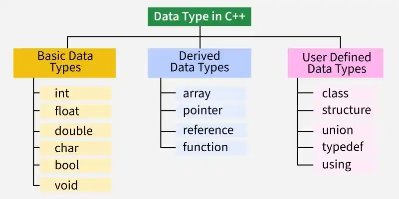

Data Types

### **3. Define token in C++**

A [token](https://www.geeksforgeeks.org/c/tokens-in-c/) is the smallest meaningful unit of a C++ program that the compiler recognizes during compilation. Every C++ program is made up of different types of tokens.

- **Keywords -** Reserved words with predefined meanings, such as int, if, and return.
- **Identifiers -** User-defined names used for variables, functions, classes, etc.
- **Constants -** Fixed values that do not change during program execution.
- **String Literals -** Sequences of characters enclosed in double quotes.
- **Operators -** Symbols that perform operations on operands, such as +, -, \*, and =.
- **Special Symbols -** Characters with specific meanings, such as (), {}, [], ;, and #.

### 4. Define 'std'?

std is the standard namespace in C++ that contains identifiers provided by the C++ Standard Library, such as cout, cin, string, and vector. It helps organize library components and prevents naming conflicts.

- std stands for the Standard Namespace.
- It contains standard library classes, functions, and objects.
- The scope resolution operator (::) is used to access its members (for example, std::cout).
- using namespace std; allows these members to be used without writing the std:: prefix repeatedly.

**Syntax:**

> int GFG = 10;  
> // reference variable  
> int& ref = GFG;

### 5.  What is a namespace in C++?

A [namespace](https://www.geeksforgeeks.org/cpp/namespace-in-c/) is a declarative region that groups related identifiers such as variables, functions, classes, and objects under a unique name. It helps organize code and prevents naming conflicts in large programs.

- Groups related identifiers into a named scope.
- Prevents name collisions between different libraries or modules.
- Improves code organization and readability.
- Accessed using the scope resolution operator (::).

### **6. What is the difference between C and C++?**

[C and C++](https://www.geeksforgeeks.org/cpp/difference-between-c-and-c/) are closely related programming languages, but C++ extends C by adding object-oriented programming features and several advanced capabilities.

| C | C++ |
| --- | --- |
| C is a procedural programming language. | C++ supports both procedural and object-oriented programming. |
| Does not support classes and objects. | Supports classes and objects. |
| Does not support OOP concepts such as encapsulation, inheritance, polymorphism, and abstraction. | Supports all major OOP concepts. |
| Does not support function and operator overloading. | Supports function and operator overloading. |

### 7. What is the function of the keyword "Auto"?

The [auto keyword](https://www.geeksforgeeks.org/cpp/type-inference-in-c-auto-and-decltype/) allows the compiler to automatically deduce the data type of a variable from its initializer.

- Eliminates the need to explicitly specify the variable's type.
- Simplifies declarations involving complex types, templates, and iterators.
- Improves code readability and reduces verbosity.

C++

```` ```
#include <iostream>
#include <vector>
using namespace std;

int main() {
    vector<int> v = {1, 2, 3};

    auto it = v.begin();

    cout << *it;

    return 0;
}
``` ````

**Output**

```
1
```

### 8. What is the mutable storage class specifier? How is it used?

The [mutable specifier](https://www.geeksforgeeks.org/cpp/c-mutable-keyword/) allows a non-static data member of a class to be modified even if it belongs to an object declared as const. It is commonly used for members that do not affect the logical state of an object, such as caches or counters.

- Allows a data member to be modified inside const member functions.
- Can only be applied to non-static, non-reference data members.
- Commonly used for caching, memoization, and debugging counters.

### 9. When is the void return type used?

The [void return t](https://www.geeksforgeeks.org/cpp/return-from-void-functions-in-cpp/)ype is used when a function performs a task but does not return a value to the caller.

- Indicates that the function does not return any value.
- Commonly used for functions that perform actions such as printing or updating data.
- A return; statement can be used to exit the function early, but it cannot return a value.

C++

```` ```
#include <iostream>
using namespace std;

void greet() {
    cout << "Hello, World!";
}

int main() {
    greet();
    return 0;
}
``` ````

**Output**

```
Hello, World!
```

### 10. What are classes and objects in C++?

A [class](https://www.geeksforgeeks.org/cpp/c-classes-and-objects/) is a user-defined data type that defines the properties (data members) and behaviors (member functions) of an object. An [object](https://www.geeksforgeeks.org/cpp/c-classes-and-objects/) is an instance of a class used to access its data members and member functions.

- **Class:** Acts as a blueprint for creating objects.
- **Object:** Represents an instance of a class with its own state and behavior.

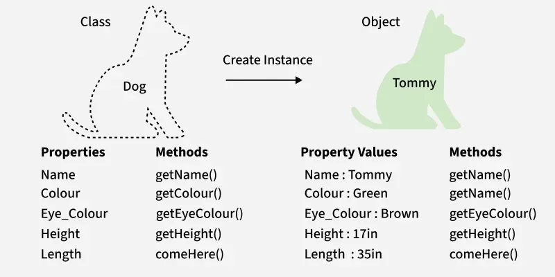

**Example:** The following program creates a Student class and an object to access its members.

C++

```` ```
#include <iostream>
using namespace std;

class Student {
public:
    string name;

    void display_name() {
        cout << "Name: " << name << endl;
    }
};

int main() {

    // Creating an object of Student
    Student s;

    s.name = "Rahul";
    s.display_name();

    return 0;
}
``` ````

**Output**

```
Name: Rahul
```

**Explanation**

- Student is a class that defines a data member (name) and a member function (display\_name()).
- s is an object of the Student class.
- The object accesses the class members using the dot (.) operator.

### 11. What is a block scope variable?

A [block scope variable](https://www.geeksforgeeks.org/cpp/scope-of-variables-in-c/) (also called a local variable) is a variable declared inside a block, such as a function, loop, or conditional statement. It is accessible only within the block in which it is declared.

- Declared inside a function or a code block ({}).
- Accessible only within its enclosing block.
- Created when the block is entered and destroyed when the block exits.

C++

```` ```
#include <iostream>
using namespace std;

int main() {
    if (true) {
        int x = 10;
        cout << x << endl;
    }

    // cout << x;   // Error: x is out of scope

    return 0;
}
``` ````

**Output**

```
10
```

### 12. What is the Difference Between a struct and a class in C++?

In C++, both [struct and class](https://www.geeksforgeeks.org/cpp/structure-vs-class-in-cpp/) can contain data members, member functions, constructors, destructors, and support inheritance. The primary difference between them lies in their default access specifiers and inheritance behavior.

| struct | class |
| --- | --- |
| Members are `public` by default. | Members are `private` by default. |
| Inheritance is `public` by default. | Inheritance is `private` by default. |
| Commonly used for simple data grouping and structures. | Commonly used for implementing encapsulation and object-oriented designs. |
| Can contain data members, member functions, constructors, and destructors. | Can contain data members, member functions, constructors, and destructors. |
| Objects can be created on the stack or heap. | Objects can be created on the stack or heap. |

### **13. What are the various OOPs concepts in C++?**

The main [Object-Oriented Programming](https://www.geeksforgeeks.org/cpp/object-oriented-programming-in-cpp/) (OOP) concepts in C++ are:

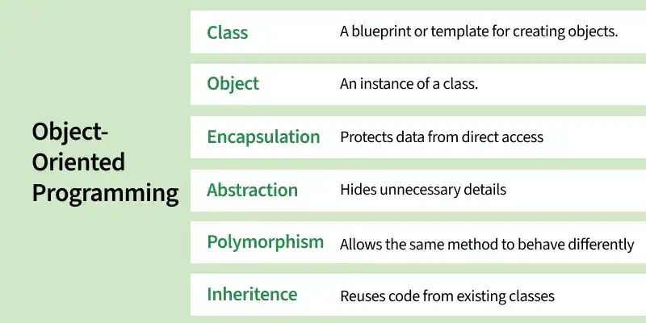

- **Class:** A user-defined data type that acts as a blueprint for creating objects.
- **Object:** An instance of a class used to access its data members and member functions.
- **Encapsulation:** Bundling data and the functions that operate on it into a single unit.
- **Abstraction:** Hiding implementation details and exposing only the essential features.
- **Inheritance:** Allows a class to acquire the properties and behaviors of another class.
- **Polymorphism:** Enables the same interface or function to exhibit different behaviors depending on the object.

### 14. What is the Difference Between an Array and a Linked List?

[Arrays and linked lists](https://www.geeksforgeeks.org/dsa/linked-list-vs-array/) are both data structures used to store collections of elements, but they differ in memory allocation, size management, and access methods.

| Array | Linked List |
| --- | --- |
| Stores elements in contiguous memory locations. | Stores elements in non-contiguous memory locations connected using pointers. |
| Has a fixed size once created. | Can grow or shrink dynamically during runtime. |
| Supports direct access to elements using indices. | Elements must be accessed sequentially by traversing the list. |
| Insertion and deletion operations can be costly due to element shifting. | Insertion and deletion are generally more efficient as no shifting is required. |
| Uses less memory because only data is stored. | Uses more memory because each node stores both data and pointer(s). |
| Provides faster element access. | Provides greater flexibility in memory management. |

### 15. What is a Storage Class in C++? Name Some Common Storage Classes.

A [Storage class](https://www.geeksforgeeks.org/cpp/storage-classes-in-c-with-examples/) specifies the scope, lifetime, and linkage of variables and functions in a C++ program.

- It determines where a variable can be accessed and how long it remains in memory.
- Common storage classes in C++ are auto, register (deprecated), static, extern, and mutable.

**Syntax:**

> storage\_class var\_data\_type var\_name;

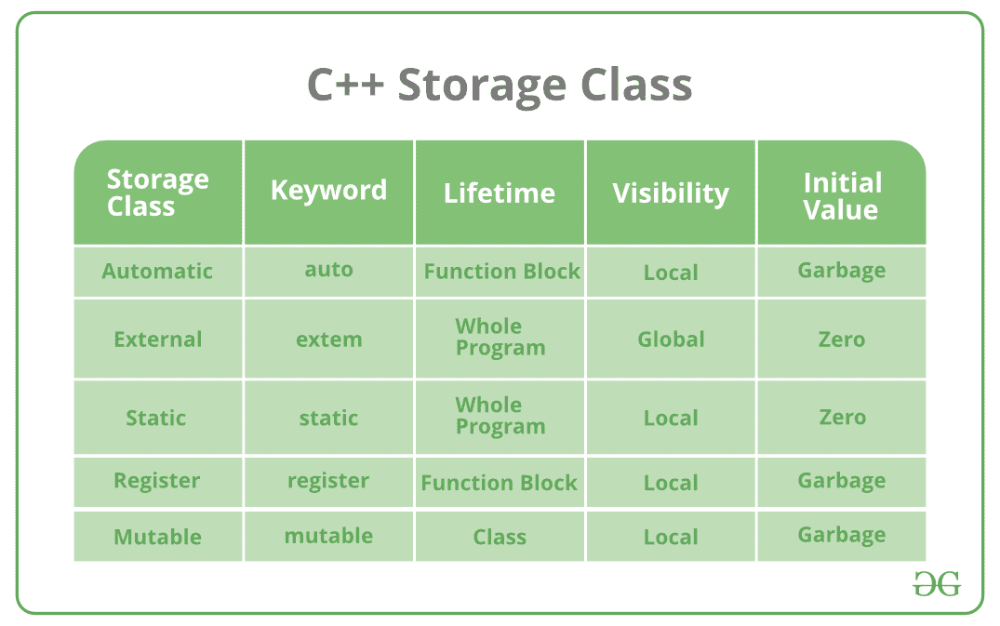

Define storage

### 16. Differentiate between virtual functions and pure virtual functions?

The following table highlights the major [difference between virtual functions and pure virtual functions](https://www.geeksforgeeks.org/cpp/difference-between-virtual-function-and-pure-virtual-function-in-c/)

| **Virtual Function** | **Pure Virtual Function** |
| --- | --- |
| A virtual function has a definition in the base class and can be overridden in derived classes. | A pure virtual function is declared using `= 0` and is intended to be overridden by derived classes. |
| Declared using the `virtual` keyword. | Declared using the `virtual` keyword followed by `= 0`. |
| The base class can be instantiated (provided it has no pure virtual functions). | A class containing at least one pure virtual function becomes an abstract class and cannot be instantiated. |
| Overriding the function in the derived class is optional. | Overriding the function in a derived class is mandatory (unless the derived class is also abstract). |
| Used to provide a default implementation that derived classes may customize. | Used to define an interface that derived classes must implement. |

### **17. What is Function Overriding in C++?**

[Function Overriding](https://www.geeksforgeeks.org/cpp/function-overloading-vs-function-overriding-in-cpp/) occurs when a derived class provides its own implementation of a virtual function defined in the base class using the same function name, parameter list, and return type. It is an example of runtime polymorphism.

- The function in the derived class must have the same signature as the base class function.
- The function to be overridden should be declared virtual in the base class.

**Example:** The following program demonstrates function overriding.

C++

```` ```
#include <iostream>
using namespace std;

class Base {
public:
    virtual void display() {
        cout << "Base Class" << endl;
    }
};

class Derived : public Base {
public:
    void display() override {
        cout << "Derived Class" << endl;
    }
};

int main() {
    Base* ptr = new Derived();
    ptr->display();

    delete ptr;
    return 0;
}
``` ````

**Output**

```
Derived Class
```

**Explanation**

- `display()` is declared as a virtual function in the base class and overridden in the derived class.
- Since the function is called through a base class pointer, the derived class version is executed at runtime.

### 18. What is inheritance in C++?

[Inheritance](https://www.geeksforgeeks.org/cpp/inheritance-in-c/) is an OOP feature that allows a derived class to acquire the data members and member functions of an existing base class. It promotes code reusability and establishes an "is-a" relationship between classes.

- Enables code reuse by inheriting existing class members.
- Supports hierarchical relationships and extensibility in programs.

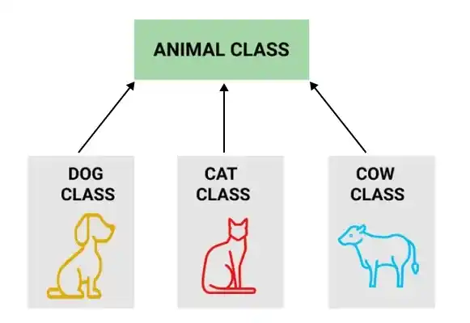

Different classes inheriting from Animal Class

### 19. What is encapsulation in C++?

[Encapsulation](https://www.geeksforgeeks.org/cpp/encapsulation-in-cpp/) is the OOP concept of combining data members and member functions into a single unit (class) while restricting direct access to the data. It is achieved using access specifiers such as private, protected, and public.

- Protects data by restricting direct access to it.
- Allows controlled access through public member functions (getters and setters).

> **Example:** A bank account hides its balance from direct access. Users cannot modify the balance directly; instead, they use public functions such as deposit(), withdraw(), and getBalance() to access or update it in a controlled manner.

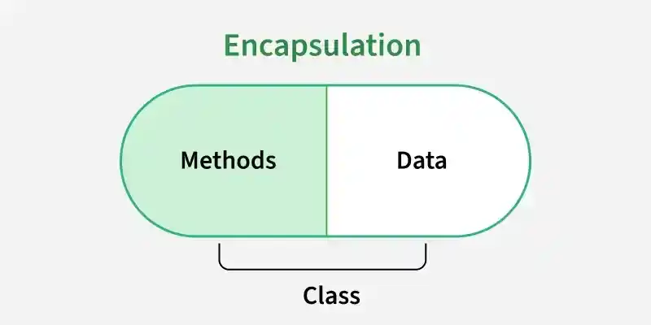

Encapsulation

### 20. What is polymorphism in C++?

[Polymorphism](https://www.geeksforgeeks.org/cpp/cpp-polymorphism/) is an OOP concept that allows the same interface (function or operator) to perform different actions depending on the object or context.

- **Compile-time polymorphism:** Achieved through function overloading and operator overloading.
- **Run-time polymorphism:** Achieved through function overriding using virtual functions.

> **Example:** A Shape class can have a draw() function. The Circle and Rectangle classes override draw() to display different outputs. When draw() is called through a base class pointer, the appropriate derived class implementation is executed at runtime.

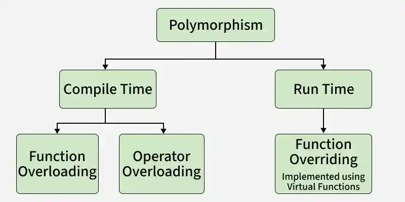

### 21. What are the different types of polymorphism in C++?

C++ supports two types of [polymorphism](https://www.geeksforgeeks.org/cpp/cpp-polymorphism/):

**1. Compile-Time Polymorphism (Static Polymorphism)**

Compile-time polymorphism is resolved by the compiler during compilation. The function or operator to execute is determined before the program runs, making it faster than runtime polymorphism. It is achieved using:

- **Function Overloading:** Multiple functions have the same name but different parameter lists.
- **Operator Overloading:** Operators are redefined to work with user-defined data types.

C++

```` ```
#include <iostream>
using namespace std;

// Function Overloading
class Calculator {
public:
    int add(int a, int b) {
        return a + b;
    }

    double add(double a, double b) {
        return a + b;
    }
};

// Operator Overloading
class Complex {
public:
    int real, imag;

    Complex(int r, int i) : real(r), imag(i) {}

    Complex operator+(const Complex& obj) {
        return Complex(real + obj.real, imag + obj.imag);
    }
};

int main() {

    Calculator c;
    cout << c.add(10, 20) << endl;
    cout << c.add(5.5, 2.5) << endl;

    Complex c1(2, 3), c2(4, 5);
    Complex c3 = c1 + c2;

    cout << c3.real << " + i" << c3.imag;

    return 0;
}
``` ````

**Output**

```
30
8
6 + i8
```

**Explanation:** The add() function demonstrates function overloading, while the + operator demonstrates operator overloading. Both are examples of compile-time polymorphism.

**2. Run-Time Polymorphism (Dynamic Polymorphism)**

Runtime polymorphism is resolved while the program is executing. The function to call is determined based on the actual object at runtime. It is achieved using:

- **Function Overriding:** Allows a derived class to redefine a virtual function of the base class using the same function signature.

C++

```` ```
#include <iostream>
using namespace std;

class Animal {
public:
    virtual void sound() {
        cout << "Animal makes a sound\n";
    }
};

class Dog : public Animal {
public:
    void sound() override {
        cout << "Dog barks\n";
    }
};

int main() {

    Animal* ptr = new Dog();

    ptr->sound();

    delete ptr;

    return 0;
}
``` ````

**Output**

```
Dog barks
```

**Explanation:** The base class pointer points to a derived class object. Since sound() is a virtual function, the overridden function in Dog is called at runtime, demonstrating runtime polymorphism.

### 22. Explain the differences between Compile-Time Polymorphism and Run-Time Polymorphism.

Following are the major [differences between the runtime and compile time polymorphism:](https://www.geeksforgeeks.org/java/difference-between-compile-time-and-run-time-polymorphism-in-java/)

| Feature | Compile-Time Polymorphism | Run-Time Polymorphism |
| --- | --- | --- |
| Binding Time | Resolved during compilation | Resolved during program execution |
| Also Known As | Static Binding / Early Binding | Dynamic Binding / Late Binding |
| Performance | Faster because the function call is determined at compile time | Slightly slower due to runtime function resolution |
| Implementation | Function Overloading, Operator Overloading | Virtual Functions, Function Overriding |
| Inheritance Required | Not necessary | Required |
| Decision Making | Compiler decides which function to call | Actual object type decides which function to call |
| Flexibility | Less flexible | More flexible and dynamic |

### 23. What is an abstract class and when do you use it?

An [abstract class](https://www.geeksforgeeks.org/cpp/pure-virtual-functions-and-abstract-classes/) is a class that contains at least one pure virtual function. It cannot be instantiated directly and is intended to serve as a base class for other classes.

- Contains at least one pure virtual function and cannot be instantiated.
- Defines a common interface for derived classes.
- Supports runtime polymorphism.
- Used when derived classes provide different implementations of the same interface.

C++

```` ```
#include <iostream>
using namespace std;

class Shape {
public:
    virtual void draw() = 0;   // Pure virtual function
};

class Circle : public Shape {
public:
    void draw() override {
        cout << "Drawing Circle";
    }
};

int main() {
    Circle c;
    c.draw();
    return 0;
}
``` ````

**Output**

```
Drawing Circle
```

### 24. Explain the constructor in C++.

A [constructor](https://www.geeksforgeeks.org/cpp/constructors-c/) is a special type of member function of a class, whose name is the same as that of the class by whom it is invoked and initializes value to the object of a class There are 3 types of constructors:

**1. Default constructor:** It is the most basic type of constructor which accepts no arguments or parameters. Even if it is not called the compiler calls it automatically when an object is created.

C++

```` ```
class Demo {
public:
    Demo() {
        cout << "Default Constructor";
    }
};
``` ````

**2. Parameterized constructor:** It is a type of constructor which accepts arguments or parameters. It has to be called explicitly by passing values in the arguments as these arguments help initialize an object when it is created. It also has the same name as that of the class

C++

```` ```
class Demo {
public:
    Demo(int x) {
        cout << x;
    }
};
``` ````

**3. Copy Constructor:** A copy constructor is a member function that initializes an object using another object of the same class. Also, the Copy constructor takes a reference to an object of the same class as an argument.

C++

```` ```
class Demo {
public:
    Demo(const Demo& obj) {
        cout << "Copy Constructor";
    }
};
``` ````

### 25. What is a destructor in C++?

[Destructors](https://www.geeksforgeeks.org/cpp/destructors-c/)  is a special member function that is automatically called when an object is destroyed. It is mainly used to release resources acquired by the object.

- Automatically called when an object goes out of scope or is deleted.
- Used to perform cleanup tasks such as freeing memory or closing files.
- Has the same name as the class, prefixed with ~, and takes no parameters or return value.

**Syntax:**

> ~constructor\_name();

C++

```` ```
class Demo { 
public: 
    ~Demo() { 
        cout << "Destructor called"; 
        
    } 
    
};
``` ````

### 26. What is a virtual destructor in C++?

A [virtual destructor](https://www.geeksforgeeks.org/cpp/virtual-destructor/) is a destructor declared with the virtual keyword in a base class. It ensures that when an object of a derived class is deleted through a base class pointer, the destructors of both the derived and base classes are called in the correct order.

- Ensures that the derived class destructor is called before the base class destructor.
- Prevents resource leaks when deleting derived objects through base class pointers.
- A virtual destructor is recommended for classes used polymorphically.

> class Base {
>
> public:
>
> virtual ~Base() {}
>
> };

## C++ Interview Questions - Intermediate Level

### 27. What are references in C++?

A reference in C++ is an alias or alternate name for an existing variable. Once a reference is initialized, it refers to the same memory location as the original variable and cannot be changed to reference another variable.

- References are declared using the & symbol.
- They must be initialized at the time of declaration.
- A reference cannot be reassigned to refer to another variable.
- References are commonly used for passing arguments to functions efficiently without creating copies.

### 28. What is the Difference Between a Reference and Pointer in C++?

Both [references and pointers](https://www.geeksforgeeks.org/cpp/pointers-and-references-in-c/) are used to access existing variables indirectly. However, they differ in how they are declared, used, and managed.

| Reference | Pointer |
| --- | --- |
| Acts as an alias for an existing variable. | Stores the memory address of a variable. |
| Must be initialized when declared. | Can be declared without initialization. |
| Cannot be reassigned to refer to another variable. | Can be reassigned to point to different variables. |
| Cannot be null. | Can store a null value (`nullptr`). |
| Accesses members using the `.` operator. | Accesses members using the `->` operator. |
| Does not require dereferencing to access the value. | Requires the dereference operator (`*`) to access the value stored at the address. |

### 29. What are void pointers?

A [void pointer](https://www.geeksforgeeks.org/c/void-pointer-c-cpp/) (void\*) is a generic pointer that can store the address of any data type. Since it is not associated with a specific type, it must be cast to the appropriate pointer type before dereferencing.

- Can store the address of any data type.
- Does not know the type of the object it points to.
- Must be typecast before dereferencing.

C++

```` ```
#include <iostream>
using namespace std;

int main() {
    int x = 10;

    void* ptr = &x;

    cout << *(static_cast<int*>(ptr));

    return 0;
}
``` ````

**Output**

```
10
```

### 30. What do you mean by Call by Value and Call by Reference?

In C++, arguments can be passed to functions using [Call by Value and Call by Reference](https://www.geeksforgeeks.org/c/difference-between-call-by-value-and-call-by-reference/). The main difference is whether the function receives a copy of the data or a reference to the original variable.

| Call by Value | Call by Reference |
| --- | --- |
| A copy of the variable is passed to the function. | A reference to the original variable is passed. |
| Changes made inside the function do not affect the original variable. | Changes made inside the function affect the original variable. |
| Uses separate memory for the parameter copy. | Uses the same memory location as the original variable. |
| Suitable when the original value should remain unchanged. | Suitable when the function needs to modify the original value or avoid copying large objects. |

### 31. Which operations are allowed on pointers in C++?

[Pointers](https://www.geeksforgeeks.org/cpp/cpp-pointers/) support several operations that allow navigation and comparison of memory addresses.

- Increment and decrement (++, --) to move to the next or previous element.
- Addition and subtraction with integers to move by a specified number of elements.
- Subtraction of two pointers of the same type to find the distance between them.
- Comparison operations (==, !=, <, >, <=, >=) between compatible pointers.

C++

```` ```
#include <iostream>
using namespace std;

int main() {
    int arr[] = {10, 20, 30};

    int* p = arr;

    cout << *p << endl;   // 10

    p++;                  // Move to next element
    cout << *p << endl;   // 20

    p = p + 1;            // Move one more element
    cout << *p << endl;   // 30

    return 0;
}
``` ````

**Output**

```
10
20
30
```

### 32. How is new different from malloc() in C++?

Both [new](https://www.geeksforgeeks.org/cpp/new-and-delete-operators-in-cpp-for-dynamic-memory/) and [malloc()](https://www.geeksforgeeks.org/cpp/cpp-malloc/) are used for dynamic memory allocation, but they differ significantly in how they allocate and manage memory.

- new is a C++ operator, whereas malloc() is a C library function declared in <cstdlib>.
- new allocates memory and automatically calls the object's constructor. malloc() only allocates raw memory and does not invoke constructors.
- new returns a pointer of the appropriate type, while malloc() returns a void\* pointer that must be explicitly cast in C++.
- If allocation fails, new throws a std::bad\_alloc exception (unless std::nothrow is used), whereas malloc() returns nullptr.

### 33. What is the purpose of the `delete` operator in C++?

The [delete](https://www.geeksforgeeks.org/cpp/delete-in-c/) operator is used to deallocate memory that was dynamically allocated using the new operator. It helps free heap memory and prevents memory leaks.

- delete is used for a single object allocated with new.
- delete[] is used for arrays allocated with new[].

C++

```` ```
int* ptr = new int(10);
delete ptr;      // Deallocate single object

int* arr = new int[100];
delete[] arr;    // Deallocate array
``` ````
> **Note:** Memory allocated with new must be released using delete, and memory allocated with new[] must be released using delete[].

### 34. How is `delete[]` different from `delete` in C++?

| `delete[]` | [`delete`](https://www.geeksforgeeks.org/cpp/delete-in-c/) |
| --- | --- |
| Used to deallocate memory allocated with `new[]`. | Used to deallocate memory allocated with `new`. |
| Used for deleting an array of objects. | Used for deleting a single object. |
| Calls the destructor for each element of the array. | Calls the destructor only once for the single object. |
| Syntax: `delete[] ptr;` | Syntax: `delete ptr;` |

**Example:**

C++

```` ```
#include <iostream>
using namespace std;

int main() {
    int* arr = new int[10];
    delete[] arr;    // Correct

    int* ptr = new int(5);
    delete ptr;      // Correct

    return 0;
}
``` ````
> **Note:** Using delete for memory allocated with new[], or delete[] for memory allocated with new, results in undefined behavior.

### **35. What is the difference between shallow copy and deep copy?**

Following are the primary differences between the [shallow copy VS deep copy](https://www.geeksforgeeks.org/blogs/difference-between-shallow-and-deep-copy-of-a-class/):

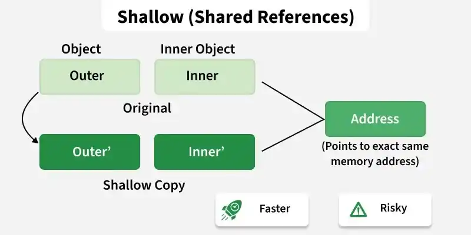

| Feature | Shallow Copy | Deep Copy |
| --- | --- | --- |
| Copy behavior | Copies member values, including pointer addresses | Creates a separate copy of dynamically allocated data |
| Memory | Shared between objects | Independent for each object |
| Effect of modification | Changes through one object affect the other | Changes do not affect the other object |
| Dynamic memory | Does not allocate new memory | Allocates new memory and copies the data |
| Default behavior | Performed by the compiler-generated copy constructor | Requires a user-defined copy constructor |

### 36. What are the static data members and static member functions?

**Static Data Members:** A [static data member](https://) belongs to the class rather than individual objects. Only one copy of the member is shared by all objects of the class.

- Shared by all objects of the class.
- Declared using the static keyword.
- Must be defined outside the class.

**Syntax**

> static Data\_Type Data\_Member; 

A [static member function](https://www.geeksforgeeks.org/cpp/static-member-function-in-cpp/) belongs to the class and can be called without creating an object. It can directly access only static members of the class.

- Can be called using the class name.
- Can directly access only static data members and other static member functions.
- Does not have access to the this pointer.

**Syntax**

> classname::function name(parameter);

C++

```` ```
#include <iostream>
using namespace std;

class Counter {
    static int count;

public:
    Counter() {
        ++count;
    }

    static void showCount() {
        cout << "Count = " << count << endl;
    }
};

int Counter::count = 0;

int main() {
    Counter a, b, c;

    Counter::showCount();

    return 0;
}
``` ````

**Output**

```
Count = 3
```

### 37. What is the difference between const and #define?

Both [const](https://www.geeksforgeeks.org/cpp/const-keyword-in-cpp/) and #[define](https://www.geeksforgeeks.org/cpp/define-preprocessor-in-cpp/) are used to represent constant values, but they differ in how they are processed and used in a C++ program.

- const creates a typed constant, while #define creates a preprocessor macro.
- const is processed by the compiler, whereas #define is expanded by the preprocessor before compilation.
- const follows C++ scope and type-checking rules, while #define has no type or scope checking.
- const constants can be inspected during debugging, but macros are usually not visible after preprocessing.

### **38. What is virtual inheritance?**

Virtual inheritance is a technique used in multiple inheritance to ensure that only one copy of a common base class is inherited, preventing duplicate base class instances (the diamond problem).

- Prevents multiple copies of the same base class in the inheritance hierarchy.
- Used to resolve ambiguity caused by multiple inheritance.

C++

```` ```
#include <iostream>
using namespace std;

class Person {
public:
    void show() {
        cout << "Person\n";
    }
};

class Student : virtual public Person { };

class Employee : virtual public Person { };

class TeachingAssistant : public Student, public Employee { };

int main() {
    TeachingAssistant ta;
    ta.show();    // No ambiguity
    return 0;
}
``` ````

**Output**

```
Person
```

**Explanation**

- Student and Employee virtually inherit from Person.
- TeachingAssistant inherits from both Student and Employee.
- Virtual inheritance ensures that TeachingAssistant contains only one Person object, so calling ta.show() is unambiguous.

### 39. When should multiple inheritance be used in C++?

[Multiple inheritance](https://www.geeksforgeeks.org/cpp/multiple-inheritance-in-c/) should be used when a class logically needs to inherit properties and behaviors from more than one base class.

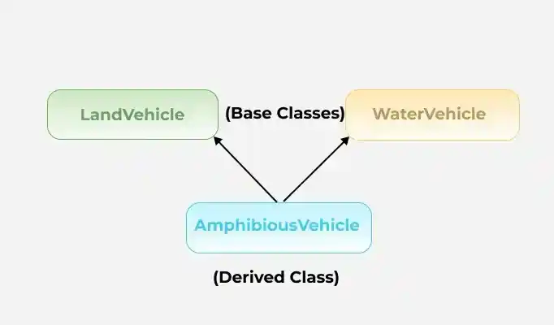

- It is useful for combining independent features, such as a class that is both Printable and Serializable.
- It can model real-world entities with multiple roles, such as a Teacher who is also a Researcher.
- It should be used carefully, as it can introduce ambiguity and issues like the diamond problem.

C++

```` ```
#include <iostream>
using namespace std;

// Base class A
class A {
public:
    void showA() {
        cout << "Function from class A" << endl;
    }
};

// Base class B
class B {
public:
    void showB() {
        cout << "Function from class B" << endl;
    }
};

// Derived class inheriting from A and B
class C : public A, public B {
public:
    void showC() {
        cout << "Function from class C" << endl;
    }
};

int main() {
    C obj;
    obj.showA();
    obj.showB();
    obj.showC();

    return 0;
}
``` ````

**Output**

```
Function from class A
Function from class B
Function from class C
```

### 40. Can we call a virtual function from a constructor?

Yes, a [virtual function](https://www.geeksforgeeks.org/cpp/virtual-function-cpp/) can be called from a constructor. However, during object construction, virtual dispatch is disabled, so the function call resolves to the version in the current class rather than an overridden version in a derived class.

- Virtual functions can be called inside constructors.
- The derived class override is not invoked during base class construction.
- This behavior prevents access to derived class members before they are initialized.
- For this reason, calling virtual functions from constructors is generally discouraged.

C++

```` ```
#include <iostream>
using namespace std;

class Base {
public:
    Base() {
        show();
    }

    virtual void show() {
        cout << "Base::show()" << endl;
    }
};

class Derived : public Base {
public:
    void show() override {
        cout << "Derived::show()" << endl;
    }
};

int main() {
    Derived obj;
    return 0;
}
``` ````

**Output**

```
Base::show()
```

### 41. Can a class have multiple destructors in C++? Why or why not?

No, a class cannot have multiple [destructor](https://www.geeksforgeeks.org/cpp/destructors-c/) in C++. Each class can have only one destructor.

- Destructors cannot accept parameters, so they cannot be distinguished by parameter lists.
- They do not have a return type, so overloading is not possible.
- Since an object is destroyed in only one way, C++ allows only a single destructor for each class.

**Syntax:**

> ~ClassName();

Defining more than one destructor in the same class results in a compilation error.

### 42. What is the difference between **F**unction **O**verloading and **O**perator **O**verloading?

Both [function overloading](https://www.geeksforgeeks.org/cpp/function-overloading-c/) and [operator overloading](https://www.geeksforgeeks.org/cpp/operator-overloading-cpp/) are forms of compile-time polymorphism in C++, but they are used for different purposes.

| Function Overloading | Operator Overloading |
| --- | --- |
| Involves defining multiple functions with the same name but different parameter lists. | Involves redefining the behavior of an existing operator for user-defined types. |
| Improves code readability by allowing similar operations to use the same function name. | Allows operators such as `+`, `-`, `*`, and `==` to work with objects. |
| The compiler selects the appropriate function based on the number or type of arguments. | The compiler invokes the overloaded operator function when the operator is used. |
| Used to perform similar operations on different types of data. | Used to provide intuitive behavior for objects of a class. |

### **43. Discuss the difference between prefix and postfix?**

The following table summarizes the key [difference between prefix and postfix](https://www.geeksforgeeks.org/cpp/increment-and-decrement-operator-overloading-in-c/) increment/decrement operators:

| **Prefix (****`++i`** **/** **`--i`****)** | **Postfix (****`i++`** **/** **`i--`****)** |
| --- | --- |
| The operator is applied before the operand is evaluated. | The operand is evaluated before the operator is applied. |
| Returns the updated value. | Returns the **original** value, then updates it. |
| Slightly more efficient for user-defined iterators and objects since it avoids creating a temporary copy. | May create a temporary copy before updating (for user-defined types). |
| Associativity is right-to-left. | Associativity is left-to-right. |

### 44. What is the scope resolution operator (::) in C++, and where is it used?

The [scope resolution operator](https://www.geeksforgeeks.org/cpp/scope-resolution-operator-in-c/) (::) is used to access or define members that belong to a specific scope, such as a namespace, class, or the global scope. It helps resolve naming conflicts and specifies exactly where an identifier is defined.

Common uses of the scope resolution operator:

- Access a global variable when a local variable has the same name.
- Define a class member function outside the class definition.
- Access members of a namespace.
- Resolve ambiguity in multiple inheritance by specifying the base class.

### 45. What are the C++ access modifiers?

The access restriction specified to the class members (whether it is member function or data member) is known as [access modifiers/specifiers.](https://www.geeksforgeeks.org/cpp/access-modifiers-in-c/)

**Access Modifiers are of 3 types:**

- **Private -** It can neither be accessed nor be viewed from outside the class
- **Protected -** It can be accessed if and only if the accessor is the derived class
- **Public -** It can be accessed or be viewed from outside the class

### 46. What are friend classes and friend functions in C++?

A [friend class](https://www.geeksforgeeks.org/cpp/friend-class-function-cpp/) can access all private and protected members of the class that declares it as a friend.

- Declared using the friend keyword.
- Can access private and protected members of the host class.
- Friendship is not inherited or transitive.

C++

```` ```
class Class_1st {
    // ClassB is a friend class of ClassA
    friend class Class_2nd;
    statements;
} class Class_2nd {
    statements;
}
``` ````

A [friend function](https://www.geeksforgeeks.org/cpp/friend-class-function-cpp/) is a non-member function that can access the private and protected members of a class.

- Declared using the friend keyword inside the class.
- It is not a member function of the class.
- It can be called like a normal function.

C++

```` ```
class GFG {
    statements;
    friend dataype function_Name(arguments);
    statements;
} OR class GFG {
    statements' friend int divide(10, 5);
    statements;
}
``` ````

### 47. Can a C++ program be compiled without a main() function?

Yes, a program can be [compiled without explicitly writing](https://www.geeksforgeeks.org/c/write-running-c-code-without-main/) a main() function, provided the compiler can still find a function that expands to main() after preprocessing. For example, a macro can be used to rename another function as main().

C++

```` ```
#include <cstdio>
#define fun main

int fun() {
    printf("GeeksforGeeks");
    return 0;
}
``` ````

### 48. Define inline function. Can we have a recursive inline function in C++?

An [inline function](https://www.geeksforgeeks.org/cpp/inline-functions-cpp/) is a function for which the compiler is requested to replace the function call with the actual function body, reducing the overhead of function calls. The inline keyword is only a request, and the compiler may choose whether or not to inline the function.

- Declared using the inline keyword.
- Can improve performance for small, frequently called functions.

Yes, a recursive function can be declared as inline. However, recursive calls usually cannot be fully expanded inline because the number of calls is not known at compile time. As a result, the compiler typically treats recursive calls as normal function calls.

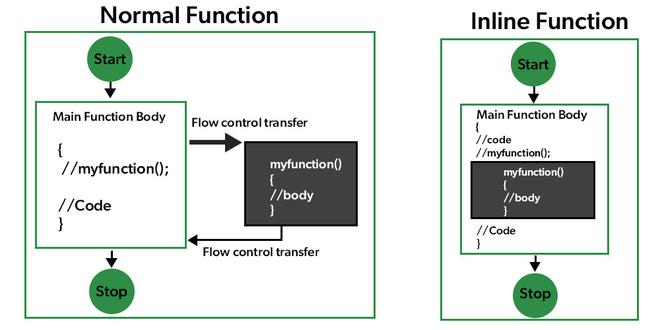

Inline Function Explanation

C++

```` ```
#include <iostream>
using namespace std;

inline int factorial(int n) {
    if (n <= 1)
        return 1;
    return n * factorial(n - 1);
}

int main() {
    cout << factorial(5);
    return 0;
}
``` ````

**Output**

```
120
```

### **49. What is STL?**

The [Standard Template Library](https://www.geeksforgeeks.org/cpp/the-c-standard-template-library-stl/) (STL) is a collection of generic template classes and functions that provides ready-to-use data structures and algorithms. It helps developers write efficient, reusable, and type-independent code.

- Provides reusable, generic, and type-independent components.
- Includes efficient implementations of common data structures and algorithms.
- Offers a consistent interface through iterators for working with containers.

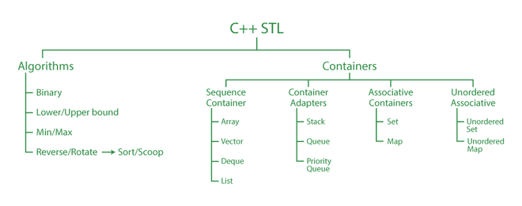

C++ STL

### 50. What are STL containers? Explain different types with examples.

STL containers are predefined data structures in C++ that store collections of data in various ways. They are categorized into three types:

**1. Sequence Containers**: Maintain the order of insertion.

- vector: Dynamic array
- list: Doubly linked list
- deque: Double-ended queue

**Example**:

> vector<int> v = {1, 2, 3};

**2. Associative Containers**: Store elements using keys (ordered).

- set, multiset: Store unique values
- map, multimap: Store key-value pairs

**Example**:

> map<string, int> age;  
> age["Alice"] = 25;

**3. Unordered Associative Containers**: Use hash tables instead of trees.

- unordered\_set, unordered\_map

**Example**:

> unordered\_map<string, int> scores;

**4. Container Adapters**: Built on other containers with restricted interface

- **stack:** based on last-in-first-out (LIFO).
- **queue:**based on first-in-first-out (FIFO).
- **priority\_queue:**implemented using min or max heap

Containers save time and effort by providing built-in operations like insertion, deletion, and search with optimal complexity.

### 51. What are iterators in STL? Describe types of iterators with examples.

An [iterator](https://www.geeksforgeeks.org/cpp/iterators-c-stl/) is an object (like a pointer) used to traverse containers. STL uses iterators to access elements in a uniform manner, regardless of the container. Iterators help in writing generic algorithms that work across different container types.

| Type | Description |
| --- | --- |
| Input Iterator | Read-only access, single pass |
| Output Iterator | Write-only access, single pass |
| Forward Iterator | Read/write, multiple passes |
| Bidirectional | Traverse both directions |
| Random Access | Direct jump to any position (e.g., vector) |

### 52. What are lambda expressions in C++? How do they relate to STL?

[Lambda expressions](https://www.geeksforgeeks.org/cpp/lambda-expression-in-c/) are anonymous functions that can be defined inline without giving them a name. They are widely used with STL algorithms to provide custom operations without writing separate functions.

- Defined inline and do not require a separate function declaration.
- Commonly used with STL algorithms such as sort(), for\_each(), count\_if(), find\_if(), and transform().
- Make code shorter, more readable, and easier to maintain.
- Can capture local variables from the surrounding scope when needed.

C++

```` ```
#include <algorithm>
#include <iostream>
#include <vector>
using namespace std;

int main() {
    vector<int> v = {1, 2, 3, 4, 5};

    int evenCount = count_if(v.begin(), v.end(),
                             [](int x) { return x % 2 == 0; });

    cout << evenCount;
    return 0;
}
``` ````

**Output**

```
2
```

**Explanation:** The lambda expression [](int x) { return x % 2 == 0; } is passed directly to count\_if(), which counts the number of even elements in the vector without requiring a separate function.

### 53. What happens if you insert a duplicate key in std::set or std::map? How do you detect insertion success?

[std::set](https://www.geeksforgeeks.org/cpp/set-in-cpp-stl/) and [std::map](https://www.geeksforgeeks.org/cpp/map-associative-containers-the-c-standard-template-library-stl/) store unique keys, so attempting to insert a duplicate key does not modify the container. The insert() function returns a std::pair containing an iterator and a boolean value.

- Duplicate keys are ignored in std::set and std::map.
- The returned bool is true if the insertion succeeds and false if the key already exists.
- The returned iterator points to the inserted element or to the existing element if the insertion fails.
- Use the boolean value to check whether the insertion was successful.

C++

```` ```
#include <iostream>
#include<bits/stdc++.h>
using namespace std;

int main() {

    set<int> s;
    auto [it, success] = s.insert(10);
    cout << (success ? "Inserted" : "Duplicate") << endl;
    
    tie(it, success) = s.insert(10); // Try duplicate
    cout << (success ? "Inserted" : "Duplicate") << endl;

    return 0;
}
``` ````

**Output**

```
Inserted
Duplicate
```

### 54. Can a function template throw exceptions?

Yes. A function template can throw exceptions just like a normal function. It can also use compile-time constructs such as if constexpr to apply different runtime checks depending on the type with which it is instantiated.

- Function templates can throw exceptions using the throw statement.
- if constexpr allows type-specific logic to be selected at compile time.
- The actual exception is still thrown at runtime if the condition is met.

C++

```` ```
#include <iostream>
#include <stdexcept>
#include <type_traits>
using namespace std;

template <typename T>
void check(T value) {
    if constexpr (is_same_v<T, int>) {
        if (value < 0)
            throw runtime_error("Negative integer not allowed");
    }

    cout << "Value = " << value << endl;
}

int main() {
    try {
        check(10);
        check(-5);
    }
    catch (const exception& e) {
        cout << e.what();
    }
}
``` ````

### 55. What is an Overflow Error?

An [overflow error](https://www.geeksforgeeks.org/dsa/check-for-integer-overflow/) occurs when a value exceeds the maximum range that can be represented by a data type. When this happens, the result becomes incorrect or undefined depending on the context.

- It occurs when a computation produces a value larger (or smaller) than the allowed range of the data type.
- Integer overflow is a common example of overflow errors.
- Overflow can lead to unexpected results or undefined behavior.

**Example:**

> int x = 2147483647; // INT\_MAX
>
> x = x + 1; // Integer overflow

## C++ Interview Questions - Expert Level

### 56. What is the difference between an error and an exception?

An error is a serious problem that usually cannot be handled by the program, whereas an exception is a runtime event that can be detected and handled using C++ exception handling mechanisms.

| Error | Exception |
| --- | --- |
| Usually caused by serious system or programming issues. | Occurs due to runtime conditions that can be handled. |
| Generally cannot be recovered from during execution. | Can be caught and handled using try, throw, and catch. |
| Often causes the program to terminate. | Allows the program to continue after handling the issue. |
| Examples: stack overflow, out-of-memory, segmentation fault. | Examples: file not found, division by zero, invalid input. |

### 57. What is an exception in C++?

An [exception](https://www.geeksforgeeks.org/cpp/exception-handling-c/) is a runtime event that disrupts the normal flow of a program. C++ provides an exception handling mechanism to detect errors and transfer control to a handler instead of terminating the program abruptly.

- Used to handle runtime errors such as division by zero or file access failures.
- Generated using the throw keyword and handled using try and catch.
- Separates error-handling code from normal program logic.
- Helps improve program reliability by allowing graceful error recovery.

### 58. What is the difference between throw, try, and catch in C++?

In C++, [exceptions](https://www.geeksforgeeks.org/cpp/exception-handling-c/) are handled using three keywords:

- [throw](https://www.geeksforgeeks.org/cpp/how-to-throw-an-exception-in-cpp/) is used to signal an exception.
- [try](https://www.geeksforgeeks.org/cpp/cpp-nested-try-blocks/) defines a block of code that may throw exceptions.
- [catch](https://www.geeksforgeeks.org/cpp/how-to-catch-specific-exception-in-cpp/) defines a block to handle exceptions thrown from the try block.

C++

```` ```
#include <iostream>
using namespace std;

int main() {
    try {
        throw runtime_error("Error occurred");
    }
    catch (const runtime_error& e) {
        cout << "Caught exception: " << e.what() << endl;
    }
}
``` ````

**Output**

```
Caught exception: Error occurred
```

### 59. What is exception propagation in C++?

Exception propagation is the process by which an exception moves up the function call stack until it is caught by a matching catch block.

- Occurs when a function throws an exception but does not handle it.
- Continues propagating until a matching catch block is found.
- Terminates the program if no suitable handler exists.
- Allows lower-level functions to delegate error handling to higher-level functions.

### 60. What is stack unwinding in exception handling? Explain its role.

Stack unwinding is the process of cleaning up the call stack after an exception is thrown and before it is caught. During unwinding, destructors of all local objects are called in reverse order of construction, ensuring proper cleanup. This prevents resource leaks and enforces RAII (Resource Acquisition Is Initialization).

- Prevents memory/resource leaks
- Ensures safe destruction of objects
- Supports RAII (Resource Acquisition Is Initialization)

C++

```` ```
#include<iostream>
using namespace std;

class Demo {
public:
    Demo() { cout << "Constructor\n"; }
    ~Demo() { cout << "Destructor\n"; }
};

void test() {
    Demo d;
    throw 1; // Stack unwinding will destroy d
}

int main() {
    try {
        test();
    } catch (...) {
        cout << "Exception caught\n";
    }
}
``` ````

**Output**

```
Constructor
Destructor
Exception caught
```

### 61. What is the difference between throw and throws?

C++ provides the [throw keyword](https://www.geeksforgeeks.org/cpp/how-to-throw-an-exception-in-cpp/) but does not have a throws keyword. The throws keyword is used in languages such as Java to declare exceptions that a method may throw.

| throw | throws |
| --- | --- |
| Used to explicitly throw an exception. | Not supported in C++. |
| Transfers control to the nearest matching catch block. | Used in Java to declare exceptions in a method signature. |
| Can throw built-in or user-defined exception objects. | Has no equivalent keyword in modern C++. |
| Example: throw std::runtime\_error("Error"); | Example (Java): void func() throws IOException |

> **Note:** Earlier versions of C++ supported dynamic exception specifications (e.g., void func() throw(Type);), but they were deprecated in C++11 and removed in C++17. Modern C++ uses noexcept to specify that a function is not expected to throw exceptions.

### 62. What is the use of noexcept in C++ exception handling?

The [noexcept keyword](https://www.geeksforgeeks.org/cpp/noexcept-specifier-in-cpp-17/) specifies that a function does not throw exceptions. It makes intent clear to both the compiler and developers. If a noexcept function does throw, std::terminate() is called. noexcept is especially important for move constructors and destructors, where it enables optimizations such as exception-safe move operations in standard containers.

- Faster execution (compiler skips setting up exception-handling code)
- Clear documentation of function behavior
- Can cause std::terminate() if the function throws anyway

> void display() noexcept {
>
> cout << "This function won't throw";
>
> }

### 63. How do you create a custom exception in C++? Give an example.

We can create a custom exception by defining a class that inherits from the std::exception class and overriding its what() method, which returns an error message.

- Provides clear error information
- Works seamlessly with standard exception handling
- Encourages structured and maintainable code

C++

```` ```
#include <iostream>
#include <exception>
using namespace std;

class MyException : public exception {
public:
    const char* what() const noexcept override {
        return "Custom Exception Occurred";
    }
};

int main() {
    try {
        throw MyException();
    } catch (const MyException& e) {
        cout << e.what();
    }
}
``` ````

**Output**

```
Custom Exception Occurred
```

### 64. What are nested exceptions in C++, and how can they be implemented?

Nested exceptions allow one exception to be stored inside another, preserving the original cause while adding additional context.

- Preserve the original exception during error propagation.
- Provide more detailed diagnostic information.
- Implemented using std::nested\_exception.
- Created with std::throw\_with\_nested().
- Retrieved using std::rethrow\_if\_nested().

C++

```` ```
#include <iostream>
#include <exception>
#include <stdexcept>

void lowLevelFunction() {
    throw std::runtime_error("File not found");
}

void highLevelFunction() {
    try {
        lowLevelFunction();
    }
    catch (...) {
        std::throw_with_nested(std::runtime_error("Failed to load configuration"));
    }
}

void printException(const std::exception& e) {
    std::cout << e.what() << '\n';

    try {
        std::rethrow_if_nested(e);
    }
    catch (const std::exception& nested) {
        printException(nested);
    }
    catch (...) {}
}

int main() {
    try {
        highLevelFunction();
    }
    catch (const std::exception& e) {
        printException(e);
    }

    return 0;
}
``` ````

**Output**

```
Failed to load configuration
File not found
```

### 65. What is multithreading in C++?

[Multithreading](https://www.geeksforgeeks.org/cpp/multithreading-in-cpp/) is the ability of a program to execute multiple threads concurrently within the same process. It improves responsiveness and can increase performance by utilizing multiple CPU cores.

- Allows multiple threads to execute independently.
- Threads share the same process memory and resources.
- Supports concurrent execution of tasks.
- Implemented using the std::thread library in C++11 and later.

### 66. What is the difference between a process and a thread?

A process is an independent program with its own memory space, whereas a [thread](https://www.geeksforgeeks.org/cpp/how-to-create-a-thread-in-cpp/) is a lightweight unit of execution within a process that shares its resources.

| Process | Thread |
| --- | --- |
| Has its own memory space. | Shares memory with other threads. |
| Creation is relatively expensive. | Creation is relatively lightweight. |
| Communication requires IPC mechanisms. | Communication occurs through shared memory. |
| Failure usually does not affect other processes. | A faulty thread can affect the entire process. |
| Suitable for independent applications. | Suitable for concurrent tasks within a process. |

### 67. How do you create and join a thread in C++?

A thread is created using the std::thread class, and the join() function waits for the thread to finish execution.

- std::thread creates a new thread of execution.
- join() blocks until the thread completes.
- A thread must be joined or detached before destruction.
- Failing to do so causes std::terminate() to be called.
- Multiple threads can execute different functions concurrently.

### 68. What is a race condition, and how can it be prevented?

A [race condition](https://www.geeksforgeeks.org/operating-systems/race-condition-in-operating-systems/) occurs when multiple threads access and modify shared data simultaneously, causing unpredictable results.

- Occurs due to unsynchronized access to shared resources.
- May produce inconsistent or incorrect program behavior.
- Prevented using synchronization mechanisms such as mutexes.
- Atomic variables can also prevent race conditions for simple operations.

### 69. What is the difference between a mutex and a semaphore?

A [mutex](https://www.geeksforgeeks.org/cpp/std-mutex-in-cpp/) provides mutual exclusion by allowing only one thread to access a resource at a time, whereas a [semaphore](https://www.geeksforgeeks.org/operating-systems/mutex-vs-semaphore/) controls access to a limited number of resources.

| Mutex | Semaphore |
| --- | --- |
| Allows only one thread at a time. | Allows multiple threads based on its count. |
| Used for mutual exclusion. | Used for resource synchronization. |
| Ownership belongs to the locking thread. | No ownership concept. |
| Binary in nature. | Can be binary or counting. |
| Prevents simultaneous access to shared data. | Controls access to limited resources. |

### 70. What is a condition variable, and when should it be used?

A [condition variable](https://www.geeksforgeeks.org/cpp/cpp-multithreading-condition-variables/) allows threads to wait until a specific condition becomes true, avoiding busy waiting.

- Used with std::mutex for thread synchronization.
- Suspends waiting threads efficiently.
- Wakes waiting threads using notify\_one() or notify\_all().
- Commonly used in producer-consumer problems and reduces unnecessary CPU usage.

### 71. What is a deadlock, and how can it be avoided?

A deadlock occurs when two or more threads wait indefinitely for resources held by each other.

- Prevented by acquiring locks in a consistent order.
- Avoid nested locking whenever possible.
- Use std::lock() to lock multiple mutexes safely.
- Keep critical sections as short as possible.

### 72. What are atomic variables, and how do they differ from mutexes?

Atomic variables perform thread-safe operations without explicit locking, while mutexes protect larger critical sections.

| Atomic Variables | Mutex |
| --- | --- |
| Lock-free for many operations. | Uses locking mechanisms. |
| Best for simple shared variables. | Suitable for complex shared data. |
| Lower synchronization overhead. | Higher overhead due to locking. |
| Supports atomic read-modify-write operations. | Protects entire critical sections. |
| Implemented using std::atomic. | Implemented using std::mutex. |

### 73. What is false sharing, and how does it affect multithreaded performance?

False sharing occurs when multiple threads modify different variables located in the same CPU cache line, causing unnecessary cache invalidations.

- Reduces cache efficiency.
- Increases cache coherence traffic.
- Degrades multithreaded performance.
- Can occur even when threads access different variables.
- Minimized using cache-line alignment or padding.

### 74. What is the producer-consumer problem, and how is it solved in C++?

The [producer-consumer problem](https://www.geeksforgeeks.org/operating-systems/producer-consumer-problem-and-its-implementation-with-c/) involves coordinating threads that produce and consume data from a shared buffer.

- Producers add items to a shared buffer.
- Consumers remove items from the buffer.
- Synchronization prevents buffer overflow and underflow.
- Typically solved using mutexes and condition variables.
- Semaphores can also be used for synchronization.

### 75. What is the main use of the keyword “Volatile”?

The [volatile keyword](https://www.geeksforgeeks.org/cpp/how-to-use-volatile-keyword-in-cpp/) tells the compiler that a variable's value may change unexpectedly outside the program's control.

- Prevents the compiler from optimizing accesses to the variable.
- Forces the variable to be read from memory whenever it is accessed.
- Commonly used with memory-mapped hardware registers.
- Does not provide thread synchronization or atomic operations.

### 76. What is the difference between rethrowing an exception and throwing a new exception?

Rethrowing propagates the original exception, whereas throwing a new exception creates a different exception object.

| Rethrowing | Throwing a New Exception |
| --- | --- |
| Uses `throw;` inside a `catch` block. | Uses `throw ExceptionType(...);`. |
| Preserves the original exception object and type. | Creates a new exception object. |
| Maintains the original exception information. | Can add additional context to the error. |
| Used when another handler should process the same exception. | Used when a different error needs to be reported. |

### 77. What is the try-with-resources statement, and what are its advantages?

The try-with-resources statement is a Java feature and is not available in C++.

- Automatically closes resources after the try block finishes.
- Eliminates the need for explicit resource cleanup.
- Helps prevent resource leaks.
- C++ achieves similar functionality using RAII (Resource Acquisition Is Initialization).
