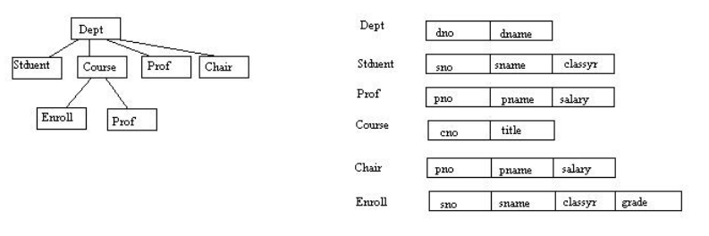

# Berkeley CS186 Spring 1994: Midterm 1: Questions

> Copied from the original: <https://hkn.eecs.berkeley.edu/exams/course/cs/186>. Text and figures are taken from the PDF as is; nothing was answered or rewritten. The original PDF is in this folder.

---

**Page 1**

&emsp;&emsp;&emsp;&emsp;&emsp;&emsp;&emsp;&emsp;CS 186, Midterm, Spring 1994 
&emsp;&emsp;&emsp;&emsp;&emsp;&emsp;&emsp;&emsp;**CS 186 Spring 1994** 
&emsp;&emsp;&emsp;&emsp;&emsp;&emsp;&emsp;&emsp;**Midterm** 
&emsp;&emsp;&emsp;&emsp;&emsp;&emsp;&emsp;&emsp;**Professor Gunther A. Vahdat**

**Problem #1 (15 Credits)** 
Suppose you are database administrator at a large university that is (still) using a hierarchical database 
system. You have chosen the following scheme to represent information about its faculty, students, 
departments, and courses.

**Problem #2 (15 Credits)** 
Let R denote a relational database scheme and F a set of functional dependencies defined on R. Furthermore, 
let G denote a minimal cover of F. 
(a) Prove that any attribute that does not appear in any functional dependency in G belongs to every key of R. 
(b) Prove that if there is a functional dependency in the minimal cover G in which all attributes of R appear, 
then R is in third normal form with respect to F.

**Problem #3 (15 Credits)** 
Give an example for a relational database scheme R and a set F of functional dependencies defined on R, 
such that 
(i) R is not in third normal form (3NF) with respect to F, and 
(ii) there are at least two ways to decompose R into a minimum number of relations R1,...,Rk such that each Ri 
is in 3NF with respect to the corresponding projection of F, and the decomposition has a lossless join and 
preserves dependencies. 
Give at least two of the possible 3NF-decompositions.

**Problem #4 (15 Credits)** 
Consider the relational database scheme R = ABCD with a set of functional dependencies F:={AB -\> C, BC 
-\> D}. 
(a) Give all candidate keys for R (with respect to F). 
(b) Show that R is not in 3NF (with respect to F). 
(c) Find a 3NF-decomposition of R that has a lossless join, preserves dependencies, and consists of a

CS 186 Spring 1994 Midterm Professor Gunther A. Vahdat   1

---

**Page 2**

&emsp;&emsp;&emsp;&emsp;&emsp;&emsp;&emsp;&emsp;CS 186, Midterm, Spring 1994 
minimum number of relations. 
(d) Is G:={AB -\> C, AB -\> D} a minimal cover of F? Prove your answer.

**Problem #5 (10 Credits)** 
Give an example of a view built on the relation EMP(name, salary, age, dept, manager) and two updates for 
that view which cannot be unambiguously translated to updates on the underlying base relation. Credit will 
be awarded proportional to the complexity of your examples.

**Problem #6 (20 Credits)** 
Consider the relations

HOUSE(house-id, h-address, h-age) 
PERSON(person-id, p-name, p-age) 
OWNS(house-id, person-id) 
LIVES-IN(house-id, person-id)

with the condition that a person can live in and own multiple houses. Write SQL queries for the following 
tasks. Credit will be awarded inversely proportional to the complexity of your queries. 
(a) Find the names of people who are part or full owners of at least one of the houses in which they live. 
(b) Find the name of the person who owns the most houses. 
(c) Find the names of the people who do not live anywhere. 
(d) Find the names of all people who live in a house which is the same age as the person's age.

&emsp;**Posted by HKN (Electrical Engineering and Computer Science Honor Society)** 
&emsp;&emsp;&emsp;&emsp;&emsp;&emsp;&emsp;&emsp;**Univeristy of California at Berkeley** 
&emsp;&emsp;&emsp;&emsp;&emsp;&emsp;**If you have any questions about these online exams** 
&emsp;&emsp;&emsp;&emsp;&emsp;&emsp;&emsp;**please contact**  **examfile@hkn.eecs.berkeley.edu.**

Problem #4 (15 Credits)   2

