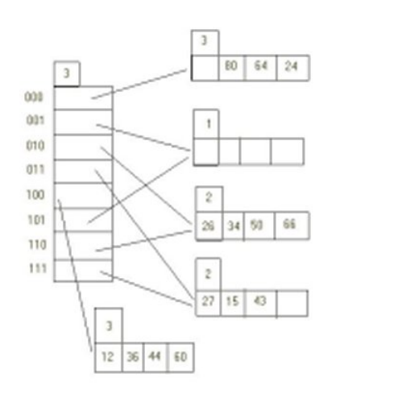

# Berkeley CS186 Fall 1998: Midterm 1: Questions

> Copied from the original: <https://hkn.eecs.berkeley.edu/exams/course/cs/186>. Text and figures are taken from the PDF as is; nothing was answered or rewritten. The original PDF is in this folder.

---

**Page 1**

&emsp;&emsp;&emsp;&emsp;&emsp;&emsp;&emsp;&emsp;CS 186, Midterm #1 Fall 1998 
&emsp;&emsp;&emsp;&emsp;&emsp;&emsp;&emsp;&emsp;**Name\_\_\_\_\_\_\_\_\_\_\_\_\_\_\_\_\_\_\_\_\_\_\_\_\_\_\_\_\_\_\_\_\_** 
&emsp;&emsp;&emsp;&emsp;&emsp;&emsp;&emsp;&emsp;**Section You Usually Attend\_\_\_\_\_\_\_\_\_\_\_\_\_\_\_\_**

&emsp;&emsp;&emsp;&emsp;&emsp;&emsp;&emsp;&emsp;**UNIVERSITY OF CALIFORNIA** 
&emsp;&emsp;&emsp;&emsp;&emsp;&emsp;&emsp;&emsp;**College of Engineering** 
&emsp;&emsp;&emsp;&emsp;&emsp;&emsp;&emsp;**Department of EECS, Computer Science Division** 
&emsp;&emsp;&emsp;&emsp;&emsp;**Midterm Exam: Introduction to Database Systems** 
This exam has four problems, each worth 25 points.  There is also 10 points of extra credit available.  Each 
problem is made up of multiple questions.   You should read through the exam quickly and plan your 
time-management accordingly.   Before beginning to answer a question, be sure to read it carefully and to 
answer all parts of every question!

&emsp;&emsp;&emsp;&emsp;&emsp;&emsp;&emsp;&emsp;Good luck!

**1. Sorting \[25 points\]** 
To receive full credit for this problem you **must** write down relevant formulas and show your work.

We are trying to sort a file containing 250,000 blocks with only 250 buffers available in the buffer pool for 
sorting.  The file contains fixed length tuples.

&emsp;&emsp;a) \[5 points\] How many initial runs will be generated if quicksort is used to sort tuples in 
&emsp;&emsp;memory?

&emsp;&emsp;b) \[5 points\] How many total I/O will the sort perform, including the cost of writing out the 
&emsp;&emsp;output?

In the following questions, assume that the average time to locate a random block (seek and rotational delay) 
takes 10 ms, while the time to transfer a block takes 5 ms.

&emsp;&emsp;c) \[5 points\] During our sort, if we merge runs a block at a time (in memory we set aside one 
&emsp;&emsp;buffer frame per input run for merging) what percent of the total disk bandwidth are we 
&emsp;&emsp;utilizing?

&emsp;&emsp;d) \[5 points\] Suppose we want to achieve a disk bandwidth utilization of 90%.   How many 
&emsp;&emsp;buffer frames per run should we set aside in our buffer pool?

&emsp;&emsp;e) \[5 points\] What is the tradeoff in setting aside aside more buffer frames (i.e. higher disk 
&emsp;&emsp;bandwidth utilization) per run? 
**2. Indexes \[25 points\]**

1Name\_\_\_\_\_\_\_\_\_\_\_\_\_\_\_\_\_\_\_\_\_\_\_\_\_\_\_\_\_\_\_\_\_ Section You Usually Attend\_\_\_\_\_\_\_\_\_\_\_\_\_\_\_\_exam #professor (e.g.,

---

**Page 2**

&emsp;&emsp;&emsp;&emsp;&emsp;&emsp;&emsp;&emsp;CS 186, Midterm #1 Fall 1998

**Hash Indexes**

&emsp;&emsp;a) \[5 points\] Fill in the 
&emsp;&emsp;global depth and local depth 
&emsp;&emsp;for each bucket in the 
&emsp;&emsp;extendible hashing index 
&emsp;&emsp;shown to the right.

&emsp;&emsp;b) \[5 points\] What is the 
&emsp;&emsp;minimum number of entries 
&emsp;&emsp;that needed to be inserted to 
&emsp;&emsp;cause the creation of a new 
&emsp;&emsp;bucket?

&emsp;&emsp;c) \[5 points\] Give an 
&emsp;&emsp;example for such a 
&emsp;&emsp;sequence of entries.

**B+ Tress**

&emsp;&emsp;d) \[5 points\] What is the 
&emsp;&emsp;maximum height of a 
&emsp;&emsp;B+-tree with N data entries and fanout k?

&emsp;&emsp;e) \[5 points\] Consider the bulk-loading algorithm we studied in class.  Assume there are N 
&emsp;&emsp;data entries, k entries fit on a leaf node, and the internal nodes have fanout k.  Ignoring the 
&emsp;&emsp;effects of buffer management, explain briefly why bulk-loading is more or less efficient than 
&emsp;&emsp;building the tree via multiple insertions.

&emsp;&emsp;f) \[Extra Credit: 10 points\] In addition to range and equality selection queries, we would like 
&emsp;&emsp;to efficiently support queries of the form "how many tuples fall in the range of x to y". 
&emsp;&emsp;Describe how you would augment a B+-tree to support such queries.  Outline how these 
&emsp;&emsp;"count" queries would be evaluated in your tree.  Also outline the steps involved in inserting 
&emsp;&emsp;a new entry.  Your augmented B+-tree should be able to support such count queries at much 
&emsp;&emsp;lower cost than normal B+-tree. 
**3. Disk, Indexes and Buffer Management \[25 points\]** 
&emsp;&emsp;a) \[5 points\] List the three major components of disk delay, organized from most to least 
&emsp;&emsp;time consuming.\]

&emsp;&emsp;b) \[5 points\] We discussed two possible formats for variable-length records: one with 
&emsp;&emsp;delimiters, and another with pointers.  Explain which one is preferable and why.

&emsp;&emsp;c) \[5 points\] Explain why you cannot have a sparse, unclustered index.  You may want to 
&emsp;&emsp;illustrate with a example.

&emsp;&emsp;d) \[5 points\] Assume you have a buffer pool with 3 frames and a file with four pages (A, B, 
&emsp;&emsp;C, D).  Assuming that the buffer pool starts out empty, give an access pattern of 8 page 
&emsp;&emsp;accesses that makes LRU do an I/O for each page access.

2\. Indexes \[25 points\]   2

---

**Page 3**

&emsp;&emsp;&emsp;&emsp;&emsp;&emsp;&emsp;&emsp;CS 186, Midterm #1 Fall 1998 
&emsp;&emsp;e) \[5 points\] Given the access pattern ABCDACACDC, and an empty buffer pool with 3 
&emsp;&emsp;frames, count the number of disk reads necessary for each of LRU, MRU, and LRU-2.  If a 
&emsp;&emsp;"tie" occurs in LRU-2, replace the lowest-numbered frame. 
**4. Formal Query Languages \[25 points\]** 
The World Organization of Furry Friends (WOOFF) has asked you to answer some questions for them.  They 
have a database with the following schema.  **Breeders** are people who raise and sell **Pets**.  Pets belong to 
different **Breeds** (e.g. "Scmauzer", "Poodle", "Siamese", etc.)  The **Pedigree** of the pet identifies the pet's 
breeder and breed.  If a pet is of mixed breed, it's considered to belong to multiple breeds - that is, that pet 
(and its breeder) will appear many times in the Pedigree table.  You may assume that pets have only one 
breeder.  Primary keys are underlined.

Breeders(brdr\_id: integer, brdr\_name: text, age: integer) 
Pets(pid: integer, pname: text, weight: float) 
Breeds(br\_id: integer, br\_name: text, friendliness: int) 
Pedigree(brdr\_id: integer, pid: integer, br\_id: integer)

&emsp;&emsp;a) \[5 points\] Give a relational calculus query to find the weights of all pets named 'Tiny'.

&emsp;&emsp;b) \[5 points\] Give a relational calculus query to find the br\_id, breed name and friendliness of 
&emsp;&emsp;all breeds raised by Breeder Bob.

&emsp;&emsp;c) \[5 points\] Give a relational algebra query to find the breed name and friendliness of all 
&emsp;&emsp;breeds for which Breeder Bob raised a pet named 'Killer'.  Please draw a "tree" for your 
&emsp;&emsp;algebra, rather than a parenthesized expression.

&emsp;&emsp;d) \[5 points\] Give a relational algebra tree to find the names of Breeders who have bred dogs 
&emsp;&emsp;in the breeds "Doberman" and "Chihuahua".  (In your answer, you should count breeders 
&emsp;&emsp;who raised Doberman/Chihuahua mixes.)

&emsp;&emsp;e) \[5 points\] Give a relational calculus query **or** relational algebra tree (you can choose 
&emsp;&emsp;either!) to find the names of pets who belong to all the same breeds as a pet named 'Icky'.

Note: you may use the DRC or TRC, whichever you prefer.

&emsp;**Posted by HKN (Electrical Engineering and Computer Science Honor Society)** 
&emsp;&emsp;&emsp;&emsp;&emsp;&emsp;&emsp;&emsp;**University of California at Berkeley** 
&emsp;&emsp;&emsp;&emsp;&emsp;&emsp;**If you have any questions about these online exams** 
&emsp;&emsp;&emsp;&emsp;&emsp;&emsp;&emsp;&emsp;**please contact examfile@hkn.eecs.berkeley.edu.**

3\. Disk, Indexes and Buffer Management \[25 points\]   3

