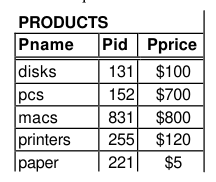
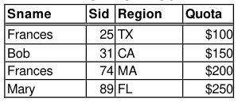
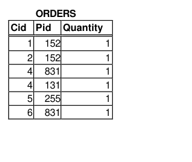
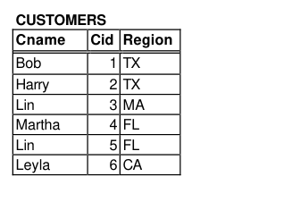
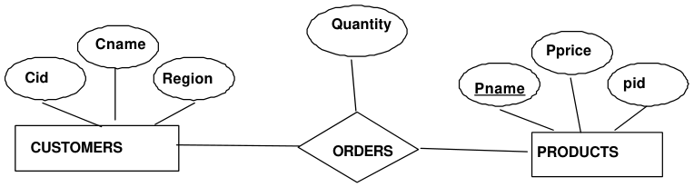

# Berkeley CS186 Fall 1999: Midterm 1: Questions

> Copied from the original: <https://hkn.eecs.berkeley.edu/exams/course/cs/186>. Text and figures are taken from the PDF as is; nothing was answered or rewritten. The original PDF is in this folder.

---

**Page 1**

&emsp;&emsp;&emsp;&emsp;&emsp;&emsp;&emsp;&emsp;UNIVERSITY OF CALIFORNIA 
&emsp;&emsp;&emsp;&emsp;&emsp;&emsp;&emsp;&emsp;Department of EECS, Computer Science Division 
CS186    Midterm I 
Oct 5, 1999 
&emsp;NOTE: THIS IS THE EXAM THAT WAS GIVEN IN THE FALL 
&emsp;1999 SEMESTER.  IT IS PROVIDED FOR YOUR STUDYING 
&emsp;&emsp;PURPOSES --- WE EXPECT THAT OUR EXAM WILL BE 
&emsp;SIMILAR IN STYLE, BUT WE MAKE NO GUARANTEES IN 
&emsp;&emsp;&emsp;THAT REGARD.  USE THIS SIMPLY A STUDY AID.

&emsp;&emsp;&emsp;**Midterm Exam: Introduction to Database Systems** 
This exam has five problems.  Each problem is made up of multiple questions.  You should read through the 
exam quickly and plan your time-management accordingly.  Before beginning to answer a question, be sure 
to read it carefully and to answer all parts of every question!

REFERENCE DATABASE . This is the Reference Database referred to in this exam.

There are four tables.  SALESPERSON contains the names, ids, regions & quotas for the  salespeople. Ids 
are unique, names are not, and there is only one salesperson per region.  PRODUCTS contains the product 
names, product ids, and prices for the products. The product ids are unique.

&emsp;&emsp;&emsp;&emsp;**SALESPERSON**

CUSTOMERS contains the customer names, customer ids, and regions for the customers (customer ids are 
unique), and ORDERS contains the customer id, the product id, and the product ordered per customer.

---

**Page 2**

**Name\_\_\_\_\_\_\_\_\_\_\_\_\_\_\_\_\_\_\_\_\_\_\_\_\_\_\_\_\_\_\_\_\_\_\_\_\_\_\_\_\_\_\_\_\_\_\_\_**

**Section You Usually Attend \_\_\_\_\_\_\_\_\_\_\_\_\_\_\_\_\_\_\_\_\_\_\_\_\_\_\_\_\_\_Login\_\_\_\_\_\_\_\_\_\_\_\_\_\_\_\_\_\_\_\_\_\_\_\_\_**

**1.**    **Relational Model and ER Model (20 points).** 
&emsp;**a.**    (2 points)   Using the Reference Database as an example, give an example of  data independence 
&emsp;&emsp;contrasting the use of a file system to store the information in the SALESPERSON table with the 
&emsp;&emsp;use of a relational database to store the same information.

&emsp;**b.**    (2 points)What is the cardinality of the table SALESPERSON in the Reference Database on page 
&emsp;&emsp;1?  What is the degree of the table SALESPERSON?

&emsp;**c.**    (4 points).  Name the primary keys of each of the four tables in the Reference Database on Page 1.

&emsp;**d.**    (4 points) For each table in the Reference Database on Page 1, determine whether or not it has a 
&emsp;&emsp;foreign key, and if so, list what it is and what it references.

&emsp;**e.**    (8 points) Modify the following ER diagram to represent the Reference Database on Page 1, 
&emsp;&emsp;including the salesperson entities and relationships.

CS186 Oct 5  Midterm    Page 2

---

**Page 3**

**Name\_\_\_\_\_\_\_\_\_\_\_\_\_\_\_\_\_\_\_\_\_\_\_\_\_\_\_\_\_\_\_\_\_\_\_\_\_\_\_\_\_\_\_\_\_\_\_\_**

**2.**     **Disks and Buffers  (20 points)** 
&emsp;a.   \[5 points\]  Consider a disk with a sector size of 512 bytes,  100 sectors per track. 
&emsp;Given a rotational speed of 7200 revolutions per second, what is the maximum rotational delay to the 
&emsp;start of a sector? 
&emsp;Assuming that one track of data can be transferred  per revolution, what is the transfer rate?

&emsp;b.    \[5 points\]  In the organization of a data page, what is a slot directory?  What is it used for?  In the 
&emsp;&emsp;organization of a data record, what is a field offset?  What is it used for?

&emsp;For questions c & d, below, assume that in the CUSTOMERS table, records are much larger than 
&emsp;shown in the table on the page – in fact, each record fits in exactly one page, so the CUSTOMERS table 
&emsp;is 5 pages long. And also assume that there is room for only two buffers – that is, there are two buffer 
&emsp;frames – in memory, and that these buffers start out empty.

&emsp;c.    \[5 points\] Is LRU or MRU a better strategy if we are reading the CUSTOMERS records in the order: 
&emsp;&emsp;Cid = 1, 1, 3, 4, 3, 1, 2. Explain your answer.

&emsp;d.    \[5 points\] Assume there are two processes that alternate references to the buffer pool.  First 
&emsp;&emsp;process A references the buffer pool, then Process B, then A and so on. Process A  keeps re- 
&emsp;&emsp;reading the record with Cid = 2, and Process B sequentially scans the entire CUSTOMERS  table 
&emsp;&emsp;each time it gets a turn.  Assume that the two processes must share the same two-buffer pool. 
&emsp;&emsp;Which algorithm (LRU, MRU or CLOCK) minimizes the number of reads?  Explain why.

CS186 Oct 5  Midterm    Page 3

---

**Page 4**

&emsp;**Name\_\_\_\_\_\_\_\_\_\_\_\_\_\_\_\_\_\_\_\_\_\_\_\_\_\_\_\_\_\_\_\_\_\_\_\_\_\_\_\_\_\_\_\_\_\_\_\_**

&emsp;3\.    **Indices** \[20 points\]

&emsp;&emsp;b.    \[5 points\]  In the Reference Database on Page 1, name one advantage of building a clustered index 
&emsp;&emsp;&emsp;on the Sname field of the SALESPERSON table.  Name one disadvantage. Under what 
&emsp;&emsp;&emsp;circumstances would a nonclustered index on the Sname field be the best choice?

&emsp;&emsp;b.    \[5 points\]  In the PRODUCTS table in the reference database on page 1, **assume that there are** 
&emsp;&emsp;&emsp;&emsp;**actually many more records in the PRODUCTS table than are listed in the table shown** – assume 
&emsp;&emsp;&emsp;&emsp;that there are P pages with R records per page. Given an Extendible Hashing index on the Pid 
&emsp;&emsp;&emsp;&emsp;attribute, what is the number of I/Os required (worst case) to fetch all Pids between  131and 150, 
&emsp;&emsp;&emsp;&emsp;including 131 & 150?  You should assume that bucket pages are internally organized like heap file 
&emsp;&emsp;&emsp;&emsp;pages.  You may assume any alternative you wish for storing data entries in the index, and for 
&emsp;&emsp;&emsp;&emsp;buffering data in the system, but you must state the alternative and the buffering assumptions, 
&emsp;&emsp;&emsp;&emsp;and present the correct analysis for those assumptions.

&emsp;&emsp;c.    \[5 points\] In the reference database on Page 1, assume that the CUSTOMERS records are much 
&emsp;&emsp;&emsp;&emsp;larger than shown in the table on the page – in fact, each record fits in exactly one page, so the 
&emsp;&emsp;&emsp;&emsp;CUSTOMERS table is 5 pages long.. Draw a B+ tree index on Cname, assuming that d = 2,  using 
&emsp;&emsp;&emsp;&emsp;any of the alternatives discussed in text, but explain which alternative you are using.

&emsp;&emsp;d.    \[5 points\]  The DBA for the reference database on Page 1 has created a sparse index on the 
&emsp;&emsp;&emsp;PRODUCTS table (again, assuming that the PRODUCTS table has many more records than are 
&emsp;&emsp;&emsp;listed on Page 1).  The sparse index is on Pname. Explain in terms of accesses to the table 
&emsp;&emsp;&emsp;PRODUCTS  the advantages of a sparse index on Pname.  Explain the disadvantages.

&emsp;CS186 Oct 5  Midterm    Page 4

---

**Page 5**

&emsp;&emsp;&emsp;&emsp;**Name\_\_\_\_\_\_\_\_\_\_\_\_\_\_\_\_\_\_\_\_\_\_\_\_\_\_\_\_\_\_\_\_\_\_\_\_\_\_\_\_\_\_\_\_\_\_\_\_**

&emsp;&emsp;&emsp;&emsp;**4.**    **Relational Algebra (16 points)**

&emsp;&emsp;&emsp;&emsp;A. (10 points; 2 points each)  Show the rows resulting from the  following  queries, using the reference 
&emsp;&emsp;&emsp;&emsp;database. 
&emsp;&emsp;&emsp;&emsp;1\.    σ Cname = “Lin” (CUSTOMERS)

&emsp;&emsp;&emsp;&emsp;2\.  πCname, Pid(CUSTOMERSCUSTOMERS.Cid = ORDERS.Cid ORDERS) 
3\.   πSname ((SALESPERSON SALESPERSON.Region = CUSTOMERS.Region CUSTOMERS)        CUSTOMERS.Cid = ORDERS.Cid 
&emsp;&emsp;(σ Pname = “Mac”   (PRODUCTSPRODUCTS.Pid = ORDERS.Pid  ORDERS)) 
&emsp;&emsp;&emsp;&emsp;4\.  π sname SALESPERSONπ Sname CUSTOMERS

&emsp;&emsp;&emsp;&emsp;5\. π sname SALESPERSONπ Sname CUSTOMERS

&emsp;&emsp;&emsp;&emsp;B. (6 points; 2 points each) State the relational algebra expression to find the following:

&emsp;&emsp;&emsp;&emsp;1\. The names of the customers who live in the region TX.

&emsp;&emsp;&emsp;&emsp;2\. The customer id’s of customers who have ordered a pc. 
&emsp;&emsp;&emsp;&emsp;3\. The Sids of the Salespeople who have sold a printer.

&emsp;&emsp;&emsp;&emsp;CS186 Oct 5  Midterm    Page 5

---

**Page 6**

**Name\_\_\_\_\_\_\_\_\_\_\_\_\_\_\_\_\_\_\_\_\_\_\_\_\_\_\_\_\_\_\_\_\_\_\_\_\_\_\_\_\_\_\_\_\_\_\_\_**

5\.    **SQL** \[24 points\]

Use the tables in the Reference Database, on Page 1, write the SQL queries to do the following. 
&emsp;&emsp;a.   \[3 points\]  List the names of the customers who have bought more than one item. 
&emsp;&emsp;e.  \[3 points\]  List the names, Pid and price of all the Products, whether or not the product has 
&emsp;&emsp;&emsp;been ordered, but if it has been ordered display the Cids of the customer who ordered it.

&emsp;&emsp;f.     \[3  points\] List the names and Cids of all customers, and, for those who have bought Products, 
&emsp;&emsp;&emsp;the total amount of money they owe for their purchases.

&emsp;&emsp;g.  \[3 points\] Find the Sids of the salespeople for the regions where there are the most customers.

Using the tables in the Reference Database on Page 1, write down the resulting rows for the following 
queries.

&emsp;&emsp;h.  \[2 points\] SELECT DISTINCT Sname FROM SALESPERSON

&emsp;&emsp;i.    \[2 points\] SELECT S.Sid, C.Cname from SALESPERSON S, CUSTOMERS C 
&emsp;&emsp;&emsp;&emsp;&emsp;&emsp;&emsp;WHERE S.Region = C.Region 
&emsp;&emsp;&emsp;&emsp;&emsp;&emsp;&emsp;AND C.Region = “MA”

&emsp;&emsp;j.     \[4 points\] SELECT S.Sid, Tsales = Sum (P.Pprice) 
&emsp;&emsp;&emsp;&emsp;&emsp;&emsp;&emsp;from SALESPERSON S,  PRODUCTS P, ORDERS O. CUSTOMERS C 
&emsp;&emsp;&emsp;&emsp;&emsp;&emsp;&emsp;WHERE S.Region = C.Region AND C.Cid = O.Cid and P.Pid = O.Pid 
&emsp;&emsp;&emsp;&emsp;&emsp;&emsp;&emsp;Group by S.Sid

&emsp;&emsp;k.     \[4 points\] SELECT P.Pname from PRODUCTS P 
&emsp;&emsp;&emsp;&emsp;&emsp;&emsp;&emsp;WHERE NOT EXISTS 
&emsp;&emsp;&emsp;&emsp;&emsp;&emsp;&emsp;(SELECT O.Pid  FROM ORDERS O 
&emsp;&emsp;&emsp;&emsp;&emsp;&emsp;&emsp;WHERE O.Pid = P.Pid)

CS186 Oct 5  Midterm    Page 6

