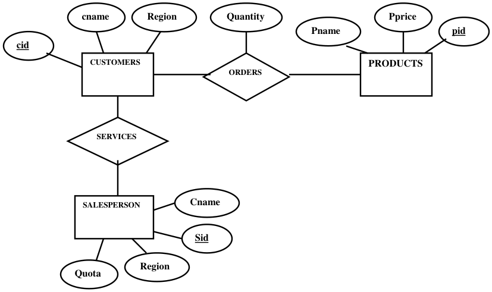
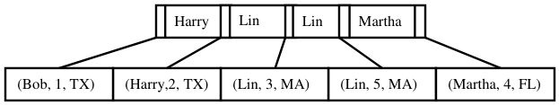
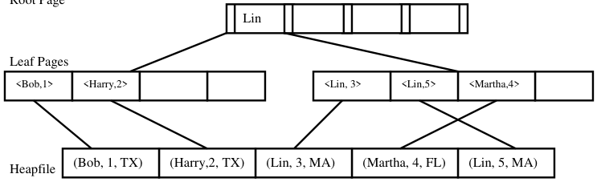

# Berkeley CS186 Fall 1999: Midterm 1: Official solutions

> Copied from the original: <https://hkn.eecs.berkeley.edu/exams/course/cs/186>. Text and figures are taken from the PDF as is; nothing was answered or rewritten. The original PDF is in this folder.

---

**Page 1**

&emsp;&emsp;&emsp;&emsp;&emsp;&emsp;&emsp;&emsp;Midterm 1 Solution Key

### **Question 1: Entity Relational Model**

a.  Answers needed to relate data independence to the SALESPERSON table, e.g. "if the data in the 
salesperson table is stored in a file system, and not in a relational DBMS, if we added a new field to the 
salesperson table the application would have to be aware of it.  But a relational database gives us data 
independence by providing a separation between the way the data is stored on the file and the way the 
application accesses it". 
b. Cardinality = 4; degree = 4 
c. Name the primary keys: Salesperson: Sid (region is also acceptable); Products Pid; Customers 
Cid; Orders \<cid, pid\>.  Quantity is NOT a primary key (point was taken off if you indicated it as a primary 
key) 
d. Orders has a foreign key Cid references customers, Pid references products. If you indicated that the 
Region attribute of Customers is a foreign key, referencing the Region key of Salesperson, that is also OK. 
e. The only connection between any of the Entities and Salespersons is the Region attribute, between 
Customers & Salespersons, so we are looking for a relationship ("services") between Customers & 
Salespersons. If you drew the Salesperson entity correctly, you got 4 points.  One more point if you 
underlined sid.   Then points were taken off for not having the right relationship, or not having it correctly 
drawn.   Below is one possible solution.

---

**Page 2**

### **Question 2**

a. Maximum rotational delay: 
1/7200 or 0.000139 sec 
We also take 99/100 \* 1/7200 
(1 point was taken off if you indicated the average rotational delay or (    \* 1/7200)) 
Transfer rate: 
512 \* 100 \* 7200 bytes/sec. 
b. A slot directory is the on page data structure used to locate a variable length record on a page. 
(A fix length record can also use a slot directory, if you explain how, you get credit.) 
There is a \<record offset, record length\> pair per slot in the slot directory when used in a variable length 
record page.   In a fix length record page, each slot has a flag indicating whether a particular slot is used or 
free. 
Field offset refers to the offset from the beginning of a record, of a particular attribute (or field). 
For instance, given the following schema: (sid: integer, name: char(30), grade: integer).   The field offset of 
name should be 4 (since an int is 4 bytes.)     Similarly the field offset of  grade should be 34.  (Note on 
some implementations, fields in records are required to be word aligned so, you may actually get 36 as the 
field offset for grade.) 
c. LRU and MRU have the same performance, both result in 5 page I/Os for the given paging sequence. 
Some students forgot to count in the first 2 page accesses and put the number of I/Os for both algorithms as 
3\.  But we also accepted that answer.  If you only gave results to LRU or MRU, but did not show work, you 
may get only partial credit. 
d. The problem is quite ambiguous.  The ambiguity comes from two parts: 
1\. The job access pattern 
2\. The clock algorithm  (i.e. whether or not advance the clock hand after reading a page already in the 
buffer pool) – however, there would not have been any ambiguity had you followed the pseudo code for 
clock from the class homepage. 
We give full credit to anyone with a reasonable analysis.  Something we are particularly looking for is like: 
1\. With a page access pattern like: 2, 1, 2, 2, 2, 3, 2, 4, 2, 5, 2.  Then LRU would be best.  (If you showed 
that the simulation of the clock algorithm performed equal to (even outperformed) LRU, and you showed 
your work you also received credit.) 
2\. If you said the job access pattern was like: 2, 1, 2, 3, 4, 5, 2, 1, 2, 3, 4, 5.  Then MRU would be best. 
Partial credit is given to any attempt that makes more or less sense.

### **Question 3**

3.a1) Advantage of cluster index on sname: fast range search on sname field 
&emsp;&emsp;1.5pts 
a2) Disadvantage: Any other indices on Salesperson would have to be unclustered, so range search on 
those fields will be slow.  Also there was overhead in maintaining the clustered property. 
&emsp;&emsp;1.5pts 
a3) Nonclustered: When there is already a cluster index on SID or if range search on SID is more common 
&emsp;&emsp;2 pts

---

**Page 3**

b) Number of I/Os : 1 header/directory page + 20 buckets = 21 in Alternative 1 
&emsp;&emsp;&emsp;&emsp;&emsp;1 header/directory page + 20 buckets + 20 data pages = 41 in 
Alternative 2 
&emsp;&emsp;2 pts for correct answer 
&emsp;&emsp;3 pts for an explanation 
c) Using d = 2 and 1 data record per page, the tree has at least a root node and index nodes. 
&emsp;&emsp;2 pts for correct index 
&emsp;&emsp;2 pts for correct leaf 
&emsp;&emsp;1 pt for overall correctness 
Here is one possible Alternative 1 Solution:

In the above diagram, the leaves actually store the entire data record.   So for the first leaf, you actually 
have (Bob, 1, TX) \<cname, cid, region\> 
Here is one possible Alternative 2 Solution 
Root Page

In the leaf level (2nd level in the above diagram) the data entries are \<Key, rid\>   (for simplicity, the rid is 
simply the page number of the page the actual data record is stored).  The data records are stored in a heap 
file as depicted in the third level. 
d) Advantage of Sparse index: index is smaller, easier to do range search. 
&emsp;&emsp;2.5 pts 
Disadvantage of Sparse: other indexes can’t be clustered.  Can’t do optimization in the index because 
the index doesn’t contain every record entry. 
&emsp;&emsp;2.5 pts

### **Question 4. Relational Algebra:**

A 
1\.  Cname             Cid         Region 
Lin   3   MA 
Lin   5   FL 
1 point was taken off if you had only 1 row.

---

**Page 4**

2\.  Cname             Pid 
Bob   152 
Harry    152 
Martha   831 
Martha   131 
Lin   255 
3\.  Cname 
Mary 
4\.  Cname 
Bob 
5\.    Name 
&emsp;Frances 
&emsp;Bob 
&emsp;Mary 
&emsp;Harry 
&emsp;Lin 
&emsp;Martha 
&emsp;1 point taken off if you had duplicates. 
B 
1.cname 
&emsp;&emsp;&emsp;&emsp;&emsp;region = “TX” (CUSTOMERS) 
2\.  cid ( ORDERS          orders.cid = products.cid  (    pname = ‘pcs’ PRODUCTS) ) 
&emsp;&emsp;&emsp;&emsp;pname = ‘printers’ PRODUCTSproducts.pid = orders.pid ORDERS) 
3\.       sid (((( 
orders.cid = customers.cid CUSTOMERS) 
&emsp;&emsp;customers.region = salesperson.regionSALESPERSON)

### **Question 5. SQL**

a) List the names of the customers who have bought more than one item. 
`SELECT cname` 
`FROM customers` 
`WHERE cid IN (SELECT cid` 
&emsp;&emsp;&emsp;&emsp;&emsp;`FROM orders` 
&emsp;&emsp;`GROUP BY cid` 
&emsp;&emsp;`HAVING count(*) > 1)` 
Alternative:   `HAVING sum(quantity) > 1)` 
Other possible solutions 
`SELECT cname` 
`FROM customers c, orders o1, orders o2` 
`WHERE c.cid = o1.cid AND` 
`c.cid = o2.cid` 
`AND o1.pid <> o2.pid`

---

**Page 5**

`SELECT c.cname` 
`FROM customers c, (SELECT cid FROM orders` 
&emsp;&emsp;&emsp;&emsp;&emsp;&emsp;&emsp;&emsp;`GROUP BY cid` 
&emsp;&emsp;&emsp;&emsp;&emsp;&emsp;&emsp;&emsp;`HAVING count (*) > 1) as o` 
`WHERE c.cid = o.cid`

`SELECT cname` 
`FROM customers` 
`WHERE 1 < (SELECT count(*)` 
&emsp;&emsp;`FROM orders o` 
&emsp;&emsp;`WHERE c.cid = o.cid)`

e) List the names, pid, and price of all the products, whether or not the product has been ordered, but if it 
has been ordered display the cids of the customer who ordered it. 
Solution 1: 
`SELECT name, pid, price, cid` 
`FROM products LEFT OUTER JOIN orders` 
`ON products.pid = orders.pid            <<<< optional` 
Solution 2: 
`SELECT name, p.pid, price, cid` 
`FROM products p, orders o` 
`WHERE p.pid = o.pid` 
`UNION` 
`SELECT name, pid, price, NULL as cid` 
`FROM products p` 
`WHERE cid NOT IN (SELECT cid FROM orders)` 
Alternatives:  `WHERE NOT EXISTS (SELECT * FROM orders o WHERE o.pid = p.pid)` 
&emsp;&emsp;`WHERE cid <> ANY (SELECT cid FROM orders)`

f) List the names and cids of all customers, and, for those who have bought product, the total amount of 
money they owe for their purchases. 
Solution 1: 
`SELECT c.name, c.cid, total = sum(price * quantity)` 
`FROM customers c, orders o, products p` 
`WHERE c.cid = o.cid AND o.pid = p.pid` 
`GROUP BY c.name, c.cid` 
`UNION` 
`SELECT c.name, c.cid, totoal = NULL` 
`FROM customers c` 
`WHERE c.cid NOT IN (SELECT cid FROM orders)` 
Solution 2: 
`SELECT name, cid total = sum(price * quantity)` 
`FROM costomer LEFT OUTER JOIN (orders INNER JOIN products)`

---

**Page 6**

`GROUP BY cid` 
g) Find the sids of the salespeople for the regions where there are the most customers. 
`SELECT s.sid FROM salesperson` 
`WHERE region IN (SELECT region` 
&emsp;&emsp;&emsp;&emsp;&emsp;`FROM customers` 
&emsp;&emsp;&emsp;&emsp;&emsp;`GROUP BY region` 
&emsp;&emsp;&emsp;&emsp;&emsp;`HAVING count(*) >= ALL (SELECT count(*)` 
&emsp;&emsp;&emsp;&emsp;&emsp;&emsp;&emsp;&emsp;`FROM customers` 
&emsp;&emsp;&emsp;&emsp;&emsp;&emsp;&emsp;&emsp;`GROUP BY region)` 
Alternative: `HAVING count(*) = (SELECT max(cnt)` 
&emsp;&emsp;&emsp;&emsp;&emsp;&emsp;&emsp;&emsp;`FROM (SELECT count(*) as cnt` 
`FROM customers` 
&emsp;&emsp;&emsp;&emsp;&emsp;&emsp;&emsp;&emsp;`GROUP BY region)` 
h. Sname 
&emsp;Frances 
&emsp;Bob 
&emsp;Mary 
i.    Sid   Name 
74   Lin 
j.    Sid   Tsales 
25   $1400 
&emsp;89 $1020 
Points were taken off if you had 2 zero rows in your answer. 
k. Pname 
&emsp;Paper

