# Berkeley CS186 Fall 1999: Midterm 2: Questions

> Copied from the original: <https://hkn.eecs.berkeley.edu/exams/course/cs/186>. Text and figures are taken from the PDF as is; nothing was answered or rewritten. The original PDF is in this folder.

---

**Page 1**

&emsp;&emsp;&emsp;&emsp;&emsp;&emsp;&emsp;&emsp;CS 186, Midterm 2, Fall 1999 
&emsp;&emsp;&emsp;&emsp;&emsp;&emsp;&emsp;&emsp;**CS 186, Fall 1999** 
&emsp;&emsp;&emsp;&emsp;&emsp;&emsp;&emsp;&emsp;**Midterm 2** 
&emsp;&emsp;&emsp;&emsp;&emsp;&emsp;&emsp;&emsp;**Professor Hawthorn**

REFERENCE DATABASE. This is the Reference Database referred to in this exam.

There are four tables. SALESPERSON contains the names, ids, regions & quotas for the salespeople. Ids are 
unique, names are not, and there is only one salesperson per region. PRODUCTS contains the product names, 
product ids, and prices for the products. The product ids are unique.

&emsp;**SALESPERSON**

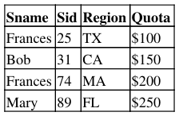

**PRODUCTS**

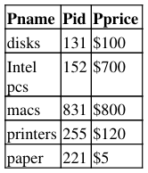

CUSTOMERS contains the customer names, customer ids, and regions for the customers (customer ids are 
unique), and ORDERS contains the customer id, the product id, and the product ordered per customer.

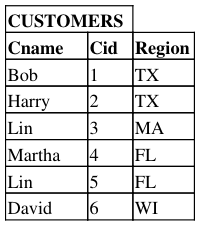

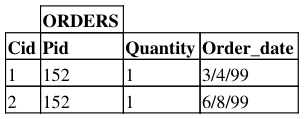

CS 186, Fall 1999 Midterm 2 Professor Hawthorn   1

---

**Page 2**

&emsp;&emsp;&emsp;&emsp;&emsp;&emsp;&emsp;&emsp;CS 186, Midterm 2, Fall 1999

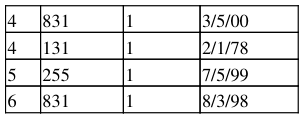

**Problem #1** 
Which of the following queries shows the Sids of the salespeople and the total sales that they have made? 
**(Only one answer is correct)**

A. SELECT S.Sid, SUM (P.Price \* O.Quantity) 
&emsp;FROM Salesperson S, Orders O, Customers C, Products P 
&emsp;GROUP BY S.Sid 
&emsp;HAVING P.Pid = O.Pid AND O.Cid = C.Cid AND S.Region = C.Region 
B. SELECT S.Sid, SUM (P.Price \* O.Quantity) 
&emsp;FROM Salesperson S, Orders O, Customers C, Products P 
&emsp;WHERE P.Pid = O.Pid AND O.Cid = C.Cid AND S.Region = C.Region 
&emsp;GROUP BY S.Sid 
C. SELECT S.Sid, Temp1.Sum1 
&emsp;FROM Salesperson S, (SELECT( SUM (P.Price \* O.Quantity) AS Sum1) 
&emsp;FROM Orders O, Customers C, Products P 
&emsp;WHERE P.Pid = O.Pid AND O.Cid = C.Cid AND S.Region = C.Region) AS Temp1 
D. SELECT S.Sid, SUM (P.Price \* O.Quantity) 
&emsp;FROM Salesperson S, Orders O, Customers C, Products P 
&emsp;WHERE P.Pid = O.Pid AND O.Cid = C.Cid AND S.Region = C.Region 
E. NONE OF THE ABOVE

**Problem #2** 
Which of the following queries finds the regions for which there are no customers? **(Only one answer is** 
**correct!)**

A. SELECT S.Region 
&emsp;FROM Customers C, Salesperson S 
&emsp;WHERE S. Region NOT EQUAL C.Region 
B. SELECT C.Region, COUNT (C.Region) 
&emsp;FROM Customers C 
&emsp;GROUP BY C.Region 
&emsp;HAVING COUNT (C.Region) = NULL 
C. SELECT C.Region 
&emsp;FROM Customers C 
&emsp;WHERE C.Region NOT IN 
&emsp;SELECT \* FROM Salesperson

Problem #1   2

---

**Page 3**

&emsp;&emsp;&emsp;&emsp;&emsp;&emsp;&emsp;&emsp;CS 186, Midterm 2, Fall 1999 
D. SELECT S.Region 
&emsp;FROM Salesperson S 
&emsp;WHERE NOT EXISTS 
&emsp;(SELECT \* FROM Customers C 
&emsp;WHERE C.Region = S.Region) 
E. NONE OF THE ABOVE

**Problem #3** 
Which is the correct answer below for the following query:

SELECT S.Sid, S.Region, C.Cname, 
FROM Salesperson S LEFT OUTER JOIN Customers C 
ON C.Region = S.Region

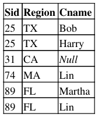

B.

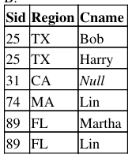

NullWIDavidC.

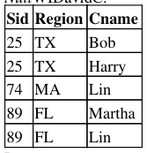

D.

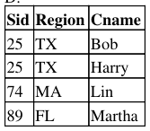

Problem #2   3

---

**Page 4**

&emsp;&emsp;&emsp;&emsp;&emsp;&emsp;&emsp;&emsp;CS 186, Midterm 2, Fall 1999 
89 FL   Lin 
NullWIDavidE.NONE OF THE ABOVE

**Problem #4** 
Which of the following queries finds most expensive part? **(Only one answer is correct!)**

A. SELECT P.Pid 
&emsp;FROM Products P 
&emsp;WHERE P.Pprice = MAX (P.Pprice) 
B. SELECT P.Pid, MAX (P.Pprice) 
&emsp;FROM Products P 
&emsp;GROUP BY P.Pid 
C. SELECT P.Pid 
&emsp;FROM Products P1, Products P2 
&emsp;WHERE P1.Pprice \> P2.Pprice 
D. SELECT P.Pid 
&emsp;FROM Products P 
&emsp;WHERE P.Pprice = (SELECT MAX (P.Pprice) 
&emsp;FROM Products P) 
E. NONE OF THE ABOVE

**Problem #5** 
**Given the query:** 
SELECT C.Cname 
FROM Customers C, Orders O 
WHERE C.Cid = O.Cid and O.Pid IN 
SELECT O.Pid 
GROUP BY O.Pid 
HAVING COUNT (\*) \> 1

What is the result?

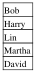

Problem #3   4

---

**Page 5**

&emsp;&emsp;&emsp;&emsp;&emsp;&emsp;&emsp;&emsp;CS 186, Midterm 2, Fall 1999

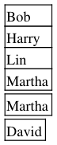

E. NONE OF THE ABOVE

**Problem #6** 
What does the following query do (select one answer)?

SELECT Sname FROM Salesperson 
WHERE Region IN (SELECT Region FROM Customers WHERE Cid = ANY 
(SELECT Cid FROM Orders) 
GROUP BY Cid 
HAVING COUNT (\*) = (SELECT MAX (cnt) 
FROM (SELECT COUNT (\*) as cnt 
FROM Orders 
GROUP BY Cid)))

A. Finds the names of the salespeople for the customers who have the maximum number of orders.

B. Finds the names of all the salespeople who have the maximum number of customers.

C. Finds the names of all the salespeople who have more than one region.

D. Finds the names of all the salespeople who have any orders.

E. NONE OF THE ABOVE

**Problem #7** 
Assume that Customers and Salesperson are much larger than pictured on Page 1; that Customers has 100 
pages, 10 records per page, and that Salesperson has 50 pages, 5 records per page. Assume that the only 
indexes are: Salesperson has a clustered B-tree index on Sid, and a Hash index on Sname and Customers has a 
clustered B-tree index on Cid. Assume there are 10 buffer pages available.

What is the lowest cost query plan for the query: SELECT C.Cname FROM Customers C, Salesperson S 
WHERE S.Region = C.Region AND S.Sid = "25"?

Problem #5   5

---

**Page 6**

&emsp;&emsp;&emsp;&emsp;&emsp;&emsp;&emsp;&emsp;CS 186, Midterm 2, Fall 1999

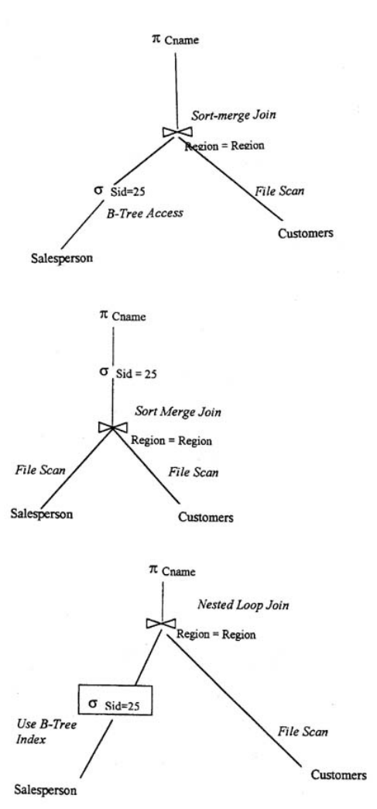

A.

B.

C.

Problem #7   6

---

**Page 7**

&emsp;&emsp;&emsp;&emsp;&emsp;&emsp;&emsp;&emsp;CS 186, Midterm 2, Fall 1999 
**Problem #8** 
The new DBA for the Reference Database has been given the following advice. Which one statement is 
always true?

A. Always put relations into third normal form

B. Always put hash indexes on fields used in equality selections

C. Never use two queries for something that can be expressed in one query

D. Always understand the workload on the system

**Problem #9** 
Let us assume that Customers and Salesperson are much larger than pictured on Page 1, and in addition that 
Orders is much larger than pictured on Page 1. Assume that the only indexes are: Salesperson has a clustered 
B-Tree index on Sid, and a Hash index on Sname; Orders has a clustered B-tree index on (Cid, Pid) and 
Customers has a clustered B-tree index on Cid.

Consider the query: 
SELECT S.Sname 
FROM Salesperson S, Customers C, Orders O 
WHERE S.Region = C.Region AND C.Cid = O.Cid and O.Pid = 152

Select the one statement below which is true.

A. No matter what the size of the relations, doing the selection O.Pid = 152 first will always be part of an 
&emsp;optimal plan. 
B. No matter what the size of the relations, an optimal plan will always need to scan Salesperson more than 
&emsp;once. 
C. No plan can use both keys in the (Cid, Pid) index. 
D. If Orders is very much larger than Customers, using the (Cid, Pid) index to join Orders and Customers 
&emsp;will cost less than a sort-merge join

**Problem #10** 
A new DBA has been hired for the Reference Database. They have done a worload analysis and determined 
that the most important and frequent query is the Sum\_orders query which sums up the dollar amount of each 
customer's order per day. To optimize this query, they decided that instead of having two different relations 
named Parts and Orders, there will be only relation:

Parts\_Orders, with fields Pname, Pid, Pprice, Cid, Quantity, Order\_Date. The Pid (Product ID) and is unique, 
and a single customer cannot order the same part twice on the same day. Select the one statement below which

Problem #8   7

---

**Page 8**

&emsp;&emsp;&emsp;&emsp;&emsp;&emsp;&emsp;&emsp;CS 186, Midterm 2, Fall 1999 
is true.

A. The new design will always result in running the Sum\_orders query faster than having two tables. 
B. The Parts\_Orders table has two functional dependencies: Pid -\> (Pname, Pprice) and (Cid, Pid, 
&emsp;Order\_Date) -\> Quantity 
C. The Parts\_Orders table is invalid because it is in first normal form. 
D. The Parts\_Orders table is invalid because it has two keys.

**Problem #11** 
The following expression is in the where clause of a query:

((3 = 3) or (7 null)) and (3 null)

What does the above expression evaluate to (under 3 value logic)? \[ means not equal to\]

A. True

B. False

C. Unknown

D. None of the above

**Problem #12** 
We have two relations, A and B. A has 1000 tuples in 50 pages. A and B both have a clustered index on id; 
also id is a key for reach relation. If the query is

SELECT A. Name 
FROM A, B 
WHERE A.id = B.id

And we have two join methods, Block Nested Loop and Index Nested Loop, under what circumstances will 
Index Nested Loop result in dramatically fewer I/Os than Block Nested Loop?

A. If B has 100 tuples in 5 pages, and there are 25 buffers available, in addition to enough buffers to assure 
&emsp;that the indices are in the buffers (if needed). 
B. If B has 1000 tuples in 50 pages and there are 55 buffers available, in addition to enough buffers to assure 
&emsp;that the indices are in the buffers (if needed). 
C. If B has 10,000 tuples in 500 pages and there are 25 buffers available, in addition to enough buffers to 
&emsp;assure that that the indices are in the buffers (if needed). 
D.

Problem #10   8

---

**Page 9**

&emsp;&emsp;&emsp;&emsp;&emsp;&emsp;&emsp;&emsp;CS 186, Midterm 2, Fall 1999 
&emsp;If B has 10,000 tuples in 500 pages and there are 502 buffers available, in addition to enough buffers to 
&emsp;assure that the indices are in the buffers (if needed).

**Problem #13** 
Assume we have a relation A that has 10,000 tuples, the values of its attribute x range from 7 to 80. And there 
are 50 distinct values of x. We also have relation B, which has 20 tuples, and the values of its attribute y range 
from 10 to 50. There are 2000 pages in A and 5 pages in B, and there are at least 10 buffer pages available. 
Consider the join

`SELECT A.x` 
`FROM A,B` 
`WHERE A.x = B.y`

Now suppose that y is a candidate key for relation B. If attribute x is not a candidate key, and A is already 
clustered on a different key, x is uniformaly distributed, which one statement below is true to assure the 
lowest cost for this query?

A. A good DBA will put a B-tree index on A.x but B.y does not need an index because it fits in memory. 
B. A good DBA will put a hash index on A.x and a hash index on B.y. 
C. A good DBA will put a B-tree index on A.x and a clustered index on B.y. 
D. A good DBA will put a hash index on A.x and a clustered index on B.y.

**Problem #14** 
The new DBA for the Reference Database needs to make sure that the salesperson cannot change their own 
quotas. There is a group Snums which defines the system ids of the salespeople, and the salespeople alreayd 
cannot delete anything in the Salesperson relation. Which of the following SQL statements should be used?

A. REVOKE UPDATE ON Salesperson(Quota) FROM Snums 
B. REVOKE INSERT, UPDATE ON Salesperson(Quota) FROM Salesperson.Sid where Salesperson.Sid IN 
&emsp;Snums 
C. REVOKE SELECT ON Salesperson(Quota) FROM Snums 
D. ON INSERT INTO Salesperson CHECK Salesperson.Sid NOT EQUAL Snum

**Problem #15** 
Given the following sequence of events

&emsp;•   Joe created a table called Customers for his database class.

Problem #12   9

---

**Page 10**

&emsp;&emsp;&emsp;&emsp;&emsp;&emsp;&emsp;&emsp;CS 186, Midterm 2, Fall 1999 
&emsp;•   Joe gave his project partner Cathy Select privilege on Customers with the option of granting Select 
&emsp;&emsp;permission. 
&emsp;•   Joe gave his other project partner Dennis Select privilege on Customers with the option of granting 
&emsp;&emsp;Select permission. 
&emsp;•   Dennis in turn decided to give select privileges to his friends Peter, and Mary (to show off his cool 
&emsp;&emsp;tables he created). 
&emsp;•   Cathy also being a friend of Peter, also decided to give Peter select privileges to the Customer's table. 
&emsp;•   After the 3rd week of classes, Dennis decided to drop the class, and so Joe revoked Dennis' privileges 
&emsp;&emsp;with the cascade option.

Which of the following is a list of people who still have SELECT privileges from the Customer table?

A. Cathy and Joe 
B. Joe ONLY 
C. Joe, Cathy, Peter, Mary 
D. Joe, Cathy, Peter 
E. Joe, Cathy, Mary

**Problem #16** 
Given the following Query

SELECT \* 
FROM Salesperson S, Customers C, Orders O, Products P 
WHERE S.region = C.region AND O.cid = C.cid AND O.pid = P.pid AND O.cid = 5

Assume that there are no indexes on any of the tables. Which of the following join orders will have the least 
I/O cost.

A. (((S, P) C) O) 
B. (((C, S) P) O) 
C. (((O, C) P) S) 
D. (((C, S) O) P) 
E. (((O, S) C) P)

Clarification: Choice A means we first join S and P, then join that result with C, and finally join that result 
with O.

&emsp;**Posted by HKN (Electrical Engineering and Computer Science Honor Society)** 
&emsp;&emsp;&emsp;&emsp;&emsp;&emsp;&emsp;&emsp;**University of California at Berkeley** 
&emsp;&emsp;&emsp;&emsp;&emsp;&emsp;**If you have any questions about these online exams** 
&emsp;&emsp;&emsp;&emsp;&emsp;&emsp;&emsp;**please contact**  **examfile@hkn.eecs.berkeley.edu.**

Problem #15   10

