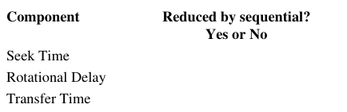
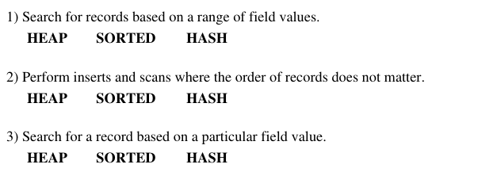

# Berkeley CS186 Fall 2000: Midterm 1: Questions

> Copied from the original: <https://hkn.eecs.berkeley.edu/exams/course/cs/186>. Text and figures are taken from the PDF as is; nothing was answered or rewritten. The original PDF is in this folder.

---

**Page 1**

&emsp;&emsp;&emsp;&emsp;&emsp;&emsp;&emsp;&emsp;**CS 186 Midterm**

&emsp;&emsp;&emsp;&emsp;&emsp;&emsp;&emsp;&emsp;**October 18, 2000**

### **Question 1 \[3 parts, 20 points total\]: Data Models**

**a) (10 points)**

Draw a (simple) E-R diagram that results in a primary key/foreign key constraint to be created between tables. 
Show the SQL statements that create the tables including the foreign key and primary key indications.

**b) (5 points)** For the relational tables you generated in question 1(a), Describe which **insert** and **delete** 
operations in this database must be checked to ensure that referential integrity is not violated for that foreign 
key. Please state specifically which operations on which relations can cause problems.

**c) (5 points)** Consider a database of employees in which we need to record information about employees' 
addresses. Name one condition which would cause you to make "address" an **entity set** of its own rather than 
an **attribute** of the employee entity set.

### **Question 2 \[3 parts, 15 points total\]: Pure Relational Languages**

Consider the following schema for an airline database (primary key attributes are in **bold**): 
FLIGHTS (**flight\_num**, source\_city, destination\_city) 
DEPARTURES (**flight\_num, date**, plane\_type) 
PASSENGERS (**passenger\_id**, passenger\_name, passenger\_address) 
BOOKINGS (**passenger\_id, flight\_num, date**, seat\_number) 
Express the following queries in **one of** (your choice): relational algebra or relational calculus. 
Feel free to use different languages for different queries and to abbreviate relation and attribute names:

**a) (5 points)** Find the cities that have direct (non-stop) flights to both Honolulu and Newark.

**b) (5 points)** Find the passenger\_name of all passengers who have a seat on at least one plane of **every** type.

CS 186 Midterm   1

---

**Page 2**

**c) (5 points)** Find the flight\_num and date of all flights for which there are no reservations.

### **Question 3 \[4 parts, 25 points total\]: SQL**

Consider the relational schema of question 2. Express the following queries in SQL (feel free to abbreviate 
relation and attribute names and to use INTERSECT and EXCEPT if you need to):

**a) (5 points)** Find the cities that have direct (non-stop) flights to both Honolulu and Newark

**b) (5 points)** Find the passenger\_id of all passengers who have a seat booked on a plane of type "747" from 
San Francisco to Washington. **Do not return any duplicate values.**

**c) (7 points)** Find the passenger\_name of all passengers who have a seat booked on at least one plane of **every** 
type.

**d) (8 points)** Print an ordered list of all source cities and the number of distinct destination cities that they 
have direct (non-stop) flights to. The list should be ordered in decreasing number of destinations and should 
contain **only those source cities that have flights to 25 or more distinct destinations**

For example, the output should look like:

&emsp;&emsp;Source\_City   NumDestinations 
&emsp;&emsp;Chicago   120 
&emsp;&emsp;Atlanta   106 
&emsp;&emsp;Boston   97 
&emsp;&emsp;...   ... 
&emsp;&emsp;Austin   25

October 18, 2000   2

---

**Page 3**

### **Question 4\[3 parts, 15 points total\]: Disks and Buffer Management**

**a) (3 points)** The main components of the cost of performing a disk read are **seek time, rotational delay**, and 
**transfer time**. For each of these three components state whether or not it is reduced by doing **sequential** 
reads rather than **random** reads.

**b) (2 points)** For the question above, which of the three is likely to result in the largest savings when 
comparing sequential reads to random reads? (No explanation necessary)

**c) (10 points)** Consider a page reference pattern that performs **three** consecutive scans over a set of **five** 
pages. Assume you start with an empty buffer pool of **three** frames. 1) How many page faults will be incurred 
with an **LRU** page replacement policy, and 2) how many will be incurred with an **MRU** page replacement 
policy?

### **Question 5 \[4 parts, 25 points total\]: Indexes and File Organization**

**a) (5 points)** Suppose that you have a file that is already **sorted** in key order and you want to construct a 
dense, clustered B+ tree index on this file using pair for data entries. A simple way to accomplish this is to 
create a B+tree, and then sequentially scan the file, inserting an index entry for each record using the normal 
B+tree insertion routine. What **performance and storage utilization problems** are there with this approach?

**b) (4 points) Briefly** describe a change to the B+tree insertion routine that would solve the problems you 
identified in part 5(a).

October 18, 2000   3

---

**Page 4**

**c) (6 points) Circle** the basic file organization (heap, sorted, or hash) that is best for a large file where the 
most frequent operations are as follows (answer each seperately - no explanation needed):

**d) (10 points)** Create a B+tree where each node can hold at most 3 pointers and 2 keys when the following 
keys are inserted in the following order: 
1, 10, 2, 11, 3, 4, 8, 5, 7

October 18, 2000   4

