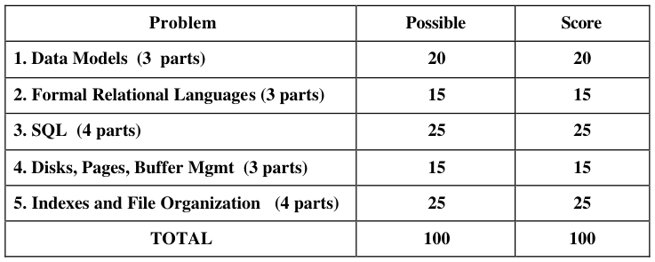
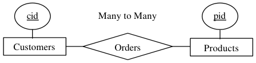
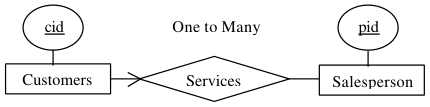
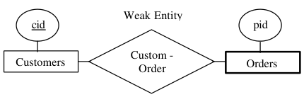
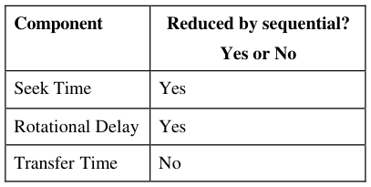
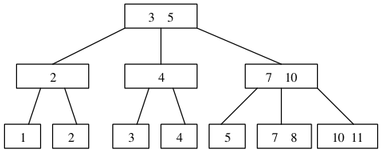
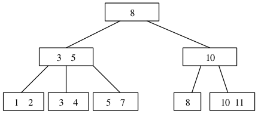
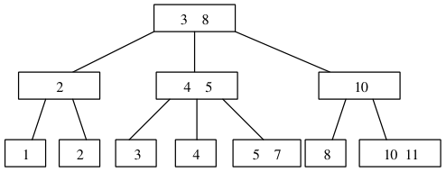
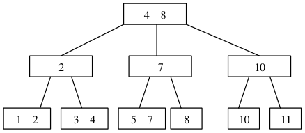

# Berkeley CS186 Fall 2000: Midterm 1: Official solutions

> Copied from the original: <https://hkn.eecs.berkeley.edu/exams/course/cs/186>. Text and figures are taken from the PDF as is; nothing was answered or rewritten. The original PDF is in this folder.

---

**Page 1**

&emsp;&emsp;&emsp;&emsp;&emsp;&emsp;&emsp;&emsp;**University of California, Berkeley** 
&emsp;&emsp;&emsp;&emsp;&emsp;&emsp;&emsp;&emsp;**College of Engineering** 
&emsp;&emsp;&emsp;&emsp;&emsp;&emsp;&emsp;&emsp;**Computer Science Division – EECS** 
Fall  2000                                            Prof. Michael J. Franklin 
&emsp;&emsp;&emsp;&emsp;&emsp;&emsp;&emsp;&emsp;**Midterm Exam - SOLUTIONS** 
&emsp;&emsp;&emsp;&emsp;&emsp;&emsp;&emsp;&emsp;October 18, 2000 
&emsp;&emsp;&emsp;&emsp;&emsp;&emsp;&emsp;&emsp;CS 186 Introduction to Database Systems

**NAME**: \_\_\_\_J. Bond\_\_\_\_\_\_\_\_\_\_\_\_\_\_\_\_\_\_\_\_\_    **STUDENT ID:\_\_\_\_007\_\_\_\_\_\_\_\_\_\_\_\_\_\_**

`Circle the last two letters of your class account:` 
`cs186 a b c d e f g h i j k l m n o p q r s t u v w x y z` 
`a b c d e f g h i j k l m n o p q r s t u v w x y z`

`DISCUSSION SECTION DAY & TIME: Saturday 10pm TA NAME: E.F. Codd` 
General Information: 
This is a **closed book** examination – but you are allowed one 8.5” x 11” sheet of notes (double 
sided).  You have 1 hour and 30 minutes to answer as many questions as possible.  Partial credit 
will be given.  There are 100 points in all.  You should read **all** of the questions before starting 
the exam, as some of the questions are substantially more time-consuming than others. 
Write all of your answers directly on this paper.  Be sure to **clearly indicate** your final answer 
for each question.  Also, be sure to state any assumptions that you are making in your answers. 
Please try to be as **concise as possible**. 
&emsp;&emsp;&emsp;&emsp;&emsp;&emsp;&emsp;&emsp;**GOOD LUCK!!!**

---

**Page 2**

Name:\_J. Bond\_\_\_\_\_\_\_\_\_\_\_\_\_\_\_\_\_\_\_\_\_                  SID:\_\_ 007\_\_\_\_\_\_\_\_\_\_\_\_\_\_

### **Question 1 \[3 parts, 20 points total\]:  Data Models**

**a)  (10  points)**  Draw a (simple) E-R diagram that results in a primary key/foreign key constraint 
to be created between tables.  Show the SQL statements that create the tables including the 
foreign key and primary key indications. 
&emsp;&emsp;&emsp;&emsp;&emsp;&emsp;&emsp;&emsp;CREATE TABLE Customers ( 
cid CHAR(10),

&emsp;&emsp;&emsp;&emsp;&emsp;&emsp;&emsp;&emsp;primary key (cid)) 
CREATE TABLE Products ( 
&emsp;&emsp;&emsp;&emsp;&emsp;&emsp;&emsp;&emsp;pid CHAR(10), 
primary key (pid)) 
&emsp;&emsp;&emsp;&emsp;&emsp;&emsp;&emsp;&emsp;CREATE TABLE Orders ( 
cid CHAR(10), 
&emsp;&emsp;&emsp;&emsp;&emsp;&emsp;&emsp;&emsp;pid CHAR(10), 
PRIMARY KEY (cid, pid), 
&emsp;&emsp;&emsp;&emsp;&emsp;&emsp;&emsp;&emsp;FOREIGN KEY (cid) REFERENCES Customers, 
FOREIGN KEY (pid) REFERENCES Products)

&emsp;&emsp;&emsp;&emsp;&emsp;&emsp;&emsp;&emsp;CREATE TABLE Salespersons (

&emsp;&emsp;&emsp;&emsp;&emsp;&emsp;&emsp;&emsp;sid CHAR(10), 
&emsp;&emsp;&emsp;&emsp;&emsp;&emsp;&emsp;&emsp;primary key (sid)) 
&emsp;&emsp;&emsp;&emsp;&emsp;&emsp;&emsp;&emsp;CREATE TABLE Customers( 
&emsp;&emsp;&emsp;&emsp;&emsp;&emsp;&emsp;&emsp;cid CHAR(10), 
&emsp;&emsp;&emsp;&emsp;&emsp;&emsp;&emsp;&emsp;sid CHAR(10), 
&emsp;&emsp;&emsp;&emsp;&emsp;&emsp;&emsp;&emsp;PRIMARY KEY (cid), 
&emsp;&emsp;&emsp;&emsp;&emsp;&emsp;&emsp;&emsp;FOREIGN KEY (sid) REFERENCES Salespersons)

&emsp;&emsp;&emsp;&emsp;&emsp;&emsp;&emsp;&emsp;CREATE TABLE Customers (

cid CHAR(10), 
&emsp;&emsp;&emsp;&emsp;&emsp;&emsp;&emsp;&emsp;primary key (cid)) 
CREATE TABLE Orders ( 
&emsp;&emsp;&emsp;&emsp;&emsp;&emsp;&emsp;&emsp;cid CHAR(10), 
pid CHAR(10), 
&emsp;&emsp;&emsp;&emsp;&emsp;&emsp;&emsp;&emsp;PRIMARY KEY (cid, pid), 
FOREIGN KEY (cid) REFERENCES Customers)

**b)  (5  points)** For the relational tables you generated in question 1(a), Describe which **insert** 
and **delete** operations in this database must be checked to ensure that referential integrity is not 
violated for that foreign key.  Please state specifically which operations on which relations can 
cause problems. 
Many to Many: 
On insert(Order)          -\> exists(Customers) and exist(Products); 
On delete(Customers)  -\> delete(Orders) or not allowed; 
On delete(Products)      -\> delete(Orders) or not allowed; 
One to Many: 
On insert(Customers)  -\> exists(Salespersons); 
On delete(Salespersons) -\> delete(Customers) or not allowed if the foreign key can not be null. 
Otherwise set\_default(Customers). 
Weak entity: 
On insert(Order)          -\> exists(Customers); 
On delete(Customers)  -\> delete(Orders) or not allowed;

CS 186 Midterm - SOLUTIONS     October 18, 2000        Page 2 of 10

---

**Page 3**

Name:\_J. Bond\_\_\_\_\_\_\_\_\_\_\_\_\_\_\_\_\_\_\_\_\_                  SID:\_\_ 007\_\_\_\_\_\_\_\_\_\_\_\_\_\_

**c) (5 points)**  Consider a database of employees in which we need to record information about 
employees’ addresses.  Name one condition which would cause you to make “address” an  **entity** 
**set** of its own rather than an **attribute** of the employee entity set. 
There are several conditions. 
&emsp;•    An employee may have more than one address and all of them are supposed to be stored 
&emsp;&emsp;in the database. 
&emsp;•    Attribute address is composed of street, city, state, etc. Components of an address may 
&emsp;&emsp;also be interesting to some queries. 
Address of an employee may be shared by another entity.

CS 186 Midterm - SOLUTIONS     October 18, 2000        Page 3 of 10

---

**Page 4**

Name:\_J. Bond\_\_\_\_\_\_\_\_\_\_\_\_\_\_\_\_\_\_\_\_\_                  SID:\_\_ 007\_\_\_\_\_\_\_\_\_\_\_\_\_\_

### **Question 2 \[3 parts, 15 points total\]:  Pure Relational Languages**

Consider the following schema for an airline database (primary key attributes are in **bold**): 
&emsp;&emsp;&emsp;&emsp;FLIGHTS (**flight\_num**, source\_city, destination\_city) 
&emsp;&emsp;&emsp;&emsp;DEPARTURES (**flight\_num, date,** plane\_type) 
&emsp;&emsp;&emsp;&emsp;PASSENGERS (**passenger\_id**, passenger\_name, passenger\_address) 
&emsp;&emsp;&emsp;&emsp;BOOKINGS( **passenger\_id**, **flight\_num, date**, seat\_number) 
Express the following queries in **one of**  (your choice): relational algebra or relational calculus. 
Feel free to use different languages for different querires and to abbreviate relation and attribute 
names: 
**a)  (5  points)**  Find the cities that have direct (non-stop) flights to both Honolulu and Newark. 
πsource\_city(σdestination\_city = “Honolulu”(FLIGHTS))∩ πsource\_city(σdestination\_city = “Newark”(FLIGHTS))

{P\|∃ F∈ FLIGHTS, ∃ G ∈ FLIGHT ( P.source\_city = F.source\_city ∧ P.source\_city = 
G.source\_city ∧ F.destination\_city = “Honolulu” ∧ G.destination\_city = “Newark”)}

**b)  (5  points)**  Find the passenger\_name of all passengers who have a seat booked on at least 
one plane of  **every**  type. 
π passenger\_name, plane\_type(PASSENGERS ∞ BOOKINGS ∞ DEPARTURES) / 
πplane\_type(DEPARTURES)

{P\|∃ P1∈PASSENGERS (∀D1∈DEPARTURES (∃ B∈BOOKINGS, ∃D2∈DEPARTURES ( 
P.passenger\_name = P1.passenger\_name ∧ P1.passenger\_id = B.passenger\_id ∧ B.flight\_num = 
D2.flight\_num ∧B.date = D2.date ∧D1.plane\_type = D2.plane\_type)))}

**c)  (5  points)** Find the flight\_num and date of all flights for which there are no reservations. 
πflight\_num, date(DEPARTURES) - πflight\_num, date(BOOKINGS)

{P\|∃ D ∈ DEPARTURES (P.flight\_num = D.flight\_num ∧P.date = D.date ∧∀B∈ BOOKINGS 
(D.flight\_num \<\> B.flight\_num ∨ D.date \<\> B.date))}

CS 186 Midterm - SOLUTIONS     October 18, 2000        Page 4 of 10

---

**Page 5**

Name:\_J. Bond\_\_\_\_\_\_\_\_\_\_\_\_\_\_\_\_\_\_\_\_\_                  SID:\_\_ 007\_\_\_\_\_\_\_\_\_\_\_\_\_\_

### **Question 3 \[4 parts, 25 points total\]: SQL**

Consider the relational schema of question 2.  Express the following queries in SQL (feel free to 
abbreviate relation and  attribute names and to use INTERSECT and EXCEPT if you need to): 
**a)  (5  points)**  Find the cities that have direct (non-stop) flights to both Honolulu and Newark

&emsp;&emsp;`SELECT DISTINCT source_city` 
&emsp;&emsp;`FROM Flights F` 
&emsp;&emsp;`WHERE F.dest_city = “Honolulu”` 
&emsp;&emsp;`AND F.source_city IN` 
&emsp;&emsp;`(SELECT source_city` 
&emsp;&emsp;`FROM Flights F2` 
&emsp;&emsp;`WHERE dest_city = “Newark”)`

Could also be done with a self join on Flights, or with INTERSECT, or…, just can’t use a simple 
selction with “AND” in the Where clause --- this would return no tuples

**b)  (5  points)** Find the passenger\_id of all passengers who have a seat booked on a plane of type 
\`\`747'' from San Francisco to Washington.  **Do not return any duplicate values.**

&emsp;&emsp;`SELECT DISTINCT B.passenger_id` 
&emsp;&emsp;`FROM Flights F, Departures D, Bookings B` 
&emsp;&emsp;`WHERE B.flight_num = D.flight_num` 
&emsp;&emsp;`AND B.date = D.date` 
&emsp;&emsp;`AND F.flight_num = D.flight_num` 
&emsp;&emsp;`AND F.source_city = “San Francisco”` 
&emsp;&emsp;`AND F.destination_city = “Washington”` 
&emsp;&emsp;`AND D.plane_type = “747”`

Since key of Departures is flight\_num and date, you need both of these to do the join and find out 
what type of plane the passenger is booked on.

CS 186 Midterm - SOLUTIONS     October 18, 2000        Page 5 of 10

---

**Page 6**

Name:\_J. Bond\_\_\_\_\_\_\_\_\_\_\_\_\_\_\_\_\_\_\_\_\_                  SID:\_\_ 007\_\_\_\_\_\_\_\_\_\_\_\_\_\_

**c)  (7 points)**   Find the passenger\_name of all passengers who have a seat booked on at least one 
plane of  **every**  type.

&emsp;&emsp;`SELECT DISTINCT passenger_name` 
&emsp;&emsp;`FROM Passengers P` 
&emsp;&emsp;`WHERE` 
&emsp;&emsp;`(SELECT COUNT(DISTINCT D.plane_type)` 
&emsp;&emsp;`FROM Departures D, Bookings B` 
&emsp;&emsp;`WHERE D.flight_num = B.flight_num` 
&emsp;&emsp;`AND D.date = B.date` 
&emsp;&emsp;`AND B.passenger_id = P.passenger_id)` 
&emsp;&emsp;`=` 
&emsp;&emsp;`(SELECT COUNT(DISTINCT D.plane_type)` 
&emsp;&emsp;`FROM Departures D)`

Alternatively: 
&emsp;&emsp;`SELECT DISTINCT P.passenger_name` 
&emsp;&emsp;`FROM Passengers P` 
&emsp;&emsp;`WHERE NOT EXISTS` 
&emsp;&emsp;`(SELECT D.plane_type` 
&emsp;&emsp;`FROM Departures D` 
&emsp;&emsp;`WHERE NOT EXITS` 
&emsp;&emsp;&emsp;&emsp;`(SELECT *` 
&emsp;&emsp;`FROM Departures D2, Bookings B` 
&emsp;&emsp;`WHERE D2.flight_num = B.flight_num` 
&emsp;&emsp;`AND D2.date = B.date` 
&emsp;&emsp;`AND B.passenger_id = P.passenger_id` 
&emsp;&emsp;&emsp;&emsp;&emsp;`AND D.plane_type = D2.plane_type))`

The first one is easier and does it by counting the number of plane types(we used a similar 
technique in class).  The second is trickier but is similar to the technique used in the book.

CS 186 Midterm - SOLUTIONS     October 18, 2000        Page 6 of 10

---

**Page 7**

Name:\_J. Bond\_\_\_\_\_\_\_\_\_\_\_\_\_\_\_\_\_\_\_\_\_                  SID:\_\_ 007\_\_\_\_\_\_\_\_\_\_\_\_\_\_

**d)  (8  points)**  Print an ordered list of all source cities and the number of  distinct destination 
cities that they have direct (non-stop) flights to.  The list should be ordered in decreasing number 
of destinations and should contain **only those source cities that have flights to 25 or more** 
**distinct destinations**. 
For example, the output should look like: 
&emsp;&emsp;Source\_City           NumDestinations 
&emsp;&emsp;Chicago                120 
&emsp;&emsp;Atlanta                  106 
&emsp;&emsp;Boston              97 
&emsp;&emsp;...                        ... 
&emsp;&emsp;Austin                   25

&emsp;&emsp;`SELECT source_city,` 
&emsp;&emsp;&emsp;&emsp;&emsp;&emsp;`COUNT(DISTINCT destination_city) AS NumDestinations` 
&emsp;&emsp;`FROM Flights F` 
&emsp;&emsp;`GROUP BY source_city` 
&emsp;&emsp;`HAVING NumDestinations >= 25` 
&emsp;&emsp;`ORDER BY NumDestinations DESC`

CS 186 Midterm - SOLUTIONS     October 18, 2000        Page 7 of 10

---

**Page 8**

Name:\_J. Bond\_\_\_\_\_\_\_\_\_\_\_\_\_\_\_\_\_\_\_\_\_                  SID:\_\_ 007\_\_\_\_\_\_\_\_\_\_\_\_\_\_

### **Question 4 \[3 parts, 15  points total\]:  Disks and Buffer Management**

**a)  (3  points)**  The main components of the cost of performing a disk read are **seek time,** 
**rotational delay**, and **transfer time**. For each of these three components state whether or not it 
is reduced by doing  **sequential** reads rather than **random** reads:

**b) (2  points)** For the question above, which of the three is likely to result in the largest savings 
when comparing sequential reads to random reads?  (No explanation necessary) 
Seek Time 
**c) (10  points)**  Consider a page reference pattern that performs **three**  consecutive scans over a 
set of **five** pages. Assume you start with an empty buffer pool of **three** frames.  1) How many 
page faults will be incurred with an **LRU** page replacement policy, and  2) how many will be 
incurred with an **MRU** page replacement policy? 
1\) 15 page faults

2\) 9 Page faults

CS 186 Midterm - SOLUTIONS     October 18, 2000        Page 8 of 10

---

**Page 9**

Name:\_J. Bond\_\_\_\_\_\_\_\_\_\_\_\_\_\_\_\_\_\_\_\_\_                  SID:\_\_ 007\_\_\_\_\_\_\_\_\_\_\_\_\_\_

### **Question 5 \[4 parts, 25  points total\]:  Indexes and File Organization**

**a)  (5  points)**  Suppose that you have a file that is already **sorted** in key order and you want to 
construct a dense, clustered B+ tree index on this file using \<key, RID\> pairs for data entries. A 
simple way to accomplish this is to create a B+tree, and then sequentially scan the file, inserting 
an index entry for each record using the normal B+tree insertion routine.  What **performance** 
**and storage utilization problems** are there with this approach?

Performance and storage utilization problem: Most leaf nodes are half full as a result of inserting 
sorted key values and splitting nodes at the leaf level in a way that each of the two nodes is half 
full. So utilization is roughly 50%. Also because the tree is large, the performance is not good.

Another performance problem is that to insert each key, the B+ tree is traversed from root to the 
leaf.

**b)  (4  points)  Briefly** describe a change to the B+tree insertion routine that would solve the 
problems you identified in part 5(a). 
Two solutions: 
&emsp;•    One is to change the splitting method. When a leaf node is split, do not move half key 
&emsp;&emsp;values to the newly created node. Just move the last key to the new node so that the left 
&emsp;&emsp;node is still full. 
&emsp;•    Bulk loading. That is to build B+ tree bottom up from sorted key values.

**c) (6 points) Circle** the basic file organization (heap, sorted, or hash) that is best for a large file 
where the most frequent operations are as follows (answer each separately – no explanation 
needed): 
&emsp;&emsp;1\) Search for records based on a range of field values.

&emsp;&emsp;&emsp;&emsp;**HEAP**         **HASH**

&emsp;&emsp;2\) Perform inserts and scans where the order of records does not matter.

&emsp;&emsp;&emsp;&emsp;&emsp;&emsp;&emsp;&emsp;**SORTED**         **HASH**

&emsp;&emsp;3\) Search for a record based on a particular field value.

&emsp;&emsp;&emsp;&emsp;&emsp;**HEAP**         **SORTED**

CS 186 Midterm - SOLUTIONS     October 18, 2000        Page 9 of 10

---

**Page 10**

Name:\_J. Bond\_\_\_\_\_\_\_\_\_\_\_\_\_\_\_\_\_\_\_\_\_                  SID:\_\_ 007\_\_\_\_\_\_\_\_\_\_\_\_\_\_

**d)  (10  points)**  Create  a B+tree where each node can hold at most 3 pointers and 2 keys 
when the following keys are inserted in the following order: 
1, 10, 2, 11, 3, 4, 8, 5, 7 
Tree 1:

Tree 2:

Tree 3:

Tree 4 (different search algorithm):

CS 186 Midterm - SOLUTIONS     October 18, 2000        Page 10 of 10

