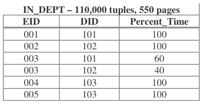
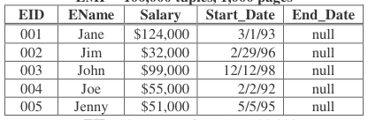
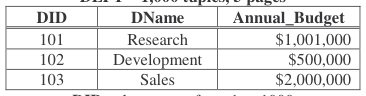
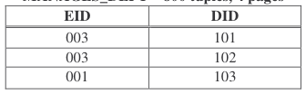
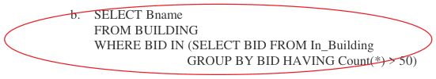
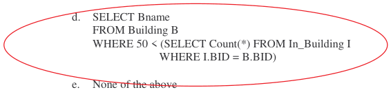
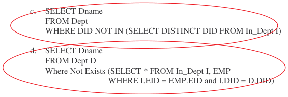
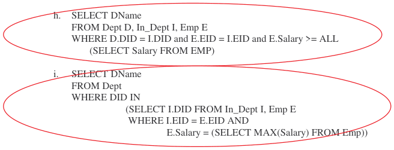

# Berkeley CS186 Spring 2000: Final: Official solutions

> Copied from the original: <https://hkn.eecs.berkeley.edu/exams/course/cs/186>. Text and figures are taken from the PDF as is; nothing was answered or rewritten. The original PDF is in this folder.

---

**Page 1**

&emsp;&emsp;&emsp;&emsp;&emsp;&emsp;&emsp;&emsp;UNIVERSITY OF CALIFORNIA 
&emsp;&emsp;&emsp;&emsp;&emsp;&emsp;&emsp;&emsp;Department of EECS, Computer Science Division 
CS186    Final Exam 
May 16, 2000 
&emsp;&emsp;&emsp;&emsp;&emsp;**Final Exam: Introduction to Database Systems** 
This exam has seven sections, each with one or more problems.  Each problem may be made up of multiple 
questions.  You should read through the exam quickly and plan your time-management accordingly.  Before 
beginning to answer a question, be sure to read it carefully and to answer all parts of every question!

REFERENCE DATABASE . This is the Reference Database referred to in some of the questions. 
&emsp;&emsp;There are six tables describing a company, describing employees, departments, buildings,  which 
&emsp;&emsp;department(s) an employee works in (and a percentage of the time for each),  department managers 
&emsp;&emsp;(possibly more than one per department), and in which building an employee works (an employee may 
&emsp;&emsp;have more than one office). The primary key of each table is the attribute(s) in capitals.  Other 
&emsp;&emsp;attributes are not necessarily unique.

&emsp;&emsp;&emsp;**EMP – 100,000 tuples, 1,000 pages**

&emsp;&emsp;&emsp;**EID** values range from 1 to 100,000 
&emsp;&emsp;&emsp;&emsp;&emsp;&emsp;&emsp;&emsp;**IN\_BUILDING – 110.000 tuples, 550 pages**

&emsp;&emsp;&emsp;**BUILDING – 2,000 tuples, 10 pages**

&emsp;&emsp;&emsp;**BID** values range from 1 to 2,000

&emsp;&emsp;&emsp;&emsp;**DEPT – 1,000 tuples, 5 pages** 
&emsp;&emsp;&emsp;&emsp;&emsp;&emsp;&emsp;&emsp;**MANAGES\_DEPT – 800 tuples, 4 pages**

&emsp;&emsp;&emsp;**DID** values range from 1 to 1000

---

**Page 2**

**Name\_\_\_\_\_\_\_\_\_\_\_\_\_\_\_\_\_\_\_\_\_\_\_\_\_\_\_\_\_\_\_\_\_\_\_\_\_\_\_\_\_\_\_\_\_\_\_\_      Login\_\_\_\_\_\_\_\_\_\_\_\_\_\_\_\_\_\_\_\_\_\_\_**

I. **SQL** – All queries are based on the sample schema shown on the first page.  Assume 
&emsp;that the tables have many more rows than are shown there.  15 Points. 
&emsp;1\. Which of the following queries finds the names of buildings where more than 50 employees work? 
&emsp;&emsp;**(Circle as many as are correct.) (5 points)** 
&emsp;&emsp;&emsp;a.    SELECT Bname 
&emsp;&emsp;&emsp;&emsp;FROM IN\_BUILDING 
&emsp;&emsp;&emsp;&emsp;GROUP\_BY BID 
&emsp;&emsp;&emsp;&emsp;WHERE Count(\*) \> 50

&emsp;&emsp;&emsp;c.    SELECT Bname 
&emsp;&emsp;&emsp;&emsp;FROM Building B, In\_Building I 
&emsp;&emsp;&emsp;&emsp;WHERE B.BID = I.BID 
&emsp;&emsp;&emsp;&emsp;GROUP BY B.BID 
&emsp;&emsp;&emsp;&emsp;HAVING Count(\*) \> 50

&emsp;2\. Which of the following queries finds the name of Departments where no employees work?  **(Circle** 
&emsp;&emsp;**as many as are correct.) (5 points)** 
&emsp;&emsp;&emsp;a.    SELECT Dname 
&emsp;&emsp;&emsp;&emsp;FROM Dept 
&emsp;&emsp;&emsp;&emsp;WHERE DID IN (SELECT I.DID FROM In\_Dept I 
&emsp;&emsp;&emsp;&emsp;GROUP BY I.DID HAVING COUNT(\*) = 0) 
&emsp;&emsp;&emsp;b. SELECT Dname 
&emsp;&emsp;&emsp;&emsp;FROM Dept D, In\_Dept I, Emp E 
&emsp;&emsp;&emsp;&emsp;WHERE I.EID = E.EID and D.DID = I.DID and Count(E.EID) = 0

&emsp;&emsp;&emsp;e.    None of the above

CS186 March 6  Midterm    Page 2 
&emsp;&emsp;&emsp;&emsp;&emsp;&emsp;&emsp;&emsp;Points for this page: \_\_\_\_\_\_\_\_\_\_\_

---

**Page 3**

**Name\_\_\_\_\_\_\_\_\_\_\_\_\_\_\_\_\_\_\_\_\_\_\_\_\_\_\_\_\_\_\_\_\_\_\_\_\_\_\_\_\_\_\_\_\_\_\_\_      Login\_\_\_\_\_\_\_\_\_\_\_\_\_\_\_\_\_\_\_\_\_\_\_**

Which of the following queries finds the name of the Department(s) where the highest paid employee 
works?  **(Circle as many as are correct.) (5 points)** 
&emsp;&emsp;f.    SELECT D.Dname 
&emsp;&emsp;&emsp;FROM Dept D 
&emsp;&emsp;&emsp;WHERE D.DID IN (SELECT T.DID, MAX(Salary) FROM Dept T, In\_Dept I, Emp E 
&emsp;&emsp;&emsp;WHERE T.DID = I.DID and E.EID = I.EID) 
&emsp;&emsp;g. SELECT Dname 
&emsp;&emsp;&emsp;FROM Dept D, In\_Dept I, Emp E 
&emsp;&emsp;&emsp;WHERE D.DID = I.DID and E.EID = I.EID and E.Salary = MAX(Salary)

&emsp;&emsp;**j.**    None of the above

CS186 March 6  Midterm    Page 3 
&emsp;&emsp;&emsp;&emsp;&emsp;&emsp;&emsp;&emsp;Points for this page: \_\_\_\_\_\_\_\_\_\_\_

---

**Page 4**

**Name\_\_\_\_\_\_\_\_\_\_\_\_\_\_\_\_\_\_\_\_\_\_\_\_\_\_\_\_\_\_\_\_\_\_\_\_\_\_\_\_\_\_\_\_\_\_\_\_      Login\_\_\_\_\_\_\_\_\_\_\_\_\_\_\_\_\_\_\_\_\_\_\_**

**Implementation of Relational Operators – 18 points** 
Consider the schema on the first page, and the number of tuples and pages for each 
relation shown there.  Let “×” be the join operator, and “A×B” means join with A as the 
outer relation and B as the inner. 
As we did in class, when computing the cost for join algorithms, you may ignore output 
cost (since this is the same for all algorithms). 
**Note**: you have 9 pages of main memory to work with in these problems.

&emsp;1\. Consider the operation: σ **(EID \< 5000)EMP** (2 points) 
&emsp;&emsp;&emsp;a) What is the I/O cost of this operation?**1000** 
&emsp;&emsp;&emsp;b) What is the reduction factor? **0.05 = 1/20**

&emsp;**2.** Consider the join: **In\_Dept** × **Dept**  (4 points) 
&emsp;&emsp;&emsp;a) What is the I/O cost of  this using Blocked Nested Loops?  \_\_\_\_ 
&emsp;&emsp;&emsp;**945 = 550 + Ceiling(550/7)\*5** 
&emsp;&emsp;&emsp;b) What is the I/O cost of this using Index Nested Loops, with a Hash index on Dept.DID? 
&emsp;&emsp;&emsp;**242,550 = 550 + 110,000 \* 2.2** 
&emsp;**3.** Consider the join: **Dept** × **In\_Dept** (4 points) 
&emsp;&emsp;&emsp;**a)** What is the I/O cost of this using Blocked Nested Loops? 
&emsp;&emsp;&emsp;**555 = 5 + Ceiling(5/7)\*550** 
&emsp;&emsp;&emsp;**b)** What is the I/O cost of this using Index Nested Loops, with a Hash index on 
&emsp;&emsp;&emsp;&emsp;&emsp;In\_Dept.DID?   **I accepted both:** 
&emsp;&emsp;&emsp;**2205 = 5 + 1000\*2.2** 
&emsp;&emsp;&emsp;**242,005 = 5 + 1000 \* 2.2 \* 110  (the approx #matches is 110)** 
&emsp;**4.** Consider the join**: EMP** × **In\_Building (**8 points) 
&emsp;&emsp;&emsp;**a)** What is the I/O cost of this using Blocked Nested Loops? 
&emsp;&emsp;&emsp;**79650 = 1000 + Ceiling(1000/7)\*550** 
&emsp;&emsp;&emsp;**b)** What is the I/O cost to sort EMP? 
&emsp;&emsp;&emsp;**8000 = 2\*1000(Ceiling(Log8(1000/9)) + 1)** 
&emsp;&emsp;&emsp;**c)** What is the I/O cost to sort In\_Building? 
&emsp;&emsp;&emsp;**3300 = 2\*550(Ceiling(Log8(550/9)) + 1)** 
&emsp;&emsp;&emsp;**d)** What is the total I/O cost to do this using Sort/Merge join? 
&emsp;&emsp;&emsp;**12850 = 8000 + 3300 + 1000 + 550**

CS186 March 6  Midterm    Page 4 
&emsp;&emsp;&emsp;&emsp;&emsp;&emsp;&emsp;&emsp;Points for this page: \_\_\_\_\_\_\_\_\_\_\_

---

**Page 5**

**Name\_\_\_\_\_\_\_\_\_\_\_\_\_\_\_\_\_\_\_\_\_\_\_\_\_\_\_\_\_\_\_\_\_\_\_\_\_\_\_\_\_\_\_\_\_\_\_\_      Login\_\_\_\_\_\_\_\_\_\_\_\_\_\_\_\_\_\_\_\_\_\_\_**

&emsp;**II. Query Optimization – 13 points** 
Consider the schema shown on the first page and especially the number of tuples and 
pages for each relation. 
Consider the following query: 
&emsp;&emsp;Select  Bname 
&emsp;&emsp;From EMP E, Building B, In\_Building I 
&emsp;&emsp;Where E.EID \< 500 and E.EID = I.EID and B.BID = I.BID 
&emsp;1\. Write this query in relational algebra. (3 points) 
&emsp;Π **Bname** σ **(EID \< 500) (Emp** × **In\_Building** × **Building)**

&emsp;2\. If the database has an unclustered B-Tree index on EMP.EID, what is the best plan you can find to 
&emsp;&emsp;execute this query?  Do your work on the additional pages at the back of the exam, and show the 
&emsp;&emsp;query plan here, including the costs for each step and the total cost. (10 points)

&emsp;**This was graded such that I looked for a plan tree, computation of costs at each** 
&emsp;**step, and some consideration of reduction factors.**

CS186 March 6  Midterm    Page 5 
&emsp;&emsp;&emsp;&emsp;&emsp;&emsp;&emsp;&emsp;Points for this page: \_\_\_\_\_\_\_\_\_\_\_

---

**Page 6**

&emsp;**Name\_\_\_\_\_\_\_\_\_\_\_\_\_\_\_\_\_\_\_\_\_\_\_\_\_\_\_\_\_\_\_\_\_\_\_\_\_\_\_\_\_\_\_\_\_\_\_\_      Login\_\_\_\_\_\_\_\_\_\_\_\_\_\_\_\_\_\_\_\_\_\_\_**

**III. Normalization – 15 points** 
&emsp;Consider the follow attributes and functional dependencies: 
&emsp;A B C D E F H 
&emsp;A→ D 
&emsp;AE → H 
&emsp;DF → BC 
&emsp;E → C 
&emsp;H → E

&emsp;&emsp;&emsp;1\. List all keys (**not** superkeys): (3 points)

&emsp;**AEF** 
&emsp;**AFH**

&emsp;&emsp;&emsp;2\. Which of the following dependencies are implied by those above: (4 points)

&emsp;&emsp;&emsp;&emsp;&emsp;&emsp;a. 
&emsp;&emsp;&emsp;&emsp;&emsp;&emsp;c. 
&emsp;&emsp;&emsp;&emsp;&emsp;&emsp;e.

&emsp;&emsp;&emsp;3\. Consider the decomposition into 4 relations: (AEH)  (ABCF)  (AD)  (CE).  Is this 
&emsp;&emsp;&emsp;&emsp;&emsp;decomposition in (circle all that apply): (4 points) 
&emsp;&emsp;&emsp;&emsp;&emsp;&emsp;a.    BCNF 
&emsp;&emsp;&emsp;&emsp;&emsp;&emsp;b. 3NF 
&emsp;&emsp;&emsp;&emsp;&emsp;&emsp;c.    1NF 
&emsp;&emsp;&emsp;&emsp;&emsp;&emsp;d. None of the above

&emsp;&emsp;&emsp;4\. Consider the decomposition into 3 relations: (AD)  (EC)  (ABEFH).  Is this decomposition in 
&emsp;&emsp;&emsp;&emsp;&emsp;(circle all that apply): (4 points) 
&emsp;&emsp;&emsp;&emsp;&emsp;&emsp;a.    BCNF 
&emsp;&emsp;&emsp;&emsp;&emsp;&emsp;b. 3NF 
&emsp;&emsp;&emsp;&emsp;&emsp;&emsp;c.    1NF 
&emsp;&emsp;&emsp;&emsp;&emsp;&emsp;d. None of the above

&emsp;CS186 March 6  Midterm    Page 6 
&emsp;&emsp;&emsp;&emsp;&emsp;&emsp;&emsp;&emsp;Points for this page: \_\_\_\_\_\_\_\_\_\_\_

---

**Page 7**

&emsp;**Name\_\_\_\_\_\_\_\_\_\_\_\_\_\_\_\_\_\_\_\_\_\_\_\_\_\_\_\_\_\_\_\_\_\_\_\_\_\_\_\_\_\_\_\_\_\_\_\_      Login\_\_\_\_\_\_\_\_\_\_\_\_\_\_\_\_\_\_\_\_\_\_\_**

**IV. Concurrency Control and Crash Recovery: LOCKING – 15 Points** 
&emsp;Locking is the most popular concurrency control technique implemented by commercial database 
&emsp;management systems. 
&emsp;&emsp;&emsp;1\. Consider a database that is read-only (i.e., no transactions change any data in the database, 
&emsp;&emsp;&emsp;&emsp;&emsp;data may be loaded into the database when the database is off-line).  Suppose serializability 
&emsp;&emsp;&emsp;&emsp;&emsp;needs to be supported.  Please circle all correct statements: (5 points) 
&emsp;&emsp;&emsp;&emsp;&emsp;&emsp;a.    No locking is necessary. 
&emsp;&emsp;&emsp;&emsp;&emsp;&emsp;b. Only read locks are necessary and they need to be held until end of transaction. 
&emsp;&emsp;&emsp;&emsp;&emsp;&emsp;c.    Only read locks are necessary but they can be released as soon as the read is 
&emsp;&emsp;&emsp;&emsp;&emsp;&emsp;&emsp;complete. 
&emsp;&emsp;&emsp;&emsp;&emsp;&emsp;d. Both read and write locks are necessary and locking must be done in two phases. 
&emsp;&emsp;&emsp;&emsp;&emsp;&emsp;e.    None of the above. 
&emsp;Consider the following database schema: 
&emsp;&emsp;&emsp;STUDENT(name, sid, gpa, level, dept) 
&emsp;&emsp;&emsp;Suppose the following two transactions are executed concurrently: 
&emsp;&emsp;&emsp;T1:    begin tran 
&emsp;&emsp;&emsp;update STUDENT set gpa = 4.0 where dept = 'CS' 
&emsp;&emsp;commit tran 
&emsp;&emsp;&emsp;T2:    begin tran 
&emsp;&emsp;insert into STUDENT values ('Mihut', 101, 3.9, 4, 'CS') 
&emsp;&emsp;insert into STUDENT values ('Sirish', 102, 3.9, 3, 'CS') 
&emsp;&emsp;commit tran

&emsp;&emsp;&emsp;2\. Assume Mihut and Sirish were not in the STUDENT table before the start of T1 or T2. 
&emsp;&emsp;&emsp;&emsp;&emsp;Suppose read locks are released immediately after the read is done and write locks are held 
&emsp;&emsp;&emsp;&emsp;&emsp;until end of transaction.  Can it ever happen that after both T1 and T2 have committed, Mihut 
&emsp;&emsp;&emsp;&emsp;&emsp;and Sirish have different gpa values?  Please state your reasoning in support of your 
&emsp;&emsp;&emsp;&emsp;&emsp;conclusion.  If your answer depends on locking granularity, access methods or indexing, 
&emsp;&emsp;&emsp;&emsp;&emsp;please analyze the possibilities. (10 points) 
&emsp;&emsp;&emsp;**This was an example of the Phantom Problem.  If you only have row-level** 
&emsp;&emsp;&emsp;**locking, Mihut & Sirish may end up with different GPAs.  If you have table-level** 
&emsp;&emsp;&emsp;**locking, they will end up with the same GPA.**

&emsp;CS186 March 6  Midterm    Page 7 
&emsp;&emsp;&emsp;&emsp;&emsp;&emsp;&emsp;&emsp;Points for this page: \_\_\_\_\_\_\_\_\_\_\_

---

**Page 8**

**Name\_\_\_\_\_\_\_\_\_\_\_\_\_\_\_\_\_\_\_\_\_\_\_\_\_\_\_\_\_\_\_\_\_\_\_\_\_\_\_\_\_\_\_\_\_\_\_\_      Login\_\_\_\_\_\_\_\_\_\_\_\_\_\_\_\_\_\_\_\_\_\_\_**

&emsp;**Concurrency Control and Crash Recovery: WRITE-AHEAD LOGGING – 12** 
&emsp;**points** 
&emsp;Write-ahead logging is the most popular recovery technique. 
&emsp;&emsp;1\. Checkpoint is a technique that can reduce recovery time after a crash.  Please circle the correct 
&emsp;&emsp;&emsp;statements: (4 points) 
&emsp;&emsp;&emsp;a.    After a soft crash (which does not affect data on hard drives), the log only needs to be 
&emsp;&emsp;&emsp;&emsp;&emsp;scanned back until the last checkpoint is found.  The log beyond the last checkpoint will 
&emsp;&emsp;&emsp;&emsp;&emsp;not be read during the recovery process. 
&emsp;&emsp;&emsp;b. Once a checkpoint is done, the log can be truncated. 
&emsp;&emsp;&emsp;c.    Checkpoint is automatically performed after every transaction commit. 
&emsp;&emsp;&emsp;d. Checkpoints should be done after every update to the database. 
&emsp;&emsp;&emsp;e.    None of the above. 
&emsp;&emsp;2\. This question deals with when updated data pages (dirty pages) must be written to disk. 
&emsp;&emsp;&emsp;Please circle the correct statements: (4 points) 
&emsp;&emsp;&emsp;a.    Updated pages must be written to disk immediately after the update. 
&emsp;&emsp;&emsp;b. Dirty pages must be written to disk at transaction commit time but before the transaction 
&emsp;&emsp;&emsp;&emsp;&emsp;log is written to disk. 
&emsp;&emsp;&emsp;c.    Dirty pages must be written to disk at transaction commit time but after the transaction 
&emsp;&emsp;&emsp;&emsp;&emsp;log is written to disk. 
&emsp;&emsp;&emsp;d. A dirty page must be written to disk when it is replaced from the buffer pool. 
&emsp;&emsp;&emsp;e.    None of the above. 
&emsp;&emsp;3\. Since a database log can grow without limits, the log should be truncated at some point. 
&emsp;&emsp;&emsp;Where can the log be truncated? (4 points)

&emsp;&emsp;**Mihut will provide the key to this question.**

CS186 March 6  Midterm    Page 8 
&emsp;&emsp;&emsp;&emsp;&emsp;&emsp;&emsp;&emsp;Points for this page: \_\_\_\_\_\_\_\_\_\_\_

---

**Page 9**

**Name\_\_\_\_\_\_\_\_\_\_\_\_\_\_\_\_\_\_\_\_\_\_\_\_\_\_\_\_\_\_\_\_\_\_\_\_\_\_\_\_\_\_\_\_\_\_\_\_      Login\_\_\_\_\_\_\_\_\_\_\_\_\_\_\_\_\_\_\_\_\_\_\_**

**V. Concurrency Control and Crash Recovery: RECOVERY – 12 points**

&emsp;&emsp;1\. If the buffer pool is large enough that uncommited data are never forced to disk, is UNDO still 
&emsp;&emsp;&emsp;necessary?  How about REDO? (4 points) 
&emsp;&emsp;&emsp;UNDO 
&emsp;&emsp;&emsp;&emsp;a) YES 
&emsp;&emsp;&emsp;&emsp;b) NO 
&emsp;&emsp;&emsp;REDO 
&emsp;&emsp;&emsp;&emsp;c) YES 
&emsp;&emsp;&emsp;&emsp;d) NO

&emsp;&emsp;2\. If updates are always forced to disk when a transaction commits, is UNDO still necessary?  How 
&emsp;&emsp;&emsp;about REDO? (4 points) 
&emsp;&emsp;&emsp;UNDO 
&emsp;&emsp;&emsp;&emsp;a) YES 
&emsp;&emsp;&emsp;&emsp;b) NO

&emsp;&emsp;&emsp;REDO 
&emsp;&emsp;&emsp;&emsp;c) YES 
&emsp;&emsp;&emsp;&emsp;d) NO

&emsp;&emsp;3\. With checkpoint, after a softcrash, where in the log should REDO start?  Where should UNDO 
&emsp;&emsp;&emsp;start? (4 points) 
&emsp;&emsp;&emsp;&emsp;a) REDO: 
&emsp;&emsp;&emsp;&emsp;**At the smallest recLSN in the dirty page table.**

&emsp;&emsp;&emsp;&emsp;b) UNDO: 
&emsp;&emsp;&emsp;&emsp;**At the last LSN for each transaction to be undone.**

CS186 March 6  Midterm    Page 9 
&emsp;&emsp;&emsp;&emsp;&emsp;&emsp;&emsp;&emsp;Points for this page: \_\_\_\_\_\_\_\_\_\_\_

---

**Page 10**

**Name\_\_\_\_\_\_\_\_\_\_\_\_\_\_\_\_\_\_\_\_\_\_\_\_\_\_\_\_\_\_\_\_\_\_\_\_\_\_\_\_\_\_\_\_\_\_\_\_      Login\_\_\_\_\_\_\_\_\_\_\_\_\_\_\_\_\_\_\_\_\_\_\_**

&emsp;&emsp;&emsp;Extra Credit – 8 points 
&emsp;•    **Broadbase: Data Marts & OLAP (2 points)** - The presenter from BroadBase described how 
&emsp;&emsp;&emsp;their database uses “Cubes”, pre-computed indexes of aggregate information.  In 15 words or 
&emsp;&emsp;&emsp;less, what aspect of the workload allows them to use “Cubes”? 
&emsp;**A read-only workload allows them to use cubes, which otherwise would be very** 
&emsp;**expensive.**

&emsp;•    **Evite: Managing data at a Web Site (5 points)** - The presenter from E-Vite expressed opinions 
&emsp;&emsp;&emsp;on the following topics w.r.t. their DBMS.  In 10 words or less, what were her opinions of: 
&emsp;&emsp;&emsp;&emsp;i. Primary Keys 
&emsp;&emsp;&emsp;&emsp;&emsp;**They don’t use them because they slow the database.** 
&emsp;&emsp;&emsp;&emsp;ii. Integrity Constraints 
&emsp;&emsp;&emsp;&emsp;&emsp;**They don’t use them because they slow the database.** 
&emsp;&emsp;&emsp;&emsp;iii. Blobs 
&emsp;&emsp;&emsp;&emsp;&emsp;**They keep them separate because they slow the database.** 
&emsp;&emsp;&emsp;&emsp;iv. Indexes 
&emsp;&emsp;&emsp;&emsp;&emsp;**Very important for making the database fast.** 
&emsp;&emsp;E-vite uses the log for an interesting purpose not discussed in the book.  In 15 words or less, what 
&emsp;&emsp;unusual thing do they do with the log? 
&emsp;**They copy the log from one machine to another to keep a backup DBMS always** 
&emsp;**running, ready, and up-to-date.** 
&emsp;•    **MineSet: Data Mining (1 point)** - Name a data mining algorithm mentioned in the guest lecture 
&emsp;&emsp;on Data Mining: 
&emsp;**Decision Trees, Clustering, Neural Nets**

CS186 March 6  Midterm    Page 10 
&emsp;&emsp;&emsp;&emsp;&emsp;&emsp;&emsp;&emsp;Points for this page: \_\_\_\_\_\_\_\_\_\_\_

