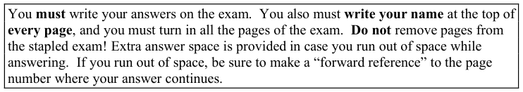
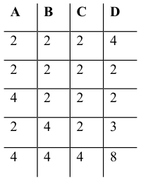
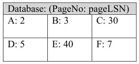
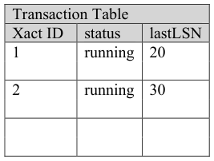
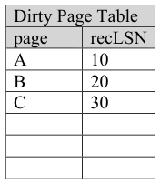
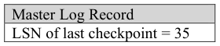
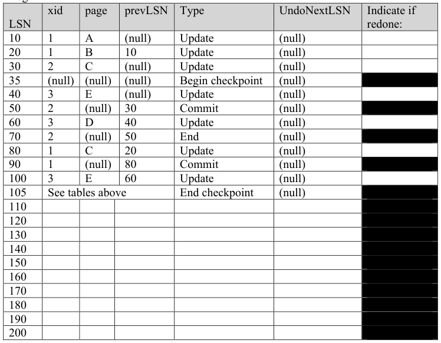

# Berkeley CS186 Spring 2001: Final: Questions

> Copied from the original: <https://hkn.eecs.berkeley.edu/exams/course/cs/186>. Text and figures are taken from the PDF as is; nothing was answered or rewritten. The original PDF is in this folder.

---

**Page 1**

&emsp;&emsp;&emsp;&emsp;&emsp;&emsp;&emsp;&emsp;**Name\_\_\_\_\_\_\_\_\_\_\_\_\_\_\_\_\_\_\_\_\_\_\_\_\_\_\_\_\_\_** 
&emsp;&emsp;&emsp;&emsp;&emsp;&emsp;&emsp;&emsp;**Class Account \_\_\_\_\_\_\_\_\_\_\_\_\_\_\_\_\_\_\_\_\_\_\_\_\_\_\_\_** 
&emsp;&emsp;&emsp;&emsp;&emsp;&emsp;&emsp;&emsp;UNIVERISTY OF CALIFORNIA, BERKELEY 
&emsp;&emsp;&emsp;&emsp;&emsp;&emsp;&emsp;&emsp;College of Engineering 
&emsp;&emsp;&emsp;&emsp;&emsp;&emsp;&emsp;&emsp;Department of EECS, Computer Science Division 
&emsp;&emsp;&emsp;CS186    J. Hellerstein 
&emsp;&emsp;&emsp;Spring 2001    Final Exam

&emsp;&emsp;&emsp;&emsp;&emsp;&emsp;&emsp;&emsp;**Final Exam: Introduction to Database Systems** 
&emsp;&emsp;&emsp;This exam has seven problems, each worth a different amount of points. Each problem is 
&emsp;&emsp;&emsp;made up of multiple questions.  You should read through the exam quickly and plan your 
&emsp;&emsp;&emsp;time-management accordingly.  Before beginning to answer a question, be sure to read it 
&emsp;&emsp;&emsp;carefully and to answer all parts of every question!

&emsp;&emsp;&emsp;&emsp;&emsp;&emsp;&emsp;&emsp;Good luck!

&emsp;&emsp;&emsp;**Transaction Management and Locking** 
&emsp;&emsp;&emsp;1\. \[15 Points\]  You have been hired as a consultant to the US Government, to decide 
&emsp;&emsp;&emsp;&emsp;&emsp;which database system to buy for the National Institute of Health.  You are 
&emsp;&emsp;&emsp;&emsp;&emsp;considering products from three database companies: Andacle, Notacle, and JCN. 
&emsp;&emsp;&emsp;&emsp;&emsp;Each company has sent you their top technical architect to tell you about their system. 
&emsp;&emsp;&emsp;&emsp;&emsp;All three use fancy terminology, but that does not mean they know what they are 
&emsp;&emsp;&emsp;&emsp;&emsp;talking about!  Your job is to determine which companies clearly do not know what 
&emsp;&emsp;&emsp;&emsp;&emsp;they are talking about. 
&emsp;&emsp;&emsp;&emsp;&emsp;Some of the following statements that you hear are wrong, some are right.  For each 
&emsp;&emsp;&emsp;&emsp;&emsp;one, **circle whether it is wrong or right**.  **If it is wrong, give a counterexample.  If** 
&emsp;&emsp;&emsp;&emsp;&emsp;**it is right, explain briefly**.

&emsp;&emsp;&emsp;&emsp;&emsp;(over →)

&emsp;&emsp;&emsp;&emsp;&emsp;&emsp;&emsp;&emsp;1

---

**Page 2**

&emsp;&emsp;&emsp;&emsp;&emsp;&emsp;&emsp;&emsp;**Name\_\_\_\_\_\_\_\_\_\_\_\_\_\_\_\_\_\_\_\_\_\_\_\_\_\_\_\_\_\_**

&emsp;&emsp;a. “Because we use the Two-Phase Locking protocol (2PL) in JCN, deadlocks 
&emsp;&emsp;&emsp;can never occur in our system.” 
&emsp;&emsp;&emsp;Wrong    Right

&emsp;&emsp;b. “Notacle uses Strict Two Phase Locking Protocol, and therefore we can 
&emsp;&emsp;&emsp;ensure there will be no cascading aborts.” 
&emsp;&emsp;&emsp;Wrong    Right

&emsp;&emsp;c. “Our lock manager in Andacle uses shared and exclusive locks, which 
&emsp;&emsp;&emsp;guarantees that all schedules in our system are serializable.”

&emsp;&emsp;&emsp;Wrong    Right

&emsp;&emsp;&emsp;&emsp;&emsp;&emsp;&emsp;&emsp;2

---

**Page 3**

&emsp;&emsp;&emsp;&emsp;&emsp;&emsp;&emsp;&emsp;**Name\_\_\_\_\_\_\_\_\_\_\_\_\_\_\_\_\_\_\_\_\_\_\_\_\_\_\_\_\_\_**

2\. \[15 points\] Commercial SQL systems actually let you “relax” serializability, by 
&emsp;controlling the “locking mode” that is used by a transaction.  By default, transactions 
&emsp;run with Strict Two-Phase Locking (2PL), but you can explicitly set up a transaction 
&emsp;to run in a relaxed mode. 
&emsp;In this question you will be given a brief description of different relaxed locking 
&emsp;modes, and asked about conflicts.  Recall that conflicts occur between two 
&emsp;transactions that are running at the same time and touch the same data objects. **There** 
&emsp;**may be zero, one, two or three correct answers in each part!** 
&emsp;&emsp;a. Transactions running in “Read Committed” mode obtain all locks in the same 
&emsp;&emsp;&emsp;way as Strict 2PL, and release exclusive locks at the end-of-transaction just 
&emsp;&emsp;&emsp;like Strict 2PL.  However, these transactions release shared locks immediately 
&emsp;&emsp;&emsp;after finishing a read. Said differently, Read Uncommitted transactions use 
&emsp;&emsp;&emsp;**Short-Term S-Locks,  and Strict 2-Phase X-Locks**.  Which of the following 
&emsp;&emsp;&emsp;conflicts **can occur** between a Read Committed transaction, and a transaction 
&emsp;&emsp;&emsp;following the Strict 2PL locking protocol: 
&emsp;&emsp;&emsp;&emsp;&emsp;− Write-Write 
&emsp;&emsp;&emsp;&emsp;&emsp;− Read-Write 
&emsp;&emsp;&emsp;&emsp;&emsp;− Write-Read

&emsp;&emsp;b. Transactions running in “Read Uncommitted” mode always read data without 
&emsp;&emsp;&emsp;setting any locks in the lock table. These transactions always set exclusive 
&emsp;&emsp;&emsp;locks before writing as usual, and hold them until end-of-transaction.  Said 
&emsp;&emsp;&emsp;differently, Read Uncommitted transactions use **No S-Locks, and Strict 2-** 
&emsp;&emsp;&emsp;**Phase X-Locks**.  Which of the following conflicts **can occur** between a Read 
&emsp;&emsp;&emsp;Uncommitted transaction, and a transaction following the Strict 2PL locking 
&emsp;&emsp;&emsp;protocol: 
&emsp;&emsp;&emsp;&emsp;&emsp;− Write-Write 
&emsp;&emsp;&emsp;&emsp;&emsp;− Read-Write 
&emsp;&emsp;&emsp;&emsp;&emsp;− Write-Read

&emsp;&emsp;c. All SQL lock modes – even the relaxed modes – use Strict 2-Phase X-Locks. 
&emsp;&emsp;&emsp;Consider what would happen if a transaction released a shared lock 
&emsp;&emsp;&emsp;immediately after a read, and released an exclusive lock immediately after a 
&emsp;&emsp;&emsp;write (**Short-Term S-Locks and Short-Term X-Locks**).   Which of the 
&emsp;&emsp;&emsp;following **could happen** in those cases? 
&emsp;&emsp;&emsp;&emsp;&emsp;− Write-Write conflicts. 
&emsp;&emsp;&emsp;&emsp;&emsp;− Inconsistent data in the database. 
&emsp;&emsp;&emsp;&emsp;&emsp;− Deadlocks

&emsp;&emsp;&emsp;&emsp;&emsp;&emsp;&emsp;&emsp;3

---

**Page 4**

&emsp;&emsp;&emsp;&emsp;&emsp;&emsp;&emsp;&emsp;**Name\_\_\_\_\_\_\_\_\_\_\_\_\_\_\_\_\_\_\_\_\_\_\_\_\_\_\_\_\_\_**

**Functional Dependencies and Decomposition** 
3\. \[10 points\]  Consider the relation **R**(A, B, C, D), with a **legal** instance of R as shown 
&emsp;below.   You have not been told what functional dependencies hold on R, you have 
&emsp;only been shown this legal instance.  Each statement below can be categorized either 
&emsp;as True, False, or Not Enough Information to be sure. **Circle one** of those 3 
&emsp;categories for each statement, and **justify your answers briefly.**

&emsp;&emsp;a. Relation R needs to be decomposed to achieve Third Normal Form. 
&emsp;&emsp;&emsp;True    False    NotEnoughInfo

&emsp;&emsp;b. The functional dependency A → C holds for R. 
&emsp;&emsp;&emsp;True    False    NotEnoughInfo

&emsp;&emsp;c. CD is a not a key for R. 
&emsp;&emsp;&emsp;True    False    NotEnoughInfo

&emsp;&emsp;&emsp;&emsp;&emsp;&emsp;&emsp;&emsp;4

---

**Page 5**

&emsp;&emsp;&emsp;&emsp;&emsp;&emsp;&emsp;&emsp;**Name\_\_\_\_\_\_\_\_\_\_\_\_\_\_\_\_\_\_\_\_\_\_\_\_\_\_\_\_\_\_**

4\. \[15 points\] Consider the relation **Student**(SSN, Id, Email, NumericGPA, LetterGPA), 
&emsp;also known as SIENL.   The relation has the following Functional Dependencies 
&emsp;(FDs):   {S → I, I → E, E → S, N → L}. 
&emsp;&emsp;a. Which of the following is the most efficient, correct way to find the keys? 
&emsp;&emsp;&emsp;&emsp;&emsp;− Apply Armstrong’s Axioms repeatedly until you cannot derive any 
&emsp;&emsp;&emsp;&emsp;&emsp;&emsp;&emsp;more FDs.  For each FD with right-hand-side equal to SIENL, the 
&emsp;&emsp;&emsp;&emsp;&emsp;&emsp;&emsp;corresponding left-hand-side is a key. 
&emsp;&emsp;&emsp;&emsp;&emsp;− Find the attribute closures for each of S,I,E,N and L.  The keys are 
&emsp;&emsp;&emsp;&emsp;&emsp;&emsp;&emsp;those sets of attributes for which the union of their closures is equal 
&emsp;&emsp;&emsp;&emsp;&emsp;&emsp;&emsp;to SIELN. 
&emsp;&emsp;&emsp;&emsp;&emsp;− Construct a dependency graph and test it for cycles.  All nodes on a 
&emsp;&emsp;&emsp;&emsp;&emsp;&emsp;&emsp;cycle correspond to a key.

&emsp;&emsp;b. How many (minimal) keys are there for Student?  Explain either by listing the 
&emsp;&emsp;&emsp;keys, or by a brief explanation.

&emsp;&emsp;c. Decompose R into BCNF, showing a tree of decompositions.  For each step, 
&emsp;&emsp;&emsp;note the violation you resolve.

&emsp;&emsp;&emsp;&emsp;&emsp;&emsp;&emsp;&emsp;5

---

**Page 6**

&emsp;&emsp;&emsp;&emsp;&emsp;&emsp;&emsp;&emsp;**Name\_\_\_\_\_\_\_\_\_\_\_\_\_\_\_\_\_\_\_\_\_\_\_\_\_\_\_\_\_\_**

**Logging and Recovery** 
5\. \[10 points\] A sales representative from Debacle corporation claims that they provide 
&emsp;a STEAL/NO-FORCE buffer management policy for efficiency, and do not need any 
&emsp;logging in their system to guarantee the ACID properties.  As a database expert, you 
&emsp;have serious doubts about this.

&emsp;&emsp;a. What potential problem can happen due to the STEAL policy in Debacle? 
&emsp;&emsp;&emsp;Briefly explain a scenario in which this happens.

&emsp;&emsp;b. What potential problem can happen due to the NO-FORCE policy in 
&emsp;&emsp;&emsp;Debacle?  Briefly explain a scenario in which this happens.

&emsp;&emsp;&emsp;&emsp;&emsp;&emsp;&emsp;&emsp;6

---

**Page 7**

&emsp;&emsp;&emsp;&emsp;&emsp;&emsp;&emsp;&emsp;**Name\_\_\_\_\_\_\_\_\_\_\_\_\_\_\_\_\_\_\_\_\_\_\_\_\_\_\_\_\_\_**

6\. \[20 points\] Below is the state of a DBMS after a crash.  Your job will be to perform 
&emsp;recovery according to ARIES (Algorithm for Recovery and Isolation Exploiting 
&emsp;Semantics).  Follow the procedures on the next page.

Log:

&emsp;&emsp;&emsp;(over →)

&emsp;&emsp;&emsp;&emsp;&emsp;&emsp;&emsp;&emsp;7

---

**Page 8**

&emsp;&emsp;&emsp;&emsp;&emsp;&emsp;&emsp;&emsp;**Name\_\_\_\_\_\_\_\_\_\_\_\_\_\_\_\_\_\_\_\_\_\_\_\_\_\_\_\_\_\_**

&emsp;&emsp;a. **Analysis**.  Do analysis to correctly fill out the Transaction and Dirty Page 
&emsp;&emsp;&emsp;Tables.  You may find that you’re scratching things out as you go…please try 
&emsp;&emsp;&emsp;to be neat so we can read the final state of the tables.

&emsp;&emsp;b. **Redo**. Perform redo to repeat history.  Put a mark in the rightmost column of 
&emsp;&emsp;&emsp;the log next to each update log record that you must redo in the database 
&emsp;&emsp;&emsp;during this phase.

&emsp;&emsp;c. **Undo**. Perform undo.  For your answer, please add the appropriate log entires 
&emsp;&emsp;&emsp;while undo is being performed, but **do not** modify the tables you filled in for 
&emsp;&emsp;&emsp;Analysis (so that we can see what you did in part (a)).

&emsp;&emsp;d. At the end of Undo, what would the real transaction table have in it?

&emsp;&emsp;&emsp;&emsp;&emsp;&emsp;&emsp;&emsp;8

---

**Page 9**

&emsp;&emsp;&emsp;&emsp;&emsp;&emsp;&emsp;&emsp;**Name\_\_\_\_\_\_\_\_\_\_\_\_\_\_\_\_\_\_\_\_\_\_\_\_\_\_\_\_\_\_**

&emsp;7\. \[15 points\] You are building an e-commerce application.  Suppose you have four 
&emsp;&emsp;tables: 
&emsp;&emsp;&emsp;− **ShoppingCarts**(CartID, CustomerID, ExpirationTime): 10,000 rows, 500 
&emsp;&emsp;&emsp;&emsp;&emsp;pages.  CustomerID is a foreign key to Customers. 
&emsp;&emsp;&emsp;− **CartContents**(CartID, ProductID): 50,000 rows, 2,000 pages.  CartID is a 
&emsp;&emsp;&emsp;&emsp;&emsp;foreign key to ShoppingCarts, ProductID is a foreign key to Products. 
&emsp;&emsp;&emsp;− **Products**(ProductID, name, description, manufacturer, price): 100,000 
&emsp;&emsp;&emsp;&emsp;&emsp;rows, 10,000 pages 
&emsp;&emsp;&emsp;− **Customers**(CustomerID, name, address, phone): 200,000 rows, 10,000 
&emsp;&emsp;&emsp;&emsp;&emsp;pages

&emsp;&emsp;There are a number of common queries in your application.  One produces a 
&emsp;&emsp;“checkout page” for a customer (whose ID is represented by the variable 
&emsp;&emsp;CUSTVAR):

&emsp;&emsp;`SELECT *` 
&emsp;&emsp;`FROM ShoppingCarts INNER JOIN CartContents` 
&emsp;&emsp;`INNER JOIN Products INNER JOIN Customers C` 
&emsp;&emsp;`WHERE C.CustomerID = CUSTVAR`

&emsp;&emsp;Another common query is to create a shopping cart (the Values are filled in by the 
&emsp;&emsp;application depending on what the customer ID is, what the time of day is, etc.)

&emsp;&emsp;`INSERT INTO ShoppingCarts Values ( … )` 
&emsp;&emsp;A third common query is to add a product to a cart (again, the Values are filled in 
&emsp;&emsp;by the app):

&emsp;&emsp;`INSERT INTO CartContents Values ( … )`

&emsp;&emsp;The final common query deletes a shopping cart (whose ID is represented by the 
&emsp;&emsp;variable CARTVAR):

&emsp;&emsp;`DELETE FROM ShoppingCarts WHERE CartID = CARTVAR`

&emsp;&emsp;The computer you’re running on is also running a number of other processes, so 
&emsp;&emsp;you can only support a buffer pool that is 200 pages large.  Hence you cannot 
&emsp;&emsp;expect any of your tables to fit into the buffer pool.

&emsp;&emsp;(over → )

&emsp;&emsp;&emsp;&emsp;&emsp;&emsp;&emsp;&emsp;9

---

**Page 10**

&emsp;&emsp;&emsp;&emsp;&emsp;&emsp;&emsp;&emsp;**Name\_\_\_\_\_\_\_\_\_\_\_\_\_\_\_\_\_\_\_\_\_\_\_\_\_\_\_\_\_\_**

&emsp;&emsp;&emsp;a) Provide CREATE TABLE statements for the tables ShoppingCarts and 
&emsp;&emsp;&emsp;&emsp;&emsp;CartContents.  You may assign types as you see fit.  Be sure that integrity 
&emsp;&emsp;&emsp;&emsp;&emsp;constraints are maintained.  Also, ensure that all the common transactions 
&emsp;&emsp;&emsp;&emsp;&emsp;are able to run to completion (i.e. they don’t have to be aborted)!

&emsp;&emsp;&emsp;&emsp;&emsp;(over → )

&emsp;&emsp;&emsp;&emsp;&emsp;&emsp;&emsp;&emsp;10

---

**Page 11**

&emsp;&emsp;&emsp;&emsp;&emsp;&emsp;&emsp;&emsp;**Name\_\_\_\_\_\_\_\_\_\_\_\_\_\_\_\_\_\_\_\_\_\_\_\_\_\_\_\_\_\_**

&emsp;&emsp;&emsp;b) Assume that each transaction works as follows:  an existing customer 
&emsp;&emsp;&emsp;&emsp;&emsp;creates a cart, adds five existing products to the cart, generates a checkout 
&emsp;&emsp;&emsp;&emsp;&emsp;page, and deletes the cart.  Given this workload, for each of the following 
&emsp;&emsp;&emsp;&emsp;&emsp;indexes say whether they should be built (YES/NO), and **justify why or** 
&emsp;&emsp;&emsp;&emsp;&emsp;**why not**.  Be sure to justify all the details of the indexes you think should 
&emsp;&emsp;&emsp;&emsp;&emsp;be built! 
&emsp;&emsp;&emsp;&emsp;&emsp;&emsp;• A clustered B+-tree index on CartContents.ProductID

&emsp;&emsp;&emsp;&emsp;&emsp;&emsp;• A linear hash index on Customers.CustomerID

&emsp;&emsp;&emsp;&emsp;&emsp;&emsp;• A linear hash index on ShoppingCarts.CartID

&emsp;&emsp;&emsp;&emsp;&emsp;&emsp;• A clustered B+-tree index on ShoppingCarts.CustomerID

&emsp;&emsp;&emsp;&emsp;&emsp;&emsp;• A clustered B+-tree index on ShoppingCarts.CustomerID

&emsp;&emsp;&emsp;&emsp;&emsp;&emsp;• A linear hash index on Products.ProductID

(over →)

&emsp;&emsp;&emsp;&emsp;&emsp;&emsp;&emsp;&emsp;11

---

**Page 12**

&emsp;&emsp;&emsp;&emsp;&emsp;&emsp;&emsp;&emsp;**Name\_\_\_\_\_\_\_\_\_\_\_\_\_\_\_\_\_\_\_\_\_\_\_\_\_\_\_\_\_\_**

&emsp;&emsp;&emsp;`c)` You are trying to decide between MySQL and Postgres, two different 
&emsp;&emsp;&emsp;&emsp;&emsp;open source DBMSs.  One advantage of Postgres over MySQL is that 
&emsp;&emsp;&emsp;&emsp;&emsp;Postgres supports hash joins, sort-merge joins as well as block and index 
&emsp;&emsp;&emsp;&emsp;&emsp;nested-loops joins; MySQL only supports block and index nested-loops 
&emsp;&emsp;&emsp;&emsp;&emsp;joins.  Assuming both systems were the same in every other way, would 
&emsp;&emsp;&emsp;&emsp;&emsp;Postgres be faster than MySQL for your workload?  Justify your answer.

&emsp;&emsp;&emsp;&emsp;&emsp;(over →)

&emsp;&emsp;&emsp;&emsp;&emsp;&emsp;&emsp;&emsp;12

---

**Page 13**

&emsp;&emsp;&emsp;&emsp;&emsp;&emsp;&emsp;&emsp;**Name\_\_\_\_\_\_\_\_\_\_\_\_\_\_\_\_\_\_\_\_\_\_\_\_\_\_\_\_\_\_**

&emsp;&emsp;&emsp;`d)` In fact, Postgres has other advantages over MySQL as well.  One 
&emsp;&emsp;&emsp;&emsp;&emsp;additional advantage is that Postgres supports row-level locking (i.e. its 
&emsp;&emsp;&emsp;&emsp;&emsp;transaction manager sets locks on individual rows), while MySQL only 
&emsp;&emsp;&emsp;&emsp;&emsp;supports table-level locking (it sets locks on entire tables).  Hence in 
&emsp;&emsp;&emsp;&emsp;&emsp;principle Postgres can provide higher concurrency than MySQL in many 
&emsp;&emsp;&emsp;&emsp;&emsp;scenarios. 
&emsp;&emsp;&emsp;&emsp;&emsp;Your friend loves MySQL, and tries to convince you that its locking 
&emsp;&emsp;&emsp;&emsp;&emsp;technique is not a problem for your workload.  One of his main arguments 
&emsp;&emsp;&emsp;&emsp;&emsp;is that your “checkout page” query is a “killer query” that will effectively 
&emsp;&emsp;&emsp;&emsp;&emsp;force both MySQL and Postgres to run one user at a time to guarantee the 
&emsp;&emsp;&emsp;&emsp;&emsp;ACID properties.  Explain why your friend is wrong.

&emsp;&emsp;&emsp;&emsp;&emsp;&emsp;&emsp;&emsp;13

---

**Page 14**

&emsp;&emsp;&emsp;&emsp;&emsp;&emsp;&emsp;&emsp;**Name\_\_\_\_\_\_\_\_\_\_\_\_\_\_\_\_\_\_\_\_\_\_\_\_\_\_\_\_\_\_**

&emsp;&emsp;&emsp;&emsp;&emsp;&emsp;&emsp;&emsp;14

---

**Page 15**

&emsp;&emsp;&emsp;&emsp;&emsp;&emsp;&emsp;&emsp;**Name\_\_\_\_\_\_\_\_\_\_\_\_\_\_\_\_\_\_\_\_\_\_\_\_\_\_\_\_\_\_**

&emsp;&emsp;&emsp;&emsp;&emsp;&emsp;&emsp;&emsp;15

---

**Page 16**

&emsp;&emsp;&emsp;&emsp;&emsp;&emsp;&emsp;&emsp;**Name\_\_\_\_\_\_\_\_\_\_\_\_\_\_\_\_\_\_\_\_\_\_\_\_\_\_\_\_\_\_**

&emsp;&emsp;&emsp;&emsp;&emsp;&emsp;&emsp;&emsp;16

