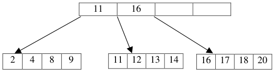
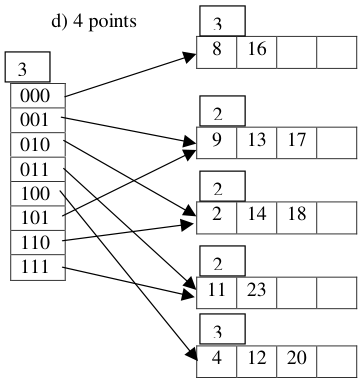
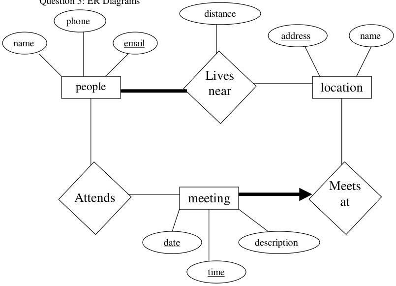

# Berkeley CS186 Spring 2001: Midterm 1: Official solutions

> Copied from the original: <https://hkn.eecs.berkeley.edu/exams/course/cs/186>. Text and figures are taken from the PDF as is; nothing was answered or rewritten. The original PDF is in this folder.

---

**Page 1**

### Question 1:

&emsp;a) 4 points. 
&emsp;&emsp;i. True, since the file is sorted on name 
&emsp;&emsp;ii. True, you can build a dense index on any file 
&emsp;&emsp;iii. False, the file is not sorted by phone 
&emsp;&emsp;iv. False, the file is not primarily sorted by eno 
&emsp;b) 2 points

&emsp;c) 5 points 
&emsp;&emsp;9 deletions

&emsp;e) 5 points 
&emsp;2 entries, Insertion of 2 entries into the second, third, or last will cause overflow, 
&emsp;which will then cause a split. 
&emsp;f)   5 points 
&emsp;2 entries, Insertion of 2 entries into the last bucket will cause a split. Since the global 
&emsp;== local depth, the global depth will increase by one.

---

**Page 2**

### Question 2:

&emsp;a) 18 points 
&emsp;&emsp;&emsp;i.   E 
&emsp;&emsp;&emsp;ii.   E 
&emsp;&emsp;&emsp;iii.   F 
&emsp;&emsp;&emsp;iv.   F 
&emsp;&emsp;&emsp;v.   A 
&emsp;&emsp;&emsp;vi.   B 
&emsp;b) Full credit was given to everyone ( 3 points )

&emsp;c) 4 points

&emsp;Πfilename, song( User **NATURAL JOIN** Has **NATURAL JOIN** Song) / Π speed (User)

&emsp;d) 5 points 
&emsp;&emsp;Solution 1: 
&emsp;&emsp;SELECT S.filename, S.title 
&emsp;&emsp;FROM Song S 
&emsp;&emsp;WHERE NOT EXISTS( SELECT \* 
&emsp;&emsp;&emsp;&emsp;&emsp;&emsp;&emsp;&emsp;FROM User U1 
&emsp;&emsp;&emsp;&emsp;&emsp;&emsp;&emsp;&emsp;WHERE NOT EXISTS ( SELECT \* 
&emsp;&emsp;&emsp;&emsp;&emsp;&emsp;&emsp;&emsp;FROM Has H, User U2 
&emsp;&emsp;&emsp;&emsp;&emsp;&emsp;&emsp;&emsp;WHERE U2.speed = U1.speed 
&emsp;&emsp;&emsp;&emsp;&emsp;&emsp;&emsp;&emsp;AND H.name = U2.name 
&emsp;&emsp;&emsp;&emsp;&emsp;&emsp;&emsp;&emsp;AND S.filename = H.filename 
&emsp;&emsp;Solution 2: 
&emsp;&emsp;SELECT S.filename, S.title 
&emsp;&emsp;FROM   Song S 
&emsp;&emsp;WHERE NOT EXISTS (   SELECT U1.speed 
&emsp;&emsp;&emsp;&emsp;&emsp;&emsp;&emsp;&emsp;FROM User U1 
&emsp;&emsp;&emsp;&emsp;&emsp;&emsp;&emsp;&emsp;EXCEPT 
&emsp;&emsp;&emsp;&emsp;&emsp;&emsp;&emsp;&emsp;SELECT U2.speed 
&emsp;&emsp;&emsp;&emsp;&emsp;&emsp;&emsp;&emsp;FROM Has H, User U2 
&emsp;&emsp;&emsp;&emsp;&emsp;&emsp;&emsp;&emsp;WHERE H.filename = S.filename 
&emsp;&emsp;&emsp;&emsp;&emsp;&emsp;&emsp;&emsp;AND   H.name = U2.name 
&emsp;&emsp;&emsp;&emsp;&emsp;&emsp;&emsp;&emsp;)

---

**Page 3**

---

**Page 4**

### Question 4: Join Algorithms

&emsp;a) 5 points 
&emsp;&emsp;\[CARTS\] + \[CARTS\] \* \[ CONTENTS \] = 1,000 + 1,000 \* 5,000 
&emsp;&emsp;&emsp;&emsp;&emsp;&emsp;&emsp;&emsp;= **5,001,000** 
b) 
\[CARTS\] + \[CONTENTS\] + (\[CARTS\] –1 ) \* ( \[CONTENTS\] – 999 ) 
= 1,000 + 5,000 + ( 999 \* 4,001 ) 
= 6000 + 4,001,000 – 4,001 = **4,002,999** 
c) 
\[ CONTENTS \] +   \[CONTENTS\] / 1,000    \* \[ CARTS \] 
&emsp;&emsp;= 5,000 + 5 \* 1,000 = 10,000 
d) 
1\. Hash Join, since √\[CARTS \] fits in memory ( 2 passes ) 
2\. Sort-Merge Join, since √\[ CONTENTS \] Does not fit in memory ( 3 passes ) 
3\. Block Nested Loops Join, 20 passes of CONTENTS !

---

**Page 5**

