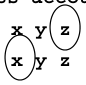
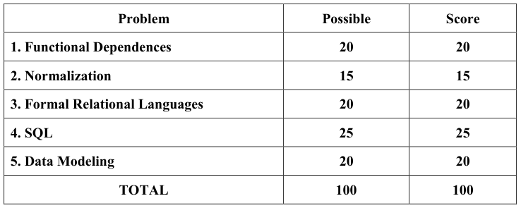
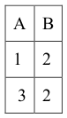
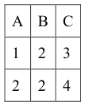
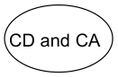
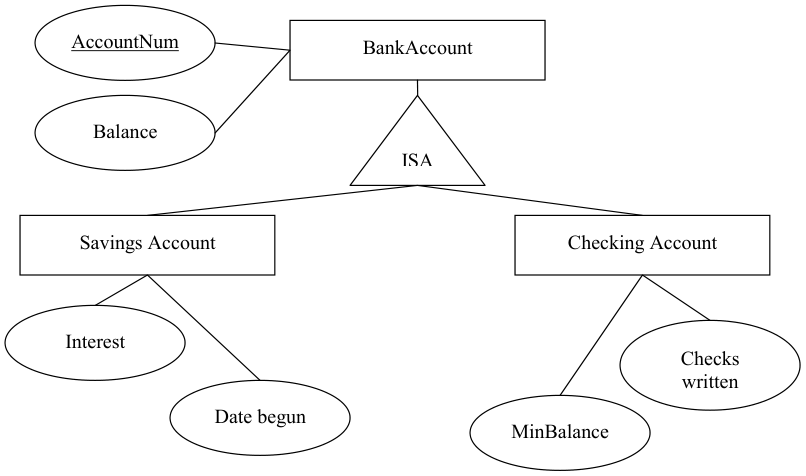
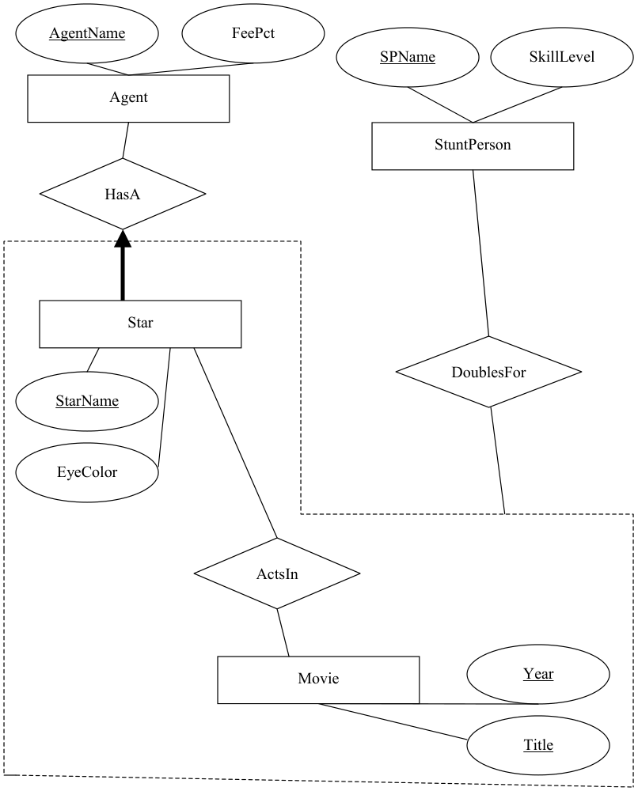

# Berkeley CS186 Fall 2002: Midterm 1: Official solutions

> Copied from the original: <https://hkn.eecs.berkeley.edu/exams/course/cs/186>. Text and figures are taken from the PDF as is; nothing was answered or rewritten. The original PDF is in this folder.

---

**Page 1**

&emsp;&emsp;&emsp;&emsp;&emsp;&emsp;&emsp;&emsp;**University of California, Berkeley** 
&emsp;&emsp;&emsp;&emsp;&emsp;&emsp;&emsp;&emsp;**College of Engineering** 
&emsp;&emsp;&emsp;&emsp;&emsp;&emsp;&emsp;&emsp;**Computer Science Division – EECS** 
Fall  2002                                      Prof. Michael J. Franklin 
&emsp;&emsp;&emsp;&emsp;&emsp;&emsp;&emsp;&emsp;**MIDTERM AND SOLUTIONS** 
&emsp;&emsp;&emsp;&emsp;&emsp;&emsp;&emsp;&emsp;CS 186 Introduction to Database Systems

**NAME**: \_\_\_\_\_Norm L. Form\_\_\_\_\_\_\_\_\_\_\_\_\_\_\_\_\_\_\_\_     **STUDENT ID:\_\_\_00000001\_\_\_\_\_**

`IMPORTANT:` `Circle` `the` `last` `two` `letters` `of` `your` `class` `account:`

`cs186` `a` `b` `c` `d` `e` `f` `g` `h` `i` `j` `k` `l` `m` `n` `o` `p` `q` `r` `s` `t` `u` `v` `w` `x` `y` `z` 
&emsp;&emsp;&emsp;`a` `b` `c` `d` `e` `f` `g` `h` `i` `j` `k` `l` `m` `n` `o` `p` `q` `r` `s` `t` `u` `v` `w` `x` `y` `z`

`DISCUSSION` `SECTION` `DAY` `&` `TIME:__Sun` `7:30am``TA` `NAME:` `_G` `something` 
General Information: 
This is a **closed book** examination – but you are allowed one 8.5” x 11” sheet of notes (double sided). 
You should try to answer as many questions as possible.  **Partial credit will be given**.  There are 100 
points in all.  You should read **all** of the questions before starting the exam, as some of the questions 
are substantially more time-consuming than others. 
Write all of your answers directly on this paper.  **Be sure to clearly indicate your final answer** for 
each question.  Also, be sure to state any assumptions that you are making in your answers.

&emsp;&emsp;&emsp;&emsp;&emsp;&emsp;&emsp;&emsp;**GOOD LUCK!!!**

---

**Page 2**

Name:\_\_\_\_\_\_\_\_\_\_\_\_\_\_\_\_\_\_\_\_\_\_\_\_\_\_\_\_\_\_                  SID:\_\_\_\_\_\_\_\_\_\_\_\_\_\_\_\_\_\_\_\_

### **Question 1 - Functional Dependencies \[5 parts, 20 points total\]:**

&emsp;**a) \[3  points\]** Your cousin, who is studying at a Bay Area university often noted for its sports 
&emsp;&emsp;programs, claims to have learned “Lance’s Axioms” for reasoning about Functional 
&emsp;&emsp;Dependencies.   He claims that one such axiom, is 
&emsp;&emsp;&emsp;&emsp;&emsp;&emsp;Reversitivity: if   “A  B” then “B  A” 
Give an example relation instance that proves that Reversitivity is invalid.  (for simplicity, use 
integers and/or single letters as your attribute values)

&emsp;&emsp;&emsp;&emsp;&emsp;&emsp;•  need to show  a B value with 2 different A values 
&emsp;&emsp;&emsp;&emsp;&emsp;&emsp;• If 2 A’s have same value, they must have same B value 
&emsp;&emsp;&emsp;&emsp;&emsp;&emsp;• not necessary to show two tuples with same A value

&emsp;**b) \[4 points\]** After viewing your counterexample for part (a),  your cousin launches into a review 
&emsp;&emsp;of the final scores of the “Big Game” over the past decade.  He then claims that there is another 
&emsp;&emsp;axiom:       Kindatransitivity: if   “A  C”  and “AB  C” then “B  C” 
&emsp;&emsp;Give an example relation instance that proves that Kindatransitivity is invalid.

&emsp;&emsp;&emsp;&emsp;&emsp;&emsp;&emsp;&emsp;• need to show  a B value with 2 different C values 
&emsp;&emsp;&emsp;&emsp;&emsp;&emsp;&emsp;&emsp;• If 2 A’s have same value, they must have same C value 
&emsp;&emsp;&emsp;&emsp;&emsp;&emsp;&emsp;&emsp;• if 2 ABs have same value, they must have same C value 
&emsp;&emsp;&emsp;&emsp;&emsp;&emsp;&emsp;&emsp;• not necessary to show two tuples with same A value

&emsp;**c) \[5 points\]** It turns out however, that your cousin almost got it right.  In fact, there is a rule as 
&emsp;&emsp;follows:         Pseudotransitivity: if   “A  B”  and “BC  D” then “AC  D” 
&emsp;&emsp;Using Armstrong’s Axioms (not Lance’s) show that Pseudotransitivity is in fact valid (Be sure 
&emsp;to indicate which axiom you are using in each step). 
&emsp;&emsp;&emsp;• A  B given; 
&emsp;&emsp;&emsp;• BC  D given 
&emsp;&emsp;&emsp;• AC  BC  Augmentation of 1 with C 
&emsp;&emsp;&emsp;• AC  D  Transitivity of 3 and 2

CS 186 Midterm     October 10, 2002        Page 2 of 13

---

**Page 3**

Name:\_\_\_\_\_\_\_\_\_\_\_\_\_\_\_\_\_\_\_\_\_\_\_\_\_\_\_\_\_\_                  SID:\_\_\_\_\_\_\_\_\_\_\_\_\_\_\_\_\_\_\_\_

### **Question 1 (continued)**

&emsp;**d) \[2 points\]** Why can’t you use an example relation instance to answer part “c”, as you did for 
&emsp;&emsp;parts “a” and “b” of this question? (be concise – i.e., one or two sentences is sufficient.) 
&emsp;&emsp;&emsp;Because F.D.s must hold across all legal instances of a relation, so showing one 
&emsp;&emsp;&emsp;example isn’t sufficient.

&emsp;**e) \[6 points\]**  Consider the relation schema **R = ABCDE** and the following functional 
&emsp;&emsp;dependencies on R: 
&emsp;&emsp;&emsp;&emsp;&emsp;&emsp;&emsp;&emsp;**A**  **D** 
&emsp;&emsp;&emsp;&emsp;&emsp;&emsp;&emsp;&emsp;**BC**  **E** 
&emsp;&emsp;&emsp;&emsp;&emsp;&emsp;&emsp;&emsp;**D**  **AB**

&emsp;&emsp;**R** has two candidate keys.  What are they (circle your answer)?

CS 186 Midterm     October 10, 2002        Page 3 of 13

---

**Page 4**

Name:\_\_\_\_\_\_\_\_\_\_\_\_\_\_\_\_\_\_\_\_\_\_\_\_\_\_\_\_\_\_                  SID:\_\_\_\_\_\_\_\_\_\_\_\_\_\_\_\_\_\_\_\_

### **Question 2 – Normalization \[7 parts,  15 points total\]**

&emsp;Consider the relation schema **S = ABCD** and the following functional dependencies on **S**: 
&emsp;&emsp;&emsp;&emsp;&emsp;&emsp;&emsp;&emsp;**A**  **BCD** 
&emsp;&emsp;&emsp;&emsp;&emsp;&emsp;&emsp;&emsp;**B**  **C** 
&emsp;&emsp;&emsp;&emsp;&emsp;&emsp;&emsp;&emsp;**CD**  **A** 
For each of the following short questions, be sure to briefly explain your answer. 
&emsp;**a) \[3 points\]**  **S** is not in BCNF, but is it in 3NF?  Explain your answer. 
&emsp;&emsp;&emsp;Yes, because CD and A are candidate keys.  B  C is okay because C is part of a 
&emsp;&emsp;&emsp;&emsp;&emsp;candidate key (CD).

&emsp;**b) \[2 points\]** Consider the decomposition of **S** into **S1** = ABC and **S2** = BCD.  Is this a valid 
&emsp;&emsp;decomposition into BCNF?  Explain. 
No, because B  C and B is not a candidate key (for either S1 and S2)

&emsp;**c) \[2 points\]** Is the decomposition of **S** into **S1** and **S2** lossless? Why or why not? 
No, because BC is the intersection and  BC is not a key for either S1 and S2

&emsp;**d) \[2 points\]** Is the decomposition of **S** into **S1** and **S2** dependency preserving? Why or why not? 
No, because CDA (or AC)  are lost

&emsp;**e) \[2 points\]** Consider the decomposition of **S** into **S3** = ABD and **S4** = BC.  Is this a valid 
&emsp;&emsp;decomposition into BCNF?  Explain. 
Yes, A is a key for ABD and B is a key for BC (also all 2 attr relns are in BCNF)

&emsp;**f) \[2 points\]** Is the decomposition of **S** into **S3** and **S4** lossless? Why or why not? 
Yes, Intersection is B and it is a key for BC

&emsp;**g) \[2 points\]** Is the decomposition of **S** into **S3** and **S4** dependency preserving? Why or why not? 
No, because CDA (or AC)  are lost ;

CS 186 Midterm     October 10, 2002        Page 4 of 13

---

**Page 5**

Name:\_\_\_\_\_\_\_\_\_\_\_\_\_\_\_\_\_\_\_\_\_\_\_\_\_\_\_\_\_\_                  SID:\_\_\_\_\_\_\_\_\_\_\_\_\_\_\_\_\_\_\_\_

### Question 3 – Formal Relational Languages \[5 parts,  20 points total\]

Consider  the following schema for the Australian Competitive Team Boomerang League.   The 
database tracks information about teams, players, and the outcomes of games they have played.  Each 
game consists of a “home” team and an “away” team.  The ACTBL requires that no games can end in 
a tie.  The winner of a game is (obviously) the team with the most points.  Assume that every team has 
played at least one game at home and at least one game away so far.  The schema is as follows 
(primary key for each relation is underlined): 
**TEAMS (TName, TCity)** 
**PLAYERS (PName, Team, Salary)** \[where Team is a foreign key referencing TEAMS\] 
**GAMES (HomeTm, AwayTm, Date, HomePts, AwayPts)** 
\[where HomeTm and AwayTm are foreign keys referencing TEAMS\] 
Express the following queries in the indicated query language.  Feel free to use the compound 
relational algebra operators, such as division: 
&emsp;**a) \[4 points\] (Relational Algebra):** List the player name and salary of each player who is on a 
&emsp;&emsp;team that has beaten the “Wombats”. 
&emsp;σpnamesalaryPlayersawayTmG,((((∏   ∏   )    
&emsp;&emsp;&emsp;&emsp;&emsp;&emsp;&emsp;&emsp;=∧\<HomeTmWombatsHomePts''   AwayPts 
&emsp;σHomeTmG((∏   )))) 
&emsp;&emsp;&emsp;&emsp;&emsp;&emsp;=∧\<AwayTmWombatsAwayPts'   HomePts

&emsp;**b) \[4 points\]**  Write the query for part “a” in **Relational Calculus:** 
&emsp;∃∈∃∈=∧\<TPPlayersGGHomeTmWombatsGHomePtsGAwayPts{\|(1(.1''.1.1 
&emsp;∧=GAwayTmPTeam.1. 
&emsp;∧=∧=TPNamePPnameTSalaryPSalary....)) 
&emsp;∨ 
&emsp;∃∈=GGamesGAwayTmWombats(2(.2'' 
&emsp;∧\>GHomePtsGAwayPts.2.2 
&emsp;∧=GHomeTmPTeam.2. 
&emsp;∧=TPnamePPname.. 
&emsp;∧=TSalaryPSalary..))}

CS 186 Midterm     October 10, 2002        Page 5 of 13

---

**Page 6**

Name:\_\_\_\_\_\_\_\_\_\_\_\_\_\_\_\_\_\_\_\_\_\_\_\_\_\_\_\_\_\_                  SID:\_\_\_\_\_\_\_\_\_\_\_\_\_\_\_\_\_\_\_\_

### **Question 3 (continued)**

Recall the schema:  **TEAMS (TName, TCity);   PLAYERS (PName, Team, Salary)** 
&emsp;&emsp;&emsp;&emsp;&emsp;&emsp;**GAMES (HomeTm, AwayTm, Date, HomePts, AwayPts)** 
&emsp;**c) \[4 points\] (Relational Algebra):** List the names of all the teams who have won every game 
&emsp;&emsp;that they have played at home. 
σ−TNameTeamsHomeTmG()(∏   ∏   ) 
&emsp;&emsp;&emsp;&emsp;&emsp;&emsp;&emsp;&emsp;\<HomePtsAwayPts

&emsp;**d) \[4 points\]** Write the query for part “c” in **Relational Calculus.** 
∀∈=⇒\>TGGamesTTNameGHomeTmGHomePtsGAwayPts{\|(....)}

&emsp;**e) \[4 points\] (Relational Calculus)** List the names of all the teams who have hosted games 
&emsp;&emsp;against every team from Sydney. 
∀∈=⇒TTTeamsTTCitySydney{\|1(.1'' 
∃∈=∧=GGamesGAwayTmTTNameTNameGHomeTm(..1..))}

.

CS 186 Midterm     October 10, 2002        Page 6 of 13

---

**Page 7**

Name:\_\_\_\_\_\_\_\_\_\_\_\_\_\_\_\_\_\_\_\_\_\_\_\_\_\_\_\_\_\_                  SID:\_\_\_\_\_\_\_\_\_\_\_\_\_\_\_\_\_\_\_\_

### **Question 4 – SQL  \[6  parts,  25 points total\]**

Consider the schema from question 3: 
**TEAMS (TName, TCity)** 
**PLAYERS (PName, Team,  Salary)** \[where Team is a foreign key referencing TEAMS\] 
**GAMES (HomeTm, AwayTm, Date, HomePts, AwayPts)** 
\[where HomeTm and AwayTm are foreign keys referencing TEAMS\] 
Express the following queries in SQL. 
&emsp;**a) \[3 points\]** List the player name, team name, and salary of each player who is on a team that has 
&emsp;&emsp;beaten the “Koalas” while playing at home.  The list should not contain duplicates. 
SELECT Distinct P.PName, P.Team, P.Salary 
FROM Players P, Games G 
WHERE 
G.HomeTm = P.Team 
AND G.AwayTm  = ‘Koalas’ 
AND G.HomePts \> G.AwayPts

&emsp;**b) \[3 points\]** List the names of all the teams who have won every game that they have played at 
&emsp;&emsp;home. 
SELECT T.TName 
FROM Teams T 
WHERE NOT EXISTS 
(SELECT \* 
FROM Games G 
WHERE G.HomeTm = T.Tname 
AND G.AwayPts \> G.HomePts)

CS 186 Midterm     October 10, 2002        Page 7 of 13

---

**Page 8**

Name:\_\_\_\_\_\_\_\_\_\_\_\_\_\_\_\_\_\_\_\_\_\_\_\_\_\_\_\_\_\_                  SID:\_\_\_\_\_\_\_\_\_\_\_\_\_\_\_\_\_\_\_\_

### **Question 4 – SQL ( continued)**

Recall the schema:  **TEAMS (TName, TCity);   PLAYERS (PName, Team, Salary)** 
&emsp;&emsp;&emsp;&emsp;&emsp;&emsp;**GAMES (HomeTm, AwayTm, Date, HomePts, AwayPts)** 
&emsp;**c) \[4 points\]** List the names of all the teams who have hosted games against every team from 
&emsp;&emsp;Sydney. 
SELECT Tname 
FROM Teams T 
WHERE NOT EXISTS(( 
SELECT TName 
FROM Teams T2 
WHERE T2.TCity = ‘Sydney’) 
MINUS 
(SELECT AwayTM 
FROM Games G 
WHERE G.HomeTm = T.Tname))

&emsp;**d) \[4  points\]**  Print a list containing the team name, team city, number of players, and the total 
&emsp;&emsp;payroll (i.e., the sum of all the salaries), for each team that has more than 10 players.  Sort this 
&emsp;&emsp;list in decreasing order of total payroll. 
SELECT T.TName, T.TCity, COUNT(\*) as numPlayers, SUM(P.Salary) AS Payroll 
FROM TeamsT, Players P 
WHERE T.TName = P.Team 
GROUP BY TName, TCity 
HAVING numPlayers \> 10 
ORDER BY Payroll DESC

CS 186 Midterm     October 10, 2002        Page 8 of 13

---

**Page 9**

Name:\_\_\_\_\_\_\_\_\_\_\_\_\_\_\_\_\_\_\_\_\_\_\_\_\_\_\_\_\_\_                  SID:\_\_\_\_\_\_\_\_\_\_\_\_\_\_\_\_\_\_\_\_

### **Question 4 – SQL ( continued)**

Recall the schema:  **TEAMS (TName, TCity);   PLAYERS (PName, Team, Salary)** 
&emsp;&emsp;&emsp;&emsp;&emsp;&emsp;**GAMES (HomeTm, AwayTm, Date, HomePts, AwayPts)** 
&emsp;**e) \[8  points\]**  Print the name of the team that has won the most home games. (Hint: you might 
&emsp;&emsp;find it easier if you use views).

CREATE VIEW HomeWins as 
SELECT HomeTm, COUNT(\*) as numWins 
FROM Games G 
WHERE G.HomePts \> G.AwayPts 
GROUP BY HomeTm

SELECT HomeTm 
FROM HomeWins H 
WHERE H.numWins = (SELECT MAX(numWins) FROM HomeWins)

&emsp;**f) \[ 3 points\]** Under what condition would “**TEAMS** LEFT OUTER JOIN **PLAYERS”** have 
&emsp;&emsp;higher cardinality (i.e., more tuples) than “**TEAMS** JOIN **PLAYERS**”?  (be concise – one 
&emsp;&emsp;sentence short sentence should suffice). 
If there are teams without players.

CS 186 Midterm     October 10, 2002        Page 9 of 13

---

**Page 10**

Name:\_\_\_\_\_\_\_\_\_\_\_\_\_\_\_\_\_\_\_\_\_\_\_\_\_\_\_\_\_\_                  SID:\_\_\_\_\_\_\_\_\_\_\_\_\_\_\_\_\_\_\_\_

### **Question 5 – Data Models \[ 4 parts, 20 total points\]**

&emsp;**b)  \[3  points\]** Draw an ER diagram for an ISA hierarchy in which there are at least two subtypes. 
&emsp;&emsp;Be sure that each of your entities has at least two attributes and indicate any keys.

&emsp;**c) \[ 4 points\]**  For the diagram you drew in the previous part, show two substantially different 
&emsp;&emsp;mappings of this into SQL DDL statements, and briefly describe the tradeoffs between these 
&emsp;&emsp;two. 
&emsp;1\) Requires joins to look at all accounts. 
&emsp;CREATE TABLE BankAccount( 
&emsp;AccountNum INTEGER PRIMARY KEY, 
&emsp;Balance FLOAT);

&emsp;CREATE TABLE SavingsAccount( 
&emsp;AccountNum INTEGER, 
&emsp;Interest FLOAT, 
&emsp;Date DATE, 
&emsp;PRIMARY KEY(AccountNum), 
&emsp;FOREIGN KEY (AccountNum) REFERENCES BankAccount);

CS 186 Midterm     October 10, 2002        Page 10 of 13

---

**Page 11**

Name:\_\_\_\_\_\_\_\_\_\_\_\_\_\_\_\_\_\_\_\_\_\_\_\_\_\_\_\_\_\_                  SID:\_\_\_\_\_\_\_\_\_\_\_\_\_\_\_\_\_\_\_\_

&emsp;CREATE TABLE CheckingAccount( 
&emsp;AccountNum INTEGER, 
&emsp;ChecksWritten INTEGER, 
&emsp;MinBalance FLOAT, 
&emsp;PRIMARY KEY(AccountNum), 
&emsp;FOREIGN KEY (AccountNum) REFERENCES BankAccount);

&emsp;2\) Requires selects to look at specific types of accounts. 
&emsp;CREATE TABLE Accounts( 
&emsp;AccountNum INTEGER PRIMARY KEY, Balance FLOAT, 
&emsp;Type INTEGER, 
&emsp;Interest FLOAT, Date DATE, 
ChecksWritten INTEGER, MinBalance FLOAT);

### **Question 5 (continued)**

&emsp;**d) \[ 3 points\]** Briefly describe how relational “views” could help make query writing easier for the 
&emsp;&emsp;tables that result from one of your ISA mappings (tell us which one you’re using!).  Write one 
&emsp;&emsp;(or more if you need it) SQL Create View statement(s) to demonstrate this. 
&emsp;Easier to examine specific types of accounts by writing 
&emsp;CREATE VIEW SavingsAccounts AS 
&emsp;SELECT \* FROM Accounts WHERE type = 1; 
&emsp;CREATE VIEW CheckingAccounts AS 
&emsp;SELECT \* FROM Accounts WHERE type = 2;

&emsp;**e)  \[10 points\]  D**raw the ER diagram that represents the schema on the next page.  Be sure that all 
&emsp;&emsp;constraints, attributes, and keys in the DDL are shown in your diagram.  NOTE you may find it 
&emsp;&emsp;helpful to remove the last page so you can see the schema while you are drawing.  You may also 
&emsp;&emsp;want to practice on a different sheet so that your final answer is readable by the graders. **Be** 
&emsp;&emsp;**sure that your regular and bold lines are clearly distinguishable from eachother.**

CS 186 Midterm     October 10, 2002        Page 11 of 13

---

**Page 12**

Name:\_\_\_\_\_\_\_\_\_\_\_\_\_\_\_\_\_\_\_\_\_\_\_\_\_\_\_\_\_\_                  SID:\_\_\_\_\_\_\_\_\_\_\_\_\_\_\_\_\_\_\_\_

CS 186 Midterm     October 10, 2002        Page 12 of 13

---

**Page 13**

### **Question 5 (continued) (REMOVE THIS PAGE IF YOU LIKE)**

&emsp;&emsp;&emsp;`CREATE` `TABLE` `Agent` `(` 
&emsp;&emsp;&emsp;&emsp;&emsp;`AgentName` `varchar(50)` `PRIMARY` `KEY,` 
&emsp;&emsp;&emsp;&emsp;&emsp;`FeePct` `float);`

&emsp;&emsp;&emsp;`CREATE` `TABLE` `Star` `(` 
&emsp;&emsp;&emsp;&emsp;&emsp;`StarName` `varchar(50)` `PRIMARY` `KEY,` 
&emsp;&emsp;&emsp;&emsp;&emsp;`Eyecolor` `varchar(10)` 
&emsp;&emsp;&emsp;&emsp;&emsp;`AgentName` `varchar(50)`   `NOT` `NULL,` 
&emsp;&emsp;&emsp;&emsp;&emsp;`FOREIGN` `KEY` `(AgentName)` `REFERENCES` `Agent);`

&emsp;&emsp;&emsp;`CREATE` `TABLE` `Movie` `(` 
&emsp;&emsp;&emsp;&emsp;&emsp;`Title` `varchar(50),` 
&emsp;&emsp;&emsp;&emsp;&emsp;`Year` `integer,` 
&emsp;&emsp;&emsp;&emsp;&emsp;`PRIMARY` `KEY` `(Title,` `Year));`

&emsp;&emsp;&emsp;`CREATE` `TABLE` `StuntPerson` `(` 
&emsp;&emsp;&emsp;&emsp;&emsp;`SPName` `varchar(50)` `PRIMARY` `KEY,` 
&emsp;&emsp;&emsp;&emsp;&emsp;`SkillLevel` `integer);`

&emsp;&emsp;&emsp;`CREATE` `TABLE` `ActsIn` `(` 
&emsp;&emsp;&emsp;&emsp;&emsp;`StarName` `varchar(50),` 
&emsp;&emsp;&emsp;&emsp;&emsp;`Title` `varchar(50),` 
&emsp;&emsp;&emsp;&emsp;&emsp;`Year` `integer,` 
&emsp;&emsp;&emsp;&emsp;&emsp;`PRIMARY` `KEY` `(StarName,` `Title,` `Year),` 
&emsp;&emsp;&emsp;&emsp;&emsp;`FOREIGN` `KEY` `(StarName)` `REFERENCES` `Star,` 
&emsp;&emsp;&emsp;&emsp;&emsp;`FOREIGN` `KEY` `(Title,` `Year)` `REFERENCES` `Movie);`

&emsp;&emsp;&emsp;`CREATE` `TABLE` `DoublesFor` `(` 
&emsp;&emsp;&emsp;&emsp;&emsp;`SPName` `varchar(50),` 
&emsp;&emsp;&emsp;&emsp;&emsp;`StarName` `varchar(50),` 
&emsp;&emsp;&emsp;&emsp;&emsp;`Title` `varchar(50),` 
&emsp;&emsp;&emsp;&emsp;&emsp;`Year` `integer,` 
&emsp;&emsp;&emsp;&emsp;&emsp;`PRIMARY` `KEY` `(SPName,` `StarName,` `Title,` `Year),` 
&emsp;&emsp;&emsp;&emsp;&emsp;`FOREIGN` `KEY` `(SPName)` `REFERENCES` `StuntPerson,` 
&emsp;&emsp;&emsp;&emsp;&emsp;`FOREIGN` `KEY` `(StarName,` `Title,` `Year)` `REFERENCES` `ActsIn);`

