# Berkeley CS186 Fall 2003: Midterm 1: Questions

> Copied from the original: <https://hkn.eecs.berkeley.edu/exams/course/cs/186>. Text and figures are taken from the PDF as is; nothing was answered or rewritten. The original PDF is in this folder.

---

**Page 1**

&emsp;&emsp;&emsp;&emsp;&emsp;&emsp;&emsp;&emsp;UNIVERSITY OF CALIFORNIA 
&emsp;&emsp;&emsp;&emsp;&emsp;&emsp;&emsp;&emsp;College of Engineering 
&emsp;&emsp;&emsp;&emsp;&emsp;&emsp;Department of EECS, Computer Science Division 
CS186                                                                                                                 Eben Haber 
Fall 2003                                                                                                                Midterm 
&emsp;&emsp;&emsp;&emsp;&emsp;**Midterm Exam: Introduction to Database Systems** 
This exam has seven problems, worth different amounts of points each. Each problem is 
made up of multiple questions. You should read through the exam quickly and plan your 
time-management accordingly. Before beginning to answer a question, be sure to read it 
carefully and to answer all parts of every question!

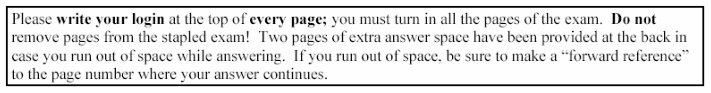

Good luck!

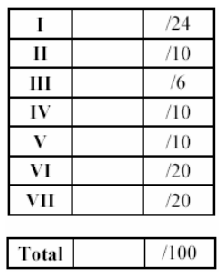

---

**Page 2**

CS 186 – Fall 2003                                                                         Login \_\_\_\_\_\_\_\_\_\_\_\_\_

**I. Query Languages (30 points).** 
Given the following database tables, choose all queries in SQL, Relational Algebra or 
Tuple Relational Calculus that return the proper answer to the corresponding question. 
Note that each question may have more than one correct answers. Circle all that apply.

Primary keys are underlined. Note that the driver involved in a car accident may not 
always be the owner of the car. Assume that accident\_date is of type integer, and 
represents a year (e.g. 1980). Year is also of type integer. We assume that a car cannot 
get involved in more than one accident at a certain date.

Person(SSN, name, address) 
Car(license, year, model) 
Accident(license, accident\_date, driver, damage\_amount) 
Owns(SSN, license)

1\. (4 points) Find the SSN of every person who owns one or more cars, none of which 
has ever been involved in a car accident. 
A. SELECT O.SSN 
FROM Owns O 
WHERE O.license NOT IN (SELECT A.license 
FROM Accident A)

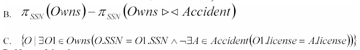

D. None of the above

2\. (4 points) Find the SSN of every person, who owns a TOYOTA or a DODGE 
A. SELECT O.SSN 
FROM Owns O, Car C 
WHERE O.license=C.license AND 
(C.model=’TOYOTA’ OR 
C.model=’DODGE’)

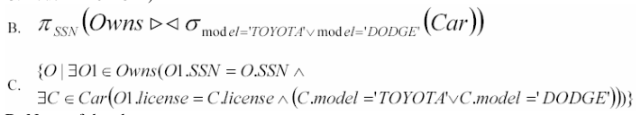

D. None of the above

---

**Page 3**

CS 186 – Fall 2003                                                                            Login \_\_\_\_\_\_\_\_\_\_\_\_\_

3\. (4 points) Find the SSN of all persons who have had all of their cars involved in an 
accident. 
A. SELECT O.SSN 
FROM Owns O, Accident A 
WHERE O.license=A.license 
EXCEPT 
SELECT O.SSN 
FROM Owns O 
WHERE O.license NOT IN (SELECT A.licens 
FROM Accident A)

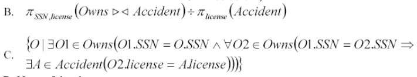

D. None of the above.

4\. (4 points) Who is the driver who participated in the most costly accident? Return the 
driver and the amount of damage. 
A. SELECT driver, damage\_amount 
FROM Accident 
WHERE damage\_amount IN (SELECT MAX(damage\_amount) 
FROM Accident) 
B. SELECT driver, damage\_amount 
FROM Accident 
WHERE damage\_amount=MAX(damage\_amount)

C. (SELECT driver, damage\_amount FROM Accident) 
EXCEPT 
(SELECT a1.driver, a1.damage\_amount 
FROM Accident a1, Accident a2 
WHERE a1.damage\_amount\<a2.damage\_amount AND a1.driver\<\>a2.driver)

D. None of the above.

5\. (4 points) Find the license number of all cars that had an accident in less than 5 years 
after their production. Return the license number and the number of years 
A. SELECT c.license 
FROM Car c, Accident a 
WHERE a.accident\_date-c.year\<5

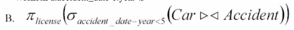

---

**Page 4**

CS 186 – Fall 2003                                                                            Login \_\_\_\_\_\_\_\_\_\_\_\_\_

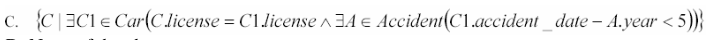

D. None of the above

6\. (4 points) Find the accident with the smallest cost and return the corresponding owner 
of the car, his/her address and the amount of damage. 
A. SELECT O.SSN, P.address, MIN(A.damage\_amount) 
FROM Accident A, Owns O, Person P 
WHERE O.license=A.license AND O.SSN=P.SSN 
GROUP BY O.SSN, P.address

B. SELECT O.SSN, P.address, (SELECT MIN(damage\_amount) FROM Accident) 
FROM Owns O, Person P, Accident A 
WHERE O.SSN=P.SSN AND A.license=O.license

C. SELECT O.SSN, P.address, A.damage\_amount 
FROM Owns O, Person P, Accident A 
WHERE O.SSN=P.SSN AND A.damage\_amount=(SELECT MIN(damage\_amount) 
FROM Accident) 
D. None of the above.

7\. (4 points) Find the license number of all cars that have been involved in more than one 
accident. (DO NOT RETURN DUPLICATES) 
A. SELECT A1.license 
FROM Accident A1, Accident A2 
WHERE A1.license=A2.license AND A1.accident\_date\<\>a2.accident\_date

B. SELECT DISTINCT A1.license 
FROM Accident A1 
WHERE A1.license IN (SELECT A2.license 
FROM Accident A2 
WHERE A1.accident\_date\<\>A2.accident\_date) 
C. SELECT license 
FROM Accident 
GROUP BY license 
HAVING COUNT(accident\_date)\>1 
D. None of the above

8\. (2 points) Explain, in English, what the following Relational Calculus query expresses:

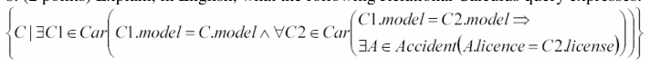

---

**Page 5**

CS 186 – Fall 2003                                                                          Login \_\_\_\_\_\_\_\_\_\_\_\_\_

**II. External Sorting (10 points)** 
1\. (6 points) Suppose we wish to sort the following values: 
84, 22, 19, 11, 60, 68, 31, 29, 58, 23, 45, 93, 48, 31, 7 
Assume that: 
&emsp;• you have three pages of memory for sorting 
&emsp;• you will use an external sorting algorithm with a 2-way merge 
&emsp;• a page only holds two values 
For each sorting pass, show the contents of all temporary files.

2\. (2 points) If you have 100 pages of data, and 10 pages of memory, what is the 
minimum number of passes required to sort the data.

3\. (2 points) If you have 500,000 pages of data, what is the minimum number of pages of 
memory required to sort the data in 3 passes?

---

**Page 6**

CS 186 – Fall 2003                                                                            Login \_\_\_\_\_\_\_\_\_\_\_\_\_

. 
**III. Join Algorithms (6 points)** 
Consider a relation R with attributes (x,y) and a relation S with attributes (y, z). Column 
y in S is a key and the set of values of y in R are the same as the set of values of y in S. 
Assume that there are no indexes available and that there are 25 pages in the buffer 
available. Table R is 1,500 pages with 50 tuples per page. Table S is 400 with 100 tuples 
per page.

Compute the I/O costs for the following joins. Assume the simplest cost model, where 
pages are read and written one at a time.

A. Block nested loops join with R as the outer relation and S as the inner relation

B. Block nested loops join with S as the outer relation and R as the inner relation

C. Sort merge join with R as the outer relation and S as the inner relation

D. Sort merge join with S as the outer relation and R as the inner relation

E. Hash join with S as the outer relation and R as the inner relation

---

**Page 7**

CS 186 – Fall 2003                                                                            Login \_\_\_\_\_\_\_\_\_\_\_\_\_

**IV Query Optimization**

Consider the following schema

Sailors(sid, sname, rating, age) 
Reserves(sid, did, day) 
Boats(bid, bname, size)

Reserves.sid is a foreign key to Sailors and Reserves.bid is a foreign key to Boats.bid.

We are given the following information about the database: 
Reserves contains 10,000 records with 40 records per page. 
Sailors contains 1000 records with 20 records per page. 
Boats contains 100 records with 10 records per page. 
There are 50 values for Reserves.bid. 
There are 10 values for Sailors.rating (1...10) 
There are 10 values for Boat.size 
There are 500 values for Reserves.day

Consider the following query

SELECT S.sid, S.sname, B.bname 
FROM Sailors S, Reserves R, Boats B 
WHERE S.sid = R.sid AND R.bid = B.bid AND 
B.size \> 5 AND R.day = 'July 4, 2003';

(a) Assuming uniform distribution of values and column independence, estimate the 
number of tuples returned by this query.

Consider the following query

SELECT S.sid, S.sname, B.bname 
FROM Sailors S, Reserves R, Boats B 
WHERE S.sid = R.sid AND R.bid = B.bid 
(b) Draw all possible left-deep query plans for this query:

---

**Page 8**

CS 186 – Fall 2003                                                                            Login \_\_\_\_\_\_\_\_\_\_\_\_\_

(c) For the first join in each query plan (the one at the bottom of the tree, what join 
algorithm would work best? Assume that you have 50 pages of memory. There are no 
indexes, so indexed nested loops is not an option.

---

**Page 9**

CS 186 – Fall 2003                                                                            Login \_\_\_\_\_\_\_\_\_\_\_\_\_

**V Buffer Management (10 points total)**

In this exercise, you will compare the LRU, MRU, and CLOCK buffer management 
algorithms for a given workload (just as you did in the first part of homework 1). Here 
are the assumptions you must make: 
&emsp;• Assume there are four page slots your buffer manager must manage: P1, P2, P3, 
&emsp;&emsp;and P4. 
&emsp;• All four slots are empty to start. 
&emsp;• When the buffer pool has unused slots (such as at the beginning, when all four 
&emsp;&emsp;slots are empty), it will put newly read data in the leftmost empty slot (e.g., if 
&emsp;&emsp;slots 2 and 3 are free, it will use slot 2). 
&emsp;• The pages to be read from disk are labelled A through G. 
&emsp;• For each access the page is pinned, and then immediately unpinned. 
Below are three tables for describing the contents of the buffer pool at each time step. A 
page is read at the beginning of each time step. You should record, in the table, the 
contents of each Buffer Page after the new page has been read in.

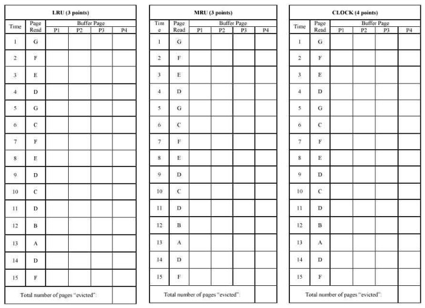

---

**Page 10**

CS 186 – Fall 2003                                                                            Login \_\_\_\_\_\_\_\_\_\_\_\_\_

**VI. Functional Dependencies and Normalization (20 points total)** 
Consider the attributes A B C D E F G which have the following functional 
dependencies: 
AD à F 
AE à G 
DF à BC 
E à C 
G à E

1\. List all candidate keys (not superkeys): (5 points)

2\. Which of the following dependencies are implied by those above: (5 points) 
a. (IS) (IS NOT) G à C 
b. (IS) (IS NOT) A à G 
c. (IS) (IS NOT) ADF à E 
d. (IS) (IS NOT) ADC à B 
e. (IS) (IS NOT) AGF à E

3\. Consider the decomposition into 4 relations: (ADF) (CE) (EG) (ABDG). 
This decomposition: (5 points) 
a. (IS) (IS NOT) in BCNF 
b. (IS) (IS NOT) in 3NF 
c. (IS) (IS NOT) in 1NF 
d. (IS) (IS NOT) Dependency Preserving 
e. (IS) (IS NOT) Lossless

4\. Consider the decomposition into 3 relations: (ADF) (EC) (ABDEG). 
This decomposition: (5 points) 
a. (IS) (IS NOT) in BCNF 
b. (IS) (IS NOT) in 3NF 
c. (IS) (IS NOT) 1NF 
d. (IS) (IS NOT) Dependency Preserving 
e. (IS) (IS NOT) Lossless

---

**Page 11**

CS 186 – Fall 2003                                                                            Login \_\_\_\_\_\_\_\_\_\_\_\_\_ 
**VII. Entity-Relational Model (20 Points)** 
a) (10 points) Draw an E-R diagram for the following situation: 
&emsp;• This is a simplified model for reserving baseball tickets. 
&emsp;• There are teams, which are identified by the team name. Teams are also located 
&emsp;&emsp;in a city. 
&emsp;• Teams play each other in games, which occur on a particular date at a particular 
&emsp;&emsp;time. Games are identified by a game ID, and each game has exactly two teams 
&emsp;&emsp;that play in it. 
&emsp;• A game is played in exactly one stadium. 
&emsp;• A stadium is identified by its name, and is also located in a city. 
&emsp;• Stadiums have seats, which have a section number, a row number, and a seat 
&emsp;&emsp;number. 
&emsp;• Ticket holders reserve seats for a game. Ticket holders are identified by their 
&emsp;&emsp;name. 
&emsp;• Some ticket holders are students (students get discounts, but we are not including 
&emsp;&emsp;that in the model).

---

**Page 12**

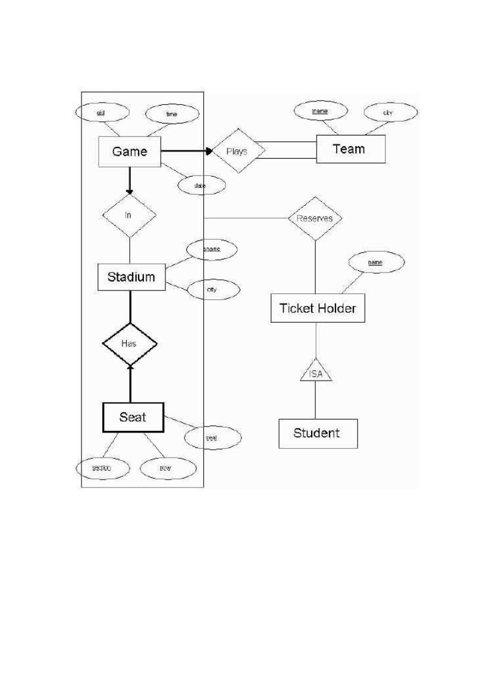

---

**Page 13**

CS 186 – Fall 2003                                                                            Login \_\_\_\_\_\_\_\_\_\_\_\_\_

b) (10 points) Using SQL, convert the following ER diagram to the relational model. 
Hint: You do not need CHECK constraints.

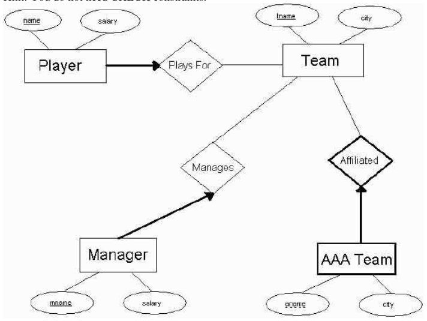

