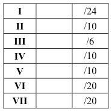
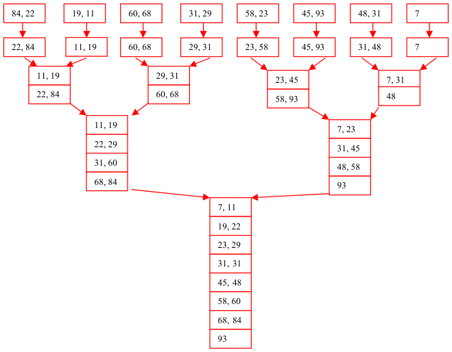
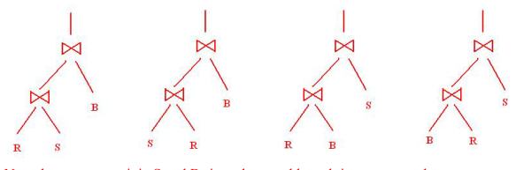
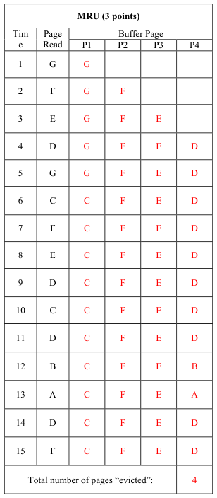
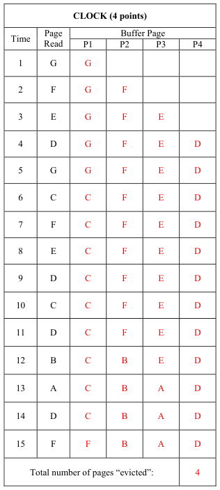
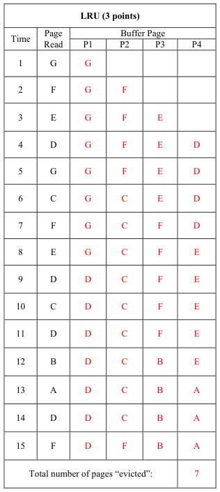
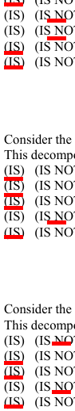
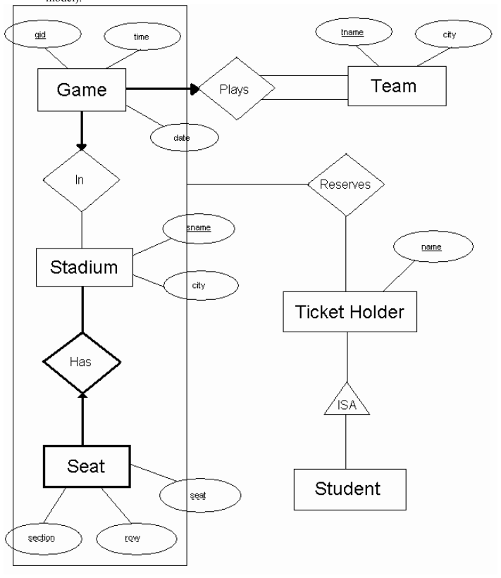
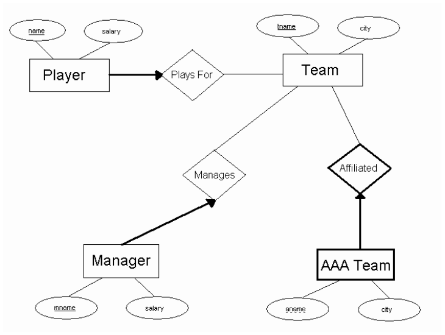

# Berkeley CS186 Fall 2003: Midterm 1: Official solutions

> Copied from the original: <https://hkn.eecs.berkeley.edu/exams/course/cs/186>. Text and figures are taken from the PDF as is; nothing was answered or rewritten. The original PDF is in this folder.

---

**Page 1**

&emsp;&emsp;&emsp;&emsp;&emsp;&emsp;&emsp;&emsp;Answer Key

&emsp;&emsp;&emsp;&emsp;&emsp;&emsp;&emsp;&emsp;UNIVERSITY OF CALIFORNIA 
&emsp;&emsp;&emsp;&emsp;&emsp;&emsp;&emsp;&emsp;College of Engineering 
&emsp;&emsp;&emsp;&emsp;&emsp;&emsp;&emsp;&emsp;Department of EECS, Computer Science Division 
CS186    Eben Haber 
Fall 2003    Midterm

&emsp;&emsp;&emsp;**Midterm Exam: Introduction to Database Systems** 
This exam has seven problems, worth different amounts of points each.  Each problem is made up of 
multiple questions.  You should read through the exam quickly and plan your time-management 
accordingly.  Before beginning to answer a question, be sure to read it carefully and to answer all parts of 
every question!

&emsp;&emsp;&emsp;&emsp;&emsp;&emsp;&emsp;&emsp;Good luck!

&emsp;&emsp;&emsp;&emsp;&emsp;&emsp;&emsp;&emsp;**Total**        /100

---

**Page 2**

CS 186 – Fall 2003    Login \_\_\_\_\_\_\_\_\_\_\_\_\_

**I. Query Languages (30 points).** 
&emsp;Given the following database tables, choose all queries in SQL, Relational Algebra or Tuple Relational 
&emsp;Calculus that return the proper answer to the corresponding question. Note that each question may 
&emsp;have more than one correct answers. Circle all that apply. 
&emsp;Primary keys are underlined. Note that the driver involved in a car accident may not always be the 
&emsp;owner of the car.  Assume that accident\_date is of type integer, and represents a year (e.g. 1980). Year 
&emsp;is also of type integer.  We assume that a car cannot get involved in more than one accident at a certain 
&emsp;date. 
&emsp;Person(SSN, name, address) 
&emsp;Car(license, year, model) 
&emsp;Accident(license, accident\_date, driver, damage\_amount) 
&emsp;Owns(SSN, license)

1\. (4 points) Find the SSN of every person who owns one or more cars, none of which has ever been 
&emsp;involved in a car accident. 
&emsp;A. SELECT O.SSN 
&emsp;&emsp;FROM Owns O 
&emsp;&emsp;WHERE O.license NOT IN (SELECT A.license 
&emsp;&emsp;FROM Accident A) 
&emsp;&emsp;&emsp;&emsp;(   )   (   ) 
&emsp;&emsp;OwnsOwns−ππ   Accident 
&emsp;&emsp;&emsp;&emsp;&emsp;&emsp;&emsp;&emsp;\>\< 
&emsp;B. 
&emsp;&emsp;&emsp;SSNSSN 
&emsp;&emsp;}{)((   ) 
&emsp;&emsp;\|1..1.1.OOOwnsOSSNOSSNAAccidentOlicenseA∃∈=∧¬∃∈=   license 
&emsp;C.

&emsp;D. None of the above 
&emsp;B is right. A and C return the SSN of every person that has at least one car that is not involved in an 
&emsp;accident, while the question asks for the people for whom all of their cars have never been involved in 
&emsp;an accident. 
2\. (4 points) Find the SSN of every person, who owns a TOYOTA or a DODGE 
&emsp;A. SELECT O.SSN 
&emsp;&emsp;FROM Owns O, Car C 
&emsp;&emsp;WHERE O.license=C.license AND 
&emsp;&emsp;&emsp;&emsp;&emsp;(C.model=’TOYOTA’ OR C.model=’DODGE’) 
&emsp;&emsp;&emsp;&emsp;)((   ) 
&emsp;&emsp;Ownsπσ   Car 
&emsp;&emsp;&emsp;&emsp;&emsp;&emsp;&emsp;\>\< 
&emsp;=∨=B. 
&emsp;&emsp;&emsp;mod''mod''SSNelTOYOTAelDODGE 
&emsp;&emsp;OOOwnsOSSNOSSN{\|1(.1.∃∈=∧ 
&emsp;))}()(C. 
&emsp;&emsp;CCarOlicenseClicenseCmodelTOYOTACmodelDODGE.1..''.'∃∈=∧=∨=   '

&emsp;D. None of the above 
&emsp;A, B and C are right.

&emsp;&emsp;&emsp;&emsp;&emsp;&emsp;&emsp;&emsp;1    Points for this page: \_\_\_\_\_\_\_\_\_\_\_\_

---

**Page 3**

CS 186 – Fall 2003    Login \_\_\_\_\_\_\_\_\_\_\_\_\_

3\. (4 points) Find the SSN of all persons who have had all of their cars involved in an accident. 
&emsp;A. SELECT O.SSN 
&emsp;&emsp;FROM Owns O, Accident A 
&emsp;&emsp;WHERE O.license=A.license 
&emsp;&emsp;EXCEPT 
&emsp;&emsp;SELECT O.SSN 
&emsp;&emsp;FROM Owns O 
&emsp;&emsp;WHERE O.license NOT IN (SELECT A.license 
&emsp;&emsp;FROM Accident A) 
&emsp;&emsp;&emsp;&emsp;&emsp;(   )   (   ) 
&emsp;&emsp;OwnsAccident÷ππ   Accident 
&emsp;B. \>\< 
&emsp;&emsp;&emsp;,SSNlicenselicense 
&emsp;&emsp;{(( 
&emsp;&emsp;\|1.1.2.1.2OOOwnsOSSNOSSNOOwnsOSSNOSSN∃∈=∧∀∈=⇒ 
&emsp;C. 
&emsp;&emsp;&emsp;&emsp;&emsp;&emsp;&emsp;(   )))} 
&emsp;&emsp;.2.AAccidentOlicenseA∃∈=   license

&emsp;D. None of the above. 
&emsp;A and C are right. B returns the people who have been involved in every accident. To be right it should 
&emsp;&emsp;&emsp;&emsp;&emsp;(   )   (   ) 
&emsp;&emsp;OwnsAccident÷ππ   Owns 
&emsp;be    \>\< 
&emsp;&emsp;,SSNlicenselicense

4\. (4 points) Who is the driver who participated in the most costly accident? Return the driver and the 
&emsp;amount of damage. 
&emsp;A. SELECT driver, damage\_amount 
&emsp;&emsp;FROM Accident 
&emsp;&emsp;WHERE damage\_amount IN (SELECT MAX(damage\_amount) 
&emsp;&emsp;FROM Accident) 
&emsp;B. SELECT driver, damage\_amount 
&emsp;&emsp;FROM Accident 
&emsp;&emsp;WHERE damage\_amount=MAX(damage\_amount) 
&emsp;C. (SELECT driver, damage\_amount FROM Accident) 
&emsp;&emsp;EXCEPT 
&emsp;&emsp;(SELECT a1.driver, a1.damage\_amount 
&emsp;&emsp;FROM Accident a1, Accident a2 
&emsp;&emsp;WHERE a1.damage\_amount\<a2.damage\_amount AND a1.driver\<\>a2.driver) 
&emsp;D. None of the above. 
&emsp;A is right. B doesn’t work. C doesn’t work if the driver involved in the most expensive accident, has 
&emsp;also been involved to some other accident. 
5\. (4 points) Find the license number of all cars that had an accident in less than 5 years after their 
&emsp;production. Return the license number and the number of years 
&emsp;A. SELECT c.license 
&emsp;&emsp;FROM Car c, Accident a 
&emsp;&emsp;WHERE a.accident\_date-c.year\<5 
&emsp;&emsp;&emsp;&emsp;&emsp;(   ) 
&emsp;&emsp;&emsp;&emsp;&emsp;&emsp;&emsp;&emsp;(   ) 
&emsp;&emsp;Carπσ   Accident 
&emsp;&emsp;&emsp;&emsp;&emsp;&emsp;&emsp;&emsp;\>\< 
&emsp;B. 
&emsp;&emsp;&emsp;\_5licenseaccidentdateyear−\<

&emsp;&emsp;&emsp;&emsp;&emsp;&emsp;&emsp;&emsp;2    Points for this page: \_\_\_\_\_\_\_\_\_\_\_\_

---

**Page 4**

CS 186 – Fall 2003    Login \_\_\_\_\_\_\_\_\_\_\_\_\_ 
&emsp;&emsp;}{)((   ) 
&emsp;&emsp;CCCarClicenseClicenseAAccidentCaccidentdateAyear\|1..1.1\_.∃∈=∧∃∈−\<   5 
&emsp;C.

&emsp;D. None of the above 
&emsp;D is right. None of the queries return the number of years. 
6\. (4 points) Find the accident with the smallest cost and return the corresponding owner of the car, 
&emsp;his/her address and the amount of damage. 
&emsp;A. SELECT O.SSN, P.address, MIN(A.damage\_amount) 
&emsp;&emsp;FROM Accident A, Owns O, Person P 
&emsp;&emsp;WHERE O.license=A.license AND O.SSN=P.SSN 
&emsp;&emsp;GROUP BY O.SSN, P.address 
&emsp;B. SELECT O.SSN, P.address, (SELECT MIN(damage\_amount) FROM Accident) 
&emsp;&emsp;FROM Owns O, Person P, Accident A 
&emsp;&emsp;WHERE O.SSN=P.SSN AND A.license=O.license 
&emsp;C. SELECT O.SSN, P.address, A.damage\_amount 
&emsp;&emsp;FROM Owns O, Person P, Accident A 
&emsp;&emsp;WHERE O.SSN=P.SSN AND A.damage\_amount=(SELECT MIN(damage\_amount) 
&emsp;&emsp;FROM Accident) 
&emsp;D. None of the above. 
&emsp;The answer is D. A returns the cheaper accident for each owner, B returns every owner involved in an 
&emsp;accident, along with the minimum value of damage, and C doesn’t work because it doesn’t perform the 
&emsp;join between Accident and the other relations. 
7\. (4 points) Find the license number of all cars that have been involved in more than one accident. (DO 
&emsp;&emsp;NOT RETURN DUPLICATES) 
&emsp;A. SELECT A1.license 
&emsp;&emsp;FROM Accident A1, Accident A2 
&emsp;&emsp;WHERE A1.license=A2.license AND A1.accident\_date\<\>a2.accident\_date 
&emsp;B. SELECT DISTINCT A1.license 
&emsp;&emsp;FROM Accident A1 
&emsp;&emsp;WHERE A1.license IN (SELECT A2.license 
&emsp;&emsp;FROM Accident A2 
&emsp;&emsp;WHERE A1.accident\_date\<\>A2.accident\_date) 
&emsp;C. SELECT license 
&emsp;&emsp;FROM Accident 
&emsp;&emsp;GROUP BY license 
&emsp;&emsp;HAVING COUNT(accident\_date)\>1 
&emsp;D. None of the above 
&emsp;B and C are right. A returns duplicates. 
8\. (2 points) Explain, in English, what the following Relational Calculus query expresses: 
=⇒ 
.1.2CmodelCmodel    
&emsp;∃∈=∧∀∈ 
\|1.1.2CCCarCmodelCmodelCCar 
&emsp;&emsp;&emsp;&emsp;&emsp;&emsp;&emsp;&emsp;(   ) 
..2AAccidentAlicenceClicense∃∈=    
&emsp;&emsp;&emsp;&emsp;&emsp;   

&emsp;&emsp;&emsp;&emsp;&emsp;&emsp;&emsp;&emsp;3    Points for this page: \_\_\_\_\_\_\_\_\_\_\_\_

---

**Page 5**

CS 186 – Fall 2003    Login \_\_\_\_\_\_\_\_\_\_\_\_\_

&emsp;“Return the model of those cars, for which all cars of that model have been involved in an accident” 
&emsp;(e.g. If every car of model ‘TOYOTA’ has been involved in an accident, the query must return the 
&emsp;model ‘TOYOTA’. If there is one ‘TOYOTA’ car not involved in an accident, ‘TOYOTA’ should 
&emsp;NOT be returned by the query)

**II. External Sorting (10 points)** 
1\. (6 points) Suppose we wish to sort the following values: 
84, 22, 19, 11, 60, 68, 31, 29, 58, 23, 45, 93, 48, 31, 7 
Assume that: 
&emsp;&emsp;•    you have three pages of memory for sorting 
&emsp;&emsp;•    you will use an external sorting algorithm with a 2-way merge 
&emsp;&emsp;•    a page only holds two values 
For each sorting pass, show the contents of all temporary files.

2\. (2 points) If you have 100 pages of data, and 10 pages of memory, what is the minimum number of 
passes required to sort the data.

Num passes = 1 + logB-1N/B   = 1 + log9100/10   = 1 + log910  = 1 + 2 = 3

3\. (2 points) If you have 500,000 pages of data, what is the minimum number of pages of memory required 
to sort the data in 3 passes?

&emsp;&emsp;&emsp;&emsp;&emsp;&emsp;&emsp;&emsp;4    Points for this page: \_\_\_\_\_\_\_\_\_\_\_\_

---

**Page 6**

CS 186 – Fall 2003    Login \_\_\_\_\_\_\_\_\_\_\_\_\_

Num passes = 1 + logB-1N/B   = 3  so, 
logB-1N/B   = 2  ⇒N/B  ≤(B – 1)2 ⇒ N ≤ B(B – 1)2 ⇒   B = 81 
You can also simplify this to N ≤ B3, in which case B = 80. 
**III. Join Algorithms (6 points)** 
Consider a relation R with attributes (x,y) and a relation S with attributes (y, z). Column y in S is a key and 
the set of values of y in R are the same as the set of values of y in S.  Assume that there are no indexes 
available and that there are 25 pages in the buffer available.  Table R is 1,500 pages with 50 tuples per 
page.  Table S is 400 with 100 tuples per page. 
Compute the I/O costs for the following joins.  Assume the simplest cost model, where pages are read and 
written one at a time. 
A. Block nested loops join with R as the outer relation and S as the inner relation 
R + R /B × S  = 1500 + 1500/25 × 400 = 25500 or 
R + R /B-1 × S  = 1500 + 1500/24 × 400 = 26700 or 
R + R /B-2 × S  = 1500 + 1500/23 × 400 = 27900 
Since all three equations were given in class, any were acceptable.

B. Block nested loops join with S as the outer relation and R as the inner relation 
S + S /B × R  = 400 + 400/25 × 1500 = 24400 or 
S + S /B-1 × R  = 400 + 400/24 × 1500 = 25900 or 
S + S /B-2 × R  = 400 + 400/23 × 1500 = 27400

C. Sort merge join with R as the outer relation and S as the inner relation 
2R (1 + logB-1R /B  ) + 2S (1 + logB-1S /B  ) + R + S  = 
2(1500)(1+ log241500/25 ) + 2(400)(1+ log24400/25 ) + 1500 + 400 =  12500 
We cannot use the cost model of 3(M+N) because we cannot sort the larger of the two relations in 2 passes.

D. Sort merge join with S as the outer relation and R as the inner relation 
Same as part (c)

E. Hash join with S as the outer relation and R as the inner relation 
3( R + S ) = 3(1500 + 400) = 5700

&emsp;&emsp;&emsp;&emsp;&emsp;&emsp;&emsp;&emsp;5    Points for this page: \_\_\_\_\_\_\_\_\_\_\_\_

---

**Page 7**

CS 186 – Fall 2003    Login \_\_\_\_\_\_\_\_\_\_\_\_\_

**IV Query Optimization** 
Consider the following schema 
Sailors(sid, sname, rating, age) 
Reserves(sid, did, day) 
Boats(bid, bname, size) 
Reserves.sid is a foreign key to Sailors and Reserves.bid is a foreign key to Boats.bid. 
We are given the following information about the database: 
Reserves contains 10,000 records with 40 records per page. 
Sailors contains 1000 records with 20 records per page. 
Boats contains 100 records with 10 records per page. 
There are 50 values for Reserves.bid. 
There are 10 values for Sailors.rating (1...10) 
There are 10 values for Boat.size 
There are 500 values for Reserves.day 
Consider the following query 
SELECT S.sid, S.sname, B.bname 
FROM Sailors S, Reserves R, Boats B 
WHERE S.sid = R.sid AND R.bid = B.bid AND 
B.size \> 5 AND R.day = 'July 4, 2003'; 
(a) Assuming uniform distribution of values and column independence, estimate the number of tuples 
returned by this query. 
The maximum cardinality this query is R × S× B  = 109. 
Reduction Factors: 
1/2 for B.size \> 5, 
1/500 for R.day = ‘July 4, 2003’, 
1/100 for R.bid = B.bid, and 
1/1000 for S.sid = R/sid 
So number of tuples return is (1/2)(1/500)(1/100)(1/1000)(109) = 10 
Consider the following query 
SELECT S.sid, S.sname, B.bname 
FROM Sailors S, Reserves R, Boats B 
WHERE S.sid = R.sid AND R.bid = B.bid 
(b) Draw all possible left-deep query plans for this query:

Note that we cannot join S and B since that would result in a cross product.

&emsp;&emsp;&emsp;&emsp;&emsp;&emsp;&emsp;&emsp;6    Points for this page: \_\_\_\_\_\_\_\_\_\_\_\_

---

**Page 8**

CS 186 – Fall 2003    Login \_\_\_\_\_\_\_\_\_\_\_\_\_

(c) For the first join in each query plan (the one at the bottom of the tree, what join algorithm would work 
best?  Assume that you have 50 pages of memory.  There are no indexes, so indexed nested loops is not an 
option.

\|R\| = 250, \|S\| = 50, \|B\| = 10. 
R join S: 
&emsp;•    Page-oriented nested loops join:  R + R × S = 250 + 250 × 50 = 12570 
&emsp;•    Block nested loops join: R + R /49 × S = 250 + 6 × 50 = 550 
&emsp;• Sort-merge join: note that 250 \< (num buffers)2 so cost is 3(R + S) = 3(250+50) = 900 
&emsp;•    Hash join: we can use hash join since each of the R partitions from phase one fit into memory. So 
&emsp;&emsp;cost is 3(R + S) = 3(250+50) = 900. 
&emsp;•    **Cheapest: Block nested loops** 
S join R: 
&emsp;•    Page-oriented nest loops join: S + S × R = 50 + 50 × 250 = 12550 
&emsp;•    Block nested loops join: S + S /49 × R = 50 + 2 × 250 = 550 
&emsp;•    Sort-merge join: 3(R + S) = 3(250+50) = 900 
&emsp;• Hash join: 3(R + S) = 3(250+50) = 900 
&emsp;•    **Cheapest: Block nested loops** 
B join R: 
&emsp;•    Page-oriented nested loops: B + B × R = 10 + 10 × 250 = 2510 
&emsp;•    Block nested loops join: B + B /49 × R = 10 + 250 = 260 
&emsp;•    Sort-merge join: 3(10+250) = 780 
&emsp;•    Hash join: 3(10+250) = 780 
&emsp;•    **Cheapest: Block nested loops** 
R join B: 
&emsp;•    Page-oriented nested loops join: The thing to note is that we can fit the entire Boats relation into 
&emsp;&emsp;memory, so we only need to scan Boats once. So the cost is R + B = 260.  This is the same if 
&emsp;&emsp;we use simple nested loops join. 
&emsp;•    Block nested loops join: R + R /49 × B = 250 + 6 × 10 = 310 
&emsp;•    Sort merge join: 3(10+250) = 900 
&emsp;•    Hash join: 3(10+250) = 900 
&emsp;•    **Cheapest: Page-oriented nested loops, or simple nested loops**

&emsp;&emsp;&emsp;&emsp;&emsp;&emsp;&emsp;&emsp;7    Points for this page: \_\_\_\_\_\_\_\_\_\_\_\_

---

**Page 9**

&emsp;&emsp;&emsp;&emsp;CS 186 – Fall 2003    Login \_\_\_\_\_\_\_\_\_\_\_\_\_

&emsp;&emsp;&emsp;&emsp;**V Buffer Management (10 points total)** 
&emsp;&emsp;&emsp;&emsp;In this exercise, you will compare the LRU, MRU, and CLOCK buffer management algorithms for a given 
&emsp;&emsp;&emsp;&emsp;workload (just as you did in the first part of homework 1).  Here are the assumptions you must make: 
&emsp;&emsp;&emsp;&emsp;&emsp;&emsp;•    Assume there are four page slots your buffer manager must manage: P1, P2, P3, and P4. 
&emsp;&emsp;&emsp;&emsp;&emsp;&emsp;•    All four slots are empty to start. 
&emsp;&emsp;&emsp;&emsp;&emsp;&emsp;•    When the buffer pool has unused slots (such as at the beginning, when all four slots are empty), it 
&emsp;&emsp;&emsp;&emsp;&emsp;&emsp;&emsp;will put newly read data in the leftmost empty slot (e.g., if slots 2 and 3 are free, it will use slot 2). 
&emsp;&emsp;&emsp;&emsp;&emsp;&emsp;•    The pages to be read from disk are labelled A through G. 
&emsp;&emsp;&emsp;&emsp;&emsp;&emsp;•    For each access the page is pinned, and then immediately unpinned. 
&emsp;&emsp;&emsp;&emsp;Below are three tables for describing the contents of the buffer pool at each time step.  A page is read at the 
&emsp;&emsp;&emsp;&emsp;beginning of each time step.  You should record, in the table, the contents of each Buffer Page after the new 
&emsp;&emsp;&emsp;&emsp;page has been read in.

&emsp;&emsp;&emsp;&emsp;&emsp;&emsp;&emsp;&emsp;8    Points for this page: \_\_\_\_\_\_\_\_\_\_\_\_

---

**Page 10**

CS 186 – Fall 2003    Login \_\_\_\_\_\_\_\_\_\_\_\_\_

**VI. Functional Dependencies and Normalization (20 points total)**

Consider the attributes A B C D E F G which have the following functional dependencies: 
AD → F 
AE → G 
DF → BC 
E → C 
G → E

1\.    List all candidate keys (not superkeys): (5 points)

**A D E** 
**A D G**

2\.    Which of the following dependencies are implied by those above: (5 points) 
a.    (IS)   (IS NOT)    G → C

b. 
c.    (IS)   (IS NOT)    ADF →  E 
d.    (IS)   (IS NOT)    ADC → B 
e.    (IS)   (IS NOT)    AGF → E

3\.    Consider the decomposition into 4 relations: (ADF)  (CE)  (EG)  (ABDG). 
&emsp;&emsp;This decomposition: (5 points) 
a. 
b. 
c. 
d.    (IS)   (IS NOT)  Dependency Preserving 
e.

4\.    Consider the decomposition into 3 relations: (ADF)  (EC)  (ABDEG). 
&emsp;&emsp;This decomposition: (5 points) 
a. 
b. 
c. 
d.    (IS)   (IS NOT)  Dependency Preserving 
e.

&emsp;&emsp;&emsp;&emsp;&emsp;&emsp;&emsp;&emsp;9    Points for this page: \_\_\_\_\_\_\_\_\_\_\_\_

---

**Page 11**

CS 186 – Fall 2003    Login \_\_\_\_\_\_\_\_\_\_\_\_\_

**VII. Entity-Relational Model (20 Points)** 
a) (10 points) Draw an E-R diagram for the following situation: 
&emsp;•    This is a simplified model for reserving baseball tickets. 
&emsp;•    There are teams, which are identified by the team name.  Teams are also located in a city. 
&emsp;•    Teams play each other in games, which occur on a particular date at a particular time.  Games are 
&emsp;&emsp;identified by a game ID, and each game has exactly two teams that play in it. 
&emsp;•    A game is played in exactly one stadium. 
&emsp;•    A stadium is identified by its name, and is also located in a city. 
&emsp;•    Stadiums have seats, which have a section number, a row number, and a seat number. 
&emsp;•    Ticket holders reserve seats for a game.  Ticket holders are identified by their name. 
&emsp;•    Some ticket holders are students (students get discounts, but we are not including that in the 
&emsp;&emsp;model).

&emsp;&emsp;&emsp;&emsp;&emsp;&emsp;&emsp;&emsp;10    Points for this page: \_\_\_\_\_\_\_\_\_\_\_\_

---

**Page 12**

CS 186 – Fall 2003    Login \_\_\_\_\_\_\_\_\_\_\_\_\_

b) (10 points) Using SQL, convert the following ER diagram to the relational model.  Hint: You do not 
need CHECK constraints.

CREATE TABLE Player (name char(30), salary real, tname char(30) NOT NULL, 
PRIMARY KEY (name), FOREIGN KEY (tname) REFERENCES Team); 
CREATE TABLE Team (tname char(30), city char(30), PRIMARY KEY (tname)); 
CREATE TABLE Manager (mname char(30), salary real, tname char(30) NOT NULL, 
PRIMARY KEY (mname), 
FOREIGN KEY (tname) REFERENCES Team); 
CREATE TABLE AAATeam (tname char(30), aname char(30), city char(30), 
PRIMARY KEY (tname, aname), 
FOREIGN KEY (tname) REFERENCES Team);

&emsp;&emsp;&emsp;&emsp;&emsp;&emsp;&emsp;&emsp;11    Points for this page: \_\_\_\_\_\_\_\_\_\_\_\_

