# Berkeley CS186 Spring 2003: Final: Questions

> Copied from the original: <https://hkn.eecs.berkeley.edu/exams/course/cs/186>. Text and figures are taken from the PDF as is; nothing was answered or rewritten. The original PDF is in this folder.

---

**Page 1**

&emsp;&emsp;&emsp;&emsp;&emsp;&emsp;&emsp;&emsp;**Name \_\_\_\_\_\_\_\_\_\_\_\_\_\_\_\_\_\_\_\_\_\_\_\_\_\_\_\_** 
&emsp;&emsp;&emsp;&emsp;&emsp;&emsp;&emsp;&emsp;**Class Account \_\_\_\_\_\_\_\_\_\_\_\_\_\_\_\_\_\_\_\_\_\_\_\_\_\_\_\_** 
&emsp;&emsp;&emsp;&emsp;&emsp;&emsp;&emsp;UNIVERISTY OF CALIFORNIA, BERKELEY 
&emsp;&emsp;&emsp;&emsp;&emsp;&emsp;&emsp;&emsp;College of Engineering 
&emsp;&emsp;&emsp;&emsp;&emsp;&emsp;Department of EECS, Computer Science Division 
CS186   J. Hellerstein 
Spring 2003   Final Exam

&emsp;&emsp;&emsp;&emsp;**Final Exam: Introduction to Database Systems** 
This exam has seven problems, each worth a different amount of points. Each problem is 
made up of multiple questions.  You should read through the exam quickly and plan your 
time-management accordingly.  Before beginning to answer a question, be sure to read it 
carefully and to answer all parts of every question!  Please **do not spend time** 
**explaining your answers unless we explicitly ask that you do so**.  We will not be 
giving extra or partial credit for explanations unless we ask for them.

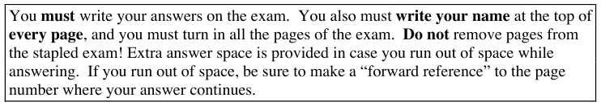

&emsp;&emsp;&emsp;&emsp;&emsp;&emsp;&emsp;&emsp;Good luck!

&emsp;&emsp;&emsp;&emsp;&emsp;&emsp;&emsp;&emsp;1

---

**Page 2**

&emsp;&emsp;&emsp;&emsp;&emsp;&emsp;&emsp;&emsp;**Name \_\_\_\_\_\_\_\_\_\_\_\_\_\_\_\_\_\_\_\_\_\_\_\_\_\_\_\_**

1\. **Recovery \[20 points\]** 
&emsp;In this question we explore the interplay between buffer management and 
&emsp;recovery.  We present four scenarios below.  For each scenario, you must follow 
&emsp;the following guidelines: 
&emsp;— Choose a maximally **efficient** protocol! 
&emsp;— Among all protocols with the same level of efficiency, choose the **simplest**.

&emsp;Each scenario corresponds to exactly one of the four quadrants in the chart at the 
&emsp;bottom of the page.  **Place the letter of each scenario (a, b, c, d) in the** 
&emsp;**appropriate quadrant.**  Note that while each letter goes in only one quadrant, it 
&emsp;is possible that some quadrants will have more or less than one letter in them!  **\[5** 
&emsp;**points each\]**

&emsp;&emsp;a. **Scenario: Traditional ARIES.**  You have been told to implement the 
&emsp;&emsp;&emsp;ARIES recovery protocol as discussed in class. 
&emsp;&emsp;b. **Scenario: Buffer Pool Bigger than Database.**  Modern servers ship with 
&emsp;&emsp;&emsp;as much as 32GB of RAM.  Hence for many customers, their databases 
&emsp;&emsp;&emsp;will never be larger than available RAM.  You have a startup company 
&emsp;&emsp;&emsp;that is designing a special-purpose DBMS for these customers. 
&emsp;&emsp;c. **Scenario: Before-Image Logging.**  In order to keep your logs more 
&emsp;&emsp;&emsp;compact, you store only the “before-image” of the data in update log 
&emsp;&emsp;&emsp;records, and not the “after-image”.  (Recall that the before-image has the 
&emsp;&emsp;&emsp;state of the page before the update; the after-image would have also shown 
&emsp;&emsp;&emsp;the state of the page after the update.) 
&emsp;&emsp;d. **Scenario: Untrusted Buffer Manager.**  No matter how many times you 
&emsp;&emsp;&emsp;explain it, the engineers implementing the buffer manager cannot 
&emsp;&emsp;&emsp;understand the log manager.  So you’re going to have to choose a protocol 
&emsp;&emsp;&emsp;that can handle any mix of page replacement decisions.

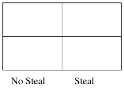

&emsp;&emsp;&emsp;&emsp;&emsp;&emsp;&emsp;&emsp;Force

&emsp;&emsp;&emsp;&emsp;&emsp;&emsp;&emsp;No Force

&emsp;&emsp;&emsp;&emsp;&emsp;&emsp;&emsp;&emsp;2

---

**Page 3**

&emsp;&emsp;&emsp;&emsp;&emsp;&emsp;&emsp;&emsp;**Name \_\_\_\_\_\_\_\_\_\_\_\_\_\_\_\_\_\_\_\_\_\_\_\_\_\_\_\_**

&emsp;2\. **ARIES \[20 points\]** 
&emsp;&emsp;Consider the following log where the DPT represents the Dirty Page Table and 
&emsp;&emsp;TT represents the Transaction Table

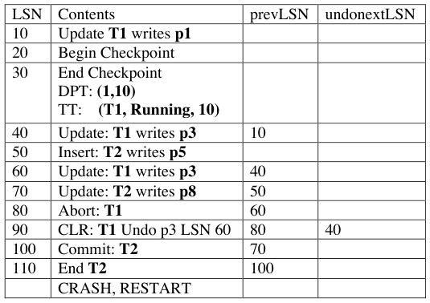

&emsp;&emsp;Answer the following questions: 
&emsp;&emsp;a. What is the smallest LSN accessed during the Analysis phase.  **\[2 points\]**

&emsp;&emsp;b. Fill in the contents of the **Dirty Page Table** and the **Transaction Table** at the 
&emsp;&emsp;&emsp;end of the Analysis phase.  (you may not need all the space we give you) **\[10** 
&emsp;&emsp;&emsp;**points\]**

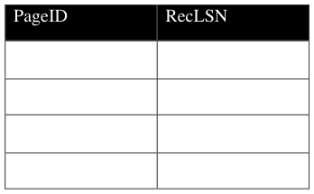

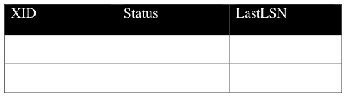

&emsp;&emsp;c. At which LSN does the Redo phase begin?  **\[2 points\]**

&emsp;&emsp;d. What entries (specify only LSNs) do get undone as part of the Undo phase? **\[6** 
&emsp;&emsp;&emsp;**points\]**

&emsp;&emsp;&emsp;&emsp;&emsp;&emsp;&emsp;&emsp;3

---

**Page 4**

&emsp;&emsp;&emsp;&emsp;&emsp;&emsp;&emsp;&emsp;**Name \_\_\_\_\_\_\_\_\_\_\_\_\_\_\_\_\_\_\_\_\_\_\_\_\_\_\_\_**

3\. **Functional Dependencies and Normalization  \[20 points\]** 
&emsp;Consider the relation schema R = (A, B, C, D, E, F) and the set of functional 
&emsp;dependencies F: **A-\>B, A-\>C, BC-\>E,  BC-\>D, E-\>F, BC-\>F**

&emsp;Note that in all the following, you will never have to compute F+, the closure of 
&emsp;F! 
&emsp;&emsp;a. List the minimal candidate key(s) for R.  Write ‘none’ if you think there 
&emsp;&emsp;&emsp;are no candidate keys. **\[2 points\]**

&emsp;&emsp;b. List the FDs in F that violate BCNF. (Hint: There are four) **\[4 points\]**

&emsp;&emsp;c. Is R in 3NF (yes or no)? **\[2 points\]**

&emsp;&emsp;d. Is F a minimal cover?  **\[2 points\]**

&emsp;&emsp;&emsp;(continued)

&emsp;&emsp;&emsp;&emsp;&emsp;&emsp;&emsp;&emsp;4

---

**Page 5**

&emsp;&emsp;&emsp;&emsp;&emsp;&emsp;&emsp;&emsp;**Name \_\_\_\_\_\_\_\_\_\_\_\_\_\_\_\_\_\_\_\_\_\_\_\_\_\_\_\_**

e. Suppose we decompose R into the following tables: 
&emsp;R1 = (B, C, E) 
&emsp;R2 = (B, C, F) 
&emsp;R3 = (B, C, D) and 
&emsp;R4 = (A, B, C). 
&emsp;This decomposed schema is indeed in BCNF (you can trust us on this!)

&emsp;Unfortunately, this decomposition is not dependency-preserving; in 
&emsp;particular, the dependency E-\>F cannot be checked on a single table. A 
&emsp;CHECK ASSERTION can be used to enforce E-\>F.

&emsp;Complete the following SQL statement for this particular CHECK 
&emsp;ASSERTION needed to guarantee E-\>F. **\[8 points\]**

&emsp;CREATE ASSERTION checkDep 
&emsp;CHECK ( NOT EXISTS 
&emsp;( SELECT \* FROM  R1, R2

&emsp;WHERE \_\_\_\_\_\_\_\_\_\_\_\_\_\_\_\_\_\_\_\_\_\_\_

&emsp;GROUP BY \_\_\_\_\_\_\_\_\_\_\_\_\_\_\_\_\_\_\_\_\_

&emsp;HAVING COUNT(\_\_\_\_\_\_\_\_\_\_\_\_\_\_\_\_\_\_\_\_\_\_\_\_\_\_)\_\_\_\_\_\_\_\_\_\_))

f. Why might the ASSERTION in (e) be expensive? **\[2 points\]** 
&emsp;&emsp;i. Updates to R1 and R2 are frequent 
&emsp;&emsp;ii. Inserts to R1 and R2 are frequent 
&emsp;&emsp;iii. Insertions to R2 are frequent; R1 rarely changes. 
&emsp;&emsp;iv. Reads to R1 and R2 are frequent 
&emsp;&emsp;v. (i) and (ii) 
&emsp;&emsp;vi. (i), (ii), (iii) 
&emsp;&emsp;vii. All of the above

&emsp;&emsp;&emsp;Answer (choose one):  \_\_\_\_\_\_\_\_\_\_\_

&emsp;&emsp;&emsp;&emsp;&emsp;&emsp;&emsp;&emsp;5

---

**Page 6**

&emsp;&emsp;&emsp;&emsp;&emsp;&emsp;&emsp;&emsp;**Name \_\_\_\_\_\_\_\_\_\_\_\_\_\_\_\_\_\_\_\_\_\_\_\_\_\_\_\_**

4\. **Database Tuning  \[14 points\]** 
&emsp;Consider the following BCNF relational

&emsp;Apartment (aid, capacity) 
&emsp;GraduateStudent (SID, age, sex, dept, GPA, aid)

&emsp;— GraduateStudent.aid is a foreign key referencing Apartment. 
&emsp;— There are very few “single” apartments (i.e. where capacity=1) 
&emsp;— 50% of the Graduate Students are males.

&emsp;&emsp;a. You are told that the following three queries are the most common. For 
&emsp;&emsp;&emsp;each of these queries, we have listed three different indexes as possible 
&emsp;&emsp;&emsp;access methods. Pick the access method that would benefit the query **most** 
&emsp;&emsp;&emsp;in terms of I/O performance. Assume that these queries occur much more 
&emsp;&emsp;&emsp;frequently than updates.  **\[3 points each\]**

&emsp;&emsp;&emsp;Query 1: List aids of apartments with capacity=1 
&emsp;&emsp;&emsp;&emsp;&emsp;i. Clustered B+Tree index for Apartment on aid field 
&emsp;&emsp;&emsp;&emsp;&emsp;ii. Unclustered B+Tree index for Apartment on capacity field 
&emsp;&emsp;&emsp;&emsp;iii. Clustered B+Tree index for Apartment on capacity field.

&emsp;&emsp;&emsp;&emsp;&emsp;&emsp;Answer (choose one):  \_\_\_\_\_\_\_\_\_\_\_

&emsp;&emsp;&emsp;Query 2: List SIDs of male graduate students 
&emsp;&emsp;&emsp;&emsp;&emsp;i. No indexes.  Use a file scan on GraduateStudent. 
&emsp;&emsp;&emsp;&emsp;&emsp;ii. Unclustered B+Tree index for GraduateStudent on sex 
&emsp;&emsp;&emsp;&emsp;iii. Clustered B+Tree index for GraduateStudent on SID

&emsp;&emsp;&emsp;&emsp;&emsp;&emsp;Answer (choose one):  \_\_\_\_\_\_\_\_\_\_\_

&emsp;&emsp;&emsp;Query 3: List depts of graduate students staying in apartment aid=4. 
&emsp;&emsp;&emsp;&emsp;&emsp;i. Clustered B+Tree index for GraduateStudent on aid 
&emsp;&emsp;&emsp;&emsp;&emsp;ii. No indexes. Use a file scan on GraduateStudent table. 
&emsp;&emsp;&emsp;&emsp;iii. Unclustered B+Tree index for GraduateStudent on \<aid, dept\>

&emsp;&emsp;&emsp;&emsp;&emsp;&emsp;Answer (choose one):  \_\_\_\_\_\_\_\_\_\_\_

&emsp;&emsp;&emsp;&emsp;&emsp;&emsp;&emsp;&emsp;continued

&emsp;&emsp;&emsp;&emsp;&emsp;&emsp;&emsp;&emsp;6

---

**Page 7**

&emsp;&emsp;&emsp;&emsp;&emsp;&emsp;&emsp;&emsp;**Name \_\_\_\_\_\_\_\_\_\_\_\_\_\_\_\_\_\_\_\_\_\_\_\_\_\_\_\_**

b. The database is still running very slowly even after you recommended the 
&emsp;right indexes in part (a)! A careful workload study reveals that in practice, 
&emsp;the following two transactions are extremely frequent (far more than any 
&emsp;other queries or updates):

&emsp;\- **T1:** Find the average age of all graduate students group by aid 
&emsp;\- **T2:** Update the GPA of graduate student g (the value of g may be 
&emsp;different each time T2 is run)

&emsp;Traces show that the above two queries resulted in concurrency control 
&emsp;bottlenecks, due to lock contention on the GraduateStudent table. Tuple 
&emsp;granularity locks are obtained.

&emsp;The following solutions have been proposed to alleviate the problem. 
&emsp;Choose the **single** letter that gives the most correct options; if no correct 
&emsp;options are listed, choose (ix).  **\[5 points\]** 
&emsp;i. Vertically partition (i.e. decompose) the GraduateStudent table into 
&emsp;&emsp;two separate tables such that (SID,age,aid) is in one table, and (SID, 
&emsp;&emsp;sex, dept, GPA) is in another. 
&emsp;ii. Horizontally partition the GraduateStudent table according to aid field. 
&emsp;&emsp;Graduate Students who stay in even numbered apartments are stored in 
&emsp;&emsp;a different table from those that are odd numbered. 
&emsp;iii. Make use of page granularity locks 
&emsp;iv. Use non-strict two-phase locking (2PL) 
&emsp;v. Create an unclustered B+Tree index for GraduateStudent on \<aid, 
&emsp;&emsp;age\> 
&emsp;vi. Either (i) or (ii) would work 
vii. Either (i) or (v) would work 
viii. Either (iii) or (iv) would work 
&emsp;ix. None of the above.

&emsp;&emsp;Answer (choose one):  \_\_\_\_\_\_\_\_\_\_\_

&emsp;&emsp;&emsp;&emsp;&emsp;&emsp;&emsp;&emsp;7

---

**Page 8**

&emsp;&emsp;&emsp;&emsp;&emsp;&emsp;&emsp;&emsp;**Name \_\_\_\_\_\_\_\_\_\_\_\_\_\_\_\_\_\_\_\_\_\_\_\_\_\_\_\_**

**5. Query Optimization  \[15 points\]** 
Consider the following relational schema and SQL query: 
Student (SID, DID, Enroll\_Year, Nationality) 
Department (DID, Name, Building\_Num, Telephone, FID) 
Finance (FID, Budget, Expenses, …)

SELECT D.Name, F.Budget 
FROM Student S, Department D, Finance F 
WHERE S.DID = D.DID and D.FID = F.FID AND 
D.Building\_Num \> 5 AND D.Building\_Num \<=10 AND 
&emsp;S.Enroll\_Year = 2000 OR S.Enroll\_Year = 2001;

Here are some statistics: 
— Building Numbers range from 1 to 20 inclusive (i.e. 1 and 20 are both valid numbers). 
— Each building has the same number of departments 
— Students’ enrollment year (Student.Enroll\_Year) ranges from 1997 to 2002, and is 
distributed according to the following table:

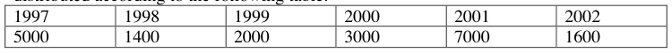

— Number of Tuples (pages) per relation: 
\- Student: 20000 (2000 pages) 
\- Department: 100 (10 pages) 
\- Finance: 100 (10 pages)

(continued)

&emsp;&emsp;&emsp;&emsp;&emsp;&emsp;&emsp;&emsp;8

---

**Page 9**

&emsp;&emsp;&emsp;&emsp;&emsp;&emsp;&emsp;&emsp;**Name \_\_\_\_\_\_\_\_\_\_\_\_\_\_\_\_\_\_\_\_\_\_\_\_\_\_\_\_**

a) Consider the following query plan.  Each of the leaf nodes is a sequential scan.  Each 
&emsp;of the joins is a naïve nested loops join.  In the **three dotted boxes**, write down the 
&emsp;expected number of tuples generated by the subtree below the associated tree edge. 
&emsp;In the **two dotted ovals,** write down the expected number of I/Os performed by the 
&emsp;associated join.  (You can assume that projections are done as early as possible.)  **\[12** 
&emsp;**points\]**

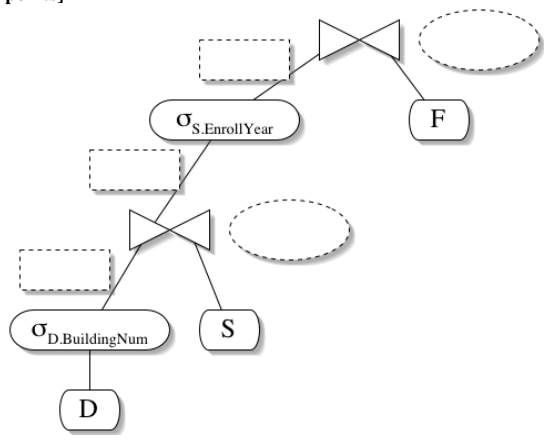

b) Would a query optimizer like the one we studied in class choose the following plan? 
&emsp;(Again, assume that projections are done as early as possible.)  **Briefly** explain your 
&emsp;answer! **\[3 points\]**

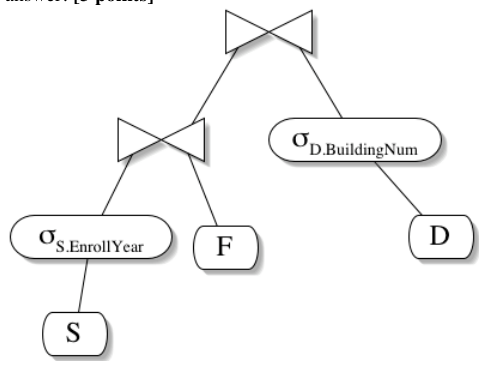

&emsp;&emsp;&emsp;&emsp;&emsp;&emsp;&emsp;&emsp;9

---

**Page 10**

&emsp;&emsp;&emsp;&emsp;&emsp;&emsp;&emsp;&emsp;**Name \_\_\_\_\_\_\_\_\_\_\_\_\_\_\_\_\_\_\_\_\_\_\_\_\_\_\_\_**

**6. Concurrency control  \[16 points\]** 
&emsp;a) Consider the following modified definition of serializability: 
&emsp;&emsp;&emsp;A schedule S is serializable iff it produces the same database state as a serial 
&emsp;&emsp;&emsp;schedule T, where the transactions in T are exactly those in S, and are ordered 
&emsp;&emsp;&emsp;in T according to their first appearance in S. 
&emsp;&emsp;&emsp;Is this definition:    **\[3 points\]** 
&emsp;&emsp;i.    Correct? 
&emsp;&emsp;ii.     Overly restrictive: i.e. there are some serializable schedules not covered by 
&emsp;&emsp;&emsp;&emsp;this definition? 
&emsp;&emsp;iii.     Overly permissive: i.e. there are some unserializable schedules that are 
&emsp;&emsp;&emsp;&emsp;covered by this definition? 
&emsp;&emsp;iv.     (ii) and (iii)

&emsp;&emsp;&emsp;&emsp;Answer (choose one):  \_\_\_\_\_\_\_\_\_\_\_

&emsp;b) Bob and Anne share a bank account for their business.  Today they went to the 
&emsp;&emsp;&emsp;bank at the same time.  Draw the dependency graph for the schedule below. 
&emsp;&emsp;&emsp;You do not need to label any edges in the graph.  **\[3 points\]** 
T\_Bob   T\_Anne

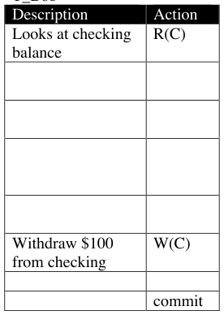

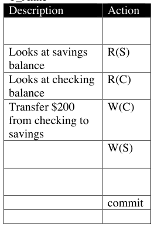

&emsp;&emsp;&emsp;&emsp;&emsp;&emsp;&emsp;&emsp;10

---

**Page 11**

&emsp;&emsp;&emsp;&emsp;&emsp;&emsp;&emsp;&emsp;**Name \_\_\_\_\_\_\_\_\_\_\_\_\_\_\_\_\_\_\_\_\_\_\_\_\_\_\_\_**

c) Is the schedule in (b) conflict serializable?  If so, give an equivalent serial 
&emsp;schedule.  If not, enumerate all the serial schedules, and explain how Bob and 
&emsp;Anne’s experience would be changed in each.  **\[5 points\]**

d) Suppose that the database system at the bank implemented strict 2-phase locking 
&emsp;as we studied in class.  Assume that Bob and Anne’s requests for actions arrive 
&emsp;in the same order as in (b), but if either of them is blocked while waiting for a 
&emsp;lock, their actions stop arriving until they acquire the lock (after which time they 
&emsp;continue as fast as they can).  Describe what happens in that scenario: a few 
&emsp;words should suffice.  **\[5 points\]**

&emsp;&emsp;&emsp;&emsp;&emsp;&emsp;&emsp;&emsp;11

---

**Page 12**

&emsp;&emsp;&emsp;&emsp;&emsp;&emsp;&emsp;&emsp;**Name \_\_\_\_\_\_\_\_\_\_\_\_\_\_\_\_\_\_\_\_\_\_\_\_\_\_\_\_**

7\. **Sorting and Hashing  \[12 points\]** 
&emsp;Consider the following query:

&emsp;SELECT g, COUNT(\*) FROM T GROUP BY g

&emsp;Assume that table T is of size N disk blocks, and the buffer pool has (B+1) frames 
&emsp;available for this grouping operation.

&emsp;**NOTE:** We assume that ÷N is a little **more** than B+1.  (Think about this!)

&emsp;We will consider both hash-based and sort-based implementations of grouping.  For 
&emsp;hash-based grouping, we will use the scheme you implemented for homework 2.  For 
&emsp;sort-based grouping, we will use the scheme described in class, with **heapsort** (also 
&emsp;known as **tournament sort**) as our in-memory sorting algorithm.

&emsp;Note that we are **not** writing out the final result of sorting or hashing, but we **do** 
&emsp;include the cost of initially scanning table T!!

&emsp;For each technique in the table below, write down the letter of the correct cost 
&emsp;solution (a – f).  Each technique has exactly one matching cost, but a given solution 
&emsp;may appear 0, 1 or many times in the table.  **\[3 points each\]**

&emsp;Possible solutions include the following costs: 
&emsp;a) N I/Os 
&emsp;b) 3N I/Os 
&emsp;c) 5N I/Os 
&emsp;d) 6N I/Os 
&emsp;e) 7N I/Os 
&emsp;f)    B I/Os

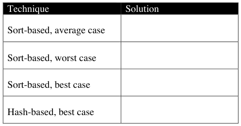

&emsp;&emsp;&emsp;&emsp;&emsp;&emsp;&emsp;&emsp;12

---

**Page 13**

&emsp;&emsp;&emsp;&emsp;&emsp;&emsp;&emsp;&emsp;**Name \_\_\_\_\_\_\_\_\_\_\_\_\_\_\_\_\_\_\_\_\_\_\_\_\_\_\_\_**

**SCRATCH**

&emsp;&emsp;&emsp;&emsp;&emsp;&emsp;&emsp;&emsp;13

---

**Page 14**

&emsp;&emsp;&emsp;&emsp;&emsp;&emsp;&emsp;&emsp;**Name \_\_\_\_\_\_\_\_\_\_\_\_\_\_\_\_\_\_\_\_\_\_\_\_\_\_\_\_**

**SCRATCH**

&emsp;&emsp;&emsp;&emsp;&emsp;&emsp;&emsp;&emsp;14

