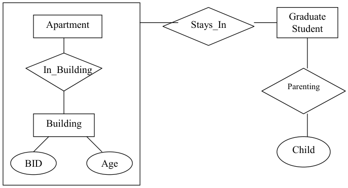
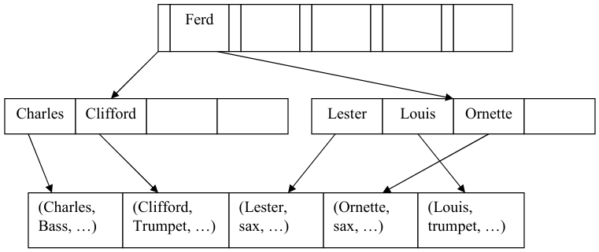

# Berkeley CS186 Spring 2003: Midterm 1: Questions

> Copied from the original: <https://hkn.eecs.berkeley.edu/exams/course/cs/186>. Text and figures are taken from the PDF as is; nothing was answered or rewritten. The original PDF is in this folder.

---

**Page 1**

&emsp;&emsp;&emsp;&emsp;&emsp;&emsp;&emsp;&emsp;UNIVERSITY OF CALIFORNIA 
&emsp;&emsp;&emsp;&emsp;&emsp;&emsp;&emsp;&emsp;College of Engineering 
&emsp;&emsp;&emsp;&emsp;&emsp;&emsp;&emsp;&emsp;Department of EECS, Computer Science Division

CS 186                                          J. Hellerstein 
Spring 2003                                            Midterm

&emsp;&emsp;&emsp;&emsp;&emsp;&emsp;&emsp;&emsp;Midterm Exam: Introduction to Database Systems

This exam has five problems, worth a total of 100 points. Each problem is made up of multiple questions. You should 
read through the exam quickly and plan your time-management accordingly. Before beginning to answer a question, be 
sure to read it carefully and to answer all parts of every question! 
Except where specifically directed otherwise, you must write your answers on the answer sheets provided. You may 
use the sheets with questions as scratch paper. You also must write your name at the top of every page, and you must 
turn in all the pages of the exam. Do not remove pages from the stapled exam! Two pages of extra answer space have 
been provided at the back in case you run out of space while answering. If you run out of space, be sure to make a 
“forward reference” to the page number where your answer continues. 
Good luck!

1\) Disk and Buffers (15 points) 
The specifications sheet for the Seagate Cheetah Xl 5-36LP 40 GB disk says that it has a sector size of 512 bytes, about 
80 million (8x1010) sectors, about 20,000 (2x104) cylinders, 4 double-sided platters, and an average seek time of about 
4 msec. The disk platters rotate at about 18,000 (18x103) rpm (revolutions per minute), and one track of data can be 
transferred per revolution. We will put our database on this disk. The buffer pool of this DBMS consists of buffer pages 
with 1024 bytes each. The disk block size is the same as buffer page size.

If your arithmetic is getting messy in this question, you can leave your answer unsimplified, as an equation of 0 
variables (e.g. “9467/32 + 212”). Note that you may not need all the information above to answer these questions.

a) (5 points) Based on the information above, how many tracks are there on each platter of this disk?

b) (5 points) Suppose that a table containing 10,000 records of 100 bytes each is to be stored on such a disk, and no 
record is allowed to span two blocks. How many blocks are required to store the entire table? (Hint: first compute the 
number of records per block! You may assume that the disk blocks are arranged for fixed-length records, and that the 
header information for each block is 20 bytes long.)

c) (5 points) Suppose that your answer to part (b) was some number B. You want to join that table with another table of 
B blocks, using nested-loops join. How many buffer pages (at least) do we need to avoid sequential flooding? Assume 
that the buffer replacement policy is LRU and all the buffers are unpinned and put in the free list before executing the 
join. Also assume we are writing the output to disk. Your answer should be an equation on the single variable B.

CS 186 Midterm, Spring 2003    Page 1

---

**Page 2**

2\) Hashing (20 points) 
In this question, you are implementing a database to handle applicants to be contestants on the TV show ‘The 
Bachelorette”. Consider the relation Applicants (name, age, IQ, haircolor. homes tate, walletthickness).

You are interested in choosing people with a variety of attributes for the show. Consider the following query (Q1):

select distinct name, haircolor, homestate 
from Applicants;

Let Applicants be N blocks big. We will consider hash-based implementations of duplicate elimination.

a) (4 points) Assume that you have a naïve implementation of hashing, which is unable to spill to disk (i.e. the code in 
Postgres before you added your HW2!) What is the largest value of N that can be handled efficiently for Qi in this 
implementation?

b) (4 points) Now imagine you improve the hashing implementation somewhat, to support a simple, 2-phase disk-based 
hashing strategy as described in lecture (partition+rehash — not hybrid hashing!). Assuming a perfect hash function, 
give an expression for the number of L’Os for processing duplicate elimination in Q1. Do not count any lJOs for 
reading the input to the partitioning phase, or writing the output of the rehashing phase!

c) (6 points) Suppose that the hash function you used does not work very well. Describe what could go wrong in Qi 
using the scheme in (b), and what a (thorough) implementation would do to compensate.

d) (6 points) When you originally set up the entry form, you allowed people to type any string they wanted for the 
haircolor field. Some weird stuff came in! Values included “fuschia”, “dishwater” and “noneo1ourbusiness”. Seems 
like a lot of the unusual entries came from Florida and California. Since you’re curious, you ask the following query 
(Q2):

select homestate, count(distinct hairco\].or) 
from Applicants 
group by homestate

Would the hash-based grouping you implemented in Homework 2 work for this query? Why or why not? Would 
sorting work better?

CS 186 Midterm, Spring 2003    Page 2

---

**Page 3**

3\) ER Diagram (25 points)

The UC Berkeley housing office has decided to computerize its information on graduate students and their dependents 
living in the married housing apartments at Albany Village.

Here are the rules of the database: 
&emsp;Graduate students are identified by their student ID (SID). They also have name, age. sex and department as 
&emsp;attributes. 
&emsp;Graduate students have zero, one or more children (with name and age as attributes). Each child has exactly one 
&emsp;graduate student listed as their parent. We are not interested in information about a child once the graduate student 
&emsp;leaves. Assume that name and age are not unique (nor is the pair \<name,age\>). 
Apartments can be inhabited by the families of zero, one or more graduate students. 
&emsp;Each apartment exists within exactly one building and has a apartment number (AID) unique to the building. 
&emsp;Apartment numbers (AIDs) may be reused across buildings. An apartment also has a capacity attribute to indicate 
&emsp;the number of persons that can stay in the apartment. 
&emsp;All buildings in the village are assigned a unique building number (BID) assigned by village authorities, and have 
&emsp;an age field to indicate how old the building is. Each building must have at least one apartment. 
&emsp;Each graduate student is assigned to exactly one apartment within the village.

a) (10 points) The Entity-Relation diagram below is incomplete. Apart from attributes of entities, some participation 
and key constraints have not been represented. One or more entities also need to be changed to a weak entity. Complete 
the following Entity-Relation diagram based on the information above — draw directly on the diagram below. You 
will not need to draw any new lines between the boxes and diamonds, but you may need to modify some of the existing 
lines. The current lines are all “thin” lines; be sure to make any changes to these lines that are necessary, and be sure 
that the distinctions among your lines clear! Do not forget to underline your primary and partial keys as appropriate.

CS 186 Midterm, Spring 2003    Page 3

---

**Page 4**

b) (10 points) Using the blank spaces provided just below, write down a relational 
&emsp;&emsp;schema for the rules above, and identify all foreign keys. As an example of our notation, we provide a 
&emsp;&emsp;dummy answer for table Foo with integer attributes X and string attribute Y, where y is a foreign key to 
&emsp;&emsp;column Z of table Baz, and y cannot be null. We have also written the schema for Building as a starting point. 
&emsp;&emsp;(Notes: If your answer to (a) is correct, then this schema will be consistent with (a). But you need not answer 
&emsp;&emsp;(a) to answer this! Also, you do not have to fill in all rows of the table below!! We provided more rows than 
&emsp;&emsp;needed.) For simplicity, use only integers or strings as the attribute types.

&emsp;&emsp;c) (5 points) Based on your information in part (b), there can potentially be at least one rule stated above for 
&emsp;&emsp;the database that would require the use of table constraints or SQL assertions. Identify in words one such rule 
&emsp;&emsp;(the rule, not the SQL). If you think there are no such rules, indicate so.

CS 186 Midterm, Spring 2003    Page 4

---

**Page 5**

4\) Relational Algebra and Calculus (25 points)

We revisit the NBA schema from homework 3.

Player (playerID: integer, name : varchar(50), position varchar(10), height : integer, weight : integer, team: 
varchar(30)) 
Each Player is assigned a unique playerID. The position of a player can either be Guard, Center or Forward. The 
height of a player is in inches while the weight is in pounds. Each player plays for only one team. The team field is a 
foreign key to Team.

Team (name: varchar(30’, city: varchar(20)) 
Each Team has a unique name associated with it. There can be multiple teams from the same city.

Game (gameID: integer, homeTeam: varchar(30), awayTeam : varchar(30), homeScore : integer, awayScore : integer) 
Each Game has a unique gameID. The fields homeTeam and awayTeam are foreign keys to Team. Two teams may play 
each other multiple times each season. There is a check constraint to ensure that homeTeam and awayTeam are 
different.

GameStats (plaverID : integer, gameID: integer, points : integer, assists : integer, rebounds : integer) 
GameStats records the performance statistics of a player within a game. If a player does not play in a particular game, 
they will not have any statistics recorded for that game. gameID is a foreign key to Games. playerID is a foreign key to 
Player. Assume that two assertions are in place. The first is to ensure that the player involved belongs to either the 
involving home or away teams, and the second is to ensure that the total score obtained by a team recorded (in Game) 
is consistent with the total sum (in GameStats) of individual players in the team playing in the game

Write the relational calculus for the following. Please output extra columns if that makes your query simpler to write.

a) (6 points) Find the tallest player(s) from each team.

b) (7 points) List the players who played in all away games for their team.

Write the relational algebra for the following. Be sure to get exactly the output columns requested. Feel free to use 
compound relational algebra operators, such as division.

c) (6 points) List each player’s playerID, and the gameIDs where they earned “triple doubles”. (A “triple double” is a 
game in which the player’s number of assists, rebounds, and points are all at least in the double-digit range or higher).

d) (6 points) List all names of Chicago Bulls players who have played in all Bulls games.

CS 186 Midterm, Spring 2003    Page 5

---

**Page 6**

5\. Indexing (15 points) 
Consider the following picture of a clustered B+-tree index and heap file on the relation Artists. The first column of the 
table in the heap file is called FirstName, and is indexed by the tree; the second column Instrument is also shown, but 
the remaining columns have been omitted from the picture (they’re the “...“ in each tuple.) Assume that the FirstName 
column is a fixed-length field — all entries are padded to 10 characters.

Each block in the index is shown as a large rectangle — there are currently three of these. Each block shows both the 
entries in the block, and the free space where more entries can fit.

In the heap file, each tuple is an entire block long. Hence each rectangle at the heap file level of the picture is a disk 
block of its own.

&emsp;&emsp;a) (3 points) What is the maximum number of data entries that the index below could hold before a node 
&emsp;&emsp;would have to split?

&emsp;&emsp;b) (8 points) Give a sequence of operations on the database that would cause the tree to look the way it does. 
&emsp;&emsp;Be sure to include the initial construction of the index as one of your operations! If you like, you can use 
&emsp;&emsp;SQL commands, but quick English descriptions of each operation will be fine.

&emsp;&emsp;c) (4 points) Redraw the B+-tree portion of the picture below to reflect the way it would look after the 
&emsp;&emsp;deletion of Charles.

&emsp;&emsp;&emsp;&emsp;&emsp;B+-tree. root

CS 186 Midterm, Spring 2003    Page 6

