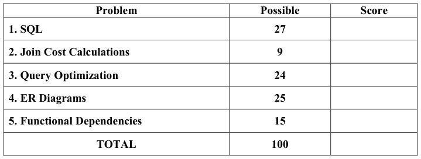
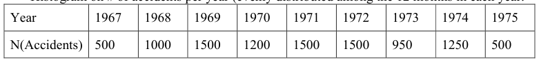
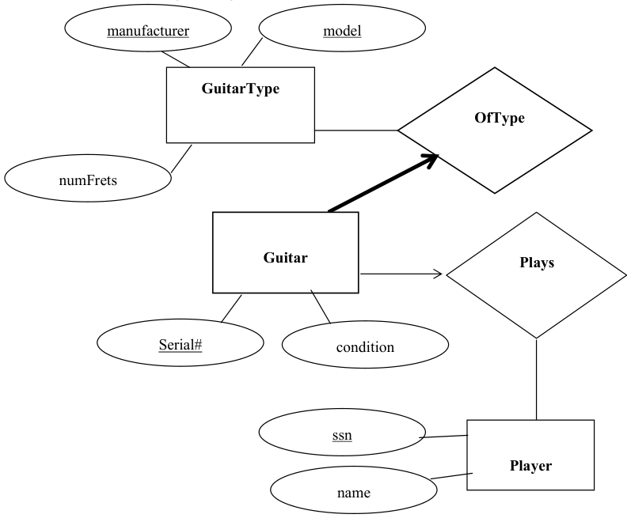

# Berkeley CS186 Fall 2004: Midterm 2: Questions

> Copied from the original: <https://hkn.eecs.berkeley.edu/exams/course/cs/186>. Text and figures are taken from the PDF as is; nothing was answered or rewritten. The original PDF is in this folder.

---

**Page 1**

&emsp;&emsp;&emsp;&emsp;&emsp;&emsp;&emsp;&emsp;University of California, Berkeley 
&emsp;&emsp;&emsp;&emsp;&emsp;&emsp;&emsp;&emsp;College of Engineering 
&emsp;&emsp;&emsp;&emsp;&emsp;&emsp;&emsp;&emsp;Computer Science Division – EECS 
Fall 2004                                                          Prof. Michael J. Franklin 
&emsp;&emsp;&emsp;&emsp;&emsp;&emsp;&emsp;&emsp;MIDTERM  II 
&emsp;&emsp;&emsp;&emsp;&emsp;&emsp;&emsp;&emsp;CS 186 Introduction to Database Systems

NAME: \_\_\_D.B. Guru\_\_\_\_\_\_\_\_\_\_\_\_\_\_\_\_\_\_\_\_\_     STUDENT ID:\_\_\_\_\_\_\_\_\_\_\_\_\_\_\_\_\_\_ 
IMPORTANT: Circle the last two letters of your class account: 
cs186 a b c d e f g h i j k l m n o p q r s t u v w x y z 
a b c d e f g h i j k l m n o p q r s t u v w x y z

DISCUSSION SECTION DAY & TIME:\_\_\_\_\_\_\_\_\_\_\_\_  TA NAME: \_\_\_\_\_\_\_\_\_\_\_ 
This is a closed book examination – but you are allowed one 8.5” x 11” sheet of notes (double 
sided).  You should answer as many questions as possible.  Partial credit will be given where 
appropriate.  There are 100 points in all.  You should read all of the questions before starting the 
exam, as some of the questions are substantially more time-consuming than others. 
Write all of your answers directly on this paper.  Be sure to clearly indicate your final answer 
for each question.  Also, be sure to state any assumptions that you are making in your answers.

&emsp;&emsp;&emsp;&emsp;&emsp;&emsp;&emsp;&emsp;GOOD LUCK!!!

---

**Page 2**

SID:\_\_\_\_\_\_\_\_\_\_\_\_\_\_\_\_\_\_\_\_

### Question 1 –SQL  \[6 parts, 27 points total\]

For parts a-d, consider the following schema (primary keys are underlined): 
&emsp;&emsp;&emsp;Student (sname, sid, gpa, level, deptno) 
&emsp;&emsp;&emsp;Course (cno, cname, deptno, units) 
&emsp;&emsp;&emsp;Dept (dname, deptno) 
&emsp;&emsp;&emsp;Takes (sid, cno) 
a) \[7 points\]  Write a SQL query that returns the names (i.e., snames) of students who have taken 
more courses outside their department than inside their department.  For this question, you can 
assume that all students in the database have taken at least one course inside their department. 
(note: you should do scratch work elsewhere and just put your final answer here!)

b) \[3 points\] Which of the following queries returns the department numbers of those departments 
for which there are no courses being offered?   More than one choice may be correct. 
&emsp;&emsp;&emsp;A)   SELECT D.deptno 
&emsp;&emsp;&emsp;FROM Dept D, Course C 
&emsp;&emsp;&emsp;WHERE D.deptno NOT EQUAL C.deptno;

&emsp;&emsp;&emsp;B)   SELECT C.deptno, COUNT(C.deptno) 
&emsp;&emsp;&emsp;FROM Course C 
&emsp;&emsp;&emsp;GROUP BY C.deptno 
&emsp;&emsp;&emsp;HAVING COUNT (C.Deptno) = NULL;

&emsp;&emsp;&emsp;C)   SELECT C.deptno 
&emsp;&emsp;&emsp;FROM Course C 
&emsp;&emsp;&emsp;WHERE C.deptno NOT IN (SELECT \* FROM Dept);

&emsp;&emsp;&emsp;D)   SELECT D.deptno 
&emsp;&emsp;&emsp;FROM Dept D 
&emsp;&emsp;&emsp;WHERE NOT EXISTS  (SELECT \* FROM Course C 
&emsp;&emsp;&emsp;WHERE C.deptno = D.deptno); 
&emsp;&emsp;&emsp;E)   None of the above 
c) \[3 points\] Which of the following queries returns the id of the student with the highest GPA? 
More than one choice may be correct.

&emsp;&emsp;&emsp;A)   SELECT S.sid 
&emsp;&emsp;&emsp;FROM Students S 
CS 186 Midterm II    November 10, 2004        Page 2 of 11

---

**Page 3**

SID:\_\_\_\_\_\_\_\_\_\_\_\_\_\_\_\_\_\_\_\_

&emsp;&emsp;&emsp;WHERE S.gpa = MAX(S.gpa);

&emsp;&emsp;&emsp;B)  SELECT S.sid, MAX(S.gpa); 
&emsp;&emsp;&emsp;FROM Students S 
&emsp;&emsp;&emsp;GROUP by S.gpa

&emsp;&emsp;&emsp;C)  SELECT S.sid 
&emsp;&emsp;&emsp;FROM Student S 
&emsp;&emsp;&emsp;WHERE S.gpa \> ALL (SELECT S.gpa FROM Student S);

&emsp;&emsp;&emsp;D)  SELECT S.sid 
&emsp;&emsp;&emsp;FROM Student S 
&emsp;&emsp;&emsp;Where S.gpa = (SELECT MAX(S.gpa) 
&emsp;&emsp;&emsp;FROM Student S);

&emsp;&emsp;&emsp;E)  None of the above

d) \[3 points\] Which of the following queries returns the sid of the students and the total units they 
are taking? More than one choice may be correct. 
&emsp;&emsp;&emsp;A)  SELECT S.sid, sum(C.units) 
&emsp;&emsp;&emsp;FROM Student S, Takes T, Course C 
&emsp;&emsp;&emsp;GROUP BY S.sid 
&emsp;&emsp;&emsp;HAVING S.sid = T.sid AND T.cno = C.cno;

&emsp;&emsp;&emsp;B)  SELECT S.sid, sum(C.units) 
&emsp;&emsp;&emsp;FROM Student S, Takes T, Course C 
&emsp;&emsp;&emsp;Where S.sid = T.sid AND T.cno = C.cno; 
&emsp;&emsp;&emsp;GROUP BY S.sid

&emsp;&emsp;&emsp;C)  SELECT S.sid, Temp.Sum1 
&emsp;&emsp;&emsp;FROM Student S, (SELECT sum(C.units) AS Sum1 
&emsp;&emsp;&emsp;FROM Takes T, Course C 
&emsp;&emsp;&emsp;WHERE T.sid = S.sid AND T.cno = C.cno) AS Temp;

&emsp;&emsp;&emsp;D)  SELECT S.sid, sum(C.units) 
&emsp;&emsp;&emsp;FROM Student S, Takes T, Course C 
&emsp;&emsp;&emsp;WHERE S.sid = T.sid AND T.cno = C.cno;

&emsp;&emsp;&emsp;E)  None of the above

CS 186 Midterm II    November 10, 2004        Page 3 of 11

---

**Page 4**

SID:\_\_\_\_\_\_\_\_\_\_\_\_\_\_\_\_\_\_\_\_

e) \[3 points\] For the following schema:  Athletes(name, country, sport, age, height, weight) 
Which of the following SQL queries reflects the English query statement: "For each country, find 
the average height of weightlifters, qualifying only those countries that have weightlifters with 
minimum weight of 160 pounds." More than one choice may be correct. 
&emsp;&emsp;A)   SELECT country, avg(height) 
&emsp;&emsp;FROM Atheletes 
&emsp;&emsp;WHERE sport = "weightlifting" 
&emsp;&emsp;GROUP BY country, height, weight  HAVING min(weight) \>= 160;

&emsp;&emsp;B)  SELECT country, avg(height) 
&emsp;&emsp;FROM Atheletes 
&emsp;&emsp;GROUP BY country, sport  HAVING min(weight) \>= 160 AND sport = "weightlifting";

&emsp;&emsp;C)   SELECT country, avg(height) 
&emsp;&emsp;FROM Atheletes 
&emsp;&emsp;WHERE sport ="weightlifting" 
&emsp;&emsp;GROUP BY country  HAVING min(weight) \>= 160;

&emsp;&emsp;D)  SELECT country, avg(height) 
&emsp;&emsp;FROM Atheletes 
&emsp;&emsp;WHERE sport = "weightlifting" AND min(weight) \>= 160 
&emsp;&emsp;GROUP BY country, weight;

&emsp;&emsp;E)  SELECT country, avg(height) 
&emsp;&emsp;FROM Atheletes 
&emsp;&emsp;WHERE sport ="weightlifting" 
&emsp;&emsp;GROUP BY country, height  HAVING min(weight) \>= 160; 
f) \[8 points\]  For the schema in part (e), write a SQL query that returns for each sport, the name of 
the sport, the country that has the most athletes who play that sport, and the number of athletes of 
that country that play that sport. (note: you should do scratch work elsewhere and just put your 
final answer here!)

CS 186 Midterm II    November 10, 2004        Page 4 of 11

---

**Page 5**

SID:\_\_\_\_\_\_\_\_\_\_\_\_\_\_\_\_\_\_\_\_

### Question 2 – Join Costs  \[3parts, 9 points total\]

For this question, you will consider the I/O cost of operations on two tables of a database.  The 
database has the following schema (note, this schema is slightly different than the schema used in 
question 1). 
&emsp;Students(sid, name, address, GPA) 
&emsp;EnrolledIn(sid, classid, semester, year)

Assume that tuples are of fixed size.  There are 10 Students tuples per page and 200 EnrolledIn 
tuples per page.  Also assume that there are 1000 pages in the Students relation, and 500 pages in 
the EnrolledIn relation. The data is unsorted, and tuples are distributed evenly throughout the 
database. 
For the following join strategies, give the I/O cost.  Assume 52 pages in the buffer, and that no 
pages are currently in the buffer when the join begins.  If multiple variants of an algorithm have 
been discussed in class, section, or in the book, use the most efficient one unless otherwise noted. 
Be sure to state any assumptions you are making and be sure to clearly indicate your final 
answer. 
a) \[3 points\] Hash Join (not hybrid):

b) \[3 points\] Sort Merge (note, both relations can be sorted in two passes):

c) \[3 points\] Block Nested Loops:

CS 186 Midterm II    November 10, 2004        Page 5 of 11

---

**Page 6**

SID:\_\_\_\_\_\_\_\_\_\_\_\_\_\_\_\_\_\_\_\_

### Question 3 – Query Optimization \[7 parts, 24 points\]

Consider a database containing information about all the car accidents between 1967 and 1975, 
including the cars involved and their owners.  The database has the following tables: 
Car(license, year, company, model); 
Accident(license, accident\_date, damage\_amount, zipcode); 
&emsp;&emsp;&emsp;&emsp;// zipcode in Accident is the place where accident took place 
&emsp;&emsp;// assume that the same car does not get into an accident twice in a day 
Owner(SSN, license, name, street, city, zipcode); 
&emsp;&emsp;&emsp;&emsp;&emsp;&emsp;&emsp;&emsp;// assume each owner has only one licensed car 
The statistics and other catalog information for the database are as follows: 
• NTuples(Car) = 10,000,  NTuples(Accident) = 10,000,  NTuples(Owner) = 10,000 
• NPages(Car) = 100,  NPages(Accident) = 1000,  NPages(Owner) = 500 
• NDistinct(Car.company) = 50 
• Min(Accident.damage\_amount) = 1000,  Max(Accident.damage\_amount) = 16,000. 
• Histogram on # of accidents per year (evenly distributed among the 12 months in each year:

• All indexes use Alternative #2 for the data entries. 
• All BTrees have 100 keys per node, hash indexes have 100 keys per bucket,; assume BTrees 
&emsp;are 3 levels deep, and the cost for a hash look up is 1.2 I/Os on average. 
• An unclustered Extendible hash index exists on Car(company) 
• A clustered B+Tree index on Accident(accident\_date) 
• An unclustered B+Tree index on Accident(damage\_amount)

Consider the following query: 
SELECT O.name, A.damage\_amount 
FROM Car C, Accident A, Owner O 
WHERE C.license = A.license AND C.license = O.license 
AND A.zipcode = O.zipcode AND C.company = ‘Volvo’ 
AND A.accident\_date \< ‘07/01/1970’ AND A.damage\_amount \> 10000;

For question parts (a) and (b), begin the process of query optimization, by first pushing down all 
the non-join predicates. Compute the cardinality of the relations after these selections are applied. 
a) \[2 points\]  What is the expected cardinality of  the Car relation after the initial selections are 
applied:

CS 186 Midterm II    November 10, 2004        Page 6 of 11

---

**Page 7**

SID:\_\_\_\_\_\_\_\_\_\_\_\_\_\_\_\_\_\_\_\_

### Question 3 – Query Optimization (continued)

b) \[4 points\] What is the expected cardinality of the Accident relation after initial selections are 
applied:

Next, estimate the I/O cost for the following access plans in Pass 1. Be sure to list any 
assumptions you are making (for example if you are sorting RIDs before accessing data). 
c) \[3points\] Index scan on Car(company) for the relation Car:

d) \[3 points\] Index scan on Accident(accident\_date) for the relation Accident:

e) \[3 points\] Index scan on Accident(damage\_amount) for the relation Accident:

CS 186 Midterm II    November 10, 2004        Page 7 of 11

---

**Page 8**

SID:\_\_\_\_\_\_\_\_\_\_\_\_\_\_\_\_\_\_\_\_

f) \[3 points\] List all join orders that will be considered in Pass 3 by the System R query optimizer. 
(ignore the specific join algorithm in this step).

g) \[6 points\] Suppose page nested loop join algorithm is the only available join algorithm, what is 
the best join order and what is the total estimated cost?

CS 186 Midterm II    November 10, 2004        Page 8 of 11

---

**Page 9**

SID:\_\_\_\_\_\_\_\_\_\_\_\_\_\_\_\_\_\_\_\_

### Question 4 – ER models \[5 parts,  25 points\]

Consider the following ER diagram

Using this diagram, answer the questions that appear on the following pages.

CS 186 Midterm II    November 10, 2004        Page 9 of 11

---

**Page 10**

SID:\_\_\_\_\_\_\_\_\_\_\_\_\_\_\_\_\_\_\_\_

### Question 4 – ER models (continued)

a) \[10 points\] Create a relational schema (with SQL CREATE TABLE statements) for this 
diagram.  Be sure to label all primary and foreign key constraints. The types of the attributes are as 
follows: 
&emsp;&emsp;INTEGER: GuitarType.numFrets, Guitar.serial#, Player.ssn 
&emsp;&emsp;CHAR(20): all others 
Note: Your schema for this part should have no more than four tables (solutions with more than 
four tables will not receive full credit).  NOTE: the solution for question 4 is a sample solution; 
some minor variations on this could still give you full credit.

CS 186 Midterm II    November 10, 2004        Page 10 of 11

---

**Page 11**

SID:\_\_\_\_\_\_\_\_\_\_\_\_\_\_\_\_\_\_\_\_

### Question 4 – ER models (continued)

b) \[2 points\] Say that we want to impose an additional constraint that a guitar can be played by at 
most one player.   Indicate this new constraint on the original diagram for this question (Be sure 
that the change is clearly indicated, there will be no regarding on this part). 
See arrow in dashed ellipse in diagram. 
c) \[4 points\] For the change in part b, indicate (below) how your CREATE TABLE statements 
would have to be changed to reflect this.

d) \[4 points\] Now, say that we want to add the fact that some players are teachers that teach other 
players.   Teachers can teach multiple players and players can have multiple teachers.  Indicate this 
new information on the original diagram for this question (Be sure that the change is clearly 
indicated, there will be no regarding on this part).

e) \[5 points\] Write the CREATE TABLE statement(s) that capture this information.  Note, this 
may cause you to change one or more of your original CREATE TABLE statements.

CS 186 Midterm II    November 10, 2004        Page 11 of 11

---

**Page 12**

SID:\_\_\_\_\_\_\_\_\_\_\_\_\_\_\_\_\_\_\_\_

### Question 5 – Functional Dependencies \[ 4 parts, 15 points\]

Consider a database table T with attributes ABCDE and a set of functional dependencies 
FD ={AE-\>BC, AC-\>D, CD-\>BE, D-\>E}

a) \[6 points\] Give three (3) candidate keys (if there are more than three, choose any three you 
want), and explain why they are candidate keys (i.e., in addition to being superkeys).

b) \[3 points\] Is table T already in BCNF?  Why or why not?

Now, consider the following table R with attributes ABCD  and with the set of functional 
dependencies  FD = {A-\>B, B-\>C, C-\>D} 
c) \[3 points\] Say you decompose it into AB, CD, AC.  Is this decomposition lossless?  Explain 
why or why not.

d) \[3 points\] Give another BCNF decomposition of relation R, which is different from the one in 
part (c).  Your decomposition should be lossless, but need not be dependency preserving.

CS 186 Midterm II    November 10, 2004        Page 12 of 11

