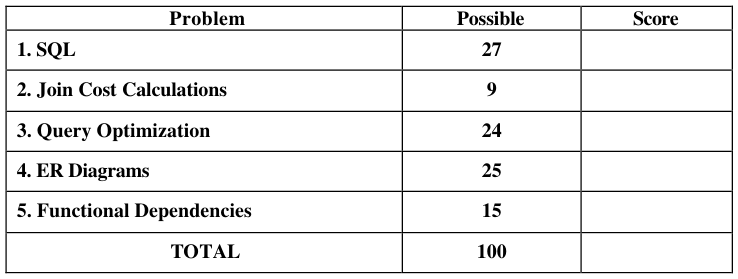
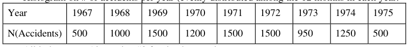
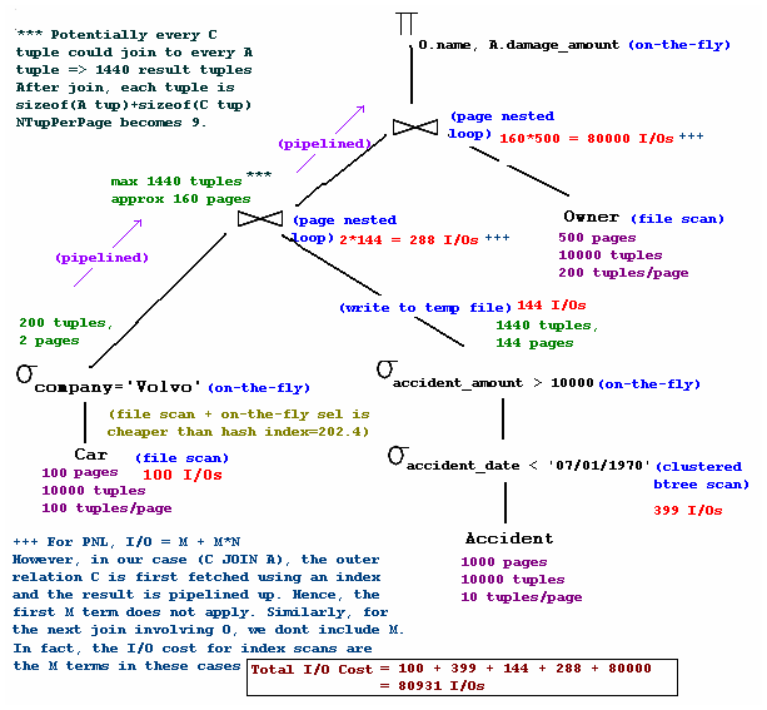
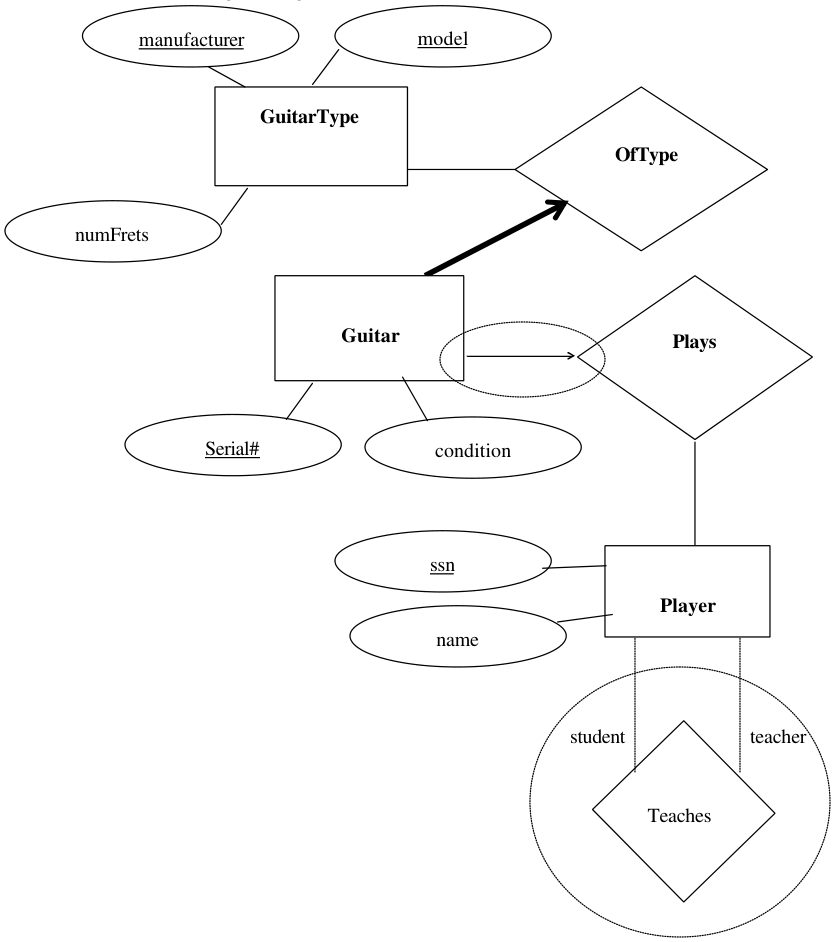

# Berkeley CS186 Fall 2004: Midterm 2: Official solutions

> Copied from the original: <https://hkn.eecs.berkeley.edu/exams/course/cs/186>. Text and figures are taken from the PDF as is; nothing was answered or rewritten. The original PDF is in this folder.

---

**Page 1**

&emsp;&emsp;&emsp;&emsp;&emsp;&emsp;&emsp;&emsp;**University of California, Berkeley** 
&emsp;&emsp;&emsp;&emsp;&emsp;&emsp;&emsp;&emsp;**College of Engineering** 
&emsp;&emsp;&emsp;&emsp;&emsp;&emsp;&emsp;&emsp;**Computer Science Division – EECS** 
Fall 2004                                                          Prof. Michael J. Franklin 
&emsp;&emsp;&emsp;&emsp;&emsp;&emsp;&emsp;&emsp;**MIDTERM  II** 
&emsp;&emsp;&emsp;&emsp;&emsp;&emsp;&emsp;&emsp;CS 186 Introduction to Database Systems

**NAME**: \_\_\_D.B. Guru\_\_\_\_\_\_\_\_\_\_\_\_\_\_\_\_\_\_\_\_\_     **STUDENT ID:\_\_\_\_\_\_\_\_\_\_\_\_\_\_\_\_\_\_** 
`IMPORTANT:` `Circle the last two letters of your class account:` 
`cs186 a b c d e f g h i j k l m n o p q r s t u v w x y z` 
`a b c d e f g h i j k l m n o p q r s t u v w x y z`

`DISCUSSION SECTION DAY & TIME:____________  TA NAME: ___________` 
This is a **closed book** examination – but you are allowed one 8.5” x 11” sheet of notes (double 
sided).  You should answer as many questions as possible.  Partial credit will be given where 
appropriate.  There are 100 points in all.  You should read **all** of the questions before starting the 
exam, as some of the questions are substantially more time-consuming than others. 
Write all of your answers directly on this paper.  **Be sure to clearly indicate your final answer** 
for each question.  Also, be sure to state any assumptions that you are making in your answers.

&emsp;&emsp;&emsp;&emsp;&emsp;&emsp;&emsp;&emsp;**GOOD LUCK!!!**

---

**Page 2**

SID:\_\_\_\_\_\_\_\_\_\_\_\_\_\_\_\_\_\_\_\_

### **Question 1 –SQL**  **\[6 parts, 27 points total\]**

For parts a-d, consider the following schema (primary keys are underlined): 
&emsp;&emsp;&emsp;Student (sname, sid, gpa, level, deptno) 
&emsp;&emsp;&emsp;Course (cno, cname, deptno, units) 
&emsp;&emsp;&emsp;Dept (dname, deptno) 
&emsp;&emsp;&emsp;Takes (sid, cno) 
**a) \[7 points\]**  Write a SQL query that returns the names (i.e., snames) of students who have taken 
more courses outside their department than inside their department.  For this question, you can 
assume that all students in the database have taken at least one course inside their department. 
**(note: you should do scratch work elsewhere and just put your final answer here!)**

SELECT S.sname from Student S 
WHERE (SELECT COUNT (\*) 
FROM Takes T, Course C 
WHERE S.sid = T.sid AND T.cno = C.cno AND C.deptno = S.deptno) 
\< (SELECT COUNT(\*) 
FROM Takes T2, Course C2 
WHERE S.sid = T2.sid AND T2.cno = C2.cno AND C2.deptno != S.deptno) 
**(Note: The above solution does not even require that each student takes atleast one course in** 
**her department)**

**Another variation seen in solutions:** 
SELECT S.sname 
FROM Student S, Takes T, Course C 
WHERE S.sid = T.sid AND T.cno = C.cno AND S.deptno = C.deptno 
GROUP BY S.sid, S.sname 
HAVING count(\*) \< 
&emsp;&emsp;&emsp;&emsp;(SELECT COUNT (\*) 
&emsp;&emsp;&emsp;&emsp;FROM Takes T1, Course C1 
&emsp;&emsp;&emsp;&emsp;WHERE S.sid = T1.sid AND T1.cno = C1.cno AND C1.deptno != S.deptno)

**b) \[3 points\]** Which of the following queries returns the department numbers of those departments 
for which there are no courses being offered?   **More than one choice may be correct.** 
&emsp;&emsp;&emsp;A)   SELECT D.deptno 
&emsp;&emsp;&emsp;FROM Dept D, Course C 
&emsp;&emsp;&emsp;WHERE D.deptno NOT EQUAL C.deptno; 
&emsp;&emsp;&emsp;B)   SELECT C.deptno, COUNT(C.deptno)

CS 186 Midterm II    November 10, 2004        Page 2 of 11

---

**Page 3**

SID:\_\_\_\_\_\_\_\_\_\_\_\_\_\_\_\_\_\_\_\_

&emsp;&emsp;&emsp;FROM Course C 
&emsp;&emsp;&emsp;GROUP BY C.deptno 
&emsp;&emsp;&emsp;HAVING COUNT (C.Deptno) = NULL; 
&emsp;&emsp;&emsp;C)   SELECT C.deptno 
&emsp;&emsp;&emsp;FROM Course C 
&emsp;&emsp;&emsp;WHERE C.deptno NOT IN (SELECT \* FROM Dept); 
&emsp;&emsp;&emsp;**D)   SELECT D.deptno** 
&emsp;&emsp;&emsp;**FROM Dept D** 
&emsp;&emsp;&emsp;**WHERE NOT EXISTS  (SELECT \* FROM Course C** 
&emsp;&emsp;&emsp;**WHERE C.deptno = D.deptno);** 
&emsp;&emsp;&emsp;E)   None of the above 
**c) \[3 points\]** Which of the following queries returns the id of the student with the highest GPA? 
**More than one choice may be correct.**

&emsp;&emsp;&emsp;A)   SELECT S.sid 
&emsp;&emsp;&emsp;FROM Students S 
&emsp;&emsp;&emsp;WHERE S.gpa = MAX(S.gpa); 
&emsp;&emsp;&emsp;B)  SELECT S.sid, MAX(S.gpa); 
&emsp;&emsp;&emsp;FROM Students S 
&emsp;&emsp;&emsp;GROUP by S.gpa 
&emsp;&emsp;&emsp;C)  SELECT S.sid 
&emsp;&emsp;&emsp;FROM Student S 
&emsp;&emsp;&emsp;WHERE S.gpa \> ALL (SELECT S.gpa FROM Student S); 
&emsp;&emsp;&emsp;**D)  SELECT S.sid** 
&emsp;&emsp;&emsp;**FROM Student S** 
&emsp;&emsp;&emsp;**Where S.gpa = (SELECT MAX(S.gpa)** 
&emsp;&emsp;&emsp;**FROM Student S);** 
&emsp;&emsp;&emsp;E)  None of the above

**d) \[3 points\]** Which of the following queries returns the sid of the students and the total units they 
are taking? **More than one choice may be correct**. 
&emsp;&emsp;&emsp;A)  SELECT S.sid, sum(C.units) 
&emsp;&emsp;&emsp;FROM Student S, Takes T, Course C 
&emsp;&emsp;&emsp;GROUP BY S.sid 
&emsp;&emsp;&emsp;HAVING S.sid = T.sid AND T.cno = C.cno; 
&emsp;&emsp;&emsp;**B)  SELECT S.sid, sum(C.units)** 
&emsp;&emsp;&emsp;**FROM Student S, Takes T, Course C** 
&emsp;&emsp;&emsp;**Where S.sid = T.sid AND T.cno = C.cno;** 
CS 186 Midterm II    November 10, 2004        Page 3 of 11

---

**Page 4**

SID:\_\_\_\_\_\_\_\_\_\_\_\_\_\_\_\_\_\_\_\_

&emsp;&emsp;&emsp;**GROUP BY S.sid** 
&emsp;&emsp;&emsp;**C)  SELECT S.sid, Temp.Sum1** 
&emsp;&emsp;&emsp;**FROM Student S, (SELECT sum(C.units) AS Sum1** 
&emsp;&emsp;&emsp;**FROM Takes T, Course C** 
&emsp;&emsp;&emsp;**WHERE T.sid = S.sid AND T.cno = C.cno) AS Temp;** 
&emsp;&emsp;&emsp;D)  SELECT S.sid, sum(C.units) 
&emsp;&emsp;&emsp;FROM Student S, Takes T, Course C 
&emsp;&emsp;&emsp;WHERE S.sid = T.sid AND T.cno = C.cno; 
&emsp;&emsp;&emsp;E)  None of the above

CS 186 Midterm II    November 10, 2004        Page 4 of 11

---

**Page 5**

SID:\_\_\_\_\_\_\_\_\_\_\_\_\_\_\_\_\_\_\_\_

**e) \[3 points\]** For the following schema:  Athletes(name, country, sport, age, height, weight) 
Which of the following SQL queries reflects the English query statement: "For each country, find 
the average height of weightlifters, qualifying only those countries that have weightlifters with 
minimum weight of 160 pounds." **More than one choice may be correct.** 
&emsp;&emsp;A)   SELECT country, avg(height) 
&emsp;&emsp;FROM Atheletes 
&emsp;&emsp;WHERE sport = "weightlifting" 
&emsp;&emsp;GROUP BY country, height, weight  HAVING min(weight) \>= 160; 
&emsp;&emsp;**B)  SELECT country, avg(height)** 
&emsp;&emsp;**FROM Atheletes** 
&emsp;&emsp;**GROUP BY country, sport  HAVING min(weight) \>= 160 AND sport =** 
&emsp;&emsp;&emsp;**"weightlifting";** 
&emsp;&emsp;**C)   SELECT country, avg(height)** 
&emsp;&emsp;**FROM Atheletes** 
&emsp;&emsp;**WHERE sport ="weightlifting"** 
&emsp;&emsp;**GROUP BY country  HAVING min(weight) \>= 160;** 
&emsp;&emsp;D)  SELECT country, avg(height) 
&emsp;&emsp;FROM Atheletes 
&emsp;&emsp;WHERE sport = "weightlifting" AND min(weight) \>= 160 
&emsp;&emsp;GROUP BY country, weight; 
&emsp;&emsp;E)  SELECT country, avg(height) 
&emsp;&emsp;FROM Atheletes 
&emsp;&emsp;WHERE sport ="weightlifting" 
&emsp;&emsp;GROUP BY country, height  HAVING min(weight) \>= 160; 
**f) \[8 points\]**  For the schema in part (e), write a SQL query that returns for each sport, the name of 
the sport, the country that has the most athletes who play that sport, and the number of athletes of 
that country that play that sport. **(note: you should do scratch work elsewhere and just put your** 
**final answer here!)**

SELECT A.sport, A.country, count(\*) 
FROM Atheletes A 
GROUP BY A.sport, A.country 
HAVING count(\*) \>= ALL 
&emsp;&emsp;&emsp;&emsp;&emsp;&emsp;&emsp;&emsp;(SELECT COUNT(\*) 
&emsp;&emsp;&emsp;&emsp;&emsp;&emsp;&emsp;&emsp;FROM Athletes A1 
&emsp;&emsp;&emsp;&emsp;&emsp;&emsp;&emsp;&emsp;WHERE A1.sport = A.sport 
&emsp;&emsp;&emsp;&emsp;&emsp;&emsp;&emsp;&emsp;GROUP BY A1.country)

CS 186 Midterm II    November 10, 2004        Page 5 of 11

---

**Page 6**

SID:\_\_\_\_\_\_\_\_\_\_\_\_\_\_\_\_\_\_\_\_

### **Question 2 – Join Costs**  **\[3parts, 9 points total\]**

For this question, you will consider the I/O cost of operations on two tables of a database.  The 
database has the following schema (note, this schema is slightly different than the schema used in 
question 1). 
&emsp;Students(sid, name, address, GPA) 
&emsp;EnrolledIn(sid, classid, semester, year)

Assume that tuples are of fixed size.  There are 10 Students tuples per page and 200 EnrolledIn 
tuples per page.  Also assume that there are 1000 pages in the Students relation, and 500 pages in 
the EnrolledIn relation. The data is unsorted, and tuples are distributed evenly throughout the 
database. 
For the following join strategies, give the I/O cost.  Assume 52 pages in the buffer, and that no 
pages are currently in the buffer when the join begins.  If multiple variants of an algorithm have 
been discussed in class, section, or in the book, use the most efficient one unless otherwise noted. 
**Be sure to state any assumptions you are making and be sure to clearly indicate your final** 
**answer.** 
**a) \[3 points\]** Hash Join (not hybrid): 
3(1000+500)=**4500**

**b) \[3 points\]** Sort Merge (note, both relations can be sorted in two passes): 
sort(Enrolled)+sort(Student)+\[Enrolled\]+\[Student\] 
= 4(500)+4(1000)+500+1000 
= **7500** 
OR 
= 2(500)+2(1000)+500+1000 
= **4500**

**c) \[3 points\]** Block Nested Loops: 
Enrolled need to be the outer relation because it is smaller: 
\[Enrolled\] + \[Enrolled/blocksize\] \* \[Student\] = 500 + (500/50)\*1000 
= **10500**

CS 186 Midterm II    November 10, 2004        Page 6 of 11

---

**Page 7**

SID:\_\_\_\_\_\_\_\_\_\_\_\_\_\_\_\_\_\_\_\_

### **Question 3 – Query Optimization \[7 parts, 24 points\]**

Consider a database containing information about all the car accidents between 1967 and 1975, 
including the cars involved and their owners.  The database has the following tables: 
`Car(license, year, company, model);` 
`Accident(license, accident_date, damage_amount, zipcode);` 
&emsp;&emsp;&emsp;&emsp;`// zipcode in Accident is the place where accident took place` 
&emsp;&emsp;`// assume that the same car does not get into an accident twice in a day` 
`Owner(SSN, license, name, street, city, zipcode);` 
&emsp;&emsp;&emsp;&emsp;&emsp;&emsp;&emsp;&emsp;`// assume each owner has only one licensed car` 
The statistics and other catalog information for the database are as follows: 
• NTuples(Car) = 10,000,  NTuples(Accident) = 10,000,  NTuples(Owner) = 10,000 
• NPages(Car) = 100,  NPages(Accident) = 1000,  NPages(Owner) = 500 
• NDistinct(Car.company) = 50 
• Min(Accident.damage\_amount) = 1000,  Max(Accident.damage\_amount) = 16,000. 
• Histogram on # of accidents per year (evenly distributed among the 12 months in each year:

• All indexes use Alternative #2 for the data entries. 
• All BTrees have 100 keys per node, hash indexes have 100 keys per bucket,; assume BTrees 
&emsp;are 3 levels deep, and the cost for a hash look up is 1.2 I/Os on average. 
• An unclustered Extendible hash index exists on Car(company) 
• A clustered B+Tree index on Accident(accident\_date) 
• An unclustered B+Tree index on Accident(damage\_amount)

**Consider the following query:** 
`SELECT O.name, A.damage_amount` 
`FROM Car C, Accident A, Owner O` 
`WHERE C.license = A.license AND C.license = O.license` 
`AND A.zipcode = O.zipcode AND C.company = ‘Volvo’` 
`AND A.accident_date < ‘07/01/1970’ AND A.damage_amount > 10000;`

For question parts (**a)** and **(b)**, begin the process of query optimization, by first pushing down all 
the non-join predicates. Compute the cardinality of the relations after these selections are applied. 
**a) \[2 points\]**  What is the expected cardinality of  the Car relation after the initial selections are 
applied: 
You can only push down the Car.company = ‘Volvo’ selection predicate. 
Given NDistinct(Car.company) = 50. So, Selectivity(Car.company) = 1/50. 
NCardinality(Car.company = ‘Volvo’) = Selectivity \* NTuples(Car) 
= (1/50) \* 10000 
= **200**

CS 186 Midterm II    November 10, 2004        Page 7 of 11

---

**Page 8**

SID:\_\_\_\_\_\_\_\_\_\_\_\_\_\_\_\_\_\_\_\_

CS 186 Midterm II    November 10, 2004        Page 8 of 11

---

**Page 9**

SID:\_\_\_\_\_\_\_\_\_\_\_\_\_\_\_\_\_\_\_\_

### **Question 3 – Query Optimization (continued)**

**b) \[4 points\]** What is the expected cardinality of the Accident relation after initial selections are 
applied: 
You can push down both A.accident\_date \< ‘07/01/1970’ AND A.damage\_amount \> 10000. The 
predicate on accident\_date cuts the histogram right in the middle of the year 1970. 
Cardinality(A.accident\_date \< ‘07/01/1970’) = 500 + 1000 + 1500 + (1200/2) = **3600** 
Selectivity(A.accident\_date \< ‘07/01/1970’) = 3600/10000 = **(9/25)** 
Selectivity(A.damage\_amount \> 10000) = (16000 – 10000)/(16000 – 1000) = 6000/15000 = (**2/5)** 
Cardinality(A.damage\_amount \> 10000) = (2/5)\*10000 = **4000** 
Selectivity(A.accident\_date \< ‘07/01/1970’ AND A.damage\_amount \> 10000) = (9/25)\*(2/5) 
Cardinality(A.accident\_date \< ‘07/01/1970’ AND A.damage\_amount \> 10000) 
= (9/25)\*(2/5)\*10000 
= **1440** 
Next, estimate the I/O cost for the following access plans in Pass 1. **Be sure to list any** 
**assumptions you are making (for example if you are sorting RIDs before accessing data).** 
**c) \[3points\]** Index scan on Car(company) for the relation Car: 
We know that Cardinality(Car.company = ‘Volvo’) = 200. 
Given: 
There is a hash index on Car.company 
Each hash bucket can hold 100 keys (need two buckets for 200 keys matching the predicate) 
Cost of hash bucket lookup is 1.2 I/Os. (To access 2 buckets, need 2\*1.2 = 2.4 I/Os) 
The hash index is unclustered (To access 200 tuples, you may need 200 I/Os) 
Hence, total I/O cost = 2.4 + 200 = **202.4 I/Os**. 
If we assume that the rids will be sorted, and if we assume that the tuples are evenly distributed 
among all the 100 Car pages, then at the most we will read all the 100 pages once, with each page 
containing 2 tuples. Then, the total I/O cost will be = 2.4 + 100 = **102.4 I/Os** 
**d) \[3 points\]** Index scan on Accident(accident\_date) for the relation Accident: 
We know that Cardinality(A.accident\_date \< ‘07/01/1970’) = 3600. 
Given: 
There is a clustered BTree  index on Accident(accident\_date) 
Cost of traversing to first matching BTree leaf node = 2 or 3, depending upon height. 
Each BTree node can hold 100 keys (need to traverse at least 36 BTree nodes to get 3600 keys) 
Each data page can hold NTuples/NPages tuples i.e. 10000/1000 = 10 tuples per data page. To 
access 3600 tuples, you only need to read 3600/10 = 360 pages, since BTree is clustered. 
Hence, total I/O cost = 2 (or 3) + 36 + 360 = **398 (or 399) I/Os**. 
**e) \[3 points\]** Index scan on Accident(damage\_amount) for the relation Accident: 
We know that Cardinality(A.damage\_amount \> 10000) = 4000. 
Given: 
There is an unclustered BTree  index on Accident(damage\_amount) 
Cost of traversing to first matching BTree leaf node = 2 or 3, depending upon height. 
Each BTree node can hold 100 keys (need to traverse at least 40 BTree nodes to get 4000 keys) 
CS 186 Midterm II    November 10, 2004        Page 9 of 11

---

**Page 10**

SID:\_\_\_\_\_\_\_\_\_\_\_\_\_\_\_\_\_\_\_\_

Since the BTree is unclustered, the 4000 tuples could be anywhere in the table pages. If you do not 
sort the rids, to access 4000 tuples, you will need to read 4000 pages. 
Hence, total I/O cost = 2 (or 3) + 40 + 4000 = **4042 (or 4043) I/Os**. 
But, if you sort the rids, then you will need to read all the 1000 pages in Accident each once, since 
the rids could be evenly distributed among all the pages (4 tuples in each page). 
Then, total I/O cost = 2 (or 3) + 40 + 1000 = **1042 (or 1043) I/Os.** 
**f) \[3 points\]** List all join orders that will be considered in Pass 3 by the System R query optimizer. 
(ignore the specific join algorithm in this step). 
If we do not consider a specific join algorithm for Pass 2, then all the left deep join orders will get 
considered in Pass 3. The answer is an enumeration of all the left deep join orders. 
((C, A), O), ((A, C), O), ((O, A), C), ((A, O), C), ((O, C), A), ((C, O), A) 
**g) \[6 points\]** Suppose page nested loop join algorithm is the only available join algorithm, what is 
the best join order and what is the total estimated cost? 
Best join order is ((C, A), O), since PNL we get fewer I/O if outer relation has fewer pages.

CS 186 Midterm II    November 10, 2004        Page 10 of 11

---

**Page 11**

SID:\_\_\_\_\_\_\_\_\_\_\_\_\_\_\_\_\_\_\_\_

### **Question 4 – ER models \[5 parts,  25 points\]**

Consider the following ER diagram

Using this diagram, answer the questions that appear on the following pages.

CS 186 Midterm II    November 10, 2004        Page 11 of 11

---

**Page 12**

SID:\_\_\_\_\_\_\_\_\_\_\_\_\_\_\_\_\_\_\_\_

### **Question 4 – ER models (continued)**

**a) \[10 points\]** Create a relational schema (with SQL CREATE TABLE statements) for this 
diagram.  Be sure to label all primary and foreign key constraints. The types of the attributes are as 
follows: 
&emsp;&emsp;INTEGER: GuitarType.numFrets, Guitar.serial#, Player.ssn 
&emsp;&emsp;CHAR(20): all others 
Note: Your schema for this part should have no more than four tables (solutions with more than 
four tables will not receive full credit).  **NOTE: the solution for question 4 is a sample solution;** 
**some minor variations on this could still give you full credit.** 
CREATE TABLE GuitarType( 
manufacturer CHAR(20), 
model CHAR(20), 
numFrets INTEGER, 
PRIMARY KEY(manufacturer,model)); 
CREATE TABLE Guitar( 
manufacturer CHAR(20) NOT NULL, 
model CHAR(20) NOT NULL, 
serial# INTEGER PRIMARY KEY, 
condition CHAR(20), 
FOREIGN KEY(manufacturer, model) REFERENCES GuitarType); 
CREATE TABLE Player( 
ssn INTEGER PRIMARY KEY, 
name CHAR(20)); 
CREATE TABLE Plays( 
serial# INTEGER, 
ssn INTEGER, 
PRIMARY KEY(serial#, ssn), 
FOREIGN KEY(ssn) REFERENCES Player, 
FOREIGN KEY(serial#) REFERENCES Guitar);

CS 186 Midterm II    November 10, 2004        Page 12 of 11

---

**Page 13**

SID:\_\_\_\_\_\_\_\_\_\_\_\_\_\_\_\_\_\_\_\_

### **Question 4 – ER models (continued)**

**b) \[2 points\]** Say that we want to impose an additional constraint that a guitar can be played by at 
most one player.   Indicate this new constraint **on the original diagram** for this question (**Be sure** 
**that the change is clearly indicated, there will be no regarding on this part).** 
See arrow in dashed ellipse in diagram. 
**c) \[4 points\]** For the change in part b, indicate (below) how your CREATE TABLE statements 
would have to be changed to reflect this.

Add a field ssn to Guitars, which is a foreign key that references Players, and drop the relation 
Plays 
OR 
Make the primary key of Plays the field serial# only.

**d) \[4 points\]** Now, say that we want to add the fact that some players are teachers that teach other 
players.   Teachers can teach multiple players and players can have multiple teachers.  Indicate this 
new information **on the original diagram** for this question (**Be sure that the change is clearly** 
**indicated, there will be no regarding on this part).** 
See new relationship in dashed circle in diagram.  You could also create a subclass for Teachers 
off of Students with ISA and use this and Students in the relationship, but this is not necessary for 
full credit. 
**e) \[5 points\]** Write the CREATE TABLE statement(s) that capture this information.  Note, this 
may cause you to change one or more of your original CREATE TABLE statements. 
Add the following table: 
CREATE TABLE Teaches( 
student\_ssn INTEGER, 
teacher\_ssn INTEGER, 
PRIMARY KEY(student\_ssn, teacher\_ssn), 
FOREIGN KEY student\_ssn REFERENCES Player(ssn), 
FOREIGN KEY teacher\_ssn REFERENCES Player(ssn));

CS 186 Midterm II    November 10, 2004        Page 13 of 11

---

**Page 14**

SID:\_\_\_\_\_\_\_\_\_\_\_\_\_\_\_\_\_\_\_\_

### **Question 5 – Functional Dependencies \[ 4 parts, 15 points\]**

Consider a database table T with attributes ABCDE and a set of functional dependencies 
FD ={AE-\>BC, AC-\>D, CD-\>BE, D-\>E}

**a) \[6 points\]** Give three (3) candidate keys (if there are more than three, choose any three you 
want), and explain why they are candidate keys (i.e., in addition to being superkeys). 
AE, AC and AD are candidate keys, as each of their attribute closures include all attributes and no 
subset of them is a super key by itself.

**b) \[3 points\]** Is table T already in BCNF?  Why or why not? 
No, because both CD -\> BE and D -\> E violate BCNF. In both cases, the left hand side is not a 
super key.

Now, consider the following table R with attributes ABCD  and with the set of functional 
dependencies  FD = {A-\>B, B-\>C, C-\>D} 
**c) \[3 points\]** Say you decompose it into AB, CD, AC.  Is this decomposition lossless?  Explain 
why or why not.

Yes, a lossless decomposition would be: ABC CD which is lossless because C is a key for CD and 
then a further decomposition of ABC into AB and AC which is lossless because A is a key for AB.

**d) \[3 points\]** Give another BCNF decomposition of relation R, which is different from the one in 
part (c).  Your decomposition should be lossless, but need not be dependency preserving.

One such composition is AB AD BC;  another is AB BC CD.

CS 186 Midterm II    November 10, 2004        Page 14 of 11

