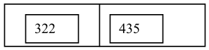
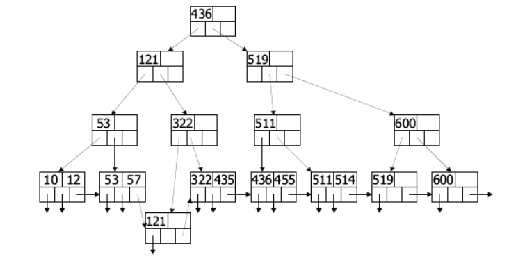
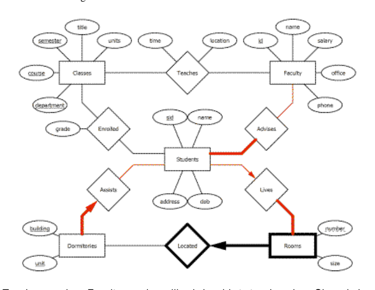

# Berkeley CS186 Fall 2005: Midterm 1: Official solutions

> Copied from the original: <https://hkn.eecs.berkeley.edu/exams/course/cs/186>. Text and figures are taken from the PDF as is; nothing was answered or rewritten. The original PDF is in this folder.

---

**Page 1**

&emsp;&emsp;&emsp;&emsp;&emsp;&emsp;&emsp;&emsp;UNIVERSITY OF CALIFORNIA 
&emsp;&emsp;&emsp;&emsp;&emsp;&emsp;&emsp;Department of EECS, Computer Science Division 
CS186    Garofalakis/Hellerstein 
Fall 2005    Midterm Solutions

&emsp;&emsp;&emsp;&emsp;**Midterm Solutions: Introduction to Database Systems**

### Problem 1: B+trees

(A)  (3 points) 
Node affected: N7

New Node:

(B)  (6 points)

(C) 
a. (5 points) 
1\. Merge N3 and N4.  (Move 519 to N3) 
2\. Merge N10 and N11, and move it to child of N3. 
b. (1 point) 
Insert any value in \[520,600)

---

**Page 2**

### Problem 2: Query Languages

&emsp;&emsp;&emsp;a.    \[4 points\] Find blog entries posted by an author with realname ‘Ted’, and return the title, 
&emsp;&emsp;&emsp;&emsp;&emsp;timestamp and body of the entry. 
&emsp;&emsp;&emsp;&emsp;&emsp;`SELECT e.title, e.timestamp, e.body` 
&emsp;&emsp;&emsp;&emsp;&emsp;`FROM entries e, authors a` 
&emsp;&emsp;&emsp;&emsp;&emsp;`WHERE e.authorid = a.authorid` 
&emsp;&emsp;&emsp;&emsp;&emsp;`AND a.realname = ‘Ted’` 
&emsp;&emsp;&emsp;b. \[6 points\] For each entry in the blog, return the same fields as in part (a), for those entries 
&emsp;&emsp;&emsp;&emsp;&emsp;with more than 2 comments. 
&emsp;&emsp;&emsp;&emsp;&emsp;`SELECT e.title, e.timestamp, e.body` 
&emsp;&emsp;&emsp;&emsp;&emsp;`FROM blogdb_entries e` 
&emsp;&emsp;&emsp;&emsp;&emsp;`WHERE e.id IN` 
&emsp;&emsp;&emsp;&emsp;&emsp;`(SELECT c.entry_id` 
&emsp;&emsp;&emsp;&emsp;&emsp;`FROM blogdb_comments c` 
&emsp;&emsp;&emsp;&emsp;&emsp;`GROUP BY c.entry_id` 
&emsp;&emsp;&emsp;&emsp;&emsp;`HAVING count(*) > 2);` 
&emsp;&emsp;&emsp;&emsp;&emsp;OR 
&emsp;&emsp;&emsp;&emsp;&emsp;`SELECT e.title, e.timestamp, e.body` 
&emsp;&emsp;&emsp;&emsp;&emsp;`FROM blogdb_entries e, blogdb_comments c` 
&emsp;&emsp;&emsp;&emsp;&emsp;`WHERE e.id = c.entry_id` 
&emsp;&emsp;&emsp;&emsp;&emsp;`GROUP BY e.id, e.title, e.timestamp, e.body` 
&emsp;&emsp;&emsp;&emsp;&emsp;`HAVING count(*) > 2);`

&emsp;&emsp;&emsp;c.    \[6 points\] The “parent\_id” field in the comments table tracks the nesting of “comments 
&emsp;&emsp;&emsp;&emsp;&emsp;on comments”: when a new comment is posted in response to an old comment, the 
&emsp;&emsp;&emsp;&emsp;&emsp;parent\_id of the new comment is the id of the old comment. (You may assume that 
&emsp;&emsp;&emsp;&emsp;&emsp;comments made directly on blog entries have parent\_id = 0). 
&emsp;&emsp;&emsp;&emsp;&emsp;Find the id of each comment and the id of its “grandparent” comment; if it does not have 
&emsp;&emsp;&emsp;&emsp;&emsp;a grandparent, omit it from the answer. 
&emsp;&emsp;&emsp;&emsp;&emsp;`SELECT kid.id, parent.parent_id` 
&emsp;&emsp;&emsp;&emsp;&emsp;`FROM comments kid, comments parent` 
&emsp;&emsp;&emsp;&emsp;&emsp;`WHERE kid.parent_id = parent.id` 
&emsp;&emsp;&emsp;&emsp;&emsp;`AND parent.parent_id <> 0` 
&emsp;&emsp;&emsp;&emsp;&emsp;OR 
&emsp;&emsp;&emsp;&emsp;&emsp;`SELECT kid.id, grand.id` 
&emsp;&emsp;&emsp;&emsp;&emsp;`FROM comments kid, comments parent,` 
&emsp;&emsp;&emsp;&emsp;&emsp;`comments grand` 
&emsp;&emsp;&emsp;&emsp;&emsp;`WHERE kid.parent_id = parent.id` 
&emsp;&emsp;&emsp;&emsp;&emsp;`AND parent.parent_id = grand.id;`

&emsp;B. XML 
&emsp;&emsp;&emsp;**a.** \[4 points\] Write an XPATH query that returns all comments associated with entries 
&emsp;&emsp;&emsp;&emsp;&emsp;entitled “Midterm”. 
&emsp;&emsp;&emsp;&emsp;&emsp;`//entry[@title=”Midterm”]/comment`

---

**Page 3**

&emsp;&emsp;&emsp;`b.` \[4 points\] Write an XPATH query to find all comments that are a “grandparent” of some 
&emsp;&emsp;&emsp;&emsp;&emsp;other comment. 
&emsp;&emsp;&emsp;&emsp;&emsp;`//comment[comment/comment]`

&emsp;&emsp;&emsp;c.    \[6 points\] Using the XQuery language, write a FLWOR query that returns entries that 
&emsp;&emsp;&emsp;&emsp;&emsp;have more than 5 comments (nested or otherwise) and an author name containing 
&emsp;&emsp;&emsp;&emsp;&emsp;"Michael".

&emsp;&emsp;&emsp;&emsp;&emsp;`FOR $e IN /entry[contains(./author, "Michael")]` 
&emsp;&emsp;&emsp;&emsp;&emsp;`LET $c := $e//comment` 
&emsp;&emsp;&emsp;&emsp;&emsp;`WHERE count($c) > 5` 
&emsp;&emsp;&emsp;&emsp;&emsp;`RETURN $e`

---

**Page 4**

`3.` **Sorting.** \[8 points\] 
We would like to sort the tuples of a relation R(column1, column2, column3, column4) on a the sort key 
(column1, column2, column4).  The following information is known about the relation. 
· The relation R contains 100,000 tuples. 
· The size of a block on disk is 4000 bytes. 
· The size of each R tuple is 400 bytes. 
· The size of each field in R is 4 bytes. 
· A record pointer is 4 bytes.

Answer the following questions based on the information above. 
**A.** \[4 points\] If we want to sort in two passes (using only Phase 0 and Phase 1), we need to know the 
minimum number of blocks B of main memory required.  Provide (i) a formula for computing B correctly, 
and (ii) also give an integer value of B that guarantees a 2-pass sort. 
Part i: 
2 points: either solutions received full credit 
B(B-1) \<= 10000 
Or 
1 + logB-1(10000/B) = 2 
1 point for minor errors (e.g., forgot the ceiling, # pages did not appear anywhere ). 
Part ii: 
2 points: 
B = 101

**B.** \[4 points\] Assume we have sufficient memory to perform the sort in two passes. What is the cost, in 
terms of number of disk I/Os, of sorting relation R? Include the cost of the writing the sorted file to the disk 
in the end in your calculations. 
`4 points:` 
`2 passes, read in and write out 10000 pages during each pass.` 
`4 * 10000 = 40,000 I/Os`

---

**Page 5**

### Problem 4: ER Diagrams

Teaches - a given Faculty member will only be able to teach a given Class during 
one semester. 
Classes - Classes with the same department and course number are no longer 
distinct over different semesters. 
Enrolled - a give Student will only be able to take a given Class during one 
semester.

Recall that the primary keys of entities taken all together become primary keys in 
the relation!

---

**Page 6**

### Problem 5: Query Optimization

**Answer 5(a):** 
**Since fromUrl is a foreign-key reference, the number of tuples in the join result (without any** 
**selections applied) is \|L\| (referential integrity); thus, the selectivity of the join operator is \|L\|/(\|P\|\*\|L\|)** 
**= 1/\|P\| = 1/106.** 
**Assuming uniformity (for both the pagesize and author attributes), the selectivities for the pagesize** 
**and author conditions in the query are  (5000-0)/(20000-0) = ¼  and  1/104, respectively.** 
**Thus, assuming independence for the conditions, the overall selectivity is:** 
&emsp;&emsp;&emsp;L\|\|500001 
&emsp;&emsp;&emsp;&emsp;&emsp;&emsp;&emsp;&emsp;! 
&emsp;&emsp;&emsp;&emsp;&emsp;&emsp;&emsp;&emsp;!251012 
&emsp;&emsp;&emsp;&emsp;&emsp;##=" 
&emsp;&emsp;P" L\|\|\|\|200000104 
&emsp;&emsp;&emsp;&emsp;&emsp;&emsp;&emsp;&emsp;!

**Answer 5(b):** 
**The complete scan of webpages costs 10^5  page IOs. Assuming uniformity over pagesizes, the** 
**number of webpages tuples that satisfy the pagesize condition in the query is:** 
&emsp;&emsp;K20000   K 
&emsp;&emsp;&emsp;&emsp;" 
101()1066 
&emsp;!="! 
&emsp;&emsp;2000020000 
**Similarly, the number of relevant index pages that must be scanned during the index scan is  (1-** 
**K/20000)\*10^3. Since we have an unclustered index and get no benefit from buffering, we must do a** 
**data-page IO for each qualifying webpages tuple.  Thus, the crossover value of K is determined by** 
**the equation:** 
&emsp;&emsp;K 
1()(1010)10635 
"!+= 
&emsp;20000 
**which gives K = 18002. Thus, for K\>18002 the unclustered index scan solution is better (and vice** 
**versa).**

**Answer (Extra Credit):** 
**Consider the n=2 case. Assuming we evaluate selection 1 before selection 2, the overall CPU cost** 
**(since the predicates are independent) is: \|R\|\*c1 + \|R\|\*s1\*c2. (This is because only \|R\|\*s1 tuples** 
**“survive” selection 1.)  Similarly, for the plan that evaluates selection 2 before selection 1, the cost is:** 
**\|R\|\*c2 + \|R\|\*s2\*c1.  Thus, evaluating selection 1 first is a better strategy, iff** 
&emsp;&emsp;&emsp;&emsp;&emsp;&emsp;&emsp;&emsp;cc21 
csccsc221112      **or** 
&emsp;+!\>+!   \> 
&emsp;&emsp;&emsp;&emsp;&emsp;&emsp;&emsp;&emsp;ss1211 
&emsp;&emsp;&emsp;&emsp;&emsp;&emsp;&emsp;&emsp;!! 
**In the general case, the optimal strategy is to evaluate the n selections in increasing order of the ci/(1-** 
**si) ratio. Intuitively, this rule says we should evaluate selections in order of their cost/benefit ratio,** 
**where cost is the per tuple cost , and benefit is the percentage of tuples they filter out (i.e. 1-** 
**selectivity).**

