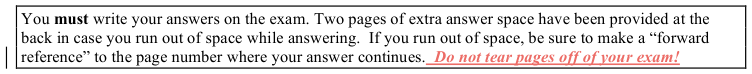
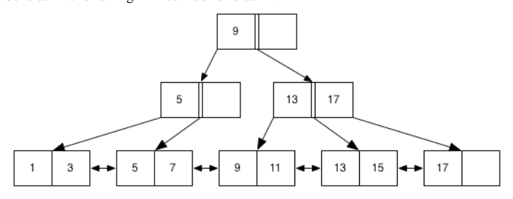
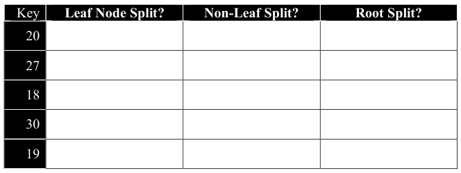
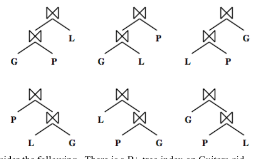
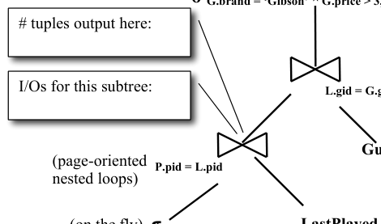
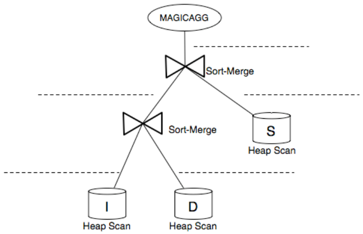

# Berkeley CS186 Fall 2006: Midterm 1: Questions

> Copied from the original: <https://hkn.eecs.berkeley.edu/exams/course/cs/186>. Text and figures are taken from the PDF as is; nothing was answered or rewritten. The original PDF is in this folder.

---

**Page 1**

&emsp;&emsp;&emsp;&emsp;&emsp;&emsp;&emsp;&emsp;**Name\_\_\_\_\_\_\_\_\_\_\_\_\_\_\_\_\_\_\_\_\_\_\_\_\_\_\_\_\_\_\_\_\_\_\_\_\_\_\_\_\_**

&emsp;&emsp;&emsp;&emsp;&emsp;&emsp;&emsp;&emsp;**Class Account: \_\_\_\_\_\_\_\_\_\_\_\_\_\_\_\_\_\_\_\_\_\_\_\_\_\_\_\_\_\_\_\_** 
&emsp;&emsp;&emsp;&emsp;&emsp;&emsp;&emsp;&emsp;UNIVERSITY OF CALIFORNIA 
&emsp;&emsp;&emsp;&emsp;&emsp;&emsp;&emsp;Department of EECS, Computer Science Division 
CS186    Hellerstein/Olston 
Fall 2006    Midterm Exam

&emsp;&emsp;&emsp;&emsp;&emsp;**Midterm Exam: Introduction to Database Systems** 
This exam has four problems and one extra credit question, worth different amounts of points each.  Each 
problem is made up of multiple questions.  You should read through the exam quickly and plan your time- 
management accordingly.  Before beginning to answer a problem, be sure to read it carefully and to answer 
all parts of every problem!

&emsp;&emsp;&emsp;&emsp;&emsp;&emsp;&emsp;&emsp;Good luck! 
**1. Relational Query Languages \[20 points\]** 
Recently, Bob the Builder coded up a Relational Query Language Translator (RQLT) and passed 
it along to his lesser-known colleague, Ted the Software Test Engineer, for testing. Fortunately 
for Ted, the RQLT is simple and only operates on a single schema: 
Tool(tid, brand, cost) 
Jobsite(location, compensation, task) 
Toolbox(tbid, location) – location is a foreign key to Jobsite 
Holds(tbid, tid) – tbid is a foreign key to Toolbox, tid is a foreign key to Tool. 
&emsp;a. (5 points) Ted sets the RQLT to translate the following SQL query to Relational Algebra: 
&emsp;&emsp;SELECT T.tid 
&emsp;&emsp;FROM Tool T, Holds H, Toolbox B, Jobsite J 
&emsp;&emsp;WHERE T.tid = H.tid AND H.tbid = B.tbid 
&emsp;&emsp;AND B.location = J.location AND J.task = ’Plumbing’

&emsp;&emsp;Which of the following would be an equivalent Relational Algebra query? 
&emsp;&emsp;&emsp;1\. πtid(Tool     Holds     Toolbox     σtask = ‘Plumbing’ (Jobsite)) 
&emsp;&emsp;&emsp;2\. πtid(σtask = ‘Plumbing’ (Tool     (Holds     Toolbox)     Jobsite)) 
&emsp;&emsp;&emsp;3\. σtask = ‘Plumbing’ (πtid (Tool)     Holds     Toolbox     Jobsite) 
&emsp;&emsp;&emsp;4\. 1 and 2 
&emsp;&emsp;&emsp;5\. 1, 2, and 3 
&emsp;&emsp;&emsp;6\. None of the above 
&emsp;&emsp;&emsp;&emsp;&emsp;&emsp;&emsp;&emsp;YOUR ANSWER HERE (1a): \_\_\_\_\_\_\_\_\_\_\_\_\_\_\_\_\_

&emsp;&emsp;&emsp;&emsp;&emsp;&emsp;&emsp;&emsp;\- 1 -

---

**Page 2**

&emsp;&emsp;&emsp;&emsp;&emsp;&emsp;&emsp;&emsp;**Name\_\_\_\_\_\_\_\_\_\_\_\_\_\_\_\_\_\_\_\_\_\_\_\_\_\_\_\_\_\_\_\_\_\_\_\_\_\_\_\_\_**

b. (10 points) Ted switches the RQLT to translate Relational Algebra into Relational 
&emsp;Calculus and passes in: 
&emsp;πtbid(Toolbox) – πtbid(   ( πtbid(Toolbox) × πbrand(Tool) ) 
&emsp;– πtbid,brand(Holds     Tool)          ) 
&emsp;Fill in the blanks to complete the equivalent Relational Calculus Query.  Note: the 
&emsp;correct answer may not require all blanks to be filled in. 
&emsp;{ B1  \|  B ∈ Toolbox  \_\_\_\_\_\_\_\_\_\_\_ B.tbid = B1.tbid \_\_\_\_\_\_\_\_\_\_\_

&emsp;\_\_\_\_\_\_\_\_\_\_\_  T ∈ Tool

&emsp;(\_\_\_\_\_\_\_\_\_\_ H ∈ Holds (T.tid = H.tid \_\_\_\_\_\_\_\_\_\_ H.tbid = B.tbid)) }

c. (5 points) Ted thinks that he has found a bug in the RQLT.  It translates the 
&emsp;following Relational Calculus query: 
&emsp;{ H1 \| H ∈ Holds ∧ H1.tbid = H.tbid ∧ 
&emsp;∀ Τ ∈ Tool ( (H.tid = T.tid) 
&emsp;⇒ (T.brand = ‘Craftsman’ ∨ T.brand = ‘Channellock’)) } 
&emsp;into the following incorrect SQL query (marked with line numbers for the purpose 
&emsp;of this question): 
&emsp;&emsp;1\. SELECT H.tbid 
&emsp;&emsp;2\.   FROM Tool T, Holds H 
&emsp;&emsp;3\.  WHERE T.tid = H.tid AND T.brand = ‘Craftsman’ 
&emsp;&emsp;4\. INTERSECT 
&emsp;&emsp;5\. SELECT H1.tbid 
&emsp;&emsp;6\.   FROM Tool T1, Holds H1 
&emsp;&emsp;7\.  WHERE T1.tid = H1.tid AND T1.brand = ‘Channellock’; 
&emsp;Fix this SQL query to match the Relational Calculus query by changing exactly 
&emsp;ONE line: 
&emsp;Answer: Change line \_\_\_\_\_\_\_  into:

&emsp;\_\_\_\_\_\_\_\_\_\_\_\_\_\_\_\_\_\_\_\_\_\_\_\_\_\_\_\_\_\_\_\_\_\_\_\_\_\_\_\_\_\_\_\_\_\_\_\_\_\_\_\_\_\_

&emsp;&emsp;&emsp;&emsp;&emsp;&emsp;&emsp;&emsp;\- 2 -

---

**Page 3**

&emsp;&emsp;&emsp;&emsp;&emsp;&emsp;&emsp;&emsp;**Name\_\_\_\_\_\_\_\_\_\_\_\_\_\_\_\_\_\_\_\_\_\_\_\_\_\_\_\_\_\_\_\_\_\_\_\_\_\_\_\_\_**

2\. **B+ Trees \[23 points\]** 
Consider the following B+ tree index of order 1:

&emsp;a. (3 points) Circle all nodes (not index entries, but entire nodes) in the above figure 
&emsp;&emsp;that must be fetched to satisfy the query "Get all records with search key greater 
&emsp;&emsp;than or equal to 7 and less than 15". 
&emsp;b. (15 points) Assume we modify the B+ tree by adding the following keys **in the** 
&emsp;&emsp;**following order**:         **20, 27, 18, 30, 19** 
&emsp;&emsp;In the answer-boxes below, each row refers to a key being inserted in order, and 
&emsp;&emsp;each column asks if the insertion of that key results in a split of particular nodes. 
&emsp;&emsp;Assume that when splitting up an odd number of entries, the left node gets one 
&emsp;&emsp;more than the right.  Place a check mark  (✓) in each box whose answer is “Yes”. 
&emsp;&emsp;Blank boxes will be interpreted as “No”.  You may want to use the back of the 
&emsp;&emsp;previous page for scratch space.

&emsp;**c.** (5 points) Suppose we were to insert all integers in the range 26 to 4112 inclusive 
&emsp;&emsp;(i.e. 26, 27, 28 ... , 4111, 4112) into the tree in part (a), one at a time. At most how 
&emsp;&emsp;many levels would the resulting B+-tree have? (Hint: You should not need to 
&emsp;&emsp;draw a B+-tree to figure this out!) 
YOUR ANSWER HERE (2c):  \_\_\_\_\_\_\_\_\_\_\_\_\_\_\_\_\_\_\_\_

&emsp;&emsp;&emsp;&emsp;&emsp;&emsp;&emsp;&emsp;\- 3 -

---

**Page 4**

&emsp;&emsp;&emsp;&emsp;&emsp;&emsp;&emsp;&emsp;**Name\_\_\_\_\_\_\_\_\_\_\_\_\_\_\_\_\_\_\_\_\_\_\_\_\_\_\_\_\_\_\_\_\_\_\_\_\_\_\_\_\_**

**3. Query Optimization \[32 points\]** 
Consider the following schema: 
Guitars (gid, brand, price) 
Players (pid, name, age) 
LastPlayed (gid, pid, date) 
And the following query: 
SELECT P.name 
FROM Guitars G, Played P, LastPlayed L 
WHERE G.gid = L.gid AND P.pid = L.pid 
AND P.age \< 25 AND G.brand = ‘Gibson’ 
AND G.price \> 3000; 
In the schema, Guitars.gid is the primary key of Guitars, Players.pid is the primary key 
of Players, and LastPlayed.gid and LastPlayed.pid are foreign keys referencing the 
primary keys of Guitars and Players (respectively).  Assume that the data is evenly 
distributed, and that the following properties hold: 
Players.age ranges from 10 to 85 
Guitars.brand has 10 distinct values 
Guitars.price ranges from 1,000 to 5,000 
Guitars.gid has 1,000 distinct values 
Players.pid has 1,000 distinct values 
a. (5 points) Compute the selectivity for each individual term in the WHERE clause. 
&emsp;You must fill in each blank below! 
&emsp;G.gid = L.gid      :   \_\_\_\_\_\_\_\_\_\_\_\_\_\_\_\_\_\_\_\_\_\_\_\_\_\_\_\_\_\_\_\_\_

&emsp;P.pid = L.pid      :  \_\_\_\_\_\_\_\_\_\_\_\_\_\_\_\_\_\_\_\_\_\_\_\_\_\_\_\_\_\_\_\_\_\_

&emsp;P.age \< 25        :  \_\_\_\_\_\_\_\_\_\_\_\_\_\_\_\_\_\_\_\_\_\_\_\_\_\_\_\_\_\_\_\_\_\_

&emsp;G.brand = ‘Gibson’ :  \_\_\_\_\_\_\_\_\_\_\_\_\_\_\_\_\_\_\_\_\_\_\_\_\_\_\_\_\_\_\_\_\_\_

&emsp;G.price \> 3000 :  \_\_\_\_\_\_\_\_\_\_\_\_\_\_\_\_\_\_\_\_\_\_\_\_\_\_\_\_\_\_\_\_\_\_

&emsp;&emsp;&emsp;&emsp;&emsp;&emsp;&emsp;&emsp;\- 4 -

---

**Page 5**

&emsp;&emsp;&emsp;&emsp;&emsp;&emsp;&emsp;&emsp;**Name\_\_\_\_\_\_\_\_\_\_\_\_\_\_\_\_\_\_\_\_\_\_\_\_\_\_\_\_\_\_\_\_\_\_\_\_\_\_\_\_\_**

&emsp;b. (5 points) 
&emsp;&emsp;&emsp;According to the 
&emsp;&emsp;&emsp;System R query 
&emsp;&emsp;&emsp;optimizer that we 
&emsp;&emsp;&emsp;studied, circle all 
&emsp;&emsp;&emsp;the following join 
&emsp;&emsp;&emsp;orders that would 
&emsp;&emsp;&emsp;be considered:

&emsp;c. (12 points) Now consider the following.  There is a B+ tree index on Guitars.gid – 
&emsp;&emsp;&emsp;it is unclustered and it uses Alternative 2 to represent data entries.  Assume that, 
&emsp;&emsp;&emsp;on average, it takes 3 I/Os to retrieve a given data entry in a leaf of the index, and 
&emsp;&emsp;&emsp;that the following properties hold: 
&emsp;&emsp;&emsp;Guitars         40 bytes/tuple, 100 tuples/page, 10 pages 
&emsp;&emsp;&emsp;Players          80 bytes/tuple, 50 tuples/page, 20 pages 
&emsp;&emsp;&emsp;Lastplayed     20 bytes/tuple, 200 tuples/page, 100 pages 
&emsp;&emsp;&emsp;Assuming no buffering occurs, fill in the three blanks in the diagram below.

&emsp;&emsp;&emsp;&emsp;&emsp;&emsp;&emsp;&emsp;**π P.name**  (on the fly)

&emsp;&emsp;&emsp;&emsp;&emsp;&emsp;&emsp;&emsp;**σ G.brand = ‘Gibson’ ^ G.price \> 3,000**  (on the fly)

&emsp;&emsp;&emsp;&emsp;&emsp;&emsp;&emsp;&emsp;**L.gid = G.gid**  (index nested loops)

&emsp;&emsp;&emsp;&emsp;&emsp;&emsp;&emsp;&emsp;**Guitars**  (B+tree on gid)

&emsp;&emsp;&emsp;&emsp;&emsp;**Players**  (file scan)

&emsp;&emsp;&emsp;&emsp;&emsp;&emsp;&emsp;&emsp;\- 5 -

---

**Page 6**

&emsp;&emsp;&emsp;&emsp;&emsp;&emsp;&emsp;&emsp;**Name\_\_\_\_\_\_\_\_\_\_\_\_\_\_\_\_\_\_\_\_\_\_\_\_\_\_\_\_\_\_\_\_\_\_\_\_\_\_\_\_\_**

d. (10 points) Consider the plan from part (c) again.  For each of the following 
&emsp;changes to it, mark the line “Y” (yes) or “N” (no) depending on whether it could 
&emsp;have led to a further reduction in the number of I/Os.  Consider each change 
&emsp;individually! Assume that any cost associated with setting up the described 
&emsp;change is not included in the execution cost, and that buffering is now being used.

&emsp;\_\_\_\_\_\_\_ Pushing down the selection on G.brand and G.price below the join

&emsp;\_\_\_\_\_\_\_ Creating a temporary file to store the results of the selection on P.age

&emsp;\_\_\_\_\_\_\_ Having the index on Guitars.gid be clustered

&emsp;\_\_\_\_\_\_\_ Projecting out P.age before the join

&emsp;\_\_\_\_\_\_\_ Changing the first join to block-oriented nested loops join.

&emsp;&emsp;&emsp;&emsp;&emsp;&emsp;&emsp;&emsp;\- 6 -

---

**Page 7**

&emsp;&emsp;&emsp;&emsp;&emsp;&emsp;&emsp;&emsp;**Name\_\_\_\_\_\_\_\_\_\_\_\_\_\_\_\_\_\_\_\_\_\_\_\_\_\_\_\_\_\_\_\_\_\_\_\_\_\_\_\_\_**

&emsp;**4. Query Execution \[25 points\]** 
&emsp;You have been hired to advise a major hot-dog vending franchise called “Dunce 
&emsp;Dog” to tune their database server installation.  They run a commercial DBMS called 
&emsp;Tentacle version 9y.  One of the startup parameters in Tentacle is called 
&emsp;query\_space; it tells Tentacle how many disk-blocks worth of RAM it should 
&emsp;allocate to use for sorting and hash joins.  Note that memory used for query\_space 
&emsp;is separate from the Tentacle buffer pool. 
&emsp;Dunce Dog is having problems running one of their monthly reporting queries.  It 
&emsp;uses the following tables: 
&emsp;Store(sid, location, owner) 
&emsp;ItemsForSale(iid, name, description, cost, price) 
&emsp;DetailedSales(receiptno, iid, sid) 
&emsp;The query is: 
&emsp;SELECT S.sid, S.location, SUM(I.price – I.cost) AS PROFIT 
&emsp;FROM Stores S, ItemsForSale I, DetailedSales D 
&emsp;WHERE S.sid = D.sid and D.iid = I.iid 
&emsp;GROUP BY S.sid, S.location 
&emsp;You determine that the query plan that Tentacle chooses is:

&emsp;&emsp;&emsp;&emsp;&emsp;&emsp;&emsp;&emsp;\- 7 -

---

**Page 8**

&emsp;&emsp;&emsp;&emsp;&emsp;&emsp;&emsp;&emsp;**Name\_\_\_\_\_\_\_\_\_\_\_\_\_\_\_\_\_\_\_\_\_\_\_\_\_\_\_\_\_\_\_\_\_\_\_\_\_\_\_\_\_**

&emsp;a) (5 points) Tentacle performs aggressive projection – that is, it discards any 
&emsp;&emsp;attributes that it does not need as soon as possible.  For each edge in the query 
&emsp;&emsp;plan, write down the smallest list of attributes that needs to be retained (i.e. not 
&emsp;&emsp;discarded) on the corresponding dotted line. 
&emsp;b) (5 points) Assume that the result of the scan and projection of ItemsForSale fits in 
&emsp;&emsp;1000 pages, and the result of the scan and projection of DetailedSales fits in 
&emsp;&emsp;10,000 pages. Approximately how many blocks of query\_space should 
&emsp;&emsp;Tentacle need at minimum to perform the sort-merge join of ItemsForSale and 
&emsp;&emsp;DetailedSales in two passes? Feel free to round up or down by as many as 2 
&emsp;&emsp;blocks in any equations that you use, but if you do so, show your equations!

&emsp;c) (5 points) Assume that the result of the first join fits in 2,500 pages, and the result 
&emsp;&emsp;of the scan of Stores fits in 400 pages.  Approximating and showing work as in 
&emsp;&emsp;part (b), estimate the number of blocks of query\_space that Tentacle should 
&emsp;&emsp;need to perform the second join in the plan in two passes.

&emsp;&emsp;&emsp;&emsp;&emsp;&emsp;&emsp;&emsp;\- 8 -

---

**Page 9**

&emsp;&emsp;&emsp;&emsp;&emsp;&emsp;&emsp;&emsp;**Name\_\_\_\_\_\_\_\_\_\_\_\_\_\_\_\_\_\_\_\_\_\_\_\_\_\_\_\_\_\_\_\_\_\_\_\_\_\_\_\_\_**

&emsp;d)  (5 points) How much memory should Tentacle’s MAGICAGG operator need to 
&emsp;&emsp;perform GROUP BY and aggregation without I/O?  Again, feel free to round up 
&emsp;&emsp;or down by as many as 2 blocks.

&emsp;e) (5 points)  Using the variables b, c and d to represent your answers to parts (b), (c) 
&emsp;&emsp;and (d) respectively, which of the following represents the minimum value of 
&emsp;&emsp;query\_space that your client should use: 
&emsp;&emsp;&emsp;a. SUM(b, c, d) 
&emsp;&emsp;&emsp;b. MAX(b, c, d) 
&emsp;&emsp;&emsp;c. MIN(sqrt(b), sqrt(c), d) 
&emsp;&emsp;&emsp;d. logquery\_space MAX(b, c, d)

&emsp;&emsp;&emsp;&emsp;&emsp;YOUR ANSWER HERE (4e):  \_\_\_\_\_\_\_\_\_\_\_\_\_\_\_\_\_\_\_\_

&emsp;&emsp;&emsp;&emsp;&emsp;&emsp;&emsp;&emsp;\- 9 -

---

**Page 10**

&emsp;&emsp;&emsp;&emsp;&emsp;&emsp;&emsp;&emsp;**Name\_\_\_\_\_\_\_\_\_\_\_\_\_\_\_\_\_\_\_\_\_\_\_\_\_\_\_\_\_\_\_\_\_\_\_\_\_\_\_\_\_**

**EXTRA CREDIT: The Disk Whisperer** (10 points) 
It’s exhausting being a disk drive, constantly seeking, scanning, transferring…  Since you 
are a sensitive Berkeley person, you are able to talk to your disk drive and it confides in 
you about how tough life is. 
Recently, your disk drive told you that it’s really tired of doing sort-merge joins.  You 
offered to let it do hash joins all the time, even when the optimizer used to choose sort- 
merge join.  Your disk responded, “Who cares – same stuff, different order.” 
Explain why your disk drive said that.

&emsp;&emsp;&emsp;&emsp;&emsp;&emsp;&emsp;&emsp;\- 10 -

---

**Page 11**

**Name\_\_\_\_\_\_\_\_\_\_\_\_\_\_\_\_\_\_\_\_\_\_\_\_\_\_\_\_\_\_\_\_\_\_\_\_\_\_\_\_\_**

&emsp;&emsp;&emsp;\- 11 -

---

**Page 12**

&emsp;&emsp;&emsp;&emsp;&emsp;&emsp;&emsp;&emsp;**Name\_\_\_\_\_\_\_\_\_\_\_\_\_\_\_\_\_\_\_\_\_\_\_\_\_\_\_\_\_\_\_\_\_\_\_\_\_\_\_\_\_**

&emsp;&emsp;&emsp;&emsp;&emsp;&emsp;&emsp;&emsp;\- 12 -

