# Berkeley CS186 Fall 2007: Midterm 1: Official solutions

> Copied from the original: <https://hkn.eecs.berkeley.edu/exams/course/cs/186>. Text and figures are taken from the PDF as is; nothing was answered or rewritten. The original PDF is in this folder.

---

**Page 1**

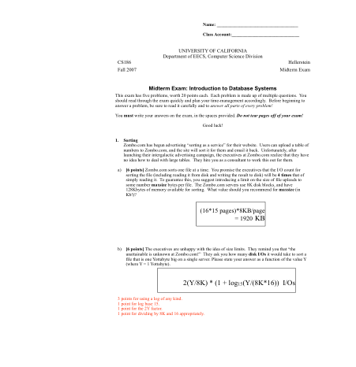

---

**Page 2**

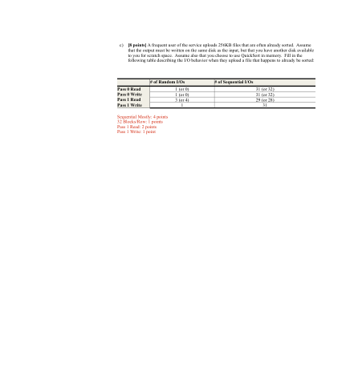

---

**Page 3**

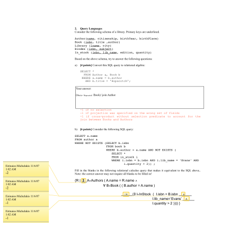

---

**Page 4**

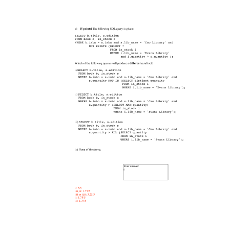

---

**Page 5**

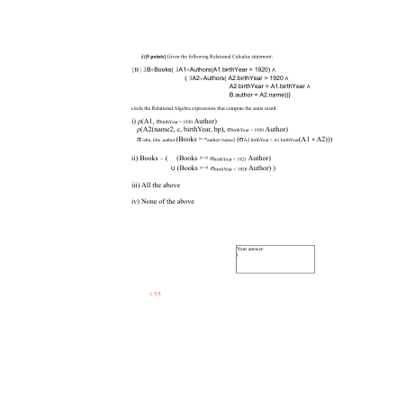

---

**Page 6**

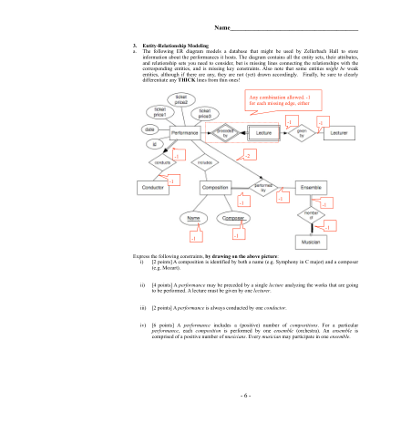

---

**Page 7**

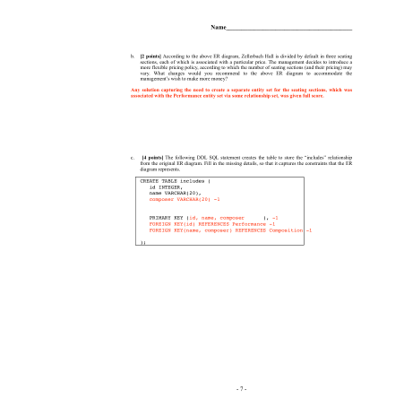

---

**Page 8**

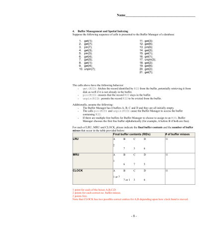

---

**Page 9**

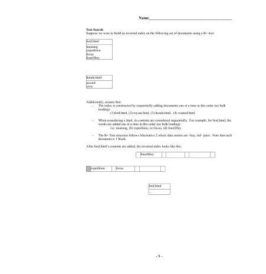

---

**Page 10**

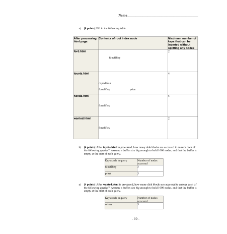

---

**Page 11**

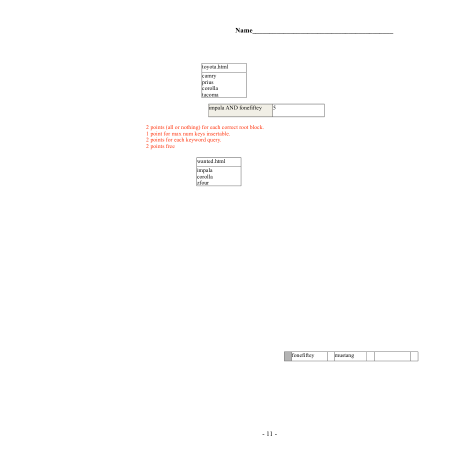

