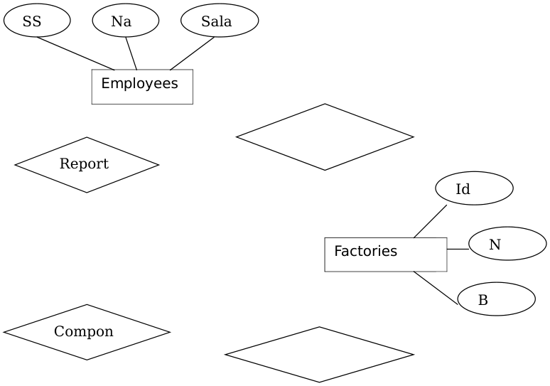
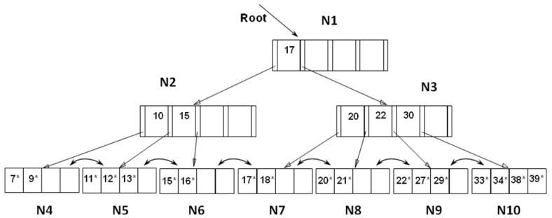
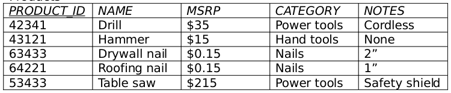
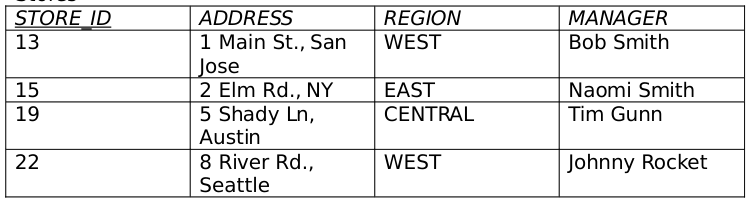
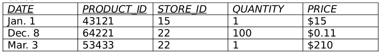
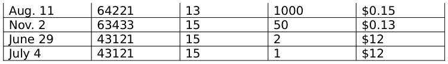
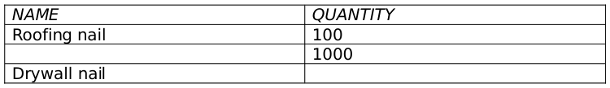
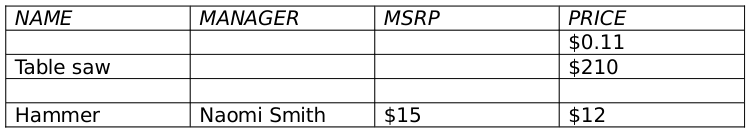
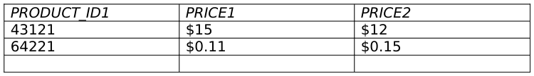
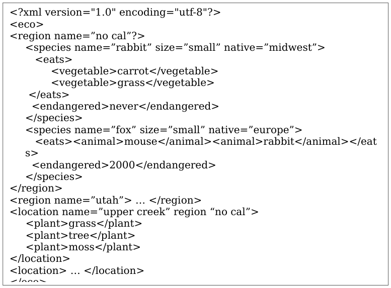

# Berkeley CS186 Spring 2008: Midterm 1: Questions

> Copied from the original: <https://hkn.eecs.berkeley.edu/exams/course/cs/186>. Text and figures are taken from the PDF as is; nothing was answered or rewritten. The original PDF is in this folder.

---

**Page 1**

&emsp;&emsp;&emsp;&emsp;&emsp;&emsp;&emsp;&emsp;Class Account: \_\_\_\_\_\_\_\_\_\_\_\_\_\_\_\_\_\_\_\_\_\_\_\_\_\_\_ 
&emsp;&emsp;&emsp;&emsp;&emsp;&emsp;&emsp;&emsp;UNIVERSITY OF CALIFORNIA 
&emsp;&emsp;&emsp;&emsp;&emsp;Department of EECS, Computer Science Division 
CS186 
Bohannon/Cooper 
Spring 2008 
&emsp;&emsp;&emsp;&emsp;**First Exam: Introduction to Database Systems** 
&emsp;&emsp;&emsp;&emsp;&emsp;&emsp;&emsp;&emsp;**February 26, 2008** 
**Instructions:** 
&emsp;1\. Write your name on each page. 
&emsp;2\. Turn in your notes page with your test. 
&emsp;3\. There are 100 points total. 
&emsp;4\. Please read over the test and plan your time.  Best to skip and go 
&emsp;&emsp;back if you are stuck on a question.

**Entity Relationship Graphs (14 pts)**

You have just been hired as a consultant for a big airplane manufacturer. 
Impressed by your background in databases, they want you to 
completely redesign their database system. Talking with the people in 
the company, you get the following information. 
&emsp;•   The database contains information about employees, factories and 
&emsp;&emsp;parts. 
&emsp;•   Each employee has a social security number (SSN), name and 
&emsp;&emsp;salary. An employee is uniquely identified by his or her SSN. 
&emsp;•   Each factory has an id, name and a budget. The id uniquely 
&emsp;&emsp;identifies a project. 
&emsp;•   Each part has an id and a name. The id uniquely identifies a part. 
&emsp;•   Each employee reports to at most one other employee. 
&emsp;•   Each employee works in at least one factory. 
&emsp;•   Each part is manufactured in exactly one factory. Each part is a 
&emsp;&emsp;component of zero or more other parts. 
A partial Entity-Relationship diagram for the above application is shown 
on the next page. 
&emsp;•   add attributes of **parts**

---

**Page 2**

2Name:\_\_\_\_\_\_\_\_\_\_\_\_\_\_\_\_\_\_\_\_\_\_\_\_\_\_\_\_\_\_\_\_\_\_

&emsp;•   add missing relationships 
&emsp;•   add keys of entity sets 
&emsp;•   capture key and participation constraints on relationships

---

**Page 3**

3Name:\_\_\_\_\_\_\_\_\_\_\_\_\_\_\_\_\_\_\_\_\_\_\_\_\_\_\_\_\_\_\_\_\_\_

---

**Page 4**

4Name:\_\_\_\_\_\_\_\_\_\_\_\_\_\_\_\_\_\_\_\_\_\_\_\_\_\_\_\_\_\_\_\_\_\_

**File Organization and Structure (12 pts)**

&emsp;a) (6 pts) Consider a large table of students.  You need to build an index for 
&emsp;&emsp;the table that best suits a given workload.  Recall the 3 data entry 
&emsp;&emsp;alternatives for implementing an index, and the type of data structures 
&emsp;&emsp;that we have available 
&emsp;&emsp;&emsp;1\. If 95% of the workload is a query requesting several pieces of 
&emsp;&emsp;&emsp;&emsp;&emsp;information about students whose last name begins with a 
&emsp;&emsp;&emsp;&emsp;&emsp;particular letter, and 5% of the workload is adding a new student, 
&emsp;&emsp;&emsp;&emsp;&emsp;but the additions only occur on Saturday. what storage option is 
&emsp;&emsp;&emsp;&emsp;&emsp;appropriate for ‘Students’.

&emsp;&emsp;&emsp;2\. If the percentage of the workload distribution is reversed and 
&emsp;&emsp;&emsp;&emsp;&emsp;additions could occur any time, would the storage option change? 
&emsp;&emsp;&emsp;&emsp;&emsp;Why?

&emsp;b) (6 pts) Operating systems provide default file system management. 
&emsp;&emsp;Name two features that DBMS systems require that are not provided by

---

**Page 5**

5Name:\_\_\_\_\_\_\_\_\_\_\_\_\_\_\_\_\_\_\_\_\_\_\_\_\_\_\_\_\_\_\_\_\_\_

&emsp;&emsp;the default OS mechanisms, and specify whether they are provided at 
&emsp;&emsp;the file-layer or record-layer.

---

**Page 6**

6Name:\_\_\_\_\_\_\_\_\_\_\_\_\_\_\_\_\_\_\_\_\_\_\_\_\_\_\_\_\_\_\_\_\_\_

**B+ Trees (12 pts)** 
This is an initial state of an index represented using a B+ tree.  In this 
tree, under-full nodes are refilled from adjacent nodes if possible, 
otherwise a merge is done.   Draw the B+ tree after the following 
operations have been completed. (Only the final B+ tree is needed but 
intermediate trees are needed for partial credit).  Also, there is no need 
to draw the entire tree, you need to only redraw the nodes that are 
affected (label unchanged nodes with same Nx labels used in the 
picture.) 
&emsp;a) Insert record 40\* 
&emsp;b) Delete record 7\* 
&emsp;c) Delete record 9\* 
&emsp;d) Delete record 15\* 
&emsp;e) Delete record 18\*

---

**Page 7**

7Name:\_\_\_\_\_\_\_\_\_\_\_\_\_\_\_\_\_\_\_\_\_\_\_\_\_\_\_\_\_\_\_\_\_\_

(space for drawing B+Trees)

---

**Page 8**

8Name:\_\_\_\_\_\_\_\_\_\_\_\_\_\_\_\_\_\_\_\_\_\_\_\_\_\_\_\_\_\_\_\_\_\_

**Sorting (14 pts)**

Answer the following questions about external merge sorts. 
&emsp;a. (3 pts) Consider an external sort of a large file that does not fit in 
&emsp;&emsp;memory. What is the main impact of increasing the amount of 
&emsp;&emsp;memory available to the sort process? 
&emsp;i.   The sort will likely proceed faster because the sort will read less 
&emsp;&emsp;&emsp;data on each pass. 
&emsp;ii.   The sort will likely proceed faster because the sort will 
&emsp;&emsp;&emsp;potentially do fewer passes. 
&emsp;iii.   The speed of the sort will not be affected. 
&emsp;iv.   The sort will likely proceed slower because of the need to read 
&emsp;&emsp;&emsp;more data on each pass. 
ANSWER: \_\_\_\_\_\_\_ 
&emsp;b. (3 pts) The primary benefit of double buffering is: 
&emsp;i.   The ability to sort two files at once. 
&emsp;ii.   The ability to merge two runs at once. 
&emsp;iii.   The ability to reduce the number of passes in the sort. 
&emsp;iv.   The ability to overlap computation and I/O. 
ANSWER: \_\_\_\_\_\_\_ 
&emsp;c. (4 pts) After each pass (except pass 0) of a 2-way external merge 
&emsp;&emsp;sort, we have: 
&emsp;i.   Half as many runs of data as before the pass, but each run is 
&emsp;&emsp;&emsp;twice as large 
&emsp;ii.   Twice as many runs of data as before the pass, and each run is 
&emsp;&emsp;&emsp;the same size 
&emsp;iii.   The same number of runs of data as before the pass, and each 
&emsp;&emsp;&emsp;run is the same size 
&emsp;iv.   Half as many runs of data as before the pass, and each run is 
&emsp;&emsp;&emsp;half as large 
ANSWER: \_\_\_\_\_\_\_

---

**Page 9**

9Name:\_\_\_\_\_\_\_\_\_\_\_\_\_\_\_\_\_\_\_\_\_\_\_\_\_\_\_\_\_\_\_\_\_\_

&emsp;d.   (4 pts) Consider a system with 1 kilobyte pages. If we devote 1 
&emsp;&emsp;&emsp;gigabyte of memory space for input buffers, and we do not use 
&emsp;&emsp;&emsp;double buffering, what is the largest file we can sort in two 
&emsp;&emsp;&emsp;passes? (Remember 1 KB = 210 bytes, 1 MB = 220 bytes, 1 GB = 
&emsp;&emsp;&emsp;230 bytes, 1 TB = 240 bytes, and 1 PB = 250 bytes) 
&emsp;i.   1 GB 
&emsp;ii.   100 GB 
&emsp;iii.   1 TB 
&emsp;iv.   1 PB 
ANSWER: **\_\_\_\_\_\_\_**

**Relational Algebra**

Consider the following relations for a sales database for a chain of 
hardware stores: 
Products

Stores

Sales

---

**Page 10**

10Name:\_\_\_\_\_\_\_\_\_\_\_\_\_\_\_\_\_\_\_\_\_\_\_\_\_\_\_\_\_\_\_\_\_\_

For the following queries, we have supplied some of the values for the 
results of the query. Fill in the missing values. Assume set semantics. 
a πNAME,QUANTITY (σCATEGORY=’Nails’ ( Products       Sales ) )   (4 
pts)

b. πNAME,MANAGER,MSRP,PRICE (σMSRP\>PRICE( Products       Sales      Stores ) )   ( 5pts)

c. πMANAGER ( ( πSTORE\_ID (Stores) - πSTORE\_ID (Sales) )       Stores )             (4 pts)

d.    (5 pts) 
S1 = ρ (Sales1(DATE1, PRODUCT\_ID1, STORE\_ID1, QUANTITY1, 
PRICE1),Sales) 
S2 = ρ (Sales2(DATE2, PRODUCT\_ID2, STORE\_ID2, QUANTITY2, 
PRICE2),Sales) 
πPRODUCTID1,PRICE1,PRICE2 ( σDATE1 \<\> DATE2 ( σPRODUCT\_ID1=PRODUCT\_ID2 S1 × S2 ) )

---

**Page 11**

11Name:\_\_\_\_\_\_\_\_\_\_\_\_\_\_\_\_\_\_\_\_\_\_\_\_\_\_\_\_\_\_\_\_\_\_

**Relational Calculus**

In this section, Assume there is an additional table, Manager, with a 
single attribute, NAME, and that there is foreign key constraint from 
Store.MANAGER to Manager.NAME. 
a.  (4 pts) 
Write a (tuple) Relational Calculus expression to return Sales tuples 
indicating that the Shady Lane, Austin store sold more than 50 
Hammers.  Your answer can use the values shown above to get 
PRODUCT\_ID and STORE\_ID and avoid joins.

b.  (4 pts) 
Complete the following expression to return managers that only manage 
stores in the “WEST” region

M \| M∈ Manager ∧ ∀\_\_\_\_\_\_\_\_\_\_\_\_\_\_\_\_\_\_\_\_\_\_\_\_\_\_\_\_\_\_\_\_\_\_\_\_\_

c.  (8 pts) 
Write a Relational Calculus expression to find managers whose stores all 
either 1) sold more than 1000 of some (single) “Nail” product on some 
day or 2) sold a power tool costing over $100.

---

**Page 12**

12Name:\_\_\_\_\_\_\_\_\_\_\_\_\_\_\_\_\_\_\_\_\_\_\_\_\_\_\_\_\_\_\_\_\_\_

**XML**

a.  (4 pts) 
Provide the declaration of the **eco** tag in a DTD:

**eco**  **\_\_\_\_\_\_\_\_\_\_\_\_\_\_\_\_\_\_\_\_\_\_\_\_\_\_\_\_\_\_\_\_\_\_\_\_\_\_\_\_\_**

b.  (4 pts) 
Write an XPath to give the name of species that live in the same region 
as a strictly vegetarian species.  (Hint: only types of food are “animal” 
and “vegetable”).

---

**Page 13**

13Name:\_\_\_\_\_\_\_\_\_\_\_\_\_\_\_\_\_\_\_\_\_\_\_\_\_\_\_\_\_\_\_\_\_\_

c. (6 pts) 
Complete the following XQuery that lists species that competes for food 
with an endangered species in a region. 
\<results\> 
{ 
for $r in doc/eco/region, $s  in $r/species 
where $s/eats/animal = 
$r/species\_\_\_\_\_\_\_\_\_\_\_\_\_\_\_\_\_\_\_\_\_\_\_\_\_\_\_\_\_\_\_\_\_\_\_\_\_\_\_ 
or $s/eats/vegetable = 
$r/species\_\_\_\_\_\_\_\_\_\_\_\_\_\_\_\_\_\_\_\_\_\_\_\_\_\_\_\_\_\_\_\_\_\_\_\_\_\_\_ 
return { $s/@name } 
} 
\</results\>

