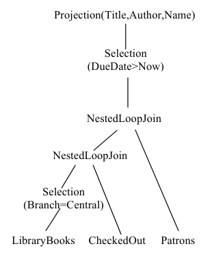
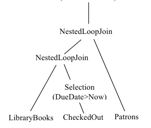
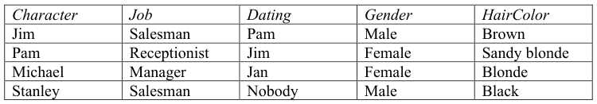

# Berkeley CS186 Spring 2008: Midterm 2: Questions

> Copied from the original: <https://hkn.eecs.berkeley.edu/exams/course/cs/186>. Text and figures are taken from the PDF as is; nothing was answered or rewritten. The original PDF is in this folder.

---

**Page 1**

&emsp;&emsp;&emsp;&emsp;&emsp;&emsp;&emsp;&emsp;Class Account: \_\_\_\_\_\_\_\_\_\_\_\_\_\_\_\_\_\_\_\_\_\_\_\_\_\_\_ 
&emsp;&emsp;&emsp;&emsp;&emsp;&emsp;&emsp;&emsp;UNIVERSITY OF CALIFORNIA 
&emsp;&emsp;&emsp;&emsp;&emsp;&emsp;Department of EECS, Computer Science Division 
CS186                                 Bohannon/Cooper 
Spring 2008 
&emsp;&emsp;&emsp;&emsp;&emsp;**Second Exam: Introduction to Database Systems** 
&emsp;&emsp;&emsp;&emsp;&emsp;&emsp;&emsp;&emsp;**April 15, 2008** 
**Instructions:** 
&emsp;1\. Write your name on each page. 
&emsp;2\. Turn in your notes page with your test. 
&emsp;3\. There are 60 points total. 
&emsp;4\. Please read over the test and plan your time.  Best to skip and go back if 
&emsp;&emsp;you are stuck on a question. The points assigned to each question reflect 
&emsp;&emsp;our estimate of the time to answer that question, so use the point 
&emsp;&emsp;allocations to plan your time.

&emsp;**1. SQL (18 points)** 
Consider the following relations: 
ComicBooks(Title,PubDate,IssueNumber,Price) 
Publishers(Name,Address) 
PublishedBy(Title,PublisherName) 
Characters(Name,GoodOrEvil,Superpowers, Mentor) 
StarOf(CharacterName,BookTitle) 
AppearsIn(CharacterName,BookTitle,PubDate) 
&emsp;• Primary key of ComicBooks is (Title, Pubdate) 
&emsp;• Primary key of Publishers is (Name) 
&emsp;• Primary key of Characters is (Name) 
&emsp;• In PublishedBy, Title is a foreign key referencing ComicBooks(Title), and 
&emsp;&emsp;PublisherName is a foreign key referencing Publishers(Name) 
&emsp;• In Characters, Mentor is a foreign key referencing Characters(Name) 
&emsp;• In StarOf, CharacterName is a foreign key referencing Characters(Name), and 
&emsp;&emsp;BookTitle is a foreign key referencing ComicBooks(Title) 
&emsp;• In AppearsIn, (BookTitle,PubDate) is a foreign key referencing 
&emsp;&emsp;ComicBooks(Title,PubDate) and CharacterName is a foreign key referencing 
&emsp;&emsp;Characters(Name) 
In this question, excessively complex SQL will be penalized.

---

**Page 2**

a. Write a SQL query to find the issue number of all comic books with title “Superman” 
that “Superwoman” appears in.

b. Write a SQL query to find, for each character who appears in comic books with title 
“Batman” or “Dark Knight”, how many times they appeared altogether in those comic 
books.

---

**Page 3**

c. Write a SQL query to find the average price of issues of comic books published by 
each publisher, but counting only comic book titles that have at least 5 issues.

d. Write a SQL query to find all pairs of characters that have a common mentor. Be sure 
to exclude trivial pairs like (Superman,Superman).

---

**Page 4**

&emsp;&emsp;**2. Query processing (18 points)** 
Consider the following schema: 
LibraryBooks(ISBN, Title, Author, Branch) 
Patrons(CardNumber, Name, Address, City, State, ZipCode) 
CheckedOut(CardNumber, ISBN, DueDate) 
&emsp;&emsp;a. The DBMS optimizer is considering two plans for the following query: 
SELECT Title, Author, Name 
FROM LibraryBooks, Patrons, CheckedOut 
WHERE LibraryBooks.ISBN = CheckedOut.ISBN 
AND Patrons.CardNumber = CheckedOut.CardNumber 
AND Branch=’Central’ 
AND DueDate\>Now; 
Assume “Now” is a special value that always evaluates to, well, now. The two plans are: 
&emsp;&emsp;&emsp;&emsp;&emsp;Plan A    Plan B

&emsp;&emsp;&emsp;&emsp;&emsp;&emsp;&emsp;&emsp;Projection(Title,Author,Name)

&emsp;&emsp;&emsp;&emsp;&emsp;&emsp;&emsp;&emsp;Selection 
&emsp;&emsp;&emsp;&emsp;&emsp;&emsp;&emsp;&emsp;(Branch=Central)

---

**Page 5**

a.1 Assuming you have no statistics and know nothing about the contents of each 
relation, which plan is likely to cost less? Why?

a.2 Assume now that you have the following statistics: 
&emsp;• LibraryBooks contains 10,000,000 tuples 
&emsp;• There are 10 different values for the Branch attribute of LibraryBooks 
&emsp;• There are 100,000 Patrons tuples 
&emsp;• There are 100,000 CheckedOut tuples 
&emsp;• Only 5% of checked out books are overdue on average 
Is the same plan you chose in part a.1 likely to be the cheapest? Why or why not?

a.3 Is a real cost-based optimizer likely to choose one of these two plans? Why or why 
not?

---

**Page 6**

a.4 Two possible join orders for this query are ((LibraryBooks JOIN CheckedOut) JOIN 
Patrons) and (LibraryBooks JOIN (CheckedOut JOIN Patrons)). If we had excellent 
estimates of selectivity (but not necessarily of relation sizes), how would we use that 
information to decide between the two join orders?

b. We usually prefer to use pipelining when evaluating plans. 
b.1 What are two advantages to fully pipelined plans?

b.2 Can we use a sort-merge join in a fully pipelined plan? Why or why not?

c. Some optimizers only consider left-deep plans. What are the advantages and 
disadvantages of doing this?

---

**Page 7**

&emsp;**3. Functional dependencies and normalization (12 points)** 
a. Consider a relation with the following schema and functional dependencies: 
Tests(PatientID, DoctorID, TestDate, Type, Lab, Technician, Fee, ResultDate, Status); 
PatientID, DoctorID → TestDate 
PatientID, TestDate, Type → Lab 
Technician  → Lab 
Type  → Fee 
PatientID, TestDate, Type  → ResultDate, Status 
a.1 Is this relation in BCNF? Why or why not?

b. Consider a relation with the following schema and functional dependencies: 
AstronomicalObjects(MessierNumber, CommonName, Coordinates, Type, Distance, 
Galaxy) 
MessierNumber  → CommonName 
CommonName  → Coordinates, Type 
MessierNumber  → Distance 
CommonName  → MessierNumber, Galaxy 
b.1 What are the candidate keys for this relation? Also, give at least one superkey.

---

**Page 8**

b.2 Is this relation in BCNF? Is it in 3NF? Why or why not?

c. Consider a relation with the following schema and functional dependencies: 
Recipes(Title, Genre, PreparationTime, Author, EstimatedCost) 
Title → Genre 
Title, Author → PreparationTime, EstimatedCost 
c.1 Which attributes of the relation are prime? Why?

c.2 Is the relation in 3NF? Why or why not?

---

**Page 9**

d. Consider the following relation instance:

d.1 What functional dependencies exist for this relation? What are the candidate keys of 
the relation?

&emsp;**4. Physical design (7 points)** 
Consider the following relation schema: 
UserProfiles(UserId, PasswordHash, RealName, ZipCode, Preferences, Avatar, 
LoginStatus) – PrimaryKey(UserID) 
Friends(UserId1, UserId2) 
Posts(UserId, Topic, Subject, Text, Date) 
The most frequent operations against this database are: 
i. Users log in, requiring a lookup of UserProfiles, at a rate of 1,000 per second 
ii. Users check to see the LoginStatus of their friends, requiring a join of Friends and 
&emsp;UserProfiles, at a rate of 10,000 per second 
iii. New users are added to UserProfiles, at a rate of 1 per second 
iv. Users enter new posts, inserting tuples into Posts, at a rate of 100 per second 
v. Users view the subjects of the posts for a topic on a given day, at the rate of 1,000 
&emsp;per second

---

**Page 10**

&emsp;a. If we only create one index for UserProfiles, what should the index be on? Why? 
&emsp;&emsp;Should it be clustering?

&emsp;b. Should we create an index for Posts? If so, what attribute or attributes should it be 
&emsp;&emsp;on? If multiple attributes, what order should they be in? If we should not create an 
&emsp;&emsp;index, why not?

&emsp;**5. Transactions (5 points)** 
An ACID transaction would permit the following situations (mark True or False for 
each): 
&emsp;a. \_\_\_\_\_ After a failure, an uncommitted transaction is rolled back and all of its 
&emsp;&emsp;effects are erased. 
&emsp;b. \_\_\_\_\_ After a failure, a committed transaction is rolled back and all of its effects 
&emsp;&emsp;are erased. 
&emsp;c. \_\_\_\_\_ Two transactions update the same tuple and then commit, and the effects of 
&emsp;&emsp;both transactions are visible afterwards. 
&emsp;d. \_\_\_\_\_ An unserializable schedule is executed. 
&emsp;e. \_\_\_\_\_ A transaction reads the same tuple twice without writing it in between and 
&emsp;&emsp;sees two different values.

