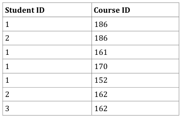
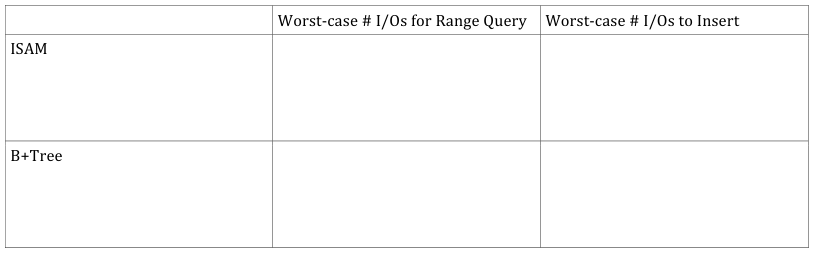
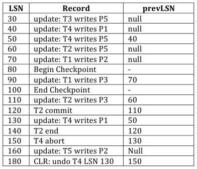
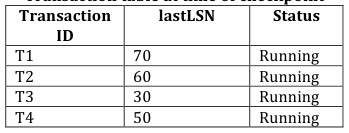
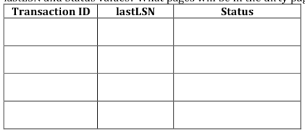
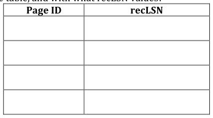
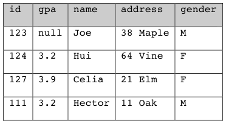

# Berkeley CS186 Spring 2010: Final: Questions

> Copied from the original: <https://hkn.eecs.berkeley.edu/exams/course/cs/186>. Text and figures are taken from the PDF as is; nothing was answered or rewritten. The original PDF is in this folder.

---

**Page 1**

&emsp;&emsp;&emsp;&emsp;&emsp;&emsp;&emsp;&emsp;SID: \_\_\_\_\_\_\_\_\_\_\_\_\_\_\_\_\_\_\_\_\_\_\_\_\_\_\_\_ 
Name:	
  \_\_\_\_\_\_\_\_\_\_\_\_\_\_\_\_\_\_\_\_\_\_\_\_\_\_\_\_\_\_\_\_\_\_\_\_\_\_\_\_\_\_\_\_\_\_\_\_\_\_	
  	
  	
  	
  	
  	
  	
  	
  	
  Class	
  Account:	
  \_\_\_\_\_\_\_\_\_\_\_\_\_\_\_\_\_\_\_\_\_\_\_

&emsp;&emsp;&emsp;&emsp;&emsp;&emsp;&emsp;&emsp;UNIVERSITY	
  OF	
  CALIFORNIA 
&emsp;&emsp;&emsp;&emsp;&emsp;&emsp;&emsp;&emsp;Department	
  of	
  EECS,	
  Computer	
  Science	
  Division 
CS186	
     Hellerstein 
Spring	
  2010	
     Final	
  Exam

&emsp;&emsp;&emsp;&emsp;&emsp;&emsp;&emsp;&emsp;**Final	
  Exam:	
  Introduction	
  to	
  Database	
  Systems** 
This	
  exam	
  has	
  seven	
  problems,	
  worth	
  different	
  amounts	
  of	
  points	
  each.	
  Each	
  problem	
  is	
  made	
  up	
  of	
  multiple 
questions.	
  You	
  should	
  read	
  through	
  the	
  exam	
  quickly	
  and	
  plan	
  your	
  time	
  management	
  accordingly.	
  Before	
  beginning 
to	
  answer	
  a	
  problem,	
  be	
  sure	
  to	
  read	
  it	
  carefully	
  and	
  to	
  answer	
  all	
  parts	
  of	
  every	
  problem!

You	
  **must**	
  write	
  your	
  answers	
  on	
  the	
  exam,	
  in	
  the	
  spaces	
  provided.	
  You	
  may	
  use	
  the	
  backs	
  of	
  the	
  pages	
  for	
  scratch 
work.	
  Do	
  not	
  tear	
  pages	
  off	
  of	
  your	
  exam!

**Good	
  luck!**

&emsp;&emsp;&emsp;&emsp;&emsp;&emsp;&emsp;&emsp;1

---

**Page 2**

&emsp;&emsp;&emsp;&emsp;&emsp;&emsp;&emsp;&emsp;SID: \_\_\_\_\_\_\_\_\_\_\_\_\_\_\_\_\_\_\_\_\_\_\_\_\_\_\_\_ 
**Q1:	
  Tree-­‐Structured	
  Indexes	
  \[10	
  points\]** 
Consider	
  the	
  instance	
  of	
  the	
  Enrolled	
  table:

a)	
  Use	
  the	
  bulk-­‐loading	
  algorithm	
  to	
  create	
  an	
  “Alternative	
  1”	
  B+Tree	
  index	
  below	
  on	
  (Student	
  ID,	
  Course	
  ID). 
Assume	
  2	
  entries	
  (3	
  pointers)	
  fit	
  per	
  internal	
  node,	
  with	
  a	
  minimum	
  of	
  1	
  entry	
  (2	
  pointers).	
  	
  Assume	
  2	
  entries	
  fit	
  per 
leaf	
  node.	
  	
  Fill	
  leaf	
  nodes	
  to	
  capacity.	
  	
  Draw	
  your	
  solution	
  below.	
  	
  **\[4	
  points\]**

b)	
  Consider	
  an	
  “Alternative	
  1”	
  B+Tree	
  of	
  height	
  H	
  where	
  internal	
  nodes	
  and	
  leaf	
  nodes	
  both	
  hold	
  R	
  entries	
  (internal 
nodes	
  also	
  hold	
  R+1	
  pointers).	
  	
  All	
  intermediate	
  nodes	
  (including	
  the	
  root)	
  are	
  full,	
  and	
  all	
  leaf	
  nodes	
  are	
  at	
  least	
  half-­‐ 
full.	
  	
  Given	
  this	
  constraint	
  and	
  the	
  usual	
  constraints	
  of	
  a	
  B+Tree,	
  assume	
  whatever	
  data	
  you	
  want	
  in	
  the	
  tree	
  for	
  each 
part	
  below.	
  	
  Assume	
  that	
  we	
  measure	
  height	
  starting	
  at	
  1	
  -­‐-­‐	
  i.e.	
  a	
  1-­‐node	
  B+Tree	
  has	
  height	
  1.	
  	
  **\[2	
  points\]** 
i)	
  What	
  is	
  the	
  maximum	
  number	
  of	
  inserts	
  possible	
  before	
  the	
  root	
  splits?

ii)	
  What	
  is	
  the	
  minimum	
  number	
  of	
  inserts	
  that	
  would	
  cause	
  the	
  root	
  to	
  split?

&emsp;&emsp;&emsp;&emsp;&emsp;&emsp;&emsp;&emsp;2

---

**Page 3**

&emsp;&emsp;&emsp;&emsp;&emsp;&emsp;&emsp;&emsp;SID: \_\_\_\_\_\_\_\_\_\_\_\_\_\_\_\_\_\_\_\_\_\_\_\_\_\_\_\_ 
c)	
  Fill	
  in	
  the	
  cost	
  table	
  below	
  for	
  “Alternative	
  1”	
  ISAM	
  and	
  B+Tree	
  indices:	
  **\[4	
  points\]** 
Assume	
  each	
  index	
  takes	
  P	
  pages	
  on	
  disk,	
  has	
  height	
  H,	
  and	
  fanout	
  F	
  at	
  each	
  internal	
  node.	
  	
  Assume	
  there	
  are	
  R 
tuples	
  in	
  the	
  relation,	
  and	
  B	
  tuples	
  fit	
  on	
  a	
  leaf	
  (or	
  overflow)	
  page.	
  	
  In	
  each	
  case,	
  assume	
  infinite	
  buffer	
  pool	
  size,	
  but 
the	
  buffer	
  pool	
  starts	
  out	
  empty.	
  	
  For	
  each	
  page	
  that	
  you	
  dirty,	
  add	
  1	
  to	
  your	
  I/O	
  cost	
  since	
  it	
  will	
  eventually	
  have	
  to 
be	
  flushed	
  to	
  disk.	
  	
  For	
  ISAM,	
  assume	
  that	
  a	
  leaf	
  node	
  maintains	
  only	
  a	
  pointer	
  to	
  the	
  beginning	
  of	
  an	
  overflow	
  list. 
Given	
  the	
  constraints	
  of	
  a	
  B+Tree/ISAM,	
  assume	
  whatever	
  data	
  you	
  want	
  in	
  the	
  tree	
  for	
  each	
  case	
  below.

&emsp;&emsp;&emsp;&emsp;&emsp;&emsp;&emsp;&emsp;3

---

**Page 4**

&emsp;&emsp;&emsp;&emsp;&emsp;&emsp;&emsp;&emsp;SID: \_\_\_\_\_\_\_\_\_\_\_\_\_\_\_\_\_\_\_\_\_\_\_\_\_\_\_\_ 
**Q2:	
  Normal	
  Forms	
  \[11	
  points\]** 
Consider	
  the	
  “Congress”	
  relation,	
  and	
  associated	
  functional	
  dependencies: 
Congress(Bill,	
  Title,	
  Sponsor,	
  Party,	
  District,	
  Committee,	
  cHairperson,	
  chAirperson\_party,	
  heaRing\_time) 
R	
  →	
  SP 
SP	
  →	
  DCH 
B	
  →	
  SCT 
DH	
  →	
  A 
TS	
  →	
  R 
SPR	
  →	
  B 
S	
  →	
  P 
a)	
  **\[4	
  points\]**	
  All	
  of	
  the	
  candidate	
  keys	
  for	
  the	
  relation	
  above	
  are	
  listed	
  below,	
  possibly	
  along	
  with	
  some	
  attribute	
  sets 
that	
  are	
  not	
  candidate	
  keys.	
  	
  Circle	
  the	
  attributes	
  sets	
  that	
  are	
  candidate	
  keys	
  for	
  the	
  relation	
  above. 
&emsp;-­‐    R 
&emsp;-­‐    S 
&emsp;-­‐    B 
&emsp;-­‐    TS 
b)	
  Circle	
  the	
  constraints	
  below	
  (if	
  any)	
  that	
  violate	
  BCNF.	
  **\[4	
  points\]**

&emsp;1\. R	
  →	
  SP 
&emsp;2\. SP	
  →	
  DCH 
&emsp;3\. B	
  →	
  SCT 
&emsp;4\. DH	
  →	
  A 
&emsp;5\. TS	
  →	
  R 
&emsp;6\. SPR	
  →	
  B 
&emsp;7\. S	
  →	
  P 
&emsp;8\. None	
  of	
  the	
  above

c)	
  Consider	
  the	
  following	
  relation	
  and	
  functional	
  dependencies: 
SupremeCourt(Docket,	
  Appellant,	
  Respondent,	
  Oral\_argument\_time,	
  oPinion\_author,	
  appoInted\_by,	
  parTy) 
&emsp;1\. PI	
  →	
  T 
&emsp;2\. RP	
  →	
  I 
&emsp;3\. O	
  →	
  ARP 
&emsp;4\. D	
  →	
  O 
&emsp;5\. OA	
  →	
  D 
&emsp;&emsp;i)	
  Write	
  the	
  lossless-­‐join	
  decomposition	
  of	
  this	
  relation	
  into	
  BCNF,	
  by	
  resolving	
  the	
  constraints	
  that	
  violate 
&emsp;&emsp;BCNF	
  (if	
  any)	
  in	
  numerical	
  order.	
  **\[2	
  points\]**

&emsp;&emsp;ii)	
  Is	
  this	
  decomposition	
  dependency-­‐preserving?	
  **\[1	
  point\]**

&emsp;&emsp;&emsp;&emsp;&emsp;&emsp;&emsp;&emsp;4

---

**Page 5**

&emsp;&emsp;&emsp;&emsp;&emsp;&emsp;&emsp;&emsp;SID: \_\_\_\_\_\_\_\_\_\_\_\_\_\_\_\_\_\_\_\_\_\_\_\_\_\_\_\_ 
d)	
  Assume	
  that	
  you	
  considering	
  a	
  new	
  normal	
  form	
  TANF	
  (Totally	
  Awesome	
  Normal	
  Form).	
  	
  A	
  constraint	
  satisfies 
TANF	
  for	
  a	
  relation	
  R	
  if,	
  for	
  every	
  functional	
  dependency	
  X	
  →	
  Y,	
  one	
  of	
  the	
  following	
  is	
  true: 
i)	
  X	
  →	
  Y	
  is	
  a	
  trivial	
  FD 
ii)	
  X	
  is	
  a	
  candidate	
  key	
  for	
  R 
Assume	
  you	
  decompose	
  a	
  relation	
  R	
  into	
  TANF	
  in	
  the	
  same	
  way	
  you	
  decompose	
  a	
  relation	
  into	
  BCNF.	
  	
  Does	
  this 
decomposition	
  for	
  TANF	
  always	
  have	
  the	
  lossless-­‐join	
  property?	
  	
  If	
  yes,	
  provide	
  a	
  2.5-­‐line	
  argument.	
  	
  If	
  no,	
  provide	
  a 
counterexample	
  involving	
  at	
  most	
  two	
  FDs.	
  	
  Longer	
  answers	
  will	
  receive	
  no	
  credit.	
  	
  **\[3	
  points\]**

If	
  YES,	
  write	
  argument	
  here:	
  \_\_\_\_\_\_\_\_\_\_\_\_\_\_\_\_\_\_\_\_\_\_\_\_\_\_\_\_\_\_\_\_\_\_\_\_\_\_\_\_\_\_\_\_\_\_\_\_\_\_\_\_\_\_\_\_\_\_\_\_\_\_\_\_\_\_\_\_\_\_\_\_\_\_\_\_\_\_\_\_\_\_\_\_\_\_\_\_\_\_\_\_\_\_\_\_\_\_\_\_\_

\_\_\_\_\_\_\_\_\_\_\_\_\_\_\_\_\_\_\_\_\_\_\_\_\_\_\_\_\_\_\_\_\_\_\_\_\_\_\_\_\_\_\_\_\_\_\_\_\_\_\_\_\_\_\_\_\_\_\_\_\_\_\_\_\_\_\_\_\_\_\_\_\_\_\_\_\_\_\_\_\_\_\_\_\_\_\_\_\_\_\_\_\_\_\_\_\_\_\_\_\_\_\_\_\_\_\_\_\_\_\_\_\_\_\_\_\_\_\_\_\_\_\_\_\_\_\_\_\_\_\_\_\_\_

\_\_\_\_\_\_\_\_\_\_\_\_\_\_\_\_\_\_\_\_\_\_\_\_\_\_\_\_\_\_\_\_\_\_\_\_\_\_\_\_\_\_\_\_\_\_\_\_\_\_\_\_\_\_\_\_\_\_\_\_\_\_\_\_\_\_\_\_\_\_\_\_\_\_\_\_\_\_\_\_\_\_\_\_\_\_\_\_\_\_\_\_\_\_\_\_\_\_\_\_\_\_\_\_\_\_\_\_\_\_\_\_\_\_\_\_\_\_\_\_\_\_\_\_\_\_\_\_\_\_\_\_\_\_ 
If	
  NO,	
  write	
  counterexample	
  here:

&emsp;&emsp;&emsp;&emsp;&emsp;&emsp;&emsp;&emsp;5

---

**Page 6**

&emsp;&emsp;&emsp;&emsp;&emsp;&emsp;&emsp;&emsp;SID: \_\_\_\_\_\_\_\_\_\_\_\_\_\_\_\_\_\_\_\_\_\_\_\_\_\_\_\_ 
**Q3:	
  Concurrency	
  \[10	
  points\]** 
Consider	
  the	
  following	
  schedule	
  of	
  accesses	
  by	
  three	
  transactions.	
  The	
  labels	
  R	
  and	
  W	
  indicate	
  reads	
  and	
  writes,	
  and 
the	
  labels	
  A,	
  B,	
  and	
  C	
  indicate	
  distinct	
  elements	
  of	
  data.

&emsp;&emsp;&emsp;&emsp;&emsp;&emsp;&emsp;&emsp;6

---

**Page 7**

&emsp;&emsp;&emsp;&emsp;&emsp;&emsp;&emsp;&emsp;SID: \_\_\_\_\_\_\_\_\_\_\_\_\_\_\_\_\_\_\_\_\_\_\_\_\_\_\_\_

(a)	
  **\[2	
  points\]**	
  Recall	
  the	
  definition	
  of	
  a	
  precedence	
  graph:	
  “A	
  precedence	
  graph	
  has	
  a	
  node	
  for	
  each	
  committed 
transaction,	
  and	
  an	
  arc	
  from	
  Ti	
  to	
  Tj	
  if	
  an	
  action	
  of	
  Ti	
  precedes	
  and	
  conflicts	
  with	
  one	
  of	
  Tj’s	
  actions.”	
  Draw	
  a 
precedence	
  graph	
  for	
  the	
  schedule	
  on	
  the	
  previous	
  page.

(b)	
  **\[2	
  points\]**	
  Is	
  the	
  schedule	
  on	
  the	
  previous	
  page	
  conflict-­‐serializable?	
  If	
  so,	
  what	
  order	
  should	
  the	
  transactions	
  be 
executed	
  in	
  to	
  produce	
  a	
  conflict-­‐equivalent	
  serial	
  schedule?

(c)	
  **\[1	
  point\]**	
  Suppose	
  instead	
  of	
  reading	
  B	
  at	
  time	
  12,	
  transaction	
  3	
  reads	
  B	
  at	
  time	
  7.	
  Draw	
  a	
  precedence	
  graph	
  for 
this	
  modified	
  schedule.

(d)	
  **\[1	
  point\]**	
  Is	
  the	
  schedule	
  of	
  part	
  (c)	
  conflict-­‐serializable?	
  If	
  so,	
  what	
  order	
  should	
  the	
  transactions	
  be	
  executed	
  in 
to	
  produce	
  a	
  conflict-­‐equivalent	
  serial	
  schedule?

(e)	
  **\[4	
  points\]**	
  Add	
  lock/unlock	
  actions	
  into	
  the	
  schedule	
  on	
  the	
  previous	
  page	
  in	
  a	
  way	
  compliant	
  with	
  (non-­‐strict) 
two-­‐phase	
  locking.	
  Use	
  L(X)	
  to	
  lock	
  a	
  data	
  element	
  X,	
  and	
  U(X)	
  to	
  unlock	
  it.	
  At	
  most	
  one	
  box	
  on	
  each	
  row	
  should 
contain	
  an	
  action,	
  and	
  it	
  may	
  contain	
  only	
  one	
  action.	
  You	
  should	
  only	
  use	
  exclusive	
  locks,	
  not	
  shared	
  (read)	
  locks. 
No	
  locks	
  should	
  remain	
  held	
  at	
  the	
  end	
  of	
  the	
  schedule.

&emsp;&emsp;&emsp;&emsp;&emsp;&emsp;&emsp;&emsp;7

---

**Page 8**

&emsp;&emsp;&emsp;&emsp;&emsp;&emsp;&emsp;&emsp;SID: \_\_\_\_\_\_\_\_\_\_\_\_\_\_\_\_\_\_\_\_\_\_\_\_\_\_\_\_ 
**Q4:	
  Logging	
  and	
  recovery	
  \[11	
  points\]** 
Your	
  database	
  server	
  has	
  just	
  crashed	
  due	
  to	
  a	
  power	
  outage.	
  You	
  boot	
  it	
  back	
  up,	
  find	
  the	
  following	
  log	
  and 
checkpoint	
  information	
  on	
  disk,	
  and	
  begin	
  the	
  recovery	
  process.	
  Assume	
  we	
  use	
  a	
  **STEAL/NO	
  FORCE**	
  recovery 
policy.

&emsp;&emsp;&emsp;&emsp;&emsp;&emsp;&emsp;&emsp;**Transaction	
  table	
  at	
  time	
  of	
  checkpoint**

&emsp;&emsp;&emsp;&emsp;&emsp;&emsp;&emsp;&emsp;**Dirty	
  page	
  table	
  at	
  time	
  of	
  checkpoint**

(a)	
  \[3	
  points\]	
  The	
  log	
  record	
  at	
  LSN	
  60	
  says	
  that	
  transaction	
  2	
  updated	
  page	
  5.	
  Was	
  this	
  update	
  to	
  page	
  5	
  successfully 
written	
  to	
  disk?	
  The	
  log	
  record	
  at	
  LSN	
  70	
  says	
  that	
  transaction	
  1	
  updated	
  page	
  2.	
  Was	
  this	
  update	
  to	
  page	
  2 
successfully	
  written	
  to	
  disk?	
  Explain	
  briefly	
  in	
  both	
  cases.

(b)	
  \[4	
  points\]	
  At	
  the	
  end	
  of	
  the	
  Analysis	
  phase,	
  what	
  transactions	
  will	
  be	
  in	
  the	
  transaction	
  table,	
  and	
  with	
  what 
lastLSN	
  and	
  Status	
  values?	
  What	
  pages	
  will	
  be	
  in	
  the	
  dirty	
  page	
  table,	
  and	
  with	
  what	
  recLSN	
  values?

(c)	
  \[4	
  points\]	
  At	
  which	
  LSN	
  in	
  the	
  log	
  should	
  redo	
  begin?	
  Which	
  log	
  records	
  will	
  be	
  redone	
  (list	
  their	
  LSNs)?	
  All	
  other 
log	
  records	
  will	
  be	
  skipped.

&emsp;&emsp;&emsp;&emsp;&emsp;&emsp;&emsp;&emsp;8

---

**Page 9**

&emsp;&emsp;&emsp;&emsp;&emsp;&emsp;&emsp;&emsp;SID: \_\_\_\_\_\_\_\_\_\_\_\_\_\_\_\_\_\_\_\_\_\_\_\_\_\_\_\_ 
**Q5:	
  Search	
  and	
  Query	
  Processing	
  \[10	
  points\]** 
You	
  are	
  consulting	
  on	
  the	
  design	
  of	
  a	
  new	
  search	
  engine.	
  	
  The	
  company	
  building	
  it	
  wants	
  to	
  use	
  SQL	
  on	
  top	
  of	
  a 
DBMS.	
  	
  (You	
  tell	
  them	
  that	
  using	
  a	
  DBMS	
  is	
  not	
  the	
  best	
  approach	
  for	
  high-­‐performance	
  text	
  search.	
  	
  They	
  tell	
  you	
  it 
is	
  a	
  non-­‐negotiable	
  design	
  decision.	
  	
  You	
  nod	
  reasonably;	
  this	
  is	
  not	
  your	
  first	
  time	
  working	
  with	
  an	
  irrational 
customer!) 
&emsp;a) **\[4	
  points\]**	
  The	
  company	
  has	
  prototyped	
  basic	
  Boolean	
  search	
  on	
  a	
  small	
  test	
  data	
  set.	
  	
  	
  They	
  are	
  storing	
  the 
&emsp;&emsp;files	
  in	
  a	
  single	
  table	
  of	
  the	
  form 
&emsp;&emsp;`Files(docID integer, content text, PRIMARY KEY (docID))`. 
&emsp;&emsp;And	
  they	
  have	
  a	
  table	
  of	
  StopWords	
  as	
  well. 
&emsp;&emsp;Here’s	
  their	
  query	
  template	
  for	
  a	
  2-­‐keyword	
  search	
  ($1	
  and	
  $2	
  are	
  replaced	
  with	
  keywords	
  at	
  runtime):

&emsp;&emsp;`SELECT DISTINCT A.docID` 
&emsp;&emsp;`FROM Files A, Files B, StopWords S` 
&emsp;&emsp;`WHERE A.docID = B.docID` 
&emsp;&emsp;`AND A.content LIKE %$1%` 
&emsp;&emsp;`AND B.content LIKE %$2%` 
&emsp;&emsp;`AND $1 <> S.word` 
&emsp;&emsp;`AND $2 <> S.word;` 
&emsp;&emsp;For	
  each	
  of	
  the	
  following	
  comments,	
  answer	
  True	
  or	
  False,	
  and	
  explain	
  your	
  answer	
  in	
  the	
  space	
  provided 
&emsp;&emsp;(DO	
  NOT	
  use	
  more	
  space!): 
&emsp;&emsp;&emsp;i.    This	
  query	
  is	
  exponential	
  in	
  the	
  number	
  of	
  File	
  tuples,	
  so	
  it	
  will	
  get	
  exponentially	
  slower	
  as	
  they	
  add 
&emsp;&emsp;&emsp;&emsp;&emsp;files	
  to	
  their	
  corpus.

&emsp;&emsp;&emsp;ii. The	
  self-­‐join	
  in	
  this	
  query	
  is	
  useless.

&emsp;&emsp;&emsp;iii. This	
  query	
  will	
  produce	
  no	
  output	
  for	
  the	
  keyword	
  $1	
  =	
  “the”	
  as	
  long	
  as	
  it	
  was	
  inserted	
  into	
  the 
&emsp;&emsp;&emsp;&emsp;&emsp;StopWords	
  table.

&emsp;&emsp;&emsp;iv. The	
  query	
  optimizer	
  may	
  produce	
  ridiculously	
  bad	
  join	
  orders.

&emsp;&emsp;&emsp;&emsp;&emsp;============================================================ 
&emsp;&emsp;&emsp;&emsp;&emsp;If	
  your	
  answer	
  continues	
  below	
  here	
  it	
  is	
  TOO	
  LONG.

&emsp;&emsp;&emsp;&emsp;&emsp;&emsp;&emsp;&emsp;9

---

**Page 10**

&emsp;&emsp;&emsp;&emsp;&emsp;&emsp;&emsp;&emsp;SID: \_\_\_\_\_\_\_\_\_\_\_\_\_\_\_\_\_\_\_\_\_\_\_\_\_\_\_\_ 
b) **\[4	
  points\]**	
  The	
  company	
  likes	
  your	
  idea	
  of	
  using	
  inverted	
  indexes.	
  	
  They	
  propose	
  to	
  use	
  the	
  scheme	
  we 
&emsp;described	
  in	
  class:	
  build	
  an	
  `InvertedFile`	
  relation	
  in	
  the	
  DBMS	
  with	
  an	
  “Alternative	
  3”	
  B-­‐tree	
  index	
  on 
&emsp;the	
  term	
  column.	
  	
  The	
  data	
  entries	
  in	
  the	
  leaves	
  point	
  to	
  `RecordIds`	
  of	
  the	
  `InvertedFile`	
  heap	
  file	
  in	
  the 
&emsp;database. 
&emsp;You	
  explain	
  to	
  them	
  that	
  their	
  DBMS	
  will	
  not	
  ensure	
  that	
  the	
  “Alternative	
  3”	
  entries	
  are	
  sorted	
  by 
&emsp;`RecordId`.	
  	
  So	
  the	
  optimizer	
  will	
  not	
  be	
  able	
  to	
  choose	
  the	
  “standard”	
  query	
  plan	
  from	
  class	
  using	
  merge 
&emsp;join.	
  They	
  don’t	
  see	
  any	
  problem	
  with	
  that. 
&emsp;To	
  demonstrate,	
  you	
  show	
  the	
  Boolean	
  query	
  “Miley	
  AND	
  antidisestablishmentarianism”.	
  The	
  data	
  entry 
&emsp;(postings	
  list)	
  for	
  “Miley”	
  takes	
  350MB(42.9	
  million	
  results	
  on	
  Google),	
  and	
  the	
  one	
  for 
&emsp;“antidisestablishmentarianism”	
  takes	
  5MB	
  (81,200	
  results	
  on	
  Google).	
  	
  They	
  have	
  10MB	
  of	
  buffer	
  space	
  to 
&emsp;run	
  this	
  query. 
&emsp;Assume	
  the	
  optimizer	
  does	
  a	
  good	
  job	
  choosing	
  among	
  the	
  various	
  join	
  algorithms	
  and	
  access	
  methods	
  we 
&emsp;learned	
  in	
  class.	
  	
  Draw	
  the	
  query	
  plan	
  it	
  would	
  choose,	
  and	
  write	
  down	
  the	
  total	
  I/O	
  cost	
  including	
  index 
&emsp;access	
  and	
  join	
  costs	
  (but	
  not	
  the	
  cost	
  of	
  writing	
  out	
  the	
  answer).

c) **\[2	
  points\]**	
  What	
  would	
  the	
  I/O	
  cost	
  have	
  been	
  using	
  the	
  scheme	
  described	
  in	
  class:	
  i.e.	
  postings	
  lists 
&emsp;guaranteed	
  to	
  be	
  sorted	
  by	
  docID,	
  and	
  simple	
  merge	
  join?

&emsp;&emsp;&emsp;&emsp;&emsp;&emsp;&emsp;&emsp;10

---

**Page 11**

&emsp;&emsp;&emsp;&emsp;&emsp;&emsp;&emsp;&emsp;SID: \_\_\_\_\_\_\_\_\_\_\_\_\_\_\_\_\_\_\_\_\_\_\_\_\_\_\_\_ 
**Q6:	
  A	
  Little	
  SQL	
  	
  \[4	
  points\]** 
The questions on this page refer the the relation defined by this statement: 
`CREATE TABLE Students(id integer, gpa float, name text,` 
`address text, gender char,` 
`PRIMARY KEY (id));`

&emsp;a. **\[1	
  point\]**	
  Are	
  the	
  two	
  queries	
  below	
  equivalent	
  ?	
  	
  That	
  is,	
  do	
  they	
  return	
  the	
  same	
  answer	
  on	
  any	
  database 
&emsp;&emsp;instance?	
  	
  Answer	
  True	
  of	
  False;	
  no	
  explanation	
  required.

&emsp;&emsp;`SELECT MAX(S.id) FROM Students S;`

&emsp;&emsp;`SELECT S.id FROM Students S` 
&emsp;&emsp;`WHERE S.id >= ALL (SELECT S2.id FROM Students S2);`

&emsp;b. **\[1	
  point\]**	
  Among	
  the	
  3	
  queries	
  below,	
  some	
  or	
  all	
  are	
  equivalent.	
  	
  Circle	
  the	
  ones	
  that	
  are	
  equivalent.

&emsp;&emsp;`SELECT MAX(S.gpa) FROM Students S;`

&emsp;&emsp;`SELECT S.gpa FROM Students S` 
&emsp;&emsp;`WHERE S.gpa >= ALL (SELECT S2.gpa FROM Students S2);`

&emsp;&emsp;`SELECT S.gpa FROM Students S` 
&emsp;&emsp;`GROUP BY S.gpa` 
&emsp;&emsp;`HAVING S.gpa >= ALL (SELECT S2.gpa FROM Students S2` 
&emsp;&emsp;`WHERE S2.gpa > S.gpa);`

&emsp;c.    **\[1	
  point\]**	
  Consider	
  the	
  following	
  query	
  and	
  the	
  table	
  of	
  data	
  to	
  the	
  right:

&emsp;&emsp;`SELECT S.id FROM Students S` 
&emsp;&emsp;`WHERE S.gpa > 3.3` 
&emsp;&emsp;`AND S.id > 120;`

&emsp;&emsp;How	
  many	
  rows	
  should	
  be	
  in	
  the	
  output?

&emsp;d. **\[1	
  point\]**	
  Using	
  the	
  same	
  data	
  from	
  the	
  table	
  in	
  part	
  (c),	
  how	
  many	
  rows	
  should	
  be	
  in	
  the	
  output	
  of	
  the 
&emsp;&emsp;following	
  query?

&emsp;&emsp;`SELECT S.id FROM Students S` 
&emsp;&emsp;`WHERE S.gpa > 3.3 OR S.gender = ‘M’;`

&emsp;&emsp;&emsp;&emsp;&emsp;&emsp;&emsp;&emsp;11

---

**Page 12**

&emsp;&emsp;&emsp;&emsp;&emsp;&emsp;&emsp;&emsp;SID: \_\_\_\_\_\_\_\_\_\_\_\_\_\_\_\_\_\_\_\_\_\_\_\_\_\_\_\_

**Q7:	
  More	
  SQL	
  \[8	
  points\]** 
Consider	
  this	
  old	
  chestnut:	
  the	
  Stable	
  Marriage	
  Problem,	
  described	
  on	
  its	
  Wikipedia	
  page	
  as	
  follows.

&emsp;&emsp;Given n men and n women, where each person has ranked all members of the opposite sex with a unique number 
&emsp;&emsp;between 1 and n in order of preference, marry the men and women off such that there are no two people of 
&emsp;&emsp;opposite sex who would both rather have each other than their current partners. If there are no such people, all the 
&emsp;&emsp;marriages are "stable".

The (arguably old-fashioned) algorithm at Wikipedia has the following pseudocode:

`1` `function` `stableMatching {` 
`2     Initialize all` `m` ∈ `M and` `w` ∈ `W to` `free` 
`3`     `while` ∃ `free` `man` `m` `who still has a woman w to propose to {` 
`4        w = m's best ranked such woman who he has not proposed to yet` 
`5`        `if` `w is` `free` 
`6          (m, w) become` `engaged` 
`7`        `else` `some pair (m', w) already exists` 
`8`          `if` `w prefers m to m'` 
`9            (m, w) become` `engaged` 
`10            m' becomes` `free` 
`11`          `else` 
`12            (m', w) remain` `engaged` 
`13     }` 
`14 }` 
We will implement a batch-oriented scalable version of this algorithm in SQL using the following schema.  The first two 
tables are the input to the algorithm, the last four are used in the implementation. 
-­‐-­‐	
  for	
  each	
  male,	
  store	
  a	
  pref	
  for	
  each	
  female	
  -­‐-­‐	
  the	
  lower	
  the	
  better	
  (1	
  is	
  best,	
  2	
  is	
  2nd-­‐best,	
  etc).	
  	
  status	
  is	
  either 
-­‐-­‐	
  ‘f’	
  for	
  free,	
  or	
  ‘e’	
  for	
  engaged,	
  and	
  should	
  preserve	
  the	
  FD	
  mID-­‐\>status. 
`CREATE TABLE M (mID integer, fID integer, pref integer, status char,` 
`PRIMARY KEY (mID, fID));` 
-­‐-­‐	
  similarly	
  for	
  each	
  female,	
  store	
  a	
  pref	
  for	
  each	
  male,	
  but	
  here	
  preserve	
  fID	
  -­‐\>	
  status. 
`CREATE TABLE F (fID integer, mID integer, pref integer, status char,` 
`PRIMARY KEY (fID, mID));` 
-­‐-­‐	
  keep	
  track	
  of	
  prior	
  proposals	
  (for	
  tests	
  in	
  lines	
  3-­‐4) 
`CREATE TABLE proposals (mID integer, fID integer);` 
-­‐-­‐	
  keep	
  track	
  of	
  engagements 
`CREATE TABLE engaged (mID integer, fID integer);` 
-­‐-­‐	
  each	
  round	
  we	
  will	
  have	
  a	
  set	
  of	
  new	
  proposals	
  to	
  consider 
`CREATE TABLE newproposals (mID integer, fID integer);` 
-­‐-­‐	
  some	
  rounds	
  we	
  may	
  find	
  engaged	
  women	
  who	
  would	
  prefer	
  to	
  upgrade	
  to	
  a	
  new	
  proposal	
  (lines	
  8-­‐9) 
`CREATE TABLE upgrades (newMan integer, fID integer, oldMan integer);`

&emsp;&emsp;&emsp;&emsp;&emsp;&emsp;&emsp;&emsp;12

---

**Page 13**

&emsp;&emsp;&emsp;&emsp;&emsp;&emsp;&emsp;&emsp;SID: \_\_\_\_\_\_\_\_\_\_\_\_\_\_\_\_\_\_\_\_\_\_\_\_\_\_\_\_

&emsp;a. **\[1	
  point\]**	
  Translate	
  line	
  2	
  of	
  the	
  pseudocode	
  into	
  SQL	
  over	
  the	
  schema	
  above.

&emsp;b. **\[3	
  points\]**	
  Fill	
  in	
  the	
  following	
  SQL,	
  for	
  generating	
  a	
  set	
  of	
  all	
  (`mID, fID`)	
  pairs	
  corresponding	
  to	
  a	
  batch	
  of 
&emsp;&emsp;(m,w)	
  pairs	
  from	
  lines	
  3	
  and	
  4.

&emsp;&emsp;`DELETE FROM newproposals;`

&emsp;&emsp;`INSERT INTO newproposals` 
&emsp;&emsp;`SELECT MIN(M.mID), M.fID` 
&emsp;&emsp;`FROM M` 
&emsp;&emsp;`WHERE M.status = 'f'` 
&emsp;&emsp;`AND M.pref =`

&emsp;&emsp;`(SELECT ___________________________________________________________` 
&emsp;&emsp;`FROM M AS M2` 
&emsp;&emsp;`WHERE M2.mID = M.mID` 
&emsp;&emsp;`AND NOT EXISTS (SELECT *` 
&emsp;&emsp;`FROM proposals AS p`

&emsp;&emsp;`WHERE ________________________________________`

&emsp;&emsp;`_____________________________________________)` 
&emsp;&emsp;`)` 
&emsp;&emsp;`GROUP BY M.fID;`

&emsp;c.    **\[2	
  points\]**	
  A	
  slightly	
  simpler	
  version	
  of	
  the	
  previous	
  query	
  would	
  omit	
  the	
  `GROUP BY` clause,	
  and	
  use 
&emsp;&emsp;`M.mID` rather	
  than `MIN(M.mID)`	
  in	
  the	
  `SELECT`	
  list.	
  	
  What	
  problem	
  could	
  arise	
  in	
  this	
  simpler	
  version	
  of 
&emsp;&emsp;the	
  query?

&emsp;&emsp;&emsp;&emsp;&emsp;&emsp;&emsp;&emsp;13

---

**Page 14**

&emsp;&emsp;&emsp;&emsp;&emsp;&emsp;&emsp;&emsp;SID: \_\_\_\_\_\_\_\_\_\_\_\_\_\_\_\_\_\_\_\_\_\_\_\_\_\_\_\_ 
&emsp;d. **\[2	
  points\]**	
  Fill	
  in	
  the	
  query	
  below	
  corresponding	
  to	
  lines	
  5	
  and	
  6	
  of	
  the	
  pseudocode: 
&emsp;&emsp;`INSERT INTO engaged` 
&emsp;&emsp;`SELECT DISTINCT P.mID, P.fID` 
&emsp;&emsp;`FROM newproposals AS P, ________________________________________________`

&emsp;&emsp;`WHERE ___________________________________________________________________`

&emsp;&emsp;`_________________________________________________________________________`

&emsp;&emsp;&emsp;&emsp;&emsp;&emsp;&emsp;&emsp;THE END!

For your entertainment, here is some SQL that corresponds to lines 7-8 of the pseudocode (lines 11-12 are a no-op).

`DELETE FROM upgrades;`

`INSERT INTO upgrades` 
`SELECT p.mID AS newMan, p.fID, engF.mID AS oldMan` 
`FROM newproposals AS P, F as newF, F as engF, engaged AS E` 
`WHERE P.fID = newF.fID` 
`AND P.mID = newF.mID` 
`AND newF.fID = engF.fID` 
`AND engF.fID = E.fID` 
`AND engF.mID = E.mID` 
`AND newF.status = 'e'` 
`AND newF.pref < engF.pref;`

`DELETE FROM engaged` 
`WHERE (mID, fID) IN (SELECT oldMan, fID FROM upgrades);`

`UPDATE M SET status = 'f'` 
`WHERE mID IN (SELECT oldMan FROM upgrades);`

`INSERT INTO engaged` 
`SELECT newMan, fID` 
`FROM upgrades;`

`UPDATE M SET status = 'e'` 
`WHERE mID IN (SELECT mID FROM engaged);`

`UPDATE F SET status = 'e'` 
`WHERE fID IN (SELECT fID FROM engaged);`

&emsp;&emsp;&emsp;&emsp;&emsp;&emsp;&emsp;&emsp;14

