# Berkeley CS186 Spring 2010: Midterm 1: Official solutions

> Copied from the original: <https://hkn.eecs.berkeley.edu/exams/course/cs/186>. Text and figures are taken from the PDF as is; nothing was answered or rewritten. The original PDF is in this folder.

---

**Page 1**

&emsp;&emsp;&emsp;&emsp;&emsp;&emsp;&emsp;&emsp;UNIVERSITY OF CALIFORNIA 
&emsp;&emsp;&emsp;&emsp;&emsp;&emsp;&emsp;&emsp;College of Engineering 
&emsp;&emsp;&emsp;&emsp;&emsp;&emsp;&emsp;&emsp;Department of EECS, Computer Science Division 
CS186    J. Hellerstein 
Spring 2010    Midterm #1

&emsp;&emsp;**Midterm Exam: Introduction to Database Systems: Solutions**

1\. **Entity-Relationship Model \[16 points\]** 
&emsp;Below is the preferred solution:

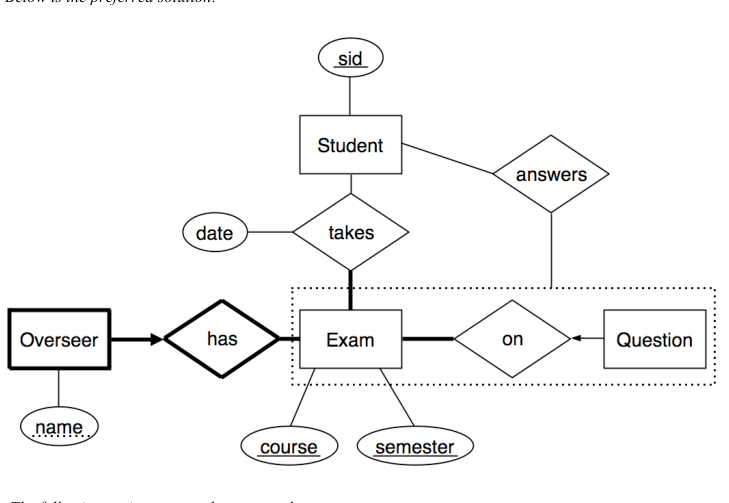

&emsp;The following variants were also accepted:

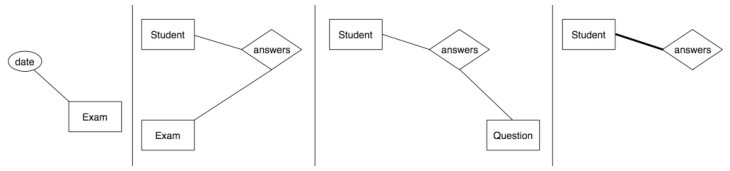

a.    \[12 points\] Complete the diagram above to be a valid E-R diagram reflecting the following 
&emsp;constraints.  (Be sure to make your bold lines **very bold**!) 
&emsp;• A student, uniquely identified by her SID, takes an exam (for example, Midterm #1) on exactly one 
&emsp;&emsp;date. A student may take any number of exams (for example, Midterm #1, Midterm #2, and a final 
&emsp;&emsp;exam), and every exam is taken by at least one student. An exam is uniquely identified by the 
&emsp;&emsp;combination of a course and a semester.

CS186 Midterm Solutions, Spring 2010    Page 1

---

**Page 2**

&emsp;• Every exam has at least one overseer (for example, Prof. Hellerstein, Derrick, and Bill). An 
&emsp;&emsp;overseer is uniquely identified by an exam and the overseer's name. 
&emsp;• There is at least one question on every exam, and a question appears on at most one exam. A 
&emsp;&emsp;question on an exam may be answered by any number of students, and a student may answer 
&emsp;&emsp;multiple questions on an exam. 
&emsp;Points for question 1(a) were assigned according to the following rubric:

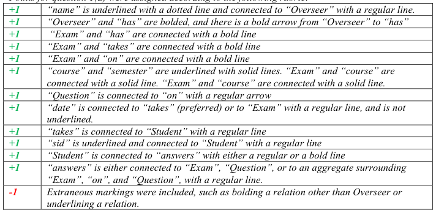

• \[2 points\] Consider the following E-R diagram, which is a fragment of a simple board game schema 
&emsp;that captures the legal moves available in each position on a board:

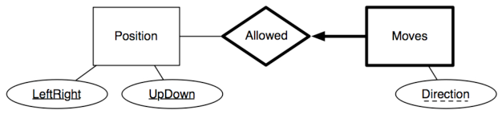

&emsp;We want to translate “Moves” into an SQL table and maintain the constraints in the ER diagram. 
&emsp;Correctly complete the SQL statement below (note that “--" begins a comment in SQL): 
&emsp;CREATE TABLE Moves 
&emsp;(direction CHAR(2), -- one of N/S/E/W/NE/NW/SE/SW 
&emsp;LeftRight CHAR, -- one of A-P 
&emsp;UpDown INTEGER, -- one of 1-16 
&emsp;**PRIMARY KEY(Direction, LeftRight, UpDown),**           (1 pt) 
&emsp;**FOREIGN KEY (LeftRight, UpDown) REFERENCES Position**  (1/2 pt) 
&emsp;**ON DELETE CASCADE**                                 (1/2 pt) 
&emsp;);

CS186 Midterm Solutions, Spring 2010    Page 2

---

**Page 3**

• \[2 points\]  The figure with ovals and circles below illustrates a relationship set between two entity sets. 
&emsp;Each circle is an entity or relationship, and the edges connect them. The ER diagram right below that 
&emsp;figure needs to be completed with constraints that are consistent with the edges in the diagram.  For 
&emsp;each of the following, circle the correct answer:  (1/2 pt each) 
&emsp;&emsp;•    A bold edge between E1 and R is :    **A)** needed    **B)** optional    **C)** disallowed 
&emsp;&emsp;•    An arrowhead between E1 and R is:     **A)** needed    **B)** optional    **C)** disallowed 
&emsp;&emsp;•    A bold edge between E2 and R is:     **A)** needed    **B)** optional    **C)** disallowed 
&emsp;&emsp;•    An arrowhead between E2 and R is:     **A)** needed    **B)** optional    **C)** disallowed

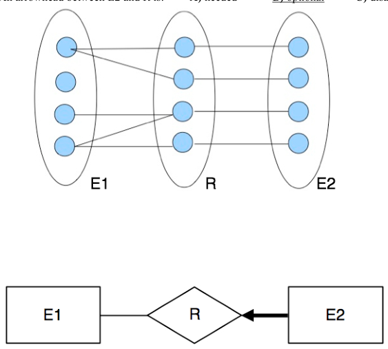

CS186 Midterm Solutions, Spring 2010    Page 3

---

**Page 4**

2\. **Query Processing \[15 points\]** 
&emsp;Consider the following relations: 
&emsp;CREATE TABLE Employee (SSN integer, DepartmentID integer, 
&emsp;PRIMARY KEY (SSN), 
&emsp;FOREIGN KEY (DepartmentID) REFERENCES Department); 
&emsp;(100,000 tuples; 1100 pages) 
&emsp;CREATE TABLE Department (DepartmentID integer, Name char(40), 
&emsp;PRIMARY KEY (DepartmentID)); 
&emsp;(1000 tuples; 50 pages) 
&emsp;And consider the following join query: 
&emsp;SELECT SSN, DepartmentID, Name 
&emsp;FROM Employee, Department 
&emsp;WHERE Employee.DepartmentID = Department.DepartmentID 
&emsp;Assume there are no indexes available, and both relations are in arbitrary order on disk.  Assume that 
&emsp;we use the refinement for sort-merge join that joins during the final merge phase.  However, assume 
&emsp;that our implementation of hash join is simple: it cannot perform recursive partitioning, and does not 
&emsp;perform hybrid hash join.  The optimizer will not choose hash join if it would require recursive 
&emsp;partitioning. 
&emsp;For each of these questions, 2 points was given for the correct algorithm and 3 points for the correct 
&emsp;cost. If the algorithm was incorrect but the cost was correct for the given algorithm, 1 point was given. 
&emsp;One point was deducted if the name of an algorithm wasn’t quite right. If the cost calculation 
&emsp;contained a few minor errors, or was incomplete, 1 or 2 points were deducted. 
&emsp;• \[5 points\]  Assume you have B=3 memory buffers, enough to hold 3 disk pages in memory at 
&emsp;&emsp;&emsp;once.  (Remember that one buffer must be used to buffer the output of a join).  What is the best 
&emsp;&emsp;&emsp;join algorithm to compute the result of this query?  What is its cost, as measured in the number 
&emsp;&emsp;&emsp;of I/Os (i.e., pages requested. **Do not include the cost of writing the final output.**  You may 
&emsp;&emsp;&emsp;ignore buffer pool effects in this question.) 
&emsp;&emsp;&emsp;•    Sort-Merge Join: Supposing number of passes to sort Employee is PE and number of 
&emsp;&emsp;&emsp;&emsp;&emsp;&emsp;&emsp;&emsp;passes to sort Department is PD, cost is (2PE - 1)\|Employee\| + 
&emsp;&emsp;&emsp;&emsp;&emsp;&emsp;&emsp;&emsp;(2PD – 1)\|Department\| with the refinement and (2PE + 1)\|Employee\| + 
&emsp;&emsp;&emsp;&emsp;&emsp;&emsp;&emsp;&emsp;(2PD + 1)\|Department\| without the refinement. Either answer was accepted, 
&emsp;&emsp;&emsp;&emsp;&emsp;&emsp;&emsp;&emsp;since the problem asked you to use the refinement but it’s not technically 
&emsp;&emsp;&emsp;&emsp;&emsp;&emsp;&emsp;&emsp;possible in this case (not enough buffers). 
&emsp;&emsp;&emsp;&emsp;&emsp;&emsp;&emsp;&emsp;In this case PE = 10 (at the beginning of each pass there are 1100, 367, 184, 
&emsp;&emsp;&emsp;&emsp;&emsp;&emsp;&emsp;&emsp;92, 46, 23, 12, 6, 3, 2 sorted runs). Similarly PD = 6 (runs are 50, 17, 9, 5, 3, 
&emsp;&emsp;&emsp;&emsp;&emsp;&emsp;&emsp;&emsp;2). Credit was given if you were off by one in either case. Consequently the 
&emsp;&emsp;&emsp;&emsp;&emsp;&emsp;&emsp;&emsp;following are all valid answers for cost in this problem: 
&emsp;&emsp;&emsp;&emsp;&emsp;&emsp;&emsp;&emsp;19150, 19250, 19350, 21350, 21450, 21550, 21650, 23550, 23650, 23750, 
&emsp;&emsp;&emsp;&emsp;&emsp;&emsp;&emsp;&emsp;23850, 25850, 25950, 26050 
&emsp;&emsp;&emsp;&emsp;&emsp;&emsp;&emsp;&emsp;(The actual answer is 23750) 
&emsp;&emsp;&emsp;• Hash Join: Not applicable, since B2 = 9 \< 50 = min(\|Employee\|, \|Department\|). Could 
&emsp;&emsp;&emsp;&emsp;&emsp;&emsp;&emsp;&emsp;only be done with recursive partitioning, which was excluded. 
&emsp;&emsp;&emsp;•    Doubly-nested loop join: cost is NumTuples(Department)\*\|Employee\| + \|Department\| = 
&emsp;&emsp;&emsp;&emsp;&emsp;&emsp;&emsp;&emsp;(1000)(1100) + 50 = 1100050 \> 23750 
&emsp;&emsp;&emsp;•    Page-oriented doubly-nested loop join: cost is \|Department\|\*\|Employee\| + \|Department\| = 
&emsp;&emsp;&emsp;&emsp;&emsp;&emsp;&emsp;&emsp;(50)(1100) + 50 = 55050 \> 23750 
&emsp;&emsp;&emsp;•    Block nested loops join: B – 2 = 1, so same as page-oriented doubly-nested loop join.

CS186 Midterm Solutions, Spring 2010    Page 4

---

**Page 5**

&emsp;• \[5 points\]  Suppose that instead of having 3 memory buffers we have B=11 memory buffers. What 
&emsp;&emsp;&emsp;is the best join algorithm now, and what is its cost (again, without writing final output or 
&emsp;&emsp;&emsp;considering buffer hits)? 
&emsp;&emsp;&emsp;• Hash Join: Since B2 = 121 \> 50 = min(\|Employee\|, \|Department\|), we can use hash join in 
&emsp;&emsp;&emsp;&emsp;&emsp;&emsp;&emsp;&emsp;this problem. We partition Employee into 10 partitions, then partition 
&emsp;&emsp;&emsp;&emsp;&emsp;&emsp;&emsp;&emsp;Department into 10 partitions (average size 5), then load each Department 
&emsp;&emsp;&emsp;&emsp;&emsp;&emsp;&emsp;&emsp;partition into memory while streaming through the corresponding larger 
&emsp;&emsp;&emsp;&emsp;&emsp;&emsp;&emsp;&emsp;Employee partition. Since there is no recursive partitioning, total cost is 
&emsp;&emsp;&emsp;&emsp;&emsp;&emsp;&emsp;&emsp;3(\|Department\| + \|Employee\|) = 3(1100 + 50) = 3450. 
&emsp;&emsp;&emsp;•    Sort-Merge Join: Supposing number of passes to sort Employee is PE and number of 
&emsp;&emsp;&emsp;&emsp;&emsp;&emsp;&emsp;&emsp;passes to sort Department is PD, cost is (2PE - 1)\|Employee\| + 
&emsp;&emsp;&emsp;&emsp;&emsp;&emsp;&emsp;&emsp;(2PD – 1)\|Department\| with the refinement and (2PE + 1)\|Employee\| + 
&emsp;&emsp;&emsp;&emsp;&emsp;&emsp;&emsp;&emsp;(2PD + 1)\|Department\| without the refinement. Either answer was accepted, 
&emsp;&emsp;&emsp;&emsp;&emsp;&emsp;&emsp;&emsp;since the problem asked you to use the refinement but it’s not technically 
&emsp;&emsp;&emsp;&emsp;&emsp;&emsp;&emsp;&emsp;possible in this case (not enough buffers). Another option was to use the 
&emsp;&emsp;&emsp;&emsp;&emsp;&emsp;&emsp;&emsp;refinement on the Department relation but not the Employee relation, for a 
&emsp;&emsp;&emsp;&emsp;&emsp;&emsp;&emsp;&emsp;cost of (2PE + 1)\|Employee\| + (2PD - 1)\|Department\|. 
&emsp;&emsp;&emsp;&emsp;&emsp;&emsp;&emsp;&emsp;In this case PE = 3 (at the beginning of each pass there are 1100, 100, 10 
&emsp;&emsp;&emsp;&emsp;&emsp;&emsp;&emsp;&emsp;sorted runs) and PD = 2 (runs are 50, 5). The following are valid answers for 
&emsp;&emsp;&emsp;&emsp;&emsp;&emsp;&emsp;&emsp;cost: 5650, 7850, 7950. These are more than the cost of hash join, but were 
&emsp;&emsp;&emsp;&emsp;&emsp;&emsp;&emsp;&emsp;still accepted because that solution was not known at the time of grading. 
&emsp;&emsp;&emsp;•    Block nested loops join: Cost is (ceiling(\|Department\|/(B-2)) \* \|Employee\|)  + 
&emsp;&emsp;&emsp;&emsp;&emsp;&emsp;&emsp;&emsp;\|Department\| = (6)(1100) + 50 = 6650. This is faster than Sort-Merge Join 
&emsp;&emsp;&emsp;&emsp;&emsp;&emsp;&emsp;&emsp;(since the refinement giving 5650 cost can’t actually be used), but slower than 
&emsp;&emsp;&emsp;&emsp;&emsp;&emsp;&emsp;&emsp;Hash Join. 
&emsp;&emsp;&emsp;•    Doubly-nested loop join, page-oriented doubly-nested loop join: costs same as in first 
&emsp;&emsp;&emsp;&emsp;&emsp;&emsp;&emsp;&emsp;part above, both far more than the above options. 
&emsp;• \[5 points\]  Suppose we raise the number of memory buffers to B=52, and increase the size of the 
&emsp;&emsp;&emsp;Departments relation to 500 pages. What is the best join algorithm now, and what is its cost (no 
&emsp;&emsp;&emsp;writing final output, ignoring buffer hits)? 
&emsp;&emsp;&emsp;• Hash Join: Since B2 = 2704 \> 500 = min(\|Employee\|, \|Department\|), we can use hash join 
&emsp;&emsp;&emsp;&emsp;&emsp;&emsp;&emsp;&emsp;in this problem. Since there is no recursive partitioning, total cost is 
&emsp;&emsp;&emsp;&emsp;&emsp;&emsp;&emsp;&emsp;3(\|Department\| + \|Employee\|) = 3(1100 + 500) = 4800. 
&emsp;&emsp;&emsp;•    Sort-Merge Join: Number of buffers is now large enough to sort each relation in two 
&emsp;&emsp;&emsp;&emsp;&emsp;&emsp;&emsp;&emsp;passes, with enough room to do the refinement for both relations (1100/52 + 
&emsp;&emsp;&emsp;&emsp;&emsp;&emsp;&emsp;&emsp;500/52 = 32 \< 52). So cost is 3(1100 + 500) = 4800, same as Hash Join. 
&emsp;&emsp;&emsp;•    Doubly-nested loop join: cost is NumTuples(Department)\*\|Employee\| + \|Department\| or 
&emsp;&emsp;&emsp;&emsp;&emsp;&emsp;&emsp;&emsp;about (10000)(1100) + 500 = 11000500 \> 4800 
&emsp;&emsp;&emsp;•    Page-oriented doubly-nested loop join: cost is \|Department\|\*\|Employee\| + \|Department\| = 
&emsp;&emsp;&emsp;&emsp;&emsp;&emsp;&emsp;&emsp;(500)(1100) + 500 = 550500 \> 4800 
&emsp;&emsp;&emsp;•    Block nested loops join: Cost is (ceiling(\|Department\|/(B-2)) \* \|Employee\|)  + 
&emsp;&emsp;&emsp;&emsp;&emsp;&emsp;&emsp;&emsp;\|Department\| = (500/(52-2))(1100) + 500 = 11500 \> 4800.

CS186 Midterm Solutions, Spring 2010    Page 5

---

**Page 6**

3\. **Files and Buffer Management \[10 points\]** 
&emsp;&emsp;•    \[3 points\] Consider a buffer pool of 3 frames, and a heap file of 100 sequential pages with 
&emsp;&emsp;&emsp;pageIDs from 1 to 100.  Assume we scan the heap file **twice** from start to finish.  Starting with 
&emsp;&emsp;&emsp;an empty buffer pool, using an MRU replacement strategy, which pages will be in the buffer 
&emsp;&emsp;&emsp;pool after the second scan? 
&emsp;&emsp;&emsp;1, 99, 100. Initially the pool fills with 1, 2, 3. Then the 3 position is overwritten until the end 
&emsp;&emsp;&emsp;of the first pass, at which point it is 1, 2, 100. During the second pass, 1 and 2 are hits, then 
&emsp;&emsp;&emsp;the 2 position is overwritten until 99 is reached. Finally 100 is a hit. 
&emsp;&emsp;•    \[1 point\] What is the hit rate (#hits/#requests) in the scenario of part (a)? 
&emsp;&emsp;&emsp;3/200 or 1.5%. Only 1, 2, and 100 are hit, once each.

&emsp;&emsp;•    \[3 points\] To save a random I/O, your friend suggests that we scan the file once from pageID 
&emsp;&emsp;&emsp;1 to pageID 100, and then switch into reverse and scan from pageID 100 back down to 1. 
&emsp;&emsp;&emsp;Again starting with an empty buffer pool and using MRU, what pages will be in memory at 
&emsp;&emsp;&emsp;the end of this scan? 
&emsp;&emsp;&emsp;1, 2, 3. Initially the pool fills with 1, 2, 3. Then the 3 position is overwritten until the end of 
&emsp;&emsp;&emsp;the first pass, at which point it is 1, 2, 100. During the second pass, 100 is a hit, then the 100 
&emsp;&emsp;&emsp;position is overwritten until 3 is reached. Finally 1 and 2 are hits. 
&emsp;&emsp;•    \[1 point\] What is the hit rate (#hits/#requests) in the scenario of part (c)? 
&emsp;&emsp;&emsp;3/200 or 1.5%. Only 100, 2, and 1 are hit, one each. 
&emsp;&emsp;•    \[1 point\] Consider a sorted file organization as we studied in class, with N tightly packed 
&emsp;&emsp;&emsp;pages of records. Write an expression for expected (average case) number of I/O requests for 
&emsp;&emsp;&emsp;an equality lookup in the file. 
&emsp;&emsp;&emsp;log2 N. This can be achieved with binary search on the pages, followed by searching the page 
&emsp;&emsp;&emsp;containing the record in memory. 
&emsp;&emsp;•    \[1 point\] Again using MRU and starting with an empty buffer pool, what is the expected hit 
&emsp;&emsp;&emsp;rate in the buffer pool for the scenario of part (e)? 
&emsp;&emsp;&emsp;0%. No page is read more than once.

CS186 Midterm Solutions, Spring 2010    Page 6

---

**Page 7**

4\. **B+-Trees \[15 points\]** 
•    \[5 points\] The B+-tree drawn below has order **3** (i.e. max 6 pointers per internal node), and contains 
&emsp;a number of errors.  Circle the errors and draw a new correct B+-tree over the same data entries (the 
&emsp;entries in the leaves).

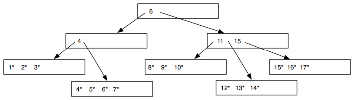

&emsp;There are two errors above and one non-error: 
&emsp;&emsp;&emsp;•    (1 pt) The internal node containing only “4” is underfull. It has 2 pointers, less than the 
&emsp;&emsp;&emsp;&emsp;&emsp;&emsp;&emsp;&emsp;minimum of 3 (which is half the maximum of 6). 
&emsp;&emsp;&emsp;•    (1 pt) The value “7” is in the left subtree of the root, but should be in the right subtree, 
&emsp;&emsp;&emsp;&emsp;&emsp;&emsp;&emsp;&emsp;since the key in the root node is 6 and 7 \> 6. 
&emsp;&emsp;&emsp;•    (1 pt) The internal node containing “11 15” is not underfull, because it contains 3 
&emsp;&emsp;&emsp;&emsp;&emsp;&emsp;&emsp;&emsp;pointers to child nodes, which is exactly half the maximum (6 pointers). 
&emsp;&emsp;&emsp;&emsp;&emsp;&emsp;&emsp;&emsp;Additionally, the presence of the key “11” which is not present in any leaf is 
&emsp;&emsp;&emsp;&emsp;&emsp;&emsp;&emsp;&emsp;not an error (internal nodes may contain values which were once present in 
&emsp;&emsp;&emsp;&emsp;&emsp;&emsp;&emsp;&emsp;leaves but have since been deleted). This point was deducted if this internal 
&emsp;&emsp;&emsp;&emsp;&emsp;&emsp;&emsp;&emsp;node was marked erroneous. 
&emsp;Additionally, the root node is not underfull because the root node is specially permitted to be less 
&emsp;than half full. Following is a correct new B+-tree over the same data entries:

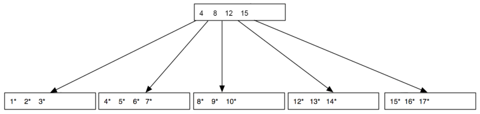

&emsp;This is the unique correct B+-tree with the exact same leaf nodes. It was also valid to compact the 
&emsp;data values into a smaller number of leaf nodes, if the values in the root are adjusted accordingly. It 
&emsp;is not possible to use more than one internal node.

CS186 Midterm Solutions, Spring 2010    Page 7

---

**Page 8**

&emsp;• \[5 points\] Consider the B+-tree with order **2 (**max **4** pointers per node**)** drawn below.  Draw what 
&emsp;&emsp;&emsp;the tree would look like after inserting **9\***

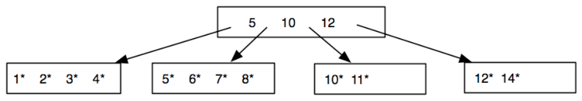

&emsp;When 9 is inserted, it goes into the node containing “5 6 7 8”. However, this node is now overfull and 
&emsp;must be split into two nodes “5 6 7” and “8 9”. The value 7 is added to the parent internal node, 
&emsp;which is now in turn overfull, so it is split into “5 7” and “10 12”. Finally a new root node is created 
&emsp;and “7” is moved to the root node. 
&emsp;Alternatively, we can make all our splits with the smaller side on the left. In this case, the overfull leaf 
&emsp;is split as “5 6” and “7 8 9”, 8 is added to the parent node, and “10” is moved to the new root node 
&emsp;instead of the new value. Both trees are shown below.

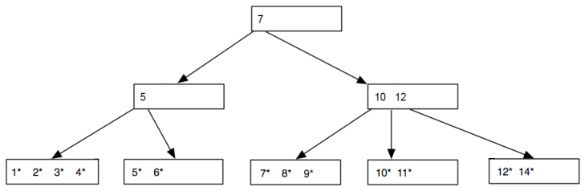

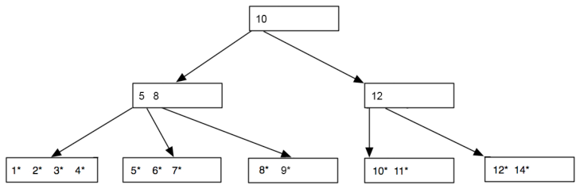

&emsp;Points were given as follows:

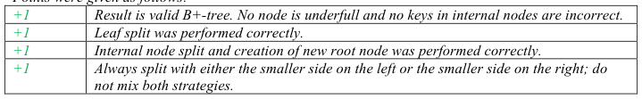

CS186 Midterm Solutions, Spring 2010    Page 8

---

**Page 9**

&emsp;**\[5 points\] Assume we have a B+tree with room for** 30 **bytes of data on each internal page: so** 
&emsp;**half-full at 15 bytes.  Assume that a pageID (a “pointer” in the tree) takes up 4 bytes, and a** 
&emsp;**character takes 1 byte. Consider the 1st B+-tree below.  Draw a correct B+-tree for this data that** 
&emsp;**uses the leaf level provided in the 2nd picture below, but employs prefix key compression above.**

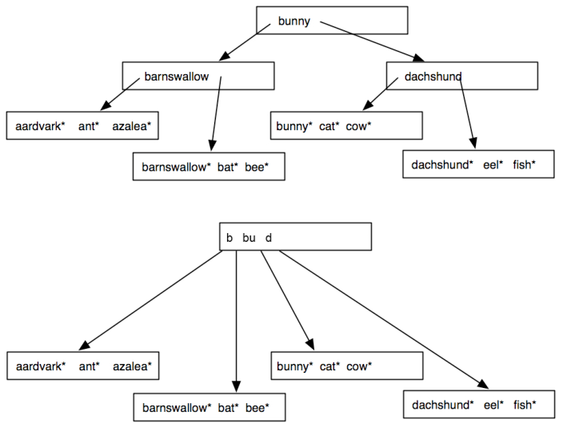

&emsp;New root node uses a total of 4(4) + 2 + 3 + 2 = 23 \< 30 bytes (assuming string prefixes are null- 
&emsp;terminated or length-prefixed with a single byte), so it all fits in one node. 
&emsp;Points were given as follows:

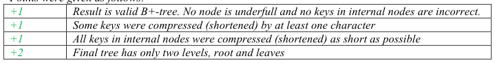

CS186 Midterm Solutions, Spring 2010    Page 9

