# Berkeley CS186 Spring 2012: Final: Questions

> Copied from the original: <https://hkn.eecs.berkeley.edu/exams/course/cs/186>. Text and figures are taken from the PDF as is; nothing was answered or rewritten. The original PDF is in this folder.

---

**Page 1**

**Final	  Exam,	  CS186,	  Spring	  2012**	  	  	  	  	  	  	  	  	  	  	  	  	  	  	  **Prof.	  Joe	  Hellerstein**

**Similarity	  Joins** 
Some	  of	  you	  may	  remember	  Homework	  5	  from	  a	  short	  while	  ago.	  This	  question	  is	  about	  ways	  we 
could	  improve	  the	  similarity	  join	  algorithm	  you	  implemented	  there. 
&emsp;1\. Recall	  from	  Homework	  4	  that	  we	  ensure	  that	  the	  list	  of	  trigrams	  for	  a	  given	  input	  string	  has 
&emsp;&emsp;at	  maximum	  1	  instance	  of	  each	  trigram.	  For	  example,	  the	  trigrams	  for	  “geegee”	  are	  \[“gee”, 
&emsp;&emsp;“eeg”,	  “ege”\]	  (excluding	  padding).	  We	  decide	  that	  we	  want	  to	  weight	  trigrams	  based	  on	  how 
&emsp;&emsp;frequently	  they	  appear	  in	  the	  original	  string,	  so	  our	  output	  for	  the	  above	  string	  would	  be, 
&emsp;&emsp;conceptually,	  \[“gee”:	  2,	  “eeg”:	  1,	  “ege”:	  1\]. 
&emsp;&emsp;&emsp;a) **\[1	  pt\]**	  Here	  is	  the	  pseudocode	  for	  generate\_trigrams:

&emsp;&emsp;&emsp;&emsp;&emsp;&emsp;1\.    def generate\_trigrams(input): 
&emsp;&emsp;&emsp;&emsp;&emsp;&emsp;2\.    trigrams = list() 
&emsp;&emsp;&emsp;&emsp;&emsp;&emsp;3\.        for word in input.split(“ “): # Split input into words 
&emsp;&emsp;&emsp;&emsp;&emsp;&emsp;4\.    # Add all trigrams for the given word to our list. 
&emsp;&emsp;&emsp;&emsp;&emsp;&emsp;5\.    trigrams += make\_trigrams(word) 
&emsp;&emsp;&emsp;&emsp;&emsp;&emsp;6\.        sort(trigrams)     # Sort the list of trigrams 
&emsp;&emsp;&emsp;&emsp;&emsp;&emsp;7\.    unique(trigrams) # Remove duplicates 
&emsp;&emsp;&emsp;&emsp;&emsp;&emsp;8\.    return trigrams 
&emsp;&emsp;&emsp;&emsp;&emsp;Which	  line	  should	  we	  replace	  with	  a	  call	  to	  “aggregate(trigrams)”,	  which	  aggregates 
&emsp;&emsp;&emsp;&emsp;&emsp;adjacent	  trigrams	  into	  the	  desired	  weighted	  list? 
&emsp;&emsp;&emsp;b) **\[1	  pt\]**	  Recall	  that	  our	  inverted	  index	  in	  HW5	  holds	  entries	  that	  contain	  information 
&emsp;&emsp;&emsp;&emsp;&emsp;about	  (MinimalTuple,	  NTrgms	  in	  the	  tuple,	  and	  a	  Trgm	  in	  the	  tuple).	  We	  have	  one 
&emsp;&emsp;&emsp;&emsp;&emsp;index	  entry	  for	  every	  trigram	  in	  every	  inner	  tuple.	  What	  is	  the	  lexicographic	  sorting 
&emsp;&emsp;&emsp;&emsp;&emsp;order	  for	  this	  index? 
&emsp;&emsp;&emsp;&emsp;&emsp;&emsp;&emsp;A. (MinimalTuple,	  NTrgms,	  Trgm) 
&emsp;&emsp;&emsp;&emsp;&emsp;&emsp;&emsp;B. (MinimalTuple,	  Trgm,	  NTrgms) 
&emsp;&emsp;&emsp;&emsp;&emsp;&emsp;&emsp;C. (Trgm,	  MinimalTuple,	  NTrgms) 
&emsp;&emsp;&emsp;&emsp;&emsp;&emsp;&emsp;D. (Trgm,	  NTrgms,	  MinimalTuple)

&emsp;&emsp;&emsp;c) **\[2	  pts\]**	  Now	  we	  want	  to	  add	  the	  “Weight”	  of	  the	  given	  Trgm	  into	  the	  index.	  We	  need 
&emsp;&emsp;&emsp;&emsp;&emsp;to	  decide	  where	  we	  should	  insert	  it	  into	  the	  lexicographic	  ordering	  from	  (b).	  	  Select 
&emsp;&emsp;&emsp;&emsp;&emsp;**all**valid	  positions	  for	  the	  “Weight”	  field	  in	  the	  lexicographic	  ordering	  (there	  may	  be 
&emsp;&emsp;&emsp;&emsp;&emsp;more	  than	  one	  valid	  answer—select	  all	  of	  them!) 
&emsp;&emsp;&emsp;&emsp;&emsp;&emsp;&emsp;A. Index	  0	  –	  at	  the	  beginning 
&emsp;&emsp;&emsp;&emsp;&emsp;&emsp;&emsp;B. Index	  1	  –	  after	  the	  first	  key 
&emsp;&emsp;&emsp;&emsp;&emsp;&emsp;&emsp;C. Index	  2	  –	  after	  the	  second	  key 
&emsp;&emsp;&emsp;&emsp;&emsp;&emsp;&emsp;D. Index	  3	  –	  at	  the	  end

---

**Page 2**

2\. Let’s	  say	  that	  instead	  of	  storing	  the	  MinimalTuple	  in	  the	  index,	  we	  decide	  to	  store	  the	  RID 
&emsp;(“record	  id”)	  which	  is	  a	  field	  in	  the	  MinimalTuple	  that	  can	  uniquely	  identify	  every	  tuple	  in	  a 
&emsp;given	  table	  (i.e.,	  a	  primary	  key). 
&emsp;&emsp;a) **\[1	  pt\]**	  How	  does	  storing	  RID	  instead	  of	  MinimalTuple	  affect	  our	  memory	  usage	  in 
&emsp;&emsp;&emsp;general? 
&emsp;&emsp;&emsp;&emsp;&emsp;A. It	  decreases	  our	  memory	  usage. 
&emsp;&emsp;&emsp;&emsp;&emsp;B. It	  increases	  our	  memory	  usage. 
&emsp;&emsp;&emsp;&emsp;&emsp;C. It	  does	  not	  change	  our	  memory	  usage. 
&emsp;&emsp;b) **\[1	  pt\]**	  Assuming	  the	  inverted	  index	  fits	  in	  memory,	  how	  does	  storing	  RID	  instead	  of 
&emsp;&emsp;&emsp;MinimalTuple	  affect	  the	  number	  of	  IOs	  during	  the	  join? 
&emsp;&emsp;&emsp;&emsp;&emsp;A. It	  decreases	  the	  number	  of	  IOs. 
&emsp;&emsp;&emsp;&emsp;&emsp;B. It	  increases	  the	  number	  of	  IOs. 
&emsp;&emsp;&emsp;&emsp;&emsp;C. It	  does	  not	  change	  the	  number	  of	  IOs. 
&emsp;&emsp;c) **\[2	  pts\]**	  Assume	  the	  necessary	  changes	  have	  already	  been	  made	  to	  the	  inverted 
&emsp;&emsp;&emsp;index.	  How	  will	  replacing	  MinimalTuple	  with	  RID	  change	  the	  similarity	  join 
&emsp;&emsp;&emsp;algorithm? 
&emsp;&emsp;&emsp;On	  the	  answer	  sheet,	  mark	  **N**	  if	  it	  will	  “Not	  require	  a	  change”,	  mark	  **T**	  if	  it	  will	  require	  a 
&emsp;&emsp;&emsp;“Trivial	  change”	  (i.e.,	  just	  altering	  one	  line),	  or	  **C**	  if	  it	  will	  require	  a	  “Complicated 
&emsp;&emsp;&emsp;change”	  (adding	  actual	  logic	  to	  the	  code). 
&emsp;&emsp;&emsp;&emsp;&emsp;i.    Trigrammating	  the	  inner	  tuples. 
&emsp;&emsp;&emsp;&emsp;&emsp;ii.    Storing	  the	  entries	  in	  the	  index. 
&emsp;&emsp;&emsp;&emsp;iii.    Finding	  the	  least	  tuple	  pointed	  to	  by	  all	  the	  outer	  trigrams. 
&emsp;&emsp;&emsp;&emsp;&emsp;iv.    Concatenation	  of	  the	  tuples	  to	  be	  returned.

---

**Page 3**

**Logging	  and	  Recovery** 
After	  mastering	  the	  skills	  of	  CS186	  you	  manage	  to	  implement	  your	  own	  database.	  But	  oh	  no,	  a 
bunny	  chewed	  through	  the	  power	  cable	  on	  your	  server	  and	  everything	  crashed!	  When	  you	  boot 
back	  up	  you	  see	  the	  following	  log	  records	  and	  transaction	  and	  dirty	  page	  table	  that	  were	  created	  at 
the	  last	  checkpoint.

&emsp;Log 
&emsp;&emsp;&emsp;&emsp;&emsp;&emsp;&emsp;&emsp;Transaction	  Table

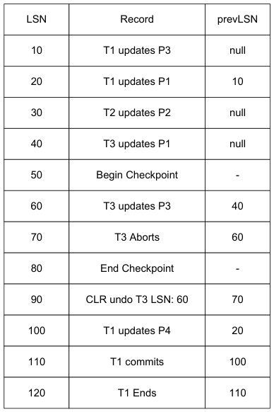

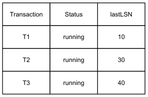

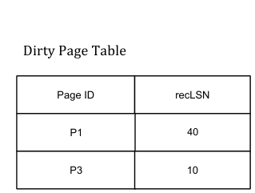

&emsp;3\. **\[1	  pt\]**	  What	  is	  the	  undoNextLSN	  of	  the	     phase? 
&emsp;&emsp;CLR	  at	  90? 
&emsp;&emsp;&emsp;&emsp;&emsp;&emsp;&emsp;&emsp;7\. **\[2	  pt\]**	  What	  are	  the	  LSNs	  of	  log 
&emsp;4\. **\[2	  pts\]**	  Fill	  in	  the	  Transaction	  and	     records	  that	  are	  read	  in	  the	  undo 
&emsp;&emsp;Dirty	  Page	  Table	  at	  the	  end	  of	  the	     phase? 
&emsp;&emsp;analysis	  phase. 
&emsp;&emsp;&emsp;&emsp;&emsp;&emsp;&emsp;&emsp;8\. **\[4	  pts\]**	  Write	  down	  the	  log	  records 
&emsp;5\. **\[1	  pt\]**	  What	  log	  record	  will	  the	  redo	     that	  will	  be	  written,	  and	  label	  them 
&emsp;&emsp;phase	  start	  at?	     with	  the	  phase	  in	  which	  they’re 
&emsp;&emsp;&emsp;&emsp;&emsp;&emsp;&emsp;&emsp;generated	  (A	  for	  Analysis,	  R	  for	  Redo, 
&emsp;6\. **\[2	  pt\]**	  What	  are	  the	  LSNs	  of	  log	     or	  U	  for	  Undo).	  	  For	  CLR’s,	  make	  sure 
&emsp;&emsp;records	  to	  be	  redone	  in	  the	  redo	     to	  add	  the	  undoNextLSN.

---

**Page 4**

**Concurrency	  Control** 
Consider	  the	  following	  schedule:

TIME

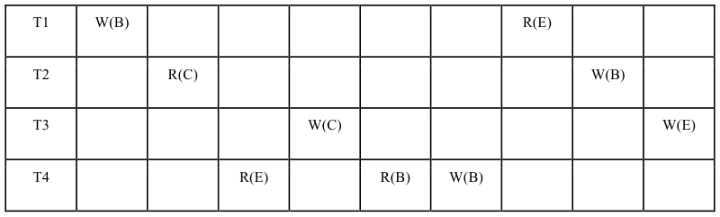

&emsp;9\. **\[1	  pt\]**	  True/False:	  The	  above	  schedule	  is	  conflict	  serializable. 
&emsp;10\. **\[1	  pt\]**	  True/False:	  There	  is	  an	  edge	  from	  T2	  to	  T1	  in	  the	  dependency	  graph. 
&emsp;11\. **\[1	  pt\]**	  True/False:	  There	  is	  an	  edge	  from	  T1	  to	  T3	  in	  the	  dependency	  graph. 
&emsp;12\. **\[1	  pt\]**	  True/False:	  There	  is	  an	  edge	  from	  T3	  to	  T4	  in	  the	  dependency	  graph. 
&emsp;13\. **\[1	  pt\]**	  True/False:	  There	  is	  an	  edge	  from	  T3	  to	  T2	  in	  the	  dependency	  graph. 
Consider	  the	  sequence	  of	  operations	  in	  the	  box	  to	  the	  right: 
&emsp;&emsp;&emsp;&emsp;&emsp;&emsp;&emsp;&emsp;1\) Lock	  X(C) 
&emsp;&emsp;&emsp;&emsp;&emsp;&emsp;&emsp;&emsp;2\) Lock	  S(A) 
&emsp;14\. **\[1	  pt\]**	  Under	  two	  phase	  locking,	  what	  is	  the	  earliest	  step	  after	  which 
&emsp;&emsp;&emsp;&emsp;&emsp;&emsp;&emsp;&emsp;3\) Read(C) 
&emsp;&emsp;we	  could	  release	  our	  lock	  on	  C?	  Your	  answer	  should	  be	  a	  number 
&emsp;&emsp;&emsp;&emsp;&emsp;&emsp;&emsp;&emsp;4\) Write(C) 
&emsp;&emsp;(e.g.,	  after	  step	  “12”). 
&emsp;&emsp;&emsp;&emsp;&emsp;&emsp;&emsp;&emsp;5\) Lock	  S(B) 
&emsp;&emsp;&emsp;&emsp;&emsp;&emsp;&emsp;&emsp;6\) Read(B) 
&emsp;15\. **\[1	  pt\]**	  Under	  strict	  two	  phase	  locking,	  what	  is	  the	  earliest	  step	  after 
&emsp;&emsp;&emsp;&emsp;&emsp;&emsp;&emsp;&emsp;7\) Lock	  S(E) 
&emsp;&emsp;which	  we	  could	  release	  our	  lock	  on	  C?	  Your	  answer	  should	  again	  be	     8) Read(E) 
&emsp;&emsp;a	  number	  (e.g.,	  after	  step	  “12”).	  9) Read(A) 
&emsp;&emsp;&emsp;&emsp;&emsp;&emsp;&emsp;&emsp;\<end	  of 
&emsp;&emsp;&emsp;&emsp;&emsp;&emsp;&emsp;&emsp;transaction\> 
&emsp;16\. **\[1	  pt\]**	  True/False:	  There	  are	  conflict	  serializable	  schedules	  that 
&emsp;&emsp;cannot	  occur	  under	  two	  phase	  locking.

&emsp;17\. **\[1	  pt\]**	  True/False:	  There	  are	  conflict	  serializable	  schedules	  that	  cannot	  occur	  under	  **strict** 
&emsp;&emsp;two	  phase	  locking.

&emsp;18\. **\[1	  pt\]**	  In	  the	  multi-­‐granularity	  locking	  protocol	  we	  discussed	  in	  class,	  if	  I	  hold	  an	  X	  lock	  on 
&emsp;&emsp;one	  page	  of	  a	  table,	  and	  an	  S	  lock	  on	  another	  page	  of	  the	  same	  table,	  what	  lock	  (if	  any)	  do	  I 
&emsp;&emsp;have	  on	  the	  table?

---

**Page 5**

**Query	  Processing	  and	  Optimization** 
Consider	  a	  student	  database	  schema	  as	  below,	  with	  primary	  keys	  underlined	  and	  foreign	  keys	  as 
listed: 
&emsp;&emsp;**STUDENTS**	  (sid,	  sname,	  street,	  city,	  age,	  gender) 
&emsp;&emsp;**REGISTERED**	  (sid,	  cid,	  credits) 
&emsp;&emsp;&emsp;&emsp;&emsp;foreign	  key	  sid	  references	  STUDENTS 
&emsp;&emsp;&emsp;&emsp;&emsp;foreign	  key	  cid	  references	  COURSES 
&emsp;&emsp;**COURSES**	  (cid,	  cname,	  profname) 
Assume	  the	  following	  statistics: 
&emsp;•    The	  STUDENTS	  relation	  has	  10,000	  tuples	  spread	  evenly	  across	  500	  pages 
&emsp;• The	  REGISTERED	  relation	  has	  50,000	  tuples	  spread	  evenly	  across	  1,000	  pages 
&emsp;•    The	  COURSES	  relation	  has	  500	  tuples;	  40	  tuples	  of	  COURSES	  fit	  in	  each	  page 
&emsp;• NKeys(city)	  for	  STUDENTS	  is	  200	  (i.e.,	  there	  are	  200	  distinct	  values	  for	  city) 
&emsp;•    NKeys(age)	  for	  STUDENTS	  is	  80 
&emsp;• NKeys(gender)	  for	  STUDENTS	  is	  2 
&emsp;•    Low(age)	  for	  STUDENTS	  is	  10 
&emsp;• High(age)	  for	  STUDENTS	  is	  90 
&emsp;•    NKeys(gender)	  for	  STUDENTS	  is	  2 
&emsp;19\. **\[1	  pt\]**	  Consider	  a	  join	  of	  STUDENTS	  and	  REGISTERED.	  	  How	  many	  I/O’s	  will	  a	  Page-­‐Oriented 
&emsp;&emsp;Nested	  Loop	  Join	  take	  using	  STUDENTS	  as	  the	  outer	  relation?	  (You	  should	  ignore	  the	  cost	  of 
&emsp;&emsp;writing	  the	  final	  join	  answer	  out	  to	  disk.) 
&emsp;20\. **\[1	  pt\]**	  Again,	  consider	  joining	  STUDENTS	  and	  REGISTERED.	  	  Now	  assume	  that	  we	  have 
&emsp;&emsp;B=52	  memory	  pages	  available	  for	  the	  join.	  Using	  the	  Block	  (Chunk)	  Nested	  Loop	  Join	  with 
&emsp;&emsp;REGISTERED	  as	  the	  outer,	  how	  many	  I/O’s	  will	  be	  required?	  (You	  should	  ignore	  the	  cost	  of 
&emsp;&emsp;writing	  the	  final	  join	  answer	  out	  to	  disk.) 
&emsp;21\. **\[1	  pt\]**	  Consider	  the	  following	  query:

&emsp;&emsp;`SELECT gender, COUNT(*) FROM STUDENTS GROUP BY gender` 
&emsp;&emsp;Calculate	  the	  total	  number	  of	  I/O’s	  required	  to	  answer	  this	  query	  using	  Hybrid	  Hash-­‐based 
&emsp;&emsp;Grouping	  using	  the	  (\<Group	  Val,	  Trans	  Val\>)	  approach	  described	  during	  lecture.	  Assume 
&emsp;&emsp;that	  the	  final	  output	  does	  not	  need	  to	  be	  written	  to	  disk.

---

**Page 6**

Now	  consider	  the	  following	  indexes: 
&emsp;• **RegSC**	  is	  a	  clustered	  B+	  Tree	  defined	  on	  composite	  key	  \<sid,	  cid\>	  for	  REGISTERED 
&emsp;&emsp;&emsp;(NPages	  =	  39,000) 
&emsp;•    **StudC**	  is	  an	  unclustered	  B+	  Tree	  index	  is	  defined	  on	  the	  city	  attribute	  for	  STUDENTS 
&emsp;&emsp;(NPages	  =	  600) 
&emsp;• **StudA**	  is	  a	  clustered	  B+	  Tree	  index	  is	  defined	  on	  the	  age	  attribute	  for	  STUDENTS 
&emsp;&emsp;&emsp;(NPages	  =	  600) 
Each	  of	  the	  indexes	  is	  **Alternative	  2**	  and	  can	  be	  assumed	  to	  have	  a	  **height	  of	  3**	  (each	  root-­‐to-­‐leaf 
path	  is	  3	  pages).	  	  Also	  assume	  that	  for	  each	  index,	  50	  index	  entries	  fit	  in	  one	  index	  page 
For	  the	  next	  three	  questions,	  you	  need	  to	  fill	  in	  (a)	  the	  expected	  number	  of	  output	  tuples	  according 
to	  the	  System	  R	  approach,	  (b)	  an	  efficient	  method	  (file	  scan,	  index	  lookup,	  etc)	  for	  answering	  this 
query	  and	  the	  names	  of	  any	  indexes	  you	  are	  using,	  and	  (c)	  the	  number	  of	  disk	  accesses	  required.	  	  If 
you	  feel	  the	  need,	  you	  can	  write	  down	  any	  assumptions	  you	  are	  making	  in	  your	  answer	  (but	  be 
extremely	  brief!) 
&emsp;22\. **\[2	  pts\]**`SELECT * FROM REGISTERED WHERE cid = “CS186”;` 
&emsp;&emsp;&emsp;a) Estimated	  #	  Tuples	  in	  Answer: 
&emsp;&emsp;&emsp;b) Method	  and	  access	  path	  used: 
&emsp;&emsp;&emsp;c) Estimated	  #	  I/O’s	  required: 
&emsp;&emsp;&emsp;d) Assumptions: 
&emsp;23\. **\[2	  pts\]**	  `SELECT * FROM REGISTERED WHERE sid = “01234567”;` 
&emsp;&emsp;&emsp;a) Estimated	  #	  Tuples	  in	  Answer: 
&emsp;&emsp;&emsp;b) Method	  and	  access	  path	  used: 
&emsp;&emsp;&emsp;c) Estimated	  #	  I/O’s	  required: 
&emsp;&emsp;&emsp;d) Assumptions: 
&emsp;24\. **\[2	  pts\]**	  `SELECT * FROM STUDENTS WHERE city = ‘Berkeley’ AND age > 50;` 
&emsp;&emsp;&emsp;a) Estimated	  #	  Tuples	  in	  Answer: 
&emsp;&emsp;&emsp;b) Method	  and	  access	  path	  used: 
&emsp;&emsp;&emsp;c) Estimated	  #	  I/O’s	  required: 
&emsp;&emsp;&emsp;d) Assumptions:

---

**Page 7**

**Parallelism** 
Imagine	  that	  the	  CS186	  staff—5	  TAs	  and	  1	  Professor—has	  to	  grade	  300	  exams	  with	  6	  questions	  per 
exam.	  	  Each	  question	  was	  written	  by	  a	  different	  Member	  Of	  Staff	  (MOS),	  and	  must	  be	  graded	  by	  that 
MOS:	  no	  MOS	  can	  grade	  a	  question	  written	  by	  another	  MOS! 
**Circle	  Grading.**	  	  The	  staff	  sits	  in	  a	  circle	  to	  grade.	  	  Exams	  are	  partitioned	  into	  6	  random	  piles	  of	  50 
exams	  each,	  and	  each	  MOS	  gets	  one	  pile.	  	  The	  grading	  process	  works	  as	  follows:	  each	  staff	  member 
removes	  an	  exam	  from	  the	  top	  of	  their	  pile,	  works	  on	  it	  for	  exactly	  1	  minute	  and	  writes	  down	  a 
score	  for	  their	  question.	  	  They	  then	  instantly	  slide	  the	  exam	  to	  the	  bottom	  of	  the	  pile	  belonging	  to 
the	  MOS	  on	  their	  right.	  	  (Assume	  that	  remove	  and	  slide	  can	  happen	  concurrently	  and 
instantaneously).	  	  When	  a	  MOS	  sees	  an	  exam	  with	  their	  own	  question	  already	  scored,	  they	  finish. 
&emsp;25\. **\[1	  pt\]**	  How	  many	  minutes	  pass	  in	  the	  Circle	  Grading	  Scheme	  before	  the	  last	  MOS	  finishes? 
**FedEx	  Grading.**	  	  Imagine	  the	  following	  grading	  scheme.	  	  The	  professor	  leaves	  town	  to	  participate	  in 
a	  2-­‐day	  "research	  retreat"	  at	  Lake	  Tahoe.	  	  The	  5	  TAs	  go	  home	  to	  5	  different	  cities	  (none	  of	  them 
Berkeley)	  for	  summer	  break.	  	  The	  Professor	  tells	  each	  TA	  to	  take	  home	  60	  exams,	  use	  FedEx	  to	  pass 
the	  exams	  among	  them	  as	  needed,	  and	  then	  send	  the	  exams	  back	  to	  him	  in	  Berkeley.	  	  Assume	  that 
FedEx	  accepts	  packages	  until	  5PM,	  and	  delivers	  the	  next	  day	  by	  9AM	  for	  a	  fixed	  cost	  of	  $10	  per 
package,	  regardless	  of	  size.	  	  Assume	  also	  that	  TAs	  have	  nothing	  better	  to	  do	  on	  a	  summer	  day	  than 
grade	  exams,	  at	  the	  rate	  of	  exactly	  1	  question	  per	  exam	  per	  minute.	  	  Finally,	  recall	  that	  the	  final 
results	  have	  to	  arrive	  in	  Berkeley	  at	  the	  professor's	  office	  so	  he	  can	  grade	  his	  question	  at	  the	  end. 
&emsp;26\. **\[2	  pts\]**	  Consider	  optimizing	  the	  FedEx	  Grading	  Scheme	  to	  minimize	  time	  to 
&emsp;&emsp;completion.	  	  How	  many	  days	  does	  it	  take	  from	  the	  start	  until	  the	  Prof.	  gets	  the	  exams? 
&emsp;27\. **\[2	  pts\]**	  Now	  consider	  optimizing	  the	  Distributed	  Grading	  Scheme	  to	  minimize	  FedEx	  cost. 
&emsp;&emsp;How	  much	  money	  would	  be	  required	  to	  complete	  the	  grading	  process	  at	  minimum? 
&emsp;28\. **\[1	  pt\]**	  Is	  it	  possible	  to	  optimize	  both	  time-­‐to-­‐completion	  and	  FedEx	  cost? 
&emsp;&emsp;&emsp;&emsp;&emsp;&emsp;&emsp;A. Yes,	  because	  the	  time-­‐optimal	  algorithm	  minimizes	  communication	  as	  well. 
&emsp;&emsp;&emsp;&emsp;&emsp;&emsp;&emsp;B. Yes,	  in	  the	  average	  case	  analysis,	  but	  No	  in	  the	  worst	  case	  analysis. 
&emsp;&emsp;&emsp;&emsp;&emsp;&emsp;&emsp;C. No,	  because	  of	  inherent	  tradeoffs	  between	  latency	  and	  bandwidth. 
&emsp;&emsp;&emsp;&emsp;&emsp;&emsp;&emsp;D. No,	  because	  minimizing	  FedEx	  cost	  requires	  time	  to	  form	  bigger	  batches. 
**Sorting.**	  	  After	  grading,	  the	  exams	  must	  be	  sorted	  by	  (Lastname,	  Firstname).	  	  This	  will	  take	  time. 
Assuming	  the	  MOS	  are	  all	  in	  one	  place,	  there	  are	  two	  proposals	  for	  how	  to	  proceed: 
TED's	  PROPOSAL:	  “Let’s	  range-­‐partition	  by	  LastName.	  	  We	  create	  6	  "bins"	  of	  exams:	  one	  bin	  each 
for	  LastNames	  beginning	  with	  \[A-­‐D\],	  \[E-­‐H\],	  \[I-­‐L\],	  \[M-­‐P\],	  \[Q-­‐T\],	  and	  \[W-­‐Z\].	  	  In	  the	  first	  phase	  we 
shuffle—go	  through	  our	  subpiles	  and	  drop	  exams	  into	  the	  appropriate	  bins.	  	  In	  the	  second	  phase, 
each	  of	  us	  sorts	  one	  bin	  independently,	  and	  then	  we	  just	  concatenate	  the	  results”. 
JIM's	  PROPOSAL:	  “Let's	  each	  just	  sort	  the	  subpile	  we	  have.	  	  We	  can	  then	  merge	  our	  sorted	  runs”. 
Assume	  that	  shuffle	  and	  merge	  take	  the	  same	  amount	  of	  time,	  and	  concatenate	  takes	  zero 
time.	  	  Assume	  also	  that	  each	  MOS	  sorts	  at	  the	  same	  speed,	  O(nlogn)	  in	  the	  number	  of	  exams. 
&emsp;29\. **\[1	  pt\]**	  Which	  proposal	  is	  more	  efficient:	  Ted’s	  or	  Jim’s?	  	  Explain	  your	  answer	  in	  five	  words	  or 
&emsp;&emsp;less.	  	  (Over-­‐long	  answers	  may	  be	  penalized!)

---

**Page 8**

**SQL** 
It	  is	  almost	  time	  for	  the	  Summer	  Olympics,	  during	  which	  stressed-­‐out	  athletes	  get	  tested	  and	  scored 
while	  we	  sit	  on	  the	  couch.	  	  That	  will	  be	  nice. 
In	  this	  question	  we	  assume	  a	  very	  simple	  database	  for	  scoring	  athletes	  in	  their	  Olympic	  events,	  with 
primary	  keys	  underlined,	  and	  integrity	  constraints	  as	  noted: 
**Athletes**(sid	  integer,	  name	  text,	  country	  text) 
**Events**(eid	  integer,	  sid	  integer,	  score	  float,	  ename	  text) 
&emsp;&emsp;sid	  foreign	  key	  to	  Athletes. 
&emsp;&emsp;score	  ranges	  from	  0	  to	  10 
&emsp;&emsp;score	  NOT	  NULL 
&emsp;30\. **\[6	  pts\]**	  For	  each	  query	  (a)-­‐(f),	  write	  down	  the	  letter	  of	  the	  corresponding	  English 
&emsp;&emsp;description	  on	  the	  bottom	  (A)-­‐(F).	  	  Each	  query	  matches	  only	  one	  description,	  but	  it	  is 
&emsp;&emsp;possible	  for	  each	  description	  to	  correspond	  to	  multiple	  queries	  (or	  none!)

&emsp;`a)` `SELECT DISTINCT A.sid`    `d)` `SELECT A.sid` 
&emsp;&emsp;`FROM Athletes A, Events E`      `FROM Athletes A` 
&emsp;&emsp;`WHERE E.sid = A.sid`     `WHERE 1 >=` 
&emsp;&emsp;`AND E.score < 10;`        `(SELECT COUNT(*)` 
&emsp;&emsp;&emsp;&emsp;&emsp;&emsp;&emsp;&emsp;`FROM Events E` 
&emsp;&emsp;&emsp;&emsp;&emsp;&emsp;&emsp;&emsp;`WHERE E.sid = A.sid` 
&emsp;&emsp;&emsp;&emsp;&emsp;&emsp;&emsp;&emsp;`AND E.score = 10);` 
&emsp;`b)` `SELECT A.sid` 
&emsp;&emsp;`FROM Athletes A` `e)` `SELECT DISTINCT A.sid` 
&emsp;&emsp;`WHERE A.sid NOT IN (`      `FROM Athletes A` 
&emsp;&emsp;`SELECT E.sid`     `WHERE A.sid NOT IN (` 
&emsp;&emsp;`FROM Events E`       `SELECT E.sid` 
&emsp;&emsp;`WHERE E.score < 10);`         `FROM Events E` 
&emsp;&emsp;&emsp;&emsp;&emsp;&emsp;&emsp;&emsp;`WHERE E.score = 10);` 
&emsp;`c)` `SELECT DISTINCT A.sid` 
&emsp;&emsp;`FROM Athletes A, Events E` `f)` `SELECT A.sid` 
&emsp;&emsp;`WHERE E.score = 10;`      `FROM Athletes A, Events E` 
&emsp;&emsp;&emsp;&emsp;&emsp;&emsp;&emsp;&emsp;`WHERE A.sid = E.sid` 
&emsp;&emsp;&emsp;&emsp;&emsp;&emsp;&emsp;&emsp;`GROUP BY A.sid` 
&emsp;&emsp;&emsp;&emsp;&emsp;&emsp;&emsp;&emsp;`HAVING AVG(E.score) = 10;`

&emsp;A. Athletes	  who	  got	  no	  10	  scores 
&emsp;B. Athletes	  who	  got	  at	  least	  one	  10	  score 
&emsp;C. Athletes	  who	  got	  at	  least	  one	  score	  less	  than	  10 
&emsp;D. Athletes	  who	  got	  “straight	  10’s”:	  i.e.,	  a	  10	  score	  in	  every	  event	  they	  competed	  in 
&emsp;E. Athletes	  who	  got	  at	  most	  one	  10	  score 
&emsp;F. Athletes	  who	  competed	  in	  every	  event.

---

**Page 9**

**Database	  Design** 
GSL	  (GOMTV	  Global	  Starcraft	  II	  League)	  three-­‐time	  champion	  Lim	  Jae	  Duk	  has	  contacted	  you	  to	  ask 
for	  help	  in	  normalizing	  the	  GSL's	  database	  of	  1v1	  Starcraft	  II	  matches.	  	  He	  provides	  you	  the 
following	  CREATE	  TABLE	  statement,	  as	  well	  as	  the	  following	  additional	  functional	  dependencies. 
**SQL	  CREATE	  TABLE	  Statement:**	     **Additional	  Functional	  Dependencies:** 
&emsp;&emsp;&emsp;&emsp;&emsp;&emsp;&emsp;&emsp;M	  →	  D 
`CREATE TABLE GSL` 
`(match_datetime timestamp, --` `D`    E	  →	  R 
`match_id, int PRIMARY KEY, --` `M` 
&emsp;&emsp;&emsp;&emsp;&emsp;&emsp;&emsp;&emsp;N1	  →	  G1	  ,	  C1 
`player1_name text,`        `--` `N``1` 
&emsp;&emsp;&emsp;&emsp;&emsp;&emsp;&emsp;&emsp;N2	  →	  G2	  ,	  C2 
`player2_name text,`        `--` `N``2` 
&emsp;&emsp;&emsp;&emsp;&emsp;&emsp;&emsp;&emsp;G1	  ,	  C1	  →	  N1 
`player1_gamertag text,`    `--` `G``1` 
`player2_gamertag text,`    `--` `G``2` 
&emsp;&emsp;&emsp;&emsp;&emsp;&emsp;&emsp;&emsp;G2	  ,	  C2	  →	  N2 
`player1_charid int,`     `--` `C``1` 
`player2_charid int,`     `--` `C``2` 
`commentator_name text,`    `--` `E` 
`commentator_rating int); --` `R`

&emsp;31\. **\[2	  pts\]**	  Decompose	  the	  above	  table	  into	  BCNF	  using	  the	  functional	  dependencies	  in	  order, 
&emsp;&emsp;considering	  the	  PRIMARY	  KEY	  as	  the	  first	  functional	  dependency.	  	  In	  your	  answer	  show 
&emsp;&emsp;only	  the	  tables	  that	  result	  from	  the	  decomposition. 
&emsp;32\. **\[1	  pt\]**	  True/False:	  This	  decomposition	  is	  lossless	  join.

&emsp;Lim	  Jae	  Duk	  has	  also	  requested	  an	  ER	  diagram	  of	  the	  decomposed	  table.	  	  He	  has	  translated	  the 
&emsp;above	  CREATE	  TABLE	  declaration	  and	  functional	  dependencies	  into	  ER-­‐diagram-­‐speak.	  	  He 
&emsp;provides	  you	  with	  the	  following	  translation: 
&emsp;•    Each	  match	  participates	  in	  the	  GSL	  relationship	  at	  most	  once,	  with	  2	  Players	  and	  1 
&emsp;&emsp;Commentator. 
&emsp;•    id	  determines	  datetime	  for	  Match. 
&emsp;•    A	  Commentator's	  name	  determines	  his	  or	  her	  rating. 
&emsp;•    A	  Player's	  name	  determines	  his	  or	  her	  Character's	  charid	  and	  gamertag,	  if	  that	  player	  has	  a 
&emsp;&emsp;Character. 
&emsp;•    A	  Character's	  gamertag	  and	  charid	  determines	  the	  name	  of	  the	  Player,	  if	  that	  Character	  has 
&emsp;&emsp;a	  Player. 
&emsp;33\. **\[4	  pts\]**	  Complete	  the	  ER	  diagram	  on	  the	  answer	  sheet	  to	  reflect	  the	  translation	  above.	  	  The 
&emsp;&emsp;only	  things	  you	  need	  to	  do	  are	  (i)	  add	  lines	  &	  arrows	  and	  (ii)	  add	  underlining	  to	  indicate 
&emsp;&emsp;primary	  keys.

---

**Page 10**

Name:	  Class	  Account: 
&emsp;&emsp;&emsp;&emsp;&emsp;&emsp;&emsp;&emsp;cs186-­‐\_\_\_\_\_\_\_\_\_\_\_\_

&emsp;&emsp;&emsp;**Similarity	  Joins**

&emsp;&emsp;&emsp;**1a.	  	  	  Line	  #\_\_\_\_\_\_\_\_\_\_\_\_\_\_**	     **1b.**	  	  (A-­‐D)**\_\_\_\_\_\_\_\_\_\_\_\_\_\_	   1c.**	  	  (A-­‐D)**\_\_\_\_\_\_\_\_\_\_\_\_\_\_**

&emsp;&emsp;&emsp;**2a.**	  	  (A-­‐C)**\_\_\_\_\_\_\_\_\_\_\_\_**	     **2b.**	  	  (A-­‐C)**\_\_\_\_\_\_\_\_\_\_\_\_**	     **2c.**)	  	  **i.\_\_\_\_\_\_\_\_	  ii.	  .\_\_\_\_\_\_\_\_	  iii.	  \_\_\_\_\_\_\_\_\_	  iv.	  .\_\_\_\_\_\_\_**

&emsp;&emsp;&emsp;**Logging	  and	  Recovery**

&emsp;&emsp;&emsp;**3.	  undoNextLSN=\_\_\_\_\_\_\_\_\_\_\_\_\_\_**

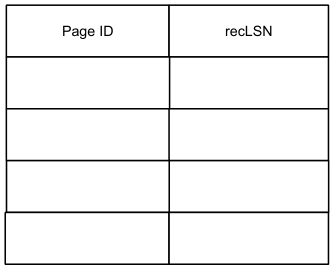

&emsp;&emsp;&emsp;**4.**

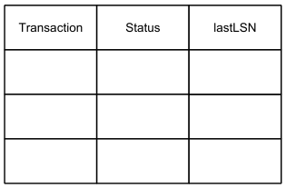

&emsp;&emsp;&emsp;**5.	  	  LSN:	  \_\_\_\_\_\_\_\_\_\_\_\_\_\_**	     **6.	  	  LSNS:	  \_\_\_\_\_\_\_\_\_\_\_\_\_\_\_\_\_\_\_\_\_\_\_\_\_\_\_\_\_\_\_\_\_\_\_\_\_\_\_\_\_\_\_\_\_\_\_\_\_\_\_\_\_\_\_\_**

&emsp;&emsp;&emsp;**7.	  	  LSNs:	  \_\_\_\_\_\_\_\_\_\_\_\_\_\_\_\_\_\_\_\_\_\_\_\_\_\_\_\_\_\_\_\_\_\_\_\_\_\_\_\_\_\_\_\_\_\_\_\_\_\_\_\_\_\_\_\_**

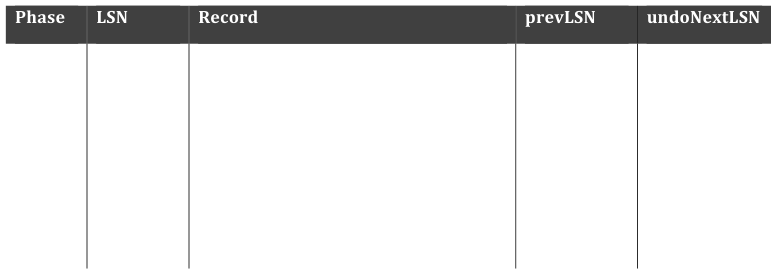

&emsp;**8.**

---

**Page 11**

Name:	  Class	  Account: 
&emsp;&emsp;&emsp;&emsp;&emsp;&emsp;&emsp;&emsp;cs186-­‐\_\_\_\_\_\_\_\_\_\_\_\_ 
&emsp;&emsp;&emsp;**Concurrency	  Control** 
&emsp;&emsp;&emsp;**9.**	     **10.**	     **11.** 
&emsp;&emsp;&emsp;&emsp;&emsp;`◯` 	  T	  	  	  	  	  	  	  	  	  `◯` 	  F	  	     `◯` 	  T	  	  	  	  	  	  	  	  	  `◯` 	  F	  	     `◯` 	  T	  	  	  	  	  	  	  	  	  `◯` 	  F 
&emsp;&emsp;&emsp;**12.**	     **13.** 
&emsp;&emsp;&emsp;&emsp;&emsp;`◯` 	  T	  	  	  	  	  	  	  	  	  `◯` 	  F	  	     `◯` 	  T	  	  	  	  	  	  	  	  	  `◯` 	  F

&emsp;&emsp;&emsp;&emsp;&emsp;&emsp;&emsp;&emsp;`◯` 	  T	  	  	  	  	  	  	  	  	  `◯` 	  F 
&emsp;&emsp;&emsp;**14.	  	  After	  step	  	  \_\_\_\_\_\_\_\_\_\_\_\_\_\_**	     **15.	  	  After	  step	  	  \_\_\_\_\_\_\_\_\_\_\_\_\_\_**	   **16.** 
&emsp;&emsp;&emsp;&emsp;&emsp;`◯` 	  T	  	  	  	  	  	  	  	  	  `◯` 	  F 
&emsp;&emsp;&emsp;**17.**	  	  	     **18.	  	  Lock:	  \_\_\_\_\_\_\_\_\_\_\_\_\_\_**

&emsp;&emsp;&emsp;**Query	  Processing	  and	  Optimization**

&emsp;&emsp;&emsp;**19.	  	  \_\_\_\_\_\_\_\_\_\_\_\_\_\_	  I/Os**	      **20.	  	  	  	  	  \_\_\_\_\_\_\_\_\_\_\_\_\_\_	  I/Os**	     **21.	  \_\_\_\_\_\_\_\_\_\_\_\_\_\_	  I/Os**

&emsp;&emsp;&emsp;**22a.	  \_\_\_\_\_\_\_\_\_\_\_\_\_\_	  tuples**	     **22b.	  \_\_\_\_\_\_\_\_\_\_\_\_\_\_\_\_\_\_\_\_\_\_\_\_\_\_\_\_\_\_\_\_\_\_\_\_\_\_\_\_\_\_\_\_\_\_\_\_\_\_\_\_\_\_\_\_**

&emsp;&emsp;&emsp;**22c.	  \_\_\_\_\_\_\_\_\_\_\_\_\_\_	  I/Os**

&emsp;&emsp;&emsp;**23a.	  \_\_\_\_\_\_\_\_\_\_\_\_\_\_	  tuples**	     **23b.	  \_\_\_\_\_\_\_\_\_\_\_\_\_\_\_\_\_\_\_\_\_\_\_\_\_\_\_\_\_\_\_\_\_\_\_\_\_\_\_\_\_\_\_\_\_\_\_\_\_\_\_\_\_\_\_\_**

&emsp;&emsp;&emsp;**23c.	  \_\_\_\_\_\_\_\_\_\_\_\_\_\_	  I/Os**

&emsp;&emsp;&emsp;**24a.	  \_\_\_\_\_\_\_\_\_\_\_\_\_\_	  tuples**	     **24b.	  \_\_\_\_\_\_\_\_\_\_\_\_\_\_\_\_\_\_\_\_\_\_\_\_\_\_\_\_\_\_\_\_\_\_\_\_\_\_\_\_\_\_\_\_\_\_\_\_\_\_\_\_\_\_\_\_**

&emsp;&emsp;&emsp;**24c.	  \_\_\_\_\_\_\_\_\_\_\_\_\_\_	  I/Os**

---

**Page 12**

Name:	  Class	  Account: 
&emsp;&emsp;&emsp;&emsp;&emsp;&emsp;&emsp;&emsp;cs186-­‐\_\_\_\_\_\_\_\_\_\_\_\_ 
&emsp;&emsp;&emsp;**Parallelism**

&emsp;&emsp;&emsp;**25.	  \_\_\_\_\_\_\_\_\_\_\_\_\_\_	  minutes**	     **26.	  	  \_\_\_\_\_\_\_\_\_\_\_\_\_\_	  days**	   	     **27.	  $\_\_\_\_\_\_\_\_\_\_\_\_\_\_**

&emsp;&emsp;&emsp;**28.	  \_\_\_\_\_\_\_\_\_\_\_\_\_\_**	     **29.**

&emsp;&emsp;&emsp;**SQL**

&emsp;&emsp;&emsp;**30a.**	  (A-­‐F)**\_\_\_\_\_\_\_\_\_\_\_\_\_\_**	  	     **30b.**	  (A-­‐F)**\_\_\_\_\_\_\_\_\_\_\_\_\_\_**	  	     **30c.**	  (A-­‐F)**\_\_\_\_\_\_\_\_\_\_\_\_\_\_**

&emsp;&emsp;&emsp;**30d.**	  (A-­‐F)**\_\_\_\_\_\_\_\_\_\_\_\_\_\_**	  	     **30e.**	  (A-­‐F)**\_\_\_\_\_\_\_\_\_\_\_\_\_\_**	  	     **30f.**	  (A-­‐F)**\_\_\_\_\_\_\_\_\_\_\_\_\_\_**

&emsp;&emsp;&emsp;**Database	  Design**

&emsp;&emsp;&emsp;**31.**

&emsp;&emsp;&emsp;**32.** 
&emsp;&emsp;&emsp;&emsp;&emsp;`◯` 	  T	  	  	  	  	  	  	  	  	  `◯` 	  F

---

**Page 13**

Name:	  Class	  Account: 
&emsp;&emsp;&emsp;&emsp;&emsp;&emsp;&emsp;&emsp;cs186-­‐\_\_\_\_\_\_\_\_\_\_\_\_

&emsp;&emsp;&emsp;**33.**

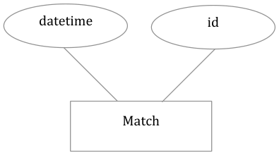

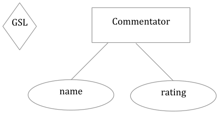

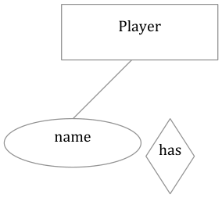

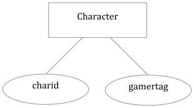

