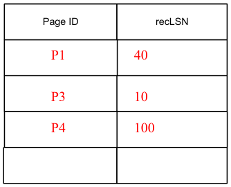
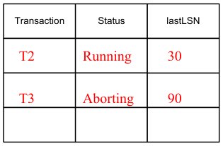
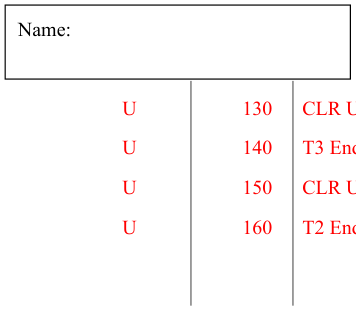
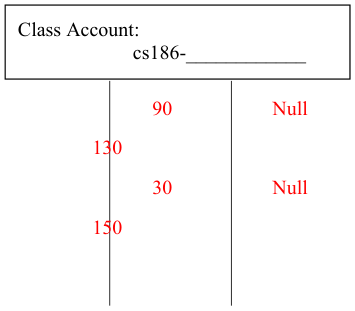
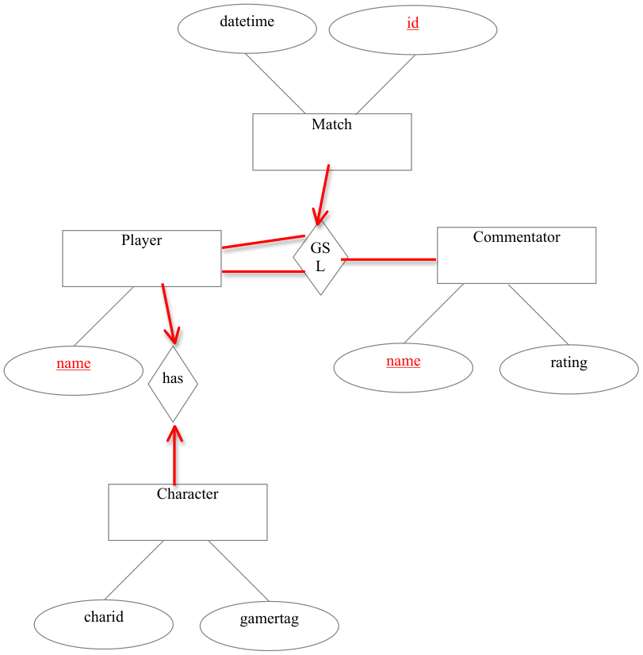

# Berkeley CS186 Spring 2012: Final: Official solutions

> Copied from the original: <https://hkn.eecs.berkeley.edu/exams/course/cs/186>. Text and figures are taken from the PDF as is; nothing was answered or rewritten. The original PDF is in this folder.

---

**Page 1**

Name: Class Account: 
&emsp;&emsp;&emsp;&emsp;&emsp;&emsp;&emsp;&emsp;cs186-\_\_\_\_\_\_\_\_\_\_\_\_

&emsp;&emsp;&emsp;**Similarity Joins**

&emsp;&emsp;&emsp;**1a.   Line #\_\_\_\_7\_\_\_\_\_\_\_\_**    **1b.**  (A-D)**\_\_\_\_C\_\_\_\_\_\_\_\_**    **1c.**  (A-D)**\_\_\_C,D\_\_\_\_**

&emsp;&emsp;&emsp;**2a.**  (A-C)**\_\_\_A\_\_\_\_\_ 2b.**  (A-C)**\_\_\_\_B\_\_\_\_\_ 2c.**)  **i.\_\_N\_\_ ii. .\_\_T\_\_\_\_ iii. \_\_N/T\_\_\_\_** 
&emsp;&emsp;&emsp;**iv. .\_\_C\_\_\_**

&emsp;&emsp;&emsp;**Logging and Recovery**

&emsp;&emsp;&emsp;**3. undoNextLSN=\_\_\_\_40\_\_\_\_\_\_** 
&emsp;&emsp;&emsp;**4.**

&emsp;&emsp;&emsp;**5.  LSN: \_\_\_\_\_10\_\_\_\_\_**    **6.  LSNS: \_\_\_\_10, 40, 60, 90,** 
&emsp;&emsp;&emsp;**100\_\_\_\_\_\_\_\_\_\_\_\_\_\_\_\_\_\_\_\_\_\_\_\_\_\_\_\_\_\_\_\_\_**

&emsp;&emsp;&emsp;**7.  LSNs: \_\_\_\_\_90, 40, 30\_\_\_\_\_\_\_\_\_\_\_\_\_\_\_\_\_\_\_\_\_\_\_\_\_\_\_\_\_\_\_\_\_\_\_\_\_\_\_\_\_\_\_\_\_**

&emsp;**8.**

---

**Page 2**

&emsp;&emsp;&emsp;&emsp;&emsp;&emsp;&emsp;&emsp;CLR Undo T3 LSN: 40

&emsp;&emsp;&emsp;&emsp;&emsp;&emsp;&emsp;&emsp;CLR Undo T2 LSN: 30

&emsp;&emsp;&emsp;**Concurrency Control** 
&emsp;&emsp;&emsp;**9.**    **10.**    **11.** 
&emsp;&emsp;&emsp;&emsp;&emsp;● T         `◯`  F     `◯`  T         ● F     ● T         `◯`  F

&emsp;&emsp;&emsp;**12.**    **13.** 
&emsp;&emsp;&emsp;&emsp;&emsp;`◯`  T         ● F     `◯`  T         ● F

&emsp;&emsp;&emsp;&emsp;&emsp;&emsp;&emsp;&emsp;● T         `◯`  F 
&emsp;&emsp;&emsp;**14.  After step  \_\_\_\_\_7\_\_\_\_\_\_\_ 15.  After step  \_\_\_\_9\_\_\_\_\_\_\_\_16.** 
&emsp;&emsp;&emsp;&emsp;&emsp;● T         `◯`  F 
&emsp;&emsp;&emsp;**17.**      **18.  Lock: \_\_\_\_\_X\_\_\_\_\_\_\_\_**

&emsp;&emsp;&emsp;**Query Processing and Optimization**

&emsp;&emsp;&emsp;**19.  \_500,500 I/Os**        **20**  **11,000**  **I/Os**    **21. \_\_\_\_\_500\_\_\_ I/Os**

&emsp;&emsp;&emsp;**22a. \_\_\_100\_\_\_\_ tuples**     **22b. \_\_\_\_\_\_\_File Scan\_\_\_\_\_\_\_\_\_\_\_\_\_\_\_**

&emsp;&emsp;&emsp;**22c. \_\_\_1000\_\_ I/Os**

&emsp;&emsp;&emsp;**23a. \_\_\_\_\_5\_\_\_\_\_ tuples**      **23b. \_\_\_\_\_\_\_\_RegSC Index\_\_\_\_\_\_\_\_\_\_\_\_\_\_\_\_\_\_\_\_\_\_**

---

**Page 3**

Name: Class Account: 
&emsp;&emsp;&emsp;&emsp;&emsp;&emsp;&emsp;&emsp;cs186-\_\_\_\_\_\_\_\_\_\_\_\_ 
&emsp;&emsp;&emsp;**23c. \_\_\_\_\_4\_\_\_\_\_\_ I/Os**

&emsp;&emsp;&emsp;**24a. \_\_\_\_25\_\_\_\_\_\_ tuples**    **24b. \_\_\_\_\_StudC Index\_\_\_\_\_\_\_\_\_\_\_\_\_**

&emsp;&emsp;&emsp;**24c. \_\_\_\_53\_\_\_\_\_\_\_ I/Os** 
&emsp;&emsp;&emsp;**Parallelism**

&emsp;&emsp;&emsp;**25. \_\_300\_\_\_\_\_\_\_\_\_ minutes 26.  \_6\_\_\_\_\_\_\_\_\_\_\_\_ days**        **27. $\_\_\_90\_\_\_\_\_\_\_\_\_**

&emsp;&emsp;&emsp;**28. \_\_\_D\_\_\_\_\_\_\_\_\_\_\_ 29.**  **Jim.  Ted could have skew/stragglers.**

&emsp;&emsp;&emsp;**SQL**

&emsp;&emsp;&emsp;**30a.** (A-F)**\_\_\_\_C\_\_\_\_\_\_\_\_**        **30b.** (A-F)**\_\_\_\_D\_\_\_\_\_\_\_\_**        **30c.** (A- 
&emsp;&emsp;&emsp;F)**\_\_\_\_— \_\_\_\_\_\_\_\_**

&emsp;&emsp;&emsp;**30d.** (A-F)**\_\_\_E\_\_\_\_\_\_\_\_\_**        **30e.** (A-F)**\_\_\_\_\_A\_\_\_\_\_\_\_**        **30f.** (A- 
&emsp;&emsp;&emsp;F)**\_\_\_\_\_D\_\_\_\_\_\_\_\_**

&emsp;&emsp;&emsp;**Database Design**

&emsp;&emsp;&emsp;**31.** 
&emsp;&emsp;&emsp;DMN1N2E     ER     N1G1C1   N2G2C2

---

**Page 4**

Name: Class Account: 
&emsp;&emsp;&emsp;&emsp;&emsp;&emsp;&emsp;&emsp;cs186-\_\_\_\_\_\_\_\_\_\_\_\_ 
&emsp;&emsp;&emsp;**32.** 
&emsp;&emsp;&emsp;&emsp;&emsp;● T         `◯`  F

---

**Page 5**

Name: Class Account: 
&emsp;&emsp;&emsp;&emsp;&emsp;&emsp;&emsp;&emsp;cs186-\_\_\_\_\_\_\_\_\_\_\_\_

&emsp;&emsp;&emsp;**33.**

