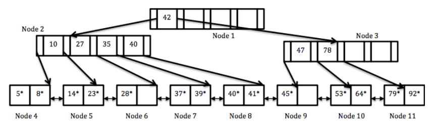
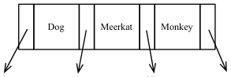
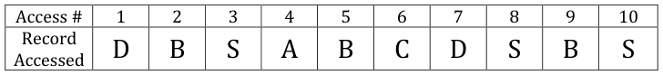
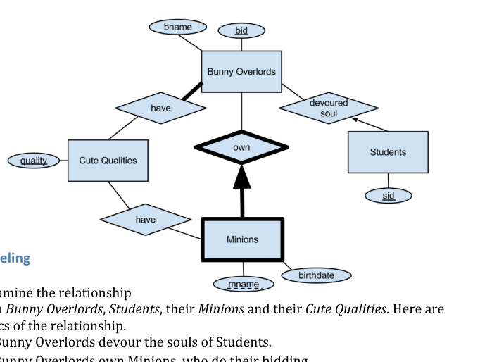
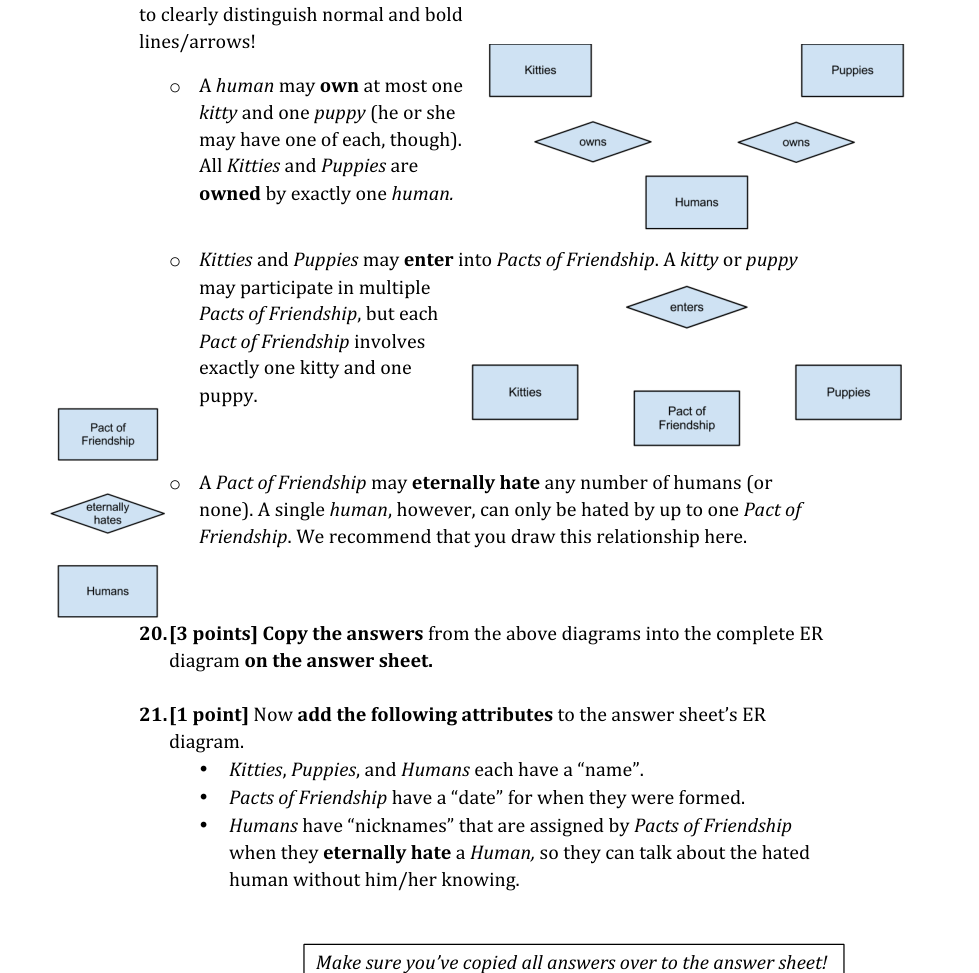
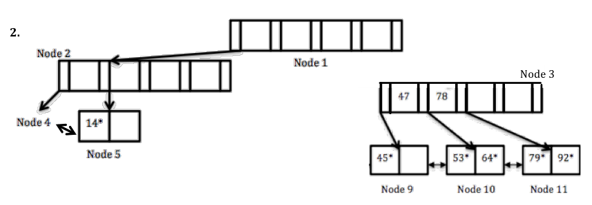
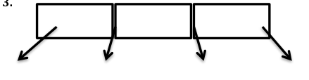
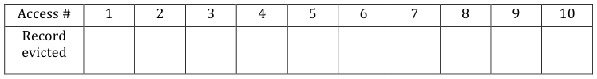
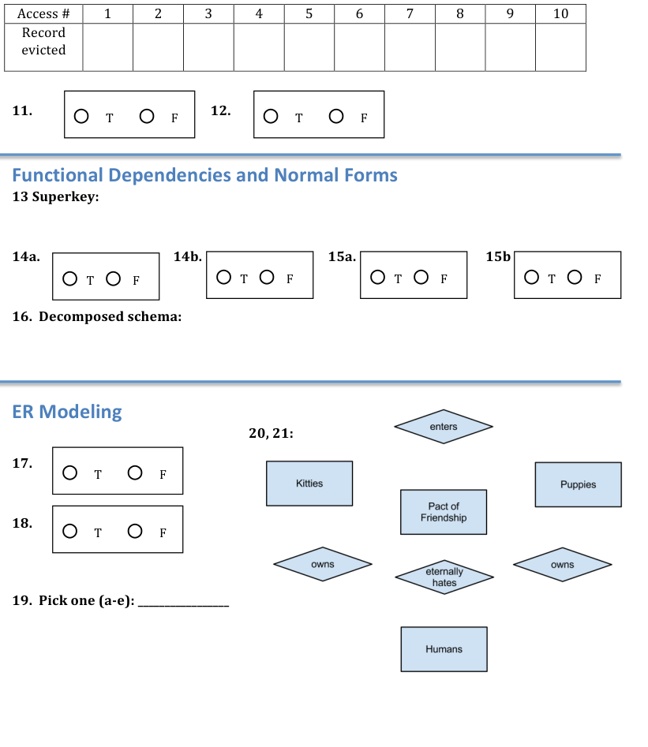

# Berkeley CS186 Spring 2012: Midterm 2: Questions

> Copied from the original: <https://hkn.eecs.berkeley.edu/exams/course/cs/186>. Text and figures are taken from the PDF as is; nothing was answered or rewritten. The original PDF is in this folder.

---

**Page 1**

**Midterm	  2,	  CS186** 
&emsp;&emsp;&emsp;&emsp;&emsp;&emsp;&emsp;&emsp;**Please	  put	  all	  answers	  on	  the	  answer	  sheets.** 
Prof.	  Hellerstein,	  Spring	  2012	  **Make	  sure	  your	  name	  is	  on	  each	  answer	  sheet!** 
**B+-­‐Trees** 
Assume	  we	  have	  the	  following	  B+	  Tree	  of	  order	  2	  in	  which	  each	  index	  node	  must 
have	  between	  2	  and	  4	  entries.	  	  The	  leaf	  nodes	  can	  only	  hold	  only	  2	  entries,	  however. 
The	  asterisk	  on	  data	  entries	  represents	  the	  fact	  that	  the	  leaf	  pages	  will	  store 
additional	  information.

**1.	  \[2	  points\]	  On	  the	  answer	  sheet,	  list	  all	  nodes**	  that	  are	  accessed	  when	  you 
perform	  a	  lookup	  on	  the	  range	  “37-­‐65”. 
**2.	  \[4	  points\]**	  A	  row	  is	  inserted	  into	  your	  table	  with	  the	  indexed	  value	  “19”.	  We	  want 
you	  to	  **draw	  the	  B+	  tree	  after	  this	  insert**	  occurs.	  	  	  We	  have	  started	  drawing	  it	  for 
you	  **on	  the	  answer	  sheet**.	  	  For	  any	  node	  X	  that	  does	  not	  change,	  simply	  write	  down 
“Node	  X”	  (as	  we	  did	  for	  Node	  4).	  	  For	  any	  node	  that	  you	  do	  change,	  please	  fill	  it	  in 
completely.	  	  You	  do	  not	  need	  to	  assign	  node	  numbers	  to	  any	  nodes	  you	  generate.

**3.**	  **\[1	  point\]**	  	  Consider	  the	  index	  page	  on	  the	  right.	  	  This 
is	  taken	  from	  a	  different	  B+-­‐tree,	  which	  can	  fit	  32	  bytes 
per	  index	  page.	  	  In	  this	  index,	  each	  character	  takes 
one	  byte	  and	  each	  pointer	  takes	  4	  bytes. 
marmot\]cat\]In	  the	  diagram	  **on	  the	  answer	  sheet,	  draw	  an**	  mink\] 
**alternative	  index	  page	  with	  prefix-­‐compressed	  index	  entries.**Where	  relevant, 
we	  have	  shown	  the	  top	  of	  the	  value-­‐range	  stored	  in	  the	  left-­‐hand	  subtree. 
**4.	  	  \[2	  points\]**	  	  Given	  your	  answer	  to	  part	  3,	  **write	  on	  the	  answer	  sheet**: 
a)	  the	  number	  of	  bytes	  occupied	  on	  your	  compressed	  page,	  and 
b)	  the	  maximum	  number	  of	  additional	  index	  entries	  we	  could	  fit	  in	  that	  page.

---

**Page 2**

**Information	  Retrieval** 
&emsp;**5. \[2	  points\]**	  Consider	  the	  keyword	  query	  “Berkeley	  Database	  Research”.	  	  We 
&emsp;&emsp;said	  in	  class	  that	  one	  could	  treat	  that	  query	  as	  a	  document,	  and	  compute	  a 
&emsp;&emsp;TF×IDF	  score	  for	  it.	  	  Now	  it	  is	  time	  to	  do	  so!	  	  Suppose	  we	  know	  that: 
&emsp;&emsp;&emsp;**a.** our	  corpus	  has	  109	  documents. 
&emsp;&emsp;&emsp;**b.** “berkeley”	  appears	  in	  105	  documents 
&emsp;&emsp;&emsp;**c.** “database”	  appears	  in	  104	  documents 
&emsp;&emsp;&emsp;**d.** “research”	  appears	  in	  103	  documents 
&emsp;&emsp;To	  help	  create	  the	  vector,	  **on	  the	  answer	  sheet	  please	  write	  down	  the** 
&emsp;&emsp;**(unnormalized!)	  TF×IDF	  score**	  for	  each	  of	  the	  3	  terms	  above.

&emsp;**6. \[2	  points\]**	  Suppose	  you	  have	  a	  relation	  stored	  as	  a	  heap	  file	  F	  representing 
&emsp;&emsp;an	  inverted	  file	  with	  the	  following	  schema: 
&emsp;&emsp;`(docId,` //	  an	  integer	  	  ID	  representing	  this	  document 
&emsp;&emsp;`termID,` //	  an	  integer	  ID	  representing	  this	  term 
&emsp;&emsp;`position,` //	  the	  word	  offset	  of	  this	  term	  occurrence	  in	  the	  doc 
&emsp;&emsp;`surrounding_text,` //	  a	  snippet	  of	  text	  containing	  this	  term	  occurrence 
&emsp;&emsp;`DocTermRank` //	  the	  TFxIDF	  score`).` 
&emsp;&emsp;You	  will	  build	  a	  standard	  B+-­‐tree	  index	  with	  “posting	  list”	  entries	  in	  the 
&emsp;&emsp;leaves	  as	  we	  discussed	  in	  class.	  	  The	  search	  key	  of	  the	  index	  will	  contain	  all 
&emsp;&emsp;attributes	  except	  for	  `surrounding_text`.	  In	  order	  for	  the	  index	  to	  be 
&emsp;&emsp;clustered,	  what	  should	  be	  the	  (lexicographic)	  sort	  order	  of	  the	  file	  F?	  	  **Write** 
&emsp;&emsp;**the	  answer	  on	  the	  answer	  sheet.**

&emsp;**7. \[2	  points\]**	  Your	  mom	  tells	  you	  that	  the	  schema	  in	  part	  (2)	  is	  not	  in	  BCNF. 
&emsp;&emsp;What	  implicit	  functional	  dependency	  makes	  her	  say	  that?	  	  **Write	  your** 
&emsp;&emsp;**answer	  on	  the	  answer	  sheet.**

&emsp;**8. \[2	  points\]**	  In	  class	  we	  discussed	  the	  idea	  of	  a	  “spider	  trap”	  web	  service	  that 
&emsp;&emsp;could	  foil	  a	  web	  crawler	  by	  generating	  interlinked	  pages	  dynamically.	  	  For 
&emsp;&emsp;each	  of	  the	  following	  arguments,	  **mark	  T	  (true)	  or	  F	  (false)	  on	  the	  answer** 
&emsp;&emsp;**sheet**: 
&emsp;&emsp;&emsp;a. The	  spider	  trap	  can	  change	  the	  IDF	  scores	  of	  other	  pages. 
&emsp;&emsp;&emsp;b. Spider	  traps	  can	  increase	  the	  search	  frontier	  of	  the	  crawler. 
&emsp;&emsp;&emsp;c. The	  spider	  trap	  can	  attract	  lots	  of	  search	  hits	  by	  generating	  pages	  with 
&emsp;&emsp;&emsp;&emsp;&emsp;arbitrarily	  high	  IDF.

---

**Page 3**

**Buffer	  Management** 
It’s	  time	  to	  play	  buffer	  manager!	  For	  each	  of	  the	  following	  replacement	  policies, 
record	  the	  eviction	  for	  each	  access	  number	  (if	  any).	  Assume	  a	  **three	  page	  buffer** 
**pool**	  and	  remember	  to	  only	  record	  **evictions**	  in	  the	  frame	  number	  they	  occur. 
For	  example,	  if	  record	  Q	  is	  evicted	  during	  access	  number	  5	  and	  record	  R	  is	  evicted	  in 
access	  10,	  put	  Q	  in	  the	  box	  marked	  5	  and	  R	  in	  the	  box	  marked	  10.	  **Do	  not**	  place	  Q	  in 
box	  1	  and	  R	  in	  box	  2;	  you	  need	  to	  record	  the	  access	  number	  of	  the	  eviction.	  Some 
boxes	  may	  be	  left	  blank.

**9.	  \[2.5	  points\]**	  Most	  Recently	  Used.	  (**Fill	  in	  the	  eviction	  history	  on	  answer	  sheet**).

**10.	  \[2.5	  points\]**	  	  Clock.	  	  (**Fill	  in	  the	  eviction	  history	  on	  answer	  sheet**). 
**Notes	  on	  10:	  As	  in	  Bunny	  #5…**assume	  a	  maximum	  reference	  count	  of	  one.	  Do	  not 
advance	  the	  clock	  hand	  when	  you	  access	  a	  page—only	  advance	  it	  when	  choosing	  a 
page	  to	  evict.	  Do	  **not**	  advance	  the	  clock	  hand	  after	  you	  replace	  a	  page,	  and	  assume 
each	  page	  is	  unpinned	  before	  the	  next	  access	  #.

For	  the	  next	  2	  questions,	  **mark	  T	  (true)	  or	  F	  (false)	  on	  the	  answer	  sheet**: 
**11.	  \[1	  point\]**	  	  Pages	  evicted	  from	  the	  buffer	  pool	  must	  be	  written	  back	  to	  disk. 
**12.	  \[1	  point\]**	  Sequential	  flooding	  occurs	  when	  **both**	  of	  the	  following	  hold: 
&emsp;&emsp;a.	  repeated	  sequential	  scans	  of	  a	  file	  and 
&emsp;&emsp;b.	  the	  number	  of	  unpinned	  buffer	  frames	  exceeds	  the	  number	  of	  file	  pages

---

**Page 4**

**Functional	  Dependencies.** 
Consider	  the	  relation:	  A	  B	  C	  D	  E 
with	  the	  functional	  dependencies	  F=	  {A	  →	  BC,	  B	  →	  A,	  DE	  →	  C,	  C	  →	  B,	  E	  →	  D	  } 
**13.\[2	  points\]**	  There	  is	  a	  unique	  minimal	  superkey.	  	  What	  is	  it? 
**Write	  your	  answer	  on	  the	  answer	  sheet.**

For	  the	  next	  2	  questions,	  **mark	  T	  (true)	  or	  F	  (false)	  on	  the	  answer	  sheet**: 
**14.	  	  \[2	  points\]**	  Consider	  the	  decomposition	  of	  the	  relation	  into	  two	  tables:	  ABED,	  EC 
a)	  	  **True/False:**	  This	  decomposition	  is	  in	  BCNF.

b)	  	  **True/False:**	  The	  decomposition	  is	  Lossless	  Join.

**15.	  	  \[2	  points\]**	  Consider	  the	  decomposition	  of	  the	  relation	  into	  two	  tables:	  ACDE,	  CB 
a)	  **True/False:**	  The	  decomposition	  is	  in	  BCNF.

b)	  **True/False:**	  The	  decomposition	  is	  Lossless	  Join.

**16.	  	  \[2	  points\]**	  Perform	  a	  BCNF	  decomposition	  of	  the	  relational	  A	  B	  C	  D	  E, 
considering	  the	  functional	  dependencies	  in	  F	  **from	  left	  to	  right**.	  	  **Show	  the	  final** 
**decomposed	  schema	  on	  the	  answer	  sheet.**

---

**Page 5**

**ER	  Modeling**

&emsp;c) Bunny	  Overlords	  have	  cute	  qualities	  (such	  as	  fluffiness	  or	  cuddliness). 
&emsp;d) Minions	  also	  have	  cute	  qualities. 
The	  ER-­‐diagram	  above	  specifies	  the	  exact	  nature	  of	  the	  relationships.	  	  Please	  answer 
the	  following	  questions	  using	  the	  ER	  diagram	  and	  clarifications	  above. 
For	  the	  next	  2	  questions,	  **mark	  T	  (true)	  or	  F	  (false)	  on	  the	  answer	  sheet**: 
&emsp;**17. \[1	  point\]	  True	  /	  False**.	  A	  student	  may	  have	  their	  soul	  devoured	  by	  more 
&emsp;&emsp;than	  one	  Bunny	  Overlord.

&emsp;**18. \[1	  point\]	  True	  /	  False**.	  A	  particular	  Bunny	  Overlord	  cannot	  have	  two 
&emsp;&emsp;minions	  with	  the	  same	  name.

&emsp;**19. \[1	  point\]	  Multiple	  Choice**.	  Consider	  a	  Bunny	  Overlord,	  Mipsy.	  	  Mipsy	  has	  the 
&emsp;&emsp;fewest	  possible	  cute	  qualities	  that	  a	  Bunny	  Overlord	  can	  have	  according	  to 
&emsp;&emsp;the	  ER	  diagram.	  Mark	  the	  most	  general	  correct	  answer	  on	  the	  answer	  sheet. 
&emsp;&emsp;a. Mipsy	  must	  have	  more	  cute	  qualities	  than	  some	  Minion. 
&emsp;&emsp;b. Mipsy	  must	  have	  more	  cute	  qualities	  than	  all	  Minions. 
&emsp;&emsp;c. Mipsy	  must	  have	  fewer	  cute	  qualities	  than	  some	  Minion. 
&emsp;&emsp;d. Mipsy	  must	  have	  fewer	  cute	  qualities	  than	  all	  Minions. 
&emsp;&emsp;e. None	  of	  the	  above.

---

**Page 6**

Now	  it’s	  your	  turn	  to	  design	  your	  own	  ER	  diagram,	  modeling	  the	  following 
relationship	  between	  Kitties,	  Puppies,	  Humans,	  and	  Pacts	  of	  Friendship.	  For	  this 
part,	  we	  recommend	  you	  draw	  the	  solution	  out	  in	  the	  diagrams	  provided.	  **In** 
**question	  20	  you	  will	  copy	  the	  whole	  thing	  over	  to	  the	  answer	  sheet**.	  Be	  sure

---

**Page 7**

Name:	  Class	  Account: 
&emsp;&emsp;&emsp;&emsp;&emsp;&emsp;&emsp;&emsp;cs186-­‐\_\_\_\_\_\_\_\_\_\_\_\_

&emsp;&emsp;&emsp;**B+-­‐Trees**

&emsp;&emsp;&emsp;**1.	  List	  of	  nodes	  accessed:**

&emsp;&emsp;&emsp;&emsp;&emsp;&emsp;&emsp;&emsp;**4a	  .	  #	  bytes	  occupied:**

&emsp;&emsp;&emsp;&emsp;&emsp;&emsp;&emsp;&emsp;**4b.	  	  #	  additional	  entries:**

&emsp;&emsp;&emsp;**Information	  Retrieval** 
&emsp;&emsp;&emsp;**5.	  	  berkeley:**	      	  	  	  	  **database:**	     	  	  	  	  **research:**

&emsp;&emsp;&emsp;**6.	  Sort	  order	  is:**

&emsp;&emsp;&emsp;**7.	  The	  FD	  is:**

&emsp;&emsp;&emsp;**8.	  	  a**	     **b**	  	  	  	  	  	  	  	  	     **c** 
&emsp;&emsp;&emsp;&emsp;&emsp;`◯` 	  T	  	  	  	  	  	  	  	  	  `◯` 	  F	  	     `◯` 	  T	  	  	  	  	  	  	  	  	  `◯` 	  F	  	     `◯` 	  T	  	  	  	  	  	  	  	  	  `◯` 	  F

---

**Page 8**

Name:	  Class	  Account: 
&emsp;&emsp;&emsp;&emsp;&emsp;&emsp;&emsp;&emsp;cs186-­‐\_\_\_\_\_\_\_\_\_\_\_\_

&emsp;&emsp;&emsp;**Buffer	  Management** 
&emsp;&emsp;&emsp;**9.	  	  MRU	  eviction	  history**

&emsp;&emsp;&emsp;**10.	  	  Clock	  eviction	  history**

