# Berkeley CS186 Spring 2015: Final: Questions

> Copied from the original: <https://hkn.eecs.berkeley.edu/exams/course/cs/186>. Text and figures are taken from the PDF as is; nothing was answered or rewritten. The original PDF is in this folder.

---

**Page 1**

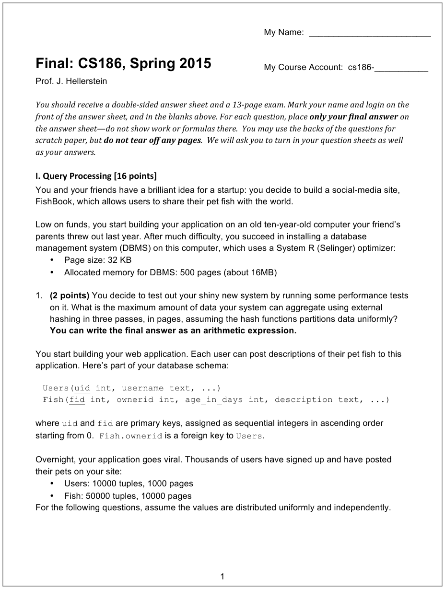

---

**Page 2**

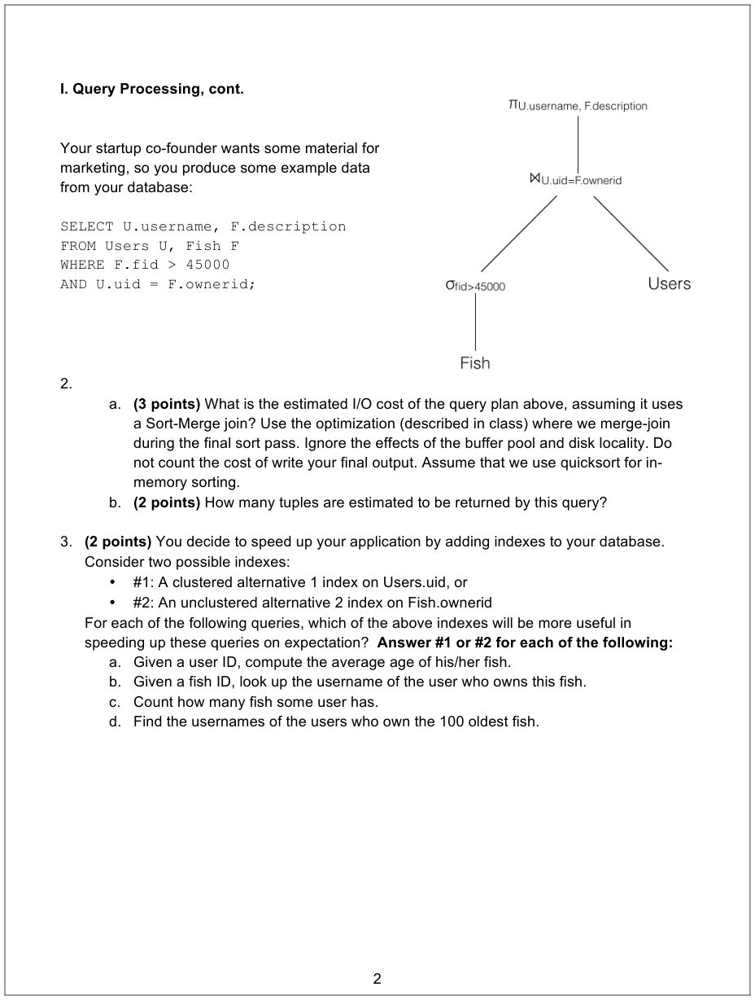

---

**Page 3**

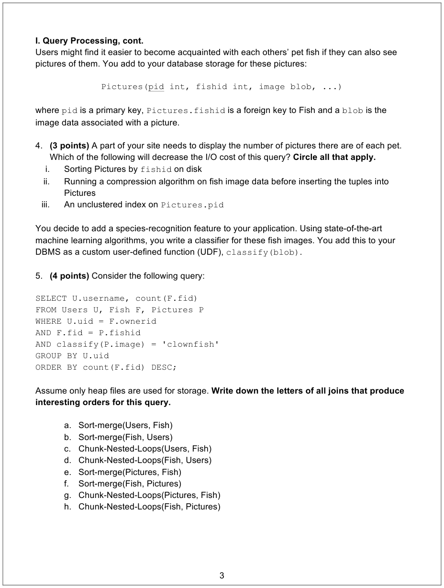

---

**Page 4**

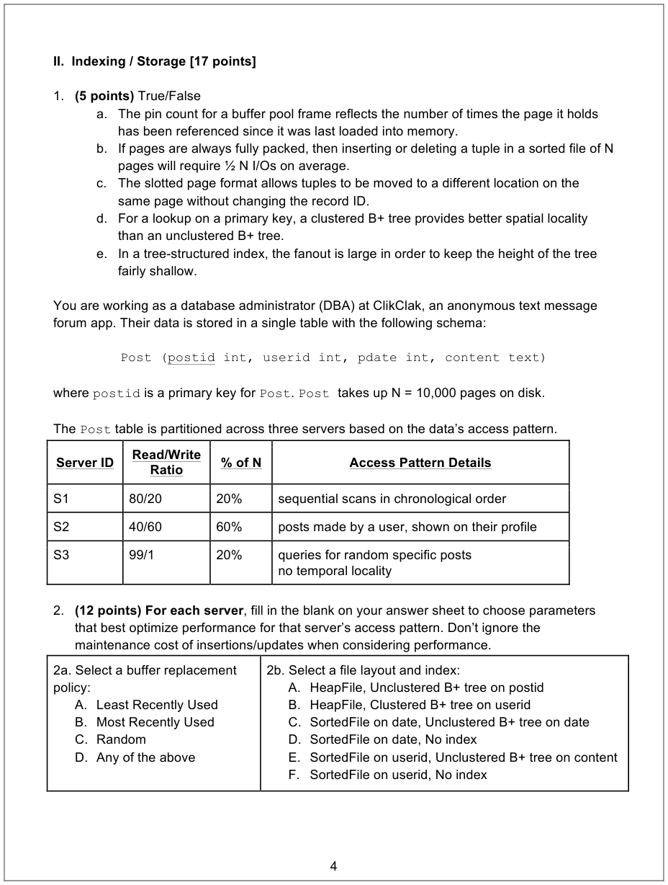

---

**Page 5**

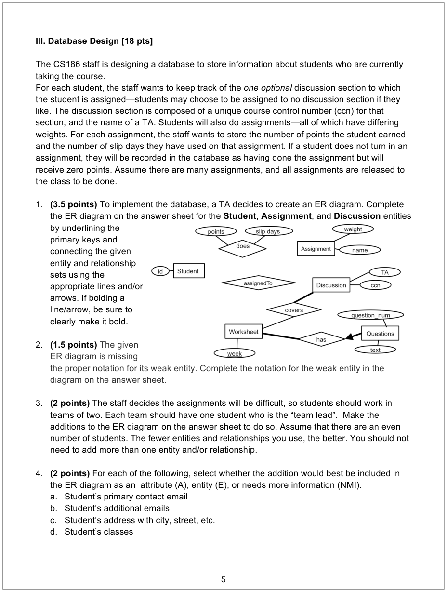

---

**Page 6**

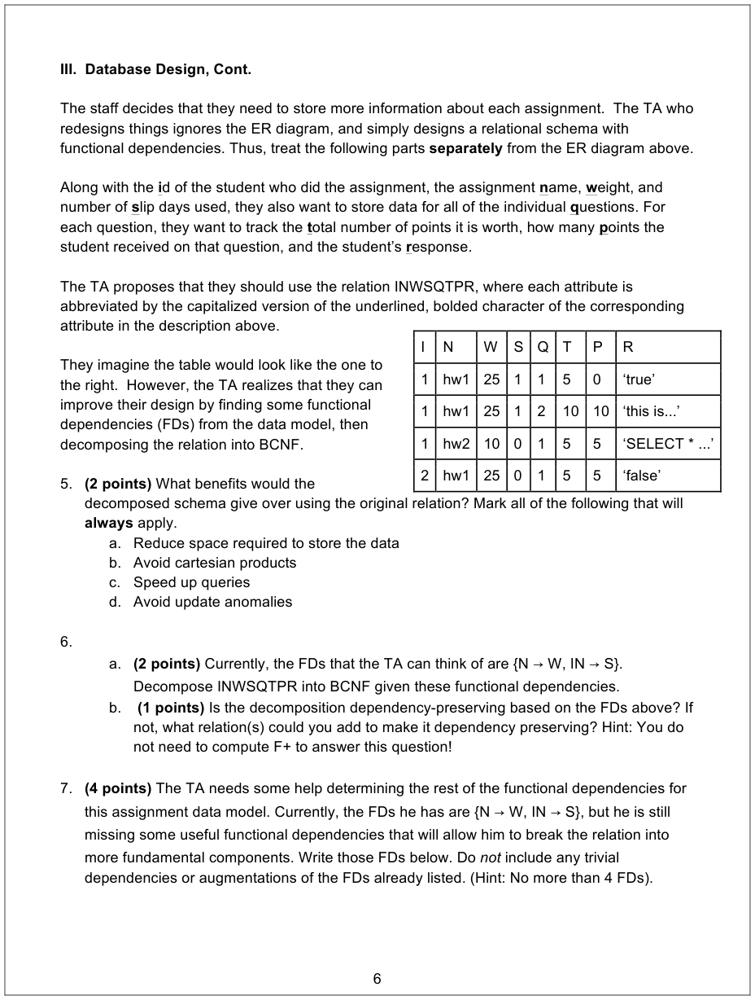

---

**Page 7**

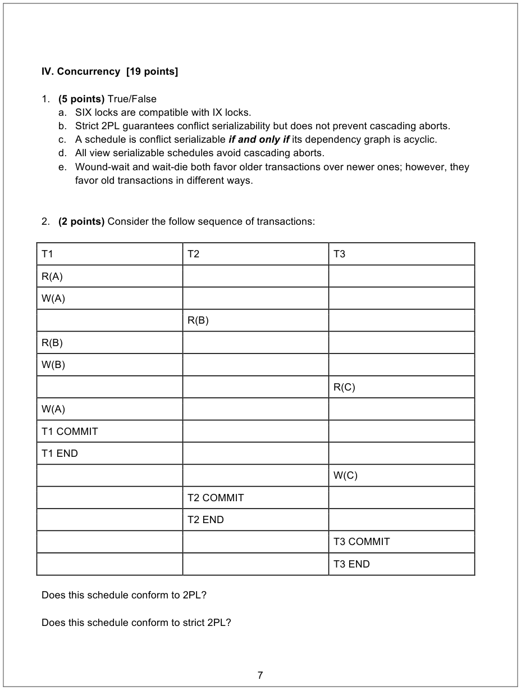

---

**Page 8**

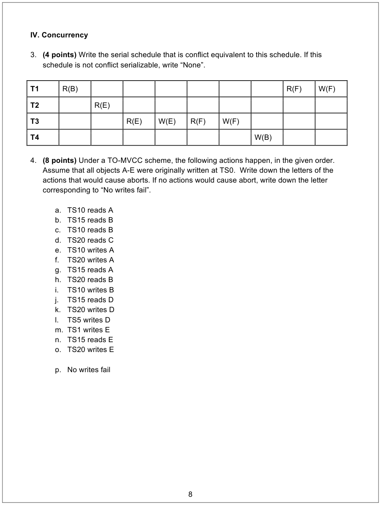

---

**Page 9**

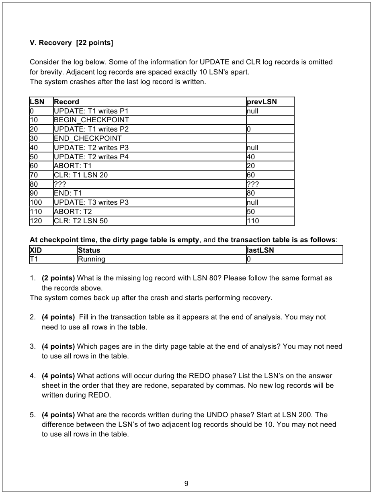

---

**Page 10**

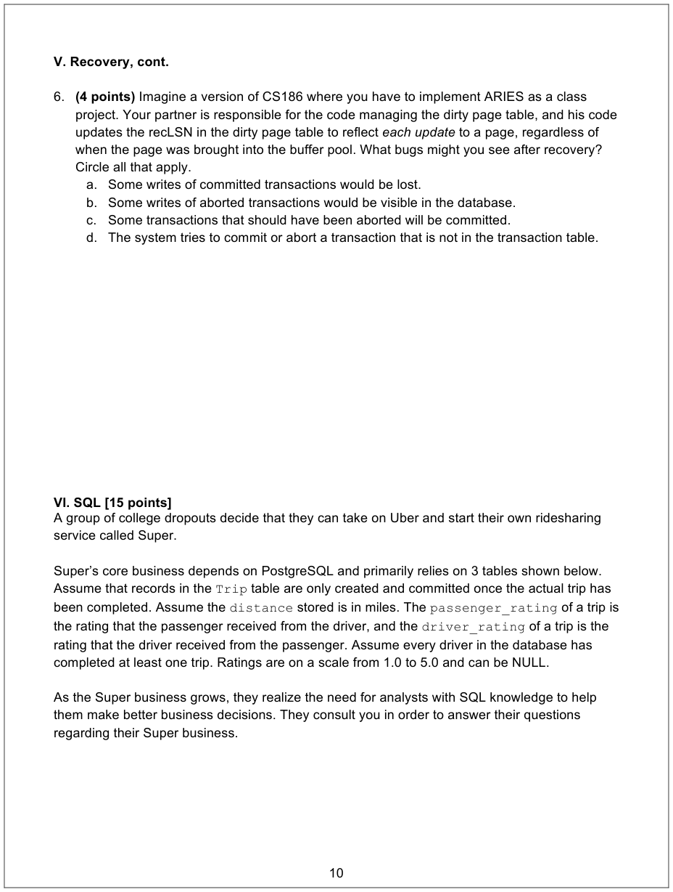

---

**Page 11**

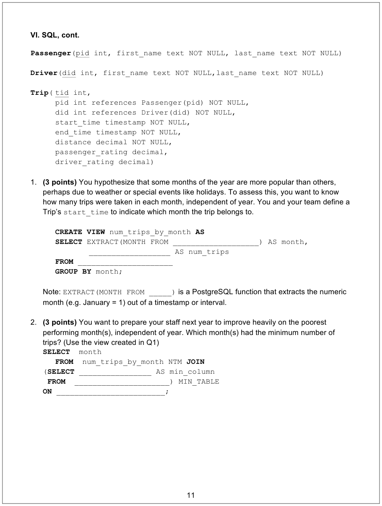

---

**Page 12**

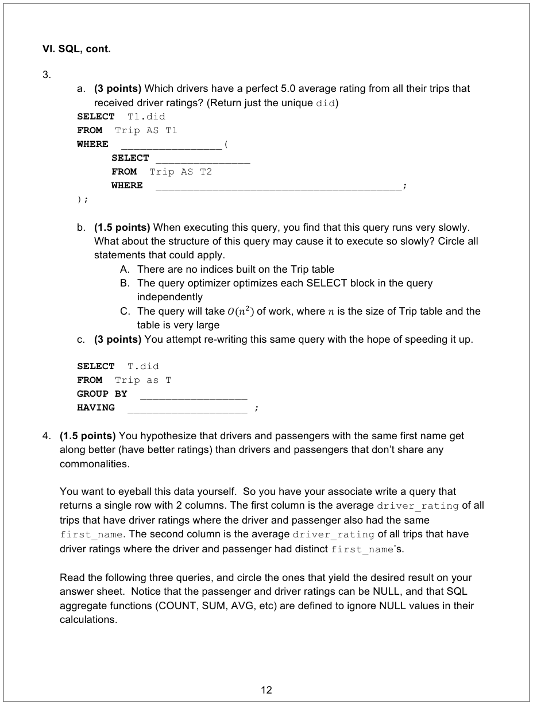

---

**Page 13**

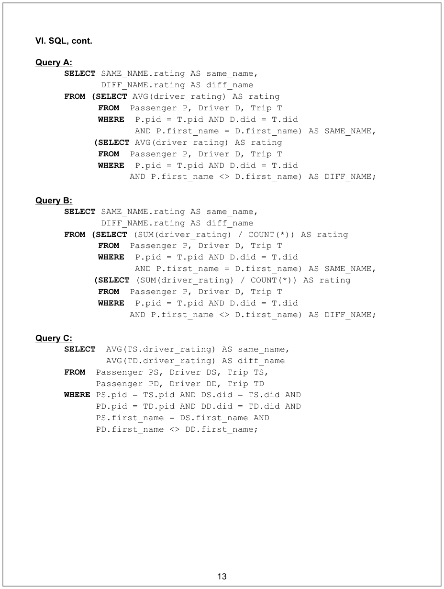

---

**Page 14**

Name:\_\_\_\_\_\_\_\_\_\_\_\_\_\_\_\_\_\_\_\_\_\_\_\_\_\_    Class Login – person on left:\_\_\_\_\_\_\_\_\_ 
Class Login (e.g. -aa): \_\_\_\_\_\_\_\_\_\_\_\_\_\_    Class Login – person on right:\_\_\_\_\_\_\_\_ 
**I. Query Processing**    **III. Database Design** 
1\. \_\_\_\_\_\_\_\_\_\_\_\_\_\_\_\_\_\_\_\_\_\_\_\_\_ pages 1-3. Add to the diagram below. 
&emsp;&emsp;&emsp;&emsp;&emsp;&emsp;&emsp;&emsp;4\. a. A / E / NMI 
2a. \_\_\_\_\_\_\_\_\_\_\_\_\_\_\_\_\_\_\_\_\_\_\_\_\_I/Os 
&emsp;&emsp;&emsp;&emsp;&emsp;&emsp;&emsp;&emsp;b. A / E / NMI 
2b. \_\_\_\_\_\_\_\_\_\_\_\_\_\_\_\_\_\_\_\_\_\_\_\_ tuples 
&emsp;&emsp;&emsp;&emsp;&emsp;&emsp;&emsp;&emsp;c. A / E / NMI 
3a. #1 / #2 
&emsp;&emsp;&emsp;&emsp;&emsp;&emsp;&emsp;&emsp;d. A / E / NMI 
3b. #1 / #2 
&emsp;&emsp;&emsp;&emsp;&emsp;&emsp;&emsp;&emsp;5\. a / b / c / d 
3c. #1 / #2 
&emsp;&emsp;&emsp;&emsp;&emsp;&emsp;&emsp;&emsp;6a. \_\_\_\_\_\_\_\_\_\_\_\_\_\_\_\_\_\_\_\_\_\_\_\_\_\_\_ 
3d. #1 / #2 
&emsp;&emsp;&emsp;&emsp;&emsp;&emsp;&emsp;&emsp;6b. Yes / No \_\_\_\_\_\_\_\_\_\_\_\_\_\_\_\_\_\_\_\_ 
4\. i. / ii. / iii. 
&emsp;&emsp;&emsp;&emsp;&emsp;&emsp;&emsp;&emsp;7\. \_\_\_\_\_\_\_\_\_\_\_\_\_\_\_\_\_\_\_\_\_\_\_\_\_\_\_\_\_ 
5\. \_\_\_\_\_\_\_\_\_\_\_\_\_\_\_\_\_\_\_\_\_\_\_\_\_\_\_\_\_\_ 
&emsp;&emsp;&emsp;&emsp;&emsp;&emsp;&emsp;&emsp;\_\_\_\_\_\_\_\_\_\_\_\_\_\_\_\_\_\_\_\_\_\_\_\_\_\_\_\_\_\_\_

**IV. Concurrency**

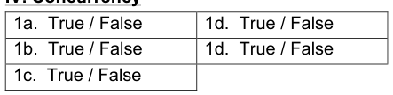

**II. Indexing / Storage**

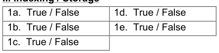

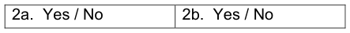

2a. S1 \_\_\_\_\_   S2 \_\_\_\_\_ S3 \_\_\_\_\_ 
2b. S1 \_\_\_\_\_   S2 \_\_\_\_\_ S3 \_\_\_\_\_    3.  \_\_\_\_\_\_\_\_\_\_\_\_\_\_\_\_\_\_\_\_\_\_\_\_\_\_\_\_\_ 
&emsp;&emsp;&emsp;&emsp;&emsp;&emsp;&emsp;&emsp;4\.  \_\_\_\_\_\_\_\_\_\_\_\_\_\_\_\_\_\_\_\_\_\_\_\_\_\_\_\_\_

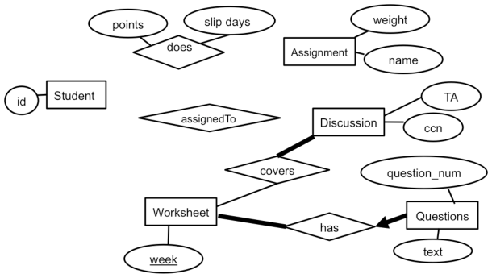

---

**Page 15**

**V. Recovery**

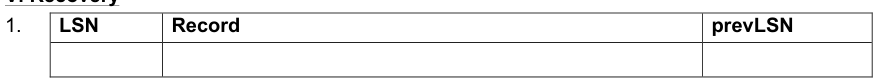

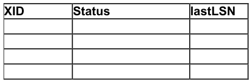

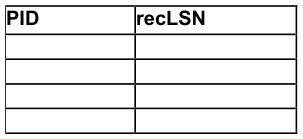

4.\_\_\_\_\_\_\_\_\_\_\_\_\_\_\_\_\_\_\_\_\_\_\_\_\_\_\_\_\_\_\_\_\_\_\_\_\_\_\_\_\_\_\_\_\_\_\_\_\_\_\_\_\_\_\_\_\_\_\_\_\_\_\_\_\_

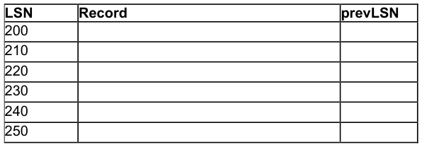

6\.  A / B / C / D

**VI.  SQL** 
1\. `CREATE VIEW` `num_trips_by_month` `AS`    3a. `SELECT`  `T1.did` 
`SELECT` `EXTRACT(MONTH FROM`        `FROM`  `Trip AS T1` 
`______________) AS month,`        `WHERE`  `___________________________(` 
`_______________________ AS num_trips`    `SELECT` `_________________________` 
`FROM` `____________________`    `FROM`  `Trip AS T2` 
`GROUP BY` `month;`    `WHERE` `____________________________` 
`__________________________);` 
2\. `SELECT`  `month` 
&emsp;&emsp;&emsp;&emsp;&emsp;&emsp;&emsp;&emsp;3b. Circle statements that apply: 
`FROM`  `num_trips_by_month NTM` `JOIN` 
&emsp;&emsp;&emsp;&emsp;&emsp;&emsp;&emsp;&emsp;**A  /  B  /  C** 
`(``SELECT` `_____________ AS min_column`    3c.`SELECT`  `T.did` 
&emsp;&emsp;&emsp;&emsp;&emsp;&emsp;&emsp;&emsp;`FROM`  `Trip as T` 
`FROM`  `__________________________` 
&emsp;&emsp;&emsp;&emsp;&emsp;&emsp;&emsp;&emsp;`GROUP BY`  `_________________________` 
`) MIN_TABLE` 
&emsp;&emsp;&emsp;&emsp;&emsp;&emsp;&emsp;&emsp;`HAVING`  `__________________________ ;` 
`ON` `_______________________________;`

4\. Circle the queries that produce the desired outcome:        A    B    C

