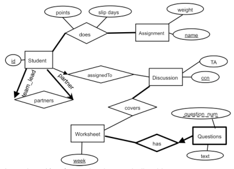
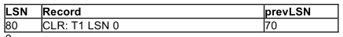
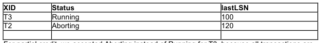
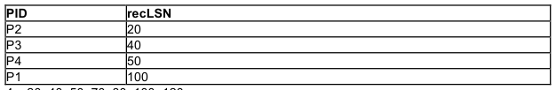
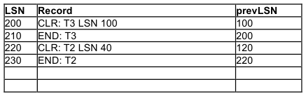
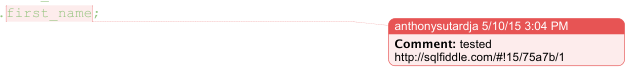

# Berkeley CS186 Spring 2015: Final: Official solutions

> Copied from the original: <https://hkn.eecs.berkeley.edu/exams/course/cs/186>. Text and figures are taken from the PDF as is; nothing was answered or rewritten. The original PDF is in this folder.

---

**Page 1**

**I. Query Execution / Optimization (Derek) \[16 pts\]** 
**\[2 pts\]** 
1\. (499^2) \* 500 (or 124500500) pages

**\[5 pts\]** 
2a. 15000 I/Os 
1 pt partial credit for 33000 I/Os (did not apply selectivity predicate) 
2b. 5000 tuples

**\[2 pts\]** 
3a. #2 
3b. #2 
3c. #2 
3d. #1 
½ pt partial credit per correct choice

**\[3 pts\]** 
4\. a., b. 
1 pt partial credit per correct marking

**\[4 pts\]** 
5\. a,b 
½ pt partial credit per correct marking

**II. Indexing/Storage (Jay) \[17 pts\]**

**\[5pts\]** 
1a. False 
1b. False 
1c. True 
1d. False 
1e. True

**\[2 point per answer\] = 12 pts** 
Replacement Policy 
&emsp;● S1:  B - MRU since sequential flooding 
&emsp;● S2:  A - LRU for temporal locality 
&emsp;● S3:  D  - if queries requests are random, then any of the policies will perform 
&emsp;&emsp;approximately equivalently

File Layout, Index: 
&emsp;● S1: D - SortedFile on date, no index

---

**Page 2**

&emsp;&emsp;&emsp;○ just do sequential scans on sorted file 
&emsp;● S2: B - HeapFile with Clustered B+ tree on userid 
&emsp;&emsp;&emsp;○ since this constitutes 60% of the data, and fairly write heavy, clustered B+ tree is 
&emsp;&emsp;&emsp;&emsp;better choice than SortedFile 
&emsp;&emsp;&emsp;○ partial credit for SortedFile on userid, No index 
&emsp;● S3: A - heapfile, Unclustered B+ tree on postid 
&emsp;&emsp;&emsp;○ use unclustered for point lookups, and no need for sorted file

**III. Database Design (Michelle)  \[18 pts\]**

&emsp;1. 
&emsp;&emsp;3.5 points: ½ pt for each edge, underlined key 
&emsp;2\. Questions, see diagram above for notation 
&emsp;&emsp;1.5 points: .5 for partial key, .5 for bolded entity, .5 for bolded reln 
&emsp;3\. Relation from student to itself or using aggregation 
&emsp;&emsp;2 points: 1 pts for making a new entity and a relationship 
&emsp;4\. a. A; b. E; c. NMI; d: E 
&emsp;5\. iv 
2 points: .5 for each 
&emsp;6\. a. NW, INS, NQTPR b. Yes; 3 pts 
&emsp;7\. INQ -\> RP, (or INQ -\> R, INQ -\> P), NQ -\> T, NQR -\> P; 4 pts

**IV. Concurrency (Vikram)  \[11.5pts\]**

&emsp;1\. 1 point each 
&emsp;&emsp;&emsp;a. False 
&emsp;&emsp;&emsp;b. False 
&emsp;&emsp;&emsp;c. True 
&emsp;&emsp;&emsp;d. False

---

**Page 3**

&emsp;&emsp;&emsp;e. True 
&emsp;2\. 1 point each 
&emsp;&emsp;&emsp;a. Yes 
&emsp;&emsp;&emsp;b. No 
&emsp;3\. T2, T3, T1, T4: 1 point each 
&emsp;4\. i, l

**V. Recovery (Varun) \[9 pts\]**

1.

2.

For partial credit, we accepted Aborting instead of Running for T3, because all transactions are 
essentially aborting during the UNDO phase. 
3.

4\. 20, 40, 50, 70, 80, 100, 120 
5.

6\. a, b. a is correct, because during the REDO phase of recovery, some UPDATE log records 
&emsp;that reflect writes that never made it to disk will be skipped. Similarly, b is correct, because 
&emsp;some CLR’s that reflect UNDO’s that never made it to disk will be skipped. c is incorrect 
&emsp;because no COMMIT log records are written during recovery. d is incorrect because even if 
&emsp;REDO begins at a later LSN, the system does not add any new transactions to the 
&emsp;transaction table during REDO.

**VI. SQL Anthony  \[15 pts\]**

---

**Page 4**

`Passenger``(` 
&emsp;&emsp;`pid (int),` 
&emsp;&emsp;`first_name (text) NOT NULL,` 
&emsp;&emsp;`last_name (text) NOT NULL` 
`)`

`Driver``(` 
&emsp;&emsp;`did (int),` 
&emsp;&emsp;`first_name (text) NOT NULL,` 
&emsp;&emsp;`last_name (text) NOT NULL` 
`)`

`Trip``(` 
&emsp;&emsp;`tid (int),` 
&emsp;&emsp;`pid (int references Passenger(pid) NOT NULL),` 
&emsp;&emsp;`did (int references Driver(did) NOT NULL),` 
&emsp;&emsp;`start_time (timestamp) NOT NULL,` 
&emsp;&emsp;`end_time (timestamp) NOT NULL,` 
&emsp;&emsp;`distance (decimal) NOT NULL,` 
&emsp;&emsp;`passenger_rating (decimal),` 
&emsp;&emsp;`driver_rating (decimal)` 
`)`

&emsp;&emsp;1\.    You hypothesize that some months of the year are more popular than others, 
&emsp;perhaps due to weather or special events like holidays. To assess this, you want to know 
&emsp;how many trips were completed in each month, independent of year.

`CREATE VIEW` `num_trips_by_month` `AS` 
`SELECT` `EXTRACT(MONTH FROM start_time) AS month,` 
&emsp;&emsp;&emsp;&emsp;`COUNT(*) AS num_trips` 
`FROM` `Trips` 
`GROUP BY` `EXTRACT(MONTH FROM start_time);`

Note: `EXTRACT(MONTH FROM _____)` is a PostgreSQL function that extracts the numeric 
month (e.g. January = 1) out of a timestamp or interval.

&emsp;2\. You want to prepare your staff next year to improve heavily on the poorest performing 
&emsp;&emsp;month(s) (independent of year). Which month(s) had the minimum number of trips? (Use 
&emsp;&emsp;the view created in Q1)

`SELECT`  `month` 
`FROM`  `num_trips_by_month NTM` `JOIN` 
&emsp;&emsp;&emsp;&emsp;`(` 
&emsp;&emsp;&emsp;&emsp;&emsp;&emsp;`SELECT` `MIN(NTM_TMP.num_trips) AS min_column`

---

**Page 5**

&emsp;&emsp;&emsp;&emsp;&emsp;&emsp;`FROM`  `num_trips_by_month NTM_TMP;` 
&emsp;&emsp;&emsp;&emsp;`) MIN_TABLE` 
&emsp;&emsp;&emsp;&emsp;`ON` `NTM.num_trips = MIN_TABLE.min_column;`

&emsp;3\. a. Which drivers have a perfect 5.0 average rating from all their trips that received driver 
&emsp;&emsp;ratings? (Return just the unique `did`)

`SELECT`  `T1.did` 
`FROM`  `Trip AS T1` 
`WHERE`  `5.0 = ALL(` 
`SELECT` `T2.driver_rating` 
`FROM`  `Trip AS T2` 
`WHERE`  `T1.did = T2.did AND driver_rating <> NULL;` 
&emsp;&emsp;`);`

&emsp;&emsp;also 
&emsp;&emsp;`SELECT`  `T1.did` 
`FROM`  `Trip AS T1` 
`WHERE`  `NOT EXISTS (` 
`SELECT` `*` 
`FROM`  `Trip AS T2` 
`WHERE`  `T1.did = T2.did AND driver_rating < 5.0;`

&emsp;&emsp;b. When executing this query, you find that this query runs very slowly. What about the 
&emsp;&emsp;structure of this query may cause it to execute so slowly?

&emsp;&emsp;&emsp;A. B. C.

&emsp;&emsp;c. You attempt re-writing this same query with the hope of speeding it up.

`SELECT`  `T.did` 
`FROM`  `Trip as T` 
`GROUP BY`  `T.did` 
`HAVING` `[AVG|MIN](T.driver_rating) = 5.0;`

&emsp;4\. You hypothesize that drivers and passengers with the same first name get along better 
&emsp;&emsp;(have better ratings) than drivers and passengers that don’t share any commonalities.

---

**Page 6**

Notice that the passenger and driver ratings can be NULL.

Select the queries that yield the desired result.

`SELECT` `SAME_NAME.rating AS same_name,` 
&emsp;&emsp;`DIFF_NAME.rating AS diff_name` 
`FROM (SELECT` `AVG(driver_rating) AS rating` 
&emsp;&emsp;`FROM`  `Passenger P, Driver D, Trip T` 
&emsp;&emsp;`WHERE`  `P.pid = T.pid AND D.did = T.did` 
&emsp;&emsp;&emsp;&emsp;`AND P.first_name = D.first_name) AS SAME_NAME,` 
&emsp;&emsp;&emsp;&emsp;`(SELECT` `AVG(driver_rating) AS rating` 
&emsp;&emsp;`FROM`  `Passenger P, Driver D, Trip T` 
&emsp;&emsp;`WHERE`  `P.pid = T.pid AND D.did = T.did` 
&emsp;&emsp;&emsp;&emsp;`AND P.first_name <> D.first_name) AS DIFF_NAME;`

&emsp;&emsp;`SELECT` `SAME_NAME.rating AS same_name,` 
&emsp;&emsp;`DIFF_NAME.rating AS diff_name` 
`FROM (SELECT` `(SUM(driver_rating) / COUNT(*)) AS rating` 
&emsp;&emsp;`FROM`  `Passenger P, Driver D, Trip T` 
&emsp;&emsp;`WHERE`  `P.pid = T.pid AND D.did = T.did` 
&emsp;&emsp;&emsp;&emsp;`AND P.first_name = D.first_name) AS SAME_NAME,` 
&emsp;&emsp;&emsp;&emsp;`(SELECT` `(SUM(driver_rating) / COUNT(*)) AS rating` 
&emsp;&emsp;`FROM`  `Passenger P, Driver D, Trip T` 
&emsp;&emsp;`WHERE`  `P.pid = T.pid AND D.did = T.did` 
&emsp;&emsp;&emsp;&emsp;`AND P.first_name <> D.first_name) AS DIFF_NAME;`

&emsp;&emsp;`SELECT`  `AVG(TS.driver_rating) AS same_name,` 
&emsp;&emsp;`AVG(TD.driver_rating) AS diff_name` 
`FROM`  `Passenger PS, Driver DS, Trip TS,` 
&emsp;&emsp;`Passenger PD, Driver DD, Trip TD` 
`WHERE` `PS.pid = TS.pid AND DS.did = TS.did AND` 
`PD.pid = TD.pid AND DD.did = TD.did AND` 
`PS.first_name = DS.first_name AND`

&emsp;&emsp;`PD.first_name <> DD.first_name;`

