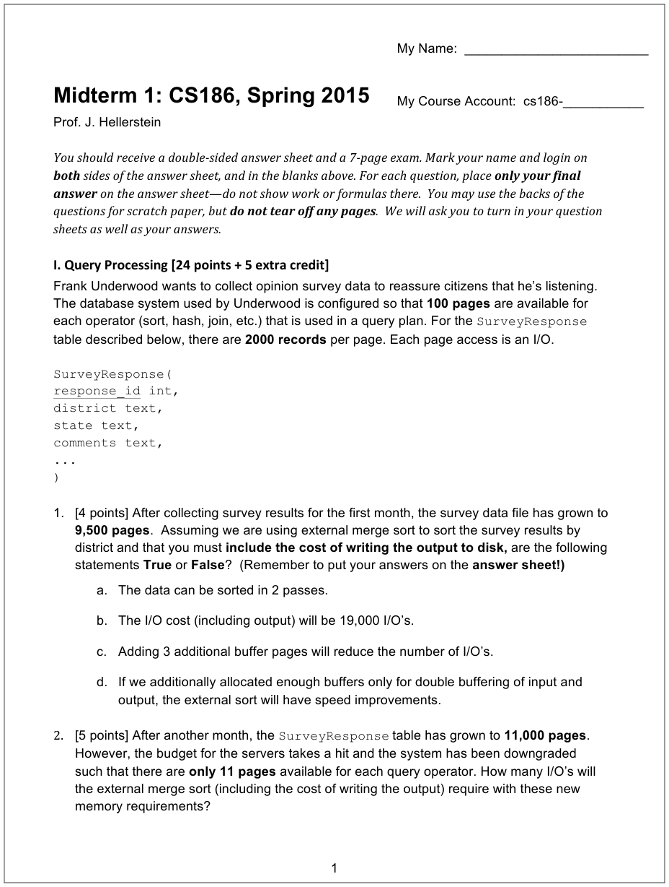
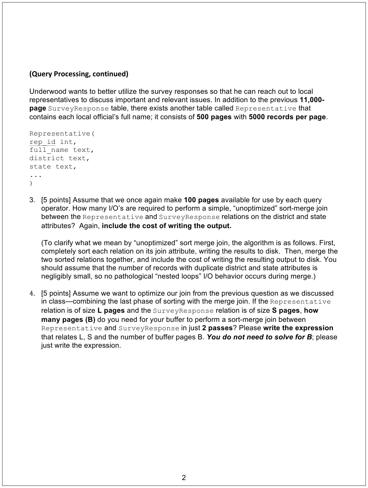
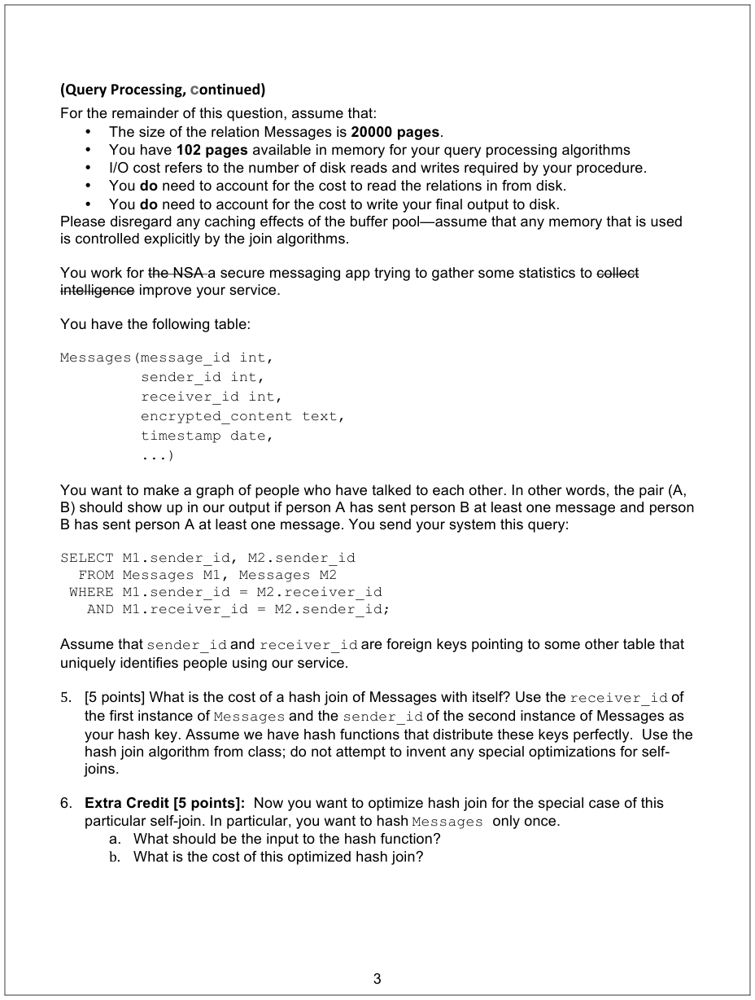
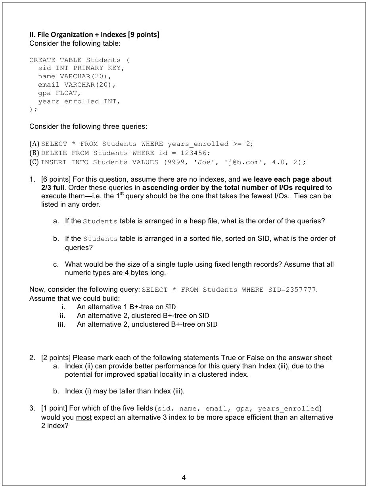
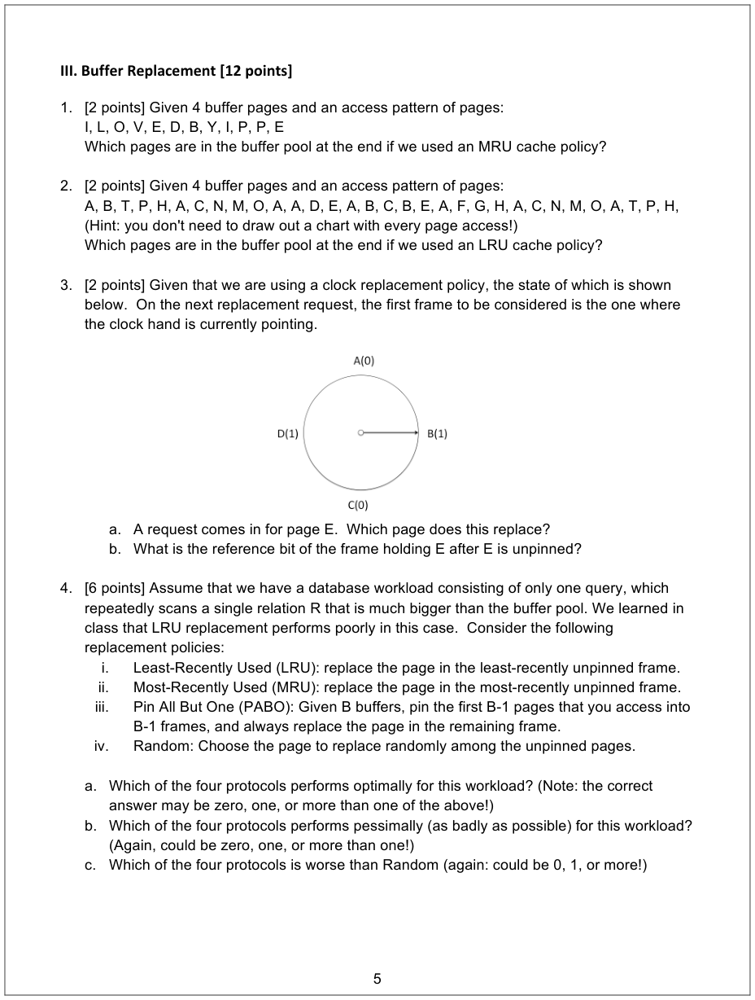
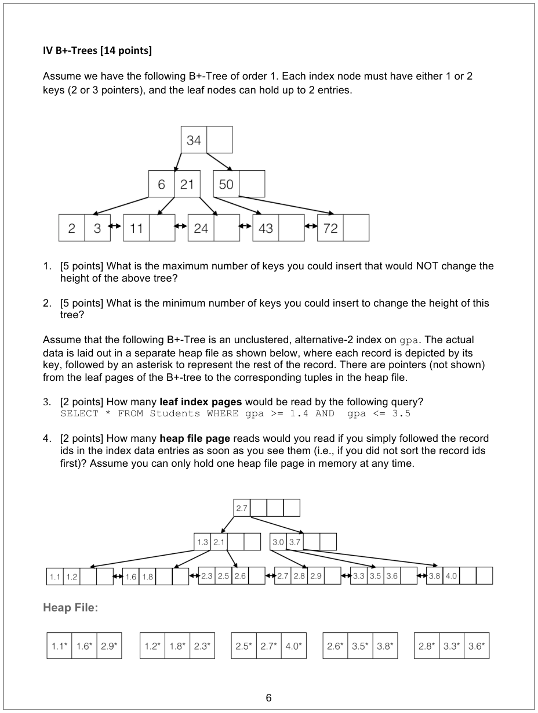
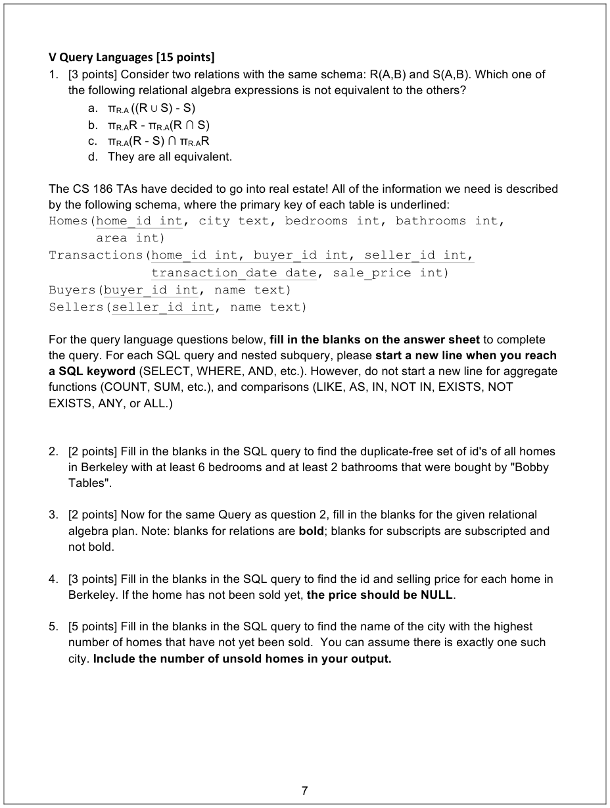

# Berkeley CS186 Spring 2015: Midterm 1: Questions

> Copied from the original: <https://hkn.eecs.berkeley.edu/exams/course/cs/186>. Text and figures are taken from the PDF as is; nothing was answered or rewritten. The original PDF is in this folder.

---

**Page 1**

---

**Page 2**

---

**Page 3**

---

**Page 4**

---

**Page 5**

---

**Page 6**

---

**Page 7**

---

**Page 8**

My Name:  \_\_\_\_\_\_\_\_\_\_\_\_\_\_\_\_\_\_\_\_\_\_\_\_\_\_\_\_\_\_\_\_\_\_\_\_\_\_    Class Login – person on my left: cs186-\_\_\_\_\_\_\_\_\_ 
My Class Login: cs186-\_\_\_\_\_\_\_\_\_\_\_\_\_\_\_\_\_    Class Login – person on my right: cs186-\_\_\_\_\_\_\_\_ 
I. Query Processing    III.Buffer Replacement 
&emsp;1\. Circle the correct answer.    1. \_\_\_\_ \_\_\_\_ \_\_\_\_ \_\_\_\_ 
&emsp;&emsp;a. True / False    2. \_\_\_\_ \_\_\_\_ \_\_\_\_ \_\_\_\_ 
&emsp;&emsp;b. True / False    3. Fill in the blanks. 
&emsp;&emsp;c. True / False    a. \_\_\_\_ 
&emsp;&emsp;d. True / False    b. \_\_\_\_ 
&emsp;2\. \_\_\_\_\_\_\_\_\_\_\_\_\_\_\_\_\_\_ I/Os     4. Circle all that apply **or** “None”. 
&emsp;3\. \_\_\_\_\_\_\_\_\_\_\_\_\_\_\_\_\_\_ I/Os     a. i. / ii. / iii. / iv. / v. / None 
&emsp;4\. Write the expression below.   b. i. / ii. / iii. / iv. / v. / None 
&emsp;&emsp;&emsp;&emsp;&emsp;&emsp;&emsp;&emsp;c. i. / ii. / iii. / iv. / v. / None

&emsp;5\. \_\_\_\_\_\_\_\_\_\_\_\_\_\_\_\_\_\_ I/Os    IV. B+-Trees 
&emsp;6\. \_\_\_\_\_\_\_\_\_\_\_\_\_\_\_\_\_\_ I/Os    1. \_\_\_\_\_\_\_\_\_\_\_\_\_\_\_\_\_\_ keys 
&emsp;7\. a.  Write the expression below.    2. \_\_\_\_\_\_\_\_\_\_\_\_\_\_\_\_\_\_ keys 
&emsp;&emsp;&emsp;&emsp;&emsp;&emsp;&emsp;&emsp;3\. \_\_\_\_\_\_\_\_\_\_\_\_\_\_\_\_\_\_ pages 
&emsp;&emsp;&emsp;&emsp;&emsp;&emsp;&emsp;&emsp;4\. \_\_\_\_\_\_\_\_\_\_\_\_\_\_\_\_\_\_ pages 
&emsp;&emsp;b. \_\_\_\_\_\_\_\_\_\_\_\_\_\_\_\_\_\_ I/Os 
&emsp;&emsp;&emsp;&emsp;&emsp;&emsp;&emsp;&emsp;VI.Query Languages 
II. File Organization + Indexes 
&emsp;&emsp;&emsp;&emsp;&emsp;&emsp;&emsp;&emsp;1\. \_\_\_\_ 
&emsp;1\. Fill in the blanks. 
&emsp;&emsp;a. \_\_\_\_, \_\_\_\_, \_\_\_\_ 
&emsp;&emsp;&emsp;&emsp;&emsp;&emsp;&emsp;&emsp;Put the rest of your answers for section 
&emsp;&emsp;b. \_\_\_\_, \_\_\_\_, \_\_\_\_ 
&emsp;&emsp;&emsp;&emsp;&emsp;&emsp;&emsp;&emsp;VI on the back of this page. 
&emsp;&emsp;c. \_\_\_\_\_\_\_\_\_\_\_\_\_\_\_\_\_\_ bytes 
&emsp;2\. Circle the correct answer. 
&emsp;&emsp;a. True / False 
&emsp;&emsp;b. True / False 
&emsp;3\. \_\_\_\_\_\_\_\_\_\_\_\_\_\_\_\_\_\_

---

**Page 9**

2. 
&emsp;`SELECT ________________________________________________________________` 
&emsp;`FROM __________________________________________________________________` 
&emsp;`_______________________________________________________________________` 
&emsp;`_______________________________________________________________________` 
&emsp;`_______________________________________________________________________` 
&emsp;`_______________________________________________________________________` 
&emsp;`_______________________________________________________________________` 
&emsp;`______________________________________________________________________;` 
3\. π \_\_\_\_\_\_\_\_\_\_\_\_\_\_\_\_\_\_\_\_\_\_\_\_\_\_\_\_\_\_\_\_\_\_\_\_\_\_\_\_\_\_\_\_\_\_\_\_\_\_\_\_\_\_\_\_\_\_\_\_\_\_\_\_\_\_\_\_\_\_\_\_\_\_\_ ( 
&emsp;σ \_\_\_\_\_\_\_\_\_\_\_\_\_\_\_\_\_\_\_\_\_\_\_\_\_\_\_\_\_\_\_\_\_\_\_\_\_\_\_\_\_\_\_\_\_\_\_\_\_\_\_\_\_\_\_\_\_\_\_\_\_\_\_\_\_\_\_\_\_\_\_\_\_\_\_ ( 
&emsp;((σ \_\_\_\_\_\_\_\_\_\_\_\_\_\_\_\_\_\_\_\_\_\_\_\_\_\_\_\_\_\_\_\_\_\_\_\_\_\_\_\_\_\_\_\_\_\_\_\_\_\_\_\_\_\_\_\_\_\_\_\_\_\_\_\_\_\_\_\_\_\_\_\_\_\_\_\_\_\_\_\_\_\_\_\_\_\_\_\_\_\_\_\_ 
&emsp;&emsp;&emsp;&emsp;&emsp;((σ \_\_\_\_\_\_\_\_\_\_\_\_\_\_\_\_\_\_\_\_\_\_\_\_\_\_\_\_\_\_\_\_\_\_\_\_\_\_\_\_\_\_\_\_\_\_\_\_\_\_\_\_\_\_\_\_\_\_\_\_\_\_\_\_\_\_\_\_ **\_\_\_\_\_\_\_\_\_\_\_\_\_\_\_**) 
&emsp;(⋈ **\_\_\_\_\_\_\_\_\_\_\_\_\_\_\_**) ⋈ **\_\_\_\_\_\_\_\_\_\_\_\_\_\_\_**)) 
4. 
&emsp;`SELECT ________________________________________________________________` 
&emsp;`FROM __________________________________________________________________` 
&emsp;`________________________________ JOIN _________________________________` 
&emsp;`ON ____________________________________________________________________` 
&emsp;`_______________________________________________________________________` 
&emsp;`_______________________________________________________________________` 
&emsp;`_______________________________________________________________________` 
&emsp;`______________________________________________________________________;` 
5. 
&emsp;`SELECT ________________________________________________________________` 
&emsp;`FROM __________________________________________________________________` 
&emsp;`WHERE _________________________________________________________________` 
&emsp;`_____ (SELECT ________________________________________________________` 
&emsp;`FROM __________________________________________________________` 
&emsp;`_______________________________________________________________` 
&emsp;`______________________________________________________________)` 
&emsp;`GROUP BY ______________________________________________________________` 
&emsp;`_______________________________________________________________________` 
&emsp;`ORDER BY _________________________________________________________ DESC` 
&emsp;`LIMIT 1;`

