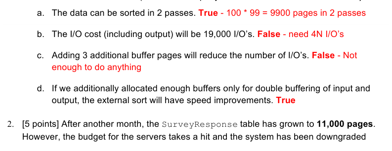
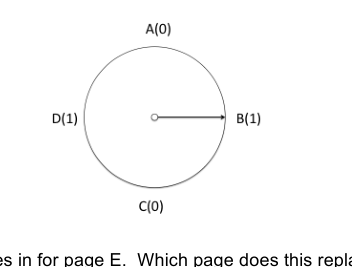
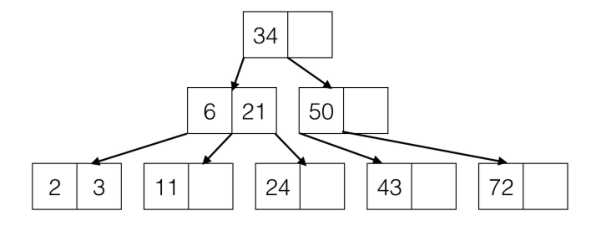
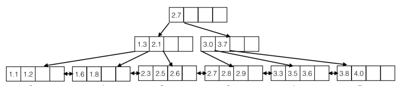
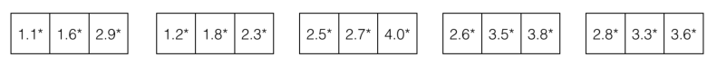
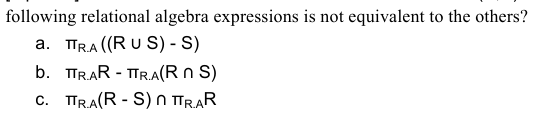

# Berkeley CS186 Spring 2015: Midterm 1: Official solutions

> Copied from the original: <https://hkn.eecs.berkeley.edu/exams/course/cs/186>. Text and figures are taken from the PDF as is; nothing was answered or rewritten. The original PDF is in this folder.

---

**Page 1**

**Midterm 1: CS186, Spring 2015** 
Prof. J. Hellerstein

You should receive a double-sided answer sheet and a 7-page exam. Mark your name and login on **both** 
sides of the answer sheet, and in the blanks above. For each question, place **only your final answer** on 
the answer sheet—do not show work or formulas there.  You may use the backs of the questions for 
scratch paper, but **do not tear off any pages**.We will ask you to turn in your question sheets as well as 
your answers.

**I. Query Processing \[24 points + 5 extra credit\]** 
Frank Underwood wants to collect opinion survey data to reassure citizens that he’s listening. 
The database system used by Underwood is configured so that **100 pages** are available for 
each operator (sort, hash, join, etc.) that is used in a query plan. For the `SurveyResponse` 
table described below, there are **2000 records** per page. Each page access is an I/O.

`SurveyResponse(` 
`response_id int,` 
`district text,` 
`state text,` 
`comments text,` 
`...` 
`)`

1\. \[4 points\] After collecting survey results for the first month, the survey data file has grown to 
&emsp;**9,500 pages**.  Assuming we are using external merge sort to sort the survey results by 
&emsp;district and that you must **include the cost of writing the output to disk,** are the following 
&emsp;statements **True** or **False**?  (Remember to put your answers on the **answer sheet!)**

&emsp;&emsp;&emsp;&emsp;&emsp;&emsp;&emsp;&emsp;1

---

**Page 2**

(1 + log\_{11 - 1} ( 11000 / 11)) \* 2 (11000) = (1 + log\_{10} (1000)) \* 2 \* 11000 = **88,000 I/O’s**

**(Query Processing, continued)** 
Underwood wants to better utilize the survey responses so that he can reach out to local 
representatives to discuss important and relevant issues. In addition to the previous **11,000-** 
**page** `SurveyResponse` table, there exists another table called `Representative` that 
contains each local official’s full name; it consists of **500 pages** with **5000 records per page**. 
`Representative(` 
`rep_id int,` 
`full_name text,` 
`district text,` 
`state text,` 
`...` 
`)` 
3\. \[5 points\] Assume that we once again make **100 pages** available to each query operator. 
&emsp;How many I/O’s are required to perform a simple, “unoptimized” sort-merge join between the 
&emsp;`Representative` and `SurveyResponse` relations on the `district` and `state` attributes? 
&emsp;Again, **include the cost of writing the output.** 
&emsp;(To clarify what we mean by “unoptimized” sort merge join, the algorithm is as follows. First, 
&emsp;completely sort each relation on its join attribute, writing the results to disk.  Then, merge the 
&emsp;two sorted relations together, and include the cost of writing the resulting output to disk. You 
&emsp;should assume that the number of records with duplicate district and state attributes is 
&emsp;negligibly small, so no pathological “nested loops” I/O behavior occurs during merge.) 
2 passes to sort 500 pages 
3 passes to sort 11,000 pages 
cost to sort SurveyResponse + cost to sort Representative + cost to join 
= 2\*500 \* 2 + 2 \* 11000 \* 3 + 11000 + 500 = **79500 I/O’s**

4\. \[5 points\] Assume we want to optimize our join from the previous question as we discussed 
&emsp;in class—combining the last phase of sorting with the merge join. If the `Representative` 
&emsp;relation is of size **L pages** and the `SurveyResponse` relation is of size **S pages**, **how** 
&emsp;&emsp;&emsp;&emsp;&emsp;&emsp;&emsp;&emsp;2

---

**Page 3**

&emsp;**many pages (B)** do you need for your buffer to perform a sort-merge join between 
&emsp;`Representative` and `SurveyResponse` in just **2 passes**? Please **write the expression** 
&emsp;that describes the number of buffer pages B in terms of L and S. **You do not need to solve** 
&emsp;**for B**; please just write the expression.

During the merge & join phase, we have B-1 input buffers to work with. If we wanted to have all 
the runs that were generated fit in one go, we can only have at most B - 1 sorted runs after pass 
0\. B - 1 must be equivalent to the number of sorted runs, which is equivalent to L / B + S / B.

**Hence, L / B + S / B \<= B - 1   or   L + S \<= (B - 1 ) \* B**

**(Query Processing, continued)** 
For the remainder of this question, assume that: 
&emsp;● The size of the relation Messages is **20000 pages**. 
&emsp;● You have **102 pages** available in memory for your query processing algorithms 
&emsp;● I/O cost refers to the number of disk reads and writes required by your procedure. 
&emsp;● You **do** need to account for the cost to read the relations in from disk. 
&emsp;● You **do** need to account for the cost to write your final output to disk. 
Please disregard any caching effects of the buffer pool—assume that any memory that is used 
is controlled explicitly by the join algorithms. 
You work for the NSA a secure messaging app trying to gather some statistics to collect 
intelligence improve your service. 
You have the following table: 
`Messages(message_id int,` 
`sender_id int,` 
`receiver_id int,` 
`encrypted_content text,` 
`timestamp date,` 
`...)` 
You want to make a graph of people who have talked to each other. In other words, the pair (A, 
B) should show up in our output if person A has sent person B at least one message and person 
B has sent person A at least one message. You send your system this query: 
`SELECT M1.sender_id, M2.sender_id` 
`FROM Messages M1, Messages M2` 
`WHERE M1.sender_id = M2.receiver_id` 
`AND M1.receiver_id = M2.sender_id;` 
Assume that `sender_id` and `receiver_id` are foreign keys pointing to some other table that 
uniquely identifies people using our service.

&emsp;&emsp;&emsp;&emsp;&emsp;&emsp;&emsp;&emsp;3

---

**Page 4**

5\. \[5 points\] What is the cost of a hash join of Messages with itself? Use the `receiver_id` of 
&emsp;the first instance of `Messages` and the `sender_id` of the second instance of Messages as 
&emsp;your hash key. Assume we have hash functions that distribute these keys perfectly.  Use the 
&emsp;hash join algorithm from class; do not attempt to invent any special optimizations for self- 
&emsp;joins. 
&emsp;&emsp;200,000 I/Os (we need two full passes of Messages) 
6\. **Extra Credit \[5 points\]:**  Now you want to optimize hash join for the special case of this 
&emsp;particular self-join. In particular, you want to hash `Messages` only once. 
&emsp;&emsp;a. What should be the input to the hash function? Accepted any answer that produced 
&emsp;&emsp;&emsp;a symmetric hash (hash(sender, receiver) = hash(receiver, sender)) 
&emsp;&emsp;b. What is the cost of this optimized hash join? 
&emsp;&emsp;&emsp;100,000 I/Os (half of 5.) 
**II. File Organization + Indexes \[9 points\]** 
Consider the following table: 
`CREATE TABLE Students (` 
`sid INT PRIMARY KEY,` 
`name VARCHAR(20),` 
`email VARCHAR(20),` 
`gpa FLOAT,` 
`years_enrolled INT,` 
`);` 
Consider the following three queries: 
(A) `SELECT * FROM Students WHERE years_enrolled >= 2`; 
(B) `DELETE FROM Students WHERE id = 123456;` 
(C) `INSERT INTO Students VALUES (9999, 'Joe', 'j@b.com', 4.0, 2);` 
1\. \[6 points\] For this question, assume there are not any indexes, and we **leave each page** 
&emsp;**about 2/3 full**. Order these queries in **ascending order by the total number of I/Os** 
&emsp;**required** to execute them; ties can be listed in any order. 
&emsp;&emsp;a. If `Students` table is arranged in a heap file, what is the order of the queries? 
&emsp;&emsp;&emsp;C, B, A 
&emsp;&emsp;b. If `Students` table is arranged in a sorted file, sorted on SID, what is the order of 
&emsp;&emsp;&emsp;queries? 
&emsp;&emsp;&emsp;B, C, A or C, B, A 
&emsp;&emsp;c. What would be the size of a single tuple using fixed length records? Assume that all 
&emsp;&emsp;&emsp;numeric types are 4 bytes long. 
&emsp;&emsp;&emsp;4 + 20 + 20 + 4 + 4 = 52 bytes 
Now, consider the following query: `SELECT * FROM Students WHERE SID=2357777`. 
Assume that we could build: 
&emsp;&emsp;&emsp;&emsp;&emsp;&emsp;&emsp;&emsp;4

---

**Page 5**

&emsp;&emsp;&emsp;i.    An alternative 1 B+-tree on SID 
&emsp;&emsp;&emsp;ii.    An alternative 2, clustered B+-tree on SID 
&emsp;&emsp;&emsp;iii.    An alternative 3, clustered B+-tree on SID 
&emsp;&emsp;&emsp;iv.    An alternative 2 unclustered B+-tree on SID

2\. \[2 points\] Please mark each of the following statements True or False on the answer sheet 
&emsp;&emsp;a. Index (ii) can provide better performance for this query than Index (iv), due to the 
&emsp;&emsp;&emsp;potential for improved spatial locality in a clustered index. 
&emsp;&emsp;&emsp;False - Since SID is a primary key, only one tuple will match 
&emsp;&emsp;b. Index (i) may be taller than Index (ii). 
&emsp;&emsp;&emsp;True - In Alternative 1, data lives in the index, so data pages are index pages 
3\. \[1 point\] For which of the five fields (`sid, name, email, gpa, years_enrolled`) 
&emsp;would you most expect an alternative 3 index to be more space efficient than an alternative 
&emsp;2 index? 
&emsp;years\_enrolled - the field with the most duplicates (aka the least cardinality) 
**III. Buffer Replacement \[12 points\]** 
1\. \[2 points\] Given 4 buffer pages and an access pattern of pages: 
&emsp;I, L, O, V, E, D, B, Y, I, P, P, E 
&emsp;Which pages are in the buffer pool at the end if we used an MRU cache policy? 
&emsp;ELOY

2\. \[2 points\] Given 4 buffer pages and an access pattern of pages: 
&emsp;A, B, T, P, H, A, C, N, M, O, A, A, D, E, A, B, C, B, E, A, F, G, H, A, C, N, M, O, A, T, P, H, 
&emsp;(Hint: you don't need to draw out a chart with every page access!) 
&emsp;Which pages are in the buffer pool at the end if we used an LRU cache policy? 
&emsp;ATPH - the last four page requests will necessarily be in the buffer pool with LRU

&emsp;&emsp;&emsp;&emsp;&emsp;&emsp;&emsp;&emsp;5

---

**Page 6**

3\. \[2 points\] Given that we are using a clock replacement policy, the state of which is shown 
&emsp;below.  On the next replacement request, the first frame to be considered is the one where 
&emsp;the clock hand is currently pointing.

&emsp;&emsp;b. What is the reference bit of the frame holding E after E is unpinned? 1

4\. \[6 points\] Assume that we have a database workload that repeatedly scans a single relation 
&emsp;R, which is much bigger than the buffer pool. We learned in class that LRU replacement 
&emsp;performs poorly in this case.  Consider the following replacement policies: 
&emsp;&emsp;i.    Least-Recently Used (LRU): replace the page in the least-recently unpinned frame. 
&emsp;&emsp;ii.    Most-Recently Used (MRU): replace the page in the most-recently unpinned frame. 
&emsp;iii.    Pin All But One (PABO): Given B buffers, pin the first B-1 pages that you access into 
&emsp;&emsp;&emsp;B-1 frames, and always replace the page in the remaining frame. 
&emsp;iv.    Random: Choose the page to replace randomly among the unpinned pages.

&emsp;a. Which of the five protocols performs optimally for this workload? (Note: the correct 
&emsp;&emsp;answer may be zero, one, or more than one of the above!) 
&emsp;&emsp;(ii) MRU

&emsp;&emsp;Note: this question is tricky! It’s tempting to say PABO as well, but a small example 
&emsp;&emsp;shows MRU outperforms PABO for sequential flooding:

&emsp;&emsp;Sequential flooding over ABCDEF (6 pages) with 4 page buffer

&emsp;&emsp;MRU: 
&emsp;&emsp;Pass0: buffer is now ABCF 
Pass1: buffer is now ABEF (hits: ABCF, misses: DE), hit rate: 4/6 
&emsp;&emsp;Pass2: buffer is now ADEF (hits: ADEF, misses: BC), hit rate: 4/6 
…

&emsp;&emsp;PABO: 
&emsp;&emsp;Pass0: buffer is now ABCF 
&emsp;&emsp;&emsp;&emsp;&emsp;&emsp;&emsp;&emsp;6

---

**Page 7**

&emsp;&emsp;Pass1: buffer is now ABCF (hits: ABC, misses: DEF), hit rate: 3/6 
&emsp;&emsp;Pass2: buffer is now ABCF (hits: ABC, misses: DEF), hit rate: 3/6

&emsp;b. Which of the five protocols performs pessimally (as badly as possible) for this workload? 
&emsp;&emsp;(Again, could be zero, one, or more than one!) 
&emsp;&emsp;(i) LRU

&emsp;c. Which of the five protocols is worse than Random (again: could be 0, 1, or more!) 
&emsp;&emsp;(i) LRU

&emsp;&emsp;&emsp;&emsp;&emsp;&emsp;&emsp;&emsp;7

---

**Page 8**

**IV B+-Trees \[14 points\]** 
Assume we have the following B+-Tree of order 1. Each index node must have either 1 or 2 
keys (2 or 3 pointers), and the leaf nodes can hold up to 2 entries.

1\. \[5 points\] What is the maximum number of keys you could insert that would NOT change the 
&emsp;height of the above tree? 
12 
A possible insertion pattern is: 12, 25, 42, 73, 41, 40, 74, 71, 39, 38, 70, 69 
2\. \[5 points\] What is the minimum number of keys you could insert to change the height of this 
&emsp;tree? 
3 
A possible insertion pattern is: 1, 4, 5 
Assume that the following B+-Tree is an unclustered, alternative-2 index on gpa. The actual 
data is laid out in a separate heap file as shown below, where each record is depicted by its 
key, followed by an asterisk to represent the rest of the record. There are pointers (not shown) 
from the leaf pages of the B+-tree to the corresponding tuples in the heap file. 
3\. \[2 point\] How many **leaf index pages** would be read by the following query? 
&emsp;`SELECT * FROM Students WHERE gpa >= 1.4 AND  gpa <= 3.5` 
4 
Labeling each leaf index page from 0 to 5 from left to right, the following leaf pages would 
be read: 1, 2, 3, 4 
4\. \[2 point\] How many **heap file page** reads would you read if you simply followed the record 
&emsp;ids in the index data entries as soon as you see them (i.e., if you did not sort the record ids 
&emsp;first)? Assume you can only hold one heap file page in memory at any time. 
9 
Labeling each heap file page from 0 to 4 from left to right, here is the access pattern for 
the heap file page reads: 0, 1, 2, 3, 2, 4, 0, 4, 3

&emsp;&emsp;&emsp;&emsp;&emsp;&emsp;&emsp;&emsp;8

---

**Page 9**

0                          1                     2                        3                       4                        5 
**Heap File:**

0                              1                             2                           3                            4

&emsp;&emsp;&emsp;&emsp;&emsp;&emsp;&emsp;&emsp;9

---

**Page 10**

**V Query Languages \[15 points\]** 
1\. \[3 points\] Consider two relations with the same schema: R(A,B) and S(A,B). Which one of the

&emsp;&emsp;d. They are all equivalent. 
Everyone was given credit on this question. 
The correct answer is b: 
A counter example is R(A, B) = {(1,2), (1,3)}, S(A, B) = {(1,2)}. a and c will have size 1, 
while b will have size 0.

The CS 186 TAs have decided to go into real estate! All of the information we need is described 
by the following schema, where the primary key of each table is underlined: 
`Homes(home_id int, city text, bedrooms int, bathrooms int,` 
`area int)` 
`Transactions(home_id int, buyer_id int, seller_id int,` 
`transaction_date date, sale_price int)` 
`Buyers(buyer_id int, name text)` 
`Sellers(seller_id int, name text)`

For the query language questions below, **fill in the blanks on the answer sheet** to complete 
the query. For each SQL query and nested subquery, please **start a new line when you reach** 
**a SQL keyword** (SELECT, WHERE, AND, etc.). However, do not start a new line for aggregate 
functions (COUNT, SUM, etc.), and comparisons (LIKE, AS, IN, NOT IN, EXISTS, NOT 
EXISTS, ANY, or ALL.)

2\. \[2 points\] Fill in the blanks in the SQL query to find the duplicate-free set of id's of all homes 
&emsp;in Berkeley with at least 6 bedrooms and at least 2 bathrooms that were bought by "Bobby 
&emsp;Tables". 
&emsp;SELECT DISTINCT H.home\_id 
&emsp;FROM Homes H, Transactions T, Buyers B 
&emsp;WHERE H.home\_id=T.home\_id 
&emsp;AND T.buyer\_id=B.buyer\_id 
&emsp;AND H.city="Berkeley" 
&emsp;AND H.bedrooms\>=6 
&emsp;AND H.bathrooms\>=2 
&emsp;AND B.name="Bobby Tables" 
&emsp;; 
&emsp;&emsp;&emsp;&emsp;&emsp;&emsp;&emsp;&emsp;10

---

**Page 11**

3\. \[2 points\] Now for the same Query as question 2, fill in the blanks for the given relational 
&emsp;algebra plan. Note: blanks for relations are **bold**; blanks for subscripts are subscripted and 
&emsp;not bold. 
&emsp;πhome\_id ( 
&emsp;σname="Bobby Tables" ( 
&emsp;((σcity="Berkeley" AND bedrooms\>=6 AND bathrooms\>=2 Homes) 
&emsp;⋈ Transactions) ⋈ Buyers))

&emsp;An alternate solution was to perform the selection on the Buyers table first. 
&emsp;πhome\_id ( 
&emsp;σcity="Berkeley" and bedrooms\>=6 and bathrooms\>=2 ( 
&emsp;((σname="Bobby Tables" Buyers) 
&emsp;⋈ Transactions) ⋈ Homes))

4\. \[3 points\] Fill in the blanks in the SQL query that finds, for each home in Berkeley, the id of 
&emsp;the home and the price for which it was sold. If the home has not been sold yet, **the price** 
&emsp;**should be NULL**. 
&emsp;SELECT H.home\_id, T.sale\_price 
&emsp;FROM Homes H 
&emsp;LEFT OUTER JOIN Transactions T 
&emsp;ON H.home\_id=T.home\_id 
&emsp;WHERE H.city="Berkeley" 
&emsp;;

&emsp;An alternate solution was to use Transactions in the FROM clause and perform a RIGHT 
&emsp;OUTER JOIN with Homes. 
&emsp;SELECT H.home\_id, T.sale\_price 
&emsp;FROM Transactions T 
&emsp;RIGHT OUTER JOIN Homes H 
&emsp;ON H.home\_id=T.home\_id 
&emsp;WHERE H.city="Berkeley" 
&emsp;;

5\. \[5 points\] Fill in the blanks in the SQL query to find the name of the city with the highest 
&emsp;number of homes that have not yet been sold. **Include the number of unsold homes in** 
&emsp;**your output.** 
&emsp;The most common solution was to check that home\_id was NOT IN the result of the 
&emsp;subquery: 
&emsp;SELECT H.city, COUNT(\*) AS cnt 
&emsp;FROM Homes H 
&emsp;WHERE H.home\_id NOT IN ( 
&emsp;&emsp;&emsp;&emsp;&emsp;&emsp;&emsp;&emsp;11

---

**Page 12**

&emsp;SELECT DISTINCT T.home\_id 
&emsp;FROM Transactions T 
&emsp;) 
&emsp;GROUP BY H.city 
&emsp;ORDER BY cnt DESC 
&emsp;LIMIT 1 
&emsp;;

&emsp;Another solution used NOT EXISTS with a correlated subquery: 
&emsp;SELECT H.city, COUNT(\*) AS cnt 
&emsp;FROM Homes H 
&emsp;WHERE NOT EXISTS ( 
&emsp;SELECT DISTINCT T.home\_id 
&emsp;FROM Transactions T 
&emsp;WHERE H.home\_id=T.home\_id 
&emsp;) 
&emsp;GROUP BY H.city 
&emsp;ORDER BY cnt DESC 
&emsp;LIMIT 1;

&emsp;&emsp;&emsp;&emsp;&emsp;&emsp;&emsp;&emsp;12

