# Berkeley CS186 Spring 2015: Midterm 2: Questions

> Copied from the original: <https://hkn.eecs.berkeley.edu/exams/course/cs/186>. Text and figures are taken from the PDF as is; nothing was answered or rewritten. The original PDF is in this folder.

---

**Page 1**

**Midterm 2: CS186, Spring 2015** 
**Prof. J. Hellerstein**

You should receive a double-sided answer sheet and an 8-page exam.

Mark your name and login on both sides of the answer sheet, and in the blanks above.

For each question, **place only your final answer on the answer sheet**—do not show work or formulas 
there.

You may use the backs of the questions for scratch paper, but do not tear off any pages.

We will ask you to turn in your question sheets as well as your answers.

&emsp;&emsp;&emsp;&emsp;&emsp;&emsp;&emsp;&emsp;1

---

**Page 2**

**I. ER Diagrams \[18 points\]**

1\. \[4 points\] **True or False:** 
&emsp;a. ER diagrams are used to model the physical schema of a database. 
&emsp;b. An entity set E can be associated with a relationship set R more than once. 
&emsp;c. At most 2 distinct entity sets can be associated with any relationship set R. 
&emsp;d. A weak entity set must have total participation in its identifying relationship set.

Chancellor Dirks wants you to explain how a **relational database management system**, (e.g. 
Postgres) works. Dirks is familiar with reading ER diagrams, so we've created the diagram 
below, but it is missing a few edges.

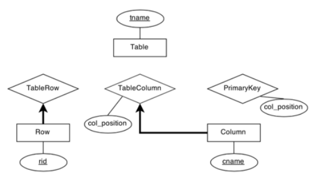

Answer questions 2 to 5 choosing the best option from the following multiple choice options:

&emsp;&emsp;&emsp;&emsp;&emsp;&emsp;&emsp;A. partial participation, non-key

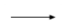

&emsp;&emsp;&emsp;&emsp;&emsp;&emsp;&emsp;B. partial participation, key

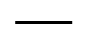

&emsp;&emsp;&emsp;&emsp;&emsp;&emsp;&emsp;C. total participation, non-key

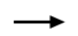

&emsp;&emsp;&emsp;&emsp;&emsp;&emsp;&emsp;D. total participation, key 
&emsp;&emsp;&emsp;&emsp;&emsp;E. none of the above

2\. \[2 point\] What is the correct edge between TableRow and Table? 
3\. \[2 point\] What is the correct edge between TableColumn and Table? 
4\. \[2 point\] What is the correct edge between Column and PrimaryKey? 
5\. \[2 point\] What is the correct edge between Table and PrimaryKey?

**ER to SQL** 
6\. \[6 points\] On your answer sheet, fill in the blanks to convert the **Row entity set**, and the 
**TableColumn relationship set** in the ER diagram above into SQL tables. You may not need all

&emsp;&emsp;&emsp;&emsp;&emsp;&emsp;&emsp;&emsp;2

---

**Page 3**

---

**Page 4**

**II. FDs & Normalization \[16 points\]**

&emsp;1\. \[4 points\] Consider the attribute set R = ABCDEF and the functional dependency set 
&emsp;&emsp;F = {AD → B, A → E, C → E, DEF → A, F → D}. Find a candidate key of R.

&emsp;2\. \[6 points\] Given the attribute set R = ABCDEFGH and the functional dependency set 
&emsp;&emsp;F = {BC → GH, AD → E, A → H, E → BCF, G → H}, decompose R into BCNF by 
&emsp;&emsp;decomposing in the order of the given functional dependencies.

&emsp;3\. \[6 points\] Given the attribute set R = ABCDEF and the functional dependency set 
&emsp;&emsp;F = {B → D, E → F, D → E, D → B, F → BD}. 
&emsp;&emsp;&emsp;a. Is the decomposition ABDE, BCDF lossless? 
&emsp;&emsp;&emsp;b. If not, what functional dependency could you add to make it lossless?

&emsp;&emsp;&emsp;&emsp;&emsp;&emsp;&emsp;&emsp;4

---

**Page 5**

**III. Transactions/CC \[17 points\]**

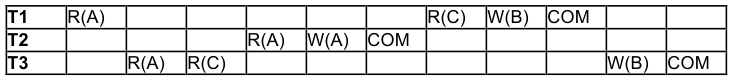

&emsp;1\. \[4 points\] Consider the preceding schedule for three transactions. R indicates a read of a 
&emsp;&emsp;page, W indicates a write of a page, and COM indicates a commit. 
&emsp;&emsp;&emsp;a. Draw the arrows for the dependency graph for this schedule. 
&emsp;&emsp;&emsp;b. Is the schedule conflict serializable?

&emsp;2\. \[5 points\] Which of the following changes to the above schedule will result in a schedule 
&emsp;&emsp;that is possible using strict two-phase locking? (**Mark all that apply**) 
&emsp;&emsp;&emsp;A. Make T1 abort instead of commit 
&emsp;&emsp;&emsp;B. Make T2 abort instead of commit 
&emsp;&emsp;&emsp;C. Remove R(A) from T1 and T3 
&emsp;&emsp;&emsp;D. Remove T2 from the schedule 
&emsp;&emsp;&emsp;E. Make T3 write to a page D instead of page B

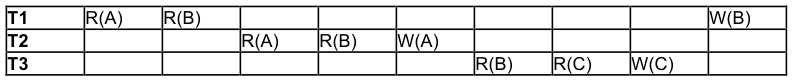

&emsp;3\. \[3 points\] Consider the preceding schedule. A, B, and C are positive integers. Each 
&emsp;&emsp;transaction reads in two integers, adds them, and writes the result. Which of the 
&emsp;&emsp;following statements is/are true? (**Mark all that apply**) 
&emsp;&emsp;&emsp;A. The schedule avoids cascading aborts 
&emsp;&emsp;&emsp;B. The schedule is conflict serializable 
&emsp;&emsp;&emsp;C. The schedule is equivalent to some serial schedule

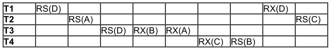

&emsp;4\. \[5 points\] Assume that we are using strict two-phase locking, and the objects being 
&emsp;&emsp;locked are pages. RS indicates a request for a shared lock on a page, and RX indicates 
&emsp;&emsp;a request for an exclusive lock on a page. No transactions commit or abort during this 
&emsp;&emsp;time. 
&emsp;&emsp;&emsp;a. Draw the arrows for the waits-for graph at the end of this schedule. 
&emsp;&emsp;&emsp;b. Does the schedule lead to deadlock?

&emsp;&emsp;&emsp;&emsp;&emsp;&emsp;&emsp;&emsp;5

---

**Page 6**

**IV. Text Search \[14 points\]**

We have a search engine with a corpus containing **only** the documents 
Document ID 1: “A time to plant and a time to reap” 
Document ID 2: “Time for you and time for me” 
Document ID 3: “Time flies”

1a. \[2 points\] Given that the stemmed version of the word “flies” is the term “fly”, what is the TF- 
IDF of “fly” in document 3?

1b. \[2 points\] What is the TF-IDF of “time” in document 1?

2\. \[4 points\] We want to perform cosine similarity ranking on these documents, so we represent 
each document with a vector containing the TF-IDFs of different terms in our documents. Which 
of the following lists of terms would allow us to correctly compute cosine similarity? Assume that 
standard stop words include “a”, "and", "to", and "for". (**Mark all that apply**) 
&emsp;A. (“plant”, “you”, “fly”, “me”, “reap”, “time”) 
&emsp;B. (“time”, “plant”, “reap”, “you”, me”, “fly”) 
&emsp;C. (“time”, “plant”, “you”, “me”, “fly”) 
&emsp;D. (“plant”, “reap”, “you”, “me”, “fly”)

3\. \[4 points\] Suppose we issue our engine the query “plant OR fly”. In the spaces provided, write 
**only** the document IDs which are returned by this query, in order of relevance **as determined** 
**by cosine similarity**. (You may want to leave some spaces **blank**.) Break ties with smaller 
document IDs first, and then larger document IDs.

&emsp;&emsp;&emsp;&emsp;&emsp;&emsp;&emsp;&emsp;6

---

**Page 7**

4a. \[2 point\] For this question, assume that we have a text index with the following schema:

`Files(docID text, content text)` 
`InvertedFile(word text, docID text)` 
`B+-tree Alternative 2 on Files` 
`B+-tree w/”postings list” at leaves on InvertedFile.word`

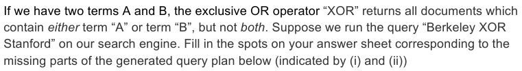

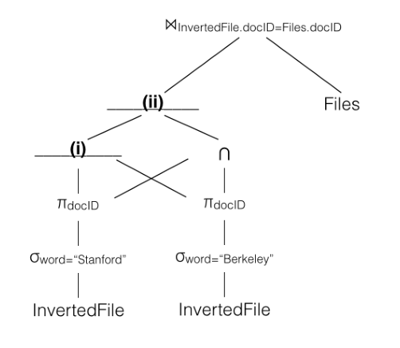

4b. \[2 points\] One of the following join algorithms would be ideal for evaluating the logical 
operator at the top of our query plan ⋈InvertedFile.docID=Files.docID.  Which one should we choose? (You 
can ignore issues of parallelism when answering this question, though they don’t really affect 
the answer.)

&emsp;A. Block Nested Loops join 
&emsp;B. Index Nested Loops join 
&emsp;C. Hash join 
&emsp;D. Sort Merge join

&emsp;&emsp;&emsp;&emsp;&emsp;&emsp;&emsp;&emsp;7

---

**Page 8**

**V. Query Optimization \[17 points\]** 
Suppose the “System R” assumptions about uniformity and independence from lecture hold. 
Assume that costs are estimated as a number of I/Os, without differentiating random and 
sequential I/O cost.

Consider the following relational schema and statistics: 
&emsp;&emsp;&emsp;&emsp;&emsp;`Students   (sid, name, age, gpa, year)` 
&emsp;&emsp;&emsp;&emsp;&emsp;`Courses    (cid, name, professor)` 
&emsp;&emsp;&emsp;&emsp;&emsp;`Enrollment (sid, cid, credits)`

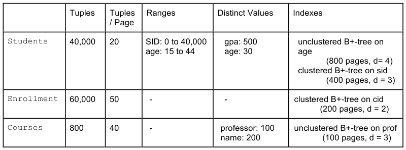

1\. Suppose we run the following query.  (`<>` is the SQL syntax for “not equals”).

`SELECT *` 
`FROM Courses` 
`WHERE name <> "CS 186"` 
`AND professor = "Hellerstein";`

a. \[2 points\] What is the selectivity of each conjunct in the WHERE clause?

b. \[2 points\] Which single table access plan would we choose?

A) Sequential/File Scan on Courses 
B) Sequential/File Scan on Enrollment 
C) Index scan of unclustered B+Tree on Courses.professor 
D) Index scan of clustered B+Tree on Enrollment.cid

&emsp;&emsp;&emsp;&emsp;&emsp;&emsp;&emsp;&emsp;8

---

**Page 9**

2\. \[6 points\] Suppose we run the following query. On the line labeled “considered”, mark the 
letters of all 2-table subplans that will be considered. On the line labeled “chosen”, mark the 
letters of all 2-table subplans that are chosen. Ignore interesting orders.

`SELECT *` 
`FROM Students S, Courses C, Enrollment E` 
`WHERE S.age > 40` 
`AND C.name LIKE "CS%"` 
`AND S.sid = E.sid` 
`AND E.cid = C.cid;`

A) S ⨝ C (200,000 IOs)    D) E ⨝ S (500,000,000 IOs) 
B) C ⨝ S (300,000 IOs)    E) C ⨝ E (300,000 IOs) 
C) S ⨝ E (400,000,000 IOs)    F) E ⨝ C (400,000 IOs)

3\. \[3 points\] Now, mark the letters for all three-table access plans that would be considered, and 
write down the letter of the final query plan that would be chosen.  (Cost given are cumulative 
for the full query.  Again, ignore interesting orders in formulating your answer.)

A) E ⨝ (S ⨝ C) (3,900,000,000 IOs)    G) (S ⨝ E) ⨝ C (7,500,000,000 IOs) 
B) E ⨝ (C ⨝ S) (6,000,000,000 IOs)    H) (E ⨝ S) ⨝ C (8,000,000,000 IOs) 
C) (C ⨝ S) ⨝ E (5,000,000,000 IOs)    I) S ⨝ (C ⨝ E) (3,500,000,000 IOs) 
D) (S ⨝ C) ⨝ E (8,000,000,000 IOs)    J) S ⨝ (E ⨝ C) (6,000,000,000 IOs) 
E) C ⨝ (S ⨝ E) (7,000,000,000 IOs)    K) (C ⨝ E) ⨝ S (4,000,000,000 IOs) 
F) C ⨝ (E ⨝ S) (9,000,000,000 IOs)    L) (E ⨝ C) ⨝ S (10,000,000,000 IOs)

4\. \[4 points\]  **True or False:** 
&emsp;a. If we had considered interesting orders in the query of Question 3, it would have further 
&emsp;&emsp;pruned the number of plans chosen. 
&emsp;b. In Question 3, it would be beneficial to consider interesting orders on C.name during 
&emsp;&emsp;optimization. 
&emsp;c. In Question 3,  it would be beneficial to consider interesting orders on C.cid during 
&emsp;&emsp;optimization.

&emsp;&emsp;&emsp;&emsp;&emsp;&emsp;&emsp;&emsp;9

---

**Page 10**

d. A modern optimizer should consider “interesting hashes”, since the output of a hash- 
&emsp;based operator (e.g. hash join) is organized in a way that would decrease the cost of 
&emsp;performing a subsequent hash-based operator (e.g. group-by).

&emsp;&emsp;&emsp;&emsp;&emsp;&emsp;&emsp;&emsp;10

---

**Page 11**

Name:\_\_\_\_\_\_\_\_\_\_\_\_\_\_\_\_\_\_\_\_\_\_\_\_\_\_\_\_\_\_\_\_\_\_\_    Class Login – person on your left:\_\_\_\_\_\_\_\_\_\_\_\_ 
Class Login (e.g. cs186-aa): \_\_\_\_\_\_\_\_\_\_\_\_\_\_\_    Class Login – person on your right:\_\_\_\_\_\_\_\_\_\_\_

I. ER Diagrams    II. FDs 
1a. True / False    1. \_\_\_\_\_\_\_\_\_\_\_\_\_\_\_\_\_\_\_\_\_\_\_\_\_ 
1b. True / False    2. \_\_\_\_\_\_\_\_\_\_\_\_\_\_\_\_\_\_\_\_\_\_\_\_\_ 
1c. True / False    3a. Yes  / No 
1d. True / False    3b. \_\_\_\_\_\_\_\_\_\_\_\_\_\_\_\_\_\_\_\_\_\_\_

2\. A / B / C / D / E 
3\. A / B / C / D / E 
4\. A / B / C / D / E 
5\. A / B / C / D / E    III. Transactions/CC 
&emsp;1a.

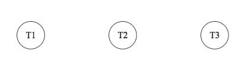

6\. `CREATE TABLE Row (` 
`_____________________________` 
`_____________________________` 
`PRIMARY KEY (________________)` 
`);` 
&emsp;&emsp;&emsp;&emsp;&emsp;&emsp;&emsp;&emsp;1b.  Yes    /    No 
&emsp;&emsp;&emsp;&emsp;&emsp;&emsp;&emsp;&emsp;2\. A / B / C / D / E 
&emsp;`CREATE TABLE TableColumn (` 
&emsp;`_______________________ STRING,` 3. A / B / C 
&emsp;&emsp;&emsp;&emsp;&emsp;&emsp;&emsp;&emsp;4a. 
`______________________________,`

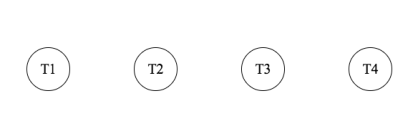

`col_position INTEGER,`

`FOREIGN KEY (_________________)` 
`REFERENCES Table` 
`FOREIGN KEY (_________________)` 
&emsp;&emsp;&emsp;&emsp;&emsp;&emsp;&emsp;&emsp;4b. Yes    /    No 
`REFERENCES _______________`

`PRIMARY KEY (_________________)` 
&emsp;&emsp;&emsp;&emsp;&emsp;&emsp;&emsp;&emsp;. 
`);`

---

**Page 12**

IV. Text Search    V. Query Optimization 
1a. \_\_\_\_\_\_\_\_ log (\_\_\_\_\_\_\_\_\_\_\_)    1a. name: \_\_\_\_\_\_\_\_\_\_\_\_\_\_\_\_\_\_\_\_\_\_ 
1b. \_\_\_\_\_\_\_\_ log (\_\_\_\_\_\_\_\_\_\_\_)    professor: \_\_\_\_\_\_\_\_\_\_\_\_\_\_\_\_\_\_\_\_\_\_ 
2\. A / B / C / D    1b. A / B / C / D 
3\. \_\_\_\_\_\_\_, \_\_\_\_\_\_\_, \_\_\_\_\_\_\_, 
4a, i. \_\_\_\_\_\_\_\_\_\_\_    2. 
4a, ii. \_\_\_\_\_\_\_\_\_\_\_    Considered: 
4b. A / B / C / D    A / B / C / D / E / F

Chosen: 
A / B / C / D / E / F

3. 
Considered: 
A / B / C / D / E / F / 
G / H / I / J / K / L

&emsp;&emsp;&emsp;&emsp;&emsp;&emsp;&emsp;&emsp;Final Plan: 
&emsp;&emsp;&emsp;&emsp;&emsp;&emsp;&emsp;&emsp;\_\_\_\_\_\_\_\_\_\_\_\_\_\_\_\_\_\_\_\_\_\_\_\_\_\_\_\_\_\_\_\_\_

&emsp;&emsp;&emsp;&emsp;&emsp;&emsp;&emsp;&emsp;4a. True / False 
&emsp;&emsp;&emsp;&emsp;&emsp;&emsp;&emsp;&emsp;4b. True / False 
&emsp;&emsp;&emsp;&emsp;&emsp;&emsp;&emsp;&emsp;4c. True / False 
&emsp;&emsp;&emsp;&emsp;&emsp;&emsp;&emsp;&emsp;4d. True / False

