# Berkeley CS186 Spring 2015: Midterm 2: Official solutions

> Copied from the original: <https://hkn.eecs.berkeley.edu/exams/course/cs/186>. Text and figures are taken from the PDF as is; nothing was answered or rewritten. The original PDF is in this folder.

---

**Page 1**

**Midterm 2: CS186, Spring 2015** 
**Prof. J. Hellerstein**

You should receive a double-sided answer sheet and an 8-page exam.

Mark your name and login on both sides of the answer sheet, and in the blanks above.

For each question, **place only your final answer on the answer sheet**—do not show work or formulas 
there.

You may use the backs of the questions for scratch paper, but do not tear off any pages.

We will ask you to turn in your question sheets as well as your answers.

&emsp;&emsp;&emsp;&emsp;&emsp;&emsp;&emsp;&emsp;1

---

**Page 2**

**I. ER Diagrams \[18 points\]**

1\. \[4 points\] **True or False:** 
&emsp;a. ER diagrams are used to model the physical schema of a database. 
&emsp;&emsp;False, they are used to model the logical schema. Physical schema refers to things like 
&emsp;&emsp;file and index layout. 
&emsp;b. An entity set E can be associated with a relationship set R more than once. 
True, for example a relationship Reports\_To which has the entity Employees 
participating twice, since Managers are also Employees. 
&emsp;c. At most 2 distinct entity sets can be associated with any relationship set R. 
&emsp;&emsp;False, for example, a ternary relationship “Covers” with participating entities Employees, 
&emsp;&emsp;Dependents, and Policies. 
&emsp;d. A weak entity set must have total participation in its identifying relationship set. 
&emsp;&emsp;True, by definition.

Chancellor Dirks wants you to explain how a **relational database management system**, (e.g. 
Postgres) works. Dirks is familiar with reading ER diagrams, so we've created the diagram 
below, but it is missing a few edges.

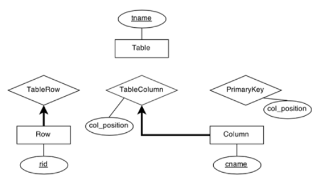

Answer questions 2 to 5 choosing the best option from the following multiple choice options:

&emsp;&emsp;&emsp;&emsp;&emsp;&emsp;&emsp;A. partial participation, non-key

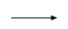

&emsp;&emsp;&emsp;&emsp;&emsp;&emsp;&emsp;B. partial participation, key

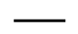

&emsp;&emsp;&emsp;&emsp;&emsp;&emsp;&emsp;C. total participation, non-key

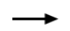

&emsp;&emsp;&emsp;&emsp;&emsp;&emsp;&emsp;D. total participation, key 
&emsp;&emsp;&emsp;&emsp;&emsp;E. none of the above

&emsp;&emsp;&emsp;&emsp;&emsp;&emsp;&emsp;&emsp;2

---

**Page 3**

2\. \[2 point\] What is the correct edge between TableRow and Table? 
A - a table has 0 or more rows 
3\. \[2 point\] What is the correct edge between TableColumn and Table? 
C - a table has 1 or more columns 
4\. \[2 point\] What is the correct edge between Column and PrimaryKey? 
B - Each column participates in at most one primary key. There is at most one primary key, 
there may be none, and even if there is one not every column will be in it. 
5\. \[2 point\] What is the correct edge between Table and PrimaryKey? 
A - A table may have a primary key with 0 columns (meaning it doesn’t have a primary key), 1 
column, or many columns,  so the table can participate in the PrimaryKey relationship 0 or more 
times.

**ER to SQL** 
6\. \[6 points\] On your answer sheet, fill in the blanks to convert the **Row entity set**, and the 
**TableColumn relationship set** in the ER diagram above into SQL tables. You may not need all 
the blanks.

CREATE TABLE Row ( 
rid INTEGER 
PRIMARY KEY (rid) 
);

CREATE TABLE TableColumn ( 
tname STRING, 
cname STRING, 
col\_position INTEGER,

FOREIGN KEY (tname) 
REFERENCES Table 
FOREIGN KEY (cname) 
REFERENCES Column 
PRIMARY KEY (tname, cname) 
);

Our intended answer for the PRIMARY KEY of Table Column was (tname, cname) since we 
usually expect a column to be identified by the table it belongs to, e.g. Students.id.

However, since cname was shown to be a key for the Column entity, meaning that all column 
names are unique in this model, we also accepted cname and (cname, col\_position) as 
answers for the PRIMARY KEYs.

&emsp;&emsp;&emsp;&emsp;&emsp;&emsp;&emsp;&emsp;3

---

**Page 4**

To make our ER diagram more accurate for Chancellor Dirks to understand, a better choice 
would be to make Column a weak-entity of Table. It's a good exercise to think about what this 
would look like in the diagram and in SQL.

**II. FDs & Normalization \[16 points\]**

&emsp;1\. \[4 points\] Consider the attribute set R = ABCDEF and the functional dependency set 
&emsp;&emsp;F = {AD → B, A → E, C → E, DEF → A, F → D}. Find a candidate key of R. 
&emsp;&emsp;**FC** 
Notice that FC is not on the right-hand side of any of the given FDs. This means that 
any key of R must contain FC. Find the closure of FC to see that FC -\> R. Thus, FC is 
a candidate key. Any other key would be superkey, since a key must contain FC.

&emsp;2\. \[6 points\] Given the attribute set R = ABCDEFGH and the functional dependency set 
&emsp;&emsp;F = {BC → GH, AD → E, A → H, E → BCF, G → H}, decompose R into BCNF by 
&emsp;&emsp;decomposing in the order of the given functional dependencies. 
**ADE, BCEF, GH, BCG** 
BC -\> GH violates BCNF, decompose. 
Relations: ABCDEF BCGH 
AD -\> E does not violate BCNF because AD is a superkey, skip. 
A -\> H No relation contains AH, skip. 
E -\> BCF violates BCNF, decompose. 
Relations: ADE EBCF BCGH 
G -\> H violates BCNF, decompose. 
ADE EBCF BCG GH

&emsp;3\. \[6 points\] Given the attribute set R = ABCDEF and the functional dependency set 
&emsp;&emsp;F = {B → D, E → F, D → E, D → B, F → BD}. 
&emsp;&emsp;&emsp;a. Is the decomposition ABDE, BCDF lossless? 
&emsp;&emsp;&emsp;b. If not, what functional dependency could you add to make it lossless? 
a. **No**, it is lossy

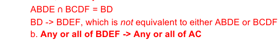

For example some valid answers were: B -\> C, B -\> A, BEFD -\> AC, etc.

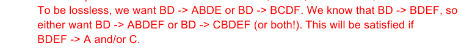

&emsp;&emsp;&emsp;&emsp;&emsp;&emsp;&emsp;&emsp;4

---

**Page 5**

**III. Transactions/CC \[17 points\]**

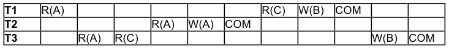

&emsp;1\. \[4 points\] Consider the preceding schedule for three transactions. R indicates a read of a 
&emsp;&emsp;page, W indicates a write of a page, and COM indicates a commit. 
&emsp;&emsp;&emsp;a. Draw the arrows for the dependency graph for this schedule. 
&emsp;&emsp;&emsp;b. Is the schedule conflict serializable? 
&emsp;&emsp;a. The dependency graph is shown below.

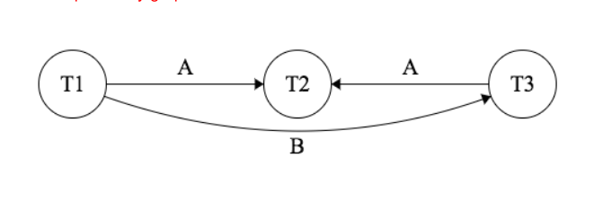

&emsp;&emsp;b. Yes, it is conflict serializable, because the dependency graph has no directed cycles.

&emsp;2\. \[5 points\] Which of the following changes to the above schedule will result in a schedule 
&emsp;&emsp;that is possible using strict two-phase locking? (**Mark all that apply**) 
&emsp;&emsp;&emsp;A. Make T1 abort instead of commit 
&emsp;&emsp;&emsp;B. Make T2 abort instead of commit 
&emsp;&emsp;&emsp;C. Remove R(A) from T1 and T3 
&emsp;&emsp;&emsp;D. Remove T2 from the schedule 
&emsp;&emsp;&emsp;E. Make T3 write to a page D instead of page B 
&emsp;&emsp;**C,D** 
&emsp;&emsp;A and B are incorrect because strict 2PL deals with acquisition of locks before a 
&emsp;&emsp;transaction commits or aborts. C is correct because if T1 and T3 do not acquire a shared 
&emsp;&emsp;lock to read page A, then T2 can acquire an exclusive lock to write page A before T1 
&emsp;&emsp;and T3 commit. Similarly, D is correct because if we remove T2 from the schedule, then 
&emsp;&emsp;no transaction needs an exclusive lock on page A. E is incorrect because T2 and T3 can 
&emsp;&emsp;already acquire an exclusive lock to write page B, and even if T3 writes to page D 
&emsp;&emsp;instead of page B, strict 2PL still prevents T2 from completing.

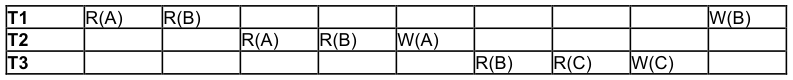

&emsp;&emsp;&emsp;&emsp;&emsp;&emsp;&emsp;&emsp;5

---

**Page 6**

&emsp;3\. \[3 points\] Consider the preceding schedule. A, B, and C are positive integers. Each 
&emsp;&emsp;transaction reads in two integers, adds them, and writes the result. Which of the 
&emsp;&emsp;following statements is/are true? (**Mark all that apply**) 
&emsp;&emsp;&emsp;A. The schedule avoids cascading aborts 
&emsp;&emsp;&emsp;B. The schedule is conflict serializable 
&emsp;&emsp;&emsp;C. The schedule is equivalent to some serial schedule 
&emsp;&emsp;**A** 
&emsp;&emsp;A is correct because after each page is written, no transaction reads that page, so if any 
&emsp;&emsp;transaction aborts, then no other transactions need to abort. B is incorrect because in 
&emsp;&emsp;the dependency graph, there is an edge from T1 to T2 (A), and an edge from T2 to T1 
&emsp;&emsp;(B), so the graph has a directed cycle. C is incorrect because there is no way to 
&emsp;&emsp;interleave the reads and writes of the transactions and have the same outputs in 
&emsp;&emsp;integers A, B, and C.

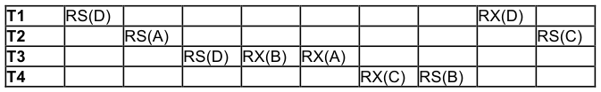

&emsp;4\. \[5 points\] Assume that we are using strict two-phase locking, and the objects being 
&emsp;&emsp;locked are pages. RS indicates a request for a shared lock on a page, and RX indicates 
&emsp;&emsp;a request for an exclusive lock on a page. No transactions commit or abort during this 
&emsp;&emsp;time. 
&emsp;&emsp;&emsp;a. Draw the arrows for the waits-for graph at the end of this schedule. 
&emsp;&emsp;&emsp;b. Does the schedule lead to deadlock? 
&emsp;&emsp;a. The waits-for graph is shown below.

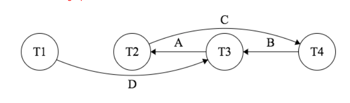

&emsp;&emsp;b. Yes, it leads to deadlock, because there is a cycle in the waits-for graph.

**IV. Text Search \[14 points\]**

We have a search engine with a corpus containing **only** the documents 
Document ID 1: “A time to plant and a time to reap” 
Document ID 2: “Time for you and time for me” 
Document ID 3: “Time flies”

&emsp;&emsp;&emsp;&emsp;&emsp;&emsp;&emsp;&emsp;6

---

**Page 7**

1a. \[2 points\] Given that the stemmed version of the word “flies” is the term “fly”, what is the TF- 
IDF of “fly” in document 3?

**1 log (3)** 
“fly” appears once (stemmed from “flies”) in document 3, so its TF is 1. It appears only in 
document 3, so its IDF is log (3/1) = log (3).

1b. \[2 points\] What is the TF-IDF of “time” in document 1?

**2 log (1)** 
“time” appears twice in document 1, so its TF is 2. It appears in three documents, so its IDF is 
log (3/3) = log (1).

2\. \[4 points\] We want to perform cosine similarity ranking on these documents, so we represent 
each document with a vector containing the TF-IDFs of different terms in our documents. Which 
of the following lists of terms would allow us to correctly compute cosine similarity? Assume that 
standard stop words include “a”, "and", "to", and "for". (**Mark all that apply**) 
&emsp;A. (“plant”, “you”, “fly”, “me”, “reap”, “time”) 
&emsp;B. (“time”, “plant”, “reap”, “you”, me”, “fly”) 
&emsp;C. (“time”, “plant”, “you”, “me”, “fly”) 
&emsp;D. (“plant”, “reap”, “you”, “me”, “fly”)

**A, B, D** 
All we care about when making cosine similarity vectors are the sets of terms themselves, so 
permuting the orderings of terms in a vector will not influence cosine similarity. (You may also 
observe that a dot product is agnostic to the ordering of terms in a vector.) After we remove stop 
words and perform stemming, lists A and B contain all the relevant terms that we would care 
about in some query against this corpus. 
Not all the terms need to be present, however. In fact, list D is sufficient for computing cosine 
similarity: with careful observation (question 1(b) is a hint) you could realize that since “time” 
showed up in every document, its TF-IDF would always be 0, and consequently “time” cannot 
affect the result of our cosine similarity ranking. 
List C was not a valid answer; the absence of “reap” would for example cause queries including 
that term to rank improperly.

3\. \[4 points\] Suppose we issue our engine the query “plant OR fly”. In the spaces provided, write 
**only** the document IDs which are returned by this query, in order of relevance **as determined** 
**by cosine similarity**. (You may want to leave some spaces **blank**.) Break ties with smaller 
document IDs first, and then larger document IDs.

**3, 1, \<blank\>**

&emsp;&emsp;&emsp;&emsp;&emsp;&emsp;&emsp;&emsp;7

---

**Page 8**

First, observe that document 2 is never returned by our query: it contains neither the term 
“plant” nor the word “fly”. 
Now we can compute cosine similarity between the document “plant OR fly” and both 
documents 1 and 3. This would involve computing the TF-IDFs of each of the relevant terms in 
documents 1 and 3 and then normalizing the resulting vector, after which you would compute a 
dot product on these vectors with the query document. 
Instead of doing the math to find these vectors, you could also have noticed that “plant” and “fly” 
have the same TF-IDF in documents 1 and 3, but document 1 has another “important” term in it 
(“reap”) while “fly” is the only important term in document 3 (discounting “time” in either 
document). Then since “plant” and “fly” had the same TF-IDF, but document 1 was “longer”, the 
TF-IDF of “plant” would have been scaled by a smaller normalizing factor than “fly”.

&emsp;&emsp;&emsp;&emsp;&emsp;&emsp;&emsp;&emsp;8

---

**Page 9**

4a. \[2 point\] For this question, assume that we have a text index with the following schema:

`Files(docID text, content text)` 
`InvertedFile(word text, docID text)` 
`B+-tree Alternative 2 on Files` 
`B+-tree w/”postings list” at leaves on InvertedFile.word`

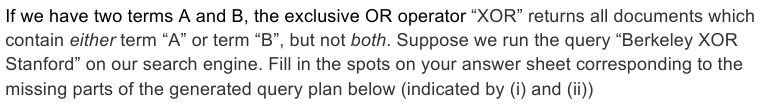

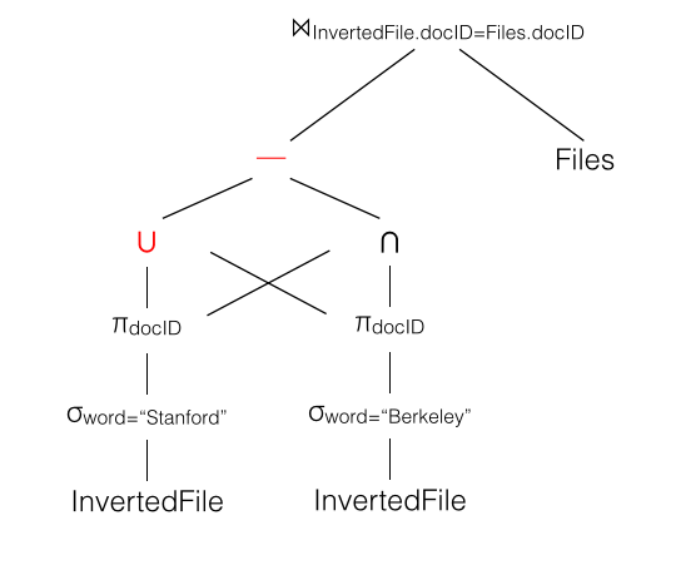

4b. \[2 points\] One of the following join algorithms would be ideal for evaluating the logical 
operator at the top of our query plan ⋈InvertedFile.docID=Files.docID.  Which one should we choose? (You 
can ignore issues of parallelism when answering this question, though they don’t really affect 
the answer.)

&emsp;A. Block Nested Loops join 
&emsp;B. Index Nested Loops join

&emsp;&emsp;&emsp;&emsp;&emsp;&emsp;&emsp;&emsp;9

---

**Page 10**

&emsp;C. Hash join 
&emsp;D. Sort Merge join

**B** 
As specified above, and as is usual for text search engines, our Files relation is conveniently 
indexed (by a B+ tree). Index Nested Loops Join will work best in this scenario, streaming result 
document IDs against this index.

**V. Query Optimization \[17 points\]** 
Suppose the “System R” assumptions about uniformity and independence from lecture hold. 
Assume that costs are estimated as a number of I/Os, without differentiating random and 
sequential I/O cost.

Consider the following relational schema and statistics: 
&emsp;&emsp;&emsp;&emsp;&emsp;`Students   (sid, name, age, gpa, year)` 
&emsp;&emsp;&emsp;&emsp;&emsp;`Courses    (cid, name, professor)` 
&emsp;&emsp;&emsp;&emsp;&emsp;`Enrollment (sid, cid, credits)`

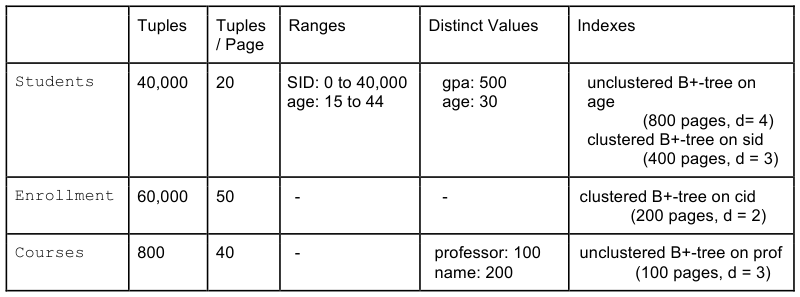

1\. Suppose we run the following query.  (`<>` is the SQL syntax for “not equals”).

`SELECT *` 
`FROM Courses` 
`WHERE name <> "CS 186"` 
`AND professor = "Hellerstein";`

a. \[2 points\] What is the selectivity of each conjunct in the WHERE clause? 
name: .995 (199/200) 
professor: .01 (1/100)

b. \[2 points\] Which single table access plan would we choose?

&emsp;&emsp;&emsp;&emsp;&emsp;&emsp;&emsp;&emsp;10

---

**Page 11**

A) Sequential/File Scan on Courses 
B) Sequential/File Scan on Enrollment 
C) Index scan of unclustered B+Tree on Courses.professor 
D) Index scan of clustered B+Tree on Enrollment.cid

2\. \[6 points\] Suppose we run the following query. On the line labeled “considered”, mark the 
letters of all 2-table subplans that will be considered. On the line labeled “chosen”, mark the 
letters of all 2-table subplans that are chosen. Ignore interesting orders.

`SELECT *` 
`FROM Students S, Courses C, Enrollment E` 
`WHERE S.age > 40` 
`AND C.name LIKE "CS%"` 
`AND S.sid = E.sid` 
`AND E.cid = C.cid;`

A) S ⨝ C (200,000 IOs)    D) E ⨝ S (500,000,000 IOs) 
B) C ⨝ S (300,000 IOs)    E) C ⨝ E (300,000 IOs) 
C) S ⨝ E (400,000,000 IOs)    F) E ⨝ C (400,000 IOs) 
Considered: C, D, E, F 
Chosen: C, E

3\. \[3 points\] Now, mark the letters for all three-table access plans that would be considered, and 
write down the letter of the final query plan that would be chosen.  (Cost given are cumulative 
for the full query.  Again, ignore interesting orders in formulating your answer.)

A) E ⨝ (S ⨝ C) (3,900,000,000 IOs)    G) (S ⨝ E) ⨝ C (7,500,000,000 IOs) 
B) E ⨝ (C ⨝ S) (6,000,000,000 IOs)    H) (E ⨝ S) ⨝ C (8,000,000,000 IOs) 
C) (C ⨝ S) ⨝ E (5,000,000,000 IOs)    I) S ⨝ (C ⨝ E) (3,500,000,000 IOs) 
D) (S ⨝ C) ⨝ E (8,000,000,000 IOs)    J) S ⨝ (E ⨝ C) (6,000,000,000 IOs) 
E) C ⨝ (S ⨝ E) (7,000,000,000 IOs)    K) (C ⨝ E) ⨝ S (4,000,000,000 IOs)

&emsp;&emsp;&emsp;&emsp;&emsp;&emsp;&emsp;&emsp;11

---

**Page 12**

F) C ⨝ (E ⨝ S) (9,000,000,000 IOs)    L) (E ⨝ C) ⨝ S (10,000,000,000 IOs) 
Considered: G, K 
Chosen: K

4\. \[4 points\]  **True or False:** 
&emsp;a. If we had considered interesting orders in the query of Question 3, it would have further 
&emsp;&emsp;pruned the number of plans chosen. False 
&emsp;b. In Question 3, it would be beneficial to consider interesting orders on C.name during 
&emsp;&emsp;optimization. False 
&emsp;c. In Question 3,  it would be beneficial to consider interesting orders on C.cid during 
&emsp;&emsp;optimization. True 
&emsp;d. A modern optimizer should consider “interesting hashes”, since the output of a hash- 
&emsp;&emsp;based operator (e.g. hash join) is organized in a way that would decrease the cost of 
&emsp;&emsp;performing a subsequent hash-based operator (e.g. group-by). True

&emsp;&emsp;&emsp;&emsp;&emsp;&emsp;&emsp;&emsp;12

