# Berkeley CS186 Spring 2016: Final: Questions

> Copied from the original: <https://hkn.eecs.berkeley.edu/exams/course/cs/186>. Text and figures are taken from the PDF as is; nothing was answered or rewritten. The original PDF is in this folder.

---

**Page 1**

&emsp;&emsp;&emsp;&emsp;&emsp;&emsp;&emsp;&emsp;Name: \_\_\_\_\_\_\_\_\_\_\_\_\_\_\_\_\_ 
&emsp;&emsp;&emsp;&emsp;&emsp;&emsp;&emsp;&emsp;Account: CS186 - \_\_ \_\_ \_\_

CS186 Final Exam                                  Spring 2016

You should receive 1 double-sided answer sheet and a **21-page** exam. There are a total of **147 Points**. 
Mark your name and login on both sides of the answer sheet, and in the blanks above. For each question, 
place only your final answer on the answer sheet—do not show work or formulas there.  You may use the 
blank spaces for scratch paper, but do not tear off any pages. You will turn in both question and answer 
sheets.

&emsp;&emsp;&emsp;&emsp;&emsp;&emsp;&emsp;&emsp;1

---

**Page 2**

I. BASICS \[14 POINTS\] 
For each image on the next page, select the letter corresponding to the best description. 
&emsp;a) Left Deep Tree    h) Slotted Page 
&emsp;b) Key Compression    i)    Variable Length Tuple 
&emsp;c) B+Tree    j)    Fixed Length Tuple 
&emsp;d) ISAM    k) Buffer Frame 
&emsp;e) Nested Loops Join    l)    Sort based group by 
&emsp;f) Sort Merge Join    m) mapPartitions 
&emsp;g) Indexed Nested Loop Join    n) Tournament Sort

&emsp;&emsp;&emsp;&emsp;&emsp;&emsp;This space is intentionally blank; exam continues on next page.

&emsp;&emsp;&emsp;&emsp;&emsp;&emsp;&emsp;&emsp;2

---

**Page 3**

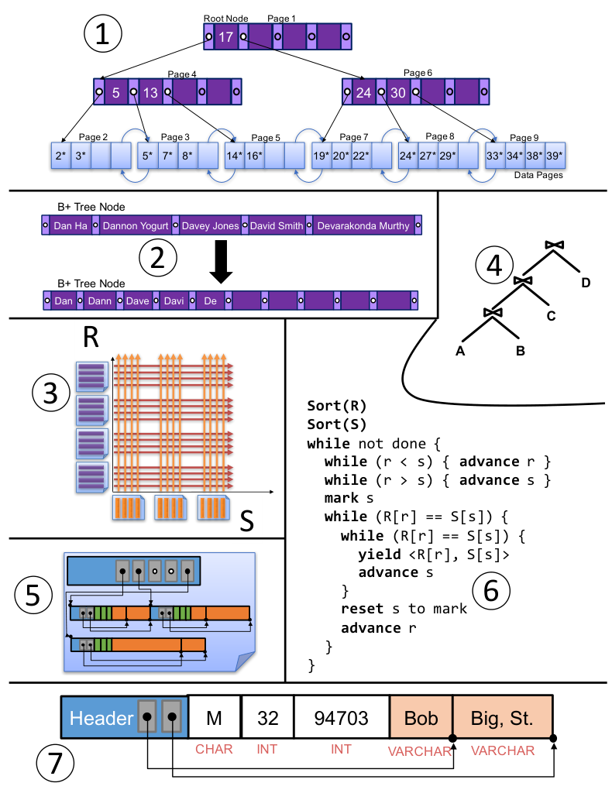

&emsp;&emsp;&emsp;&emsp;&emsp;&emsp;&emsp;&emsp;3

---

**Page 4**

II. CONCURRENCY \[13 POINTS\]

&emsp;1\. **\[3 Points\]** For the following statements, mark the boxes for all true statement(s), or mark 
&emsp;&emsp;∅ if none are true. 
&emsp;&emsp;&emsp;a) In a system that uses two-phase locking, a transaction may perform writes after 
&emsp;&emsp;&emsp;&emsp;&emsp;the first lock has been released. 
&emsp;&emsp;&emsp;b) An SIX lock is compatible with another SIX lock on the same resource. 
&emsp;&emsp;&emsp;c) In a system that uses the wound-wait protocol, there can be two disjoint deadlock 
&emsp;&emsp;&emsp;&emsp;&emsp;cycles at the same time. 
&emsp;&emsp;&emsp;d) By definition, a schedule is conflict serializable if it is equivalent to a serial 
&emsp;&emsp;&emsp;&emsp;&emsp;schedule. 
&emsp;&emsp;&emsp;e) In a system that uses strict two-phase locking, if a transaction aborts, it releases 
&emsp;&emsp;&emsp;&emsp;&emsp;all of its locks as soon as rollback is complete. 
&emsp;&emsp;&emsp;f) In a system that uses strict two-phase locking, a transaction that only performs 
&emsp;&emsp;&emsp;&emsp;&emsp;reads can never enter a deadlock cycle.

Consider the following sequence of actions from time steps 1 through 10. The meanings of 
actions are shown below:

&emsp;&emsp;R(A): the transaction reads tuple A                  W(A): the transaction writes tuple A 
&emsp;&emsp;&emsp;&emsp;&emsp;&emsp;&emsp;&emsp;COM: the transaction commits

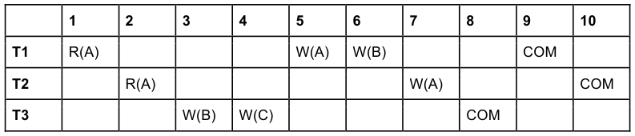

&emsp;2\. **\[3 Points\]** Draw the dependency graph for this schedule. (**Figure is on Answer Sheet.**)

&emsp;3\. **\[2 Points\]** Which of the following would guarantee that the schedule is serializable? 
&emsp;&emsp;Consider each scenario independently. Mark the boxes for all true statement(s), or mark 
&emsp;&emsp;∅ if none are true.

&emsp;&emsp;&emsp;a) Remove T1’s write to A at time step 5. 
&emsp;&emsp;&emsp;b) Change the commit order (i.e., swap values in time-steps 8, 9, and 10) 
&emsp;&emsp;&emsp;c) T1 and T2 write the same value to A at time steps 5 and 7, respectively. 
&emsp;&emsp;&emsp;d) T1 writes a value to A that is one less than it read from A earlier; T2 writes a 
&emsp;&emsp;&emsp;&emsp;&emsp;value to A that is 2 times larger than it read from A earlier.

&emsp;&emsp;&emsp;&emsp;&emsp;&emsp;&emsp;&emsp;4

---

**Page 5**

Consider the following sequence of lock requests from time steps 1 through 6. Assume that the 
system uses **strict two-phase locking at only the tuple level**. None of the transactions 
commit or abort during the specified time period. The meanings of requests are shown below:

•    S(A): the transaction requests (but does not necessarily acquire) a shared lock on tuple A 
•    X(A): the transaction requests (but does not necessarily acquire) an exclusive lock on tuple A

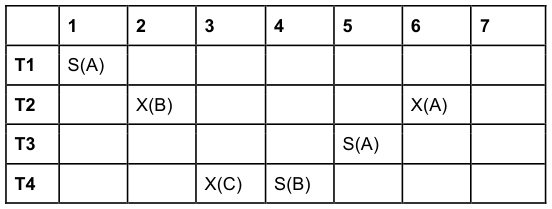

&emsp;4\. **\[3 Points\]** Draw the waits-for graph for the series of requests above. (**Figure is on the** 
&emsp;&emsp;**answer Sheet.**)

&emsp;5\. **\[1 Point\]** (True/False) There are no deadlocks in the sequence of lock requests.

&emsp;6\. **\[1 Point\]** (True/False) If T1 requests a shared lock on B at time-step 7 there are **no** 
&emsp;&emsp;**deadlocks.**

&emsp;&emsp;&emsp;&emsp;&emsp;&emsp;This space is intentionally blank; exam continues on next page.

&emsp;&emsp;&emsp;&emsp;&emsp;&emsp;&emsp;&emsp;5

---

**Page 6**

III.MULTIGRANULARITY LOCKING \[6 POINTS\] 
Consider the following sequence of actions from time steps 1 through 9. Assume that we are 
using strict two-phase locking with locks that can be acquired at the table, page, and tuple 
levels. Assume that at each time step, the transaction acquires the locks with minimal privilege 
required to complete the specified action.

Table Y contains pages A, B, and C. Page A contains tuples A1, …, A20. Page B contains tuples 
B1, …, B30. Page C contains tuples C1, …, C10. R(A) indicates that the transaction reads page A. 
W(A) indicates that the transaction writes page A. Italicized and underlined values indicate 
actions that were blocked because they could not acquire all of the necessary locks. Intention 
lock requests are not shown, but assume that the system follows multi-granularity strict two- 
phase locking. None of the transactions commit or abort during the specified time period.

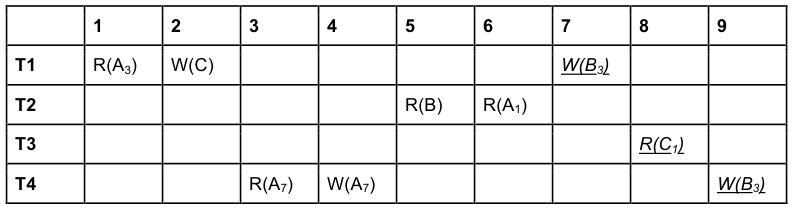

&emsp;1\. **\[2 points\]** For each transaction write down the **table level locks** it has acquired on 
&emsp;&emsp;**table Y** at the moment T4 is blocked during time step 9. For instance, if a transaction 
&emsp;&emsp;acquires an S lock on Y, write S(Y); if none write ∅.

&emsp;2\. **\[3 points\]** Suppose T2 commits at time step 10. Which locks do T1, T3, and T4 **acquire** 
&emsp;&emsp;after this happens? Again, use locks with **minimal privilege**. For example, to indicate 
&emsp;&emsp;that a transaction acquires an S lock on page A, use the notation S(A). **(**Hint: recall from 
&emsp;&emsp;Homework 4 that if multiple transactions are waiting to acquire a lock on a resource, we 
&emsp;&emsp;form a FIFO wait queue.)

&emsp;3\. **\[1 point\] (True or False)** Consider time step 9 in the chart above. If T4’s W(B3) at that 
&emsp;&emsp;time step had instead been R(A), then the action would **not** have been blocked.

&emsp;&emsp;&emsp;&emsp;&emsp;&emsp;&emsp;&emsp;6

---

**Page 7**

IV. ARIES RECOVERY \[20 POINTS\]

&emsp;**1. \[2 Points\]** Suppose that you are forced to flush pages in the DPT to disk upon 
&emsp;&emsp;checkpointing. Which of the following cases are now guaranteed? **There is exactly one** 
&emsp;&emsp;**correct answer.** 
&emsp;&emsp;&emsp;a) We can skip one of the three phases (analysis/redo/undo) completely 
&emsp;&emsp;&emsp;b) We must start analysis from the beginning of the log 
&emsp;&emsp;&emsp;c) Redo can start at the checkpoint. 
&emsp;&emsp;&emsp;d) Redo must start from the beginning of the log 
&emsp;&emsp;&emsp;e) Undo can start at the checkpoint 
&emsp;&emsp;&emsp;f) Undo must run until the beginning of the log

&emsp;2\. **\[4 Points\]** Consider the following log, recovered after a crash. T1 and T2 are the only 
&emsp;&emsp;transactions.  All pages were flushed to disk at and including LSN 60, so the log record 
&emsp;&emsp;has been truncated to start at LSN 70.

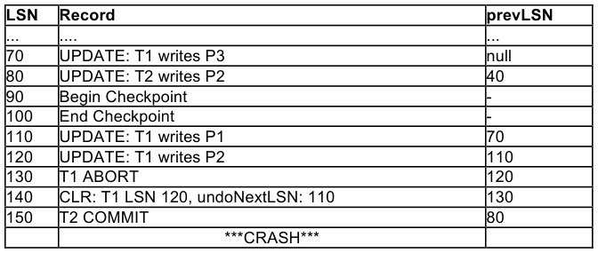

&emsp;&emsp;Assuming the buffer has **not** flushed any pages to disk after LSN 60, fill out the 
&emsp;&emsp;transaction table and dirty page table given on the answer sheet **as recorded in the** 
&emsp;&emsp;**end checkpoint record**. You may not need all rows, and may list the 
&emsp;&emsp;transactions/pages in any order.

&emsp;3\. **\[6 points\]** Now, fill out the transaction table and dirty page table on the answer sheet for 
&emsp;&emsp;the same log **after the analysis phase**. You may not need all rows.

&emsp;4\. **\[6 points\]** After recovery is complete, what records have been added to the log? You 
&emsp;&emsp;may not need all rows on the answer sheet. Be sure to follow the log record format we 
&emsp;&emsp;use above. (You may omit End records.)

&emsp;5\. **\[1 point\]** True/False: After recovery, both the Transaction Table and Dirty Page Table 
&emsp;&emsp;are empty.

&emsp;&emsp;&emsp;&emsp;&emsp;&emsp;&emsp;&emsp;7

---

**Page 8**

&emsp;6\. **\[1 Points\]** Consider a slightly different scenario, in which the records at LSN 100 and 
&emsp;&emsp;110 are in opposite order (that is, the UPDATE occurs before the End Checkpoint). Of 
&emsp;&emsp;the following, choose the **single** most appropriate answer. 
&emsp;&emsp;&emsp;a) The DPT stored in the checkpoint must be different than in the original scenario. 
&emsp;&emsp;&emsp;b) The DPT stored in the checkpoint could be different than in the original scenario. 
&emsp;&emsp;&emsp;c) The DPT stored in the checkpoint must be the same as in the original scenario.

&emsp;&emsp;&emsp;&emsp;&emsp;&emsp;This space is intentionally blank; exam continues on next page.

&emsp;&emsp;&emsp;&emsp;&emsp;&emsp;&emsp;&emsp;8

---

**Page 9**

V. TWO PHASE COMMIT \[14 POINTS\]

&emsp;1\. **\[6 Points\]** Mark the boxes for all true statement(s), or mark ∅ if none are true. 
&emsp;&emsp;&emsp;a) Eventual consistency guarantees that if you read a copy from one replica, the 
&emsp;&emsp;&emsp;&emsp;&emsp;other replicas will eventually be consistent with what you read. 
&emsp;&emsp;&emsp;b) Two-phase commit (2PC) requires write-ahead logging, but not all log records 
&emsp;&emsp;&emsp;&emsp;&emsp;must be flushed to disk before their corresponding message is sent. 
&emsp;&emsp;&emsp;c) In 2PC, coordinators send prepare messages to participants. The coordinator 
&emsp;&emsp;&emsp;&emsp;&emsp;must write a log record when all prepare messages have been sent. 
&emsp;&emsp;&emsp;d) A global commit message cannot be sent before the coordinator has received a 
&emsp;&emsp;&emsp;&emsp;&emsp;vote from all participants. 
&emsp;&emsp;&emsp;e) A global abort message cannot be sent before the coordinator has received a 
&emsp;&emsp;&emsp;&emsp;&emsp;vote from all participants. 
&emsp;&emsp;&emsp;f) A participant machine that does not flush its prepare records to the log could 
&emsp;&emsp;&emsp;&emsp;&emsp;violate the durability property.

&emsp;2\. **\[2 Points\]** Suppose that you are a machine that has just recovered from a crash.  You 
&emsp;&emsp;discover a prepare record in your log for transaction T, and deduce that you are a 
&emsp;&emsp;participant. But you do not find a commit record. Under proper 2PC and logging 
&emsp;&emsp;protocols, mark the boxes for all true statement(s), or mark ∅ if none are true.. 
&emsp;&emsp;&emsp;a) The coordinator must have received your vote. 
&emsp;&emsp;&emsp;b) You must determine if you need to commit or abort.

&emsp;3\. **\[3 Points\]** Given the scenario from the previous question, answer the following: 
&emsp;&emsp;&emsp;a) On the answer sheet, circle all of the 2PC log records that **another participant** 
&emsp;&emsp;&emsp;&emsp;&emsp;could have already logged. 
&emsp;&emsp;&emsp;b) On the answer sheet, circle all of the 2PC log records that **the coordinator** could 
&emsp;&emsp;&emsp;&emsp;&emsp;have already logged.

&emsp;4\. **\[3 Points\]** A participant machine can unilaterally (without consulting other machines) 
&emsp;&emsp;choose to abort at any time before it takes what action? On the answer sheet, choose 
&emsp;&emsp;exactly one of the sentences provided (mark the circle by your choice) and fill in the 
&emsp;&emsp;blank in your chosen sentence with the correct word. Hint: Try to answer this question 
&emsp;&emsp;without looking at the options on the answer sheet, and then choose the option that fits 
&emsp;&emsp;your answer.

&emsp;&emsp;&emsp;&emsp;&emsp;This space is intentionally blank; exam continues on next page.

&emsp;&emsp;&emsp;&emsp;&emsp;&emsp;&emsp;&emsp;9

---

**Page 10**

VI. SQL & LINEAR ALGEBRA \[11 PTS\]

In lecture we learned that matrix algebra can be cast as operation on tables.  Let's take a look 
linear algebra in SQL.

We have two d-dimensional sparse vectors (stored in row id, value form):

&emsp;&emsp;`CREATE TABLE` `x` `(``row` `INTEGER,` `value` `REAL)`

&emsp;&emsp;`CREATE TABLE` `y` `(``row` `INTEGER,` `value` `REAL)`

and two sparse matrices (stored in row id, col id, value form)

&emsp;&emsp;`CREATE TABLE` `A` `(``row` `INTEGER,` `col` `INTEGER,` `value` `REAL)`

&emsp;&emsp;`CREATE TABLE` `B` `(``row` `INTEGER,` `col` `INTEGER,` `value` `REAL)`

assume **A** is n by d and **B** is d by m.

&emsp;1\. **\[2 Point\]** On the answer sheet mark the letter corresponding to the SQL query that 
&emsp;&emsp;correctly computes the dot product 
&emsp;&emsp;&emsp;&emsp;&emsp;&emsp;&emsp;&emsp;Xd 
&emsp;&emsp;&emsp;&emsp;&emsp;&emsp;&emsp;&emsp;x · y =   xiyi 
&emsp;&emsp;&emsp;&emsp;&emsp;&emsp;&emsp;&emsp;i=1

&emsp;&emsp;of **x** and **y**. Assume they have compatible dimensions and **there is only one correct** 
&emsp;&emsp;**answer**.

&emsp;&emsp;&emsp;&emsp;a) `SELECT x.row AS row, x.value * y.value AS value` 
&emsp;&emsp;&emsp;&emsp;&emsp;`FROM x JOIN y` 
&emsp;&emsp;&emsp;&emsp;b) `SELECT SUM(x.value * y.value) AS value,` 
&emsp;&emsp;&emsp;&emsp;&emsp;`FROM x JOIN y ON x.row = y.row` 
&emsp;&emsp;&emsp;&emsp;c) `SELECT x.row, y.value, y.value` 
&emsp;&emsp;&emsp;&emsp;&emsp;`FROM x JOIN y ON x.row = y.row` 
&emsp;&emsp;&emsp;&emsp;d) `SELECT x.value * y.value` 
&emsp;&emsp;&emsp;&emsp;&emsp;`FROM x JOIN y ON x.row = y.row`

&emsp;&emsp;&emsp;&emsp;&emsp;&emsp;&emsp;&emsp;10

---

**Page 11**

&emsp;2\. **\[2 Points\]** Suppose we wanted to compute the elementwise sum of the vectors **x** and **y** 
&emsp;&emsp;using the SQL expression:

&emsp;&emsp;&emsp;&emsp;&emsp;`SELECT x.row AS row, sum(x.value + y.value) AS value` 
&emsp;&emsp;&emsp;&emsp;&emsp;`FROM x JOIN y` 
&emsp;&emsp;&emsp;&emsp;&emsp;`ON x.row = y.row`

&emsp;&emsp;Which of the following statements about this query are **true**?  Mark the boxes for all true 
&emsp;&emsp;statement(s), or mark ∅ if none are true.

&emsp;&emsp;&emsp;a) Some non-zero entries may be omitted from the final result. 
&emsp;&emsp;&emsp;b) The correct query should use LEFT OUTER JOIN 
&emsp;&emsp;&emsp;c) The correct query should use FULL OUTER JOIN 
&emsp;&emsp;&emsp;d) There is nothing wrong

&emsp;3\. **\[2 Points\]** Which of the following expressions computes the matrix vector product: 
&emsp;&emsp;&emsp;&emsp;&emsp;&emsp;&emsp;&emsp;Xd 
&emsp;&emsp;&emsp;&emsp;&emsp;&emsp;&emsp;&emsp;(Ax)i =   Aikxk 
&emsp;&emsp;&emsp;&emsp;&emsp;&emsp;&emsp;&emsp;k=1 
&emsp;&emsp;of the matrix **A** with the vector **x**?  Assume **A** and **x** have compatible dimensions and 
&emsp;&emsp;**there is only one correct answer,**

&emsp;&emsp;&emsp;a) `SELECT A.row AS row, A.value * x.value AS value` 
&emsp;&emsp;&emsp;&emsp;&emsp;`FROM A JOIN x` 
&emsp;&emsp;&emsp;&emsp;&emsp;`ON A.row = x.row` 
&emsp;&emsp;&emsp;b) `SELECT A.row AS row, SUM(A.value * x.value) AS value` 
&emsp;&emsp;&emsp;&emsp;&emsp;`FROM A JOIN x` 
&emsp;&emsp;&emsp;&emsp;&emsp;`ON A.row = x.row` 
&emsp;&emsp;&emsp;&emsp;&emsp;`GROUP BY A.col` 
&emsp;&emsp;&emsp;c) `SELECT A.row AS row, SUM(A.value * x.value) AS value` 
&emsp;&emsp;&emsp;&emsp;&emsp;`FROM A JOIN x` 
&emsp;&emsp;&emsp;&emsp;&emsp;`ON A.col = x.row` 
&emsp;&emsp;&emsp;&emsp;&emsp;`GROUP BY A.row` 
&emsp;&emsp;&emsp;d) `SELECT x.row AS row, SUM(A.value * x.value) AS value` 
&emsp;&emsp;&emsp;&emsp;&emsp;`FROM A JOIN x` 
&emsp;&emsp;&emsp;&emsp;&emsp;`ON A.col = x.row` 
&emsp;&emsp;&emsp;&emsp;&emsp;`GROUP BY A.col`

&emsp;&emsp;&emsp;&emsp;&emsp;&emsp;&emsp;&emsp;11

---

**Page 12**

&emsp;4\. **\[5 Points\]** Fill in the blanks to complete the SQL implementation of matrix multiply 
&emsp;&emsp;between matrix **A** and **B** that is compute**:** 
&emsp;&emsp;&emsp;&emsp;&emsp;&emsp;&emsp;&emsp;Xd 
&emsp;&emsp;&emsp;&emsp;&emsp;&emsp;&emsp;&emsp;(AB)ij =   AikBkj 
&emsp;&emsp;&emsp;&emsp;&emsp;&emsp;&emsp;&emsp;k=1 
&emsp;&emsp;&emsp;&emsp;&emsp;`SELECT` `A.row` `AS row,` `B.col` `AS col,` 
&emsp;&emsp;&emsp;&emsp;&emsp;&emsp;&emsp;`(a)`           `AS value` 
&emsp;&emsp;&emsp;&emsp;&emsp;`FROM A JOIN B` 
&emsp;&emsp;&emsp;&emsp;&emsp;`ON`     `(b)`     `=`    `(c)`    `_` 
&emsp;&emsp;&emsp;&emsp;&emsp;`GROUP BY`     `(d)`    `,`    `(e)`   `_`

Using the following options (you may any one option multiple times):

&emsp;&emsp;&emsp;`1)` `A.row` 
&emsp;&emsp;&emsp;`2)` `B.row` 
&emsp;&emsp;&emsp;`3)` `A.col` 
&emsp;&emsp;&emsp;`4)` `B.col` 
&emsp;&emsp;&emsp;`5)` `A.value + B.value` 
&emsp;&emsp;&emsp;`6)` `A.value * B.value` 
&emsp;&emsp;&emsp;`7)` `sum(A.value + B.value)` 
&emsp;&emsp;&emsp;`8)` `sum(A.value * B.value)`

&emsp;&emsp;&emsp;&emsp;&emsp;This space is intentionally blank; exam continues on next page.

&emsp;&emsp;&emsp;&emsp;&emsp;&emsp;&emsp;&emsp;12

---

**Page 13**

VII. SPARK \[15 PTS\]

&emsp;1\. **\[6 Points\]** Mark the boxes for all true statement(s), or mark ∅ if none are true.. 
&emsp;&emsp;&emsp;a) In the following block of code we know that `a == 3 * b`:

&emsp;&emsp;&emsp;&emsp;&emsp;&emsp;&emsp;`rdd = sc.parallelize(range(1, 1000))` 
&emsp;&emsp;&emsp;&emsp;&emsp;&emsp;&emsp;`a = rdd.flatMap(lambda x: [0, 1, 2]).count()` 
&emsp;&emsp;&emsp;&emsp;&emsp;&emsp;&emsp;`b = rdd.map(lambda x: [0, 1, 2]).count()`

&emsp;&emsp;&emsp;b) `reduceByKey` and `reduce` both return an RDD. 
&emsp;&emsp;&emsp;c) A call to `filter` may result in partitions with no records. 
&emsp;&emsp;&emsp;d) The `mapPartitions` method takes a function from tuples to tuples 
&emsp;&emsp;&emsp;e) `count()` forces the operations on the rdd to be evaluated. 
&emsp;&emsp;&emsp;f) The following program will terminate

&emsp;&emsp;&emsp;&emsp;&emsp;&emsp;&emsp;`rdd = sc.parallelize(range(1, 1000))`

&emsp;&emsp;&emsp;&emsp;&emsp;&emsp;&emsp;`def loop_forever(x):` 
&emsp;&emsp;&emsp;&emsp;&emsp;&emsp;&emsp;`while true:` 
&emsp;&emsp;&emsp;&emsp;&emsp;&emsp;&emsp;`print “I am thinking”` 
&emsp;&emsp;&emsp;&emsp;&emsp;&emsp;&emsp;`return 42`

&emsp;&emsp;&emsp;&emsp;&emsp;&emsp;&emsp;`profound_thought = rdd.map(loop_forever)`

&emsp;&emsp;&emsp;&emsp;&emsp;&emsp;&emsp;`print “hello World”`

&emsp;&emsp;&emsp;&emsp;&emsp;This space is intentionally blank; exam continues on next page.

&emsp;&emsp;&emsp;&emsp;&emsp;&emsp;&emsp;&emsp;13

---

**Page 14**

&emsp;2\. **\[5 pts\]** Given `rdd = sc.parallelize([1.0,2.0,3.0,4.0])`, compute the 
&emsp;&emsp;variance: 
&emsp;&emsp;&emsp;&emsp;&emsp;&emsp;&emsp;&emsp;Xn 
&emsp;&emsp;&emsp;&emsp;&emsp;&emsp;&emsp;&emsp;¯x = 1 
&emsp;&emsp;&emsp;&emsp;&emsp;&emsp;&emsp;&emsp;xi 
&emsp;&emsp;&emsp;&emsp;&emsp;&emsp;&emsp;&emsp;n 
&emsp;&emsp;&emsp;&emsp;&emsp;&emsp;&emsp;&emsp;i=1 
&emsp;&emsp;&emsp;&emsp;&emsp;&emsp;&emsp;&emsp;Xn 
&emsp;&emsp;&emsp;&emsp;&emsp;&emsp;&emsp;&emsp;**Var** = 1 
&emsp;&emsp;&emsp;&emsp;&emsp;&emsp;&emsp;&emsp;(xi −¯x)2 
&emsp;&emsp;&emsp;&emsp;&emsp;&emsp;&emsp;&emsp;n 
&emsp;&emsp;&emsp;&emsp;&emsp;&emsp;&emsp;&emsp;i=1 
&emsp;&emsp;by completing the following program:

&emsp;&emsp;&emsp;&emsp;&emsp;`xbar = rdd.____``(a)``____ / ____``(b)``____` 
&emsp;&emsp;&emsp;&emsp;&emsp;`var = rdd.____``(c)``_____.____``(d)``____ / ____``(e)``_____`

For each letter in a blank, choose one of the following code snippets (you may use some 
snippets multiple times):

&emsp;&emsp;&emsp;&emsp;&emsp;`1.` `rdd.size()` 
&emsp;&emsp;&emsp;&emsp;&emsp;`2.` `rdd.count()` 
&emsp;&emsp;&emsp;&emsp;&emsp;`3.` `map(lambda x: x)` 
&emsp;&emsp;&emsp;&emsp;&emsp;`4.` `map(lambda x: (x – xbar) * (x – xbar))` 
&emsp;&emsp;&emsp;&emsp;&emsp;`5.` `mapPartitions(lambda x: (x – xbar) * (x – xbar))` 
&emsp;&emsp;&emsp;&emsp;&emsp;`6.` `reduce(lambda a, b: a + b)` 
&emsp;&emsp;&emsp;&emsp;&emsp;`7.` `reduceByKey(lambda a, b: a + b)`

&emsp;3\. **\[4 Point\]** A friend at a big web company sent you the following snippet of Spark code 
&emsp;&emsp;from the core of the search engine:

`data = [` 
`("http://hello.com", "hello world ohai"),` 
`("http://goodbye.com", "hello goodbye another day")` 
`]` 
`rdd = sc.parallelize(data)` 
`rdd = rdd.flatMap(lambda x: [(y, [x[0]]) for y in x[1].split(' ')])` 
`rdd.reduceByKey(lambda a, b: a + b).collect()`

&emsp;&emsp;and asked you “What does it return”.  **Choose one.**

&emsp;&emsp;&emsp;a. A page and the count of words in the page, e.g `("http://hello.com", 3)` 
&emsp;&emsp;&emsp;b. A page and the words with the frequency in that page, e.g. 
&emsp;&emsp;&emsp;&emsp;&emsp;`("http://hello.com", [("hello", 1), …])` 
&emsp;&emsp;&emsp;c. A word and the frequency of that word across pages, e.g. `("hello", 2)` 
&emsp;&emsp;&emsp;d. A word and then the list of pages that contain that word, e.g. `("hello",` 
&emsp;&emsp;&emsp;&emsp;&emsp;`["http://hello.com", "http://goodbye.com"])`

&emsp;&emsp;&emsp;&emsp;&emsp;&emsp;&emsp;&emsp;14

---

**Page 15**

VIII. ANALYTICS AND MACHINE LEARNING \[17 POINTS\]

1\) **\[3 Points\] Enterprise Data Infrastructure:** Mark the boxes for all true statement(s), or 
&emsp;mark ∅ if none are true.. 
&emsp;a) A **schema-on-load** design implies that the schema is determined **when querying the** 
&emsp;&emsp;**data**. 
&emsp;b) Data-lakes typically adopt a **schema-on-read** design to provide **greater flexibility** and 
&emsp;&emsp;simplify data collection. 
&emsp;c) The **star schema** is a **normalized** representation of data in the data warehouse 
&emsp;d) **Rollup** is the process of viewing data at increasingly **finer** granularity. 
&emsp;e) In some situations storing the **messy or dirty raw data** can be **better than imposing a** 
&emsp;&emsp;**strict schema**. 
&emsp;f) A multidimensional **data cube** can in fact have more than 3 dimensions.

2\) **\[3 Points\] General Machine Learning**: Mark the boxes for all true statement(s), or mark ∅ 
&emsp;if none are true. 
&emsp;a) In **supervised** machine learning **labeled data** is used to train a model. 
&emsp;b) **Classification models** would be a good candidate when trying to predict **the total** 
&emsp;&emsp;**amount of time** a user spends browsing a page. 
&emsp;c) The ultimate goal in machine learning is **to find a model** that best fits the **training** data. 
&emsp;d) The **k-means** algorithm is guaranteed **to converge** to the **optimal clustering** 
&emsp;e) The **bag-of-words** model encodes **text as a vector**. 
&emsp;f) A common form of **feature engineering** on **continuous** data is **one-hot-encoding**.

3\) **\[4 Points\] K-Means Assignments:** For the following data choose the center assignments 
&emsp;on the answer sheet for each of the points **1, 2, 3,** and **4**

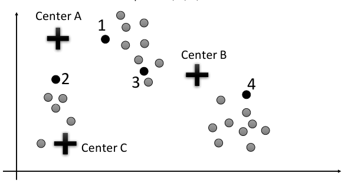

&emsp;&emsp;&emsp;&emsp;&emsp;&emsp;&emsp;&emsp;15

---

**Page 16**

4\) **\[3 Points\] K-Means Cluster Centers:** For each of the cluster centers choose the letter on 
&emsp;the answer sheet corresponding to the new location of that center after updating the 
&emsp;assignments (one step of k-means).  If the center doesn’t move, choose DM (Doesn’t Move).

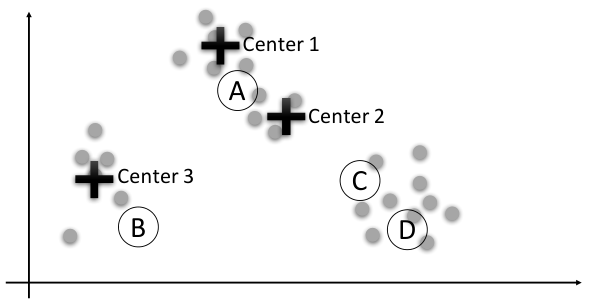

5\) **\[2 Points\] The A-Res Algorithm:** Using the following table containing the random numbers 
&emsp;**u** and the calculated functions of **u,** mark the boxes of the **2 letters** would be selected using 
&emsp;the A-Res algorithm:

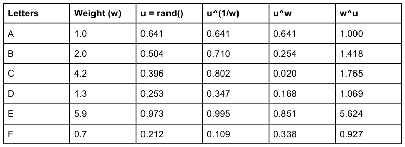

&emsp;&emsp;&emsp;&emsp;&emsp;&emsp;&emsp;&emsp;16

---

**Page 17**

6\) **\[2 Points\] Regression and Overfitting:** Consider the following plots of training data, and 
&emsp;functions fit to that data.

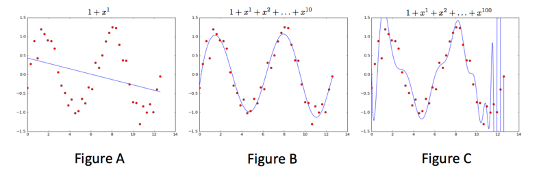

&emsp;a) Choose the letter corresponding to the plot of **over-fitting** 
&emsp;b) Choose the letter corresponding to the plot of **under-fitting**

&emsp;&emsp;This space is intentionally blank; exam continues on next page.

&emsp;&emsp;&emsp;&emsp;&emsp;&emsp;&emsp;&emsp;17

---

**Page 18**

IX. ER MODELING \[14 POINTS\]

&emsp;1\. **\[1 Points\]** True/False: Any ternary relationship is equivalent to some pair of binary 
&emsp;&emsp;relationships. 
&emsp;2\. **\[3 Points\]** For each of the following three diagrams, mark the circle by the **single** letter 
&emsp;&emsp;that corresponds to one of the following classifications of the relationship (read left-to- 
&emsp;&emsp;right): 
&emsp;&emsp;&emsp;a) Many to Many 
&emsp;&emsp;&emsp;b) One to Many 
&emsp;&emsp;&emsp;c) Many to One 
&emsp;&emsp;&emsp;d) One to One

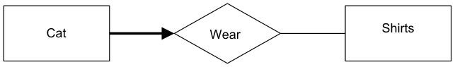

&emsp;&emsp;&emsp;a.

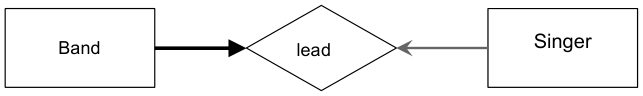

&emsp;&emsp;&emsp;b.

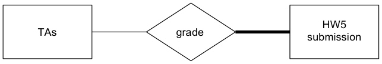

&emsp;&emsp;&emsp;c.

&emsp;&emsp;This space is intentionally blank; exam continues on next page.

&emsp;&emsp;&emsp;&emsp;&emsp;&emsp;&emsp;&emsp;18

---

**Page 19**

&emsp;3\. **\[2 Points\]** Given the following ER diagram, which SQL CREATE TABLE statements 
&emsp;&emsp;below best captures the Student entity set and grade relationship set correctly?  **Choose** 
&emsp;&emsp;**exactly one.**  For each choice, you can assume TA is defined as: 
&emsp;&emsp;`CREATE TABLE TA(EmpNum integer PRIMARY KEY, Name text);`

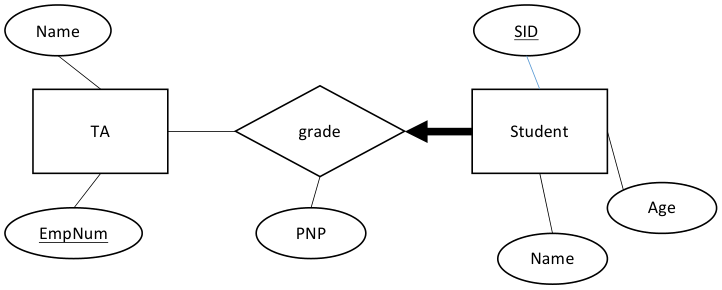

&emsp;&emsp;&emsp;a. `CREATE TABLE Student(SID integer PRIMARY KEY, Age integer,` 
&emsp;&emsp;&emsp;&emsp;&emsp;`Name text);` 
&emsp;&emsp;&emsp;&emsp;&emsp;`CREATE TABLE grade(SID integer REFERENCES Student NOT NULL,` 
&emsp;&emsp;&emsp;&emsp;&emsp;`EmpNum integer REFERENCES TA,` 
&emsp;&emsp;&emsp;&emsp;&emsp;`PNP char(2),` 
&emsp;&emsp;&emsp;&emsp;&emsp;`PRIMARY KEY (SID, EmpNum));` 
&emsp;&emsp;&emsp;b. `CREATE TABLE Student(SID integer PRIMARY KEY, Age integer,` 
&emsp;&emsp;&emsp;&emsp;&emsp;`Name text);` 
&emsp;&emsp;&emsp;&emsp;&emsp;`CREATE TABLE grade(SID integer REFERENCES Student NOT NULL,` 
&emsp;&emsp;&emsp;&emsp;&emsp;`EmpNum integer REFERENCES TA,` 
&emsp;&emsp;&emsp;&emsp;&emsp;`PNP char(2));` 
&emsp;&emsp;&emsp;&emsp;&emsp;`PRIMARY KEY (SID));` 
&emsp;&emsp;&emsp;c. `CREATE TABLE StGrade(SID integer,` 
&emsp;&emsp;&emsp;&emsp;&emsp;`EmpNum integer REFERENCES TA NOT NULL,` 
&emsp;&emsp;&emsp;&emsp;&emsp;`Age integer, Name text, PNP char(2),` 
&emsp;&emsp;&emsp;&emsp;&emsp;`PRIMARY KEY (SID, EmpNum));` 
&emsp;&emsp;&emsp;d. `CREATE TABLE StGrade(SID integer,` 
&emsp;&emsp;&emsp;&emsp;&emsp;`EmpNum integer REFERENCES TA NOT NULL,` 
&emsp;&emsp;&emsp;&emsp;&emsp;`Age integer, Name text, PNP char(2),` 
&emsp;&emsp;&emsp;&emsp;&emsp;`PRIMARY KEY (SID));`

&emsp;&emsp;&emsp;&emsp;&emsp;&emsp;&emsp;&emsp;19

---

**Page 20**

&emsp;4\. **\[8 Points\]** Please modify the edges on the ER diagram on the answer sheet to capture 
&emsp;&emsp;the following constraints.  If you draw any bold lines, make sure they are clearly different 
&emsp;&emsp;from the non-bold lines. 
&emsp;&emsp;&emsp;a) Each Donor can donate to multiple PACs but does not need to donate. 
&emsp;&emsp;&emsp;b) Each PAC can receive donations from multiple donors and must receive at least 
&emsp;&emsp;&emsp;&emsp;&emsp;1 donation. 
&emsp;&emsp;&emsp;c) Each Donor can be friends with multiple Politicians but does not need to be 
&emsp;&emsp;&emsp;&emsp;&emsp;friends with any. 
&emsp;&emsp;&emsp;d) Each Politician can be friends with multiple donors and needs to be friends with 
&emsp;&emsp;&emsp;&emsp;&emsp;at least 1 donor. 
&emsp;&emsp;&emsp;e) Each Donor can own multiple businesses but does not need to own any. 
&emsp;&emsp;&emsp;f) Each corporation must be owned by exactly 1 donor. 
&emsp;&emsp;&emsp;g) Each PAC can only run ads for 1 politician, but does not need to run any. 
&emsp;&emsp;&emsp;h) Each politician can receive ads from many PACs but does not need to receive 
&emsp;&emsp;&emsp;&emsp;&emsp;any.

&emsp;&emsp;&emsp;&emsp;&emsp;This space is intentionally blank; exam continues on next page.

&emsp;&emsp;&emsp;&emsp;&emsp;&emsp;&emsp;&emsp;20

---

**Page 21**

X. FUNCTIONAL DEPENDENCIES AND NORMALIZATION \[15 POINTS\]

&emsp;1\. **\[3 Points\]** Check the boxes for all true statement(s), or check ∅ if none are true. 
&emsp;&emsp;&emsp;a) Suppose A is a set of attributes over relation scheme R. Then it must be the case 
&emsp;&emsp;&emsp;&emsp;&emsp;that: (A+)+ = A+. 
&emsp;&emsp;&emsp;b) Any 2-column relation must be in BCNF. 
&emsp;&emsp;&emsp;c) If A, B and C are attributes in table R with a functional dependency AB → C, then 
&emsp;&emsp;&emsp;&emsp;&emsp;A → C and B → C.

&emsp;2\. **\[4 Points\]** Consider the relation R(A, B, C, D), with functional dependency set 
&emsp;&emsp;`F = {AB`→`C, BC`→`D, CD`→`A, AD`→`B, C`→`BD}` 
&emsp;&emsp;Check the boxes for all true statement(s), or check ∅ if none are true. 
&emsp;&emsp;&emsp;a) C is a candidate key of R. 
&emsp;&emsp;&emsp;b) D is a candidate key of R. 
&emsp;&emsp;&emsp;c) AB is a candidate key of R. 
&emsp;&emsp;&emsp;d) R is in BCNF.

&emsp;3\. **\[4 Points\]** Suppose you are given a relation R(A,B,C,D), with FDs F = {B → C, D → A}. 
&emsp;&emsp;Consider a decomposition of R into BC and AD.  Check the boxes for all true 
&emsp;&emsp;statement(s), or check ∅ if none are true. 
&emsp;&emsp;&emsp;a) The decomposition is lossy. 
&emsp;&emsp;&emsp;b) One of BC and AD is not in BCNF. 
&emsp;&emsp;&emsp;c) The decomposition is not dependency preserving. 
&emsp;&emsp;&emsp;d) Neither BC nor AD has candidate keys.

&emsp;4\. **\[4 Points\]** Now consider R(A, B, C, D), decomposed into ACD and BC. Check the boxes 
&emsp;&emsp;for all true statement(s), or check ∅ if none are true. 
&emsp;&emsp;&emsp;a) The decomposition is lossless if C is a candidate key for ACD 
&emsp;&emsp;&emsp;b) The decomposition is lossless only if the rows of ACD and BC match up one-to- 
&emsp;&emsp;&emsp;&emsp;&emsp;one. 
&emsp;&emsp;&emsp;c) If the decomposition is lossy, the natural join of ACD and BC will be missing 
&emsp;&emsp;&emsp;&emsp;&emsp;tuples found in R. 
&emsp;&emsp;&emsp;d) If the decomposition is lossless, then both ACD and BC could have fewer rows 
&emsp;&emsp;&emsp;&emsp;&emsp;than R.

&emsp;&emsp;&emsp;&emsp;&emsp;&emsp;&emsp;&emsp;21

