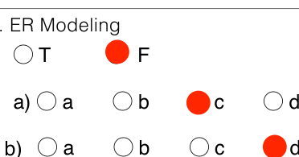
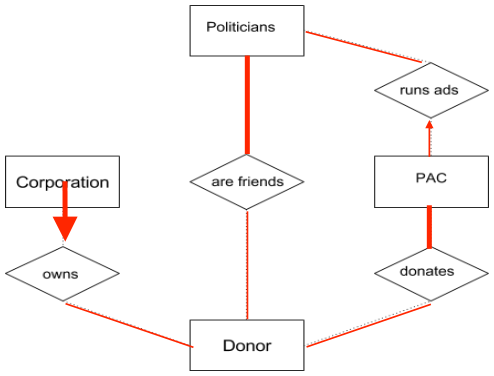

# Berkeley CS186 Spring 2016: Final: Official solutions

> Copied from the original: <https://hkn.eecs.berkeley.edu/exams/course/cs/186>. Text and figures are taken from the PDF as is; nothing was answered or rewritten. The original PDF is in this folder.

---

**Page 1**

&emsp;&emsp;&emsp;&emsp;&emsp;&emsp;Peter Perfect 
My Name: \_\_\_\_\_\_\_\_\_\_\_\_\_\_\_\_\_\_\_\_\_\_\_\_\_     My Class Login: cs186-\_\_ \_\_ \_\_

&emsp;&emsp;&emsp;&emsp;&emsp;&emsp;&emsp;&emsp;2. 
I.Basics   **TID**   **Status**   **LastLSN** 
&emsp;&emsp;&emsp;&emsp;&emsp;&emsp;&emsp;&emsp;1   Running   70 
&emsp;&emsp;&emsp;C   B   E   A 
&emsp;1\. \_\_\_\_ 2. \_\_\_\_ 3. \_\_\_\_ 4. \_\_\_\_ 
&emsp;&emsp;&emsp;&emsp;&emsp;&emsp;&emsp;&emsp;2   Running   80 
&emsp;&emsp;&emsp;H   F   I 
&emsp;5\. \_\_\_\_ 6. \_\_\_\_ 7. \_\_\_\_ 
&emsp;&emsp;&emsp;&emsp;&emsp;&emsp;&emsp;&emsp;**PID**   **recLSN** 
&emsp;&emsp;&emsp;&emsp;&emsp;&emsp;&emsp;&emsp;3   70 
&emsp;&emsp;&emsp;&emsp;&emsp;&emsp;&emsp;&emsp;2   80 
II. Concurrency 
&emsp;1\. ⃞ a     ⃞ b     ⃞ c 
&emsp;&emsp;⃞ d     ⃞ e     ⃞ f     ⃞ ∅ 
&emsp;&emsp;&emsp;&emsp;&emsp;&emsp;&emsp;&emsp;**TID**   **Status**   **LastLSN** 
&emsp;&emsp;&emsp;&emsp;&emsp;&emsp;&emsp;&emsp;3. 
&emsp;2\. T1   T2   1   AborAng   140 
&emsp;&emsp;&emsp;&emsp;&emsp;&emsp;&emsp;&emsp;2   Commi7ng   150 
&emsp;&emsp;&emsp;&emsp;&emsp;T3   **PID**   **recLSN** 
&emsp;&emsp;&emsp;&emsp;&emsp;&emsp;&emsp;&emsp;3   70 
&emsp;&emsp;&emsp;&emsp;&emsp;&emsp;&emsp;&emsp;2   80 
&emsp;3\. ⃞ a      ⃞ b      ⃞ c      ⃞ d      ⃞ ∅ 
&emsp;&emsp;&emsp;&emsp;&emsp;&emsp;&emsp;&emsp;1110

&emsp;4. 
&emsp;&emsp;&emsp;&emsp;&emsp;T1   T2 
&emsp;&emsp;&emsp;&emsp;&emsp;&emsp;&emsp;&emsp;4.

&emsp;&emsp;&emsp;&emsp;&emsp;&emsp;&emsp;&emsp;**LSN**   **Record**   **prevLSN** 
&emsp;&emsp;&emsp;&emsp;&emsp;T3   T4 
&emsp;&emsp;&emsp;&emsp;&emsp;&emsp;&emsp;&emsp;160   CLR: T1 LSN 110 undoNextLSN: 70   140 
&emsp;&emsp;&emsp;&emsp;&emsp;&emsp;&emsp;&emsp;170   CLR: T1 LSN 70 undoNextLSN: null   160 
&emsp;5\.   ◯ T          ◯  F 
&emsp;6\.   ◯ T          ◯  F 
&emsp;&emsp;&emsp;&emsp;&emsp;&emsp;&emsp;&emsp;5\.   ◯ T          ◯  F 
III.  Multi granularity Locking 
&emsp;&emsp;&emsp;&emsp;&emsp;&emsp;&emsp;&emsp;6\.   ◯ a       ◯ b       ◯ c 
&emsp;IS(Y)IX(Y)1. T1:\_\_\_\_\_\_ T2:\_\_\_\_\_\_ 
&emsp;&emsp;T3:\_\_\_\_\_\_ T4:\_\_\_\_\_\_IS(Y)   IX(Y) 
&emsp;&emsp;&emsp;&emsp;&emsp;&emsp;&emsp;&emsp;V. Two Phase Commit 
&emsp;∅2. T1:\_\_\_\_\_\_ T3:\_\_\_\_\_\_ 
&emsp;&emsp;&emsp;&emsp;IX(B)X(B\_3) 
&emsp;&emsp;&emsp;&emsp;&emsp;&emsp;&emsp;&emsp;1\. ⃞ a     ⃞ b     ⃞ c 
&emsp;&emsp;T4:\_\_\_\_\_\_IX(B) 
&emsp;&emsp;&emsp;&emsp;&emsp;&emsp;&emsp;&emsp;⃞ d     ⃞ e     ⃞ f     ⃞ ∅ 
&emsp;3\.   ◯ T          ◯  F 
&emsp;&emsp;&emsp;&emsp;&emsp;&emsp;&emsp;&emsp;2\. ⃞ a     ⃞ b    ⃞ ∅ 
IV. ARIES Recovery 
&emsp;&emsp;&emsp;&emsp;&emsp;&emsp;&emsp;&emsp;3\. Circle all that apply 
&emsp;1\. ◯ a       ◯ b       ◯ c 
&emsp;&emsp;&emsp;&emsp;&emsp;&emsp;&emsp;&emsp;a) PREPARE / COMMIT / ABORT 
&emsp;&emsp;◯ d       ◯ e       ◯ f 
&emsp;&emsp;&emsp;&emsp;&emsp;&emsp;&emsp;&emsp;b) COMMIT / ABORT / END

&emsp;&emsp;&emsp;&emsp;&emsp;&emsp;&emsp;&emsp;21Page " of

---

**Page 2**

My Name: \_\_\_\_\_\_\_\_\_\_\_\_\_\_\_\_\_\_\_\_\_\_\_\_\_     My Class Login: cs186-\_\_ \_\_ \_\_ 
&emsp;&emsp;&emsp;&emsp;&emsp;&emsp;&emsp;&emsp;4\. C1: ◯ A   ◯ B   ◯ C   ◯ D  ◯ DM 
&emsp;4\. Before it… 
&emsp;&emsp;◯  writes a \_\_\_\_\_\_\_\_\_ record 
&emsp;&emsp;&emsp;&emsp;&emsp;&emsp;&emsp;&emsp;prepare        C2: ◯ A   ◯ B   ◯ C   ◯ D  ◯ DM 
&emsp;&emsp;◯  sends a \_\_\_\_\_\_\_\_\_ message 
&emsp;&emsp;&emsp;&emsp;&emsp;&emsp;&emsp;&emsp;C3: ◯ A   ◯ B   ◯ C   ◯ D  ◯ DM 
&emsp;&emsp;◯  receives a \_\_\_\_\_\_\_ message 
&emsp;&emsp;&emsp;&emsp;&emsp;&emsp;&emsp;&emsp;5\. ⃞ a     ⃞ b     ⃞ c 
&emsp;&emsp;&emsp;&emsp;&emsp;&emsp;&emsp;&emsp;⃞ d     ⃞ e     ⃞ f     ⃞ ∅ 
VI. SQL & LINEAR ALGEBRA 
&emsp;&emsp;&emsp;&emsp;&emsp;&emsp;&emsp;&emsp;6\. a) ◯ A       ◯ B       ◯ C 
&emsp;◯ a       ◯ b       ◯ c       ◯ d 
1. 
&emsp;&emsp;&emsp;&emsp;&emsp;&emsp;&emsp;&emsp;b) ◯ A       ◯ B       ◯ C 
2\.  ⃞ a      ⃞ b      ⃞ c      ⃞ d      ⃞ ∅ 
&emsp;◯ a       ◯ b       ◯ c       ◯ d 
3.

4\. (a) \_\_\_\_ (b) \_\_\_\_ (c) \_\_\_\_ 
8   3   2 
&emsp;(d) \_\_\_\_ (e) \_\_\_\_1   4

VII. Spark 
1\. ⃞ a     ⃞ b     ⃞ c 
&emsp;&emsp;&emsp;&emsp;&emsp;&emsp;&emsp;&emsp;◯ a       ◯ b       ◯ c       ◯ d 
&emsp;&emsp;&emsp;&emsp;&emsp;&emsp;&emsp;&emsp;c) 
&emsp;⃞ d     ⃞ e     ⃞ f     ⃞ ∅ 
&emsp;&emsp;&emsp;&emsp;&emsp;&emsp;&emsp;&emsp;3\. ◯ a       ◯ b       ◯ c       ◯ d 
2\. (a) \_\_\_\_ (b) \_\_\_\_ (c) \_\_\_\_ 
6   2   4 
&emsp;&emsp;&emsp;&emsp;&emsp;&emsp;&emsp;&emsp;4\. Fill in the ER Diagram: 
&emsp;&emsp;&emsp;&emsp;6   2

&emsp;(d) \_\_\_\_ (e) \_\_\_\_ 
3\. ◯ a       ◯ b       ◯ c       ◯ d

VIII. Analytics and ML 
1\. ⃞ a     ⃞ b     ⃞ c 
&emsp;**BUG** 
&emsp;⃞ d     ⃞ e     ⃞ f     ⃞ ∅ 
2\. ⃞ a     ⃞ b     ⃞ c 
&emsp;⃞ d     ⃞ e     ⃞ f     ⃞ ∅ 
3\. 1)    ◯ A       ◯ B       ◯ C 
&emsp;&emsp;&emsp;&emsp;&emsp;&emsp;&emsp;&emsp;X. FDs & Normalization 
&emsp;&emsp;&emsp;&emsp;&emsp;&emsp;&emsp;&emsp;1\. ⃞ a      ⃞ b       ⃞ c       ⃞ d       ⃞ ∅ 
&emsp;&emsp;&emsp;&emsp;&emsp;&emsp;&emsp;&emsp;**BUG** 
&emsp;2\)  ◯ A       ◯ B       ◯ C 
&emsp;&emsp;&emsp;&emsp;&emsp;&emsp;&emsp;&emsp;2\. ⃞ a      ⃞ b       ⃞ c       ⃞ d       ⃞ ∅ 
&emsp;3\)  ◯ A       ◯ B       ◯ C 
&emsp;&emsp;&emsp;&emsp;&emsp;&emsp;&emsp;&emsp;3\. ⃞ a      ⃞ b       ⃞ c       ⃞ d       ⃞ ∅ 
&emsp;&emsp;&emsp;&emsp;&emsp;&emsp;&emsp;&emsp;**BUG** 
&emsp;4\)  ◯ A       ◯ B       ◯ C 
&emsp;&emsp;&emsp;&emsp;&emsp;&emsp;&emsp;&emsp;4\. ⃞ a      ⃞ b       ⃞ c       ⃞ d       ⃞ ∅ 
&emsp;&emsp;&emsp;&emsp;&emsp;&emsp;&emsp;&emsp;22Page # of

