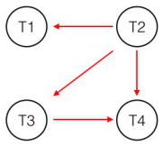
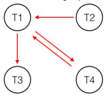

# Berkeley CS186 Spring 2016: Midterm 2: Official solutions

> Copied from the original: <https://hkn.eecs.berkeley.edu/exams/course/cs/186>. Text and figures are taken from the PDF as is; nothing was answered or rewritten. The original PDF is in this folder.

---

**Page 1**

&emsp;CS 186 Spring 2016 Midterm 2 Solutions 
I.   Locking and Serializability

&emsp;1\.   For the following statements, list the true statement(s) in alphabetical order. 
&emsp;&emsp;&emsp;a.   Schedules that are conflict serializable are also view serializable. 
&emsp;&emsp;&emsp;&emsp;&emsp;&emsp;True. 
&emsp;&emsp;&emsp;b.   Under two­phase locking, once a transaction releases a lock, it can no longer acquire any new locks. 
&emsp;&emsp;&emsp;&emsp;&emsp;&emsp;True. 
&emsp;&emsp;&emsp;c.   Schedules that are conflict serializable have to be produced by two­phase locking. 
&emsp;&emsp;&emsp;&emsp;&emsp;&emsp;False. Note that the converse is true ­ 2PL guarantees conflict serializability. 
&emsp;&emsp;&emsp;d.   Schedules produced by two­phase locking are guaranteed to prevent cascading aborts. 
&emsp;&emsp;&emsp;&emsp;&emsp;&emsp;False. Strict 2PL is needed to guarantee this. 
&emsp;&emsp;&emsp;e.   Strict two­phase locking is both necessary and sufficient to guarantee conflict serializability. 
&emsp;&emsp;&emsp;&emsp;&emsp;&emsp;False. Sufficient but not necessary. 
&emsp;&emsp;&emsp;f.   Wound­wait and wait­die algorithms are pessimistic deadlock avoidance algorithms and can cause 
&emsp;&emsp;&emsp;&emsp;more transaction aborts than needed. 
&emsp;&emsp;&emsp;&emsp;&emsp;&emsp;True. 
&emsp;&emsp;&emsp;g.   Under multi­granularity locking, locks should be acquired and released from the top level to the bottom 
&emsp;&emsp;&emsp;&emsp;level. 
&emsp;&emsp;&emsp;&emsp;&emsp;&emsp;False. Locks are acquired top down, but released bottom up. 
&emsp;&emsp;&emsp;h.   Under multi­granularity locking, when a transaction T1 is holding an ‘IX’ lock on page A, it is possible 
&emsp;&emsp;&emsp;&emsp;for transaction T2 to hold a ‘S’ lock on record B of page A. 
&emsp;&emsp;&emsp;&emsp;&emsp;&emsp;True. 
&emsp;&emsp;&emsp;\*Instructor note: Some of these might seem like arbitrary rules, but they all exist for a reason. For each, do 
&emsp;&emsp;&emsp;you understand why?

&emsp;2\.   Draw the dependency graph for this schedule.

&emsp;3\.   Of the following, list all conflict equivalent serial orderings of this schedule in alphabetical order: 
conflict equivalent serial orderings? \*Can you think of all 
&emsp;&emsp;&emsp;a.   T2 T1 T4 T3 
&emsp;&emsp;&emsp;b.   T2 T3 T4 T1 
&emsp;&emsp;&emsp;c.   T2 T1 T3 T4 
&emsp;&emsp;&emsp;d.   T2 T4 T1 T3

&emsp;4\.   List one read that could occur between timestep 9 and 10 that would make this schedule not conflict 
&emsp;&emsp;serializable. 
&emsp;&emsp;&emsp;There were multiple answers: T2:R(A) or T2:R(B) or T2:R(C) or T3:R(B)

---

**Page 2**

5\.   For the following statements, list the true statement(s) in alphabetical order. 
&emsp;a.   It is possible for this schedule to be produced by two­phase locking. 
&emsp;&emsp;&emsp;&emsp;&emsp;True. 
&emsp;b.   It is possible for this schedule to be produced by strict two­phase locking. 
&emsp;&emsp;&emsp;&emsp;&emsp;False. Recall that strict 2PL releases locks at commit. 
&emsp;c.   This schedule is guaranteed not to have cascading aborts. 
&emsp;&emsp;&emsp;&emsp;&emsp;True.

6\.   What locks have been acquired on table Y at timestep 9? 
&emsp;&emsp;T1:IX, T2: IX, T3: IX, T4: IX 
&emsp;&emsp;\*All transaction tried to write to the table, so they all have IX locks. Note that transactions that started 
&emsp;&emsp;with IS locks will upgraded those locks to IX. Also note that no transaction has to wait for a lock at the 
&emsp;&emsp;table level, since there are no S or X locks at that level. All waiting happens at lower levels.

7\.   What locks have been acquired on page B at timestep 9? 
&emsp;&emsp;T1: IX, T2: IS 
&emsp;&emsp;\*T1 has an IX lock, as it wrote to B1. T2 has an IS lock, as it read from B2 ­ it does not have an X lock, 
&emsp;&emsp;as it is waiting for T1. 
&emsp;&emsp;Tying this back to the previous question, before T2 writes to B, it will successfully acquire the IX on 
&emsp;&emsp;table Y, but will have to wait for T1 before acquiring the X on B.

8\.   There is a deadlock in this schedule (i.e. it is waiting indefinitely for locks). 
&emsp;a.   Draw the waits­for graph for this schedule.

&emsp;b.   Which transactions are involved in the deadlock? 
&emsp;&emsp;&emsp;&emsp;&emsp;These are the transactions in the cycle above: T2 T4 
&emsp;c.   Circle all true statements (on the answer sheet): 
&emsp;&emsp;&emsp;i.   We can resolve this deadlock by aborting any transaction involved in the deadlock. 
&emsp;&emsp;&emsp;&emsp;&emsp;True. 
&emsp;&emsp;ii.   No transaction can proceed until this deadlock is resolved. 
&emsp;&emsp;&emsp;&emsp;&emsp;False. In this schedule, T3 can clearly proceed.

9\.   Suppose T1 wishes to scan page B between timestep 8 and 9. Which locks are upgraded at this time? 
&emsp;&emsp;IX(B) ­\> SIX(B) 
&emsp;&emsp;its lock on B. Recall that we \*At this time, T1 has IX(Y), IX(B), and X(B1). So, T1 only needs to upgrade 
&emsp;&emsp;are working with Strict 2PL, so it cannot drop the IX on B.

---

**Page 3**

II. Query Optimization 
&emsp;1. 
&emsp;&emsp;&emsp;a.   When evaluating potential query plans, the set of left deep join plans are always  guaranteed to 
&emsp;&emsp;&emsp;&emsp;&emsp;contain the best plan. 
&emsp;&emsp;&emsp;&emsp;&emsp;False ­ this is a heuristic that System R uses to shrink the search space. 
&emsp;&emsp;&emsp;b.   As a heuristic, the System R optimizer avoids cross­products if possible. 
&emsp;&emsp;&emsp;&emsp;&emsp;True. 
&emsp;&emsp;&emsp;c.   Considering all join orders and join methods, there are n! ways to join n tables. 
&emsp;&emsp;&emsp;&emsp;&emsp;False. During the exam we amended this question to say O(n!) ­­ it is still false, but ends up 
&emsp;&emsp;&emsp;&emsp;&emsp;being a bit harder to prove, so we gave everyone a point for this question. 
&emsp;&emsp;&emsp;d.   A plan can result in an interesting order if it involves a sort­merge join. 
&emsp;&emsp;&emsp;&emsp;&emsp;True. 
&emsp;&emsp;&emsp;e.   The System R algorithm is greedy because for each pass, it only keeps the lowest cost plan for 
&emsp;&emsp;&emsp;&emsp;&emsp;each combination of tables. 
&emsp;&emsp;&emsp;&emsp;&emsp;False ­ it is not greedy because it keeps track of interesting orders. 
&emsp;&emsp;&emsp;f.   If the statistics needed to compute the result size of a table are missing, the System R optimizer 
&emsp;&emsp;&emsp;&emsp;&emsp;aborts. 
&emsp;&emsp;&emsp;&emsp;&emsp;False ­ it uses 1/10 as reduction factor if it cannot be computed. 
&emsp;2. 
&emsp;&emsp;&emsp;a. 
&emsp;&emsp;&emsp;&emsp;&emsp;&emsp;i.   1/50 
&emsp;&emsp;&emsp;&emsp;&emsp;ii.   1/50000 
&emsp;&emsp;&emsp;&emsp;&emsp;iii.   2501 / 5000 
&emsp;&emsp;&emsp;&emsp;&emsp;iv.   (3\*10^6) / (7\*10^6 + 1) 
&emsp;&emsp;&emsp;b. 
&emsp;&emsp;&emsp;&emsp;&emsp;&emsp;i.   B 
&emsp;&emsp;&emsp;&emsp;&emsp;ii.   Ø. The correct answer is 100020\*R3 
&emsp;&emsp;&emsp;&emsp;&emsp;iii.   A 
&emsp;&emsp;&emsp;&emsp;&emsp;iv.   D 
&emsp;&emsp;&emsp;&emsp;&emsp;v.   C 
&emsp;&emsp;&emsp;c.   \[NPages(Index III) + NPages(C)\]\*½    + ½ ½ NPages(C) \* NPages(F) 
&emsp;&emsp;&emsp;&emsp;&emsp;15 + 5\*50 = 265 I/Os

&emsp;&emsp;&emsp;&emsp;&emsp;We will access City using Index (III) which gives an outer cost of \[NPages(Index III) + 
&emsp;&emsp;NPages(C)\]\*½. We can only apply one reduction factor because Index III is only on population.

&emsp;&emsp;&emsp;&emsp;&emsp;How many pages worth of tuples will be candidates to be joined with F?  ½ ½ NPages(C) 
&emsp;&emsp;because of the two predicates.

&emsp;&emsp;&emsp;&emsp;&emsp;To access F, we have to use a page scan: NPages(F).

&emsp;&emsp;&emsp;&emsp;&emsp;Common mistakes were to forget the index access cost for the outer loop, applying the wrong 
&emsp;&emsp;reduction factors, or having F as the outside releation. “A JOIN B” is typically interpreted to have A on 
&emsp;&emsp;the outside, and furthermore we always put the smaller relation on the outside to minimize I/O cost.

&emsp;&emsp;&emsp;d.   After Pass 2, which of the following plans could be in the DP table? 
&emsp;&emsp;&emsp;&emsp;&emsp;A. City \[Index(III)\] JOIN Airline \[File scan\] ­ False this is a cross product.

---

**Page 4**

&emsp;&emsp;&emsp;&emsp;&emsp;B. City \[Index (III)\] JOIN Flight \[Index (I)\] ­ True, this could possibly be in the table. 
&emsp;&emsp;&emsp;&emsp;&emsp;C. Flight \[Index (II)\] JOIN City \[Index (III)\] ­ False, Index (II) would not have been kept as a 
&emsp;&emsp;&emsp;&emsp;&emsp;Single Table Access Method.

&emsp;3\.   CDE

&emsp;&emsp;A. Maintain a more detailed histogram of Cities.population 
&emsp;&emsp;We gave everyone points for A since it was vague. Maintaining the histograms helps, but only if we also 
&emsp;&emsp;update our optimizer to use these more advanced statistics for its cost estimation (which the answer 
&emsp;&emsp;choice did not explain).

&emsp;&emsp;B. Change Index (III) to be unclustered 
&emsp;&emsp;An unclustered index would not minimize I/O cost, since it’s more random I/O, and we may load a page 
more than once.

&emsp;&emsp;C. Reduce the size of Airline.name field using string compression 
&emsp;&emsp;Fitting more records per page means fewer I/Os.

&emsp;&emsp;D. Add a hash index on Flights.aid 
&emsp;&emsp;Hash index allows us to do a different kind of index nested loops join, which may reduce I/O cost.

&emsp;&emsp;E. Store City as a sorted file on population 
&emsp;&emsp;Sorted file may provide more efficient range lookups.

---

**Page 5**

III. Recovery 
1\.   \[6 points\] List all the true statements in alphabetical order: 
&emsp;a.   When a transaction commits, any modified buffer pages must be written to durable storage. 
&emsp;&emsp;False. ARIES uses a NO FORCE policy. 
&emsp;b.   When aborting a transaction, it may be necessary to modify pages on disk. 
&emsp;&emsp;True. ARIES uses a STEAL policy. 
&emsp;c.   During recovery, the ARIES protocol may redo aborted transactions. 
&emsp;&emsp;True. This is a key feature of ARIES and essential for the correctness of the protocol. 
&emsp;d.   The pageLSN contains the LSN of the last operation to modify the page. 
&emsp;&emsp;True. This is the definition of the pageLSN. 
&emsp;e.   The tail of the log is always flushed after every update operation. 
&emsp;&emsp;False. We only require that the tail of the log be flushed on commit. Remember that flushedLSN keeps 
&emsp;&emsp;track of the log tail. 
&emsp;f.   A system that uses a FORCE, STEAL policy does not need to undo any operations after a crash. 
&emsp;&emsp;False. A system with a STEAL policy needs UNDO logging to ensure atomicity.

Questions 2 through 7 use the log below. Our database system is using ARIES for recovery. Some of the 
information for update and CLR log records is omitted for brevity. Adjacent log records are spaced exactly 10 
LSN's apart. The system crashes after the last log record is written.

**LSN**   **Record**   **prevLSN** 
0    update: T1 writes P1    null 
10    update: T2 writes P2    null 
20    update: T3 writes P1    null 
30    update: T2 writes P3    10 
40    begin\_checkpoint    ­ 
50    update: T1 writes P4    0 
60    update: T2 writes P5    30 
70    end\_checkpoint    ­ 
80    commit: T2    60 
90    update: T3 writes P5    20 
100    T2 end    80 
110    T1 abort    50 
120    CLR: T1 LSN 50    110

Transaction Table and Dirty Page Table recorded at end\_checkpoint (LSN 70). 
**Transaction Table**    **Dirty Page Table** 
**Transaction**    **lastLSN**    **Status**    **PageID**    **recLSN** 
T1    0    Running    P1    20 
T2    30    Running    P3    30 
T3    20    Running

2\.   \[1 point\] The page updated by LSN 0 has been written to disk when the system starts recovering from the 
&emsp;crash. 
&emsp;a.   True 
&emsp;b.   False 
&emsp;c.   Not enough information

---

**Page 6**

a. At the time of the begin\_checkpoint record, P1 appears in the dirty page table with recLSN 20, so the update 
at LSN 0 has definitely been materialized on disk.

3\.   \[1 point\] The page updated by LSN 60 has been written to disk when the system starts recovering from the 
&emsp;crash. 
&emsp;a.   True 
&emsp;b.   False 
&emsp;c.   Not enough information 
c. When T2 committed, all log records for T2 were forced to the stable log. However, because we are using a 
NO FORCE policy, the data pages themselves may not have been forced to disk.

4\.   \[1 point\] What is the undoNextLSN of the CLR at LSN 120? 
0\. The undoNextLSN of a CLR indicates the LSN of the next CLR that will be written for that transaction, or null 
if all CLR’s for that transaction have been written.

5\.   \[6 points\] Fill in the transaction table and dirty page table after Analysis. Do not add any rows to the 
&emsp;transaction table (it should only contain T1 and T3). You may not need to use all rows provided in the dirty 
&emsp;page table. 
**Transaction Table**    **Dirty Page Table** 
**Transaction**    **lastLSN**    **Status**    **PageID**    **recLSN** 
T1    120   Aborting   P1   20 
T3    90   Running   P3   30 
&emsp;&emsp;&emsp;&emsp;&emsp;&emsp;&emsp;&emsp;P4   50 
&emsp;&emsp;&emsp;&emsp;&emsp;&emsp;&emsp;&emsp;P5   60

+½ for each correct lastLSN in the transaction table, +½ for each correct Status in the transaction table, +¾ for 
each correct (PageID, recLSN) in the dirty page table, +1 if P2 was not included in the dirty page table.

6\.   \[3 points\] List the LSN’s of the actions that are redone during REDO.  Assume that nothing in the buffer 
&emsp;pool was flushed to disk between begin checkpoint and the time of crash. 
20, 30, 50, 60, 90, 120 
+½ for each correct LSN, ­½ for each incorrect LSN

7\.   \[6 points\] What log records are written during UNDO? Fill in the remaining columns for the records below. 
&emsp;You may not need to use all rows in the table. 
&emsp;Hint: T1 and T3 are the only "loser" transactions. 
**LSN**   **Record**   **prevLSN** 
200    CLR: T3 LSN 90   90 
210    CLR: T3 LSN 20   200 
220    T3 end   210 
230    CLR: T1 LSN 0   120 
240    T1 end   230 
250 
260 
­1 for each missing record above, ­1 for most additional records included in the answer, ­½ for each correct 
record with an incorrect prevLSN. 
A common mistake was to include a record “CLR: T1 LSN 50”. This log record is not written during UNDO 
because it was already written before the crash. Another common mistake was to include records “T3 abort” or 
“T1 abort”. The only records written during UNDO are CLR and END records.

