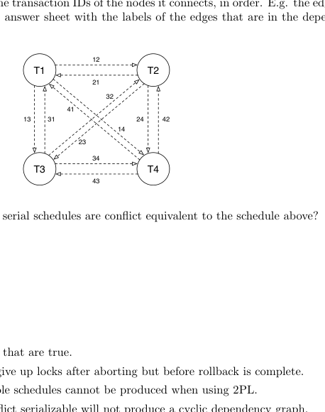
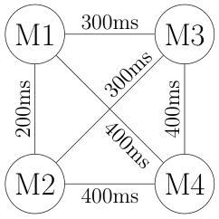

# Berkeley CS186 Fall 2017: Final: Questions

> Copied from the original: <https://hkn.eecs.berkeley.edu/exams/course/cs/186>. Text and figures are taken from the PDF as is; nothing was answered or rewritten. The original PDF is in this folder.

---

**Page 1**

&emsp;&emsp;&emsp;CS 186/286 Fall 2017 Final Exam 
• Do not turn this page until instructed to start the exam. 
• You should receive 1 answer sheet and a 15-page exam packet. 
• All answers should be written on the answer sheet. The exam packet will be collected but not graded. 
• You have 3 hours to complete the final. 
• The midterm has 8 questions, each with multiple parts. 
• For each question, place only your final answer on the answer sheet; do not show work. 
• For multiple choice questions, please fill in the bubble or box completely, **do not mark the box with** 
**an X or checkmark**. 
• Use the blank spaces in your exam for scratch paper. 
• You are allowed **two** 8.5” × 11” double-sided pages of notes. 
• No electronic devices are allowed.

---

**Page 2**

**1**   **Concurrency** 
Consider the following schedule of reads and writes to pages. 
&emsp;&emsp;&emsp;&emsp;&emsp;1   2   3   4   5   6   7   8   9   10 
&emsp;&emsp;&emsp;T1   R(A)   W(A)   R(C) 
&emsp;&emsp;&emsp;T2   R(A)   R(C) 
&emsp;&emsp;&emsp;T3   R(C)   R(B)   W(B) 
&emsp;&emsp;&emsp;T4   R(C)   W(C)

**Conflicts** 
1\. (2 points) What edges are included in the **dependency graph** (not waits-for graph) for the above 
&emsp;schedule? A reference graph is provided for your convenience. The dotted edges represent all possible

&emsp;graph of the schedule above.

&emsp;&emsp;&emsp;A. T4, T2, T1, T3 
&emsp;&emsp;&emsp;B. T3, T2, T4, T1 
&emsp;&emsp;&emsp;C. T3, T4, T2, T1 
&emsp;&emsp;&emsp;D. T1, T2, T4, T3 
&emsp;&emsp;&emsp;E. T1, T4, T2, T3 
&emsp;&emsp;&emsp;F. None of the above 
3\. (2.5 points) Mark all statements that are true.

&emsp;&emsp;&emsp;D. Both Strict 2PL and 2PL enforce conflict serializability. 
&emsp;&emsp;&emsp;E. All schedules that are conflict serializable are view serializable.

&emsp;&emsp;&emsp;&emsp;&emsp;&emsp;&emsp;&emsp;Page 2 of 15

---

**Page 3**

**Dealing with Deadlock** 
For the following sequence of lock requests, assume T1 is older than T2, and T2 is older than T3. The oldest 
transaction has the highest priority. No locks are released in the time frame shown. Note that not all requests 
may actually be issued—in some cases the transaction is still blocked waiting for a prior request. 
&emsp;Consider the following schedule of lock requests: 
&emsp;&emsp;&emsp;&emsp;&emsp;&emsp;&emsp;1   2   3   4   5   6   7   8   9 
&emsp;&emsp;&emsp;&emsp;&emsp;T1   X(D)   S(A)   S(C) 
&emsp;&emsp;&emsp;&emsp;&emsp;T2   X(A)   S(B)   S(D) 
&emsp;&emsp;&emsp;&emsp;&emsp;T3   S(B)   X(B)   S(C) 
4\. (1 point) The above schedule could not successfully occur whether one uses deadlock avoidance or not. 
&emsp;Suppose we are not using any deadlock avoidance algorithms. List the time steps in the schedule above 
&emsp;in which the lock request could not have been made: i.e. timesteps when the requesting transaction would 
&emsp;have been blocked waiting for a previous lock request. 
5\. (1 point) Assuming we do not use deadlock avoidance, what is the first time step when deadlock will 
&emsp;occur? 
6\. (1 point) Mark the transactions involved in the first deadlock. 
7\. (1 point) If we were using the wound-wait deadlock avoidance algorithm, what would happen at time 
&emsp;step 3? 
&emsp;&emsp;&emsp;A. The transaction requesting the lock would wait 
&emsp;&emsp;&emsp;B. The transaction requesting the lock would abort 
&emsp;&emsp;&emsp;C. The transaction that holds the lock would abort

&emsp;&emsp;&emsp;&emsp;&emsp;&emsp;&emsp;&emsp;Page 3 of 15

---

**Page 4**

**2**   **Recovery** 
1\. (0.5 points) Which buffer management policy would allow us to maximize efficiency in terms of speed?

&emsp;&emsp;&emsp;A. STEAL, NO FORCE   C. NO STEAL, FORCE 
&emsp;&emsp;&emsp;B. STEAL, FORCE   D. NO STEAL, NO FORCE

2\. (0.5 points) True or False? In ARIES recovery, after the analysis phase, the recLSN of each page in the 
&emsp;dirty page table must be larger than the pageLSN of the corresponding page. 
3\. (2 points) Select all the correct statements that are true about ARIES. 
&emsp;&emsp;&emsp;A. CLRs are never undone during ARIES recovery. 
&emsp;&emsp;&emsp;B. We remove a page from the dirty page table each time we write a CLR to the log. 
&emsp;&emsp;&emsp;C. The transaction table and dirty page table in the End Checkpoint record are up-to-date as of 
&emsp;&emsp;&emsp;&emsp;the time when the End Checkpoint record was logged. 
&emsp;&emsp;&emsp;D. ARIES never causes a database disk page to be overwritten by a page with the same PageLSN. 
4\. (0.5 points) True or False: Regardless of the number of times we run recovery, each UPDATE in the log 
&emsp;will have at most one matching CLR record in the log. 
5\. (1 point) Why would the undoNextLSN field in a CLR be marked null? 
&emsp;&emsp;&emsp;A. If the transaction committed. 
&emsp;&emsp;&emsp;B. If this CLR corresponds to the lowest UPDATE LSN of the transaction 
&emsp;&emsp;&emsp;C. If this CLR corresponds to the highest UPDATE LSN of the transaction 
&emsp;&emsp;&emsp;D. If this CLR was the highest LSN flushed at the time of crash. 
&emsp;&emsp;&emsp;E. If this CLR corresponds to a page that was flushed before the checkpoint.

&emsp;&emsp;&emsp;&emsp;&emsp;&emsp;&emsp;&emsp;Page 4 of 15

---

**Page 5**

Now consider the following log records which are recovered after a crash. 
&emsp;&emsp;&emsp;&emsp;**LSN**   **Record**   **PrevLSN** 
&emsp;&emsp;&emsp;&emsp;...   ...   ... 
&emsp;&emsp;&emsp;&emsp;40   UPDATE: T3 writes P4   null 
&emsp;&emsp;&emsp;&emsp;50   UPDATE: T2 writes P3   null 
&emsp;&emsp;&emsp;&emsp;60   Begin Checkpoint   - 
&emsp;&emsp;&emsp;&emsp;70   End Checkpoint   - 
&emsp;&emsp;&emsp;&emsp;80   UPDATE: T1 writes P1   null 
&emsp;&emsp;&emsp;&emsp;90   UPDATE: T3 writes P5   40 
&emsp;&emsp;&emsp;&emsp;100   UPDATE: T3 writes P2   90 
&emsp;&emsp;&emsp;&emsp;110   UPDATE: T2 writes P1   50 
&emsp;&emsp;&emsp;&emsp;120   T3 Commit   100 
&emsp;&emsp;&emsp;&emsp;130   T3 End   120 
&emsp;&emsp;&emsp;&emsp;140   UPDATE: T1 writes P5   80 
&emsp;&emsp;&emsp;&emsp;150   T1 Abort   140 
&emsp;&emsp;&emsp;&emsp;160   CLR: Undo write to P5 (T1, LSN 140), undoNextLSN: 80   150 
&emsp;&emsp;&emsp;&emsp;&emsp;&emsp;CRASH! 
The following dirty page table and transaction table are read from the checkpoint: 
&emsp;&emsp;&emsp;**Transaction Table**   **Dirty Page Table** 
&emsp;&emsp;&emsp;&emsp;**Transaction**   **Status**   **lastLSN**   **Page**   **recLSN** 
&emsp;&emsp;&emsp;&emsp;T2   Running   50   P4   40 
&emsp;&emsp;&emsp;&emsp;T3   Running   40 
6\. (1 point) Assume that at the end of the Analysis phase, we convert all Running status to Aborting in the 
&emsp;transaction table. For each transaction, give its status in the transaction table at the end of the analysis 
&emsp;phase. List its status as “A” if the transaction is Aborting and “C” if the transaction is Committing. If 
&emsp;a transaction is **NOT** in the transaction table, list its status as “0”. 
7\. (2.5 points) For each page referenced in the log, give its recLSN in the dirty page table at the end of 
&emsp;the analysis phase. If a page is **NOT** in the dirty page table, list its recLSN as “0”. Assume the buffer 
&emsp;manager does not flush any pages during recovery. 
8\. (1 point) Mark the LSNs of the records that will actually be redone in the redo phase (i.e. that will 
&emsp;require us to update a database page). 
9\. (1 point) Mark the LSNs of the UPDATE records that we write CLRs for during the undo phase.

&emsp;&emsp;&emsp;&emsp;&emsp;&emsp;&emsp;&emsp;Page 5 of 15

---

**Page 6**

**3**   **Two-Phase Commit**

Our database runs on 4 machines and uses Two-Phase Commit.   Ma- 
chine 1 is the Coordinator, while Machines 2, 3, and 4 are Partici- 
pants.

Suppose our machines are connected such that the time it takes to send 
a message from Machine i to Machine j is 100·max(i, j) milliseconds (see 
graph). Assume these communication latencies are symmetric: it takes 
the same amount of time to send from i to j as it takes to send from j 
to i. For example, sending a message between Machine 2 and Machine 4 
takes 400 milliseconds in either direction.

Assume that the transaction will commit (i.e. all subordinates vote yes), 
and that everything is instantaneous except for the time spent sending 
messages between two machines. 
1\. (0.25 points) What is the first message Machine 1 sends?

&emsp;&emsp;&emsp;A. VOTE YES   B. PREPARE   C. COMMIT   D. None of these

2\. (0.25 points) What is the second message Machine 1 sends?

&emsp;&emsp;&emsp;A. VOTE YES   B. PREPARE   C. COMMIT   D. None of these

3\. (1 point) How much time passes from when Machine 1 sends its first message to when Machine 1 sends 
&emsp;its second message? 
4\. (0.25 points) What is the first message Machine 2 sends?

&emsp;&emsp;&emsp;A. VOTE YES   B. PREPARE   C. COMMIT   D. None of these

5\. (0.25 points) What is the second message Machine 2 sends?

&emsp;&emsp;&emsp;A. VOTE YES   B. PREPARE   C. COMMIT   D. None of these

6\. (1 point) How much time passes from when Machine 2 sends its first message to when Machine 2 sends 
&emsp;its second message? 
7\. (0.5 points) True or False. A transaction is considered committed even if over half of the participants 
&emsp;do not acknowledge the commit. 
Now suppose that our implementation of 2-Phase Commit has an off-by-one bug where the Coordinator 
receives, but does not use, Machine 4’s vote. That is, Machine 4’s vote does not affect whether or not the 
transaction commits or aborts. 
8\. (0.5 points) True or False. A transaction that should normally commit may be aborted instead. 
9\. (0.5 points) True or False. A transaction that should normally abort may be committed instead. 
10\. (0.5 points) True or False. A transaction that should normally commit may be committed properly. 
11\. (0.5 points) True or False. A transaction that should normally abort may be aborted properly.

&emsp;&emsp;&emsp;&emsp;&emsp;&emsp;&emsp;&emsp;Page 6 of 15

---

**Page 7**

**4**   **Joins** 
**4.1**   **Young Justice... again** 
For the following questions in this section, assume that we are streaming our query output to a terminal. 
(Do not consider the cost of writing the final output)

`CREATE` `TABLE` `JusticeLeague` `(` 
&emsp;`member_id` `INTEGER` `PRIMARY` `KEY,` 
&emsp;`code_name` `CHAR(33),` 
&emsp;`birth_planet` `CHAR(20),` 
&emsp;`power_level` `INTEGER` 
`);`

`CREATE` `TABLE` `Teaches` `(` 
&emsp;`member_id` `INTEGER` `PRIMARY` `KEY` `REFERENCES` `JusticeLeague,` 
&emsp;`teacher_id` `INTEGER` `REFERENCES` `JusticeLeague,` 
&emsp;`since` `DATE` 
`);` 
&emsp;We assume that 
&emsp;• JusticeLeague has \[J\] = 100 pages 
&emsp;• JusticeLeague has \|J\| = 1000 members 
&emsp;• Teaches has \[T\] = 200 pages 
&emsp;• Teaches has \|T\| = 2000 members 
&emsp;• Buffer size = 12 pages 
&emsp;• An Alternative-1 B+ tree for Teaches indexed on `T.member` `id` has the height 2. In this problem, we 
&emsp;interpret height as the number of I/Os it takes to travel from the root to the leaf page. 
1\. (2 points) What is the I/O cost of using Index Nested Loop Join to perform a natural join of Teaches and 
&emsp;JusticeLeague? Consider table JusticeLeague as the outer relation. Note that we want the actual cost 
&emsp;in I/O requests, not a Selinger-style estimate. Treat each I/O request the same, regardless of whether 
&emsp;you think the request will hit in the buffer pool. Your answer must be a single integer. 
2\. (2 points) Assume we introduce an Alternative 2, clustered B+ tree for JusticeLeague indexed on 
&emsp;`member` `id` with height 2. What is the I/O cost of using Index Nested Loop Join to perform a nat- 
&emsp;ural join of Teaches and JusticeLeague? This time consider table Teaches as the outer relation. Your 
&emsp;answer must be a single integer. 
3\. (1 point) If the previous question’s B+ tree for JusticeLeague had used an unclustered index, would the 
&emsp;I/O cost have been different? (Answer only in Yes or No)

&emsp;&emsp;&emsp;&emsp;&emsp;&emsp;&emsp;&emsp;Page 7 of 15

---

**Page 8**

**4.2**   **General Join Algorithm Questions**

4\. (2 points) In this question, we explore the strengths and weaknesses of various join algorithms. Assume 
throughout that we are joining two tables R and S, and we have B buffers of memory for our join. Do 
not assume any additional information about the tables that is not explicitly provided. 
&emsp;(a) (1 point) We are performing an equijoin. \[R\] \< B, \[S\] \> B3. Which join algorithm will provide 
&emsp;&emsp;the correct answer with the fewest I/Os: 
&emsp;&emsp;&emsp;&emsp;A. Block Nested Loops Join 
&emsp;&emsp;&emsp;&emsp;B. Grace Hash Join 
&emsp;&emsp;&emsp;&emsp;C. Sort-Merge Join 
&emsp;(b) (1 point) We are performing an equijoin. B \< \[R\] \< (B −1)2, and B \< \[S\] \< (B −1)2. Both R 
&emsp;&emsp;and S have only 2 distinct values in the join key column. Which join algorithm will provide the 
&emsp;&emsp;correct answer with the fewest I/Os: 
&emsp;&emsp;&emsp;&emsp;A. Block Nested Loops Join 
&emsp;&emsp;&emsp;&emsp;B. Grace Hash Join 
&emsp;&emsp;&emsp;&emsp;C. Sort-Merge Join 
5\. (2 points) Consider the following “Index On Demand” join algorithm. Given an equijoin on tables R 
and S (with \[R\] \< \[S\]), but no indexes on the join columns initially, the algorithm will (a) bulk-load an 
Alternative-1 B+-tree on R, (b) perform an Index Nested Loops Join on S ▷◁R using the index, and 
(c) delete the index on R. Mark all of the following that you believe to be true for joining R and S, 
assuming B \< \[R\] \< \[S\] \< (B −1)2: 
&emsp;&emsp;A. This algorithm generates more I/Os than Grace Hash Join (without recursive partitioning). 
&emsp;&emsp;B. This algorithm generates more I/Os than a 2-pass Sort-Merge join. 
&emsp;&emsp;C. This algorithm generates more random I/Os than Block Nested Loops Join. 
&emsp;&emsp;D. If we omit step (c), this algorithm might be of interest for its benefits on subsequent queries, 
&emsp;&emsp;&emsp;even though it could be sub-optimal for the current query.

&emsp;&emsp;&emsp;&emsp;&emsp;&emsp;&emsp;&emsp;Page 8 of 15

---

**Page 9**

**5**   **Query Optimization** 
For the following questions, assume the following: 
&emsp;• The System R assumptions about uniformity and independence from lecture hold 
&emsp;• We use System R defaults when selectivity estimation is not possible 
&emsp;• Primary key IDs are sequential in each table, starting from 1, and there are no gaps in the ID sequence 
&emsp;in any table 
&emsp;• Our system implements only implements Grace Hash Join. It allocates 5 pages of memory for the join 
&emsp;operator. 
&emsp;• Assume all indices are alternative 3 indices. 
&emsp;• Assume the optimizer statistics are fully accurate w.r.t. the current content of the database.

**Table Schema**   **Records**   **Pages**   **Indices** 
`CREATE` `TABLE` `User` `(` 
&emsp;`uid` `INTEGER` `PRIMARY` `KEY,` 
&emsp;&emsp;&emsp;&emsp;&emsp;&emsp;&emsp;&emsp;1,000   100   None 
&emsp;`fullname` `VARCHAR(32),` 
&emsp;`country` `VARCHAR(4))` 
`)` 
`CREATE` `TABLE` `Item` `(` 
&emsp;`sku` `INTEGER` `PRIMARY` `KEY,`   • Index 0: Unclustered Index on sku. 
&emsp;&emsp;&emsp;&emsp;&emsp;&emsp;&emsp;&emsp;10,000   1,000 
&emsp;`itemname` `VARCHAR(32),` 
&emsp;&emsp;&emsp;&emsp;&emsp;&emsp;&emsp;&emsp;• Index 1: Clustered Index price Low 0, High 100 
&emsp;`price` `NUMERIC` 
`)` 
`CREATE` `TABLE` `Order` `(` 
&emsp;`uid` `INTEGER` `REFERENCES` `User,` 
&emsp;&emsp;&emsp;&emsp;&emsp;&emsp;&emsp;&emsp;100,000   5,000   • Index 2: Clustered Index on uid 
&emsp;`sku` `INTEGER` `REFERENCES` `Item,` 
&emsp;`quantity`   `INTEGER)` 
`)` 
`CREATE` `TABLE` `Tax` `(` 
&emsp;`sku` `INTEGER` `PRIMARY` `KEY` 
&emsp;&emsp;&emsp;&emsp;&emsp;&emsp;&emsp;&emsp;10,000   1,000   None 
&emsp;&emsp;`REFERENCES` `Item,` 
&emsp;`taxrate` `NUMERIC` 
`)`

1\. (1 point) After applying the System R optimizer, which query has a lower estimated final cost for the 
&emsp;optimal query plan.

&emsp;&emsp;&emsp;A. `SELECT` `*`   B. `SELECT` `*` 
&emsp;&emsp;&emsp;&emsp;`FROM` `Item`   `FROM` `Item` 
&emsp;&emsp;&emsp;&emsp;`WHERE` `Item.itemname` `=` `’WidgetA’`   `WHERE` `Item.price` `<` `3`

2\. (1 point) After applying the System R optimizer, which query has a lower estimated final cost for the 
&emsp;optimal query plan.

&emsp;&emsp;&emsp;A. `SELECT` `*`   B. `SELECT` `*` 
&emsp;&emsp;&emsp;&emsp;`FROM` `Item`   `FROM` `Tax` 
&emsp;&emsp;&emsp;&emsp;`ORDER` `BY` `Item.price`   `ORDER` `BY` `Tax.taxrate`

&emsp;&emsp;&emsp;&emsp;&emsp;&emsp;&emsp;&emsp;Page 9 of 15

---

**Page 10**

3\. (0.5 points) (True or False) The System R optimizer will apply a projection to the Tax table that 
preserves only the `taxrate` attribute before performing a join for the following query: 
&emsp;`SELECT` `taxrate` 
&emsp;`FROM` `Item,` `Tax` 
&emsp;`WHERE` `Tax.sku` `=` `Item.sku`

4\. (0.5 points) (True or False) For the following query, one can determine the cardinality of the join result 
(i.e the number of tuples in the result) exactly: 
&emsp;`SELECT` `taxrate` 
&emsp;`FROM` `Item,` `Tax` 
&emsp;`WHERE` `Tax.sku` `=` `Item.sku`

5\. (0.5 points) (True or False) In general, even if an eligible index exists, a sequential scan can be selected 
rather than an index scan. 
6\. (1.5 points) Consider the following query: 
&emsp;`SELECT` `*` 
&emsp;`FROM` `User,` `Order` 
&emsp;`WHERE` `User.uid` `=` `Order.uid` `AND` 
&emsp;&emsp;&emsp;`User.country` `=` `’USA’` 
During Pass 2 of the System R Optimizer, what is the estimated cost of executing the query using a 
Grace hash join? Be sure to include the cost of the heap scans and any other upstream operators. 
7\. (1 point) Consider the following query: 
&emsp;`SELECT` `*` 
&emsp;`FROM` `User,` `Order,` `Tax,` `Item` 
&emsp;`WHERE` `User.uid` `=` `Order.uid` `AND` 
&emsp;&emsp;&emsp;&emsp;&emsp;`Item.sku` `=` `Order.sku` `AND` 
&emsp;&emsp;&emsp;&emsp;&emsp;`Tax.sku` `=` `Item.sku` `AND` 
&emsp;&emsp;&emsp;&emsp;&emsp;`Tax.sku` `=` `Order.sku` 
Without making assumptions about costs and selectivities, which of the following join orders could 
**NEVER** be considered by the System R optimizer to answer this query? Mark all that apply 
&emsp;&emsp;A. (((User ▷◁Order) ▷◁Item) ▷◁Tax) 
&emsp;&emsp;B. (User ▷◁Order) ▷◁(Item ▷◁Tax) 
&emsp;&emsp;C. (((User ▷◁Item) ▷◁Order) ▷◁Tax) 
&emsp;&emsp;D. (((User ▷◁Order) ▷◁Tax) ▷◁Item) 
&emsp;&emsp;E. (((Tax ▷◁Item) ▷◁Order) ▷◁User) 
&emsp;&emsp;F. None of the above 
8\. (0.5 points) (True or False) Ignoring order by statements, group by statements, and nested queries, the 
System R optimizer is guaranteed to return the left-deep query plan with the lowest IO cost with respect 
to the estimated costs.

&emsp;&emsp;&emsp;&emsp;&emsp;&emsp;&emsp;&emsp;Page 10 of 15

---

**Page 11**

**6**   **SQL** 
Consider a table `Friend` representing a social network.   Each record of the Friend table consists of two 
integers corresponding to a friendship relationship between two users (identified by the id number). Assume 
that no person is friends with themselves.

`CREATE` `TABLE` `Friend(` 
&emsp;&emsp;`id1` `INTEGER,` 
&emsp;&emsp;`id2` `INTEGER,` 
&emsp;&emsp;`PRIMARY` `KEY` `(id1,id2));` 
1\. (1.5 points) Some of the friendship relationships in this table are not reciprocated, i.e., `(id1=a,id2=b)` 
&emsp;exists in the table but `(id1=b,id2=a)` does not exist. Which of the following SQL queries identifies all 
&emsp;tuples where the reciprocal relationship does not exist in the table. Mark all that apply. 
&emsp;&emsp;&emsp;A. `SELECT` `*` 
&emsp;&emsp;&emsp;&emsp;`FROM` `Friend` `f1` 
&emsp;&emsp;&emsp;&emsp;`WHERE` `NOT` `EXISTS` `(SELECT` `*` 
&emsp;&emsp;&emsp;&emsp;&emsp;&emsp;&emsp;&emsp;`FROM` `Friend` `f2` 
&emsp;&emsp;&emsp;&emsp;&emsp;&emsp;&emsp;&emsp;`WHERE` `f1.id1` `=` `f2.id2` `AND` `f1.id2` `=` `f2.id1)`

&emsp;&emsp;&emsp;B. `SELECT` `t.id1,` `t.id2` 
&emsp;&emsp;&emsp;&emsp;`FROM` `(` 
&emsp;&emsp;&emsp;&emsp;&emsp;`(SELECT` `id1,` `id2` 
&emsp;&emsp;&emsp;&emsp;&emsp;&emsp;`FROM` `Friend` `f1)` 
&emsp;&emsp;&emsp;&emsp;&emsp;`UNION` `ALL` 
&emsp;&emsp;&emsp;&emsp;&emsp;`(SELECT` `f2.id2` `as` `id1,` `f2.id1` `as` `id2` 
&emsp;&emsp;&emsp;&emsp;&emsp;&emsp;`FROM` `Friend` `f2)` 
&emsp;&emsp;&emsp;&emsp;`)` `as` `t` 
&emsp;&emsp;&emsp;&emsp;`GROUP` `BY` `t.id1,` `t.id2` 
&emsp;&emsp;&emsp;&emsp;`HAVING` `count(*)`   `<`   `2`

&emsp;&emsp;&emsp;C. `SELECT` `t.id1,` `t.id2` 
&emsp;&emsp;&emsp;&emsp;`FROM` `(` 
&emsp;&emsp;&emsp;&emsp;&emsp;`SELECT` `f2.id2` `as` `id1,` `f2.id1` `as` `id2` 
&emsp;&emsp;&emsp;&emsp;&emsp;`FROM` `Friend` `f2` 
&emsp;&emsp;&emsp;&emsp;`)` `as` `t` `FULL` `OUTER` `JOIN` `Friend` 
&emsp;&emsp;&emsp;&emsp;`ON` `t.id1` `=` `Friend.id1` `AND` `t.id2` `=` `Friend.id2` `AND` `Friend.id1` `<>` `NULL` 
&emsp;&emsp;&emsp;D. None of the above 
2\. (1 point) Consider the same table, but without the primary key constraint. Continue to assume that 
&emsp;no person is friends with themselves. 
&emsp;`CREATE` `TABLE` `Friend(` 
&emsp;&emsp;&emsp;`id1` `INTEGER,` 
&emsp;&emsp;&emsp;`id2` `INTEGER);` 
&emsp;This table can contain multiple copies of the same friendship relationship, e.g., two tuples with `(id1=a,id2=b)`. 
&emsp;Therefore, each distinct `(id1=a,id2=b)` pair will have a count of the number of times it occurs in the 
&emsp;relation. We want to write a query that finds all distinct pairs where the count of `(id1=a,id2=b)` is not 
&emsp;equal to the count of `(id1=b,id2=a)`. Mark all that apply.

&emsp;&emsp;&emsp;&emsp;&emsp;&emsp;&emsp;&emsp;Page 11 of 15

---

**Page 12**

&emsp;&emsp;A. `SELECT` `id1,` `id2,` `count(*)`   C. `(SELECT` `id1,` `id2,` `count(*)` 
&emsp;&emsp;&emsp;`FROM` `Friend`   `FROM` `Friend` 
&emsp;&emsp;&emsp;`GROUP` `BY` `id1,` `id2`   `GROUP` `BY` `id1,` `id2`

&emsp;&emsp;&emsp;`EXCEPT`   `EXCEPT`

&emsp;&emsp;&emsp;`SELECT` `id2,` `id1,` `count(*)`   `SELECT` `id2,` `id1,` `count(*)` 
&emsp;&emsp;&emsp;`FROM` `Friend`   `FROM` `Friend` 
&emsp;&emsp;&emsp;`GROUP` `BY` `id1,` `id2`   `GROUP` `BY` `id1,` `id2)`

&emsp;&emsp;&emsp;&emsp;&emsp;&emsp;&emsp;&emsp;`UNION` `ALL`

&emsp;&emsp;&emsp;&emsp;&emsp;&emsp;&emsp;&emsp;`(SELECT` `id2,` `id1,` `count(*)` 
&emsp;&emsp;B. `SELECT` `id1,` `id2,` `count(*)` 
&emsp;&emsp;&emsp;&emsp;&emsp;&emsp;&emsp;&emsp;`FROM` `Friend` 
&emsp;&emsp;&emsp;`FROM` `Friend` 
&emsp;&emsp;&emsp;&emsp;&emsp;&emsp;&emsp;&emsp;`GROUP` `BY` `id1,` `id2` 
&emsp;&emsp;&emsp;`GROUP` `BY` `id1,` `id2` 
&emsp;&emsp;&emsp;&emsp;&emsp;&emsp;&emsp;&emsp;`EXCEPT` 
&emsp;&emsp;&emsp;`EXCEPT` `ALL` 
&emsp;&emsp;&emsp;&emsp;&emsp;&emsp;&emsp;&emsp;`SELECT` `id1,` `id2,` `count(*)` 
&emsp;&emsp;&emsp;`SELECT` `id2,` `id1,` `count(*)` 
&emsp;&emsp;&emsp;&emsp;&emsp;&emsp;&emsp;&emsp;`FROM` `Friend` 
&emsp;&emsp;&emsp;`FROM` `Friend` 
&emsp;&emsp;&emsp;&emsp;&emsp;&emsp;&emsp;&emsp;`GROUP` `BY` `id1,` `id2)` 
&emsp;&emsp;&emsp;`GROUP` `BY` `id1,` `id2` 
&emsp;&emsp;&emsp;&emsp;&emsp;&emsp;&emsp;&emsp;D. None of the above

3\. (1.5 points) Assume the following `Friend` table with the primary key constraint. 
&emsp;`CREATE` `TABLE` `Friend(` 
&emsp;&emsp;&emsp;`id1` `INTEGER,` 
&emsp;&emsp;&emsp;`id2` `INTEGER,` 
&emsp;&emsp;&emsp;`PRIMARY` `KEY` `(id1,id2));` 
A “triangle” of friends is defined as Person a is friends with Person b, Person b is friends with Person c, 
and Person c is friends with Person a. Which of the following queries lists of all of the distinct triangles 
output in alphabetical order—i.e., if a, b, c is in the result then c, a, b should not be in the result. Mark 
all that apply.

&emsp;&emsp;A. `SELECT` `f1.id1,` `f2.id1,` `f3.id1`   C. `SELECT` `f1.id1,` `f2.id1,` `f3.id1` 
&emsp;&emsp;&emsp;`FROM` `Friend` `f1,` `Friend` `f2,` `Friend`   `FROM` `Friend` `f1,` `Friend` `f2,` `Friend` 
&emsp;&emsp;&emsp;&emsp;&emsp;`f3`   `f3` 
&emsp;&emsp;&emsp;`WHERE` `f1.id2` `=` `f2.id1` `AND`   `WHERE` `f1.id2` `=` `f2.id1` `AND` 
&emsp;&emsp;&emsp;&emsp;&emsp;&emsp;`f2.id2` `=` `f3.id1` `AND`   `f2.id2` `=` `f3.id1` `AND` 
&emsp;&emsp;&emsp;&emsp;&emsp;&emsp;`f3.id2` `=` `f1.id1` `AND`   `f3.id2` `=` `f1.id1` `AND` 
&emsp;&emsp;&emsp;&emsp;&emsp;&emsp;`f1.id1` `<` `f2.id1` `AND`   `f1.id1` `<` `f2.id1` `AND` 
&emsp;&emsp;&emsp;&emsp;&emsp;&emsp;`f2.id1` `>` `f3.id1`   `f2.id1` `<` `f3.id1` 
&emsp;&emsp;B. `SELECT` `f1.id1,` `f2.id1,` `f3.id1`   D. None of the above 
&emsp;&emsp;&emsp;`FROM` `Friend` `f1,` `Friend` `f2,` `Friend` 
&emsp;&emsp;&emsp;&emsp;&emsp;`f3` 
&emsp;&emsp;&emsp;`WHERE` `f1.id2` `=` `f2.id1` `AND` 
&emsp;&emsp;&emsp;&emsp;&emsp;&emsp;`f2.id2` `=` `f3.id1` `AND` 
&emsp;&emsp;&emsp;&emsp;&emsp;&emsp;`f3.id2` `=` `f1.id1`

&emsp;&emsp;&emsp;&emsp;&emsp;&emsp;&emsp;&emsp;Page 12 of 15

---

**Page 13**

**7**   **Replication** 
1\. (3 points) Which of the following are reasons to replicate data: 
&emsp;&emsp;&emsp;A. To increase the odds that some node will be able to respond to any request at any given time 
&emsp;&emsp;&emsp;B. To allow multiple nodes to split up the work for a large volume of requests. 
&emsp;&emsp;&emsp;C. To reduce latency by allowing clients to fetch data from a nearby server 
&emsp;&emsp;&emsp;D. To handle ever-increasing database sizes. 
&emsp;&emsp;&emsp;E. To hide transient performance problems. 
&emsp;&emsp;&emsp;F. To recover from failures. 
2\. (2 points) Consider a single-master system that performs 2PC upon transaction commit. Which of the 
&emsp;following problems could occur in a single-master system, but are prevented by 2PC? 
&emsp;&emsp;&emsp;A. The standby node may have an older value for some key than the master. 
&emsp;&emsp;&emsp;B. Transactions could commit while the standby node has failed. 
&emsp;&emsp;&emsp;C. The standby node may have processed an update that conflicts with the master node. 
&emsp;&emsp;&emsp;D. The master node may fail and block progress. 
3\. (2 points) Which of the following drawbacks are true of 2PC-controlled replication? 
&emsp;&emsp;&emsp;A. If it is not strict 2PC, you could get cascading aborts. 
&emsp;&emsp;&emsp;B. A failed participant node can cause live nodes to abort. 
&emsp;&emsp;&emsp;C. A failed coordinator node can freeze up the entire system indefinitely. 
&emsp;&emsp;&emsp;D. Message latency for 2PC across wide-area networks can be high, and lead to slow transaction 
&emsp;&emsp;&emsp;&emsp;performance. 
4\. (0.5 points) True or False: In multi-master replication, it is possible for the system to get “split brain”: 
&emsp;two nodes may disagree about the value associated with some key. 
5\. (0.5 points) True or False: In the absence of 2PC, multi-master replication is a high-bandwidth approach 
&emsp;because many nodes can service writes to the same key in parallel, without sending each other messages.

&emsp;&emsp;&emsp;&emsp;&emsp;&emsp;&emsp;&emsp;Page 13 of 15

---

**Page 14**

**8**   **B+ Trees** 
**8.1**   **True/False** 
1\. (3 points) Mark all statements that are true. 
&emsp;&emsp;&emsp;A. A B+ tree is always balanced-height 
&emsp;&emsp;&emsp;B. The keys on an internal node are always in sorted order 
&emsp;&emsp;&emsp;C. A B+ tree built using bulk loading is always more bushy than a B+ trees built from standard 
&emsp;&emsp;&emsp;&emsp;insert operations 
&emsp;&emsp;&emsp;D. Alternative 3 is always better than alternative 2 
&emsp;&emsp;&emsp;E. The number of records in the table must be known before performing bulk loading 
&emsp;&emsp;&emsp;F. A leaf node can be a root node

**8.2**   **Best and Worst Case IOs** 
Consider an alternative 2 B+ tree index of height h = 3 and order d = 4. In this problem, the height of 
a tree corresponds to the number of I/Os to traverse to a leaf. Assume that the index key is the primary 
key of the table. Note that index pages include both leaf and non-leaf pages. The maximum number of leaf 
pages that can exist in this index is (2d + 1)3 = 729. The minimum number of leaf pages that can exist in 
this index is (d + 1)3 = 125. 
2\. (0.5 points) In the **worst case**, what is the **largest** number of index pages that will be **read** in an 
&emsp;equality search?

&emsp;&emsp;&emsp;A. 0   C. 3   E. 729   G. 732 
&emsp;&emsp;&emsp;B. 1   D. 4   F. 731   H. none of the above

3\. (0.5 points) In the **best case**, what is **fewest** number of index pages that will be **read** in an equality 
&emsp;search?

&emsp;&emsp;&emsp;A. 0   C. 3   E. 125   G. 128 
&emsp;&emsp;&emsp;B. 1   D. 4   F. 127   H. none of the above

4\. (0.5 points) In the **worst case**, what is the **largest** number of index pages that you will **write to** 
&emsp;during an insert? Include both existing index pages that are written to and index pages that are created 
&emsp;as part of the write in your answer.

&emsp;&emsp;&emsp;A. 2   C. 4   E. 6   G. 8 
&emsp;&emsp;&emsp;B. 3   D. 5   F. 7   H. none of the above

5\. (0.5 points) In the **best case**, what is the **fewest** number of index pages that you will **write to** during 
&emsp;an insert? Include both existing index pages that are written to and index pages that are created as 
&emsp;part of the write in your answer.

&emsp;&emsp;&emsp;A. 0   C. 2   E. 4   G. 6 
&emsp;&emsp;&emsp;B. 1   D. 3   F. 5   H. none of the above

&emsp;&emsp;&emsp;&emsp;&emsp;&emsp;&emsp;&emsp;Page 14 of 15

---

**Page 15**

6\. (0.5 points) In the **worst case**, what is the **largest** number of index pages that will be **read** during a 
range search that returns exactly 7 records?

&emsp;&emsp;A. 2   C. 4   E. 6   G. 8 
&emsp;&emsp;B. 3   D. 5   F. 7   H. none of the above

7\. (0.5 points) In the **best case**, what is the **fewest** number of index pages that will be **read** during a 
range search that returns exactly 7 records?

&emsp;&emsp;A. 2   C. 4   E. 6   G. 8 
&emsp;&emsp;B. 3   D. 5   F. 7   H. none of the above

&emsp;&emsp;&emsp;&emsp;&emsp;&emsp;&emsp;&emsp;Page 15 of 15

