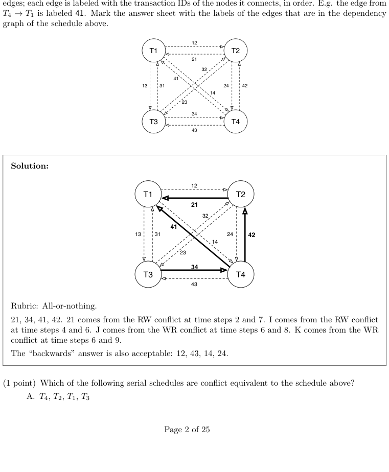

# Berkeley CS186 Fall 2017: Final: Official solutions

> Copied from the original: <https://hkn.eecs.berkeley.edu/exams/course/cs/186>. Text and figures are taken from the PDF as is; nothing was answered or rewritten. The original PDF is in this folder.

---

**Page 1**

&emsp;&emsp;&emsp;CS 186/286 Fall 2017 Final Exam 
• Do not turn this page until instructed to start the exam. 
• You should receive 1 answer sheet and a 25-page exam packet. 
• All answers should be written on the answer sheet. The exam packet will be collected but not graded. 
• You have 3 hours to complete the final. 
• The midterm has 8 questions, each with multiple parts. 
• For each question, place only your final answer on the answer sheet; do not show work. 
• For multiple choice questions, please fill in the bubble or box completely, **do not mark the box with** 
**an X or checkmark**. 
• Use the blank spaces in your exam for scratch paper. 
• You are allowed **two** 8.5” × 11” double-sided pages of notes. 
• No electronic devices are allowed.

---

**Page 2**

**1**   **Concurrency** 
Consider the following schedule of reads and writes to pages. 
&emsp;&emsp;&emsp;&emsp;&emsp;1   2   3   4   5   6   7   8   9   10 
&emsp;&emsp;&emsp;T1   R(A)   W(A)   R(C) 
&emsp;&emsp;&emsp;T2   R(A)   R(C) 
&emsp;&emsp;&emsp;T3   R(C)   R(B)   W(B) 
&emsp;&emsp;&emsp;T4   R(C)   W(C)

**Conflicts** 
1\. (2 points) What edges are included in the **dependency graph** (not waits-for graph) for the above 
&emsp;schedule? A reference graph is provided for your convenience. The dotted edges represent all possible

---

**Page 3**

&emsp;&emsp;B. T3, T2, T4, T1 
&emsp;&emsp;**C.** T3**,** T4**,** T2**,** T1 
&emsp;&emsp;D. T1, T2, T4, T3 
&emsp;&emsp;E. T1, T4, T2, T3 
&emsp;&emsp;F. None of the above

&emsp;**Solution:** C. The graph is acyclic, so it is conflict serializable. Topologically sorting the above 
&emsp;graph gives this ordering.

3\. (2.5 points) Mark all statements that are true. 
&emsp;&emsp;A. In Strict 2PL, we can give up locks after aborting but before rollback is complete. 
&emsp;&emsp;**B. Some conflict serializable schedules cannot be produced when using 2PL.** 
&emsp;&emsp;**C. Schedules that are conflict serializable will not produce a cyclic dependency graph.**

&emsp;&emsp;**D. Both Strict 2PL and 2PL enforce conflict serializability.** 
&emsp;&emsp;**E. All schedules that are conflict serializable are view serializable.**

&emsp;**Solution:** Only A is false. For A, you must wait until rollback is complete before giving up locks. 
&emsp;For B, 2PL enforces conflict serializability but may not allow all conflict serializable schedules (e.g. 
&emsp;W1(X), R2(X), W1(Y), R2(Y) is impossible under 2PL). For C, a schedule is conflict serializable if 
&emsp;and only if the dependency graph is acyclic, so conflict serializable implies an acyclic dependency 
&emsp;graph.   For D, because you cannot get any new locks after releasing a lock in both strict and 
&emsp;non-strict 2PL, the dependency graph for the resulting schedule can never be cyclic. For E, view 
&emsp;serializability is a generalization of conflict serializability, hence all conflict serializable schedules are 
&emsp;view serializable.

&emsp;&emsp;&emsp;&emsp;&emsp;&emsp;&emsp;&emsp;Page 3 of 25

---

**Page 4**

**Dealing with Deadlock** 
For the following sequence of lock requests, assume T1 is older than T2, and T2 is older than T3. The oldest 
transaction has the highest priority. No locks are released in the time frame shown. Note that not all requests 
may actually be issued—in some cases the transaction is still blocked waiting for a prior request. 
&emsp;Consider the following schedule of lock requests: 
&emsp;&emsp;&emsp;&emsp;&emsp;&emsp;&emsp;1   2   3   4   5   6   7   8   9 
&emsp;&emsp;&emsp;&emsp;&emsp;T1   X(D)   S(A)   S(C) 
&emsp;&emsp;&emsp;&emsp;&emsp;T2   X(A)   S(B)   S(D) 
&emsp;&emsp;&emsp;&emsp;&emsp;T3   S(B)   X(B)   S(C) 
4\. (1 point) The above schedule could not successfully occur whether one uses deadlock avoidance or not. 
&emsp;Suppose we are not using any deadlock avoidance algorithms. List the time steps in the schedule above 
&emsp;in which the lock request could not have been made: i.e. timesteps when the requesting transaction would 
&emsp;have been blocked waiting for a previous lock request.

&emsp;**Solution:** Rubric: All-or-Nothing.   Answer: 6 and 9.   Transaction 1 is blocked at time step 3 
&emsp;because it is not granted the shared lock on A, since Transaction 2 already has an exclusive lock on 
&emsp;it, so it cannot make the request at time step 6. Transaction 3 is blocked at time step 7 because it 
&emsp;is not granted its lock upgrade, since there is another transaction that also has a shared lock on B.

5\. (1 point) Assuming we do not use deadlock avoidance, what is the first time step when deadlock will 
&emsp;occur?

&emsp;**Solution:** 8. When T2 requests this lock, it is waiting on T1, which is blocked, so the transactions 
&emsp;enter deadlock.

6\. (1 point) Mark the transactions involved in the first deadlock.

&emsp;**Solution:** T1 and T2. The cycle in the waits-for graph only goes between these two transactions. 
&emsp;All or nothing for credit.

7\. (1 point) If we were using the wound-wait deadlock avoidance algorithm, what would happen at time 
&emsp;step 3? 
&emsp;&emsp;&emsp;A. The transaction requesting the lock would wait 
&emsp;&emsp;&emsp;B. The transaction requesting the lock would abort 
&emsp;&emsp;&emsp;**C. The transaction that holds the lock would abort**

&emsp;**Solution:** C. T1 is requesting the lock T2 holds and it has higher priority, so T2 would abort.

&emsp;&emsp;&emsp;&emsp;&emsp;&emsp;&emsp;&emsp;Page 4 of 25

---

**Page 5**

**2**   **Recovery** 
1\. (0.5 points) Which buffer management policy would allow us to maximize efficiency in terms of speed?

&emsp;&emsp;&emsp;**A. STEAL, NO FORCE**   C. NO STEAL, FORCE 
&emsp;&emsp;&emsp;B. STEAL, FORCE   D. NO STEAL, NO FORCE

&emsp;**Solution:** A. STEAL allows us to re-use the frames in the buffer pool more efficiently, and NO 
&emsp;FORCE avoids unnecessary disk flushes. Together, these improve the efficiency of the buffer manager 
&emsp;at the cost of requiring more complex recover algorithms. 
&emsp;This question was graded all or nothing. The correct answer received 1 point; every other answer 
&emsp;received 0 points.

2\. (0.5 points) True or False? In ARIES recovery, after the analysis phase, the recLSN of each page in the 
&emsp;dirty page table must be larger than the pageLSN of the corresponding page.

&emsp;**Solution:** False. The page could have been updated and flushed from the buffer pool between the 
&emsp;last checkpoint and time of crash. The flushed page would have a pageLSN from its most recent 
&emsp;update, which is after the recLSN in the checkpoint. 
&emsp;This question was graded all or nothing. The correct answer received 1 point; every other answer 
&emsp;received 0 points.

3\. (2 points) Select all the correct statements that are true about ARIES. 
&emsp;&emsp;&emsp;**A. CLRs are never undone during ARIES recovery.** 
&emsp;&emsp;&emsp;B. We remove a page from the dirty page table each time we write a CLR to the log. 
&emsp;&emsp;&emsp;C. The transaction table and dirty page table in the End Checkpoint record are up-to-date as of 
&emsp;&emsp;&emsp;&emsp;the time when the End Checkpoint record was logged. 
&emsp;&emsp;&emsp;**D. ARIES never causes a database disk page to be overwritten by a page with the** 
&emsp;&emsp;&emsp;&emsp;**same PageLSN.**

&emsp;**Solution:** A is true. CLRs are re-done but never undone. B is false. CLRs do not require us to 
&emsp;flush a page in the dirty page table to disk. In fact, at no point in ARIES are we forced to flush a 
&emsp;page in the dirty page table to disk. C is false. The transaction table and dirty page table in the 
&emsp;End Checkpoint record are up-to-date as of the time where the Begin Checkpoint record was logged. 
&emsp;D is true. A page on disk is only ever overwritten with a more recent version of the page, and if the 
&emsp;page is more recent, it has a larger PageLSN. 
&emsp;This question was graded as 4 independent true/false questions, each worth 0.5 points. That is, you 
&emsp;got 0.5 points for every correct choice that you selected and 0.5 points for every incorrect choice 
&emsp;that you did not select.

4\. (0.5 points) True or False: Regardless of the number of times we run recovery, each UPDATE in the log 
&emsp;will have at most one matching CLR record in the log.

&emsp;&emsp;&emsp;&emsp;&emsp;&emsp;&emsp;&emsp;Page 5 of 25

---

**Page 6**

&emsp;**Solution:** True. ARIES never issues multiple CLRs for the same UPDATE twice. Instead, the 
&emsp;redo phase redoes CLR log entries. 
&emsp;This question was graded all or nothing. The correct answer received 1 point; every other answer 
&emsp;received 0 points.

5\. (1 point) Why would the undoNextLSN field in a CLR be marked null? 
&emsp;&emsp;A. If the transaction committed. 
&emsp;&emsp;**B. If this CLR corresponds to the lowest UPDATE LSN of the transaction** 
&emsp;&emsp;C. If this CLR corresponds to the highest UPDATE LSN of the transaction 
&emsp;&emsp;D. If this CLR was the highest LSN flushed at the time of crash. 
&emsp;&emsp;E. If this CLR corresponds to a page that was flushed before the checkpoint.

&emsp;**Solution:** The undoNextLSN field of a CLR is the LSN of the next record that is to be undone. 
&emsp;When there are no records left to be undone, the field is left null. Thus, B is correct and all other 
&emsp;answers are not. 
&emsp;This question was graded all or nothing. The correct answer received 1 point; every other answer 
&emsp;received 0 points.

&emsp;&emsp;&emsp;&emsp;&emsp;&emsp;&emsp;&emsp;Page 6 of 25

---

**Page 7**

Now consider the following log records which are recovered after a crash. 
&emsp;&emsp;&emsp;&emsp;**LSN**   **Record**   **PrevLSN** 
&emsp;&emsp;&emsp;&emsp;...   ...   ... 
&emsp;&emsp;&emsp;&emsp;40   UPDATE: T3 writes P4   null 
&emsp;&emsp;&emsp;&emsp;50   UPDATE: T2 writes P3   null 
&emsp;&emsp;&emsp;&emsp;60   Begin Checkpoint   - 
&emsp;&emsp;&emsp;&emsp;70   End Checkpoint   - 
&emsp;&emsp;&emsp;&emsp;80   UPDATE: T1 writes P1   null 
&emsp;&emsp;&emsp;&emsp;90   UPDATE: T3 writes P5   40 
&emsp;&emsp;&emsp;&emsp;100   UPDATE: T3 writes P2   90 
&emsp;&emsp;&emsp;&emsp;110   UPDATE: T2 writes P1   50 
&emsp;&emsp;&emsp;&emsp;120   T3 Commit   100 
&emsp;&emsp;&emsp;&emsp;130   T3 End   120 
&emsp;&emsp;&emsp;&emsp;140   UPDATE: T1 writes P5   80 
&emsp;&emsp;&emsp;&emsp;150   T1 Abort   140 
&emsp;&emsp;&emsp;&emsp;160   CLR: Undo write to P5 (T1, LSN 140), undoNextLSN: 80   150 
&emsp;&emsp;&emsp;&emsp;&emsp;&emsp;CRASH! 
The following dirty page table and transaction table are read from the checkpoint: 
&emsp;&emsp;&emsp;**Transaction Table**   **Dirty Page Table** 
&emsp;&emsp;&emsp;&emsp;**Transaction**   **Status**   **lastLSN**   **Page**   **recLSN** 
&emsp;&emsp;&emsp;&emsp;T2   Running   50   P4   40 
&emsp;&emsp;&emsp;&emsp;T3   Running   40 
6\. (1 point) Assume that at the end of the Analysis phase, we convert all Running status to Aborting in the 
&emsp;transaction table. For each transaction, give its status in the transaction table at the end of the analysis 
&emsp;phase. List its status as “A” if the transaction is Aborting and “C” if the transaction is Committing. If 
&emsp;a transaction is **NOT** in the transaction table, list its status as “0”.

&emsp;**Solution:** The transaction table after the analysis phase is shown below. T1 and T2 were running 
&emsp;at the time of the crash, so they are marked as Aborting in the transaction table. T3 committed 
&emsp;and ended before the crash, so it is absent from the transaction table.

&emsp;&emsp;&emsp;&emsp;&emsp;&emsp;&emsp;&emsp;**Transaction**   **Status**   **lastLSN** 
&emsp;&emsp;&emsp;&emsp;&emsp;&emsp;&emsp;&emsp;T1   Aborting   160 
&emsp;&emsp;&emsp;&emsp;&emsp;&emsp;&emsp;&emsp;T2   Aborting   110

&emsp;This question was graded all or nothing. The correct answer received 1 point; every other answer 
&emsp;received 0 points.

7\. (2.5 points) For each page referenced in the log, give its recLSN in the dirty page table at the end of 
&emsp;the analysis phase. If a page is **NOT** in the dirty page table, list its recLSN as “0”. Assume the buffer 
&emsp;manager does not flush any pages during recovery.

&emsp;**Solution:** The dirty page table after the analysis phase is show below. 
&emsp;&emsp;&emsp;&emsp;&emsp;&emsp;&emsp;&emsp;**Page**   **recLSN** 
&emsp;&emsp;&emsp;&emsp;&emsp;&emsp;&emsp;&emsp;P1   80 
&emsp;&emsp;&emsp;&emsp;&emsp;&emsp;&emsp;&emsp;P2   100 
&emsp;&emsp;&emsp;&emsp;&emsp;&emsp;&emsp;&emsp;P3   0 
&emsp;&emsp;&emsp;&emsp;&emsp;&emsp;&emsp;&emsp;P4   40 
&emsp;&emsp;&emsp;&emsp;&emsp;&emsp;&emsp;&emsp;P5   90

&emsp;&emsp;&emsp;&emsp;&emsp;&emsp;&emsp;&emsp;Page 7 of 25

---

**Page 8**

&emsp;This question was graded as 5 independent true/false questions, each worth 0.5 points. That is, you 
&emsp;got 0.5 points for every correct choice that you selected and 0.5 points for every incorrect choice 
&emsp;that you did not select.

8\. (1 point) Mark the LSNs of the records that will actually be redone in the redo phase (i.e. that will 
require us to update a database page).

&emsp;**Solution:** The redo phase of ARIES begins at the smallest recLSN in the dirty page table. In this 
&emsp;example, that is 40, the recLSN of P4. We then walk forward through the log and redo all the 
&emsp;UPDATEs except for those that satisfy one of the three conditions under which we do not redo an 
&emsp;UPDATE. 
&emsp;The UPDATE with LSN 50 is not redone becasue P3 is not in the dirty page table.   All other 
&emsp;UPDATEs are redone. These updates have LSNs 40, 80, 90, 100, 110, 130, and 150. 
&emsp;This question was graded all or nothing. The correct answer received 1 point; every other answer 
&emsp;received 0 points.

9\. (1 point) Mark the LSNs of the UPDATE records that we write CLRs for during the undo phase.

&emsp;**Solution:** The undo phase of ARIES undoes all of the UPDATEs made by the aborting transactions. 
&emsp;In this example, T1 and T2 are aborting, so we must undo the UPDATEs with LSNs 50, 80, 110, 
&emsp;and 140. The CLR with LSN 160 undoes the UPDATE with LSN 140 and is already in the log, so 
&emsp;we introduce three new CLRs to undo the UPDATEs with LSNS 50, 80, and 110. 
&emsp;This question was graded all or nothing. The correct answer received 1 point; every other answer 
&emsp;received 0 points.

&emsp;&emsp;&emsp;&emsp;&emsp;&emsp;&emsp;&emsp;Page 8 of 25

---

**Page 9**

**3**   **Two-Phase Commit**

Our database runs on 4 machines and uses Two-Phase Commit.   Ma- 
chine 1 is the Coordinator, while Machines 2, 3, and 4 are Partici- 
pants.

Suppose our machines are connected such that the time it takes to send 
a message from Machine i to Machine j is 100·max(i, j) milliseconds (see 
graph). Assume these communication latencies are symmetric: it takes 
the same amount of time to send from i to j as it takes to send from j 
to i. For example, sending a message between Machine 2 and Machine 4 
takes 400 milliseconds in either direction.

Assume that the transaction will commit (i.e. all subordinates vote yes), 
and that everything is instantaneous except for the time spent sending 
messages between two machines. 
1\. (0.25 points) What is the first message Machine 1 sends?

&emsp;&emsp;&emsp;A. VOTE YES   **B. PREPARE**   C. COMMIT   D. None of these

&emsp;**Solution:** The coordinator (i.e. Machine 1) begins the first round of two-phase commit by sending 
&emsp;a PREPARE message to all of the subordinates. 
&emsp;This question was graded all or nothing. The correct answer received 0.25 points; every other answer 
&emsp;received 0 points.

2\. (0.25 points) What is the second message Machine 1 sends?

&emsp;&emsp;&emsp;A. VOTE YES   B. PREPARE   **C. COMMIT**   D. None of these

&emsp;**Solution:** The coordinator (i.e. Machine 1) begins the second phase of two-phae commit by sending 
&emsp;a COMMIT message to all of the subordinates. Note that the problem states that all subordinates 
&emsp;vote yes in the first round which is why the coordinator sends a COMMIT message (instead of an 
&emsp;ABORT message) to start the second round. 
&emsp;This question was graded all or nothing. The correct answer received 0.25 points; every other answer 
&emsp;received 0 points.

3\. (1 point) How much time passes from when Machine 1 sends its first message to when Machine 1 sends 
&emsp;its second message?

&emsp;**Solution:** This is just the maximum time for a round-trip between Machine 1 and Machines 2–4, 
&emsp;since Machine 1 sends its second message (COMMIT) once its first message (PREPARE) reaches 
&emsp;each of the other machines and each of the machines respond back with a VOTE YES message. 
&emsp;The time for a round-trip between Machine 1 and Machine i is 2 · 100 · i, and the largest of these is 
&emsp;with Machine 4: 2 · 100 · 4 = 800ms. 
&emsp;This question was graded all or nothing. The correct answer received 1 point; every other answer 
&emsp;received 0 points.

&emsp;&emsp;&emsp;&emsp;&emsp;&emsp;&emsp;&emsp;Page 9 of 25

---

**Page 10**

4\. (0.25 points) What is the first message Machine 2 sends?

&emsp;&emsp;**A. VOTE YES**   B. PREPARE   C. COMMIT   D. None of these

&emsp;**Solution:** A subordinate (e.g. Machine 2) responds to a PREPARE message from the coordinator 
&emsp;with a VOTE YES or VOTE NO. The problem states that all subordinates vote yes, so Machine 2 
&emsp;sends a VOTE YES message. 
&emsp;This question was graded all or nothing. The correct answer received 0.25 points; every other answer 
&emsp;received 0 points.

5\. (0.25 points) What is the second message Machine 2 sends?

&emsp;&emsp;A. VOTE YES   B. PREPARE   C. COMMIT   **D. None**   **of** 
&emsp;&emsp;&emsp;&emsp;&emsp;&emsp;&emsp;&emsp;**these**

&emsp;**Solution:** The second message Machine 2 (a participant) sends is an ACK. 
&emsp;This question was graded all or nothing. The correct answer received 0.25 points; every other answer 
&emsp;received 0 points.

6\. (1 point) How much time passes from when Machine 2 sends its first message to when Machine 2 sends 
its second message?

&emsp;**Solution:** Let’s have Machine 1 send the PREPARE message at time 0. 
&emsp;This PREPARE message will reach Machine 2 at time 200ms, so Machine 2 sends its first message 
&emsp;(VOTE YES) at time 200ms. 
&emsp;Machine 1 sends the COMMIT message at time 800ms (when it hears back from Machine 4), and 
&emsp;this message takes 200ms to reach Machine 2. Machine 2 therefore receives the COMMIT message 
&emsp;at time 1000ms, and sends its second message (ACK). 
&emsp;The time passed is therefore 1000ms - 200ms = 800ms. 
&emsp;The correct answer received 1 point. 0.5 points of partial credit was given to the answer 600ms 
&emsp;(failing to realize that Machines 3 and 4 have not received PREPARE at the time that Machine 2 
&emsp;sends a VOTE YES, but correctly observing that the coordinator waits for all votes). Every other 
&emsp;answer received 0 points.

7\. (0.5 points) True or False. A transaction is considered committed even if over half of the participants 
do not acknowledge the commit.

&emsp;**Solution:** True. A transaction must commit once the COMMIT message is sent out, even if all the 
&emsp;participants promptly crash repeatedly and do not respond with ACKs as a result. 
&emsp;This question was graded all or nothing. The correct answer received 0.5 points; every other answer 
&emsp;received 0 points.

&emsp;&emsp;&emsp;&emsp;&emsp;&emsp;&emsp;&emsp;Page 10 of 25

---

**Page 11**

Now suppose that our implementation of 2-Phase Commit has an off-by-one bug where the Coordinator 
receives, but does not use, Machine 4’s vote. That is, Machine 4’s vote does not affect whether or not the 
transaction commits or aborts. 
8\. (0.5 points) True or False. A transaction that should normally commit may be aborted instead.

&emsp;**Solution:** False. If the transaction would normally commit, then Machines 2 and 3 must have been 
&emsp;functional and voted yes, so the transaction would still have to commit with this bug. 
&emsp;This question was graded all or nothing. The correct answer received 0.5 points; every other answer 
&emsp;received 0 points.

9\. (0.5 points) True or False. A transaction that should normally abort may be committed instead.

&emsp;**Solution:** True. If Machine 4 votes no and other participants vote yes, then the transaction should 
&emsp;be aborted but commits anyways. 
&emsp;This question was graded all or nothing. The correct answer received 0.5 points; every other answer 
&emsp;received 0 points.

10\. (0.5 points) True or False. A transaction that should normally commit may be committed properly.

&emsp;**Solution:** True. If all machines vote yes, then the transaction commits even if we ignore Machine 
&emsp;4’s vote. 
&emsp;This question was graded all or nothing. The correct answer received 0.5 points; every other answer 
&emsp;received 0 points.

11\. (0.5 points) True or False. A transaction that should normally abort may be aborted properly.

&emsp;**Solution:** True. If Machine 2 or 3 votes no, then the transaction aborts in both cases. 
&emsp;This question was graded all or nothing. The correct answer received 0.5 points; every other answer 
&emsp;received 0 points.

&emsp;&emsp;&emsp;&emsp;&emsp;&emsp;&emsp;&emsp;Page 11 of 25

---

**Page 12**

**4**   **Joins** 
**4.1**   **Young Justice... again** 
For the following questions in this section, assume that we are streaming our query output to a terminal. 
(Do not consider the cost of writing the final output)

`CREATE` `TABLE` `JusticeLeague` `(` 
&emsp;`member_id` `INTEGER` `PRIMARY` `KEY,` 
&emsp;`code_name` `CHAR(33),` 
&emsp;`birth_planet` `CHAR(20),` 
&emsp;`power_level` `INTEGER` 
`);`

`CREATE` `TABLE` `Teaches` `(` 
&emsp;`member_id` `INTEGER` `PRIMARY` `KEY` `REFERENCES` `JusticeLeague,` 
&emsp;`teacher_id` `INTEGER` `REFERENCES` `JusticeLeague,` 
&emsp;`since` `DATE` 
`);` 
&emsp;We assume that 
&emsp;• JusticeLeague has \[J\] = 100 pages 
&emsp;• JusticeLeague has \|J\| = 1000 members 
&emsp;• Teaches has \[T\] = 200 pages 
&emsp;• Teaches has \|T\| = 2000 members 
&emsp;• Buffer size = 12 pages 
&emsp;• An Alternative-1 B+ tree for Teaches indexed on `T.member` `id` has the height 2. In this problem, we 
&emsp;interpret height as the number of I/Os it takes to travel from the root to the leaf page. 
1\. (2 points) What is the I/O cost of using Index Nested Loop Join to perform a natural join of Teaches and 
&emsp;JusticeLeague? Consider table JusticeLeague as the outer relation. Note that we want the actual cost 
&emsp;in I/O requests, not a Selinger-style estimate. Treat each I/O request the same, regardless of whether 
&emsp;you think the request will hit in the buffer pool. Your answer must be a single integer.

&emsp;**Solution:** \[J\] + \|J\|\*(cost of finding T) 
&emsp;100 + 1000 \* 2 = 2100 I/O

2\. (2 points) Assume we introduce an Alternative 2, clustered B+ tree for JusticeLeague indexed on 
&emsp;`member` `id` with height 2. What is the I/O cost of using Index Nested Loop Join to perform a nat- 
&emsp;ural join of Teaches and JusticeLeague? This time consider table Teaches as the outer relation. Your 
&emsp;answer must be a single integer.

&emsp;**Solution:** \[T\] + \|T\|\*(cost of finding J) 
&emsp;200 + 2000 \* 3 = 6200 I/O

&emsp;&emsp;&emsp;&emsp;&emsp;&emsp;&emsp;&emsp;Page 12 of 25

---

**Page 13**

3\. (1 point) If the previous question’s B+ tree for JusticeLeague had used an unclustered index, would the 
I/O cost have been different? (Answer only in Yes or No)

&emsp;**Solution:** No

&emsp;&emsp;&emsp;&emsp;&emsp;&emsp;&emsp;&emsp;Page 13 of 25

---

**Page 14**

**4.2**   **General Join Algorithm Questions**

4\. (2 points) In this question, we explore the strengths and weaknesses of various join algorithms. Assume 
throughout that we are joining two tables R and S, and we have B buffers of memory for our join. Do 
not assume any additional information about the tables that is not explicitly provided. 
&emsp;(a) (1 point) We are performing an equijoin. \[R\] \< B, \[S\] \> B3. Which join algorithm will provide 
&emsp;&emsp;the correct answer with the fewest I/Os: 
&emsp;&emsp;&emsp;&emsp;**A. Block Nested Loops Join** 
&emsp;&emsp;&emsp;&emsp;B. Grace Hash Join 
&emsp;&emsp;&emsp;&emsp;C. Sort-Merge Join 
&emsp;(b) (1 point) We are performing an equijoin. B \< \[R\] \< (B −1)2, and B \< \[S\] \< (B −1)2. Both R 
&emsp;&emsp;and S have only 2 distinct values in the join key column. Which join algorithm will provide the 
&emsp;&emsp;correct answer with the fewest I/Os: 
&emsp;&emsp;&emsp;&emsp;**A. Block Nested Loops Join** 
&emsp;&emsp;&emsp;&emsp;B. Grace Hash Join 
&emsp;&emsp;&emsp;&emsp;C. Sort-Merge Join 
5\. (2 points) Consider the following “Index On Demand” join algorithm. Given an equijoin on tables R 
and S (with \[R\] \< \[S\]), but no indexes on the join columns initially, the algorithm will (a) bulk-load an 
Alternative-1 B+-tree on R, (b) perform an Index Nested Loops Join on S ▷◁R using the index, and 
(c) delete the index on R. Mark all of the following that you believe to be true for joining R and S, 
assuming B \< \[R\] \< \[S\] \< (B −1)2: 
&emsp;&emsp;**A. This algorithm generates more I/Os than Grace Hash Join (without recursive** 
&emsp;&emsp;&emsp;**partitioning).** 
&emsp;&emsp;**B. This algorithm generates more I/Os than a 2-pass Sort-Merge join.** 
&emsp;&emsp;**C. This algorithm generates more random I/Os than Block Nested Loops Join.** 
&emsp;&emsp;**D. If we omit step (c), this algorithm might be of interest for its benefits on subse-** 
&emsp;&emsp;&emsp;**quent queries, even though it could be sub-optimal for the current query.**

&emsp;&emsp;&emsp;&emsp;&emsp;&emsp;&emsp;&emsp;Page 14 of 25

---

**Page 15**

**5**   **Query Optimization** 
For the following questions, assume the following: 
&emsp;• The System R assumptions about uniformity and independence from lecture hold 
&emsp;• We use System R defaults when selectivity estimation is not possible 
&emsp;• Primary key IDs are sequential in each table, starting from 1, and there are no gaps in the ID sequence 
&emsp;in any table 
&emsp;• Our system implements only implements Grace Hash Join. It allocates 5 pages of memory for the join 
&emsp;operator. 
&emsp;• Assume all indices are alternative 3 indices. 
&emsp;• Assume the optimizer statistics are fully accurate w.r.t. the current content of the database.

**Table Schema**   **Records**   **Pages**   **Indices** 
`CREATE` `TABLE` `User` `(` 
&emsp;`uid` `INTEGER` `PRIMARY` `KEY,` 
&emsp;&emsp;&emsp;&emsp;&emsp;&emsp;&emsp;&emsp;1,000   100   None 
&emsp;`fullname` `VARCHAR(32),` 
&emsp;`country` `VARCHAR(4))` 
`)` 
`CREATE` `TABLE` `Item` `(` 
&emsp;`sku` `INTEGER` `PRIMARY` `KEY,`   • Index 0: Unclustered Index on sku. 
&emsp;&emsp;&emsp;&emsp;&emsp;&emsp;&emsp;&emsp;10,000   1,000 
&emsp;`itemname` `VARCHAR(32),` 
&emsp;&emsp;&emsp;&emsp;&emsp;&emsp;&emsp;&emsp;• Index 1: Clustered Index price Low 0, High 100 
&emsp;`price` `NUMERIC` 
`)` 
`CREATE` `TABLE` `Order` `(` 
&emsp;`uid` `INTEGER` `REFERENCES` `User,` 
&emsp;&emsp;&emsp;&emsp;&emsp;&emsp;&emsp;&emsp;100,000   5,000   • Index 2: Clustered Index on uid 
&emsp;`sku` `INTEGER` `REFERENCES` `Item,` 
&emsp;`quantity`   `INTEGER)` 
`)` 
`CREATE` `TABLE` `Tax` `(` 
&emsp;`sku` `INTEGER` `PRIMARY` `KEY` 
&emsp;&emsp;&emsp;&emsp;&emsp;&emsp;&emsp;&emsp;10,000   1,000   None 
&emsp;&emsp;`REFERENCES` `Item,` 
&emsp;`taxrate` `NUMERIC` 
`)` 
1\. (1 point) After applying the System R optimizer, which query has a lower estimated final cost for the 
&emsp;optimal query plan. 
&emsp;&emsp;&emsp;A. `SELECT` `*`   **B.** `SELECT` `*` 
&emsp;&emsp;&emsp;&emsp;`FROM` `Item`   `FROM` `Item` 
&emsp;&emsp;&emsp;&emsp;`WHERE` `Item.itemname` `=` `’WidgetA’`   `WHERE` `Item.price` `<` `3`

&emsp;10,**Solution:** B. Since there is no index on `itemname`, the optimizer will estimate a selectivity of1 
&emsp;100 for Item.price.compared to a selectivity of3 
&emsp;This question was graded all or nothing. The correct answer received 1 point; every other answer 
&emsp;received 0 points.

2\. (1 point) After applying the System R optimizer, which query has a lower estimated final cost for the 
&emsp;optimal query plan.

&emsp;&emsp;&emsp;&emsp;&emsp;&emsp;&emsp;&emsp;Page 15 of 25

---

**Page 16**

&emsp;&emsp;**A.** `SELECT` `*`   B. `SELECT` `*` 
&emsp;&emsp;&emsp;`FROM` `Item`   `FROM` `Tax` 
&emsp;&emsp;&emsp;`ORDER` `BY` `Item.price`   `ORDER` `BY` `Tax.taxrate`

&emsp;**Solution:** A. `Item` and `Tax` have the same number of pages, but there is an eligible clustered 
&emsp;index on `Item.price`. Thus, we can perform an index scan on `Item` to return tuples ordered by 
&emsp;`Item.price`, but we have to perform an external sort on `Tax` in order to return tuples ordered by 
&emsp;`Tax.taxrate`. 
&emsp;This question was graded all or nothing. The correct answer received 1 point; every other answer 
&emsp;received 0 points.

3\. (0.5 points) (True or False) The System R optimizer will apply a projection to the Tax table that 
preserves only the `taxrate` attribute before performing a join for the following query: 
&emsp;`SELECT` `taxrate` 
&emsp;`FROM` `Item,` `Tax` 
&emsp;`WHERE` `Tax.sku` `=` `Item.sku`

&emsp;**Solution:** False. `sku` is also needed for the join. 
&emsp;This question was graded all or nothing. The correct answer received 0.5 points; every other answer 
&emsp;received 0 points.

4\. (0.5 points) (True or False) For the following query, one can determine the cardinality of the join result 
(i.e the number of tuples in the result) exactly: 
&emsp;`SELECT` `taxrate` 
&emsp;`FROM` `Item,` `Tax` 
&emsp;`WHERE` `Tax.sku` `=` `Item.sku`

&emsp;**Solution:** True. The foreign key relationship enforces a constraint between the two tables. Note 
&emsp;that `Tax.sku` is a primary key and hence is never null. 
&emsp;This question was graded all or nothing. The correct answer received 0.5 points; every other answer 
&emsp;received 0 points.

5\. (0.5 points) (True or False) In general, even if an eligible index exists, a sequential scan can be selected 
rather than an index scan.

&emsp;**Solution:** True. For example, a full table scan can often be less expensive than an unclustered 
&emsp;index scan with a low selectivity predicate. 
&emsp;This question was graded all or nothing. The correct answer received 0.5 points; every other answer 
&emsp;received 0 points.

6\. (1.5 points) Consider the following query:

&emsp;&emsp;&emsp;&emsp;&emsp;&emsp;&emsp;&emsp;Page 16 of 25

---

**Page 17**

&emsp;`SELECT` `*` 
&emsp;`FROM` `User,` `Order` 
&emsp;`WHERE` `User.uid` `=` `Order.uid` `AND` 
&emsp;&emsp;&emsp;`User.country` `=` `’USA’` 
During Pass 2 of the System R Optimizer, what is the estimated cost of executing the query using a 
Grace hash join? Be sure to include the cost of the heap scans and any other upstream operators.

&emsp;**Solution:** First, notice that we apply the predicate `User.country` `=` `’USA’` to `User` before doing 
&emsp;any joins. This incurs a cost of 100 pages. Since there isn’t an index on this attribute, the selectivity 
&emsp;10\. This means that optimizer estimates that after applying the predicate there are 100estimate is1 
&emsp;records and 10 pages. The `Order` table is also scanned and this incurs a cost of 5000 pages. 
&emsp;10 \< 5 ∗4, so Grace hash can be performed in 2 passes–leading to the formula (100 + 5000) + 2 ∗ 
&emsp;(10 + 5000) = 15120.

7\. (1 point) Consider the following query: 
&emsp;`SELECT` `*` 
&emsp;`FROM` `User,` `Order,` `Tax,` `Item` 
&emsp;`WHERE` `User.uid` `=` `Order.uid` `AND` 
&emsp;&emsp;&emsp;&emsp;&emsp;`Item.sku` `=` `Order.sku` `AND` 
&emsp;&emsp;&emsp;&emsp;&emsp;`Tax.sku` `=` `Item.sku` `AND` 
&emsp;&emsp;&emsp;&emsp;&emsp;`Tax.sku` `=` `Order.sku` 
Without making assumptions about costs and selectivities, which of the following join orders could 
**NEVER** be considered by the System R optimizer to answer this query? Mark all that apply 
&emsp;&emsp;A. (((User ▷◁Order) ▷◁Item) ▷◁Tax) 
&emsp;&emsp;B. (User ▷◁Order) ▷◁(Item ▷◁Tax) 
&emsp;&emsp;**C. (((User** ▷◁**Item)** ▷◁**Order)** ▷◁**Tax)** 
&emsp;&emsp;**D. (((User** ▷◁**Order)** ▷◁**Tax)** ▷◁**Item)** 
&emsp;&emsp;E. (((Tax ▷◁Item) ▷◁Order) ▷◁User) 
&emsp;&emsp;F. None of the above

&emsp;**Solution:** Rubric: all-or-nothing. B is not a left-deep query plan, so it is never considered by the 
&emsp;System R optimizer. C’s leftmost join is between `User` and `Item` but this is a cross join. The System 
&emsp;R optimizer defers cross joins to the top of the query plan, so the System R optimizer would not 
&emsp;consider C. All other query plans may be considered by the System R optimizer.

8\. (0.5 points) (True or False) Ignoring order by statements, group by statements, and nested queries, the 
System R optimizer is guaranteed to return the left-deep query plan with the lowest IO cost with respect 
to the estimated costs.

&emsp;**Solution:** True. The System R optimizer is not guaranteed to return the best overall query plan, 
&emsp;but it is guaranteed to return the best left-deep query plan with respect to the estimated costs. Note 
&emsp;that the estimated costs may be erroneous, so the query plan returned by the System R optimizer 
&emsp;may not actually be the best left-deep plan.

&emsp;&emsp;&emsp;&emsp;&emsp;&emsp;&emsp;&emsp;Page 17 of 25

---

**Page 18**

**6**   **SQL** 
Consider a table `Friend` representing a social network.   Each record of the Friend table consists of two 
integers corresponding to a friendship relationship between two users (identified by the id number). Assume 
that no person is friends with themselves. 
`CREATE` `TABLE` `Friend(` 
&emsp;&emsp;`id1` `INTEGER,` 
&emsp;&emsp;`id2` `INTEGER,` 
&emsp;&emsp;`PRIMARY` `KEY` `(id1,id2));` 
1\. (1.5 points) Some of the friendship relationships in this table are not reciprocated, i.e., `(id1=a,id2=b)` 
&emsp;exists in the table but `(id1=b,id2=a)` does not exist. Which of the following SQL queries identifies all 
&emsp;tuples where the reciprocal relationship does not exist in the table. Mark all that apply. 
&emsp;&emsp;&emsp;**A.** `SELECT` `*` 
&emsp;&emsp;&emsp;&emsp;`FROM` `Friend` `f1` 
&emsp;&emsp;&emsp;&emsp;`WHERE` `NOT` `EXISTS` `(SELECT` `*` 
&emsp;&emsp;&emsp;&emsp;&emsp;&emsp;&emsp;&emsp;`FROM` `Friend` `f2` 
&emsp;&emsp;&emsp;&emsp;&emsp;&emsp;&emsp;&emsp;`WHERE` `f1.id1` `=` `f2.id2` `AND` `f1.id2` `=` `f2.id1)`

&emsp;&emsp;&emsp;**B.** `SELECT` `t.id1,` `t.id2` 
&emsp;&emsp;&emsp;&emsp;`FROM` `(` 
&emsp;&emsp;&emsp;&emsp;&emsp;`(SELECT` `id1,` `id2` 
&emsp;&emsp;&emsp;&emsp;&emsp;&emsp;`FROM` `Friend` `f1)` 
&emsp;&emsp;&emsp;&emsp;&emsp;`UNION` `ALL` 
&emsp;&emsp;&emsp;&emsp;&emsp;`(SELECT` `f2.id2` `as` `id1,` `f2.id1` `as` `id2` 
&emsp;&emsp;&emsp;&emsp;&emsp;&emsp;`FROM` `Friend` `f2)` 
&emsp;&emsp;&emsp;&emsp;`)` `as` `t` 
&emsp;&emsp;&emsp;&emsp;`GROUP` `BY` `t.id1,` `t.id2` 
&emsp;&emsp;&emsp;&emsp;`HAVING` `count(*)`   `<`   `2`

&emsp;&emsp;&emsp;C. `SELECT` `t.id1,` `t.id2` 
&emsp;&emsp;&emsp;&emsp;`FROM` `(` 
&emsp;&emsp;&emsp;&emsp;&emsp;`SELECT` `f2.id2` `as` `id1,` `f2.id1` `as` `id2` 
&emsp;&emsp;&emsp;&emsp;&emsp;`FROM` `Friend` `f2` 
&emsp;&emsp;&emsp;&emsp;`)` `as` `t` `FULL` `OUTER` `JOIN` `Friend` 
&emsp;&emsp;&emsp;&emsp;`ON` `t.id1` `=` `Friend.id1` `AND` `t.id2` `=` `Friend.id2` `AND` `Friend.id1` `<>` `NULL` 
&emsp;&emsp;&emsp;D. None of the above

&emsp;**Solution:** A, B. 
&emsp;Answer **A** correctly uses a subquery to determine whether for each friendship tuple there exists at 
&emsp;least one inverse relationship. 
&emsp;Answer **B** takes a union all of friends table and a friends table where the attributes are in reverse 
&emsp;order. It counts the number of elements in each group. This relies on the fact that (id1,id2) is a 
&emsp;primary key. 
&emsp;Answer **C** is incorrect because the statement Friend.id1 \<\> NULL should not be applied in the join 
&emsp;condition.

2\. (1 point) Consider the same table, but without the primary key constraint. Continue to assume that 
&emsp;no person is friends with themselves.

&emsp;&emsp;&emsp;&emsp;&emsp;&emsp;&emsp;&emsp;Page 18 of 25

---

**Page 19**

&emsp;`CREATE` `TABLE` `Friend(` 
&emsp;&emsp;`id1` `INTEGER,` 
&emsp;&emsp;`id2` `INTEGER);` 
This table can contain multiple copies of the same friendship relationship, e.g., two tuples with `(id1=a,id2=b)`. 
Therefore, each distinct `(id1=a,id2=b)` pair will have a count of the number of times it occurs in the 
relation. We want to write a query that finds all distinct pairs where the count of `(id1=a,id2=b)` is not 
equal to the count of `(id1=b,id2=a)`. Mark all that apply.

&emsp;&emsp;**A.** `SELECT` `id1,` `id2,` `count(*)`   C. `(SELECT` `id1,` `id2,` `count(*)` 
&emsp;&emsp;&emsp;`FROM` `Friend`   `FROM` `Friend` 
&emsp;&emsp;&emsp;`GROUP` `BY` `id1,` `id2`   `GROUP` `BY` `id1,` `id2`

&emsp;&emsp;&emsp;`EXCEPT`   `EXCEPT`

&emsp;&emsp;&emsp;`SELECT` `id2,` `id1,` `count(*)`   `SELECT` `id2,` `id1,` `count(*)` 
&emsp;&emsp;&emsp;`FROM` `Friend`   `FROM` `Friend` 
&emsp;&emsp;&emsp;`GROUP` `BY` `id1,` `id2`   `GROUP` `BY` `id1,` `id2)`

&emsp;&emsp;&emsp;&emsp;&emsp;&emsp;&emsp;&emsp;`UNION` `ALL`

&emsp;&emsp;&emsp;&emsp;&emsp;&emsp;&emsp;&emsp;`(SELECT` `id2,` `id1,` `count(*)` 
&emsp;&emsp;**B.** `SELECT` `id1,` `id2,` `count(*)` 
&emsp;&emsp;&emsp;&emsp;&emsp;&emsp;&emsp;&emsp;`FROM` `Friend` 
&emsp;&emsp;&emsp;`FROM` `Friend` 
&emsp;&emsp;&emsp;&emsp;&emsp;&emsp;&emsp;&emsp;`GROUP` `BY` `id1,` `id2` 
&emsp;&emsp;&emsp;`GROUP` `BY` `id1,` `id2` 
&emsp;&emsp;&emsp;&emsp;&emsp;&emsp;&emsp;&emsp;`EXCEPT` 
&emsp;&emsp;&emsp;`EXCEPT` `ALL` 
&emsp;&emsp;&emsp;&emsp;&emsp;&emsp;&emsp;&emsp;`SELECT` `id1,` `id2,` `count(*)` 
&emsp;&emsp;&emsp;`SELECT` `id2,` `id1,` `count(*)` 
&emsp;&emsp;&emsp;&emsp;&emsp;&emsp;&emsp;&emsp;`FROM` `Friend` 
&emsp;&emsp;&emsp;`FROM` `Friend` 
&emsp;&emsp;&emsp;&emsp;&emsp;&emsp;&emsp;&emsp;`GROUP` `BY` `id1,` `id2)` 
&emsp;&emsp;&emsp;`GROUP` `BY` `id1,` `id2` 
&emsp;&emsp;&emsp;&emsp;&emsp;&emsp;&emsp;&emsp;D. None of the above

&emsp;**Solution:** A and B are correct see `http://sqlfiddle.com/#!17/f3cf9/1`. C is incorrect because 
&emsp;it can contain tuples that don’t exist in the database: `http://sqlfiddle.com/#!17/f3cf9/3`

3\. (1.5 points) Assume the following `Friend` table with the primary key constraint. 
&emsp;`CREATE` `TABLE` `Friend(` 
&emsp;&emsp;&emsp;`id1` `INTEGER,` 
&emsp;&emsp;&emsp;`id2` `INTEGER,` 
&emsp;&emsp;&emsp;`PRIMARY` `KEY` `(id1,id2));` 
A “triangle” of friends is defined as Person a is friends with Person b, Person b is friends with Person c, 
and Person c is friends with Person a. Which of the following queries lists of all of the distinct triangles 
output in alphabetical order—i.e., if a, b, c is in the result then c, a, b should not be in the result. Mark 
all that apply.

&emsp;&emsp;A. `SELECT` `f1.id1,` `f2.id1,` `f3.id1`   `WHERE` `f1.id2` `=` `f2.id1` `AND` 
&emsp;&emsp;&emsp;`FROM` `Friend` `f1,` `Friend` `f2,` `Friend`   `f2.id2` `=` `f3.id1` `AND` 
&emsp;&emsp;&emsp;&emsp;&emsp;`f3`   `f3.id2` `=` `f1.id1` `AND`

&emsp;&emsp;&emsp;&emsp;&emsp;&emsp;&emsp;&emsp;Page 19 of 25

---

**Page 20**

&emsp;&emsp;&emsp;&emsp;`f1.id1` `<` `f2.id1` `AND`**C.** `SELECT` `f1.id1,` `f2.id1,` `f3.id1` 
&emsp;&emsp;&emsp;&emsp;`f2.id1` `>` `f3.id1`   `FROM` `Friend` `f1,` `Friend` `f2,` `Friend` 
&emsp;&emsp;&emsp;&emsp;&emsp;&emsp;&emsp;&emsp;`f3` 
&emsp;B. `SELECT` `f1.id1,` `f2.id1,` `f3.id1`   `WHERE` `f1.id2` `=` `f2.id1` `AND` 
&emsp;&emsp;`FROM` `Friend` `f1,` `Friend` `f2,` `Friend``f2.id2` `=` `f3.id1` `AND` 
&emsp;&emsp;&emsp;`f3``f3.id2` `=` `f1.id1` `AND` 
&emsp;&emsp;`WHERE` `f1.id2` `=` `f2.id1` `AND``f1.id1` `<` `f2.id1` `AND` 
&emsp;&emsp;&emsp;&emsp;`f2.id2` `=` `f3.id1` `AND``f2.id1` `<` `f3.id1` 
&emsp;&emsp;&emsp;&emsp;`f3.id2` `=` `f1.id1` 
&emsp;&emsp;&emsp;&emsp;&emsp;&emsp;&emsp;&emsp;D. None of the above

**Solution:** Only C is correct. See `http://sqlfiddle.com/#!17/4e78f/1/0`.

&emsp;&emsp;&emsp;&emsp;&emsp;&emsp;&emsp;&emsp;Page 20 of 25

---

**Page 21**

**7**   **Replication** 
1\. (3 points) Which of the following are reasons to replicate data: 
&emsp;&emsp;&emsp;**A. To increase the odds that some node will be able to respond to any request at any** 
&emsp;&emsp;&emsp;&emsp;**given time** 
&emsp;&emsp;&emsp;**B. To allow multiple nodes to split up the work for a large volume of requests.** 
&emsp;&emsp;&emsp;**C. To reduce latency by allowing clients to fetch data from a nearby server** 
&emsp;&emsp;&emsp;D. To handle ever-increasing database sizes. 
&emsp;&emsp;&emsp;**E. To hide transient performance problems.** 
&emsp;&emsp;&emsp;**F. To recover from failures.**

&emsp;**Solution:** Rubric: each answer treated as independent T/F question.   A. is Availability.   B is 
&emsp;Workload Scaling.   C is Locality.   D is false: that’s what partitioning is for.   E is a version of 
&emsp;Availability: latency within timeout. F is a version of Availability as well.

2\. (2 points) Consider a single-master system that performs 2PC upon transaction commit. Which of the 
&emsp;following problems could occur in a single-master system, but are prevented by 2PC? 
&emsp;&emsp;&emsp;**A. The standby node may have an older value for some key than the master.** 
&emsp;&emsp;&emsp;**B. Transactions could commit while the standby node has failed.** 
&emsp;&emsp;&emsp;C. The standby node may have processed an update that conflicts with the master node. 
&emsp;&emsp;&emsp;D. The master node may fail and block progress.

&emsp;**Solution:** Rubric: each answer treated as independent T/F question. A: True. this is likely to be 
&emsp;the case before 2PC commit processing. B. True. The standby could get arbitrarily out of date. C. 
&emsp;False. The standby does not process updates in Single-Master. D. While this could happen, 2PC 
&emsp;does not help.

3\. (2 points) Which of the following drawbacks are true of 2PC-controlled replication? 
&emsp;&emsp;&emsp;A. If it is not strict 2PC, you could get cascading aborts. 
&emsp;&emsp;&emsp;**B. A failed participant node can cause live nodes to abort.** 
&emsp;&emsp;&emsp;**C. A failed coordinator node can freeze up the entire system indefinitely.** 
&emsp;&emsp;&emsp;**D. Message latency for 2PC across wide-area networks can be high, and lead to slow** 
&emsp;&emsp;&emsp;&emsp;**transaction performance.**

&emsp;**Solution:** Rubric: each answer treated as independent T/F question.   A: False: this makes no 
&emsp;sense. Don’t confuse 2PL and 2PC! B. TRUE, due to unanimous it’s true. C. TRUE. Eventually 
&emsp;the coordinator will time out waiting for the failed node and abort transactions. D. TRUE. This is 
&emsp;the case that Paxos Commit came to solve. E. This is TRUE – e.g. the slides point out that Google 
&emsp;spanner takes 100ms to turn around a simple transaction.

4\. (0.5 points) True or False: In multi-master replication, it is possible for the system to get “split brain”: 
&emsp;two nodes may disagree about the value associated with some key.

&emsp;&emsp;&emsp;&emsp;&emsp;&emsp;&emsp;&emsp;Page 21 of 25

---

**Page 22**

&emsp;**Solution:** True.

5\. (0.5 points) True or False: In the absence of 2PC, multi-master replication is a high-bandwidth approach 
because many nodes can service writes to the same key in parallel, without sending each other messages.

&emsp;**Solution:** True.

&emsp;&emsp;&emsp;&emsp;&emsp;&emsp;&emsp;&emsp;Page 22 of 25

---

**Page 23**

**8**   **B+ Trees** 
**8.1**   **True/False** 
1\. (3 points) Mark all statements that are true. 
&emsp;&emsp;&emsp;**A. A B+ tree is always balanced-height** 
&emsp;&emsp;&emsp;**B. The keys on an internal node are always in sorted order** 
&emsp;&emsp;&emsp;C. A B+ tree built using bulk loading is always more bushy than a B+ trees built from standard 
&emsp;&emsp;&emsp;&emsp;insert operations 
&emsp;&emsp;&emsp;D. Alternative 3 is always better than alternative 2 
&emsp;&emsp;&emsp;E. The number of records in the table must be known before performing bulk loading 
&emsp;&emsp;&emsp;**F. A leaf node can be a root node**

&emsp;**Solution:** A is true because B+ trees are dynamic. B is true by definition. C is false with a low 
&emsp;fill factor. D is false because it can cause variable sized data entries. D is also false if index is built 
&emsp;on primary key, in this case they are the same. E is not a requirement for bulk loading. F this is 
&emsp;not true because the index could be on a different key. G true when height = 1.

**8.2**   **Best and Worst Case IOs** 
Consider an alternative 2 B+ tree index of height h = 3 and order d = 4. In this problem, the height of 
a tree corresponds to the number of I/Os to traverse to a leaf. Assume that the index key is the primary 
key of the table. Note that index pages include both leaf and non-leaf pages. The maximum number of leaf 
pages that can exist in this index is (2d + 1)3 = 729. The minimum number of leaf pages that can exist in 
this index is (d + 1)3 = 125. 
2\. (0.5 points) In the **worst case**, what is the **largest** number of index pages that will be **read** in an 
&emsp;equality search?

&emsp;&emsp;&emsp;A. 0   **C. 3**   E. 729   G. 732 
&emsp;&emsp;&emsp;B. 1   D. 4   F. 731   H. none of the above

&emsp;**Solution:** 3. It will read one page for each height level to get to the correct leaf page, where it can 
&emsp;determine if the specified record exists or not.

3\. (0.5 points) In the **best case**, what is **fewest** number of index pages that will be **read** in an equality 
&emsp;search?

&emsp;&emsp;&emsp;A. 0   **C. 3**   E. 125   G. 128 
&emsp;&emsp;&emsp;B. 1   D. 4   F. 127   H. none of the above

&emsp;**Solution:** 3. Same reasoning as Q2.

4\. (0.5 points) In the **worst case**, what is the **largest** number of index pages that you will **write to** 
&emsp;during an insert? Include both existing index pages that are written to and index pages that are created 
&emsp;as part of the write in your answer.

&emsp;&emsp;&emsp;&emsp;&emsp;&emsp;&emsp;&emsp;Page 23 of 25

---

**Page 24**

&emsp;&emsp;A. 2   C. 4   E. 6   G. 8 
&emsp;&emsp;B. 3   D. 5   **F. 7**   H. none of the above

&emsp;**Solution:** 7. If the tree is maximally full, it will split at every level upon insertion which will require 
&emsp;it to write two index pages at every height. It will also have to write a new root page. Therefore 
&emsp;the max number of index pages written on insert is 2 ∗h + 1 = 6 + 1 = 7.

5\. (0.5 points) In the **best case**, what is the **fewest** number of index pages that you will **write to** during 
an insert? Include both existing index pages that are written to and index pages that are created as 
part of the write in your answer.

&emsp;&emsp;A. 0   C. 2   E. 4   G. 6 
&emsp;&emsp;**B. 1**   D. 3   F. 5   H. none of the above

&emsp;**Solution:** 1. You can only write one leaf page on insert if there is enough space to hold the record.

&emsp;&emsp;&emsp;&emsp;&emsp;&emsp;&emsp;&emsp;Page 24 of 25

---

**Page 25**

6\. (0.5 points) In the **worst case**, what is the **largest** number of index pages that will be **read** during a 
range search that returns exactly 7 records?

&emsp;&emsp;A. 2   C. 4   E. 6   G. 8 
&emsp;&emsp;B. 3   **D. 5**   F. 7   H. none of the above

&emsp;**Solution:** 5. It will take 3 reads to get to the correct leaf page. The records can be spread over 
&emsp;three pages, so it can take two additional reads to return all 7 records if the leaf pages only contain 
&emsp;the minimal 4 records each.

7\. (0.5 points) In the **best case**, what is the **fewest** number of index pages that will be **read** during a 
range search that returns exactly 7 records?

&emsp;&emsp;A. 2   C. 4   E. 6   G. 8 
&emsp;&emsp;**B. 3**   D. 5   F. 7   H. none of the above

&emsp;**Solution:** 3. It takes 3 reads to get to the correct leaf page. If the records are packed, they can all 
&emsp;fit on one page.

&emsp;&emsp;&emsp;&emsp;&emsp;&emsp;&emsp;&emsp;Page 25 of 25

