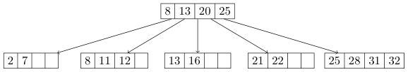

# Berkeley CS186 Fall 2017: Midterm 1: Questions

> Copied from the original: <https://hkn.eecs.berkeley.edu/exams/course/cs/186>. Text and figures are taken from the PDF as is; nothing was answered or rewritten. The original PDF is in this folder.

---

**Page 1**

&emsp;&emsp;&emsp;CS 186/286 Fall 2017 Midterm 1 
• Do not turn this page until instructed to start the exam. 
• You should receive 1 single-sided answer sheet and a 8-page exam packet. 
• You have 80 minutes to complete the midterm. 
• The midterm has 5 questions, each with multiple parts. 
• You will turn in the answer sheet but not the exam. 
• For each question, place only your final answer on the answer sheet; do not show work. 
• Use the blank spaces in your exam for scratch paper. 
• You are allowed one 8.5” × 11” double-sided page of notes. 
• No electronic devices are allowed.

---

**Page 2**

**1**   **SQL** 
Imagine that you are using SQL to program an online card game. You are given a table `Deck(suit` `text,` 
`val` `text,` `score` `integer)` `primary` `key(suit,` `val)` where each tuple in `Deck` represents one card to be 
dealt. The suit is one of 4 possible strings: `hearts`, `spade`, `club`, `diamond` and the value is one of thirteen 
possible strings: `two`, `three`, `four`, `five`, `six`, `seven`, `eight`, `nine`, `ten`, `jack`, `queen`, `king`, `ace`. Assume 
that `Deck` represents a standard deck of 52 playing cards. 
&emsp;&emsp;&emsp;&emsp;&emsp;&emsp;&emsp;&emsp;`suit`   `val`   `score` 
&emsp;&emsp;&emsp;&emsp;&emsp;&emsp;&emsp;&emsp;`heart`   `two`   `2` 
&emsp;&emsp;&emsp;&emsp;&emsp;&emsp;&emsp;&emsp;`spade`   `king`   `13` 
&emsp;&emsp;&emsp;&emsp;&emsp;&emsp;&emsp;&emsp;...   ...   ... 
1\. (1 point) Which of the following queries is a syntactically valid SQL query that returns 1/2 the score 
&emsp;attribute as a floating point number? **There is only one correct answer.** 
&emsp;&emsp;&emsp;A. `SELECT` `FLOAT(score)/2` `FROM` `Deck` 
&emsp;&emsp;&emsp;B. `SELECT` `score/2` `AS` `FLOAT` `FROM` `Deck` 
&emsp;&emsp;&emsp;C. `SELECT` `CAST(score` `AS` `FLOAT)/2` `FROM` `Deck` 
&emsp;&emsp;&emsp;D. `SELECT` `(FLOAT)score/2` `FROM` `Deck` 
&emsp;&emsp;&emsp;E. `SELECT` `score:FLOAT/2` `FROM` `Deck` 
&emsp;&emsp;&emsp;F. None of the above 
2\. (5 points) We want to create a view called `Hand` that includes all possible **distinct** draws of two cards 
&emsp;from the deck (without replacement) where order **does not** matter.   For example, the view should 
&emsp;include either (`heart`, `jack`, `11`, `spade`, `four`, `4`) or (`spade`, `four`, `4`, `heart`, `jack`, `11`), but not both. 
&emsp;Which of the following queries correctly populates the view. **There may be zero, one, or more than** 
&emsp;**one correct answer.** 
&emsp;&emsp;&emsp;A. `CREATE` `VIEW` `Hand(suit1,` `val1,` `score1,` `suit2,` `val2,` `score2)` `AS` 
&emsp;&emsp;&emsp;&emsp;`SELECT` `draw1.*,` `draw2.*` 
&emsp;&emsp;&emsp;&emsp;`FROM` `Deck` `as` `draw1,` `Deck` `as` `draw2` 
&emsp;&emsp;&emsp;&emsp;`WHERE` `NOT` `(draw1.suit` `=` `draw2.suit` `AND` `draw1.val` `=` `draw2.val)` 
&emsp;&emsp;&emsp;B. `CREATE` `VIEW` `Hand(suit1,` `val1,` `score1,` `suit2,` `val2,` `score2)` `AS` 
&emsp;&emsp;&emsp;&emsp;`SELECT` `draw1.*,` `draw2.*` 
&emsp;&emsp;&emsp;&emsp;`FROM` `Deck` `as` `draw1,` `Deck` `as` `draw2` 
&emsp;&emsp;&emsp;&emsp;`WHERE` `(draw1.suit` `>` `draw2.suit` 
&emsp;&emsp;&emsp;&emsp;&emsp;&emsp;`OR` `(draw1.suit` `=` `draw2.suit` `AND` `draw1.val` `>` `draw2.val))` 
&emsp;&emsp;&emsp;C. `CREATE` `VIEW` `Hand(suit1,` `val1,` `score1,` `suit2,` `val2,` `score2)` `AS` 
&emsp;&emsp;&emsp;&emsp;`SELECT` `draw1.*,` `draw2.*` 
&emsp;&emsp;&emsp;&emsp;`FROM` `Deck` `as` `draw1,` `Deck` `as` `draw2` 
&emsp;&emsp;&emsp;&emsp;`WHERE` `(draw1.suit` `<` `draw2.suit` 
&emsp;&emsp;&emsp;&emsp;&emsp;&emsp;`OR` `(draw1.suit` `=` `draw2.suit` `AND` `draw1.val` `<` `draw2.val))` 
&emsp;&emsp;&emsp;D. `CREATE` `VIEW` `Hand(suit1,` `val1,` `score1,` `suit2,` `val2,` `score2)` `AS` 
&emsp;&emsp;&emsp;&emsp;`SELECT` `DISTINCT` `draw1.*,` `draw2.*` 
&emsp;&emsp;&emsp;&emsp;`FROM` `Deck` `as` `draw1,` `Deck` `as` `draw2` 
&emsp;&emsp;&emsp;&emsp;`WHERE` `NOT` `(draw1.suit` `=` `draw2.suit` `AND` `draw1.val` `=` `draw2.val)` 
&emsp;&emsp;&emsp;E. `CREATE` `VIEW` `Hand(suit1,` `val1,` `score1,` `suit2,` `val2,` `score2)` `AS` 
&emsp;&emsp;&emsp;&emsp;`SELECT` `draw1.*,` `draw2.*` 
&emsp;&emsp;&emsp;&emsp;`FROM` `Deck` `as` `draw1,` `Deck` `as` `draw2` 
&emsp;&emsp;&emsp;&emsp;`WHERE` `(draw1.suit` `<` `draw2.suit` 
&emsp;&emsp;&emsp;&emsp;&emsp;&emsp;`AND` `draw1.val` `<` `draw2.val)`

&emsp;&emsp;&emsp;&emsp;&emsp;&emsp;&emsp;&emsp;Page 2 of 8

---

**Page 3**

3\. (4 points) The total score of a two-card hand is simply the sum of the scores of the two cards. We want 
to write a query over the `Hand` view that assigns the total score to each tuple in `Hand`. Which of the 
following SQL queries results in the correct output. **There may be zero, one, or more than one** 
**correct answer.** 
&emsp;&emsp;A. `SELECT` `t.suit1,` `t.val1,` `t.suit2,` `t.val2,` `SUM(score)` `AS` `score` 
&emsp;&emsp;&emsp;`FROM` `(` 
&emsp;&emsp;&emsp;&emsp;`SELECT` `suit1,` `val1,` `suit2,` `val2,` `score1` `AS` `score` `FROM` `Hand` 
&emsp;&emsp;&emsp;&emsp;`UNION` 
&emsp;&emsp;&emsp;&emsp;`SELECT` `suit1,` `val1,` `suit2,` `val2,` `score2` `AS` `score` `FROM` `Hand` 
&emsp;&emsp;&emsp;`)` `as` `t` 
&emsp;&emsp;&emsp;`GROUP` `BY` `t.suit1,` `t.val1,` `t.suit2,` `t.val2` 
&emsp;&emsp;B. `SELECT` `suit1,` `val1,` `suit2,` `val2,` `SUM(COALESCE(score1,` `score2))` `AS` `score` 
&emsp;&emsp;&emsp;`FROM` `Hand` 
&emsp;&emsp;&emsp;`GROUP` `BY` `suit1,` `val1,` `suit2,` `val2` 
&emsp;&emsp;C. `SELECT` `h1.suit1,` `h1.val1,` `h2.suit2,` `h2.val2,` `h1.score1` `+` `h2.score2` `AS` `score` 
&emsp;&emsp;&emsp;`FROM` `Hand` `AS` `h1,` `Hand` `AS` `h2` 
&emsp;&emsp;&emsp;`WHERE` `h1.suit1` `=` `h2.suit2` `AND` `h1.val1` `=` `h2.val2` 
&emsp;&emsp;D. `SELECT` `suit1,` `val1,` `suit2,` `val2,` `score1` `+` `score2` `AS` `score` 
&emsp;&emsp;&emsp;`FROM` `Hand` 
&emsp;&emsp;&emsp;`GROUP` `BY` `suit1,` `val1,` `suit2,` `val2,` `score1,` `score2`

&emsp;&emsp;&emsp;&emsp;&emsp;&emsp;&emsp;&emsp;Page 3 of 8

---

**Page 4**

**2**   **Heap Files** 
Assume that we have serialized a relation as an 8 MB heap file on disk without any header pages of any sort. 
Further assume that file is divided into 64 KB pages (1 MB = 1000 KB). Answer the following questions 
with the following **important notes** in mind. 
&emsp;• **Reuse results:** For each part of this question, whenever possible you should reuse the values calculated 
&emsp;in previous parts using capital letters, e.g. let A be your answer in part A, B be your answer in part 
&emsp;B, etc. **Do not use the numerical value of previous parts in subsequent parts.** 
&emsp;• **Spare the arithmetic:** You can leave arithmetic expressions unsimplified. 
A. (1 point) How many pages are in the file? Remember the notes above! 
B. (1 point) Imagine we want to add a page directory to the heap file. If 24 directory entries can fit on one 
&emsp;page, how many additional directory pages do we need for the file? Remember the notes above! 
C. (1 point) Assume that at least one page in the file has space for a new record. In the worst case, how 
&emsp;many I/Os does it take to insert a new record into the relation and persist the changes to the file? 
&emsp;Remember the notes above! 
D. (2 points) In the worst case, if you are given the value of the primary key of an existing record, how 
&emsp;many I/Os does it take to update that record? Remember the notes above! 
E. (2 points) Now imagine we sort the file by the relation’s primary key. Given the value of the primary 
&emsp;key of an existing record, how many I/Os will it take to update that record in the worst case? Remember 
&emsp;the notes above!

&emsp;&emsp;&emsp;&emsp;&emsp;&emsp;&emsp;&emsp;Page 4 of 8

---

**Page 5**

**3**   **B+-Trees** 
1\. (1 point) What is the maximum fanout F of an order d B+-tree? 
2\. (2 points) Assume that each leaf can hold F data entries. What is the maximum number of data entries 
&emsp;that an order d B+-tree of height 5 can store? Note that a height 1 B+-tree only has a root node, and 
&emsp;a height 2 B+-tree has a root node and one layer of leaf nodes. Express your answer as a function of F. 
3\. (2 points) Again, assume that each leaf can hold F data entries. What is the minimum number of I/Os 
&emsp;it will take to check if a data entry exists in a B+-tree with 1,000,000,000 (1 × 109) records assuming we 
&emsp;have indexed the file with an order d B+-tree? Express your answer as a function of F.

Consider the following B+ tree of order 2.

4\. (1 point) How many nodes split when you insert 27? 
5\. (1 point) After inserting 27 into the tree, you also insert 26. How many nodes split as a result of inserting 
&emsp;26? 
6\. (1 point) Assume that after inserting 26 and 27, you insert the keys 34, 35, 36, . . ., 100. After all these 
&emsp;insertions, what keys are in the leftmost leaf node?

7\. (1 point) In homework 2, which class was used to represented keys in a B+ tree? **There is only one** 
&emsp;**correct answer.** 
&emsp;&emsp;&emsp;A. `Atom` 
&emsp;&emsp;&emsp;B. `DataBox` 
&emsp;&emsp;&emsp;C. `DbType` 
&emsp;&emsp;&emsp;D. `Datum` 
&emsp;&emsp;&emsp;E. `Scalar` 
&emsp;&emsp;&emsp;F. `AtomicVal` 
&emsp;&emsp;&emsp;G. `Value` 
&emsp;&emsp;&emsp;H. None of the above.

&emsp;&emsp;&emsp;&emsp;&emsp;&emsp;&emsp;&emsp;Page 5 of 8

---

**Page 6**

**4**   **External Sorting** 
Assume pages are 2 KB large. Also assume you have a 12 KB buffer pool with six 2 KB frames. 
1\. (2 points) How many passes P would it take to externally sort an 84 page file? Include the initial sorting 
&emsp;pass and subsequent merging passes in your answer. You do not need to simplify your answer. 
2\. (2 points) What would be the total cost in I/Os for this external sort? Let P be the answer to part 1 
&emsp;(i.e. the number of passes). Leave your answer in terms of P. You do not need to simplify your answer. 
3\. (2 points) What is the minimum number of additional buffer frames we require to reduce the number 
&emsp;of passes P (from part 1) by 1? You do not need to simplify your answer.

True or False 
4\. (1 point) Increasing the number of buffer pages does not affect the number of I/Os performed in Pass 0 
&emsp;of an external sort. 
5\. (1 point) Double buffering reduces the time it takes to sort records within a single page.

&emsp;&emsp;&emsp;&emsp;&emsp;&emsp;&emsp;&emsp;Page 6 of 8

---

**Page 7**

**5**   **Buffer Management** 
We are given an initially empty buffer pool with 4 buffer frames. Consider the following access pattern: 
&emsp;&emsp;&emsp;&emsp;&emsp;&emsp;&emsp;&emsp;`S` `E` `E` `M` `A` `W` `E` `S` `O` `M` `E` `P` `O` `S` `S` `U` `M` 
In the next two questions, you will need to evaluate the **MRU** replacement policy, keeping track of the pages 
in the buffer pool, and the number of buffer pool hits. 
1\. (2 points) Using an MRU replacement policy, what are the four pages in the buffer pool after all accesses 
&emsp;are complete? **Note: write the four pages in alphabetical order.** 
2\. (1 point) Using an MRU replacement policy, how many buffer pool hits are there?

We are again given an initially empty buffer pool with 4 frames. Now consider the following access pattern: 
&emsp;&emsp;&emsp;&emsp;&emsp;&emsp;&emsp;&emsp;`S` `E` `E` `M` `A` `W` `E` `S` `O` `M` `E` 
**Note: This access pattern is different from the previous question. Do NOT include** `POSSUM` **in** 
**your accesses.** 
&emsp;In the next few questions, you will need to evaluate the **clock** policy, keeping track of the pages in the 
buffer pool, the reference bits on the frames, and the number of buffer pool hits. Assume that we do not 
increment the clock hand when we request a page that is already in the buffer pool. Only increment the 
clock hand as part of a page replacement. 
3\. (2 points) Using the clock replacement policy, what are the four pages in the buffer pool after all accesses 
&emsp;are complete? **Note: write the four pages in alphabetical order.** 
4\. (1 point) Using the clock replacement policy, what are the reference bits for each buffer pool page? 
&emsp;**Note: make sure your reference bits correspond to the pages in alphabetical order. For** 
&emsp;**example, put** `1110` **if the first 3 pages have a reference bit set, but the last page does not.** 
5\. (1 point) Using the clock replacement policy, how many buffer pool hits are there?

True or False. 
6\. (1 point) Assume page `A` is loaded into the buffer pool during a specific access pattern and is not evicted 
&emsp;at any point during the access pattern. Page `A` has a pin count of 7 at the end of all accesses. True or 
&emsp;False: Page `A` was accessed exactly 7 times during this access pattern. 
7\. (1 point) The buffer manager decides when to set the dirty bit of a page. 
8\. (1 point) A buffer pool has 101 frames, and you have an access pattern of 1000 accesses with the following 
&emsp;properties: 
&emsp;&emsp;• 900 of the 1000 page accesses are to the same page `P`. 
&emsp;&emsp;• The remaining 100 accesses are all to pages that are unique/different from each other and are not 
&emsp;&emsp;to `P`. 
&emsp;You repeat this access pattern many times. True or False: MRU would have fewer misses than LRU for 
&emsp;this access pattern.

&emsp;&emsp;&emsp;&emsp;&emsp;&emsp;&emsp;&emsp;Page 7 of 8

---

**Page 8**

