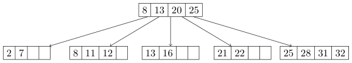

# Berkeley CS186 Fall 2017: Midterm 1: Official solutions

> Copied from the original: <https://hkn.eecs.berkeley.edu/exams/course/cs/186>. Text and figures are taken from the PDF as is; nothing was answered or rewritten. The original PDF is in this folder.

---

**Page 1**

&emsp;&emsp;&emsp;CS 186/286 Fall 2017 Midterm 1 
• Do not turn this page until instructed to start the exam. 
• You should receive 1 single-sided answer sheet and a 14-page exam packet. 
• You have 80 minutes to complete the midterm. 
• The midterm has 5 questions, each with multiple parts. 
• You will turn in the answer sheet but not the exam. 
• For each question, place only your final answer on the answer sheet; do not show work. 
• Use the blank spaces in your exam for scratch paper. 
• You are allowed one 8.5” × 11” double-sided page of notes. 
• No electronic devices are allowed.

---

**Page 2**

**1**   **SQL** 
Imagine that you are using SQL to program an online card game. You are given a table `Deck(suit` `text,` 
`val` `text,` `score` `integer)` `primary` `key(suit,` `val)` where each tuple in `Deck` represents one card to be 
dealt. The suit is one of 4 possible strings: `hearts`, `spade`, `club`, `diamond` and the value is one of thirteen 
possible strings: `two`, `three`, `four`, `five`, `six`, `seven`, `eight`, `nine`, `ten`, `jack`, `queen`, `king`, `ace`. Assume 
that `Deck` represents a standard deck of 52 playing cards. 
&emsp;&emsp;&emsp;&emsp;&emsp;&emsp;&emsp;&emsp;`suit`   `val`   `score` 
&emsp;&emsp;&emsp;&emsp;&emsp;&emsp;&emsp;&emsp;`heart`   `two`   `2` 
&emsp;&emsp;&emsp;&emsp;&emsp;&emsp;&emsp;&emsp;`spade`   `king`   `13` 
&emsp;&emsp;&emsp;&emsp;&emsp;&emsp;&emsp;&emsp;...   ...   ... 
1\. (1 point) Which of the following queries is a syntactically valid SQL query that returns 1/2 the score 
&emsp;attribute as a floating point number? **There is only one correct answer.** 
&emsp;&emsp;&emsp;A. `SELECT` `FLOAT(score)/2` `FROM` `Deck` 
&emsp;&emsp;&emsp;B. `SELECT` `score/2` `AS` `FLOAT` `FROM` `Deck` 
&emsp;&emsp;&emsp;C. `SELECT` `CAST(score` `AS` `FLOAT)/2` `FROM` `Deck` 
&emsp;&emsp;&emsp;D. `SELECT` `(FLOAT)score/2` `FROM` `Deck` 
&emsp;&emsp;&emsp;E. `SELECT` `score:FLOAT/2` `FROM` `Deck` 
&emsp;&emsp;&emsp;F. None of the above

&emsp;**Solution: C**. Recall from the SQL Homework, that Postgres uses the syntax `CAST(attr` `as` `TYPE)`. 
&emsp;So to return 1/2 the score attribute as a floating point number, the answer is C.

2\. (5 points) We want to create a view called `Hand` that includes all possible **distinct** draws of two cards 
&emsp;from the deck (without replacement) where order **does not** matter.   For example, the view should 
&emsp;include either (`heart`, `jack`, `11`, `spade`, `four`, `4`) or (`spade`, `four`, `4`, `heart`, `jack`, `11`), but not both. 
&emsp;Which of the following queries correctly populates the view. **There may be zero, one, or more than** 
&emsp;**one correct answer.** 
&emsp;&emsp;&emsp;A. `CREATE` `VIEW` `Hand(suit1,` `val1,` `score1,` `suit2,` `val2,` `score2)` `AS` 
&emsp;&emsp;&emsp;&emsp;`SELECT` `draw1.*,` `draw2.*` 
&emsp;&emsp;&emsp;&emsp;`FROM` `Deck` `as` `draw1,` `Deck` `as` `draw2` 
&emsp;&emsp;&emsp;&emsp;`WHERE` `NOT` `(draw1.suit` `=` `draw2.suit` `AND` `draw1.val` `=` `draw2.val)` 
&emsp;&emsp;&emsp;B. `CREATE` `VIEW` `Hand(suit1,` `val1,` `score1,` `suit2,` `val2,` `score2)` `AS` 
&emsp;&emsp;&emsp;&emsp;`SELECT` `draw1.*,` `draw2.*` 
&emsp;&emsp;&emsp;&emsp;`FROM` `Deck` `as` `draw1,` `Deck` `as` `draw2` 
&emsp;&emsp;&emsp;&emsp;`WHERE` `(draw1.suit` `>` `draw2.suit` 
&emsp;&emsp;&emsp;&emsp;&emsp;&emsp;`OR` `(draw1.suit` `=` `draw2.suit` `AND` `draw1.val` `>` `draw2.val))` 
&emsp;&emsp;&emsp;C. `CREATE` `VIEW` `Hand(suit1,` `val1,` `score1,` `suit2,` `val2,` `score2)` `AS` 
&emsp;&emsp;&emsp;&emsp;`SELECT` `draw1.*,` `draw2.*` 
&emsp;&emsp;&emsp;&emsp;`FROM` `Deck` `as` `draw1,` `Deck` `as` `draw2` 
&emsp;&emsp;&emsp;&emsp;`WHERE` `(draw1.suit` `<` `draw2.suit` 
&emsp;&emsp;&emsp;&emsp;&emsp;&emsp;`OR` `(draw1.suit` `=` `draw2.suit` `AND` `draw1.val` `<` `draw2.val))` 
&emsp;&emsp;&emsp;D. `CREATE` `VIEW` `Hand(suit1,` `val1,` `score1,` `suit2,` `val2,` `score2)` `AS` 
&emsp;&emsp;&emsp;&emsp;`SELECT` `DISTINCT` `draw1.*,` `draw2.*` 
&emsp;&emsp;&emsp;&emsp;`FROM` `Deck` `as` `draw1,` `Deck` `as` `draw2` 
&emsp;&emsp;&emsp;&emsp;`WHERE` `NOT` `(draw1.suit` `=` `draw2.suit` `AND` `draw1.val` `=` `draw2.val)`

&emsp;&emsp;&emsp;&emsp;&emsp;&emsp;&emsp;&emsp;Page 2 of 14

---

**Page 3**

&emsp;&emsp;E. `CREATE` `VIEW` `Hand(suit1,` `val1,` `score1,` `suit2,` `val2,` `score2)` `AS` 
&emsp;&emsp;&emsp;`SELECT` `draw1.*,` `draw2.*` 
&emsp;&emsp;&emsp;`FROM` `Deck` `as` `draw1,` `Deck` `as` `draw2` 
&emsp;&emsp;&emsp;`WHERE` `(draw1.suit` `<` `draw2.suit` 
&emsp;&emsp;&emsp;&emsp;&emsp;&emsp;`AND` `draw1.val` `<` `draw2.val)`

&emsp;**Solution: B and C.** To understand why B and C are the correct solutions, let’s first consider 
&emsp;a simpler problem with a table with a single attribute. Suppose you had a table T with a single 
&emsp;attribute a, this query returns all pairs:

&emsp;&emsp;`SELECT` `t1.a,` `t2.a` 
&emsp;&emsp;`FROM` `T` `as` `t1,` `T` `as` `t2`

&emsp;This query will return the set of tuples (s, t) that both includes exact duplicates where s = t and 
&emsp;duplicates up to ordering where (s, t) = (t, s). We can remove these by adding the following `WHERE` 
&emsp;statement for any type that supports comparison and ordering:

&emsp;&emsp;`SELECT` `t1.a,` `t2.a` 
&emsp;&emsp;`FROM` `T` `as` `t1,` `T` `as` `t2` 
&emsp;&emsp;`WHERE` `t1.a` `>` `t2.a`

&emsp;This `WHERE` statement clearly removes exact duplicates (since s connot equal to t if s \> t). It also 
&emsp;removes duplicates up to orders since both (s, t) and (t, s) cannot be in the result since either s \> t 
&emsp;or t \> s. This result is symmetric in the sense that `WHERE` `t1.a` `<` `t2.a` also achieves the same goal. 
&emsp;To extend this idea to tables with multiple attributes, we just need to define a consistent comparison 
&emsp;between tuples rather than single attributes. We can use the idea of lexicographic ordering as used 
&emsp;in the indexing section of the course. This means that for two tuples (a1, a2) and (b1, b2), we first 
&emsp;compare on the first attribute—if there is a tie we proceed to the subsequent attribute. 
&emsp;&emsp;&emsp;&emsp;&emsp;&emsp;&emsp;&emsp;(a1, a2) \> (b1, b2) ≡(a1 \> b1) ∧(a1 = b1 ∨a2 \> b2) 
&emsp;&emsp;&emsp;&emsp;&emsp;&emsp;&emsp;&emsp;(a1, a2) \< (b1, b2) ≡(a1 \< b1) ∧(a1 = b1 ∨a2 \> b2) 
&emsp;Therefore, for the question above there are two acceptable `WHERE` statements:

&emsp;&emsp;`WHERE` `(draw1.suit` `>` `draw2.suit` 
&emsp;&emsp;&emsp;&emsp;`OR` `(draw1.suit` `=` `draw2.suit` `AND` `draw1.val` `>` `draw2.val))`

&emsp;&emsp;`WHERE` `(draw1.suit` `<` `draw2.suit` 
&emsp;&emsp;&emsp;&emsp;`OR` `(draw1.suit` `=` `draw2.suit` `AND` `draw1.val` `<` `draw2.val))`

&emsp;So the solution is B and C.

3\. (4 points) The total score of a two-card hand is simply the sum of the scores of the two cards. We want 
to write a query over the `Hand` view that assigns the total score to each tuple in `Hand`. Which of the 
following SQL queries results in the correct output. **There may be zero, one, or more than one** 
**correct answer.** 
&emsp;&emsp;A. `SELECT` `t.suit1,` `t.val1,` `t.suit2,` `t.val2,` `SUM(score)` `AS` `score` 
&emsp;&emsp;&emsp;`FROM` `(` 
&emsp;&emsp;&emsp;&emsp;`SELECT` `suit1,` `val1,` `suit2,` `val2,` `score1` `AS` `score` `FROM` `Hand` 
&emsp;&emsp;&emsp;&emsp;`UNION` 
&emsp;&emsp;&emsp;&emsp;`SELECT` `suit1,` `val1,` `suit2,` `val2,` `score2` `AS` `score` `FROM` `Hand`

&emsp;&emsp;&emsp;&emsp;&emsp;&emsp;&emsp;&emsp;Page 3 of 14

---

**Page 4**

&emsp;&emsp;`)` `as` `t` 
&emsp;&emsp;`GROUP` `BY` `t.suit1,` `t.val1,` `t.suit2,` `t.val2` 
&emsp;B. `SELECT` `suit1,` `val1,` `suit2,` `val2,` `SUM(COALESCE(score1,` `score2))` `AS` `score` 
&emsp;&emsp;`FROM` `Hand` 
&emsp;&emsp;`GROUP` `BY` `suit1,` `val1,` `suit2,` `val2` 
&emsp;C. `SELECT` `h1.suit1,` `h1.val1,` `h2.suit2,` `h2.val2,` `h1.score1` `+` `h2.score2` `AS` `score` 
&emsp;&emsp;`FROM` `Hand` `AS` `h1,` `Hand` `AS` `h2` 
&emsp;&emsp;`WHERE` `h1.suit1` `=` `h2.suit2` `AND` `h1.val1` `=` `h2.val2` 
&emsp;D. `SELECT` `suit1,` `val1,` `suit2,` `val2,` `score1` `+` `score2` `AS` `score` 
&emsp;&emsp;`FROM` `Hand` 
&emsp;&emsp;`GROUP` `BY` `suit1,` `val1,` `suit2,` `val2,` `score1,` `score2`

**Solution: D.** For this question, it actually would suffice the run the following query:

`SELECT` `suit1,` `val1,` `suit2,` `val2,` `score1` `+` `score2` `AS` `score` 
`FROM` `Hand`

This query is much simpler than those provided in the choices so the trick is to determine which 
of provided queries is equivalent to this query under the assumptions laid out in the previous two 
sections.

&emsp;• Choice A is incorrect if there exists a record where `score1` is equal to `score2`, this means that 
&emsp;the `UNION` statement will turn that into a single tuple and not aggregate properly. 
&emsp;• Choice B is incorrect because `COALESCE` takes the returns the first non-null value, this is not 
&emsp;the same as adding the two scores. 
&emsp;• Choice C is conceptually incorrect as it would create a new table where both val1 and val2 are 
&emsp;equal to each other. 
&emsp;• Choice D is correct because under the problem assumptions all hands are uniquely identified 
&emsp;by the suits and values of their cards. This means that the `GROUP` `BY` statement returns a 
&emsp;single tuple and there is no table aggregate in the `SELECT` statment—making it equivalent to 
&emsp;not using it at all.

&emsp;&emsp;&emsp;&emsp;&emsp;&emsp;&emsp;&emsp;Page 4 of 14

---

**Page 5**

**2**   **Heap Files** 
Assume that we have serialized a relation as an 8 MB heap file on disk without any header pages of any sort. 
Further assume that file is divided into 64 KB pages (1 MB = 1000 KB). Answer the following questions 
with the following **important notes** in mind. 
&emsp;• **Reuse results:** For each part of this question, whenever possible you should reuse the values calculated 
&emsp;in previous parts using capital letters, e.g. let A be your answer in part A, B be your answer in part 
&emsp;B, etc. **Do not use the numerical value of previous parts in subsequent parts.** 
&emsp;• **Spare the arithmetic:** You can leave arithmetic expressions unsimplified. 
A. (1 point) How many pages are in the file? Remember the notes above!

&emsp;**Solution:** The file takes up 8 MB (8000 KB) and one page holds 64 KB, so the file takes up 
&emsp;8000/64 = 125 pages.

B. (1 point) Imagine we want to add a page directory to the heap file. If 24 directory entries can fit on one 
&emsp;page, how many additional directory pages do we need for the file? Remember the notes above!

&emsp;**Solution:** This question is poorly worded and caused a lot of confusion during the exam. For that 
&emsp;reason, we were very lenient on the answer. 
&emsp;The original intent of the question was to ask for the total number of directory pages. Since 24 
&emsp;entries fit on one page and we need one entry for each of A data pages, the total number of directory 
&emsp;24⌉.pages is ⌈A 
&emsp;However, the clarification given during the midterm specified that it should be the number of 
&emsp;24 −1⌉as correct answers.24⌉and ⌈Adirectory pages beyond 1. For that reason we accepted both ⌈A

C. (1 point) Assume that at least one page in the file has space for a new record. In the worst case, how 
&emsp;many I/Os does it take to insert a new record into the relation and persist the changes to the file? 
&emsp;Remember the notes above!

&emsp;**Solution:** Conceptually, we want to find a page with free space, update the page, and update its 
&emsp;directory page. To find the page with free space we have have to scan the directory pages, B I/Os. 
&emsp;To update the page we read it in then write it back out, 2 I/Os. To update the directory page, since 
&emsp;it’s already read into memory, we just need 1 I/O to write it back out. This is a total of B +3 I/Os. 
&emsp;If we consider B to be the “beyond-1” number of directory pages, the solution is B + 4 I/Os.

D. (2 points) In the worst case, if you are given the value of the primary key of an existing record, how 
&emsp;many I/Os does it take to update that record? Remember the notes above!

&emsp;**Solution:** It was clarified during the exam that records were fixed length (so the size of an updated 
&emsp;record is the same size as the original record). To update a record in a heap file, you must scan the 
&emsp;entire file to find it, then update it and write it back out. The page directory is not involved in the 
&emsp;search for the record. This will take A + 1 I/Os.

&emsp;&emsp;&emsp;&emsp;&emsp;&emsp;&emsp;&emsp;Page 5 of 14

---

**Page 6**

E. (2 points) Now imagine we sort the file by the relation’s primary key. Given the value of the primary 
&emsp;key of an existing record, how many I/Os will it take to update that record in the worst case? Remember 
&emsp;the notes above!

&emsp;**Solution:** It would only take log2(A) I/Os to find the record in a sorted file. However, in the worst 
&emsp;case, we update the column that the file is sorted on and have to end up shifting records on all A 
&emsp;pages. Therefore, this will take log2(A) + 2A I/Os in the worst case.

&emsp;&emsp;&emsp;&emsp;&emsp;&emsp;&emsp;&emsp;Page 6 of 14

---

**Page 7**

**3**   **B+-Trees** 
1\. (1 point) What is the maximum fanout F of an order d B+-tree?

&emsp;**Solution:** The maximum fan out is the maximum occupancy plus one, or 2d + 1, by definition. 
&emsp;Some students interpreted the question as asking how many entries can be in the leaf node, so we 
&emsp;also accepted 2d to account for this. (Moreover, we also accepted F +1 based on how F is interpreted 
&emsp;in the previous problem)

2\. (2 points) Assume that each leaf can hold F data entries. What is the maximum number of data entries 
&emsp;that an order d B+-tree of height 5 can store? Note that a height 1 B+-tree only has a root node, and 
&emsp;a height 2 B+-tree has a root node and one layer of leaf nodes. Express your answer as a function of F

&emsp;**Solution:** We are assuming that the leaf pages hold F = 2d + 1 entries instead of the standard 2d. 
&emsp;At height 1, the root node is a leaf node and therefore the index holds F. At height 2, there is a 
&emsp;root node and its children are leaf nodes. The root node has a max fanout of F children and each 
&emsp;child is a leaf node that can hold max F entries. Therefore the index can hold F 2 total entries. 
&emsp;Generally, the tree holds F h entries by similar justification and at height 5, the tree can hold up to 
&emsp;F 5 entries. We are accepting F 5, (2d + 1)5 and any other fifth power of fanout

3\. (2 points) Again, assume that each leaf can hold F data entries. What is the minimum number of I/Os 
&emsp;it will take to check if a data entry exists in a B+-tree with 1,000,000,000 (1 × 109) records assuming we 
&emsp;have indexed the file with an order d B+-tree? Express your answer as a function of F

&emsp;**Solution:** To check if a tree exists in a B+-tree with the minimum number of I/Os we assume that 
&emsp;the maximum number of entries are being stored in the inner and leaf nodes. Therefore there will 
&emsp;be 109   leaf nodes. At every level we reduce the number of node we will look at by F −1 
&emsp;&emsp;&emsp;&emsp;&emsp;&emsp;&emsp;&emsp;due to the 
&emsp;&emsp;&emsp;F   F 
&emsp;binary search like properties of B+ trees. Therefore it will take us 1 + logF ( 109 
&emsp;&emsp;&emsp;&emsp;&emsp;&emsp;&emsp;&emsp;F ) I/Os to check if a 
&emsp;key exists in the tree.

Consider the following B+ tree of order 2.

4\. (1 point) How many nodes split when you insert 27?

&emsp;**Solution:**

&emsp;&emsp;&emsp;&emsp;&emsp;&emsp;&emsp;&emsp;Page 7 of 14

---

**Page 8**

&emsp;&emsp;• To insert 27, we follow the rightmost pointer in the tree from the root node because 27 \> 
&emsp;&emsp;&emsp;8,27 \> 13,27 \> 20,25 \> 20. 
&emsp;&emsp;• We get to the leaf node containing (25, 28, 31, 32) and attempt to insert 27, but the leaf node 
&emsp;&emsp;&emsp;is at maximum capacity and the insertion breaks the occupancy invariant. Therefore we must 
&emsp;&emsp;&emsp;split the leaf into (25, 27) and (28, 32, 21) and copy up key 27 because this is a leaf node. 
&emsp;&emsp;• We attempt to insert 27 into the parent node containing (8, 13, 20, 25) but the root is also at 
&emsp;&emsp;&emsp;maximum capacity. We split it into (8, 13) and (25, 28) pushing up key 20 because it is an 
&emsp;&emsp;&emsp;inner node. Our final tree looks like and we split two nodes

5\. (1 point) After inserting 27 into the tree, you also insert 26. How many nodes split as a result of inserting 
26?

&emsp;**Solution:**

&emsp;&emsp;• To insert 26, we first look at the root node and follow the right pointer because 26 ≥20. We 
&emsp;&emsp;&emsp;then follow the middle pointer at the inner node below the root node because 26 \> 25 but 
&emsp;&emsp;&emsp;26 \< 28. We get to the leaf node containing (25, 27) 
&emsp;&emsp;• We attempt to insert 26 into the leaf node containing (25, 27) and since 3 is less than the 
&emsp;&emsp;&emsp;occupancy invariant 4 we insert 26 and are done. We did not split any nodes.

6\. (1 point) Assume that after inserting 26 and 27, you insert the keys 34, 35, 36, . . ., 100. After all these 
insertions, what keys are in the leftmost leaf node?

&emsp;**Solution:** You should be able to identify that we are only inserting keys into the right side of the 
&emsp;tree. This is similar to bulk loading in that the left leaf nodes will not be touched. Therefore, we 
&emsp;know that the leftmost leaf node will not be modified and will contain (2, 7) after the insertions to 
&emsp;the right side of the tree.

7\. (1 point) In homework 2, which class was used to represented keys in a B+ tree? **There is only one** 
**correct answer.** 
&emsp;&emsp;A. `Atom` 
&emsp;&emsp;B. `DataBox` 
&emsp;&emsp;C. `DbType` 
&emsp;&emsp;D. `Datum` 
&emsp;&emsp;E. `Scalar` 
&emsp;&emsp;F. `AtomicVal` 
&emsp;&emsp;G. `Value` 
&emsp;&emsp;H. None of the above.

&emsp;&emsp;&emsp;&emsp;&emsp;&emsp;&emsp;&emsp;Page 8 of 14

---

**Page 9**

**Solution:** The answer is `DataBox`. None of the other classes exist at all in the homework.

&emsp;&emsp;&emsp;&emsp;&emsp;&emsp;&emsp;&emsp;Page 9 of 14

---

**Page 10**

**4**   **External Sorting** 
Assume pages are 2 KB large. Also assume you have a 12 KB buffer pool with six 2 KB frames. 
1\. (2 points) How many passes P would it take to externally sort an 84 page file? Include the initial sorting 
&emsp;pass and subsequent merging passes in your answer. You do not need to simplify your answer.

&emsp;&emsp;&emsp;&emsp;&emsp;&emsp;&emsp;&emsp;⌈   ⌉ 
&emsp;B ⌉)**Solution:** In general, we can sort N pages with B buffer pages in 1 +logB−1(⌈N   passes. Here, 
&emsp;&emsp;&emsp;&emsp;&emsp;&emsp;&emsp;&emsp;⌈   ⌉ 
&emsp;6 ⌉)N = 84 and B = 6, so it takes 1 +log5(⌈84   = 3 passes.

2\. (2 points) What would be the total cost in I/Os for this external sort? Let P be the answer to part 1 
&emsp;(i.e. the number of passes). Leave your answer in terms of P. You do not need to simplify your answer.

&emsp;**Solution:** In all P passes, we read and write all 84 pages of the file.   Thus, the total cost is 
&emsp;2 ∗84 ∗P = 168P = 504 IOs.

3\. (2 points) What is the minimum number of additional buffer frames we require to reduce the number 
&emsp;of passes P (from part 1) by 1? You do not need to simplify your answer.

&emsp;**Solution:** With 6 buffer frames, we can sort the file in three passes. In order to sort the file in two 
&emsp;passes, we need B buffer frames where B(B −1) ≥84. The smallest such B is 10. Thus, the number 
&emsp;of additional pages is 10 −6 = 4.

True or False 
4\. (1 point) Increasing the number of buffer pages does not affect the number of I/Os performed in Pass 0 
&emsp;of an external sort.

&emsp;**Solution: True.** Regardless of the number of buffer pages, every pass of an external sort (including 
&emsp;Pass 0) performs the same number of IOs.

5\. (1 point) Double buffering reduces the time it takes to sort records within a single page.

&emsp;**Solution: False.** Double buffering allows a program to concurrently perform computations and 
&emsp;fetch data from disk. Once a page of data is resident in memory, double buffering will not help 
&emsp;speed up computation on it.

&emsp;&emsp;&emsp;&emsp;&emsp;&emsp;&emsp;&emsp;Page 10 of 14

---

**Page 11**

**5**   **Buffer Management** 
We are given an initially empty buffer pool with 4 buffer frames. Consider the following access pattern: 
&emsp;&emsp;&emsp;&emsp;&emsp;&emsp;&emsp;&emsp;`S` `E` `E` `M` `A` `W` `E` `S` `O` `M` `E` `P` `O` `S` `S` `U` `M` 
In the next two questions, you will need to evaluate the **MRU** replacement policy, keeping track of the pages 
in the buffer pool, and the number of buffer pool hits. 
1\. (2 points) Using an MRU replacement policy, what are the four pages in the buffer pool after all accesses 
&emsp;are complete? **Note: write the four pages in alphabetical order.**

&emsp;**Solution: MPUW.** See Figure 1.

2\. (1 point) Using an MRU replacement policy, how many buffer pool hits are there?

&emsp;**Solution: 8.** See Figure 1.

&emsp;&emsp;&emsp;&emsp;&emsp;&emsp;`S`   `*`   `O`   `*`   `S`   `*`   `U` 
&emsp;&emsp;&emsp;&emsp;&emsp;&emsp;&emsp;`E`   `*`   `*`   `*`   `P` 
&emsp;&emsp;&emsp;&emsp;&emsp;&emsp;&emsp;&emsp;`M`   `*`   `*` 
&emsp;&emsp;&emsp;&emsp;&emsp;&emsp;&emsp;&emsp;`A`   `W` 
&emsp;&emsp;&emsp;&emsp;&emsp;&emsp;&emsp;&emsp;Figure 1: MRU

We are again given an initially empty buffer pool with 4 frames. Now consider the following access pattern: 
&emsp;&emsp;&emsp;&emsp;&emsp;&emsp;&emsp;&emsp;`S` `E` `E` `M` `A` `W` `E` `S` `O` `M` `E` 
**Note: This access pattern is different from the previous question. Do NOT include** `POSSUM` **in** 
**your accesses.** 
&emsp;In the next few questions, you will need to evaluate the **clock** policy, keeping track of the pages in the 
buffer pool, the reference bits on the frames, and the number of buffer pool hits. Assume that we do not 
increment the clock hand when we request a page that is already in the buffer pool. Only increment the 
clock hand as part of a page replacement. 
3\. (2 points) Using the clock replacement policy, what are the four pages in the buffer pool after all accesses 
&emsp;are complete? **Note: write the four pages in alphabetical order.**

&emsp;**Solution: EMOS.** See Figure 2.

4\. (1 point) Using the clock replacement policy, what are the reference bits for each buffer pool page? 
&emsp;**Note: make sure your reference bits correspond to the pages in alphabetical order. For** 
&emsp;**example, put** `1110` **if the first 3 pages have a reference bit set, but the last page does not.**

&emsp;&emsp;&emsp;&emsp;&emsp;&emsp;&emsp;&emsp;Page 11 of 14

---

**Page 12**

&emsp;**Solution: 1100.** Before the last 2 accesses (M and E), the pages in the buffer pool are in the 
&emsp;following order W, E, S, O. The reference bits are set as 1011, and the clock arm is pointing at W. 
&emsp;Now, when we request M, the clock arm sets the reference bit for W to be 0, and moves onto E. 
&emsp;The reference bit for E is not set, so it replaces E with M and sets the reference bit for M to be 1 
&emsp;(so the buffer pool pages are now in the order W, M, S, O, and the reference bits are 0111). The 
&emsp;clock arm is now pointing at S. Now, when we request E, the clock arm advances until it reaches a 
&emsp;reference bit of 0, so it moves through S and O and sets their reference bits to 0. Then, the clock 
&emsp;arm points at W and replaces it with E. The final state is thus E, M, S, O, where E and M have 
&emsp;their reference bits set to 1.

5\. (1 point) Using the clock replacement policy, how many buffer pool hits are there?

&emsp;**Solution: 2.** See Figure 2.

&emsp;&emsp;&emsp;&emsp;&emsp;&emsp;&emsp;&emsp;`S`   `W`   `E` 
&emsp;&emsp;&emsp;&emsp;&emsp;&emsp;&emsp;&emsp;`E`   `*`   `*`   `M` 
&emsp;&emsp;&emsp;&emsp;&emsp;&emsp;&emsp;&emsp;`M`   `S` 
&emsp;&emsp;&emsp;&emsp;&emsp;&emsp;&emsp;&emsp;`A`   `O` 
&emsp;&emsp;&emsp;&emsp;&emsp;&emsp;&emsp;&emsp;Figure 2: Clock

True or False. 
6\. (1 point) Assume page `A` is loaded into the buffer pool during a specific access pattern and is not evicted 
&emsp;at any point during the access pattern. Page `A` has a pin count of 7 at the end of all accesses. True or 
&emsp;False: Page `A` was accessed exactly 7 times during this access pattern.

&emsp;**Solution: False.** At any point of an access pattern, the pin count of a page represents the number 
&emsp;of processes currently accessing the page, not the total number of times the page was accessed. Here 
&emsp;is a counterexample: Page A could’ve been requested 8 times. The pin count went up to 8, but then 
&emsp;a process was done using page A and decremented its pin count to 7.

7\. (1 point) The buffer manager decides when to set the dirty bit of a page.

&emsp;**Solution: False.** The file/index management code decides when to set the dirty bit of a page.

8\. (1 point) A buffer pool has 101 frames, and you have an access pattern of 1000 accesses with the following 
&emsp;properties: 
&emsp;&emsp;• 900 of the 1000 page accesses are to the same page `P`. 
&emsp;&emsp;• The remaining 100 accesses are all to pages that are unique/different from each other and are not 
&emsp;&emsp;to `P`.

&emsp;&emsp;&emsp;&emsp;&emsp;&emsp;&emsp;&emsp;Page 12 of 14

---

**Page 13**

You repeat this access pattern many times. True or False: MRU would have fewer misses than LRU for 
this access pattern.

**Solution: False.** Your buffer pool size is 101 frames. You only have 101 unique pages in your 1000 
page access pattern. Thus, all the 101 pages in your access pattern can fit inside your buffer pool, 
so you never have to evict any pages. This means any buffer replacement policy will have the same 
number of misses (0 misses), since you never have to replace pages.

&emsp;&emsp;&emsp;&emsp;&emsp;&emsp;&emsp;&emsp;Page 13 of 14

---

**Page 14**

