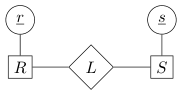
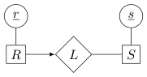
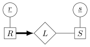

# Berkeley CS186 Fall 2017: Midterm 2: Questions

> Copied from the original: <https://hkn.eecs.berkeley.edu/exams/course/cs/186>. Text and figures are taken from the PDF as is; nothing was answered or rewritten. The original PDF is in this folder.

---

**Page 1**

&emsp;&emsp;&emsp;CS 186/286 Fall 2017 Midterm 2 
• Do not turn this page until instructed to start the exam. 
• You should receive 1 single-sided answer sheet and a 9-page exam packet. 
• All answers should be written on the answer sheet. The exam packet will be collected but not graded. 
• You have 80 minutes to complete the midterm. 
• The midterm has 6 questions, each with multiple parts. 
• For each question, place only your final answer on the answer sheet; do not show work. 
• Use the blank spaces in your exam for scratch paper. 
• You are allowed one 8.5” × 11” double-sided page of notes. 
• No electronic devices are allowed.

---

**Page 2**

**1**   **Relational Algebra** 
For the following relational algebra questions, please use the schema defined below.

Students(sid, sname, year) 
Companies(cid, cname, valuation) 
Recruitment(sid, cid, position, salary, status)

&emsp;For each question, indicate which of the expressions gives the desired output. Note that the following 
table abbreviations are being used: Students →S, Companies →C, Recruitment →R. Also note that some 
of the expressions are invalid, in which case they should definitely not be marked in your answer. 
1\. (2 points) Find the names of all students who have received at least one recruitment offer. Note that if 
&emsp;a student has received an offer, the status field in the Recruitment table will be the text “offer”. Mark 
&emsp;all that apply. 
&emsp;&emsp;&emsp;A. πsname(σstatus=“offer′′(S ▷◁R)) 
&emsp;&emsp;&emsp;B. πsname(S ▷◁(σstatus=“offer′′(R))) 
&emsp;&emsp;&emsp;C. σstatus=“offer′′((πsname(S)) ▷◁R) 
&emsp;&emsp;&emsp;D. πsname(σstatus=“offer′′(S ▷◁(πsid(R)))) 
2\. (2 points) Find the names of all students who have not received an offer from any company. Mark all 
&emsp;that apply. 
&emsp;&emsp;&emsp;A. πsname((σstatus=“offer′′(πsid(S) −πsid(R))) ▷◁S) 
&emsp;&emsp;&emsp;B. πsname((πsid(S) −πsid(σstatus=“offer′′(R))) ▷◁S) 
&emsp;&emsp;&emsp;C. πsname(S) −πsname(σstatus=“offer′′(R ▷◁S)) 
&emsp;&emsp;&emsp;D. σstatus=“offer′′((πsname(πsid(S) −πsid(R))) ▷◁S) 
3\. (2 points) For every record in Recruitment, output the name of the student, name of the company he/she 
&emsp;is being recruited for, and the position the student is being recruited for. Mark all that apply. 
&emsp;&emsp;&emsp;A. (πsname(S)) ▷◁(πcname(C)) ▷◁(πposition(R)) 
&emsp;&emsp;&emsp;B. πsname,cname,position(S ▷◁C ▷◁R) 
&emsp;&emsp;&emsp;C. πsname,cname,position((πsid,sname(S)) ▷◁(πcid,cname(C)) ▷◁(πposition(R))) 
&emsp;&emsp;&emsp;D. πsname,cname,position(S ▷◁C ▷◁(πsid,cid,position(R))) 
4\. (1.5 points) Apple is an American computing company.   Orange is a European telecommunications 
&emsp;company. Consider the following two expressions: 
&emsp;ρ(Apples(1 →sid), πsid(σcname=′Apple′(C ▷◁R))) 
&emsp;ρ(Oranges(1 →sid), πsid(σcname=′Orange′(C ▷◁R))) 
&emsp;Using those expressions, which of the expressions on the answer sheet computes the sids of students 
&emsp;being recruited by both companies? Mark all that apply.

&emsp;&emsp;&emsp;&emsp;&emsp;&emsp;&emsp;&emsp;Page 2 of 9

---

**Page 3**

**2**   **Joins** 
**2.1**   **T/F Questions** 
1\. (2 points) Mark the statements that are true. 
&emsp;&emsp;&emsp;A. Grace Hash Join will always perform better than Sort Merge Join 
&emsp;&emsp;&emsp;B. It is possible that a hash function will not partition data evenly during the building phase. 
&emsp;&emsp;&emsp;C. If one of the joining relations fits in RAM, Naive Hash Join can outperform Grace Hash Join. 
&emsp;&emsp;&emsp;D. A two-pass Grace Hash join requires memory equivalent to the square root of the larger input 
&emsp;&emsp;&emsp;&emsp;relation.

&emsp;**2.2**   **Young Justice** 
&emsp;For the following questions in this section, assume that we are streaming our query output to a terminal. 
&emsp;(Do not consider the cost of writing the final output)

&emsp;`CREATE` `TABLE` `JusticeLeague` `{` 
&emsp;&emsp;`member_id` `INTEGER` `PRIMARY` `KEY,` 
&emsp;&emsp;`code_name` `CHAR(33),` 
&emsp;&emsp;`birth_planet` `CHAR(20),` 
&emsp;&emsp;`power_level` `INTEGER,` 
&emsp;`}`

&emsp;`CREATE` `TABLE` `Teaches` `{` 
&emsp;&emsp;`member_id` `INTEGER` `PRIMARY` `KEY,` 
&emsp;&emsp;`teacher_id` `INTEGER` `REFERENCES` `JusticeLeague` 
&emsp;&emsp;`since` `DATE` 
&emsp;`}` 
&emsp;We assume that 
&emsp;&emsp;• JusticeLeague has \[J\] = 100 pages 
&emsp;&emsp;• Teaches has \[T\] = 200 pages 
&emsp;&emsp;• Buffer size = 12 pages 
&emsp;&emsp;• Half the JusticeLeague records have `birth` `planet` `=` `’Earth’` 
2\. (2 points) What is the best possible I/O cost of using Page Nested Loops Join to perform a natural join 
&emsp;of Teaches and JusticeLeague? Consider both join orders! 
3\. (3 points) Consider the following query:

&emsp;`--` `Find` `all` `members` `who` `have` `a` `earth-born` `teacher.` 
&emsp;`SELECT` `T.member_id` 
&emsp;&emsp;`FROM` `JusticeLeague` `J,` `Teaches` `T` 
&emsp;`WHERE` `T.teacher_id` `=` `J.member_id` 
&emsp;&emsp;`AND` `J.birth_planet` `=` `’Earth’;` 
&emsp;Given the fact that half of the JusticeLeague members are earth-born, what is the best possible I/O cost 
&emsp;to evaluate the query using Block Nested Loop Join? Assume you evaluate the selection operator on the 
&emsp;fly (no materialization). Consider both scanT ▷◁BNLJ (σ(scanJ)) and (σ(scanJ)) ▷◁BNLJ scanT . 
4\. (3 points) What is the optimal I/O cost to evaluate the previous query using Grace Hash Join, again 
&emsp;considering both join orders with selection on the fly?

&emsp;&emsp;&emsp;&emsp;&emsp;&emsp;&emsp;&emsp;Page 3 of 9

---

**Page 4**

&emsp;**3**   **Parallel Query Evaluation** 
&emsp;A local animal shelter that houses dogs, cats, and ducks maintains a database of their animals in the following 
&emsp;relations:

&emsp;Dogs(dog id, name, birthyear) 
&emsp;Cats(cat id, name, birthyear) 
&emsp;Ducks(duck id, name id, birthyear) 
&emsp;Names(name id, name)

&emsp;These relations are distributed across 3 different machines as follows: 
&emsp;&emsp;• Dogs is stored solely on Machine 1. 
&emsp;&emsp;• Cats is range-partitioned on birthyear over Machines 2 and 3. 
&emsp;&emsp;• Ducks is hash-partitioned on name id over Machines 1, 2, and 3. 
&emsp;&emsp;• Names is round-robin partitioned over Machines 1, 2, and 3. 
&emsp;The network our database uses supports only “point-to-point” (“unicast”) messages. That is, for Machine 1 
&emsp;to send the same message m of b bytes to each of Machines 2 and 3, it must send m to Machine 2, and then 
&emsp;separately send m to Machine 3; a total of 2b bytes sent.

&emsp;The following questions consider the following SQL query to get the names of all dogs, cats, and ducks: 
1`(SELECT` `name` `FROM` `Dogs` 
2`UNION` `ALL` 
3`SELECT` `name` `FROM` `Cats)` 
4`UNION` 
5`(SELECT` `name` 
6`FROM` `Names` `INNER` `JOIN` `Ducks` 
7`ON` `Ducks.name_id` `=` `Names.name_id)`

&emsp;1\. (2 points) Which of the following operations can be pipeline breakers in this query? Assume that we 
&emsp;&emsp;have very little memory relative to the amount of data. Mark all that apply. 
&emsp;&emsp;&emsp;&emsp;A. Full Table Scan on Dogs (line 1) 
&emsp;&emsp;&emsp;&emsp;B. Parallel Hash Join (lines 6, 7) 
&emsp;&emsp;&emsp;&emsp;C. `UNION` `ALL` of Dogs and Cats (line 2) 
&emsp;&emsp;&emsp;&emsp;D. `UNION` of the two subqueries (line 4) 
&emsp;2\. (1 point) Using parallel Grace hash join, what is the lowest network cost (the number of bytes sent over 
&emsp;&emsp;the network by any node) possible while performing the join of Names and Ducks? 
&emsp;&emsp;\[N\] denotes the number of pages in Names and \[D\] denotes the number of pages in Ducks. Each page is 
&emsp;&emsp;4KB. 
&emsp;&emsp;&emsp;&emsp;A. \[N\] \* 4KB 
&emsp;&emsp;&emsp;&emsp;B. \[D\] \* 4KB 
&emsp;&emsp;&emsp;&emsp;3 (\[N\] + \[D\]) \* 4KBC.1 
&emsp;&emsp;&emsp;&emsp;3 (\[N\] + \[D\]) \* 4KBD.2 
&emsp;&emsp;&emsp;&emsp;E. (\[N\] + \[D\]) \* 4KB 
&emsp;&emsp;&emsp;&emsp;3 \[N\] \* 4KBF.2 
&emsp;&emsp;&emsp;&emsp;G. None of the above 
&emsp;3\. (0.5 points) True or False? There is an extra disk I/O cost for parallel Grace Hash Join due to reparti- 
&emsp;&emsp;tioning (shuffling) the data across machines.

&emsp;&emsp;&emsp;&emsp;&emsp;&emsp;&emsp;&emsp;Page 4 of 9

---

**Page 5**

4\. (1 point) Suppose we range-partition cats by birthyear, so that Machine 2 stores cats born before 1950, 
and Machine 3 stores cats born 1950 or later. Assume both machines perform scans at the same rate. 
If 40% of cats in our data were born before 1950, how long will it take for a parallel scan of cats to 
complete? 
\[C\] denotes the number of pages in Cats, and D represents the time taken to perform a single I/O. 
&emsp;&emsp;A. 1/3 \* \[C\] \* D 
&emsp;&emsp;B. 0.4 \* \[C\] \* D 
&emsp;&emsp;C. 0.6 \* \[C\] \* D 
&emsp;&emsp;D. \[C\] \* D 
&emsp;&emsp;E. None of the above 
5\. (2 points) Now suppose we wish to compare cats and dogs with the same name, and perform the following 
query:

&emsp;&emsp;&emsp;`SELECT` `*` `FROM` `Cats` `INNER` `JOIN` `Dogs` `ON` `Cats.name` `=` `Dogs.name`

Assuming that \[Dogs\] = 10 pages and \[Cats\] = 1000 pages, what is the least number of pages that must 
be transferred across the network to perform this join? 
6\. (1.5 points) In the following questions, select the correct choice to fill in the blank. 
&emsp;(a) (0.5 points) The term   captures the improvement in throughput as the parallelism 
&emsp;&emsp;(number of machines) is increased. 
&emsp;&emsp;&emsp;&emsp;A. speedup 
&emsp;&emsp;&emsp;&emsp;B. scaleup 
&emsp;(b) (0.5 points) The term   captures the ability to maintain throughput as both the 
&emsp;&emsp;parallelism and the size of the data are increased. 
&emsp;&emsp;&emsp;&emsp;A. speedup 
&emsp;&emsp;&emsp;&emsp;B. scaleup 
&emsp;(c) (0.5 points) Given: 50% of the Ducks in our database all share the same name id. Suppose we run 
&emsp;&emsp;a series of experiments, each time increasing the number of machines over which we hash-partition 
&emsp;&emsp;the Ducks table, and measuring the time to complete a parallel scan of Ducks each time. Across 
&emsp;&emsp;experiments, the completion time for parallel scan will be a   function of the number 
&emsp;&emsp;of machines used. 
&emsp;&emsp;&emsp;&emsp;A. constant 
&emsp;&emsp;&emsp;&emsp;B. logarithmic 
&emsp;&emsp;&emsp;&emsp;C. linear 
&emsp;&emsp;&emsp;&emsp;D. exponential

&emsp;&emsp;&emsp;&emsp;&emsp;&emsp;&emsp;&emsp;Page 5 of 9

---

**Page 6**

**4**   **Query Optimization** 
For the following questions, assume the following: 
&emsp;• The System R assumptions about uniformity and independence from lecture hold 
&emsp;• We use System R defaults when selectivity estimation is not possible 
&emsp;• Primary key IDs are sequential, starting from 1 
&emsp;• Our optimizer does not consider interesting orders

**Table Schema**   **Records**   **Pages**   **Indices** 
`CREATE` `TABLE` `Student` `(`   • Index 1:   Clustered(`major`).   There are 130 
&emsp;`sid` `INTEGER` `PRIMARY` `KEY,`   unique majors 
&emsp;`name` `VARCHAR(32),` 
&emsp;&emsp;&emsp;&emsp;&emsp;&emsp;&emsp;&emsp;25,000   500 
&emsp;&emsp;&emsp;&emsp;&emsp;&emsp;&emsp;&emsp;• Index 2:   Unclustered(`semesters` `completed`). 
&emsp;`major` `VARCHAR(64)),` 
&emsp;&emsp;&emsp;&emsp;&emsp;&emsp;&emsp;&emsp;There are **11 unique values** in the range 
&emsp;`semesters_completed` `INTEGER` 
&emsp;&emsp;&emsp;&emsp;&emsp;&emsp;&emsp;&emsp;**\[0, 10\]** 
`)` 
`CREATE` `TABLE` `Application` `(` 
&emsp;`sid` `INTEGER` `REFERENCES` `Student,` 
&emsp;&emsp;&emsp;&emsp;&emsp;&emsp;&emsp;&emsp;• Index 3: Clustered(cid, sid). 
&emsp;`cid` `INTEGER` `REFERENCES` `Company,` 
&emsp;&emsp;&emsp;&emsp;&emsp;&emsp;&emsp;&emsp;100,000   10,000 
&emsp;`status` `TEXT,` 
&emsp;&emsp;&emsp;&emsp;&emsp;&emsp;&emsp;&emsp;• Given: `status` has **10 unique values** 
&emsp;`(sid,` `cid)` `PRIMARY` `KEY` 
`)` 
`CREATE` `TABLE` `Company` `(`   • Index 4: Unclustered(cid) 
&emsp;`cid` `INTEGER` `PRIMARY` `KEY,` 
&emsp;&emsp;&emsp;&emsp;&emsp;&emsp;&emsp;&emsp;500   100 
&emsp;&emsp;&emsp;&emsp;&emsp;&emsp;&emsp;&emsp;• Index 5:   Clustered(`open` `roles`).   There are 
&emsp;`open_roles`   `INTEGER)` 
&emsp;&emsp;&emsp;&emsp;&emsp;&emsp;&emsp;&emsp;**500 unique values** in the range **\[1, 500\]** 
`)`

&emsp;`SELECT` `Student.name,` `Company.open_roles,` `Application.referral` 
&emsp;&emsp;`FROM` `Student,` `Application,` `Company` 
&emsp;`WHERE` `Student.sid` `=` `Application.sid`   -- (Selectivity 1) 
&emsp;&emsp;`AND` `Application.cid` `=` `Company.cid`   -- (Selectivity 2) 
&emsp;&emsp;`AND` `Student.semesters_completed` `>` `6`   -- (Selectivity 3) 
&emsp;&emsp;`AND` `(Student.major=’EECS’` `OR` `Company.open_roles` `<=` `50)`   -- (Selectivity 4) 
&emsp;&emsp;`AND` `NOT` `Application.status` `=` `’limbo’`   -- (Selectivity 5) 
&emsp;`ORDER` `BY` `Company.open_roles;` 
&emsp;For the first 5 questions, write the reduction factor for each clause in the answer box as a fully-reduced 
fraction. For example, 1/2 should be written as: 
&emsp;&emsp;&emsp;&emsp;&emsp;&emsp;&emsp;&emsp;1   /   2 
**Note:** Answers that are not reduced fractions or are formatted incorrectly will receive 0 points. 
1\. (0.5 points) `Student.sid` `=` `Application.sid` 
2\. (0.5 points) `Application.cid` `=` `Company.cid` 
3\. (0.5 points) `Student.semesters` `completed` `>` `6` 
4\. (1 point) `Student.major` `=` `’EECS’` `OR` `Company.open` `roles` `<=` `50` 
5\. (0.5 points) `NOT` `Application.status` `=` `’limbo’`

&emsp;&emsp;&emsp;&emsp;&emsp;&emsp;&emsp;&emsp;Page 6 of 9

---

**Page 7**

6\. (2.5 points) For each predicate, mark the first pass of Selinger’s algorithm that uses its selectivity to 
&emsp;estimate output size. 
&emsp;(a) Selectivity 1: Pass 1, Pass 2, or Pass 3. 
&emsp;(b) Selectivity 2: Pass 1, Pass 2, or Pass 3. 
&emsp;(c) Selectivity 3: Pass 1, Pass 2, or Pass 3. 
&emsp;(d) Selectivity 4: Pass 1, Pass 2, or Pass 3. 
&emsp;(e) Selectivity 5: Pass 1, Pass 2, or Pass 3. 
7\. (1 point) Mark the choices for all access plans that would be considered in pass 2 of the Selinger algo- 
&emsp;rithm. 
&emsp;&emsp;&emsp;A. Student ▷◁Application (800 IOs) 
&emsp;&emsp;&emsp;B. Application ▷◁Student (750 IOs) 
&emsp;&emsp;&emsp;C. Student ▷◁Company (470 IOs) 
&emsp;&emsp;&emsp;D. Company ▷◁Student (525 IOs) 
&emsp;&emsp;&emsp;E. Application ▷◁Company (600 IOs) 
&emsp;&emsp;&emsp;F. Company ▷◁Application (575 IOs) 
8\. (1 point) Mark the choices from the previous question for all access plans that would be chosen at the 
&emsp;end of pass 2 of the Selinger algorithm. 
9\. (1 point) Mark the choices for all plans that would be considered in pass 3. Note carefully the nested 
&emsp;expressions: you may want to draw them out. 
&emsp;&emsp;&emsp;A. Company ▷◁(Application ▷◁Student) (175,000 IOs) 
&emsp;&emsp;&emsp;B. Company ▷◁(Student ▷◁Application) (150,000 IOs) 
&emsp;&emsp;&emsp;C. Application ▷◁(Company ▷◁Student) (155,000 IOs) 
&emsp;&emsp;&emsp;D. Application ▷◁(Company ▷◁Student) (160,000 IOs) 
&emsp;&emsp;&emsp;E. Student ▷◁(Company ▷◁Application) (215,000 IOs) 
&emsp;&emsp;&emsp;F. (Company ▷◁Application) ▷◁Student (180,000 IOs) 
&emsp;&emsp;&emsp;G. (Application ▷◁Company) ▷◁Student (200,000 IOs) 
&emsp;&emsp;&emsp;H. (Application ▷◁Student) ▷◁Company (194,000 IOs) 
&emsp;&emsp;&emsp;I. (Student ▷◁Application) ▷◁Company (195,000 IOs) 
&emsp;&emsp;&emsp;J. (Student ▷◁Company) ▷◁Application (165,000 IOs) 
10\. (1 point) Mark the choices from the previous question for all plans that would be chosen at the end of 
&emsp;pass 3.

&emsp;&emsp;&emsp;&emsp;&emsp;&emsp;&emsp;&emsp;Page 7 of 9

---

**Page 8**

**5**   **Database Design** 
**5.1**   **ER Diagrams** 
Consider the following ER diagrams labelled i, ii, and iii.

(i)   (ii)   (iii)

1\. (0.5 points) Which ER diagram do the following SQL statements correspond to? Note that there is 
&emsp;exactly one correct answer. 
&emsp;&emsp;`CREATE` `TABLE` `S(s` `INT,` `PRIMARY` `KEY` `(s));` 
&emsp;&emsp;`CREATE` `TABLE` `R(r` `INT,` `s` `INT` `REFERENCES` `S,` `PRIMARY` `KEY` `(r));`

2\. (0.5 points) Which ER diagram do the following SQL statements correspond to? Note that there is 
&emsp;exactly one correct answer. 
&emsp;&emsp;`CREATE` `TABLE` `R(r` `INT,` `PRIMARY` `KEY` `(r));` 
&emsp;&emsp;`CREATE` `TABLE` `S(s` `INT,` `PRIMARY` `KEY` `(s));` 
&emsp;&emsp;`CREATE` `TABLE` `L(r` `INT` `REFERENCES` `R,` `s` `INT` `REFERENCES` `S);`

3\. (0.5 points) Which ER diagram do the following SQL statements correspond to? Note that there is 
&emsp;exactly one correct answer. 
&emsp;&emsp;`CREATE` `TABLE` `S(s` `INT,` `PRIMARY` `KEY` `(s));` 
&emsp;&emsp;`CREATE` `TABLE` `R(r` `INT,` `s` `INT` `NOT` `NULL` `REFERENCES` `S,` `PRIMARY` `KEY` `(r));`

**5.2**   **Functional Dependencies and Normalization** 
4\. (1 point) True or False? For all sets of functional dependencies F and G, F + ∪G+ = (F ∪G)+. That 
&emsp;is, closure is homomorphic. 
5\. (2 points) Which of the following functional dependencies are in the closure of {T →UV, TV   → 
&emsp;WX, UX →Y }? Mark all that apply.

&emsp;&emsp;• UX →W   • V →X   • T →X   • T →Y

6\. (2 points) Given the relation R and functional dependencies above, which of the following attribute sets 
&emsp;are superkeys? Mark all that apply.

&emsp;&emsp;• T   • UV   • TV   • UX

7\. (1 point) Given the relation R and functional dependencies above, which of the following attribute sets 
&emsp;are candidate keys? Mark all that apply.

&emsp;&emsp;• T   • UV   • TV   • UX

8\. (1 point) Is R in BCNF? 
9\. (2 points) Which of the following are lossless-join decompositions of R? Mark all that apply.

&emsp;&emsp;&emsp;&emsp;&emsp;&emsp;&emsp;&emsp;Page 8 of 9

---

**Page 9**

&emsp;&emsp;&emsp;A. TV W and UXY 
&emsp;&emsp;&emsp;B. T and UV WXY 
&emsp;&emsp;&emsp;C. TUV WX and UXY 
&emsp;&emsp;&emsp;D. TUV WX and TUXY 
10\. (1 point) Which of the following are lossless-join decompositions of R into BCNF? Mark all that apply. 
&emsp;&emsp;&emsp;A. TV W and UXY 
&emsp;&emsp;&emsp;B. T and UV WXY 
&emsp;&emsp;&emsp;C. TUV WX and UXY 
&emsp;&emsp;&emsp;D. TUV WX and TUXY

&emsp;&emsp;&emsp;&emsp;&emsp;&emsp;&emsp;&emsp;Page 9 of 9

