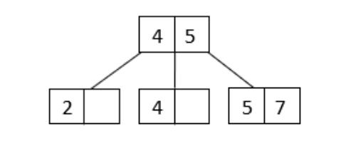
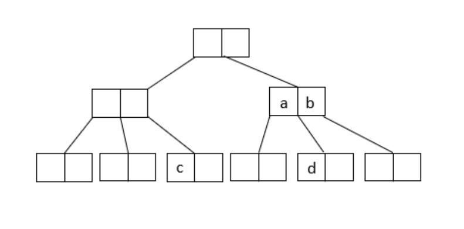
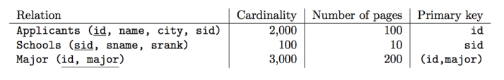
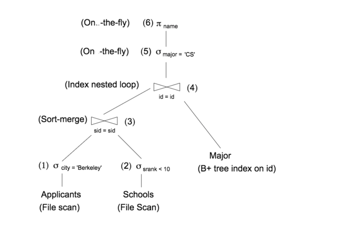
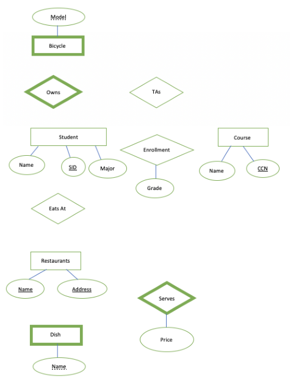

# Berkeley CS186 Fall 2018: Final: Questions

> Copied from the original: <https://hkn.eecs.berkeley.edu/exams/course/cs/186>. Text and figures are taken from the PDF as is; nothing was answered or rewritten. The original PDF is in this folder.

---

**Page 1**

&emsp;&emsp;&emsp;&emsp;&emsp;&emsp;&emsp;CS W186 Fall 2018 Final

&emsp;&emsp;&emsp;&emsp;&emsp;&emsp;**Do not turn this page until instructed to start the exam.**

**Contents:** 
&emsp;• You should receive one double-sided answer sheet and a 21-page exam packet. 
&emsp;• The final has 10 questions, each with multiple parts. 
&emsp;• The final is worth a total of 126.5 points.

**Taking the exam:** 
&emsp;• You have 170 minutes to complete the final. 
&emsp;• All answers should be written on the answer sheet. The exam packet will be collected but not graded. 
&emsp;• For each question, place only your final answer on the answer sheet; do not show work. 
&emsp;• For multiple choice questions, please fill in the bubble or box completely as shown on the left below. 
&emsp;Do not mark the box with an X or checkmark.

&emsp;• Use the blank spaces in your exam for scratch paper.

**Aids:** 
&emsp;• You are allowed **two** 8.5” × 11” double-sided pages of notes. 
&emsp;• The **only** electronic devices allowed are basic scientific calculators with simple numeric readout. No 
&emsp;graphing calculators, tablets, cellphones, smartwatches, laptops, etc. are allowed.

---

**Page 2**

**1**   **FDs & BCNF (12 points)** 
1\. (5 points) Decompose R = ABCDEFGH into BCNF in the order of the given functional dependencies: 
&emsp;F = {C →A, B →EF, H →BCG, F →CD, G →B}. 
&emsp;Which of the following tables are included in the final decomposition? 
&emsp;&emsp;&emsp;A. AC 
&emsp;&emsp;&emsp;B. BCDGH 
&emsp;&emsp;&emsp;C. BCGH 
&emsp;&emsp;&emsp;D. BG 
&emsp;&emsp;&emsp;E. DH

2\. (3 points) Two students are writing a decomposition of tables based on the attribute set R = ABCDEF 
&emsp;and the functional dependency set F = {C →D, A →B, B →EF, F →A}. 
&emsp;A Stanford student decides to write a decomposition of tables as ABDE and ABCF. Right now, this 
&emsp;is not a lossless decomposition. Which of the following changes (applied individually, not combined 
&emsp;together) would make this a lossless decomposition? 
&emsp;&emsp;&emsp;A. Adding D →ABCDEF to the functional dependency set F 
&emsp;&emsp;&emsp;B. Adding E →C to the functional dependency set F 
&emsp;&emsp;&emsp;C. Adding B →D to the functional dependency set F

3\. (4 points) Please mark the functional dependencies that are consistent with the following table.

&emsp;&emsp;&emsp;&emsp;&emsp;&emsp;&emsp;&emsp;A   B   C   D 
&emsp;&emsp;&emsp;&emsp;&emsp;&emsp;&emsp;&emsp;1   3   6   2 
&emsp;&emsp;&emsp;&emsp;&emsp;&emsp;&emsp;&emsp;2   4   1   1 
&emsp;&emsp;&emsp;&emsp;&emsp;&emsp;&emsp;&emsp;1   3   5   2 
&emsp;&emsp;&emsp;&emsp;&emsp;&emsp;&emsp;&emsp;2   2   1   2 
&emsp;&emsp;&emsp;A. A →D 
&emsp;&emsp;&emsp;B. AB →D 
&emsp;&emsp;&emsp;C. A →CD 
&emsp;&emsp;&emsp;D. ABC →D

&emsp;&emsp;&emsp;&emsp;&emsp;&emsp;&emsp;&emsp;Page 2 of 21

---

**Page 3**

**2**   **Transactions/2PL (17 points)** 
1\. (3 points) Consider the following schedule:

&emsp;&emsp;&emsp;&emsp;&emsp;&emsp;&emsp;&emsp;T1   T2 
&emsp;&emsp;&emsp;&emsp;&emsp;&emsp;&emsp;&emsp;Read(A) 
&emsp;&emsp;&emsp;&emsp;&emsp;&emsp;&emsp;&emsp;Read(B) 
&emsp;&emsp;&emsp;&emsp;&emsp;&emsp;&emsp;&emsp;Read(A) 
&emsp;&emsp;&emsp;&emsp;&emsp;&emsp;&emsp;&emsp;Read(B) 
&emsp;&emsp;&emsp;&emsp;&emsp;&emsp;&emsp;&emsp;A = A + B 
&emsp;&emsp;&emsp;&emsp;&emsp;&emsp;&emsp;&emsp;c = MIN(A, B) 
&emsp;&emsp;&emsp;&emsp;&emsp;&emsp;&emsp;&emsp;d = MAX(A, B) 
&emsp;&emsp;&emsp;&emsp;&emsp;&emsp;&emsp;&emsp;B = A - B 
&emsp;&emsp;&emsp;&emsp;&emsp;&emsp;&emsp;&emsp;A = A - B 
&emsp;&emsp;&emsp;&emsp;&emsp;&emsp;&emsp;&emsp;A = c 
&emsp;&emsp;&emsp;&emsp;&emsp;&emsp;&emsp;&emsp;B = d 
&emsp;&emsp;&emsp;&emsp;&emsp;&emsp;&emsp;&emsp;Write(A) 
&emsp;&emsp;&emsp;&emsp;&emsp;&emsp;&emsp;&emsp;Write(A) 
&emsp;&emsp;&emsp;&emsp;&emsp;&emsp;&emsp;&emsp;Write(B) 
&emsp;&emsp;&emsp;&emsp;&emsp;&emsp;&emsp;&emsp;Write(B)

&emsp;Which of the following describe this schedule? 
&emsp;&emsp;&emsp;A. Serializable 
&emsp;&emsp;&emsp;B. View Serializable 
&emsp;&emsp;&emsp;C. Conflict Serializable 
2\. (2.5 points) For each of the following, mark either true or false. 
&emsp;&emsp;&emsp;A. Two Phase Locking must be used, or we cannot guarantee conflict serializability. 
&emsp;&emsp;&emsp;B. Two Phase Locking must be used, or we cannot guarantee serializability. 
&emsp;&emsp;&emsp;C. Two Phase Locking ensures that we do not have cascading aborts. 
&emsp;&emsp;&emsp;D. Strict Two Phase Locking ensures that we do not have deadlocks. 
&emsp;&emsp;&emsp;E. Strict Two Phase Locking requires that transactions acquire locks only at the start of the 
&emsp;&emsp;&emsp;&emsp;transaction, and release all locks only at the end of the transaction.

&emsp;&emsp;&emsp;&emsp;&emsp;&emsp;&emsp;&emsp;Page 3 of 21

---

**Page 4**

3\. (2 points) In our new database, we implement lock promotion similarly to Homework 5: if we need to 
block the transaction, we place the request at the front of the queue. Unlike Homework 5, however, we 
release the lock a transaction originally held before blocking the transaction and adding the promotion 
request to the queue. We wish to test our implementation to make sure that the request was indeed 
placed at the front, rather than the back, of the queue, and write the following test:

&emsp;&emsp;&emsp;&emsp;`Transaction` `t1,` `t2,` `t3;` 
&emsp;&emsp;&emsp;&emsp;`t1` `requests` `__(1)__` `lock` `on` `database` 
&emsp;&emsp;&emsp;&emsp;`t2` `requests` `__(2)__` `lock` `on` `database` 
&emsp;&emsp;&emsp;&emsp;`t3` `requests` `__(3)__` `lock` `on` `database`

&emsp;&emsp;&emsp;&emsp;`t2` `requests` `a` `promotion` `to` `__(4)__` 
&emsp;&emsp;&emsp;&emsp;`check` `that` `t2` `is` `blocked`

&emsp;&emsp;&emsp;&emsp;`t1` `releases` `lock` `on` `database` 
&emsp;&emsp;&emsp;&emsp;`check` `that` `t2` `has` `a` `__(4)__` `lock` `on` `database`

Our new database does not support multigranularity locking, so transactions can only have an S or X 
lock. What lock types do we need for this test to properly test that our implementation indeed places 
the request at the front of the queue (in other words, the test should pass if and only if we placed the 
promotion request at the front of the queue)? If there are multiple answers, choose any one.

&emsp;&emsp;&emsp;(1)   (2)   (3)   (4) 
&emsp;&emsp;&emsp;&emsp;&emsp;A. S   A. S   A. S   A. S 
&emsp;&emsp;&emsp;&emsp;&emsp;B. X   B. X   B. X   B. X

4\. (1.5 points) In this question, assume that the levels of granularity we have are: Database, Table, Page, 
Record. For each of the following, mark either true or false. 
&emsp;&emsp;A. To write to a page, we must have an X lock the page, the table, and the database. 
&emsp;&emsp;B. A transaction that has only one lock—an IX lock on the database—has enough to request an 
&emsp;&emsp;&emsp;X lock on a page. 
&emsp;&emsp;C. There is no need to check for a SIX and IX conflict at the table level, because the conflict can 
&emsp;&emsp;&emsp;be resolved at a lower level (page or record) when one transaction requests an X lock.

&emsp;&emsp;&emsp;&emsp;&emsp;&emsp;&emsp;&emsp;Page 4 of 21

---

**Page 5**

5\. (3 points) Mark all the transactions that are involved in a deadlock. If there is no deadlock, mark No 
Deadlock. 
&emsp;&emsp;&emsp;&emsp;T1   X(A)   S(D) 
&emsp;&emsp;&emsp;&emsp;T2   S(A) 
&emsp;&emsp;&emsp;&emsp;T3   X(B)   S(C)   X(A) 
&emsp;&emsp;&emsp;&emsp;T4   S(C)   X(A) 
&emsp;&emsp;&emsp;&emsp;T5   S(D)   X(B) 
&emsp;&emsp;A. T1 
&emsp;&emsp;B. T2 
&emsp;&emsp;C. T3 
&emsp;&emsp;D. T4 
&emsp;&emsp;E. T5 
&emsp;&emsp;F. No Deadlock 
6\. (1 point) Which of the following applies for the “wait-die” deadlock avoidance strategy? 
&emsp;&emsp;A. This deadlock avoidance strategy avoids all deadlocks. 
&emsp;&emsp;B. This deadlock avoidance strategy never aborts unnecessarily. 
7\. (1 point) Which of the following applies for the “wound-wait” deadlock avoidance strategy? 
&emsp;&emsp;A. This deadlock avoidance strategy avoids all deadlocks. 
&emsp;&emsp;B. This deadlock avoidance strategy never aborts unnecessarily. 
8\. (3 points) Consider a “wait-wait-die” deadlock avoidance strategy, where when Ti requests a lock that 
Tj holds, it follows the following protocol: 
&emsp;• if Tj has higher priority, Ti waits, 
&emsp;• else if no transaction is waiting on Ti, Ti waits, 
&emsp;• else, Ti aborts. 
Which of the following applies for the “wait-wait-die” deadlock avoidance strategy? 
&emsp;&emsp;A. This deadlock avoidance strategy avoids all deadlocks. 
&emsp;&emsp;B. This deadlock avoidance strategy never aborts unnecessarily. 
&emsp;&emsp;C. This deadlock avoidance strategy aborts less frequently than the wait-die strategy.

&emsp;&emsp;&emsp;&emsp;&emsp;&emsp;&emsp;&emsp;Page 5 of 21

---

**Page 6**

**3**   **Recovery (14 points)** 
1\. (4 points) For each of the following four questions, mark True or False. 
&emsp;&emsp;&emsp;A. A NO STEAL policy is useful for achieving atomicity without REDO logging. 
&emsp;&emsp;&emsp;B. A FORCE policy is useful for achieving durability without REDO logging. 
&emsp;&emsp;&emsp;C. An implementation of the REDO phase that only checks pageLSN ≥LSN and not the other 
&emsp;&emsp;&emsp;&emsp;2 criteria is an incorrect implementation (here correctness means that an operation is redone 
&emsp;&emsp;&emsp;&emsp;in this implementation if and only if it is redone in the original implementation from lecture). 
&emsp;&emsp;&emsp;D. Assume that a system only allows at most n active transactions. In the worst case, there is no 
&emsp;&emsp;&emsp;&emsp;ACID-preserving mechanism to bound the number of operations undone in the undo phase by 
&emsp;&emsp;&emsp;&emsp;some constant k. 
Consider the following log recovered after a crash. Assume the buffer pool flushes to disk all pages referenced 
up to (and including) LSN 60, and does not flush any pages after that.

&emsp;&emsp;&emsp;&emsp;&emsp;&emsp;&emsp;&emsp;LSN   Record   prevLSN 
&emsp;&emsp;&emsp;&emsp;&emsp;&emsp;&emsp;&emsp;70   UPDATE T2 W(P3)   null 
&emsp;&emsp;&emsp;&emsp;&emsp;&emsp;&emsp;&emsp;80   UPDATE T1 W(P1)   null 
&emsp;&emsp;&emsp;&emsp;&emsp;&emsp;&emsp;&emsp;90   Begin Checkpoint   — 
&emsp;&emsp;&emsp;&emsp;&emsp;&emsp;&emsp;&emsp;100   UPDATE T3 W(P2)   null 
&emsp;&emsp;&emsp;&emsp;&emsp;&emsp;&emsp;&emsp;110   UPDATE T1 W(P2)   80 
&emsp;&emsp;&emsp;&emsp;&emsp;&emsp;&emsp;&emsp;120   End Checkpoint   — 
&emsp;&emsp;&emsp;&emsp;&emsp;&emsp;&emsp;&emsp;130   COMMIT T2   70 
&emsp;&emsp;&emsp;&emsp;&emsp;&emsp;&emsp;&emsp;140   COMMIT T3   100 
&emsp;&emsp;&emsp;&emsp;&emsp;&emsp;&emsp;&emsp;150   END T2   130 
&emsp;&emsp;&emsp;&emsp;&emsp;&emsp;&emsp;&emsp;160   UPDATE T4 W(P1)   null 
&emsp;&emsp;&emsp;&emsp;&emsp;&emsp;&emsp;&emsp;170   UPDATE T1 W(P1)   110 
&emsp;&emsp;&emsp;&emsp;&emsp;&emsp;&emsp;&emsp;180   ABORT T1   170

2\. (5.5 points) Fill out what the DPT and Xact table look like at the beginning of the REDO phase (after 
&emsp;ANALYSIS ends). Please write **None** for any fields that should not be in the tables. For the Xact table 
&emsp;Status, the possible options are: running, committing, aborting.

&emsp;&emsp;&emsp;&emsp;&emsp;&emsp;**PID**   **recLSN**   **TID**   **lastLSN**   **Status** 
&emsp;&emsp;&emsp;&emsp;&emsp;&emsp;&emsp;1   (a)   1   (d)   (e) 
&emsp;&emsp;&emsp;&emsp;&emsp;&emsp;&emsp;2   (b)   2   (f)   (g) 
&emsp;&emsp;&emsp;&emsp;&emsp;&emsp;&emsp;3   (c)   3   (h)   (i) 
&emsp;&emsp;&emsp;&emsp;&emsp;&emsp;&emsp;&emsp;4   (j)   (k)

3\. (3 points) For each of the following questions, mark True if the record is added to the log after recovery, 
&emsp;and False otherwise. 
&emsp;&emsp;&emsp;A. A CLR for T2’s update at LSN 70 
&emsp;&emsp;&emsp;B. A CLR for T1’s update at LSN 80 
&emsp;&emsp;&emsp;C. A CLR for T3’s update at LSN 100 
&emsp;&emsp;&emsp;D. A CLR for T1’s update at LSN 110 
&emsp;&emsp;&emsp;E. A CLR for T4’s update at LSN 160 
&emsp;&emsp;&emsp;F. A CLR for T1’s update at LSN 170

&emsp;&emsp;&emsp;&emsp;&emsp;&emsp;&emsp;&emsp;Page 6 of 21

---

**Page 7**

4\. (1.5 points) Mark the box corresponding to the order of transactions (ascending by LSN) in which the 
CLR records are added. For example, if we had a log that looked like this

&emsp;&emsp;&emsp;&emsp;&emsp;&emsp;&emsp;&emsp;LSN   Record   prevLSN 
&emsp;&emsp;&emsp;&emsp;&emsp;&emsp;&emsp;&emsp;190   CLR T5 . . .   . . . 
&emsp;&emsp;&emsp;&emsp;&emsp;&emsp;&emsp;&emsp;200   CLR T6 . . .   . . . 
&emsp;&emsp;&emsp;&emsp;&emsp;&emsp;&emsp;&emsp;210   CLR T7 . . .   . . .

The ordering would be 
T5, T6, T7 
&emsp;&emsp;A. T1, T1, T1, T4, T3, T2 
&emsp;&emsp;B. T1, T4, T1, T3, T1, T2 
&emsp;&emsp;C. T1, T1, T1, T4 
&emsp;&emsp;D. T1, T4, T1, T1 
&emsp;&emsp;E. T1, T1, T1, T3, T2 
&emsp;&emsp;F. T1, T1, T3, T1, T2

&emsp;&emsp;&emsp;&emsp;&emsp;&emsp;&emsp;&emsp;Page 7 of 21

---

**Page 8**

**4**   **Text Search Incl Ranking (TF-IDF) (12 points)** 
1\. (6 points) For each assertion, fill in the corresponding bubble True or False. 
&emsp;&emsp;&emsp;A. In the “Bag of Words” model, we might choose to ignore the word “of” because it doesn’t 
&emsp;&emsp;&emsp;&emsp;contain much information. This is an example of a stop word. 
&emsp;&emsp;&emsp;B. To allow fast text searches, we build inverted files, which contain maps from documents to 
&emsp;&emsp;&emsp;&emsp;words. 
&emsp;&emsp;&emsp;C. The vector space of an IR system is enormous because it has one “dimension” per document 
&emsp;&emsp;&emsp;&emsp;in the corpus. 
&emsp;&emsp;&emsp;D. When calculating distance to find similarity between docs, it is beneficial to normalize the 
&emsp;&emsp;&emsp;&emsp;vectors. 
&emsp;&emsp;&emsp;E. Consider three docs: Doc1 has length 10,000, Doc2 has length 9,900, Doc3 has length 100. If 
&emsp;&emsp;&emsp;&emsp;we use Cosine Similarity Distance Metric, Doc1 is very likely to be more similar to Doc2 than 
&emsp;&emsp;&emsp;&emsp;to Doc3. 
&emsp;&emsp;&emsp;F. TF-IDF value increases as the number of times a word appears in the document increases.

2\. (1 point) When doing IR Ranking, what types of words do we favor? **There may be zero, one, or** 
&emsp;**more than one correct answer.** 
&emsp;&emsp;&emsp;A. repeated words 
&emsp;&emsp;&emsp;B. long words 
&emsp;&emsp;&emsp;C. unusual words 
&emsp;&emsp;&emsp;D. capitalized words

3\. (2 points) Consider 500 documents with docID 1, . . . , 500. The following table contains the number of 
&emsp;occurrences of the word “database” in each document:

&emsp;&emsp;&emsp;&emsp;&emsp;&emsp;&emsp;&emsp;docID   number of “database” 
&emsp;&emsp;&emsp;&emsp;&emsp;&emsp;&emsp;&emsp;1   4 
&emsp;&emsp;&emsp;&emsp;&emsp;&emsp;&emsp;&emsp;2   17 
&emsp;&emsp;&emsp;&emsp;&emsp;&emsp;&emsp;&emsp;3   12 
&emsp;&emsp;&emsp;&emsp;&emsp;&emsp;&emsp;&emsp;4   7 
&emsp;&emsp;&emsp;&emsp;&emsp;&emsp;&emsp;&emsp;5   9 
&emsp;&emsp;&emsp;&emsp;&emsp;&emsp;&emsp;&emsp;6-500   0

&emsp;What is the “DocTermRank” for term = “database” and docID = 2? (Hint: consider TF and IDF). 
&emsp;Assume base-10 for any logarithms.

&emsp;&emsp;&emsp;&emsp;&emsp;&emsp;&emsp;&emsp;Page 8 of 21

---

**Page 9**

4\. (1 point) We run a text search query and get the top 100 answers. We find that 95 of them are correct. 
&emsp;We say that this is a good answer because 95% of them are correct. Which metric of answer quality is 
&emsp;this? 
&emsp;&emsp;&emsp;A. Accuracy 
&emsp;&emsp;&emsp;B. Precision 
&emsp;&emsp;&emsp;C. Retrieval 
&emsp;&emsp;&emsp;D. Recall 
For the next two problems, consider the following expressions:

&emsp;A. (# of true positives) / ((# of true positives) + (# of false positives)) 
&emsp;&emsp;B. (# of true positives) / ((# of true positives) + (# of true negatives)) 
&emsp;C. (# of true positives) / ((# of true positives) + (# of false negatives)) 
&emsp;D. (# of true positives) / (# of true negatives) 
5\. (1 point) Which of the above 4 expressions above is a definition of precision?

6\. (1 point) Which of the above 4 expressions above is a definition of recall?

&emsp;&emsp;&emsp;&emsp;&emsp;&emsp;&emsp;&emsp;Page 9 of 21

---

**Page 10**

**5**   **Distributed Transactions with Two Phase Commit (2PC) (10** 
&emsp;**points)** 
1\. (4 points) For each of the following four questions, mark True or False. 
&emsp;&emsp;&emsp;A. Distributed deadlock occurs only if the waits-for graph at a node forms a cycle. 
&emsp;&emsp;&emsp;B. In 2PC, we need all participant nodes to agree on abort (vote NO) to abort a transaction. 
&emsp;&emsp;&emsp;C. A participant machine that does not flush its prepare records to the log before responding to 
&emsp;&emsp;&emsp;&emsp;the coordinator could violate the durability property. 
&emsp;&emsp;&emsp;D. In 2PC phase 2, after the coordinator sends commit message to all participants, participants 
&emsp;&emsp;&emsp;&emsp;first respond with Ack, and then generate and flush commit record.

2\. (2 points) Suppose you are you are a machine that has just recovered from a crash. You discover only 
&emsp;an abort record in your log for transaction T. Under proper 2PC and logging protocols, mark True or 
&emsp;False for each of the following two questions. 
&emsp;&emsp;&emsp;A. You are a participant. 
&emsp;&emsp;&emsp;B. You crashed during phase 2.

3\. (2 points) Suppose you are a participant machine that has just recovered from a crash. There is only 
&emsp;one record in your log for transaction T. Under proper 2PC and logging protocols, mark True or False 
&emsp;for each of the following two questions. 
&emsp;&emsp;&emsp;A. You know all the messages you received before you crashed. 
&emsp;&emsp;&emsp;B. You need to decide if you need to commit or abort transaction T.

4\. (2 points) Suppose in 2PC with logging, we have one coordinator and three participants. It takes 30ms 
&emsp;for a coordinator to send messages to all participants; 5, 10, and 15ms for participant 1, 2, and 3 to send 
&emsp;a message to the coordinator respectively; and 10ms for each machine to generate and flush a record. 
&emsp;Assume for the same message, each participant receives it from the coordinator at the same time. 
&emsp;Under proper 2PC and logging protocols, how long does the whole 2PC process (from the beginning to 
&emsp;the coordinator’s final log flush) take for a successful commit in the best case?

&emsp;&emsp;&emsp;&emsp;&emsp;&emsp;&emsp;&emsp;Page 10 of 21

---

**Page 11**

**6**   **SQL/Relational Algebra (10.5 points)** 
Use your knowledge of SQL to deduce what is happening during the Battle of Hogwarts. You may assume 
you have the following tables: 
`CREATE` `TABLE` `Wizards(wizid` `integer,` `name` `text,` `house` `text,` `evil` `boolean,` `PRIMARY` `KEY(wizid));`

`CREATE` `TABLE` `Spells(sid` `integer,` `name` `text,` `offensive` `boolean,` `PRIMARY` `KEY` `(sid));`

`CREATE` `TABLE` `Attacks(attackid` `integer,` `attacker` `integer,` `attacked` `integer,` `spell` `integer,` 
&emsp;`PRIMARY` `KEY` `(attackid),` `FOREIGN` `KEY(spell)` `REFERENCES` `Spells,` 
&emsp;`FOREIGN` `KEY(attacker)` `REFERENCES` `Wizards,` `FOREIGN` `KEY(attacked)` `REFERENCES` `Wizards);` 
&emsp;**Disclaimer**: For all of the following questions, you do not need any Harry Potter knowledge.   Any 
understanding of Wizards or Spells will not be helpful. 
1\. (1.5 points) Select all of the following queries that return the name of each wizard who has been an 
&emsp;attacker more than 3 times. Do not assume that names are unique. 
&emsp;&emsp;&emsp;A. `SELECT` `name` `FROM` `Wizards,` `Attacks` 
&emsp;&emsp;&emsp;&emsp;&emsp;`WHERE` `wizid` `=` `attacker` 
&emsp;&emsp;&emsp;&emsp;&emsp;`GROUP` `BY` `attacker,` `name` 
&emsp;&emsp;&emsp;&emsp;&emsp;`HAVING` `COUNT(*)` `>` `3;`

&emsp;&emsp;&emsp;B. `SELECT` `name` `FROM` `Wizards,` `Attacks` 
&emsp;&emsp;&emsp;&emsp;&emsp;`WHERE` `wizid` `=` `attacker` 
&emsp;&emsp;&emsp;&emsp;&emsp;`GROUP` `BY` `name` 
&emsp;&emsp;&emsp;&emsp;&emsp;`HAVING` `COUNT(*)` `>` `3;`

&emsp;&emsp;&emsp;C. `SELECT` `name` `FROM` 
&emsp;&emsp;&emsp;&emsp;&emsp;&emsp;&emsp;`(SELECT` `name` `FROM` `Wizards,` `Attacks` 
&emsp;&emsp;&emsp;&emsp;&emsp;&emsp;&emsp;&emsp;`WHERE` `wizid` `=` `attacker)` `AS` `a` 
&emsp;&emsp;&emsp;&emsp;&emsp;`GROUP` `BY` `attacker,name` 
&emsp;&emsp;&emsp;&emsp;&emsp;`HAVING` `COUNT(*)` `>` `3` 
&emsp;&emsp;&emsp;&emsp;&emsp;`ORDER` `BY` `COUNT(name);`

2\. (1.5 points) Select all of the following queries that select the names of wizards (A) that another individual 
&emsp;wizard (B) attacked twice, where the attacker (B) used two different spells. There should be no duplicates 
&emsp;in this list. Do not assume that names are unique. 
&emsp;&emsp;&emsp;A. `SELECT` `w1.name` `AS` `A` 
&emsp;&emsp;&emsp;&emsp;&emsp;`FROM` `Wizards` `w1,` `Wizards` `w2,` `Attacks` `a1,` `Attacks` `a2` 
&emsp;&emsp;&emsp;&emsp;&emsp;`WHERE` `w1.wizid` `=` `a1.attacked` `AND` `a1.spell` `<>` `a2.spell` 
&emsp;&emsp;&emsp;&emsp;&emsp;&emsp;`AND` `w2.wizid` `=` `a2.attacked` `AND` `a1.attacked` `=` `a2.attacked;`

&emsp;&emsp;&emsp;B. `SELECT` `DISTINCT` `w1.` `name` `AS` `A` 
&emsp;&emsp;&emsp;&emsp;&emsp;`FROM` `Wizards` `w1,` `Attacks` `a1,` `Attacks` `a2` 
&emsp;&emsp;&emsp;&emsp;&emsp;`WHERE` `w1.wizid` `=` `a1.attacked` `AND` `a1.spell` `<>` `a2.spell` 
&emsp;&emsp;&emsp;&emsp;&emsp;&emsp;`AND` `w1.wizid` `=` `a2.attacked` `AND` `a1.attacked` `=` `a2.attacked;`

&emsp;&emsp;&emsp;C. `SELECT` `DISTINCT` `w1.name` `AS` `A` 
&emsp;&emsp;&emsp;&emsp;&emsp;`FROM` `Wizards` `w1,` `Wizards` `w2,` `Attacks` `a1,` `Attacks` `a2` 
&emsp;&emsp;&emsp;&emsp;&emsp;`WHERE` `a1.attacker` `=` `a2.attacker` `AND` `w1.wizid` `=` `a1.attacked` 
&emsp;&emsp;&emsp;&emsp;&emsp;&emsp;`AND` `a1.spell` `<>` `a2.spell` `AND` `w2.wizid` `=` `a2.attacked` `AND` `a1.attacked` `=` `a2.attacked;`

&emsp;&emsp;&emsp;&emsp;&emsp;&emsp;&emsp;&emsp;Page 11 of 21

---

**Page 12**

3\. (1.5 points) Select all of the following queries that return the name of all of the spells that have never 
&emsp;been used in an attack. 
&emsp;&emsp;&emsp;A. `SELECT` `name` 
&emsp;&emsp;&emsp;&emsp;&emsp;`FROM` `Spells` 
&emsp;&emsp;&emsp;&emsp;&emsp;`WHERE` `sid` `NOT` `IN` 
&emsp;&emsp;&emsp;&emsp;&emsp;&emsp;&emsp;`(SELECT` `spell` `FROM` `Attacks);`

&emsp;&emsp;&emsp;B. `SELECT` `name` 
&emsp;&emsp;&emsp;&emsp;&emsp;`FROM` `Spells` 
&emsp;&emsp;&emsp;&emsp;&emsp;`WHERE` `NOT` `EXISTS` 
&emsp;&emsp;&emsp;&emsp;&emsp;&emsp;&emsp;`(SELECT` `*` `FROM` `Attacks` `WHERE` `spell` `=` `sid);`

&emsp;&emsp;&emsp;C. `SELECT` `Spells.name` 
&emsp;&emsp;&emsp;&emsp;&emsp;`FROM` `Spells,` `Wizards,` `Attacks` 
&emsp;&emsp;&emsp;&emsp;&emsp;`WHERE` `wizid` `=` `attacker` `and` `spell` `=` `sid;`

For the following questions: fill in the blanks to create a query that returns true if more evil wizards cast 
offensive spells, and returns false if more good wizards cast offensive spells. 
Note that **exactly one** answer will be correct. 
&emsp;&emsp;`WITH` `count_evil_good_spells(evil,` `num_offensive)` `AS` 
&emsp;&emsp;&emsp;&emsp;`(SELECT` `evil,` `count(*)` 
&emsp;&emsp;&emsp;&emsp;&emsp;`FROM` `attacks,` `wizards,` `spells` 
&emsp;&emsp;&emsp;&emsp;&emsp;`WHERE` `___(4)___` `and` `spell` `=` `sid` 
&emsp;&emsp;&emsp;&emsp;&emsp;`AND` `offensive` `=` `____(5)___` 
&emsp;&emsp;&emsp;&emsp;&emsp;`GROUP` `BY` `____(6)___)` 
&emsp;&emsp;`SELECT` `evil` 
&emsp;&emsp;&emsp;&emsp;`FROM` `count_evil_good_spells` 
&emsp;&emsp;&emsp;&emsp;`WHERE` `num_offensive` `>=` `ALL` 
&emsp;&emsp;&emsp;&emsp;&emsp;`(SELECT` `num_offensive` 
&emsp;&emsp;&emsp;&emsp;&emsp;`FROM` `___(7)___);` 
4\. (0.5 points) Fill in the blank labeled (4) 
&emsp;&emsp;&emsp;A.   `wizid=attackid` 
&emsp;&emsp;&emsp;B.   `wizid=attacked` 
&emsp;&emsp;&emsp;C.   `wizid=attacker` 
5\. (0.5 points) Fill in the blank labeled (5) 
&emsp;&emsp;&emsp;A.   `true` 
&emsp;&emsp;&emsp;B.   `false` 
6\. (0.5 points) Fill in the blank labeled (6) 
&emsp;&emsp;&emsp;A.   `evil` 
&emsp;&emsp;&emsp;B.   `spell` 
&emsp;&emsp;&emsp;C.   `attacker` 
7\. (0.5 points) Fill in the blank labeled (7) 
&emsp;&emsp;&emsp;A.   `Wizards` 
&emsp;&emsp;&emsp;B.   `count_evil_good_spells` 
&emsp;&emsp;&emsp;C.   `Attacks`

&emsp;&emsp;&emsp;&emsp;&emsp;&emsp;&emsp;&emsp;Page 12 of 21

---

**Page 13**

8\. (2 points) Select all of the following answers that return the **wizid** of all of the wizards who have not 
attacked anybody. 
&emsp;&emsp;A. πwizid(Attacks −Wizards) 
&emsp;&emsp;B. πwizid(πwizid(Wizards) −πattacker(Attacks)) 
&emsp;&emsp;C. πwizid(Wizards) −πattacker(Spells ▷◁sid = spell Attacks ▷◁attacker = wizid Wizards) 
&emsp;&emsp;D. πwizid,name(Wizards) −πattacker(Attacks)

9\. (2 points) Select all of the following answers that return the **wizid** of all of the wizards who were 
attacked by Wizards whose house is Gryffindor. 
&emsp;&emsp;A. πattacked(Spells ▷◁sid = spell Attacks ▷◁attacker = wizid σhouse =’Gryffindor’(Wizards)) 
&emsp;&emsp;B. πattacked(Spells ▷◁sid = spell Attacks ▷◁attacker = wizid σhouse =’Gryffindor’(πwizid((Wizards))) 
&emsp;&emsp;C. πwizid(Wizards)−πattacked(Spells ▷◁sid = spell Attacks ▷◁attacked = wizid σhouse !=’Gryffindor’(Wizards)) 
&emsp;&emsp;D. πattacked(Attacks ▷◁attacker=wizid (σhouse =’Gryffindor’(Wizards) ▷◁sid=spell Spells))

&emsp;&emsp;&emsp;&emsp;&emsp;&emsp;&emsp;&emsp;Page 13 of 21

---

**Page 14**

**7**   **B+ Trees (15 points)** 
1\. (5 points) For each of the following five questions, mark True or False. 
&emsp;&emsp;&emsp;A. You cannot build a B+ tree on a variable length column such as a string. 
&emsp;&emsp;&emsp;B. Indexes are used to optimize tables that are written to much more frequently than they are 
&emsp;&emsp;&emsp;&emsp;read from. 
&emsp;&emsp;&emsp;C. For alternative 2 trees, clustered indexes will not save any IOs over unclustered indexes when 
&emsp;&emsp;&emsp;&emsp;you are only doing equality search. 
&emsp;&emsp;&emsp;D. Alternative 1 indexes will usually be able to store fewer records in each leaf than Alternative 
&emsp;&emsp;&emsp;&emsp;2 indexes. 
&emsp;&emsp;&emsp;E. With a series of carefully constructed inserts, an adversary can cause a B+ tree to be unbal- 
&emsp;&emsp;&emsp;&emsp;anced, so that some lookups visit more nodes than others. 
2\. (4 points) Given the following B+ tree:

&emsp;What will the B+ tree look like after inserting 1, 3, and 6 in that order? Fill in the answer sheet with 
&emsp;what number goes in boxes a-d using the following template. Put none if the box is empty. Some pages 
&emsp;in the template may not have any entries on in them. 
&emsp;**Reminder**: when a node splits and there is an odd number of entries, the majority goes to the right 
&emsp;node.

&emsp;&emsp;&emsp;&emsp;&emsp;&emsp;&emsp;&emsp;Page 14 of 21

---

**Page 15**

For the following problems consider an alternative 2 unclustered B+ tree of height 3 on the sid column, 
which is a primary key. As a reminder, we define the height of a tree with only a root as 0. Assume that no 
tree pages or data pages are initially in the buffer pool. 
3\. (2 points) In the best case, how many IOs (index and heap) will it take to insert a tuple? Assume no 
&emsp;tree nodes split, and that modifications to any page will immediately be flushed to disk.

4\. (2 points) If we want to do a range search on this tree and we estimate that about half the tuples will 
&emsp;fall in this range, should we do an index scan, or should we simply do a full table scan?

5\. (2 points) How many IOs (index and heap) will an index scan on the condition: sid \> 10 and sid \< 15 
&emsp;take? Assume that only two leaves have records matching the conditions, and that each of those leaves 
&emsp;have three records matching the condition.

&emsp;&emsp;&emsp;&emsp;&emsp;&emsp;&emsp;&emsp;Page 15 of 21

---

**Page 16**

**8**   **Query Processing and Parallel DBMS (10 points)** 
1\. (2 points) For each of the following three questions, mark True or False. 
&emsp;&emsp;&emsp;A. Performing an index nested loop join with a clustered index on the inner relation always 
&emsp;&emsp;&emsp;&emsp;requires more I/Os than an index nested loop join with an unclustered index on the inner 
&emsp;&emsp;&emsp;&emsp;relation (for the same tables). 
&emsp;&emsp;&emsp;B. Pipeline parallelism scales up with the amount of data. 
&emsp;&emsp;&emsp;C. Performing key lookup over hash partitioned data requires fewer I/Os than if the data had 
&emsp;&emsp;&emsp;&emsp;been round-robin partitioned. 
We want to join together the Owners and Pets table on petID so we can later on compare the owner’s 
happiness to the pet’s happiness. Suppose we have the following tables and variables: 
&emsp;&emsp;&emsp;&emsp;&emsp;&emsp;&emsp;&emsp;`Owners:`   `(ownerID,` `name,` `happiness,` `petID)` 
&emsp;&emsp;&emsp;&emsp;&emsp;&emsp;&emsp;&emsp;`Pets:`   `(petID,` `happiness,` `ownerID)`

&emsp;&emsp;&emsp;&emsp;&emsp;&emsp;&emsp;&emsp;**variable**   **symbol**   **value** 
&emsp;&emsp;&emsp;&emsp;&emsp;&emsp;&emsp;&emsp;pages of `Owners` table   \[O\]   30 
&emsp;&emsp;&emsp;&emsp;&emsp;&emsp;&emsp;&emsp;tuples per `Owners` page   pO   5 
&emsp;&emsp;&emsp;&emsp;&emsp;&emsp;&emsp;&emsp;pages of `Pets` table   \[P\]   45 
&emsp;&emsp;&emsp;&emsp;&emsp;&emsp;&emsp;&emsp;tuples per `Pets` page   pP   5 
&emsp;&emsp;&emsp;&emsp;&emsp;pages in memory per machine to perform the join   B   6 
&emsp;&emsp;&emsp;&emsp;&emsp;&emsp;&emsp;&emsp;Number of machines   M   3 
&emsp;&emsp;&emsp;&emsp;&emsp;&emsp;&emsp;&emsp;Size of Page   s   2KB

**Note:** For these questions, do **NOT** include the cost of writing matching output, but **DO** include the cost 
of scanning the tables. 
Assume that we have **three** machines. We want to join `Owners` and `Pets` on `Owners.petID` `=` `Pets.petID`.

2\. (2 points) If the data starts out round-robin partitioned, what is the total amount of data **in KB** 
&emsp;transmitted over the network during repartitioning in order to perform **grace hash join**?

3\. (2 points) Assume that we can partition and perform the initial pass of hashing at the same time. 
&emsp;Assuming that the data starts out round-robin partitioned across the machines, how many (disk) I/Os 
&emsp;are needed **in total across all machines** to perform **grace hash join**?

4\. (2 points) Assume that the data starts out partitioned perfectly across the machines for a **sort-merge** 
&emsp;**join**, and no network communication is required. How many (disk) I/Os are needed **per machine** to 
&emsp;perform sort merge join, using the optimization if possible? (Note: your answer should be per machine, 
&emsp;in contrast to the previous question.)

5\. (2 points) How many (disk) I/Os would be needed to perform sort merge join using the optimization if 
&emsp;possible if we only had **one** machine and **6 buffer pages** for this one machine instead?

&emsp;&emsp;&emsp;&emsp;&emsp;&emsp;&emsp;&emsp;Page 16 of 21

---

**Page 17**

**9**   **Query Optimization (16 points)** 
A relational database has the table: 
`CREATE` `TABLE` `Employee(PNR` `text,` `SALARY` `integer,` `SEX` `text,` `DEPT` `text,` `PRIMARY` `KEY(PNR))` 
The cost-based optimizer uses the following statistics stored as meta-data in the DBMS’s system catalogue: 
&emsp;• There are 10000 rows in the table. 
&emsp;• There are 20 departments in the company. 
&emsp;• SEX is either ‘Male’ or ‘Female’. 
&emsp;• The lowest salary is 20000 and the highest is 100000. 
The query optimizer make the following assumptions on statistics: 
&emsp;• The query optimizer assumes even distributions of data values in columns 
&emsp;• The query optimizer assumes independence between values in different columns 
For questions of selectivity, you may answer either with a fraction or a decimal.

1\. (2 points) What is the selectivity of the condition: SALARY \< 25000?

2\. (2 points) What is the selectivity of the condition: (SALARY \> 100000 OR SEX != ’Male’) And 
&emsp;DEPT=’Toys’?

3\. (2 points) What is the selectivity of the condition: (SEX = ’Male’ OR SALARY \> 80000)?

4\. (2 points) What is the selectivity of the condition: ((SEX= ’Male’ AND DEPT = ’Toys’) OR (SEX= 
&emsp;’Female’ AND DEPT = ’Tools’)) AND (SALARY \> 50000 OR SALARY \< 25000)?

&emsp;&emsp;&emsp;&emsp;&emsp;&emsp;&emsp;&emsp;Page 17 of 21

---

**Page 18**

Consider the following SQL query that finds all applicants who want to major in CS, live in Berkeley, and 
go to a school ranked better than 10 (i.e., rank \< 10).

`SELECT` `A.name` 
&emsp;`FROM` `Applicants` `A,` `Schools` `S,` `Major` `M` 
&emsp;`WHERE` `A.sid` `=` `S.sid` `AND` `A.id` `=` `M.id` 
&emsp;`AND` `A.city` `=` `’Berkeley’` `AND` `S.srank` `<` `10` `AND` `M.major` `=` `’CS’` 
&emsp;Assume that: 
&emsp;• Each school has a unique rank number (srank value) between 1 and 100 (both inclusive). 
&emsp;• There are 20 different cities. 
&emsp;• Applicants.sid is a foreign key that references Schools.sid. 
&emsp;• Major.id is a foreign key that references Applicants.id. 
&emsp;• There is an unclustered, alternative 2 B+ tree index on Major.id and all index pages (a total of 5) are 
&emsp;already in memory. 
&emsp;• For Major table, all tuples belonging to same student are stored in one physical page. 
&emsp;• The buffer size is 150 pages. 
The query optimizer is currently considering the below query plan.

&emsp;&emsp;&emsp;&emsp;&emsp;&emsp;&emsp;&emsp;Page 18 of 21

---

**Page 19**

5\. (3 points) What is the cardinality of the output of operator 1 in unit of tuples?

6\. (5 points) Suppose the output cardinality of operator 3 is known to be 9 tuples and they have different 
Applicant ids. What is the total I/O cost of this whole plan? Do not include the cost of writing the 
final result.

&emsp;&emsp;&emsp;&emsp;&emsp;&emsp;&emsp;&emsp;Page 19 of 21

---

**Page 20**

**10**   **ER Diagrams (10 points)** 
For questions 1-10, you will fill in the following ER Diagram, which models parts of a student’s routine 
in a University. (Hint: You might want to fill the diagram while you read these requirements here). The 
constraints are listed below. 
• Students own at least one bicycle. Each bicycle is uniquely identified by its owner and the bicycle model. 
• Students must take at least one course, and every course must have at least one student. 
• Students may TA for at most one course, but are under no obligation to teach at all. Every course can 
&emsp;have as many TAs as it needs, or none at all. 
• Students can choose to eat at restaurants, but are under no obligation to do so. Every restaurant must 
&emsp;have some students eating at it, however. 
• Each restaurant, identified by its address and name, has to serve multiple dishes. Each dish is uniquely 
&emsp;identified by its name and the restaurant serving it.

&emsp;&emsp;&emsp;&emsp;&emsp;&emsp;&emsp;&emsp;Page 20 of 21

---

**Page 21**

&emsp;For each of the following questions, mark **one** of the following choices:

&emsp;A. Thin Arrow 
&emsp;&emsp;B. Thick Arrow 
&emsp;C. Thin Line 
&emsp;D. Thick Line 
1\. (1 point) Which edge should we draw to connect the **Students** entity with the **Enrollment** relationship 
&emsp;set?

2\. (1 point) Which edge should we draw to connect the **Course** entity with the **Enrollment** relationship 
&emsp;set?

3\. (1 point) Which edge should we draw to connect the **Students** entity with the **TAs** relationship set?

4\. (1 point) Which edge should we draw to connect the **Course** entity with the **TAs** relationship set?

5\. (1 point) Which edge should we draw to connect the **Student** entity with the **Owns** relationship set?

6\. (1 point) Which edge should we draw to connect the **Bicycle** entity with the **Owns** relationship set?

7\. (1 point) Which edge should we draw to connect the **Restaurants** entity with the **Eats At** relationship 
&emsp;set?

8\. (1 point) Which edge should we draw to connect the **Student** entity with the **Eats At** relationship set?

9\. (1 point) Which edge should we draw to connect the **Restaurants** entity with the **Serves** relationship 
&emsp;set?

10\. (1 point) Which edge should we draw to connect the **Dish** entity with the **Serves** relationship set?

&emsp;&emsp;&emsp;&emsp;&emsp;&emsp;&emsp;&emsp;Page 21 of 21

