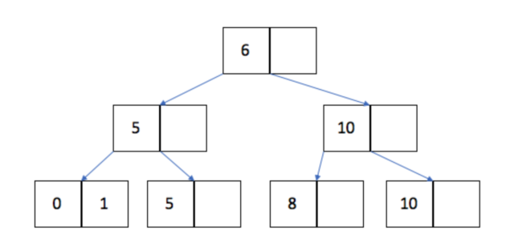
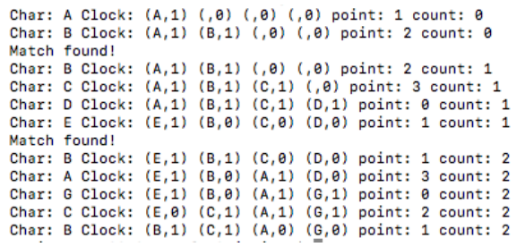

# Berkeley CS186 Fall 2018: Midterm 1: Official solutions

> Copied from the original: <https://hkn.eecs.berkeley.edu/exams/course/cs/186>. Text and figures are taken from the PDF as is; nothing was answered or rewritten. The original PDF is in this folder.

---

**Page 1**

&emsp;&emsp;&emsp;&emsp;CS W186 Fall 2018 Midterm 1 
• Do not turn this page until instructed to start the exam. 
• You should receive one double-sided answer sheet and a 18-page exam packet. 
• All answers should be written on the answer sheet. The exam packet will be collected but not graded. 
• You have 80 minutes to complete the midterm. 
• The midterm has 5 questions, each with multiple parts. 
• The midterm is worth a total of 84 points. 
• For each question, place only your final answer on the answer sheet; do not show work. 
• For multiple choice questions, please fill in the bubble or box completely, **do not mark the box with** 
**an X or checkmark**. 
• Use the blank spaces in your exam for scratch paper. 
• You are allowed **one** 8.5” × 11” double-sided page of notes. 
• No electronic devices are allowed.

---

**Page 2**

**1**   **Sorting/Hashing (18 points)** 
1\. (4 points) For each choice, fill in the corresponding bubble if the statement is true. **There may be** 
&emsp;**zero, one, or more than one correct answer.** 
&emsp;&emsp;&emsp;A. In the sorting algorithm, for every pass except the first one, we keep 1 buffer frame reserved 
&emsp;&emsp;&emsp;&emsp;as the output buffer. 
&emsp;&emsp;&emsp;B. In the hashing algorithm, for every pass except the first one, we keep 1 buffer frame reserved 
&emsp;&emsp;&emsp;&emsp;as the output buffer. 
&emsp;&emsp;&emsp;C. Suppose the relation we are sorting is made of 100 data pages and we have 5 pages available 
&emsp;&emsp;&emsp;&emsp;for sorting. The second pass of our sorting algorithm will write to disk exactly 25 times. 
&emsp;&emsp;&emsp;D. When the hashing algorithm does no recursive partitioning, the first pass serves as a divide 
&emsp;&emsp;&emsp;&emsp;phase, and the second pass serves as the conquer phase.

&emsp;**Solution:** A D 
&emsp;Explanation: 
&emsp;A - True because in the first pass we use all our buffers to sort and in subsequent passes we use B-1 
&emsp;to sort and 1 output buffer 
&emsp;B - False because we use every buffer to build a hash table which gets written to disk 
&emsp;C - False because we have to write to disk 100 times (once for every page - the unit of transfer from 
&emsp;memory to disk) 
&emsp;D - True, this is a classic divide and conquer algorithm

&emsp;For the rest of this question, suppose we have a relation with 1000 pages of data and 11 pages of memory 
&emsp;available. Each part of the question has no impact on prior or future parts. 
2\. (2 points) How many passes are required to sort this relation (pass 0 counts as one of the passes!)

&emsp;**Solution:** 3 
&emsp;Explanation: 
&emsp;N=1000, B=11, 
&emsp;1+ceil(log10(1000/11)) = 3

3\. (2 points) Assume that our query is: `SELECT` `R.x` `FROM` `R` `ORDER` `BY` `x`. Each tuple is fixed-length and 
&emsp;100 bytes long, and column `R.x` is fixed-length but only 10 bytes long. We have optimized our sorting 
&emsp;algorithm to perform projection (removing unnecessary columns) on the fly during Pass 0. In other words, 
&emsp;during pass 0 the database only copies 10 bytes from each tuple into memory buffers for quicksort and 
&emsp;subsequently each tuple is only 10 bytes long. How many IOs does sorting with these conditions take, 
&emsp;including writing the output to disk?

&emsp;&emsp;&emsp;&emsp;&emsp;&emsp;&emsp;&emsp;Page 2 of 18

---

**Page 3**

&emsp;**Solution:** 1300 IOs. 
&emsp;Explanation: Pass 0: 1000 to read R, 100 to write R into 10 runs after the projection. (9 runs of 
&emsp;length 11, 1 run of length 1) Pass 1: 100 to read the runs, 100 to write the output.

4\. (2 points) How many IOs are required to hash the relation, including writing the output to disk? Assume 
unique keys, and hash functions that evenly distribute keys across hash values.

&emsp;**Solution:** 6000 
&emsp;Explanation: 
&emsp;N=1000, B=11 
&emsp;1 + log10(1000/11) = 3 passes 
&emsp;3 ∗2000 = 6000 IOs

5\. (2 points) Assume you have 10 buffer pages for external hashing. What is the largest input file (measured 
in number of pages) that we can possibly hash without recursive partitioning?

&emsp;**Solution:** 90 
&emsp;Explanation: We generate 9 partitions in pass 1. If each partition is \<= 10 pages long, we finish in 
&emsp;pass two. With perfect hashing in pass 1, we can do this for a 90-page file. Anything larger would 
&emsp;generate at least 1 partition of length \> 10, requiring recursive partitioning.

6\. (2 points) Again assume 10 buffer pages for external hashing. This time, we want to know what is the 
smallest input file (measured in pages) that could cause us to invoke recursive partitioning?

&emsp;**Solution:** 11 
&emsp;Explanation: With very bad luck in pass 1, we generate only 1 non-empty partition. If that partition 
&emsp;is \> 10 pages long, it requires recursive partitioning. Hence a file of size 11 is the smallest file that 
&emsp;could cause recursive partitioning.

&emsp;&emsp;&emsp;&emsp;&emsp;&emsp;&emsp;&emsp;Page 3 of 18

---

**Page 4**

In the next two questions, think about how data is laid out on disk, and how disk reads and writes are 
scheduled in sorting and hashing. 
7\. (2 points) For external sorting, write down the following I/O behaviors as S for all sequential, or R for 
mostly random: (for example, if all four are sequential IO, then write ”S S S S”) 
&emsp;1\. Pass 0 reads 
&emsp;2\. Pass 0 writes 
&emsp;3\. Pass 1 reads 
&emsp;4\. Pass 1 writes

&emsp;**Solution:** S S R S 
&emsp;Explanation: 
&emsp;Pass 0 uses B buffer pages, reads from disk sequentially, and produces ceil(N/B) sorted runs of B 
&emsp;pages each by sorting each run in place and writing them sequentially. 
&emsp;Pass 1, 2, etc. merge B-1 runs at a time (read first elements from each of B-1 input buffers, compare 
&emsp;them, and write the smallest one to output buffer). We cannot continuously/sequentially read from 
&emsp;the same input buffer because the current min value will vary over time from input to input. But 
&emsp;we always write to the same output buffer which is appended to a sequential file. Thus the read 
&emsp;here is mostly random and the write is sequential.

8\. (2 points) For external hashing, mark the following I/O behaviors as S for all sequential, or R for mostly 
random. (You can assume no recursive partitioning occurs.) 
&emsp;1\. Pass 1 reads 
&emsp;2\. Pass 1 writes 
&emsp;3\. Pass 2 reads 
&emsp;4\. Pass 2 writes

&emsp;**Solution:** S R S S 
&emsp;Explanation: 
&emsp;In pass 1, we read sequentially from a single file, and write each tuple to output buffer corresponding 
&emsp;to hash function hp. Random input values mean that we fill up output buffers in random order. 
&emsp;Thus the read here is sequential, and the write here is random. 
&emsp;In pass 2, we read sequentially from each partition, walk the in-memory hashtable and append tuples 
&emsp;to a single sequential output file.

&emsp;&emsp;&emsp;&emsp;&emsp;&emsp;&emsp;&emsp;Page 4 of 18

---

**Page 5**

**2**   **Disks, Buffers, Files (16 points)**

&emsp;For questions 1-2, consider the following relation: 
&emsp;&emsp;`CREATE` `TABLE` `products` `(` 
&emsp;&emsp;&emsp;&emsp;`id` `INTEGER` `PRIMARY` `KEY,` `--` `cannot` `be` `NULL` 
&emsp;&emsp;&emsp;&emsp;`stock` `INTEGER` `NOT` `NULL,` 
&emsp;&emsp;&emsp;&emsp;`price` `INTEGER` `NOT` `NULL,` 
&emsp;&emsp;&emsp;&emsp;`name` `VARCHAR(10)` `NOT` `NULL,` 
&emsp;&emsp;&emsp;&emsp;`category` `CHAR(6)` `NOT` `NULL,` 
&emsp;&emsp;&emsp;&emsp;`serial_number` `CHAR(20)` `--` `may` `be` `NULL!` 
&emsp;&emsp;`);`

&emsp;A field of type CHAR(n) consists of exactly n characters, while a field of type VARCHAR(n) consists 
&emsp;of at most n characters (assume that a field of VARCHAR(n) takes up at most n bytes). Assume that 
&emsp;record headers take up 8 bytes, and integers are 4 bytes long. Note that columns in a primary key cannot 
&emsp;be NULL. 
1\. (3 points) Which of the following, if any, are a possible size, in bytes, for some record of the products 
&emsp;relation, assuming a variable-length representation with a record header? **There may be zero, one,** 
&emsp;**or more than one correct answer.** 
&emsp;&emsp;&emsp;A. 18 
&emsp;&emsp;&emsp;B. 27 
&emsp;&emsp;&emsp;C. 38 
&emsp;&emsp;&emsp;D. 45 
&emsp;&emsp;&emsp;E. 48 
&emsp;&emsp;&emsp;F. 55

&emsp;**Solution:** B, E, F 
&emsp;Possible sizes with 8 byte record header are 26-36, 46-56. 
&emsp;6 T/F questions, each all or nothing.

2\. (1 point) True or False. If our table was initially populated with records that all had non-NULL serial 
&emsp;numbers, then we delete a few rows, and later wish to insert a new record that was not assigned a serial 
&emsp;number, we may create fragmentation on the page.

&emsp;**Solution:** True. A record with a NULL for the serial number would take up less space than the 
&emsp;record it was replacing.

&emsp;&emsp;&emsp;&emsp;&emsp;&emsp;&emsp;&emsp;Page 5 of 18

---

**Page 6**

In the following two questions, assume that we are using fixed-length records, and each record is 64 bytes 
long. Assume that the page header is empty, except for a bitmap when necessary, which is as small as 
possible, rounded up to the nearest byte. 
3\. (2 points) How many records can fit on a 1 KB page, assuming we use a packed page layout?

&emsp;**Solution:** 1024 / 64 = 16 records 
&emsp;All or nothing.

4\. (2 points) How many records can fit on a 1 KB page, assuming we use an **un**packed page layout?

&emsp;**Solution:** 15 records (2 byte bitmap) 
&emsp;All or nothing.

In the following two questions, assume that every page is 1 KB, a linked list pointer takes up 8 bytes 
(and we are using singly linked lists wherever applicable). Assume that exactly 50 fixed-length records 
can fit onto a data page (after accounting for metadata and any linked list pointers needed), and an 
entry in the page directory is 8 bytes long, and **all data pages are half full**. 
5\. (2 points) How many pages will the relation take up if we have 10,000 records and implement the heap 
file with a linked-list structure?

&emsp;**Solution:** 10,000 / (50 / 2 - half full) = 400 data pages, + 1 page for header = 401 pages 
&emsp;Partial credit for answer of 201 (data pages full)

6\. (2 points) How many pages will the relation take up if we have 10,000 records and implement the heap 
file with a page directory?

&emsp;&emsp;&emsp;&emsp;&emsp;&emsp;&emsp;&emsp;Page 6 of 18

---

**Page 7**

&emsp;**Solution:** 10,000 / (50 / 2 - half full) = 400 data pages, each header page contains info for 
&emsp;floor((1024 - 8) / 8) = 127 data pages, so we need ceil(400 / 127) = 4 header pages = 404 pages 
&emsp;Partial credit for answer of 202 (data pages full)

7\. (4 points) Select all the statements below that are true. Assume that all searches are performed on the 
same key that the sorted file is sorted by. **There may be zero, one, or more than one correct** 
**answer.** 
&emsp;&emsp;A. Scanning all the records in a heap file is strictly faster than scanning all the records in a sorted 
&emsp;&emsp;&emsp;file. 
&emsp;&emsp;B. Suppose we know there is exactly 1 match, because the search key is the primary key of table. 
&emsp;&emsp;&emsp;An equality search on a sorted file is always faster than an equality search on a heap file. 
&emsp;&emsp;C. Assuming the number of records with the same value for the search key is small, a range search 
&emsp;&emsp;&emsp;on a sorted file is typically faster than the same search on a heap file. 
&emsp;&emsp;D. An insertion into a sorted file is typically faster than an insertion into a heap file.

&emsp;**Solution:** A: same speed assuming sorted file pages are full, B: heap file search faster if found on 
&emsp;first page, C: true, D: insertion in sorted file requires more bookkeeping. 
&emsp;4 T/F questions, each all or nothing.

&emsp;&emsp;&emsp;&emsp;&emsp;&emsp;&emsp;&emsp;Page 7 of 18

---

**Page 8**

**3**   **Query Languages (20 points)**

&emsp;`Books:` `bid` `INTEGER,` 
&emsp;&emsp;&emsp;`title` `TEXT,` 
&emsp;&emsp;&emsp;`library` `REFERENCES` `Library,` 
&emsp;&emsp;&emsp;`genre` `TEXT,` 
&emsp;&emsp;&emsp;`PRIMARY` `KEY` `(bid)`

&emsp;`Library:` `lid` `INTEGER,` 
&emsp;&emsp;&emsp;&emsp;`lname` `TEXT,` 
&emsp;&emsp;&emsp;&emsp;`PRIMARY` `KEY` `(lid)`

&emsp;`Checkouts:` `book` `INTEGER` `REFERENCES` `Books,` 
&emsp;&emsp;&emsp;&emsp;&emsp;`day` `DATETIME,` 
&emsp;&emsp;&emsp;&emsp;&emsp;`PRIMARY` `KEY` `(book,` `date)` 
&emsp;For each of the following questions, mark all the statements that result in the correct output. Your T/F 
&emsp;answer for statement is worth 1 point. If you get all the statements for a question correct, you get 1 
&emsp;additional point. 
1\. (4 points) Return the bid and genre of each book that has ever been checked out. Remove any duplicate 
&emsp;rows with the same bid and genre. **There may be zero, one, or more than one correct answer.** 
&emsp;&emsp;&emsp;A. `SELECT` `b.bid,` `b.genre` 
&emsp;&emsp;&emsp;&emsp;`FROM` `Books` `b,` `Checkouts` `c` 
&emsp;&emsp;&emsp;&emsp;`WHERE` `b.bid` `=` `c.book`

&emsp;&emsp;&emsp;B. `SELECT` `b.bid,` `b.genre` 
&emsp;&emsp;&emsp;&emsp;`FROM` `Books` `b,` `Checkouts` `c` 
&emsp;&emsp;&emsp;&emsp;`WHERE` `b.library` `=` `c.library`

&emsp;&emsp;&emsp;C. `SELECT` `DISTINCT` `b.bid,` `b.genre` 
&emsp;&emsp;&emsp;&emsp;`FROM` `Books` `b,` `Checkouts` `c` 
&emsp;&emsp;&emsp;&emsp;`WHERE` `b.bid` `=` `c.book`

&emsp;**Solution:** C 
&emsp;Answer A is the correct output but does not remove duplicates so there are too many rows. 
&emsp;Answer B uses the wrong join predicate (joining on library instead of bid) 
&emsp;Answer C is correct. The query uses the keyword DISTINCT to remove all duplicates and joins on 
&emsp;the bid key.

2\. (4 points) Find all of the fantasy book titles that have been checked out and the date when they were 
&emsp;checked out. If a book hasn’t been checked out, the output should read (title, NULL). **There may be** 
&emsp;**zero, one, or more than one correct answer.** 
&emsp;&emsp;&emsp;A. `SELECT` `title,` `day` 
&emsp;&emsp;&emsp;&emsp;`FROM` `Books` `b` `LEFT` `OUTER` `JOIN` `Checkouts` `c` 
&emsp;&emsp;&emsp;&emsp;&emsp;`ON` `c.book` `=` `b.bid` 
&emsp;&emsp;&emsp;&emsp;`WHERE` `b.genre` `=` `’Fantasy’;`

&emsp;&emsp;&emsp;&emsp;&emsp;&emsp;&emsp;&emsp;Page 8 of 18

---

**Page 9**

&emsp;&emsp;B. `SELECT` `title,` `day` 
&emsp;&emsp;&emsp;`FROM` `Books` `b` `RIGHT` `OUTER` `JOIN` `Checkouts` `c` 
&emsp;&emsp;&emsp;&emsp;&emsp;`ON` `c.book` `=` `b.bid` 
&emsp;&emsp;&emsp;`WHERE` `b.genre` `=` `’Fantasy’`

&emsp;&emsp;C. `SELECT` `title,` `day` 
&emsp;&emsp;&emsp;`FROM` `Checkouts` `c` `RIGHT` `OUTER` `JOIN` `Books` `b` 
&emsp;&emsp;&emsp;&emsp;&emsp;`ON` `c.book` `=` `b.bid` 
&emsp;&emsp;&emsp;`WHERE` `b.genre` `=` `’Fantasy’;`

&emsp;**Solution:** A, C 
&emsp;Answer A is correct. 
&emsp;Answer B preserves checkouts instead of book titles because of the Right outer join instead of left. 
&emsp;This means that all checkouts will be present with their corresponding book but if a book were never 
&emsp;checked out then it wouldnt be in the output. 
&emsp;Answer C is just like answer A but the two relations are flipped in their position in the join so a 
&emsp;right outer join works instead of a left outer join.

3\. (4 points) Select the name of all of the pairs of libraries that have books with matching titles. Include 
the name of both libraries and the title of the book. There should be no duplicate rows, and no two rows 
that are the same except the libraries are in opposite order (e.g. `(‘East’,` `‘West’,` `‘Of` `Mice` `and` 
`Men’)` and `(‘West’,` `‘East’,` `‘Of` `Mice` `and` `Men’))`. To ensure this, the first library name should be 
alphabetically less than the second library name. **There may be zero, one, or more than one** 
**correct answer.** 
&emsp;&emsp;A. `SELECT` `DISTINCT` `l.lname,` `l.lname,` `b.title` 
&emsp;&emsp;&emsp;&emsp;`FROM` `Library` `l,` `Books` `b` 
&emsp;&emsp;&emsp;&emsp;`WHERE` `l.lname` `=` `b.library` 
&emsp;&emsp;&emsp;&emsp;&emsp;`AND` `b.library` `=` `l.lid` 
&emsp;&emsp;&emsp;&emsp;`ORDER` `BY` `l.lname`

&emsp;&emsp;B. `SELECT` `DISTINCT` `l1.lname,` `l2.lname,` `b1.title` 
&emsp;&emsp;&emsp;&emsp;`FROM` `Library` `l1,` `Library` `l2,` `Books` `b1,` `Books` `b2` 
&emsp;&emsp;&emsp;&emsp;`WHERE` `l1.lname` `<` `l2.lname` `AND` `b1.title` `=` `b2.title` 
&emsp;&emsp;&emsp;&emsp;&emsp;`AND` `b1.library` `=` `l1.lid` `AND` `b2.library` `=` `l2.lid`

&emsp;&emsp;C. `SELECT` `DISTINCT` `first.l1,` `second.l2,` `b1` 
&emsp;&emsp;&emsp;&emsp;`FROM` 
&emsp;&emsp;&emsp;&emsp;&emsp;&emsp;`(SELECT` `lname` `l1,` `title` `b1` 
&emsp;&emsp;&emsp;&emsp;&emsp;&emsp;&emsp;`FROM` `Library` `l,` `Books` `b` 
&emsp;&emsp;&emsp;&emsp;&emsp;&emsp;`WHERE` `b.library` `=` `l.lid)` `as` `first,` 
&emsp;&emsp;&emsp;&emsp;&emsp;&emsp;`(SELECT` `lname` `l2,` `title` `b2` 
&emsp;&emsp;&emsp;&emsp;&emsp;&emsp;&emsp;`FROM` `Library` `l,` `Books` `b` 
&emsp;&emsp;&emsp;&emsp;&emsp;&emsp;`WHERE` `b.library` `=` `l.lid)` `as` `second` 
&emsp;&emsp;&emsp;&emsp;`WHERE` `first.l1` `<` `second.l2` 
&emsp;&emsp;&emsp;&emsp;&emsp;`AND` `first.b1` `=` `second.b2;`

&emsp;&emsp;&emsp;&emsp;&emsp;&emsp;&emsp;&emsp;Page 9 of 18

---

**Page 10**

**Solution:** B, C 
A is incorrect because it does not return the books with matching titles but rather the names of the 
books at a specific library. 
B is correct. C will perform a cross product of libraries with itself and books with itself matching 
books on title and matching that book to two different libraries. 
C is correct. It performs two separate joins on libraries and books finding all of the book library 
pairs as inner subqueries. Then the outer query finds the matching book titles from the subqueries 
such that the library name for one is less than the second.

&emsp;&emsp;&emsp;&emsp;&emsp;&emsp;&emsp;&emsp;Page 10 of 18

---

**Page 11**

4\. (4 points) Choose the statement that selects the name of the book that has been checked out the most 
times and the corresponding checked out count. You can assume that each book was checked out a 
unique number of times. **There may be zero, one, or more than one correct answer.** 
&emsp;&emsp;A. `SELECT` `title,` `count(*)` `AS` `cnt` 
&emsp;&emsp;&emsp;&emsp;`FROM` `Books` `b,` `Checkouts` `c` 
&emsp;&emsp;&emsp;&emsp;`WHERE` `b.bid` `=` `c.book` `AND` `NOT` `EXISTS` 
&emsp;&emsp;&emsp;&emsp;&emsp;`(SELECT` `count(*)` `AS` `cnt2` 
&emsp;&emsp;&emsp;&emsp;&emsp;&emsp;`FROM` `Books` `b,` `Checkouts` `c` 
&emsp;&emsp;&emsp;&emsp;&emsp;&emsp;`WHERE` `b.bid` `=` `c.book` `AND` `count(*)` `>` `cnt);`

&emsp;&emsp;B. `SELECT` `title,` `count(*)` `AS` `cnt` 
&emsp;&emsp;&emsp;&emsp;`FROM` `Books` `b,` `Checkouts` `c` 
&emsp;&emsp;&emsp;&emsp;`WHERE` `b.bid` `=` `c.book` 
&emsp;&emsp;&emsp;&emsp;`GROUP` `BY` `b.title` 
&emsp;&emsp;&emsp;`HAVING` `COUNT(*)` `>=` `ALL` 
&emsp;&emsp;&emsp;&emsp;&emsp;&emsp;`(SELECT` `count(*)` `FROM` `Books` `b2,` `Checkouts` `c2` 
&emsp;&emsp;&emsp;&emsp;&emsp;&emsp;`WHERE` `b2.bid` `=` `c2.book` 
&emsp;&emsp;&emsp;&emsp;&emsp;&emsp;`GROUP` `BY` `b2.title);`

&emsp;&emsp;C. `SELECT` `title,` `count(*)` `as` `cnt` 
&emsp;&emsp;&emsp;&emsp;`FROM` `Books` `b,` `Checkouts` `c` 
&emsp;&emsp;&emsp;&emsp;`WHERE` `b.bid` `=` `c.book` 
&emsp;&emsp;&emsp;&emsp;`GROUP` `BY` `b.title` 
&emsp;&emsp;&emsp;&emsp;`ORDER` `BY` `cnt` `DESC` 
&emsp;&emsp;&emsp;&emsp;`LIMIT` `1;`

&emsp;**Solution:** B, C 
&emsp;A is incorrect as there is an aggregate clause in WHERE and cnt cannot be referenced in the 
&emsp;WHERE clause because aggregates are computed after the WHERE clause so cnt is undefined. 
&emsp;B is correct. It selects a title and a count of that title from books that have been check out grouping 
&emsp;on titles that have a count greater than or equal to all other checkout counts. 
&emsp;C is correct. It selects books that have been checked out and groups by them by title to count the 
&emsp;number of times it has been checked out. Orders by that count and take the one with the highest 
&emsp;count.

Relational Algebra 
We will refer to the Books relation as B, the Library relation as L, and the Checkouts relation as C as 
shorthand in the question below. 
5\. (4 points) Select the title of all books from the “City of Berkeley Library ”. **There may be zero, one,** 
**or more than one correct answer.**

&emsp;&emsp;&emsp;&emsp;&emsp;&emsp;&emsp;&emsp;Page 11 of 18

---

**Page 12**

&emsp;A. πtitle(B ▷◁bid = book (σlname = “City of Berkeley Library”L)) 
&emsp;B. πtitle(σlibrary = “City of Berkeley Library” B) 
&emsp;C. πtitle(B ▷◁bid = book ((σlname = “City of Berkeley Library”L) ▷◁lid = library C))

**Solution:** A 
A is correct. It first selects the library with the name City of Berkeley Library and then joins that 
with books to get all of the books in that library. Then the titles are projected. 
B is incorrect as the library column in B actually references lids. 
C is incorrect. It finds the titles of the books from the City of Berkeley Library that have been 
checked out. But not all books. 
Notice that there is an typo in this question so we give credit to all students for A.

&emsp;&emsp;&emsp;&emsp;&emsp;&emsp;&emsp;&emsp;Page 12 of 18

---

**Page 13**

**4**   **B+ Trees (16 points)** 
Consider a database table `Students` that contains 100 records and a primary key `id`, stored in a heap file. 
Each block in the heap file can hold at most 4 records, but each block is only 75% full.

We bulk load an alternative 2 B+ Tree of order 5 on students.id, with leaves that can hold 10 entries at 
most, using bulk loading and a fill factor of 50%.

Consider the following SQL statements that arrive after the tree is loaded.

**Q1:** `SELECT` `*` `from` `Students` `where` `id` `=` `216972;`

**Q2:** `INSERT` `into` `Students(id,` `name)` `VALUES` `(25555,` `John` `Doe);`

**Q3:** `DELETE` `from` `Students` `WHERE` `name` `=` `John` `Smith;`

&emsp;Answer each of the following sub-questions assuming you execute from the original state of the index/- 
database as described above (e.g.   each sub-question is independent of any changes made by the other 
sub-questions).

Keep in mind two notes as you answer these: 
1\. the index is on students.id 
2\. reading the root of the index costs 1 IO

1\. (2 points) How many IOs in the worst case does it take execute query Q1?

&emsp;**Solution:** 4 IOs. There are 100 records, the number of heap blocks doesnt matter. Since R = 
&emsp;10(1/2) = 5, there are 20 leaves. This mean it takes 3 IOs to find the leaf, and one to fetch the 
&emsp;corresponding heap page.

2\. (2 points) How many IOs in the best case to execute query Q1?

&emsp;**Solution:** 3 IOs, we reach the leaf, and find that there is no data entry corresponding to the id, so 
&emsp;we dont have to fetch a heap block.

&emsp;&emsp;&emsp;&emsp;&emsp;&emsp;&emsp;&emsp;Page 13 of 18

---

**Page 14**

3\. (2 points) In the best case, how many IOs does it take to execute Q2 (assuming the insert is valid)?

&emsp;**Solution:** 6 IOs. 4 IOs to read the heap page, 1 to write the heap page, 1 to write the leaf node

4\. (2 points) In the best case, how many IOs does it take to execute query Q3?

&emsp;**Solution:** 34 IOs. Must read whole heap file, since the WHERE clause is on name. Best case if no 
&emsp;match so dont need a write.

Consider the following B+-tree with order d=1, and leaves that hold 2 entries.

5\. (2 points) What is the maximum number of inserts we can do without changing the height of the tree?

&emsp;**Solution:** 13. 
&emsp;18 - 5 existing = 13.

&emsp;&emsp;&emsp;&emsp;&emsp;&emsp;&emsp;&emsp;Page 14 of 18

---

**Page 15**

6\. (2 points) What is the minimum number of inserts we can do that will change the height of the tree?

&emsp;**Solution:** 4. 
&emsp;One possible pattern is 2,3,4,4.1.

7\. (2 points) Lets say we wanted to create a new index (with the same order) on the same table and key. 
How many total pages would we have in the new index if we used bulk loading with a fill factor of 50%.

&emsp;**Solution:** 8. We would have 5 leaves instead of 4, because we have 5 keys in total and each leaf 
&emsp;will only be 50% full, meaning it will only hold 1 entry. Then, as a result, we would need 3 inner 
&emsp;nodes (1 root node, 2 intermediate nodes).

8\. (2 points) After we create the new index in part 3 with bulk-loading, which key is at the root?

&emsp;**Solution:** 5

&emsp;&emsp;&emsp;&emsp;&emsp;&emsp;&emsp;&emsp;Page 15 of 18

---

**Page 16**

**5**   **Buffer Management (12 points)** 
1\. (5 points) Which of the following statements are true? **There may be zero, one, or more than one** 
&emsp;**correct answer.** 
&emsp;&emsp;&emsp;A. Each frame in the buffer pool is the size of a disk page 
&emsp;&emsp;&emsp;B. The buffer manager code (rather than the file/index management code) is responsible for 
&emsp;&emsp;&emsp;&emsp;turning on the dirty bit of a page. 
&emsp;&emsp;&emsp;C. The Dirty bit is used to track the popularity of the page 
&emsp;&emsp;&emsp;D. When using the LRU policy, the reference bits are used to give pages a “second chance” to 
&emsp;&emsp;&emsp;&emsp;stay in memory before they are replaced. 
&emsp;&emsp;&emsp;E. A sequential scan of the file will have the same hit rate using either MRU or LRU (starting 
&emsp;&emsp;&emsp;&emsp;with an empty buffer pool) when the file is smaller than the buffer pool

&emsp;**Solution:** A, E 
&emsp;Explanation: 
&emsp;For B, requestor of the page (file/index management code) sets the dirty page. 
&emsp;For C, dirty bit is used to track whether the page has been modified before its written back to disk. 
&emsp;For D, reference bits are not used for LRU policy. Its used in Clock policy.

&emsp;We are given an initially empty buffer pool with 4 buffer frames. Consider the following access pattern:

&emsp;A, B, B, C, D, E, B, A, G, C, B

&emsp;In the next two questions, you will need to evaluate the clock policy, keeping track of three things: the 
&emsp;pages in the buffer pool, the reference bits on the frames, and the number of buffer pool hits. 
&emsp;**Assume that we do not advance the clock hand on a hit – i.e., when we request a page that** 
&emsp;**is already in the buffer pool. We only advance the clock hand on a miss, as part of a page** 
&emsp;**replacement. Be careful to follow this protocol!**

2\. (2 points) Using the CLOCK replacement policy, which 4 pages remain in the buffer pool at the end of 
&emsp;the access pattern (in alphabetical order)?

&emsp;**Solution:** ABCG 
&emsp;See the explanation for the next question.

3\. (2 points) Using CLOCK replacement policy, how many buffer pool hits are there?

&emsp;&emsp;&emsp;&emsp;&emsp;&emsp;&emsp;&emsp;Page 16 of 18

---

**Page 17**

**Solution:** 2 
From the output of a script provided by a student:

&emsp;&emsp;&emsp;&emsp;&emsp;&emsp;&emsp;&emsp;Page 17 of 18

---

**Page 18**

4\. (2 points) In the next question, we will use the **LRU** policy. Start again with an empty buffer pool of 
4 buffer frames. Consider the following access pattern: 
T, H, I, S, I, S, A, R, E, A, L, L, Y, L, O, N, G, P, A, T, T, E, R, N 
Using LRU policy, which pages remain in the buffer pool in the end (in alphabetical order)?

&emsp;**Solution:** E N R T 
&emsp;LRU always keeps the most recent pages in buffer.

5\. (1 point) Assume you start with an empty buffer pool of 3 frames and repeatedly scan a file of 7 pages. 
How will the number of cache hits for LRU compare to MRU, and why? **There is only one correct** 
**answer; note that both the comparison and the “why” part have to be correct!** 
&emsp;&emsp;A. LRU will have more cache hits because LRU is always better than MRU. 
&emsp;&emsp;B. LRU will have more cache hits because LRU works better with frequent access to popular 
&emsp;&emsp;&emsp;pages. 
&emsp;&emsp;C. They will be the same because we access every page the same number of times. 
&emsp;&emsp;D. MRU will have more cache hits because MRU is always better than LRU for repeated sequential 
&emsp;&emsp;&emsp;scans. 
&emsp;&emsp;E. MRU will have more cache hits because LRU simply will not have any cache hits with this 
&emsp;&emsp;&emsp;pattern but MRU will have some hits.

&emsp;**Solution:** E 
&emsp;Explanation: 
&emsp;This question tests the concept of sequential flooding. 
&emsp;A is wrong. As we see in this case, MRU is better with sequential flooding. 
&emsp;B’s reasoning is correct but it’s unrelated to the provided pattern. 
&emsp;C doesn’t make sense because page replacement policies deal with which page to replace. 
&emsp;D is wrong because if the pages can all fit in buffer, then MRU and LRU are the same for repeated 
&emsp;scans. 
&emsp;E is correct, as it explains sequential flooding.

&emsp;&emsp;&emsp;&emsp;&emsp;&emsp;&emsp;&emsp;Page 18 of 18

