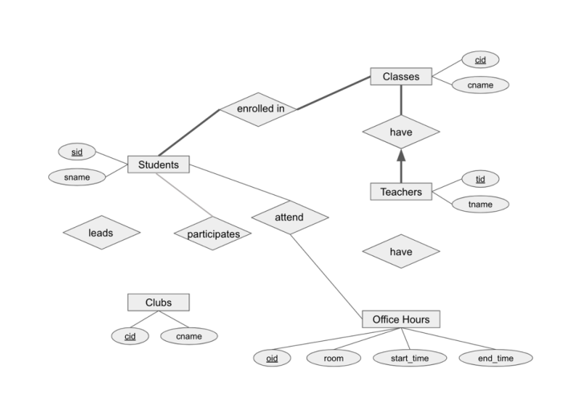
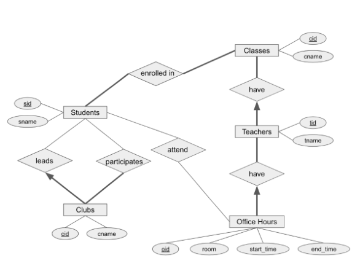

# Berkeley CS186 Fall 2018: Midterm 2: Official solutions

> Copied from the original: <https://hkn.eecs.berkeley.edu/exams/course/cs/186>. Text and figures are taken from the PDF as is; nothing was answered or rewritten. The original PDF is in this folder.

---

**Page 1**

&emsp;&emsp;&emsp;&emsp;&emsp;CS W186 Fall 2018 Midterm 2

&emsp;&emsp;&emsp;&emsp;&emsp;&emsp;**Do not turn this page until instructed to start the exam.**

**Contents:** 
&emsp;• You should receive one double-sided answer sheet and a 17-page exam packet. 
&emsp;• The midterm has 5 questions, each with multiple parts. 
&emsp;• The midterm is worth a total of 61 points.

**Taking the exam:** 
&emsp;• You have 80 minutes to complete the midterm. 
&emsp;• All answers should be written on the answer sheet. The exam packet will be collected but not graded. 
&emsp;• For each question, place only your final answer on the answer sheet; do not show work. 
&emsp;• For multiple choice questions, please fill in the bubble or box completely as shown on the left below. 
&emsp;Do not mark the box with an X or checkmark.

&emsp;• Use the blank spaces in your exam for scratch paper.

**Aids:** 
&emsp;• You are allowed **two** 8.5” × 11” double-sided pages of notes. 
&emsp;• The **only** electronic devices allowed are basic scientific calculators with simple numeric readout. No 
&emsp;graphing calculators, tablets, cellphones, smartwatches, laptops, etc.

---

**Page 2**

**1**   **Iterators and Joins (15 points)** 
1\. (5 points) For each of the following five questions, mark True or False. 
&emsp;&emsp;&emsp;A. Chunk Nested Loops join will always perform at least as well as Page Nested Loops Join when 
&emsp;&emsp;&emsp;&emsp;it comes to minimizing I/Os. 
&emsp;&emsp;&emsp;B. Grace hash join is usually the best algorithm for joins in which the join condition includes an 
&emsp;&emsp;&emsp;&emsp;inequality (i.e. col1 \< col2). 
&emsp;&emsp;&emsp;C. In choosing a join order for nested loops join to minimize I/Os, it is best to make the smaller 
&emsp;&emsp;&emsp;&emsp;relation the “outer” part of the loop. 
&emsp;&emsp;&emsp;D. Suppose we are joining two tables that are very different in size. In choosing a join order for 
&emsp;&emsp;&emsp;&emsp;index nested loops join to minimize I/Os, if both relations have indexes on their join column, 
&emsp;&emsp;&emsp;&emsp;it is best to query the index of the smaller relation. 
&emsp;&emsp;&emsp;E. If we can call the next() method on an iterator, then we are using a streaming (on-the-fly) 
&emsp;&emsp;&emsp;&emsp;algorithm.

&emsp;**Solution:** A. C 
&emsp;Explanation: 
&emsp;A. True - Chunk Nested Loops Join turns into PNLJ when B=2. Otherwise the cost model is strictly 
&emsp;less: \[R\] + \[R\] ∗\[S\] vs \[R\] + \[R/(B −2)\] ∗\[S\] 
&emsp;B. False - A hash join requires an Equijoin which cannot happen when an inequality is involved. 
&emsp;C. True - Consider the cost model for PNLJ, where O = outer, I = inner. \[O\] + \[O\]\[I\]. The \[O\]\[I\] 
&emsp;will be there no matter what order we choose, so we want to minimize the other term (the cost of 
&emsp;scanning the outer relation), so we make the outer relation smaller. 
&emsp;D. False - Consider the cost model for INLJ, where L = larger and S = smaller. If we query S, the 
&emsp;cost is \[L\] + \|L\|∗(cost to lookup in S), whereas if we query L the cost is \[S\] + \|S\|∗(cost to lookup 
&emsp;in L). The cost to lookup in an index wont change much even if one table is much bigger but the 
&emsp;number of records can change drastically, so you want to lookup in the larger table. 
&emsp;E. False - It might result in blocking (batch), which means the function does not produce output 
&emsp;until it consumes its entire input (consider sort merge join).

&emsp;In the next five questions, assume we have the following two database tables with the corresponding 
&emsp;details below.

&emsp;&emsp;&emsp;&emsp;&emsp;&emsp;&emsp;&emsp;`Students:`   `(sid,` `sname,` `syear)` 
&emsp;&emsp;&emsp;&emsp;&emsp;&emsp;&emsp;&emsp;`Enrolled:`   `(sid,` `cid,` `semester)` 
&emsp;&emsp;&emsp;&emsp;&emsp;&emsp;&emsp;&emsp;**variable**   **symbol**   **value** 
&emsp;&emsp;&emsp;&emsp;&emsp;&emsp;&emsp;&emsp;pages of `Students` table   \[S\]   200 
&emsp;&emsp;&emsp;&emsp;&emsp;&emsp;&emsp;&emsp;tuples per `Students` page   pS   10 
&emsp;&emsp;&emsp;&emsp;&emsp;&emsp;&emsp;&emsp;pages of `Enrolled` table   \[E\]   100 
&emsp;&emsp;&emsp;&emsp;&emsp;&emsp;&emsp;&emsp;tuples per `Enrolled` page   pE   60 
&emsp;&emsp;&emsp;&emsp;&emsp;&emsp;&emsp;&emsp;pages in memory to perform the join   B   7 
&emsp;&emsp;&emsp;&emsp;&emsp;&emsp;&emsp;I/Os needed to access the leaf of a B+tree   L   2

&emsp;&emsp;&emsp;&emsp;&emsp;&emsp;&emsp;&emsp;Page 2 of 17

---

**Page 3**

We want to join `Students` and `Enrolled` on `Students.sid` `=` `Enrolled.sid`.   Attribute `sid` is the 
primary key for table `Students`. For every tuple in `Students`, assume there are 3 matching tuples in 
`Enrolled`. There is an unclustered B+tree index on `E.sid`. 
**Note:** For these questions, do **NOT** include the cost of writing matching output, but **DO** include for 
the cost of scanning the tables. 
2\. (2 points) How many **I/Os** will a **grace hash join** take? Assume perfect hash functions, and be sure 
to choose the best relation for “building” to minimize cost.

&emsp;**Solution:** 1500 
&emsp;Explanation: 
&emsp;We want to first partition E (the smaller table) until it fits into B-2 = 5 pages. Number of partitioning 
&emsp;passes: 2 because 100/6 \> 5, but 100/6/6 \< 5. 
&emsp;We then build the hash table based on E and probe S to generate the final matching pairs. 
&emsp;2 ∗2 ∗(100 + 200) + 100 + 200 = 1500 I/Os

3\. (2 points) What is the **minimum** number of total **pages** in RAM that it would take to reduce the 
number of I/Os for **grace hash join**?

&emsp;**Solution:** 12 Pages 
&emsp;Explanation: 
&emsp;We can only afford 1 partitioning pass then. 
&emsp;100 / B-1 ≤B-2 
&emsp;Try B = 11: 100 / 10 = 10 which is \> 9. 
&emsp;Try B = 12: 100 / 11 \< 10 
&emsp;12 Pages

4\. (2 points) How many disk **I/Os** are needed to perform an **index nested loops join** using the B+tree 
on `E.sid`?

&emsp;**Solution:** 10200 
&emsp;Explanation: 
&emsp;We probe on the index on E: \[S\]+\[S\]∗pS∗(cost to find matching E tuples) = 200+200∗10∗(2+3) = 
&emsp;10200 I/Os

&emsp;&emsp;&emsp;&emsp;&emsp;&emsp;&emsp;&emsp;Page 3 of 17

---

**Page 4**

5\. (2 points) After examining the data, you realize that both the `Students` table and `Enrolled` table are 
sorted by `sid`. To account for this, you want to use **Sort Merge Join**. How many **I/Os** will this join 
take?

&emsp;**Solution:** 300 
&emsp;Explanation: 
&emsp;Cost to sort = 0 for both, so the total cost is just 100 + 200 = 300 I/Os.

6\. (2 points) Suppose that I wanted to do a **Chunk Nested Loops Join** in at most 1100 I/Os. What is 
the **minimum** number of **pages** in RAM I would need to accomplish this?

&emsp;**Solution:** 22 
&emsp;Explanation: 
&emsp;100 + (100/\[B-2\]) \* 200 ≤1100 
&emsp;20000/\[B-2\] ≤1000 
&emsp;20000 ≤1000(B - 2) 
&emsp;20 ≤B - 2 
&emsp;B ≤22

&emsp;&emsp;&emsp;&emsp;&emsp;&emsp;&emsp;&emsp;Page 4 of 17

---

**Page 5**

**2**   **Parallel Query Processing (10 points)** 
For the following questions, assume that you have access to the following relations: 
`Players` `(name,` `team,` `position,` `salary,` `agent)` 
`Coaches` `(name,` `team,` `salary)` 
Important parameters for this question are summarized in this table: 
&emsp;&emsp;&emsp;&emsp;&emsp;&emsp;&emsp;&emsp;**variable**   **symbol**   **value** 
&emsp;&emsp;&emsp;&emsp;&emsp;&emsp;&emsp;&emsp;Number of machines   M   4 
&emsp;&emsp;&emsp;&emsp;&emsp;&emsp;&emsp;&emsp;Size of Page   s   4 KB 
&emsp;&emsp;&emsp;&emsp;&emsp;&emsp;&emsp;Pages in RAM per machine for joins   B   8 pages 
&emsp;&emsp;&emsp;&emsp;&emsp;&emsp;&emsp;&emsp;Size of `Players`   \[P\]   128 pages 
&emsp;&emsp;&emsp;&emsp;&emsp;&emsp;&emsp;&emsp;Size of `Coaches`   \[C\]   4 pages 
&emsp;&emsp;&emsp;&emsp;&emsp;&emsp;&emsp;&emsp;Time for each I/O   t   5 ms 
Assume we have 4 machines, each with 8 pages in memory for joins. We will need to measure time, so assume 
that an I/O takes 5ms. For the following questions, when we ask for execution time we are only concerned 
with the time associated with I/Os (e.g. assume CPU and other costs are negligible). Assume that we can 
send individual tuples over the network with no overhead in terms of network cost.

Questions 1 and 2 will deal with the following query: 
`SELECT` `p.name,` `c.name` `FROM` `Players` `p,` `Coaches` `c` `WHERE` `c.team` `=` `p.team` 
1\. (4 points) Assuming the `Players` and `Coaches` relations are both round-robin partitioned across 4 ma- 
&emsp;chines by an adversary who is trying to maximize our network costs, what is the largest amount of data 
&emsp;we ship across the network, **in KB**, of the query above, assuming we execute a sort-merge join?

&emsp;**Solution:** s \* (\[P\] + \[C\]) = 4KB \* (128 + 4) = 528 KB – we will, in the worst case, have to send 
&emsp;over every single tuple because we need to range partition.

2\. (2 points) Assuming the `Players` relation starts out hash-partitioned on the `position` key across the 
&emsp;4 machines, and that 75% of `Players` gets mapped to one machine, how long **in ms** will it take to 
&emsp;complete a parallel scan of `Players`?

&emsp;**Solution:** t \* 0.75 \* \[P\] = 5 \* 0.75 \* 128 = 5 \* 96 = 480 ms

&emsp;&emsp;&emsp;&emsp;&emsp;&emsp;&emsp;&emsp;Page 5 of 17

---

**Page 6**

Suppose we add another table with the following schema: `Fans` `(name,` `team)`, which has 40,000 pages 
and is round-robin partitioned across 4 **new** machines with only this data. 
Questions 3-4 deal with the following query: 
`Select` `f.name,` `c.name` `from` `Coaches` `c,` `Fans` `f` `where` `f.team` `=` `c.team` 
3\. (2 points) What is the **name** of the join strategy that provides lowest possible network cost (amount of 
data shipped) to execute the query above?

&emsp;**Solution:** Broadcast join. Symmetric shuffle and asymmetric shuffle would cost more because we 
&emsp;would have to re-partition Fans.

4\. (2 points) What is the amount of data shipped **in KB** to execute that join strategy?

&emsp;**Solution:** s \* 4 \* 4 = 4 KB \* 4 \* 4 = 64 KB (perform a broadcast join - send over the entire 
&emsp;Coaches table to each machine.)

&emsp;&emsp;&emsp;&emsp;&emsp;&emsp;&emsp;&emsp;Page 6 of 17

---

**Page 7**

**3**   **Query Optimization (11 points)** 
1\. (2.5 points) For each of the following assertions about left-deep plans, answer True or False. 
&emsp;&emsp;&emsp;A. Two left-deep plans can differ in the order of relations and produce the same output. 
&emsp;&emsp;&emsp;B. Two left-deep plans can differ in the access method for each leaf operator and produce the 
&emsp;&emsp;&emsp;&emsp;same output. 
&emsp;&emsp;&emsp;C. Two left-deep plans can differ in the join method for each join operator and produce the same 
&emsp;&emsp;&emsp;&emsp;output. 
&emsp;&emsp;&emsp;D. The cheapest plan will always be among the left-deep plans. 
&emsp;&emsp;&emsp;E. The concept of “interesting” orders is not relevant for left-deep plans.

&emsp;**Solution:** A, B, C

2\. (2 points) For each of the following assertions about the System R algorithm, answer True or False. 
&emsp;&emsp;&emsp;A. System R never considers plans with cartesian products because they are suboptimal 
&emsp;&emsp;&emsp;B. System R only explores left deep plans 
&emsp;&emsp;&emsp;C. System R doesn’t keep track of interesting orders as they do not reduce I/O cost 
&emsp;&emsp;&emsp;D. The running time of the System R algorithm is at least exponential in the number of tables

&emsp;**Solution:** B, D

&emsp;&emsp;&emsp;&emsp;&emsp;&emsp;&emsp;&emsp;Page 7 of 17

---

**Page 8**

Suppose the System R assumptions about uniformity and independence from lecture hold. Assume that 
costs are estimated as a number of I/Os, without differentiating random and sequential I/O cost. 
Consider the following relational schema:

Assume the distribution on `Customers.happiness` is as shown in Figure 1. Each bin is inclusive of the 
min and exclusive of the max, \[min, max).

&emsp;&emsp;&emsp;&emsp;&emsp;&emsp;&emsp;&emsp;\[1-2)   \[2-5)   \[5-7)   \[7-9)   ≥9 
&emsp;&emsp;&emsp;&emsp;&emsp;&emsp;&emsp;&emsp;5%   15%   10%   30%   40% 
&emsp;&emsp;&emsp;&emsp;&emsp;&emsp;&emsp;&emsp;Figure 1: Histogram on `Customers.happiness`

Suppose you’re executing the following query:

`SELECT` `id,` `name` 
`FROM` `Customers` `c,` `Purchases` `p` 
`WHERE` `c.happiness` `>=` `2` 
&emsp;&emsp;`AND` `c.name` `=` `p.customer_name` 
&emsp;&emsp;`AND` `c.happiness` `<` `7`

3\. (1 point) What will be the selectivity for the predicate `c.name` `=` `p.customer` `name`?

&emsp;max(50,90) =max(distinct vals c.name,distinct vals p.customer name) =**Solution:** The selectivity is1   1   1 
&emsp;&emsp;&emsp;&emsp;&emsp;&emsp;&emsp;&emsp;90

4\. (1 point) What will be the selectivity of `c.happiness` ≥`2` `AND` `c.happiness` \< `7`?

&emsp;**Solution:** We know that we want happiness to be between 2 and 7. The selectivity is therefore 
&emsp;.1 + .15 = .25

&emsp;&emsp;&emsp;&emsp;&emsp;&emsp;&emsp;&emsp;Page 8 of 17

---

**Page 9**

5\. (1 point) How many tuples do we estimate to be in the output of the query? Choose one of the options 
below. 
&emsp;&emsp;A. (answer to q3) ∗(answer to q4) ∗\|`Customers`\| ∗\|`Purchases`\| 
&emsp;&emsp;B. (selectivity of `c.happiness` ≥2) ∗(selectivity of `c.happiness` \< 7) ∗\|`Customers`\|∗\|`Purchases`\| 
&emsp;&emsp;C. (answer to q3) ∗(selectivity of `c.happiness` ≥2) 
&emsp;&emsp;&emsp;∗(selectivity of `c.happiness` \< 7) ∗\|`Customers`\| ∗\|`Purchases`\|

&emsp;**Solution:** 
&emsp;&emsp;&emsp;A. is correct as it has the correct selectivity clauses 
&emsp;&emsp;&emsp;B. is incorrect as c.happiness ≥2 and c.happiness \< 7 are not independent and is missing 
&emsp;&emsp;&emsp;&emsp;the column equality 
&emsp;&emsp;&emsp;C. is incorrect as c.happiness ≥2 and c.happiness \< 7 are not independent

&emsp;&emsp;&emsp;&emsp;&emsp;&emsp;&emsp;&emsp;Page 9 of 17

---

**Page 10**

For problems 6-7, refer to the following query:

`SELECT` `c.id,` `r.` `return_id,` `p.order_id` 
`FROM` `Customers` `c,` `Purchases` `p,` `Returns` `r` 
`WHERE` `c.id` `=` `p.customer_id` 
&emsp;&emsp;`AND` `p.order_id` `=` `r.order_id` 
&emsp;&emsp;`AND` `r.customer_id` `=` `c.id` 
&emsp;&emsp;`AND` `c.happiness` `<` `2` 
`ORDER` `BY` `c.id`

6\. (2.5 points) Which of these table scans will output an interesting order? Mark True for correct answers 
and False for incorrect answers. 
&emsp;&emsp;A. Index scan on `happiness` for `Customers` 
&emsp;&emsp;B. Index scan on `id` for `Customers` 
&emsp;&emsp;C. Full table scan on `Customers` 
&emsp;&emsp;D. Index scan on `order` `id` for `Purchases` 
&emsp;&emsp;E. Index scan on `return` `id` for `Returns`

&emsp;**Solution:** B, D 
&emsp;&emsp;&emsp;A. is not an interesting order because happiness is never used again after c.happiness \< 2 
&emsp;&emsp;&emsp;B. id is an interesting order because id is used again for c.id = p.customer id and r.customer id 
&emsp;&emsp;&emsp;&emsp;= c.id and the ORDER BY clause 
&emsp;&emsp;&emsp;C. A full table scan doesn’t output the tuples in any particular order so there is no interesting 
&emsp;&emsp;&emsp;&emsp;order 
&emsp;&emsp;&emsp;D. order id is an interesting order because order id is used again for r.customer id = r.order id 
&emsp;&emsp;&emsp;E. return id is not an interesting order because it is not present in the where clause

7\. (1 point) True or False: Consider the SQL query above question 6. System R will choose to do a full 
table scan rather than an index scan for the Customers table.

&emsp;**Solution:** False.   A full table scan will cost 10 I/Os while an index scan on happiness for the 
&emsp;Customer table will cost 3 I/Os (2 IOs to traverse the tree and 1 IOs to get the records (0.05 \* 10)).

&emsp;&emsp;&emsp;&emsp;&emsp;&emsp;&emsp;&emsp;Page 10 of 17

---

**Page 11**

**4**   **ER Diagrams(14 points)** 
For questions 1-6, you will use the following ER Diagram, which represents the commitments that teachers 
and students have during the semester. (Hint: You might want to fill the diagram while you read these 
requirements here). 
• Students may lead multiple clubs, and every club has one student leader. 
• Students can also participate in multiple clubs, and every club has at least one student member. 
• Every teacher has multiple office hours, and one teacher leads each office hour.

1\. (1 point) Which edge should we draw to connect the **Clubs** entity with the **leads** relationship set? 
&emsp;&emsp;&emsp;A. Thin Arrow 
&emsp;&emsp;&emsp;B. Thick Arrow 
&emsp;&emsp;&emsp;C. Thin Line 
&emsp;&emsp;&emsp;D. Thick Line

&emsp;**Solution:** 
&emsp;B 
&emsp;Explanation: 
&emsp;One club has exactly one student leader.

&emsp;&emsp;&emsp;&emsp;&emsp;&emsp;&emsp;&emsp;Page 11 of 17

---

**Page 12**

2\. (1 point) Which edge should we draw to connect the **Students** entity with the **leads** relationship set? 
&emsp;&emsp;A. Thin Arrow 
&emsp;&emsp;B. Thick Arrow 
&emsp;&emsp;C. Thin Line 
&emsp;&emsp;D. Thick Line

&emsp;**Solution:** 
&emsp;C 
&emsp;Explanation: 
&emsp;One student can lead zero, one or more clubs.

3\. (1 point) Which edge should we draw to connect the **Clubs** entity with the **participates** relationship 
set? 
&emsp;&emsp;A. Thin Arrow 
&emsp;&emsp;B. Thick Arrow 
&emsp;&emsp;C. Thin Line 
&emsp;&emsp;D. Thick Line

&emsp;**Solution:** 
&emsp;D 
&emsp;Explanation: 
&emsp;One club has at least one student who participates in it.

4\. (1 point) Which edge should we draw to connect the **Office Hours** entity with the **have** relationship 
set? 
&emsp;&emsp;A. Thin Arrow 
&emsp;&emsp;B. Thick Arrow 
&emsp;&emsp;C. Thin Line 
&emsp;&emsp;D. Thick Line

&emsp;**Solution:** 
&emsp;B 
&emsp;Explanation: 
&emsp;One office hour has exactly one teacher who leads it.

&emsp;&emsp;&emsp;&emsp;&emsp;&emsp;&emsp;&emsp;Page 12 of 17

---

**Page 13**

5\. (1 point) Which edge should we draw to connect the **Teachers** entity with the **have** relationship set? 
&emsp;&emsp;A. Thin Arrow 
&emsp;&emsp;B. Thick Arrow 
&emsp;&emsp;C. Thin Line 
&emsp;&emsp;D. Thick Line

&emsp;**Solution:** 
&emsp;D 
&emsp;Explanation: 
&emsp;Each teacher has multiple office hours. 
&emsp;The correct ER Diagram to represent the relationship should look like this

6\. (1 point) True or False: Can a class be taught by multiple teachers? 
&emsp;&emsp;A. True 
&emsp;&emsp;B. False

&emsp;**Solution:** True 
&emsp;Explanation: 
&emsp;A teacher can teach exactly one class, but classes can be taught by multiple teachers.

&emsp;&emsp;&emsp;&emsp;&emsp;&emsp;&emsp;&emsp;Page 13 of 17

---

**Page 14**

7\. (4 points) Above are two alternative schemata1 that represent pet adoptions. For each of the following 
assertions, mark True or False. 
&emsp;&emsp;A. In schema 1, a family can adopt at most one pet. 
&emsp;&emsp;B. In schema 2, if there are k agencies, a family can adopt at most k times. 
&emsp;&emsp;C. In schema 2, there is no record of which pet was adopted by which family. 
&emsp;&emsp;D. In schema 1, a family can adopt a pet without an agency being involved.

&emsp;**Solution:** A, B, C 
&emsp;Explanation: A is true because of the arrow from Family to Adopts. B is true because relationship 
&emsp;sets are unique, so each (family, agency) pair in Adopts can be recorded at most once. C is true 
&emsp;because the Adopts and Provides relationship sets are independent: if we record that the Browns 
&emsp;adopt from Daisy Hill Agency, and Daisy Hill provides both Snoopy and Spike, we cannot tell if the 
&emsp;Browns adopt Snoopy or Spike. D is false because a relationship by definition involves an entity 
&emsp;from each associated entity set.

8\. (4 points) To capture the ER Diagram above, we create three relations: Pet, Adopts and Family. For 
each of the following assertions, mark True or False. 
&emsp;&emsp;A. The Pet table’s primary key includes the column fid. 
&emsp;&emsp;B. The Adopts table’s primary key includes the column pname. 
1“Schemata” is the plural of schema.

&emsp;&emsp;&emsp;&emsp;&emsp;&emsp;&emsp;&emsp;Page 14 of 17

---

**Page 15**

&emsp;C. The Adopts table’s primary key includes the column fid. 
&emsp;D. The Adopts table’s column fid can be declared NOT NULL.

**Solution:** B, D. A is false because fid is not a column of the Pet table whatsoever. B is true because 
each adoption needs to identify a specific pet. C is false, because if we include fid in the primary 
key with pname, then each pet could be adopted more than once. D is true: if we want to identify 
a Pet with 0 adoptions we can exclude it from the Adopts table completely (it is recorded in the 
Pets table); if we want to identify a Pet with 1 adoption it will have a non-NULL fid.

&emsp;&emsp;&emsp;&emsp;&emsp;&emsp;&emsp;&emsp;Page 15 of 17

---

**Page 16**

**5**   **Text Search (11 points)** 
1\. (5 points) For each assertion, fill in the corresponding bubble True or False. 
&emsp;&emsp;&emsp;A. A postings list is a heap file of docIDs for a term. 
&emsp;&emsp;&emsp;B. In IR’s “bag of words” model, the word “running” is converted to “run”, so “running” is an 
&emsp;&emsp;&emsp;&emsp;example of a stop word. 
&emsp;&emsp;&emsp;**C. IR is used mostly with unstructured text data.** 
&emsp;&emsp;&emsp;D. Inverted files are so named because they are structured with document IDs ordered in descend- 
&emsp;&emsp;&emsp;&emsp;ing order. 
&emsp;&emsp;&emsp;**E. In general, relational DBMSs are faster at handling individual updates and deletes** 
&emsp;&emsp;&emsp;&emsp;**than Text Search Engines.**

&emsp;**Solution:** C, E 
&emsp;Explanation: 
&emsp;A is wrong. Should be a B+-tree / hash index. 
&emsp;B is wrong. Should be stemming. 
&emsp;D is wrong. Inverted File means we match from terms to docIDs.

Questions 2 to 6 refer to finding all docs matching the following Boolean expression: 
&emsp;`"Berkeley"` `AND` `("Database"` `OR` `"Computer")` `AND` `NOT` `"Stanford"` 
Assume all term searches use index scans. Assume no optimizations are applied. 
2\. (1 point) How many index scans will be done to perform this search? Choose one. 
&emsp;&emsp;&emsp;A. 1 
&emsp;&emsp;&emsp;B. 2 
&emsp;&emsp;&emsp;C. 3 
&emsp;&emsp;&emsp;D. 4

&emsp;**Solution:** D 
&emsp;Explanation: 
&emsp;One index scan for every term.

3\. (1 point) How many unions are performed? **Answer in a nonnegative integer.**

&emsp;**Solution:** 1 
&emsp;Explanation: 
&emsp;AND = union

&emsp;&emsp;&emsp;&emsp;&emsp;&emsp;&emsp;&emsp;Page 16 of 17

---

**Page 17**

4\. (1 point) How many intersections are performed? **Answer in a nonnegative integer.**

&emsp;**Solution:** 1 
&emsp;Explanation: 
&emsp;OR = intersection

5\. (1 point) How many set subtractions are performed? **Answer in a nonnegative integer.**

&emsp;**Solution:** 1 
&emsp;Explanation: 
&emsp;AND NOT = set subtraction

6\. (2 points) Mark True or False for each of the following assertions regarding the efficiency of IR queries. 
&emsp;&emsp;A. To perform set operations we can use hash joins without the partitioning phase because post- 
&emsp;&emsp;&emsp;ings lists are already hash partitioned. 
&emsp;&emsp;**B. To perform set operations we can use merge joins without sorting because posting** 
&emsp;&emsp;&emsp;**lists are already sorted.** 
&emsp;&emsp;**C. Performing a set operation on two postings lists requires no more than 3 I/O** 
&emsp;&emsp;&emsp;**buffers in memory: two for input to the operation, one for output.** 
&emsp;&emsp;D. The B+-tree containing the postings lists is perfectly clustered: that is, the heap file it points 
&emsp;&emsp;&emsp;to is organized by (`term`, `docId`).

&emsp;**Solution:** B, C. 
&emsp;The postings list is stored in order by docId, so A is false and B is true. The postings lists can be 
&emsp;merged directly, which requires at most 3 buffers, so C is true. The postings lists is stored in the 
&emsp;leaves of the B+-tree; there is no heap file. So D is false

&emsp;&emsp;&emsp;&emsp;&emsp;&emsp;&emsp;&emsp;Page 17 of 17

