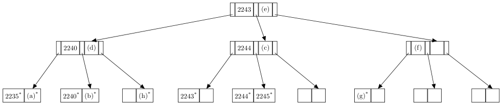
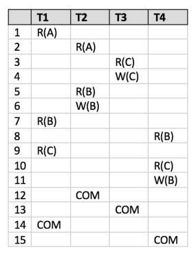
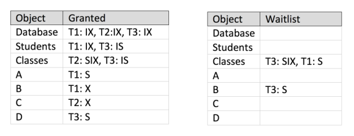
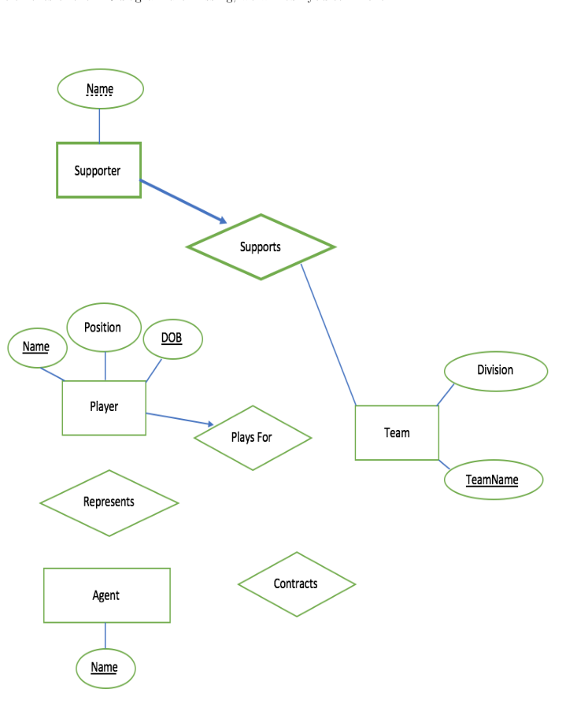

# Berkeley CS186 Spring 2018: Final: Questions

> Copied from the original: <https://hkn.eecs.berkeley.edu/exams/course/cs/186>. Text and figures are taken from the PDF as is; nothing was answered or rewritten. The original PDF is in this folder.

---

**Page 1**

&emsp;&emsp;&emsp;&emsp;CS 186/286 Spring 2018 Final 
• Do not turn this page until instructed to start the exam. 
• You should receive 1 single-page answer sheet and a 25-page exam packet. 
• All answers should be written on the answer sheet. The exam packet will be collected but not graded. 
• You have 170 minutes to complete the final. 
• The final has 7 questions, each with multiple parts. 
• The final is worth a total of 108 points. 
• For each question, place only your final answer on the answer sheet; do not show work. 
• For multiple choice questions, please fill in the bubble or box completely, **do not mark the box with** 
**an X or checkmark**. 
• Use the blank spaces in your exam for scratch paper. 
• You are allowed **three** 8.5” × 11” double-sided page of notes. 
• Only standard scientific calculators are allowed.

---

**Page 2**

**1**   **SQL and Relational Algebra (14 points)**

Imagine you need to build a site like Piazza and want to maintain its data in a relational database. In this 
question, we will use the following schema to represent this data.

**Users** represent the users posting on the site.   Assume there are only two types of users, either “stu- 
dents” or “instructors”. 
**Folders** represent various topics in which posts are categorized. 
**Posts** represent a post with its summary title. 
**Postings** represent the individual messages in a post. Each message has a unique position in the post.

&emsp;`CREATE` `TABLE` `Users(` 
&emsp;&emsp;`uid` `INTEGER` `PRIMARY` `KEY,` 
&emsp;&emsp;`name` `VARCHAR(32),` 
&emsp;&emsp;`dob` `DATE,` 
&emsp;&emsp;`user_type` `VARCHAR(10)` `NOT` `NULL` 
&emsp;`)`

&emsp;`CREATE` `TABLE` `Folders(` 
&emsp;&emsp;`fid` `integer` `PRIMARY` `KEY,` 
&emsp;&emsp;`fname` `VARCHAR(128)` 
&emsp;`)`

&emsp;`CREATE` `TABLE` `Posts(` 
&emsp;&emsp;`pid` `INTEGER` `PRIMARY` `KEY,` 
&emsp;&emsp;`folder` `INTEGER` `REFERENCES` `folders(fid),` 
&emsp;&emsp;`summary` `VARCHAR(128)` 
&emsp;`)`

&emsp;`CREATE` `TABLE` `Postings(` 
&emsp;&emsp;`post` `INTEGER` `REFERENCES` `posts(pid),` 
&emsp;&emsp;`position` `INTEGER,` 
&emsp;&emsp;`user` `INTEGER` `REFERENCES` `users(uid),` 
&emsp;&emsp;`ptext` `TEXT,` 
&emsp;&emsp;`PRIMARY` `KEY(post,` `position)` 
&emsp;`)`

For the questions below, choose the relational algebra expressions that compute the results for the provided 
English queries. You may choose one or more options. Assume all joins are natural joins unless otherwise 
specified.

&emsp;&emsp;&emsp;&emsp;&emsp;&emsp;&emsp;&emsp;Page 2 of 25

---

**Page 3**

1\. (2 points) Return names of all users that posted in the “lecture” folder with the summary title “Midterm 
2 grades”. 
&emsp;&emsp;A. Πname(σsummary=“Midterm 2 grades′′(σfname=“lecture”(Folders) ▷◁F olders.fid=P osts.folder Posts 
&emsp;&emsp;&emsp;▷◁P osts.pid=P ostings.post Postings) ▷◁P ostings.user=User.uid Users) 
&emsp;&emsp;B. Πname(σsummary=“Midterm 2 grades′′(Πfid(σfname=“lecture”(Folders)) 
&emsp;&emsp;&emsp;▷◁F olders.fid=P osts.folder Posts ▷◁P osts.pid=P ostings.post Postings) ▷◁P ostings.user=User.uid Users) 
&emsp;&emsp;C. Πname((σfname=“lecture”(Folders) ▷◁F olders.fid=P osts.folder Posts ▷◁P osts.pid=P ostings.post Postings) 
&emsp;&emsp;&emsp;▷◁P ostings.user=User.uid Πuid(Users)) 
&emsp;&emsp;D. Πname(σfname=“lecture”,summary=“Midterm 2 grades′′((Folders ▷◁F olders.fid=P osts.folder 
&emsp;&emsp;&emsp;Posts ▷◁P osts.pid=P ostings.post Postings) ▷◁P ostings.user=User.uid Users))

2\. (2 points) Return summary titles of all posts with more than one user posting on that post. 
&emsp;&emsp;&emsp;&emsp;Assume ρ(R1, Postings), ρ(R2, Postings). 
&emsp;&emsp;A. Πsummary(ΠR1.post(σR1.user̸=R2.user(R1 ▷◁R1.post=R2.post R2)) ▷◁R1.post=P osts.pid Posts) 
&emsp;&emsp;B. Πsummary(ΠR1.post(σR1.user̸=R2.user(ΠR1.post,R1.user,R2.user(R1×R2))) ▷◁R1.post=P osts.pid Posts) 
&emsp;&emsp;C. Πsummary(ΠR1.post(R1 × R2 −(R1 ▷◁R1.post=R2.post R2)) ▷◁R1.post=P osts.pid Posts) 
&emsp;&emsp;D. Πsummary(ΠR1.post(σR1.post=R2.post∧R1.user̸=R2.user(R1 × R2)) ▷◁R1.post=P osts.pid Posts)

3\. (2 points) Return the name of the oldest user. 
&emsp;&emsp;&emsp;&emsp;Assume ρ(R1, Users), ρ(R2, Users) 
&emsp;&emsp;A. Πname(σUsers.dob=min(Πdob(R1))(Users)) 
&emsp;&emsp;B. Πname(ρ(1 →dob, γmin(dob)(R1)) ▷◁Users) 
&emsp;&emsp;C. Πname((Πuid(Users) −ΠR1.uid(σR1.dob\>R2.dob(R1 × R2))) ▷◁Users) 
&emsp;&emsp;D. Πname(ΠR1.uid(σR1.dob\<R2.dob(R1 × R2)) −(Πuid(Users)) ▷◁Users)

&emsp;&emsp;&emsp;&emsp;&emsp;&emsp;&emsp;&emsp;Page 3 of 25

---

**Page 4**

For the questions below, choose the SQL queries that compute the results for the provided English 
queries. You may choose one or more options. 
4\. (2 points) Return posts with both students and instructor postings. 
&emsp;&emsp;A. `(SELECT` `P.pid,` `P.folder,` `P.summary` 
&emsp;&emsp;&emsp;`FROM` `Posts` `as` `P` `INNER` `JOIN` `Postings` `as` `Ping` `on` `P.pid` `=` `Ping.post` `INNER` `JOIN` 
&emsp;&emsp;&emsp;&emsp;&emsp;`Users` `as` `U` `on` `Ping.user` `=` `U.uid` 
&emsp;&emsp;&emsp;`WHERE` `U.user_type` `=` `’student’)` 
&emsp;&emsp;&emsp;`INTERSECT` 
&emsp;&emsp;&emsp;`(SELECT` `P.pid,` `P.folder,` `P.summary` 
&emsp;&emsp;&emsp;`FROM` `Posts` `as` `P` `INNER` `JOIN` `Postings` `as` `Ping` `on` `P.pid` `=` `Ping.post` `INNER` `JOIN` 
&emsp;&emsp;&emsp;&emsp;&emsp;`Users` `as` `U` `on` `Ping.user` `=` `U.uid` 
&emsp;&emsp;&emsp;`WHERE` `U.user_type` `=` `’instructor’);`

&emsp;&emsp;B. `(SELECT` `P.pid,` `P.folder,` `P.summary` 
&emsp;&emsp;&emsp;`FROM` `Posts` `as` `P` `INNER` `JOIN` `Postings` `as` `Ping` `on` `P.pid` `=` `Ping.post` `INNER` `JOIN` 
&emsp;&emsp;&emsp;&emsp;&emsp;`Users` `as` `U` `on` `Ping.user` `=` `U.uid` 
&emsp;&emsp;&emsp;`WHERE` `U.user_type` `=` `’student’)` 
&emsp;&emsp;&emsp;`EXCEPT` 
&emsp;&emsp;&emsp;`(SELECT` `P.pid,` `P.folder,` `P.summary` 
&emsp;&emsp;&emsp;`FROM` `Posts` `as` `P` `INNER` `JOIN` `Postings` `as` `Ping` `on` `P.pid` `=` `Ping.post` `INNER` `JOIN` 
&emsp;&emsp;&emsp;&emsp;&emsp;`Users` `as` `U` `on` `Ping.user` `=` `U.uid` 
&emsp;&emsp;&emsp;`WHERE` `U.user_type` `=` `’instructor’);`

&emsp;&emsp;C. `(SELECT` `P.pid,` `P.folder,` `P.summary` 
&emsp;&emsp;&emsp;`FROM` `Posts` `as` `P` `INNER` `JOIN` `Postings` `as` `Ping` `on` `P.pid` `=` `Ping.post` `INNER` `JOIN` 
&emsp;&emsp;&emsp;&emsp;&emsp;`Users` `as` `U` `on` `Ping.user` `=` `U.uid` 
&emsp;&emsp;&emsp;`WHERE` `U.user_type` `=` `’student’` 
&emsp;&emsp;&emsp;`OR` `U.user_type` `=` `’instructor’);`

&emsp;&emsp;D. `(SELECT` `P.pid,` `P.folder,` `P.summary` 
&emsp;&emsp;&emsp;`FROM` `Posts` `as` `P` `INNER` `JOIN` `Postings` `as` `Ping` `on` `P.pid` `=` `Ping.post` `INNER` `JOIN` 
&emsp;&emsp;&emsp;&emsp;&emsp;`Users` `as` `U` `on` `Ping.user` `=` `U.uid` 
&emsp;&emsp;&emsp;`WHERE` `U.user_type` `=` `’student’` 
&emsp;&emsp;&emsp;`AND` `U.user_type` `=` `’instructor’);`

&emsp;&emsp;&emsp;&emsp;&emsp;&emsp;&emsp;&emsp;Page 4 of 25

---

**Page 5**

5\. (2 points) Find the largest folder(s). This is the folder(s) with the largest number of postings. 
&emsp;&emsp;A. `WITH` `R` `AS` `(` 
&emsp;&emsp;&emsp;&emsp;&emsp;`SELECT` `P.folder,` `count(P.pid)` `as` `cnt` 
&emsp;&emsp;&emsp;&emsp;&emsp;`FROM` `Posts` `as` `P` 
&emsp;&emsp;&emsp;&emsp;&emsp;`GROUP` `BY` `P.folder` 
&emsp;&emsp;&emsp;`)` 
&emsp;&emsp;&emsp;`(SELECT` `folder` 
&emsp;&emsp;&emsp;`FROM` `R)` 
&emsp;&emsp;&emsp;`EXCEPT` 
&emsp;&emsp;&emsp;`(SELECT` `R1.folder` 
&emsp;&emsp;&emsp;`FROM` `R` `as` `R1,` `R` `as` `R2` 
&emsp;&emsp;&emsp;`WHERE` `R1.cnt` `<` `R2.cnt);`

&emsp;&emsp;B. `SELECT` `folder` `FROM` `(` 
&emsp;&emsp;&emsp;&emsp;`SELECT` `folder,` `count(pid)` 
&emsp;&emsp;&emsp;&emsp;`FROM` `Posts` 
&emsp;&emsp;&emsp;&emsp;`GROUP` `BY` `folder` 
&emsp;&emsp;&emsp;&emsp;`HAVING` `count(pid)` `=` `(` 
&emsp;&emsp;&emsp;&emsp;`SELECT` `max(cnt)` `FROM` `(` 
&emsp;&emsp;&emsp;&emsp;&emsp;`SELECT` `folder,` `count(pid)` `as` `cnt` 
&emsp;&emsp;&emsp;&emsp;&emsp;`FROM` `Posts` 
&emsp;&emsp;&emsp;&emsp;&emsp;`GROUP` `BY` `folder` 
&emsp;&emsp;&emsp;&emsp;&emsp;`)` `AS` `t1)` 
&emsp;&emsp;&emsp;&emsp;`)` `as` `t2;` 
&emsp;&emsp;C. `SELECT` `R.folder` `FROM` 
&emsp;&emsp;&emsp;&emsp;&emsp;`(SELECT` `folder,` `count(pid)` `as` `cnt` 
&emsp;&emsp;&emsp;&emsp;&emsp;`FROM` `Posts` 
&emsp;&emsp;&emsp;&emsp;&emsp;`GROUP` `BY` `folder)` `as` `R` 
&emsp;&emsp;&emsp;`WHERE` `R.cnt` `=` `(` 
&emsp;&emsp;&emsp;&emsp;&emsp;`SELECT` `max(R.cnt)` 
&emsp;&emsp;&emsp;&emsp;&emsp;`FROM` `R` 
&emsp;&emsp;&emsp;&emsp;&emsp;`);` 
&emsp;&emsp;D. `WITH` `R` `as` `(` 
&emsp;&emsp;&emsp;&emsp;`SELECT` `folder,` `count(pid)` `as` `cnt` 
&emsp;&emsp;&emsp;&emsp;`FROM` `Posts` 
&emsp;&emsp;&emsp;&emsp;`GROUP` `BY` `folder` 
&emsp;&emsp;&emsp;`)` 
&emsp;&emsp;&emsp;`SELECT` `R.folder` 
&emsp;&emsp;&emsp;`FROM` `R` 
&emsp;&emsp;&emsp;`WHERE` `R.cnt` `=` `(` 
&emsp;&emsp;&emsp;`SELECT` `max(R.cnt)` 
&emsp;&emsp;&emsp;`FROM` `R` 
&emsp;&emsp;&emsp;`);`

&emsp;&emsp;&emsp;&emsp;&emsp;&emsp;&emsp;&emsp;Page 5 of 25

---

**Page 6**

6\. (2 points) How many users post more than once on the same post? 
&emsp;&emsp;A. 
&emsp;&emsp;&emsp;`SELECT` `count(distinct` `user)` 
&emsp;&emsp;&emsp;`FROM` `Postings` 
&emsp;&emsp;&emsp;`WHERE` `position` `>` `0` 
&emsp;&emsp;&emsp;`AND` `user` `in` `(` 
&emsp;&emsp;&emsp;&emsp;&emsp;`SELECT` `user` 
&emsp;&emsp;&emsp;&emsp;&emsp;`FROM` `Postings` 
&emsp;&emsp;&emsp;&emsp;&emsp;`WHERE` `position` `=` `0` 
&emsp;&emsp;&emsp;`)`

&emsp;&emsp;B. `SELECT` `count(DISTINCT` `P1.user)` 
&emsp;&emsp;&emsp;`FROM` `Postings` `as` `P1,` `Postings` `as` `P2` 
&emsp;&emsp;&emsp;`WHERE` `P1.post` `=` `P2.post` `AND` `P1.user` `=` `P2.user` 
&emsp;&emsp;&emsp;`AND` `P1.position` `<>` `P2.position`

&emsp;&emsp;C. `SELECT` `count(DISTINCT` `P1.user)` 
&emsp;&emsp;&emsp;`FROM` `Postings` `as` `P1` `NATURAL` `JOIN` `Postings` `as` `P2` 
&emsp;&emsp;&emsp;`WHERE` `P1.position` `<>` `P2.position`

&emsp;&emsp;D. `SELECT` `count(distinct` `user)` 
&emsp;&emsp;&emsp;`FROM` `Postings` `as` `P1` 
&emsp;&emsp;&emsp;`WHERE` `exists` 
&emsp;&emsp;&emsp;&emsp;&emsp;`(SELECT` `user` 
&emsp;&emsp;&emsp;&emsp;&emsp;`FROM` `Postings` `as` `P2` 
&emsp;&emsp;&emsp;&emsp;&emsp;`WHERE` `P1.post` `=` `P2.post` `AND` `P1.user` `=` `P2.user` 
&emsp;&emsp;&emsp;&emsp;&emsp;`AND` `P2.position` `<>` `P1.position)`

&emsp;&emsp;&emsp;&emsp;&emsp;&emsp;&emsp;&emsp;Page 6 of 25

---

**Page 7**

7\. (2 points) Which users (user id) post in more than one folder? 
&emsp;&emsp;A. `WITH` `USERFOLDER` `AS` 
&emsp;&emsp;&emsp;`(SELECT` `user,` `folder` 
&emsp;&emsp;&emsp;`FROM` `Posts` `INNER` `JOIN` `Postings` `on` `Posts.pid` `=` `Postings.post)` 
&emsp;&emsp;&emsp;`SELECT` `DISTINCT` `uf1.user` 
&emsp;&emsp;&emsp;`FROM` `USERFOLDER` `as` `uf1,` `USERFOLDER` `as` `uf2` 
&emsp;&emsp;&emsp;`WHERE` `uf1.user` `=` `uf2.user` `and` `uf1.post` `<>` `uf2.post;`

&emsp;&emsp;B. `SELECT` `DISTINCT` `P1.user` 
&emsp;&emsp;&emsp;`FROM` `Postings` `as` `P1,` `Postings` `as` `P2` 
&emsp;&emsp;&emsp;`WHERE` `P1.user` `=` `P2.user` `and` `P1.post` `<>` `P2.post;`

&emsp;&emsp;C. `WITH` `USERFOLDER` `AS` 
&emsp;&emsp;&emsp;`(SELECT` `user,` `folder` 
&emsp;&emsp;&emsp;`FROM` `Posts` `INNER` `JOIN` `Postings` `on` `Posts.pid` `=` `Postings.post)` 
&emsp;&emsp;&emsp;`SELECT` `user` `FROM` 
&emsp;&emsp;&emsp;`(SELECT` `user,` `COUNT(folder)` `AS` `cnt` 
&emsp;&emsp;&emsp;`FROM` `USERFOLDER` 
&emsp;&emsp;&emsp;`GROUP` `BY` `user` 
&emsp;&emsp;&emsp;`HAVING` `cnt` `>` `1);`

&emsp;&emsp;D. `WITH` `USERFOLDER` `AS` 
&emsp;&emsp;&emsp;`(SELECT` `user,` `folder` 
&emsp;&emsp;&emsp;`FROM` `Posts` `INNER` `JOIN` `Postings` `on` `Posts.pid` `=` `Postings.post)` 
&emsp;&emsp;&emsp;`SELECT` `user` `FROM` 
&emsp;&emsp;&emsp;`(SELECT` `user,` `COUNT(DISTINCT` `folder)` `AS` `cnt` 
&emsp;&emsp;&emsp;`FROM` `USERFOLDER` 
&emsp;&emsp;&emsp;`GROUP` `BY` `user` 
&emsp;&emsp;&emsp;`HAVING` `cnt` `>` `1);`

&emsp;&emsp;&emsp;&emsp;&emsp;&emsp;&emsp;&emsp;Page 7 of 25

---

**Page 8**

**2**   **Files, Indices, and Buffers (18 points)**

For this section, remember that **the height of a one level tree is defined to be 0, the height of a** 
**tree with two levels is defined to be 1, and so on.**

**2.1**   **True and False** 
1\. (3 points) Fill in the corresponding box on the answer sheet if True. 
&emsp;&emsp;&emsp;A. Flash memory is preferable to disk because flash allows for fine-grained writes. 
&emsp;&emsp;&emsp;B. In random page access patterns, seek time and rotational delays are significant overheads in 
&emsp;&emsp;&emsp;&emsp;I/O costs. 
&emsp;&emsp;&emsp;C. The leaves of an ISAM are the only part of the structure that can be modified on an insert. 
&emsp;&emsp;&emsp;D. To keep track of the amount of free space on a page, we use a page directory. 
&emsp;&emsp;&emsp;E. Assuming we only have one copy of a table, we can only build an Alternative 1 clustered index 
&emsp;&emsp;&emsp;&emsp;on a single column of that table. 
&emsp;&emsp;&emsp;F. A clustered B+ tree will always perform better than an unclustered B+ tree for equality 
&emsp;&emsp;&emsp;&emsp;searches.

**2.2**   **The Lottery** 
To celebrate the end of the semester, the CS 186 TAs decide to enter a lottery! Each time a TA buys a 
ticket, a tuple containing the first letter of their name and the number of their ticket is inserted into an 
unordered file. Note, the each lottery ticket number is unique. At the end of the day, the file contains the 
following 10 tuples: 
&emsp;&emsp;&emsp;&emsp;&emsp;&emsp;&emsp;&emsp;**Name (Char(1))**   **Number (Integer)** 
&emsp;&emsp;&emsp;&emsp;&emsp;&emsp;&emsp;&emsp;E   2245 
&emsp;&emsp;&emsp;&emsp;&emsp;&emsp;&emsp;&emsp;Y   2240 
&emsp;&emsp;&emsp;&emsp;&emsp;&emsp;&emsp;&emsp;V   2235 
&emsp;&emsp;&emsp;&emsp;&emsp;&emsp;&emsp;&emsp;E   2243 
&emsp;&emsp;&emsp;&emsp;&emsp;&emsp;&emsp;&emsp;Y   2244 
&emsp;&emsp;&emsp;&emsp;&emsp;&emsp;&emsp;&emsp;E   0007 
&emsp;&emsp;&emsp;&emsp;&emsp;&emsp;&emsp;&emsp;R   2241 
&emsp;&emsp;&emsp;&emsp;&emsp;&emsp;&emsp;&emsp;C   2242 
&emsp;&emsp;&emsp;&emsp;&emsp;&emsp;&emsp;&emsp;S   2250 
&emsp;&emsp;&emsp;&emsp;&emsp;&emsp;&emsp;&emsp;L   2249

**Buffer Management** 
Suppose the Lottery Company stores customer profile information on a page that corresponds to the first 
letter of their name (e.g. Customer information on Eugene would be stored on page E).

Before the winning number is announced, the Lottery Company wants to go through all tickets that were 
sold that day and see if their respective purchaser has any criminal records that would disqualify them from 
participating in the lottery. The company goes through all tickets twice to make sure they don’t make any 
mistakes.

This leads to the following access pattern of pages:

&emsp;&emsp;&emsp;&emsp;&emsp;&emsp;&emsp;&emsp;E, Y, V, E, Y, E, R, C, S, L, E, Y, V, E, Y, E, R, C, S, L

&emsp;&emsp;&emsp;&emsp;&emsp;&emsp;&emsp;&emsp;Page 8 of 25

---

**Page 9**

&emsp;&emsp;&emsp;&emsp;**Note that these letters reference pages of a customer profile table and not the records listed** 
&emsp;&emsp;&emsp;&emsp;**in the above user tickets table.**

&emsp;&emsp;&emsp;&emsp;For the following questions, assume we have 4 pages in the buffer pool and assume that pages are unpinned 
&emsp;&emsp;&emsp;&emsp;immediately. 
&emsp;&emsp;&emsp;&emsp;2\. (2 points) Using the Most Recently Used replacement policy, which 4 pages remain in the buffer pool 
&emsp;&emsp;&emsp;&emsp;&emsp;(in alphabetical order)? How many cache hits do we have?

&emsp;&emsp;&emsp;&emsp;3\. (2 points) Using the Clock replacement policy, which 4 pages remain in the buffer pool (in alphabetical 
&emsp;&emsp;&emsp;&emsp;&emsp;order)? How many cache hits do we have?

&emsp;&emsp;&emsp;&emsp;**Indices** 
&emsp;&emsp;&emsp;&emsp;At the end of the day, the Lottery Company decides upon one winning number from all of the purchased 
&emsp;&emsp;&emsp;&emsp;tickets. Instead of traversing the entire file to find the name of the person with the winning ticket, they hire 
&emsp;&emsp;&emsp;&emsp;you to build an Alternative 2 B+ tree index on **Number** of order 1. To build this index, they specifically 
&emsp;&emsp;&emsp;&emsp;tell you to insert the tuples from the file one at a time in the order they appear (so no bulk loading). 
&emsp;&emsp;&emsp;&emsp;4\. (6 points) Draw the resulting B+ tree after all 10 inserts, and write the value of each specified entry 
&emsp;&emsp;&emsp;&emsp;&emsp;on your answer sheet. If the specified entry either does not exist in the final tree or has no value in the 
&emsp;&emsp;&emsp;&emsp;&emsp;final tree, write N/A. The first five records have already been inserted for you. Note that after a split, 
&emsp;&emsp;&emsp;&emsp;&emsp;the new right node gets the larger number of keys or records.

&emsp;&emsp;&emsp;&emsp;&emsp;&emsp;&emsp;&emsp;Page 9 of 25

---

**Page 10**

**Index Alternatives** 
Now, consider a different scenario where we have an Alternative 2 Clustered Index and an Alternative 2 
Unclustered Index, both with height 3. Assume that 4 records fit on a page for the heap file. 
5\. (1.5 points) Suppose a range scan returns 6 records. Assuming that all leaf records were on the same 
&emsp;leaf of the index, how many IOs does this take for the unclustered Index in the worst case?

6\. (1.5 points) Suppose a range scan returns 6 records. Assuming that all leaf records were on the same 
&emsp;leaf of the index, how many IOs does this take for the clustered Index in the worst case?

**Files** 
After a while, the business of the Lottery Company grows immensely. On any given day, they expect over 
10,000 people to buy tickets for the lottery. At the beginning of each day, the Lottery Company creates a 
brand new file. Each time a person buys a ticket, a new record (with schema shown earlier) is inserted into 
the file. At the end of each day, **one** winning number is chosen and the corresponding record is retrieved 
from the file.

7\. (2 points) Given this specification, mark the letters of the parameters **(one from each column)** that 
&emsp;will optimize the performance for the tasks the Lottery Company must perform:

&emsp;&emsp;&emsp;&emsp;&emsp;&emsp;**Page Format**   **File Layout**   **Index** 
&emsp;&emsp;&emsp;&emsp;(a) Fixed length (Packed)   (d) Heap File   (f) Clustered Index on Number 
&emsp;&emsp;&emsp;&emsp;(b) Fixed length (Unpacked)   (e) Sorted File   (g) Unclustered Index on Number 
&emsp;&emsp;&emsp;&emsp;&emsp;&emsp;(c) Slotted Page   (h) None

&emsp;&emsp;&emsp;&emsp;&emsp;&emsp;&emsp;&emsp;Page 10 of 25

---

**Page 11**

**3**   **Sorting, Hashing, and Parallel Queries (12 points)**

For the following questions, we consider the following schema: 
`CREATE` `TABLE` `Player(` 
`pid` `INTEGER` `PRIMARY` `KEY,` 
`name` `TEXT` 
`);`

`CREATE` `TABLE` `Relationship(` 
`pid1` `INTEGER` `REFERENCES` `Player(pid),` 
`pid2` `INTEGER` `REFERENCES` `Player(pid)` 
`);` 
Because there are no uniqueness constraints on `(pid1,` `pid2)`, a pair of players may appear multiple times 
in `Relationship`. This is undesirable, and unfortunately, we have already accumulated some duplicates in 
this table. So, suppose we want to clean up our table by removing duplicates.

In this section, assume that every machine has B=101 pages of memory available. Assume all hash functions 
perfectly partition their input, and assume a fill factor of 0.5 for all in-memory hash tables. **Do not give** 
**your answer as a formula; simplify and provide your answer for each part as a single number.**

First assume we have a **single machine**, and that \[`Relationship`\] = 200 pages. Also, do not include the 
I/O cost for writing the output in your answer. 
1\. (1.5 points) One way to remove duplicates is to first sort the data.   What is the cost of sorting 
&emsp;`Relationship`?

2\. (1.5 points) Alternatively, we can use hashing to remove duplicates.   What is the disk I/O cost of 
&emsp;removing duplicates using the standard hashing algorithm?

A common optimization is **partial pre-aggregation**. In this, operators computing decomposable aggrega- 
tions, like `DISTINCT`, can opportunistically compute the aggregate on part of the data to reduce disk I/O. 
For example, during a partitioning pass in hashing, we can scan through an output buffer and only append 
a record if it is unique. As before, we append the output buffer to its partition on disk when full or at the 
end of the pass. 
3\. (1.5 points) Suppose every unique row appears exactly 4 times in `Relationship`. What is the disk I/O 
&emsp;cost of the partitioning pass of hashing with partial pre-aggregation?

&emsp;&emsp;&emsp;&emsp;&emsp;&emsp;&emsp;&emsp;Page 11 of 25

---

**Page 12**

4\. (1.5 points) Assume we complete the first partitioning pass with partial pre-aggregation, as above, and 
&emsp;maintain the separate partition runs on disk. Using these partitions, what is the disk I/O cost to check 
&emsp;if a new record is a duplicate? Ignore the I/O cost of reading the new record, and assume that no data 
&emsp;from the partitions is in memory.

Now suppose we have **m=100 machines**. Assume that the data is initially **distributed round robin** 
across all the machines. Assume further that every unique row in `Relationship` appears exactly 100 times 
and \[`Relationship`\] = 100, 000 pages. The key we use for parallel hashing is `(pid1,` `pid2)`. 
5\. (1.5 points) What is the total amount of data in MBs transferred over the network when doing duplicate 
&emsp;elimination with parallel hashing? Assume each page is 1MB.

6\. (1.5 points) What is the total disk I/O cost of the partitioning pass of parallel hashing with all opti- 
&emsp;mizations including partial pre-aggregation for duplicate elimination?

7\. (3 points) Suppose we have completely de-duplicated and compacted the `Relationship` table, and it is 
&emsp;hash partitioned by `(pid1,` `pid2)` without any skew across machines. Consider the following query: 
&emsp;`SELECT` `*` 
&emsp;`FROM` `Players,` `Relationship` 
&emsp;`WHERE` `pid2` `=` `pid;` 
&emsp;(a) (1.5 points) Suppose \[`Player`\] = 2, 000 pages, and `Player` is hash partitioned by `pid` over all 100 
&emsp;&emsp;machines. Using the cheapest query plan, how much data (in MBs) must be transferred over the 
&emsp;&emsp;network to compute this query? Assume each page is 1MB.

&emsp;(b) (1.5 points) Using the cheapest query plan, what is the total disk I/O cost across all machines 
&emsp;&emsp;needed to compute this query? Do not include the I/O cost for writing the output.

&emsp;&emsp;&emsp;&emsp;&emsp;&emsp;&emsp;&emsp;Page 12 of 25

---

**Page 13**

**4**   **Joins and Query Optimization (20 points)**

For this section, we consider a modified schema from Section 1. The database has the schema below with 
the corresponding statistics and indices built on the tables. Remember that the height of a one level tree is 
defined to be 0, the height of a tree with two levels is defined to be 1, and so on. **Assume that the buffer** 
**pool has 10 pages**, and column values are uniformly distributed unless otherwise specified.

**Table Schema**   **Records**   **Pages**   **Indices** 
`CREATE` `TABLE` `Users` `(` 
&emsp;`uid` `INTEGER` `PRIMARY` `KEY,` 
&emsp;`name` `VARCHAR(32),`Index 0: Clustered alternative 2 B+-tree of height 
&emsp;&emsp;&emsp;&emsp;&emsp;&emsp;&emsp;&emsp;10,000   500 
&emsp;`age` `INTEGER,`3 on uid 
&emsp;`user_type` `VARCHAR(10)` `NOT` `NULL,` 
`)` 
`CREATE` `TABLE` `Posts` `(` 
&emsp;&emsp;&emsp;&emsp;&emsp;&emsp;&emsp;&emsp;• Index 1:   Clustered alternative 2 B+ tree of 
&emsp;`pid` `INTEGER` `PRIMARY` `KEY,` 
&emsp;&emsp;&emsp;&emsp;&emsp;&emsp;&emsp;&emsp;height 2 on post time 
&emsp;`summary` `VARCHAR(32),` 
&emsp;&emsp;&emsp;&emsp;&emsp;&emsp;&emsp;&emsp;30,000   300 
&emsp;`post_time` `TIMESTAMP,`   • Index 2: Unclustered alternative 2 B+ tree of 
&emsp;`type` `VARCHAR(10)`   height 1 on type 
`)` 
`CREATE` `TABLE` `Postings` `(` 
&emsp;`post` `INTEGER` `REFERENCES` `posts(pid),` 
&emsp;`position` `INTEGER,` 
&emsp;&emsp;&emsp;&emsp;&emsp;&emsp;&emsp;&emsp;Index 3: Unclustered alternative 2 B+-tree index 
&emsp;&emsp;&emsp;&emsp;&emsp;&emsp;&emsp;&emsp;100,000   1,000 
&emsp;`user` `INTEGER` `REFERENCES` `users(uid),` 
&emsp;&emsp;&emsp;&emsp;&emsp;&emsp;&emsp;&emsp;of height 1 on position 
&emsp;`ptext` `TEXT,` 
&emsp;`PRIMARY` `KEY(post,` `position)` 
`)` 
Assume for Q1-3 that traversing the index from root to leaf and scanning the leaf pages on Index 0 incurs a 
cost of 50 I/Os. 
1\. (2 points) What is the best cost of a sort-merge join between Postings and Users on uid? Use any 
&emsp;optimizations from lecture, if possible, and assume we stream the output.

2\. (2 points) What is the best cost of a hash join between Postings and Users on uid? Assume that you 
&emsp;have a perfect hash function and fill factor of 1.0. Use the optimization from lecture if possible. Assume 
&emsp;we stream the output.

3\. (2 points) Now assume that we have 15 buffers and a fill factor of 1.0. What is the I/O cost for a hybrid 
&emsp;hash join between Posts and Postings on pid? Assume we stream the output.

&emsp;&emsp;&emsp;&emsp;&emsp;&emsp;&emsp;&emsp;Page 13 of 25

---

**Page 14**

**Assume the following histogram for the distribution of Users.age. Note, each bucket’s range** 
**is \[min,max), exclusive of the max.**

&emsp;&emsp;&emsp;&emsp;&emsp;&emsp;&emsp;&emsp;15-18   18-21   21-24   ≥24 
&emsp;&emsp;&emsp;&emsp;&emsp;&emsp;&emsp;&emsp;30%   15%   35%   20% 
&emsp;&emsp;&emsp;&emsp;&emsp;&emsp;&emsp;&emsp;Figure 1: Histogram on Users.age

**Consider the following query:** 
`SELECT` `Postings.text,` `Posts.summary,` `U.name` 
`FROM` `(Postings` `INNER` `JOIN` `Posts` `ON` `Postings.post` `=` `Posts.pid)`   ---Predicate 1 
&emsp;&emsp;`RIGHT` `OUTER` `JOIN` `Users` `U` `ON` `Postings.user` `=` `U.uid`   ---Predicate 2 
`WHERE` `Posts.type` `=` `’final’`   ---Predicate 3 
&emsp;&emsp;`AND` `U.age` `<` `19`   ---Predicate 4 
&emsp;&emsp;`AND` `U.name` `<>` `’Ryan’`   ---Predicate 5 
&emsp;&emsp;`AND` `Posts.summary` `!=` `’Final␣Exam␣Solutions’`   ---Predicate 6 
&emsp;&emsp;`AND` `(Postings.position` `>=` `1,000` `OR` `Posts.post_time` `<=` `2018:05:10)`   ---Predicate 7 
`ORDER` `BY` `U.name` `DESC;`

4\. (1 point) What selectivity would a System R-style optimizer estimate for join Predicate 1? 
&emsp;&emsp;&emsp;A. 1/3,000,000,000 
&emsp;&emsp;&emsp;B. 1/100,000 
&emsp;&emsp;&emsp;C. 1/30,000 
&emsp;&emsp;&emsp;D. 1/10,000 
&emsp;&emsp;&emsp;E. 1/3,000 
5\. (1 point) What is the best estimate for the selectivity of Predicate 4 on the `Users` table? 
&emsp;&emsp;&emsp;A. 40% 
&emsp;&emsp;&emsp;B. 38% 
&emsp;&emsp;&emsp;C. 37.5% 
&emsp;&emsp;&emsp;D. 35% 
&emsp;&emsp;&emsp;E. 33.75%

&emsp;**Suppose we use a System R-style bottom-up optimization algorithm.** In the following ques- 
&emsp;tions, you may choose more than one option. 
6\. (1 point) Which predicate(s) would be considered in the **first** pass of optimization? You may select 
&emsp;none of them if no predicates apply in this pass. 
&emsp;&emsp;&emsp;A. Predicate 1 
&emsp;&emsp;&emsp;B. Predicate 2 
&emsp;&emsp;&emsp;C. Predicate 3 
&emsp;&emsp;&emsp;D. Predicate 4 
&emsp;&emsp;&emsp;E. Predicate 5 
&emsp;&emsp;&emsp;F. Predicate 6 
&emsp;&emsp;&emsp;G. Predicate 7

&emsp;&emsp;&emsp;&emsp;&emsp;&emsp;&emsp;&emsp;Page 14 of 25

---

**Page 15**

7\. (1 point) Which predicate(s) would be considered in the **second** pass of optimization? You may select 
&emsp;none of them if no predicates apply in this pass. 
&emsp;&emsp;&emsp;A. Predicate 1 
&emsp;&emsp;&emsp;B. Predicate 2 
&emsp;&emsp;&emsp;C. Predicate 3 
&emsp;&emsp;&emsp;D. Predicate 4 
&emsp;&emsp;&emsp;E. Predicate 5 
&emsp;&emsp;&emsp;F. Predicate 6 
&emsp;&emsp;&emsp;G. Predicate 7 
8\. (1 point) Which of the following additional indices would be the most useful in speeding up the query? 
&emsp;&emsp;&emsp;A. An unclustered alternative 2 index on Users.uid 
&emsp;&emsp;&emsp;B. A clustered alternative 1 index on Users.name 
&emsp;&emsp;&emsp;C. An unclustered alternative 3 index on Users.age

Assume that the following table contains the correct costs for each access method for the Posts relation. 
&emsp;&emsp;&emsp;&emsp;&emsp;&emsp;&emsp;&emsp;**Relation**   **Access Method**   **I/O Cost** 
&emsp;&emsp;&emsp;&emsp;&emsp;&emsp;&emsp;&emsp;Full table scan   300 
&emsp;&emsp;&emsp;&emsp;&emsp;&emsp;&emsp;&emsp;`Posts` 
&emsp;&emsp;&emsp;&emsp;&emsp;&emsp;&emsp;&emsp;Index 1 on post time   325 
&emsp;&emsp;&emsp;&emsp;&emsp;&emsp;&emsp;&emsp;`Posts` 
&emsp;&emsp;&emsp;&emsp;&emsp;&emsp;&emsp;&emsp;Index 2 on type   250 
&emsp;&emsp;&emsp;&emsp;&emsp;&emsp;&emsp;&emsp;`Posts` 
9\. (1 point) Select all the single table access plans that are considered for the Posts table. 
&emsp;&emsp;&emsp;A. Full table scan 
&emsp;&emsp;&emsp;B. Index 1 
&emsp;&emsp;&emsp;C. Index 2 
10\. (1 point) Select all the single table access plans for the Posts table that remain for consideration at the 
&emsp;start of the second pass. 
&emsp;&emsp;&emsp;A. Full table scan 
&emsp;&emsp;&emsp;B. Index 1 
&emsp;&emsp;&emsp;C. Index 2 
11\. (1 point) Now consider all the tables. After the first pass, how many single-table access plans have an 
&emsp;interesting order? 
&emsp;&emsp;&emsp;A. 0 
&emsp;&emsp;&emsp;B. 1 
&emsp;&emsp;&emsp;C. 2 
&emsp;&emsp;&emsp;D. 3 
&emsp;&emsp;&emsp;E. 4 
&emsp;&emsp;&emsp;F. 5

&emsp;&emsp;&emsp;&emsp;&emsp;&emsp;&emsp;&emsp;Page 15 of 25

---

**Page 16**

Assume that we now have an index on Users.name and the following is the System R-style dynamic pro- 
gramming table after Pass 1: 
&emsp;&emsp;&emsp;&emsp;&emsp;**Relation**   **Interesting Order**   **Output Size (in Pages)**   **I/O cost** 
&emsp;&emsp;&emsp;&emsp;&emsp;Users   none   500   500 
&emsp;&emsp;&emsp;&emsp;&emsp;Users   name   500   750 
&emsp;&emsp;&emsp;&emsp;&emsp;Users   uid   500   525 
&emsp;&emsp;&emsp;&emsp;&emsp;Posts   none   100   100 
&emsp;&emsp;&emsp;&emsp;&emsp;Postings   none   1,000   1,000 
Use the given pass 1 results from the table above to solve the pass 2 questions and use your pass 2 solution 
to solve for pass 3. 
12\. (1.5 points) Which of the following joins orders may be **considered** in pass 2? 
&emsp;&emsp;&emsp;A. ( Users ▷◁Posts ) I/O Cost: 10,500 Output Order: none 
&emsp;&emsp;&emsp;B. ( Users ▷◁Posts ) I/O Cost: 20,000 Output Order: U.name 
&emsp;&emsp;&emsp;C. ( Posts ▷◁Users ) I/O Cost: 10,750 Output Order: U.uid 
&emsp;&emsp;&emsp;D. ( Postings ▷◁Users ) I/O Cost: 5,000 Output Order: none 
&emsp;&emsp;&emsp;E. ( Users ▷◁Postings ) I/O Cost: 10,250 Output Order: U.name 
&emsp;&emsp;&emsp;F. ( Users ▷◁Postings ) I/O Cost: 20,100 Output Order: U.uid 
&emsp;&emsp;&emsp;G. ( Users ▷◁Postings) I/O Cost: 9,000 Output Order: none 
&emsp;&emsp;&emsp;H. ( Posts ▷◁Postings ) I/O Cost: 10,600 Output Order: none 
&emsp;&emsp;&emsp;I. ( Postings ▷◁Posts ) I/O Cost: 10,000 Output Order: none 
13\. (1.5 points) Which of the following join orders would be **selected** in pass 2? 
&emsp;&emsp;&emsp;A. ( Users ▷◁Posts ) I/O Cost: 10,500 Output Order: none 
&emsp;&emsp;&emsp;B. ( Users ▷◁Posts ) I/O Cost: 20,000 Output Order: U.name 
&emsp;&emsp;&emsp;C. ( Posts ▷◁Users ) I/O Cost: 10,750 Output Order: U.uid 
&emsp;&emsp;&emsp;D. ( Postings ▷◁Users ) I/O Cost: 5,000 Output Order: none 
&emsp;&emsp;&emsp;E. ( Users ▷◁Postings ) I/O Cost: 10,250 Output Order: U.name 
&emsp;&emsp;&emsp;F. ( Users ▷◁Postings ) I/O Cost: 20,100 Output Order: U.uid 
&emsp;&emsp;&emsp;G. ( Users ▷◁Postings) I/O Cost: 9,000 Output Order: none 
&emsp;&emsp;&emsp;H. ( Posts ▷◁Postings ) I/O Cost: 10,600 Output Order: none 
&emsp;&emsp;&emsp;I. ( Postings ▷◁Posts ) I/O Cost: 10,000 Output Order: none 
14\. (1.5 points) Which of the following join orders may be **considered** in pass 3? 
&emsp;&emsp;&emsp;A. (Users ▷◁(Postings ▷◁Posts)) I/O Cost: 60,300 Output Order: none 
&emsp;&emsp;&emsp;B. ((Users ▷◁Postings) ▷◁Posts) I/O Cost: 70,100 Output Order: U.name 
&emsp;&emsp;&emsp;C. ((Postings ▷◁Posts) ▷◁Users) I/O Cost: 130,200 Output Order: none 
&emsp;&emsp;&emsp;D. (Posts ▷◁(Users ▷◁Postings)) I/O Cost: 90,250 Output Order: none 
&emsp;&emsp;&emsp;E. ((Postings ▷◁Users) ▷◁Posts) I/O Cost: 70,000 Output Order: none 
&emsp;&emsp;&emsp;F. (Posts ▷◁(Users ▷◁Postings)) I/O Cost: 60,750 Output Order: U.name 
&emsp;&emsp;&emsp;G. ((Users ▷◁Posts) ▷◁Postings) I/O Cost: 50,100 Output Order: U.uid 
&emsp;&emsp;&emsp;H. ((Posts ▷◁Users) ▷◁Postings)) I/O Cost: 50,600 Output Order: none 
&emsp;&emsp;&emsp;I. (Postings ▷◁(Posts ▷◁Users)) I/O Cost: 110,700 Output Order: U.uid 
&emsp;&emsp;&emsp;J. (Postings ▷◁(Users ▷◁Posts)) I/O Cost: 80,400 Output Order: U.name

&emsp;&emsp;&emsp;&emsp;&emsp;&emsp;&emsp;&emsp;Page 16 of 25

---

**Page 17**

15\. (1.5 points) Assume that the final output size is 500 pages. Which of the following subplans would 
&emsp;comprise the final query plan? 
&emsp;&emsp;&emsp;A. (Users ▷◁(Postings ▷◁Posts)) I/O Cost: 60,300 Output Order: none 
&emsp;&emsp;&emsp;B. ((Users ▷◁Postings) ▷◁Posts) I/O Cost: 70,100 Output Order: U.name 
&emsp;&emsp;&emsp;C. ((Postings ▷◁Posts) ▷◁Users) I/O Cost: 130,200 Output Order: none 
&emsp;&emsp;&emsp;D. (Posts ▷◁(Users ▷◁Postings)) I/O Cost: 90,250 Output Order: none 
&emsp;&emsp;&emsp;E. ((Postings ▷◁Users) ▷◁Posts) I/O Cost: 70,000 Output Order: none 
&emsp;&emsp;&emsp;F. (Posts ▷◁(Users ▷◁Postings)) I/O Cost: 60,750 Output Order: U.name 
&emsp;&emsp;&emsp;G. ((Users ▷◁Posts) ▷◁Postings) I/O Cost: 50,100 Output Order: U.uid 
&emsp;&emsp;&emsp;H. ((Posts ▷◁Users) ▷◁Postings)) I/O Cost: 50,600 Output Order: none 
&emsp;&emsp;&emsp;I. (Postings ▷◁(Posts ▷◁Users)) I/O Cost: 110,700 Output Order: U.uid 
&emsp;&emsp;&emsp;J. (Postings ▷◁(Users ▷◁Posts)) I/O Cost: 80,400 Output Order: U.name

&emsp;&emsp;&emsp;&emsp;&emsp;&emsp;&emsp;&emsp;Page 17 of 25

---

**Page 18**

**5**   **Transactions and Concurrency Control (16 points)**

1\. (3.5 points) Fill in the corresponding box on the answer sheet if True. 
&emsp;&emsp;&emsp;A. SIX locks cannot be escalated. 
&emsp;&emsp;&emsp;B. IX locks are compatible with X locks. 
&emsp;&emsp;&emsp;C. All conflict serializable schedules guarantee no cascading aborts if they are created using Strict 
&emsp;&emsp;&emsp;&emsp;2PL. 
&emsp;&emsp;&emsp;D. All conflict serializable schedules are also view serializable. 
&emsp;&emsp;&emsp;E. In deadlock avoidance, later transaction timestamps always map to higher transaction priori- 
&emsp;&emsp;&emsp;&emsp;ties. 
&emsp;&emsp;&emsp;F. Multi-granularity locking allows for higher concurrency. 
&emsp;&emsp;&emsp;G. In multi-granularity locking, we should acquire the locks from bottom to top hierarchy (e.g. 
&emsp;&emsp;&emsp;&emsp;from record-level to page-level) and release the locks from top to bottom hierarchy (e.g. from 
&emsp;&emsp;&emsp;&emsp;page-level to record-level).

2\. (4 points) Consider the following schedule. (For each of the questions below, you may mark zero, one 
&emsp;or more than one of the choices.)

&emsp;(a) (0.5 points) What transactions is T1 pointing to in the conflict graph for the schedule above? 
&emsp;&emsp;&emsp;&emsp;A. T1 
&emsp;&emsp;&emsp;&emsp;B. T2 
&emsp;&emsp;&emsp;&emsp;C. T3 
&emsp;&emsp;&emsp;&emsp;D. T4

&emsp;&emsp;&emsp;&emsp;&emsp;&emsp;&emsp;&emsp;Page 18 of 25

---

**Page 19**

&emsp;(b) (0.5 points) What transactions is T2 pointing to in the conflict graph for the schedule above? 
&emsp;&emsp;&emsp;&emsp;A. T1 
&emsp;&emsp;&emsp;&emsp;B. T2 
&emsp;&emsp;&emsp;&emsp;C. T3 
&emsp;&emsp;&emsp;&emsp;D. T4 
&emsp;(c) (0.5 points) What transactions is T3 pointing to in the conflict graph for the schedule above? 
&emsp;&emsp;&emsp;&emsp;A. T1 
&emsp;&emsp;&emsp;&emsp;B. T2 
&emsp;&emsp;&emsp;&emsp;C. T3 
&emsp;&emsp;&emsp;&emsp;D. T4 
&emsp;(d) (0.5 points) What transactions is T4 pointing to in the conflict graph for the schedule above? 
&emsp;&emsp;&emsp;&emsp;A. T1 
&emsp;&emsp;&emsp;&emsp;B. T2 
&emsp;&emsp;&emsp;&emsp;C. T3 
&emsp;&emsp;&emsp;&emsp;D. T4

&emsp;(e) (1 point) Which of the following locking disciplines could have produced the above schedule? 
&emsp;&emsp;&emsp;&emsp;A. 2 phase locking 
&emsp;&emsp;&emsp;&emsp;B. Strict 2 phase locking

&emsp;(f) (1 point) Which of the following schedules below are conflict equivalent to the schedule above? 
&emsp;&emsp;&emsp;&emsp;A. T3, T1, T2, T4 
&emsp;&emsp;&emsp;&emsp;B. T2, T3, T1, T4 
&emsp;&emsp;&emsp;&emsp;C. T4, T3, T1, T2 
&emsp;&emsp;&emsp;&emsp;D. T1, T2, T3, T4 
&emsp;&emsp;&emsp;&emsp;E. T3, T2, T1, T4

3\. (8.5 points) A Kitchener high school, Huron Heights, is trying to figure out class assignments for its 
students! Suppose their database has 2 tables, Students and Classes. Students consists of 2 pages, 
A and B. Classes consists of another 2 pages, C, and D. They have 3 transactions currently running. 
Consider the following lock table and wait list of requested locks for each object. Wait list requests are 
ordered from left to right with the leftmost to be granted next. (For each of the questions below, you 
may mark zero, one or more than one of the choices.)

&emsp;&emsp;&emsp;&emsp;&emsp;&emsp;&emsp;&emsp;Page 19 of 25

---

**Page 20**

(a) (0.5 points) What transactions is T1 pointing to in the waits-for graph for the table above? 
&emsp;&emsp;&emsp;A. T1 
&emsp;&emsp;&emsp;B. T2 
&emsp;&emsp;&emsp;C. T3 
(b) (0.5 points) What transactions is T2 pointing to in the waits-for graph for the table above? 
&emsp;&emsp;&emsp;A. T1 
&emsp;&emsp;&emsp;B. T2 
&emsp;&emsp;&emsp;C. T3 
(c) (0.5 points) What transactions is T3 pointing to in the waits-for graph for the table above? 
&emsp;&emsp;&emsp;A. T1 
&emsp;&emsp;&emsp;B. T2 
&emsp;&emsp;&emsp;C. T3 
(d) (1 point) True or False? Suppose T3 asks to escalate to an IX lock on Classes and subsequently 
&emsp;requests an X lock on page D. Its requests can be immediately granted. 
(e) (1 point) Suppose T2 commits in the next time step. After T2 commits, which locks are granted? 
&emsp;&emsp;&emsp;A. T3: S(B) 
&emsp;&emsp;&emsp;B. T3: SIX(Classes) 
&emsp;&emsp;&emsp;C. T1: S(Classes) 
(f) (1.5 points) Starting from the original lock table, assume we are using Wait-Die deadlock avoidance 
&emsp;and that the transactions were started in the following chronological order: T2, T3, T1. If T2 
&emsp;requests X lock on Students, which of the following happen as a result of deadlock avoidance? 
&emsp;&emsp;&emsp;A. T1 dies 
&emsp;&emsp;&emsp;B. T2 dies 
&emsp;&emsp;&emsp;C. T3 dies 
&emsp;&emsp;&emsp;D. T2 waits 
(g) (1.5 points) Starting from the original lock table, assume we are using Wound-Wait deadlock avoid- 
&emsp;ance and that the transactions were started in the following chronological order: T2, T3, T1. If T2 
&emsp;requests X lock on Students, which of the following happen as a result of deadlock avoidance? 
&emsp;&emsp;&emsp;A. T1 dies 
&emsp;&emsp;&emsp;B. T2 dies 
&emsp;&emsp;&emsp;C. T3 dies 
&emsp;&emsp;&emsp;D. T2 waits 
(h) (1 point) Starting from the original lock table, suppose T2 requests an X lock on Classes. Which 
&emsp;transaction(s) will be in the waitlist for Classes? 
&emsp;&emsp;&emsp;A. T1 
&emsp;&emsp;&emsp;B. T2 
&emsp;&emsp;&emsp;C. T3 
(i) (1 point) Support further that T3 subsequently aborts. Which transaction(s) will remain in the 
&emsp;waitlist for Classes? 
&emsp;&emsp;&emsp;A. T1 
&emsp;&emsp;&emsp;B. T2 
&emsp;&emsp;&emsp;C. T3

&emsp;&emsp;&emsp;&emsp;&emsp;&emsp;&emsp;&emsp;Page 20 of 25

---

**Page 21**

**6**   **Recovery (18 points)**

1\. (3.5 points) Fill in the corresponding box on the answer sheet if True. 
&emsp;&emsp;&emsp;A. If we do not allow buffer-pool frames with uncommitted updates to overwrite committed data 
&emsp;&emsp;&emsp;&emsp;on DB disk (No Steal), then we do not need UNDO logging. 
&emsp;&emsp;&emsp;B. Write-Ahead Logging (WAL) guarantees that a transactions log records are flushed to disk 
&emsp;&emsp;&emsp;&emsp;before the transaction commit. 
&emsp;&emsp;&emsp;C. If PageLSN is greater than the max LSN flushed so far (flushedLSN), we can safely write this 
&emsp;&emsp;&emsp;&emsp;page to disk. 
&emsp;&emsp;&emsp;D. In the REDO phase, the PageLSN is used to identify and skip updates that have been already 
&emsp;&emsp;&emsp;&emsp;applied. 
&emsp;&emsp;&emsp;E. The recovery REDO process does not force any updates to disk. 
&emsp;&emsp;&emsp;F. If we are forced to flush pages in the dirty page table (DPT) to disk upon checkpointing, then 
&emsp;&emsp;&emsp;&emsp;we can skip the analysis phase whenever we have a checkpoint available. 
&emsp;&emsp;&emsp;G. When we perform checkpointing in a distributed database system, nodes have to communicate 
&emsp;&emsp;&emsp;&emsp;synchronously to agree on a checkpoint timestamp to ensure correctness.

2\. (3 points) Consider the following log. If the **flushedLSN is 50**, under WAL, which of the following 
&emsp;scenario(s) are possible?

&emsp;&emsp;&emsp;&emsp;&emsp;&emsp;&emsp;&emsp;**LSN**   **Record**   **prevLSN** 
&emsp;&emsp;&emsp;&emsp;&emsp;&emsp;&emsp;&emsp;10   UPDATE: T1 writes P1   null 
&emsp;&emsp;&emsp;&emsp;&emsp;&emsp;&emsp;&emsp;20   UPDATE: T2 writes P2   null 
&emsp;&emsp;&emsp;&emsp;&emsp;&emsp;&emsp;&emsp;30   Begin Checkpoint   - 
&emsp;&emsp;&emsp;&emsp;&emsp;&emsp;&emsp;&emsp;40   End Checkpoint   - 
&emsp;&emsp;&emsp;&emsp;&emsp;&emsp;&emsp;&emsp;50   UPDATE: T2 writes P2   20 
&emsp;&emsp;&emsp;&emsp;&emsp;&emsp;&emsp;&emsp;60   UPDATE: T1 writes P3   10 
&emsp;&emsp;&emsp;A. No dirty pages have been flushed to disk. 
&emsp;&emsp;&emsp;B. The page updated at LSN 50 has been flushed to disk but the page updated at LSN 10 has 
&emsp;&emsp;&emsp;&emsp;not. 
&emsp;&emsp;&emsp;C. The page updated at LSN 50 has been flushed to disk but the page updated at LSN 20 has 
&emsp;&emsp;&emsp;&emsp;not. 
&emsp;&emsp;&emsp;D. All dirty pages have been flushed to disk.

&emsp;&emsp;&emsp;&emsp;&emsp;&emsp;&emsp;&emsp;Page 21 of 25

---

**Page 22**

Consider the following log, recovered after a crash. T1, T2, and T3 are the only transactions. All pages were 
flushed to disk at and including LSN 50, so the log record has been truncated to start at LSN 60. For the 
following questions, assume we have not flushed any pages to disk after LSN 50, that is, all pages on disk 
have pageLSN \< 60. 
&emsp;&emsp;&emsp;&emsp;&emsp;&emsp;&emsp;**LSN**   **Record**   **prevLSN** 
&emsp;&emsp;&emsp;&emsp;&emsp;&emsp;&emsp;&emsp;...   ...   ... 
&emsp;&emsp;&emsp;&emsp;&emsp;&emsp;&emsp;&emsp;60   UPDATE: T1 writes P2   null 
&emsp;&emsp;&emsp;&emsp;&emsp;&emsp;&emsp;&emsp;70   UPDATE: T2 writes P3   40 
&emsp;&emsp;&emsp;&emsp;&emsp;&emsp;&emsp;&emsp;80   Begin Checkpoint   - 
&emsp;&emsp;&emsp;&emsp;&emsp;&emsp;&emsp;&emsp;90   End Checkpoint   - 
&emsp;&emsp;&emsp;&emsp;&emsp;&emsp;&emsp;100   UPDATE: T2 writes P1   70 
&emsp;&emsp;&emsp;&emsp;&emsp;&emsp;&emsp;110   UPDATE: T1 writes P3   60 
&emsp;&emsp;&emsp;&emsp;&emsp;&emsp;&emsp;120   UPDATE: T3 writes P1   null 
&emsp;&emsp;&emsp;&emsp;&emsp;&emsp;&emsp;130   T1 ABORT   110 
&emsp;&emsp;&emsp;&emsp;&emsp;&emsp;&emsp;140   CLR: T1 LSN 110, undoNextLSN: 60   130 
&emsp;&emsp;&emsp;&emsp;&emsp;&emsp;&emsp;150   T2 COMMIT   100 
&emsp;&emsp;&emsp;&emsp;&emsp;&emsp;&emsp;&emsp;\*\*\*CRASH\*\*\*

3\. (4 points) Fill out the transaction table (**order by TID**) and dirty page table (**order by PID**) as 
&emsp;recorded in the end checkpoint record. You may not need all rows.

4\. (4 points) Now, fill out the transaction table (**order by TID**) and dirty page table (**order by PID**) 
&emsp;for the same log after the analysis phase. You may not need all rows.

5\. (2 points) After the UNDO phase is complete, which of the record(s) are added to log? 
&emsp;&emsp;&emsp;A. a CLR for T1’s update at LSN 60 
&emsp;&emsp;&emsp;B. a CLR for T2’s update at LSN 100 
&emsp;&emsp;&emsp;C. a CLR for T2’s update at LSN 70 
&emsp;&emsp;&emsp;D. a CLR for T3’s update at LSN 120

6\. (1.5 points) Consider a slightly different scenario, in which the records at LSN 90 and 100 are in opposite 
&emsp;order (that is, the UPDATE occurs before the End Checkpoint). Of the following, choose the most 
&emsp;appropriate answer. 
&emsp;&emsp;&emsp;A. The dirty page table stored in the checkpoint must be different than in the original scenario. 
&emsp;&emsp;&emsp;B. The dirty page table stored in the checkpoint could be different than in the original scenario. 
&emsp;&emsp;&emsp;C. The dirty page table stored in the checkpoint must be the same as in the original scenario.

&emsp;&emsp;&emsp;&emsp;&emsp;&emsp;&emsp;&emsp;Page 22 of 25

---

**Page 23**

**7**   **Database Design (10 points)**

In this question, we will choose to model elements of a baseball league using ER-Diagrams. We have 4 en- 
tities: supporters, teams, players, and agents. Refer to the diagram below for the following question. Some 
elements of the ER-diagram are missing; we will ask you to fill them in.

&emsp;&emsp;&emsp;&emsp;&emsp;&emsp;&emsp;&emsp;Page 23 of 25

---

**Page 24**

1\. (1 point) Each team must have at least 30 players on its roster. Which edge should we draw to connect 
the Team entity set with the Plays For relationship set? 
&emsp;&emsp;A. Thin line 
&emsp;&emsp;B. Thick line 
&emsp;&emsp;C. Thin Arrow 
&emsp;&emsp;D. Thick Arrow 
2\. (2 points) Each player must have exactly one agent, and **each agent can represent as many players** 
**as he or she wants to, or none at all**. Select all choices indicating the appropriate edges we should 
draw to indicate this relationship. 
&emsp;&emsp;A. Thin Line (Agent to Represents) 
&emsp;&emsp;B. Thick Line (Agent to Represents) 
&emsp;&emsp;C. Thick Arrow (Agent to Represents) 
&emsp;&emsp;D. Thin Arrow (Agent to Represents) 
&emsp;&emsp;E. Thin Line (Player to Represents) 
&emsp;&emsp;F. Thick Line (Player to Represents) 
&emsp;&emsp;G. Thick Arrow (Player to Represents) 
&emsp;&emsp;H. Thin Arrow (Player to Represents) 
3\. (1 point) True or False: In the diagram above, a supporter may **not** support multiple baseball teams. 
&emsp;&emsp;A. True 
&emsp;&emsp;B. False 
4\. (2 points) Select the proper SQL table corresponding to the **Supporter** Entity set: 
&emsp;&emsp;A. `CREATE` `TABLE` `Supporter(Name` `CHAR(20),` `TeamName` `CHAR(20)` `NOT` `NULL,` `PRIMARY` `KEY` `(Name,` 
&emsp;&emsp;&emsp;`TeamName),` `FOREIGN` `KEY` `(TeamName)` `REFERENCES` `TEAM` `ON` `DELETE` `CASCADE);` 
&emsp;&emsp;B. `CREATE` `TABLE` `Supporter(Name` `CHAR(20),` `TeamName` `CHAR(20)` `REFERENCES` `TEAM,` `PRIMARY` 
&emsp;&emsp;&emsp;`KEY` `(Name,` `TeamName));` 
&emsp;&emsp;C. `CREATE` `TABLE` `Supporter(Name` `CHAR(20),` `TeamName` `CHAR(20)` `REFERENCES` `TEAM` `NOT` `NULL,` 
&emsp;&emsp;&emsp;`PRIMARY` `KEY` `(Name));` 
&emsp;&emsp;D. `CREATE` `TABLE` `Supporter(Name` `CHAR(20),` `TeamName` `CHAR(20)` `REFERENCES` `TEAM` `ON` `DELETE` 
&emsp;&emsp;&emsp;`CASCADE,` `PRIMARY` `KEY` `(Name,` `TeamName));` 
5\. (2 points) Select the SQL tables (there may be more than one appropriate one) that can represent the 
**PlaysFor** relationship for Players: 
&emsp;&emsp;A. `CREATE` `TABLE` `PLAYER` `PLAYSFOR` `(Name` `CHAR(20),` `Position` `CHAR(20),` `DOB` `DATE,` `TeamName` 
&emsp;&emsp;&emsp;`CHAR(20),` `PRIMARY` `KEY` `(Name,` `DOB),` `FOREIGN` `KEY` `(TeamName)` `REFERENCES` `Team);` 
&emsp;&emsp;B. `CREATE` `TABLE` `PLAYSFOR` `(Name` `CHAR(20),` `DOB` `DATE,` `Division` `CHAR(10),` `TeamName` `CHAR(20),` 
&emsp;&emsp;&emsp;`PRIMARY` `KEY` `(Name,` `TeamName));` 
&emsp;&emsp;C. `CREATE` `TABLE` `PLAYSFOR` `(Name` `CHAR(20),` `DOB` `DATE,` `TeamName` `CHAR(20),` `PRIMARY` `KEY` 
&emsp;&emsp;&emsp;`(Name,` `DOB),` `FOREIGN` `KEY` `(Name,` `DOB)` `REFERENCES` `Player,` `FOREIGN` `KEY` `(TeamName)` 
&emsp;&emsp;&emsp;`REFERENCES` `Team);` 
&emsp;&emsp;D. `CREATE` `TABLE` `PLAYSFOR` `(Name` `CHAR(20),` `DOB` `DATE,` `TeamName` `CHAR(20),` `PRIMARY` `KEY` 
&emsp;&emsp;&emsp;`(Name,` `DOB,` `TeamName),` `FOREIGN` `KEY` `(Name,` `DOB)` `REFERENCES` `Player;` 
&emsp;&emsp;E. `CREATE` `TABLE` `PLAYSFOR` `(Name` `CHAR(20),` `DOB` `DATE,` `TeamName` `CHAR(20),` `PRIMARY` `KEY` 
&emsp;&emsp;&emsp;`(Name,` `DOB,` `TeamName);`

&emsp;&emsp;&emsp;&emsp;&emsp;&emsp;&emsp;&emsp;Page 24 of 25

---

**Page 25**

6\. (1 point) Let us now add in another set: the relation **Contract**, which involves a player, his agent, 
and his team. Let us model this using a ternary relationship. Assuming that each player can have at 
most one contract, but that the other assumptions from previous parts hold, what should be the edge 
connecting the **Player** entity and **Contracts** relation? 
&emsp;&emsp;A. Thin Line (Player to Contracts) 
&emsp;&emsp;B. Thick Line (Player to Contracts) 
&emsp;&emsp;C. Thick Arrow (Player to Contracts) 
&emsp;&emsp;D. Thin Arrow (Player to Contracts) 
7\. (1 point) Assuming that each player can have at most one contract, but that the other assumptions from 
previous parts hold, what should be the edge connecting the **Agent** entity and **Contracts** relation? 
Remember that agents can choose to represent as many players as they want, or none at all. 
&emsp;&emsp;A. Thin Line (Agent to Contracts) 
&emsp;&emsp;B. Thick Line (Agent to Contracts) 
&emsp;&emsp;C. Thick Arrow (Agent to Contracts) 
&emsp;&emsp;D. Thin Arrow (Agent to Contracts)

&emsp;&emsp;&emsp;&emsp;&emsp;&emsp;&emsp;&emsp;Page 25 of 25

