# Berkeley CS186 Spring 2018: Midterm 1: Official solutions

> Copied from the original: <https://hkn.eecs.berkeley.edu/exams/course/cs/186>. Text and figures are taken from the PDF as is; nothing was answered or rewritten. The original PDF is in this folder.

---

**Page 1**

&emsp;&emsp;&emsp;CS 186/286 Spring 2018 Midterm 1 
• Do not turn this page until instructed to start the exam. 
• You should receive 1 single-sided answer sheet and a 18-page exam packet. 
• All answers should be written on the answer sheet. The exam packet will be collected but not graded. 
• You have 80 minutes to complete the midterm. 
• The midterm has 4 questions, each with multiple parts. 
• The midterm is worth a total of 75 points. 
• For each question, place only your final answer on the answer sheet; do not show work. 
• For multiple choice questions, please fill in the bubble or box completely, **do not mark the box with** 
**an X or checkmark**. 
• Use the blank spaces in your exam for scratch paper. 
• You are allowed **one** 8.5” × 11” double-sided page of notes. 
• No electronic devices are allowed.

---

**Page 2**

**1**   **SQL/Relational Algebra (28 points)**

For the following questions, we consider the following schema:

`CREATE` `TABLE` `Player(` 
`pid` `INTEGER` `PRIMARY` `KEY,` 
`name` `TEXT` 
`);`

`CREATE` `TABLE` `Relationship(` 
`pid1` `INTEGER` `REFERENCES` `Player(pid),` 
`pid2` `INTEGER` `REFERENCES` `Player(pid),` 
`type` `TEXT,` 
`time` `TIMESTAMP,` 
`PRIMARY` `KEY(pid1,` `pid2,` `time)` 
`);` 
Players may be part of a relationship (with the “type” being either “Friend” or “Enemy”) with other players.

A single row in the `Relationship` table represents the start of a relationship between two players. The most 
current relationship between players A and B is the row in Relationship with A, B, and the latest timestamp.

Consider the following relationships:

&emsp;At `2018-03-01` `11:40:00`:   At `2018-03-01` `11:50:00`:   At `2018-03-01` `12:00:00`:

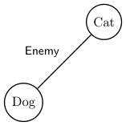

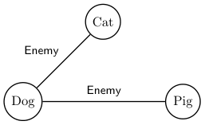

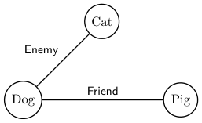

&emsp;The corresponding tables are:

&emsp;&emsp;&emsp;&emsp;&emsp;&emsp;&emsp;Player   Relationship 
&emsp;&emsp;&emsp;&emsp;&emsp;&emsp;**pid**   **name**   **pid1**   **pid2**   **type**   **time** 
&emsp;&emsp;&emsp;&emsp;&emsp;&emsp;1   Cat   1   2   Enemy   `2018-03-01` `11:40:00` 
&emsp;&emsp;&emsp;&emsp;&emsp;&emsp;2   Dog   2   1   Enemy   `2018-03-01` `11:40:00` 
&emsp;&emsp;&emsp;&emsp;&emsp;&emsp;3   Pig   2   3   Enemy   `2018-03-01` `11:50:00` 
&emsp;&emsp;&emsp;&emsp;&emsp;&emsp;&emsp;&emsp;3   2   Enemy   `2018-03-01` `11:50:00` 
&emsp;&emsp;&emsp;&emsp;&emsp;&emsp;&emsp;&emsp;2   3   Friend   `2018-03-01` `12:00:00` 
&emsp;&emsp;&emsp;&emsp;&emsp;&emsp;&emsp;&emsp;3   2   Friend   `2018-03-01` `12:00:00` 
Relationships are always mutual: if there is a row with `pid1=3` and `pid2=4`, there will be a corresponding 
row with the same `type`/`time` and with `pid1=4` and `pid2=3`.

Assume that a player is never in a relationship with themself (Dog cannot be friends with Dog, and Cat 
cannot be enemies with Cat).

&emsp;&emsp;&emsp;&emsp;&emsp;&emsp;&emsp;&emsp;Page 2 of 18

---

**Page 3**

1\. (4 points) We wish to find players that have started enemy relationships (with the same or with different 
players) at least 50 times. This could be between the same pair of players at least 50 times, or between 
at least 50 others, etc. 
Mark all of the following queries that do this. 
&emsp;&emsp;A.   `SELECT` `Player.*` 
&emsp;&emsp;&emsp;&emsp;&emsp;&emsp;`FROM` `Player` 
&emsp;&emsp;&emsp;`INNER` `JOIN` `Relationship` `ON` `pid1` `=` `pid` 
&emsp;&emsp;&emsp;&emsp;&emsp;`WHERE` `type` `=` `‘Enemy’` `AND` `COUNT(*)` `>=` `50` 
&emsp;&emsp;&emsp;&emsp;`GROUP` `BY` `pid,` `name;` 
&emsp;&emsp;**B.**   `SELECT` `Player.*` 
&emsp;&emsp;&emsp;&emsp;&emsp;&emsp;`FROM` `Player,` `Relationship` 
&emsp;&emsp;&emsp;&emsp;&emsp;`WHERE` `pid` `=` `pid1` `AND` `type` `=` `‘Enemy’` 
&emsp;&emsp;&emsp;&emsp;`GROUP` `BY` `pid,` `name` 
&emsp;&emsp;&emsp;&emsp;&emsp;`HAVING` `COUNT(*)` `>=` `50;` 
&emsp;&emsp;C.   `SELECT` `Player.*` 
&emsp;&emsp;&emsp;&emsp;&emsp;&emsp;`FROM` `Player` 
&emsp;&emsp;&emsp;`INNER` `JOIN` `Relationship` `ON` `pid1` `=` `pid` 
&emsp;&emsp;&emsp;&emsp;&emsp;`WHERE` `COUNT(*)` `>=` `50;` 
&emsp;&emsp;&emsp;&emsp;`GROUP` `BY` `pid,` `name,` `type` 
&emsp;&emsp;&emsp;&emsp;&emsp;`HAVING` `type` `=` `‘Enemy’;` 
&emsp;&emsp;**D.**   `SELECT` `Player.*` 
&emsp;&emsp;&emsp;&emsp;&emsp;`FROM` `Player,` `Relationship` 
&emsp;&emsp;&emsp;`GROUP` `BY` `pid,` `pid1,` `type,` `name` 
&emsp;&emsp;&emsp;&emsp;`HAVING` `pid` `=` `pid1` `AND` `type` `=` `‘Enemy’` `AND` `COUNT(*)` `>=` `50;`

&emsp;**Solution:** A is incorrect. It is an invalid query, since we are using an aggregate in the `WHERE` clause. 
&emsp;B is correct. 
&emsp;C is incorrect. It is an invalid query, since we are using an aggregate in the `WHERE` clause. 
&emsp;D is correct. We group based on `pid`, `pid1`, and `type`, and throw out groups where the player IDs 
&emsp;are unequal, where the type is not “Enemy”, or where the count is too small. 
&emsp;This question was graded as 4 independent true/false questions, each worth 0.5 points. That is, you 
&emsp;got 0.5 points for every correct choice that you selected and 0.5 points for every incorrect choice 
&emsp;that you did not select.

2\. (6 points) Now instead, we decide that we want to fetch the number of times each player has started an 
enemy relationship (if a player became enemies with the same player twice, count it twice). If a player 
has never started an enemy relationship, the count should be 0. 
Mark all of the following queries that do this. 
&emsp;&emsp;A.   `SELECT` `Player.*,` `COUNT(*)` 
&emsp;&emsp;&emsp;&emsp;&emsp;`FROM` `Player` 
&emsp;&emsp;&emsp;`LEFT` `JOIN` `Relationship` `ON` `pid1` `=` `pid` 
&emsp;&emsp;&emsp;&emsp;&emsp;`WHERE` `type` `=` `‘Enemy’` 
&emsp;&emsp;&emsp;&emsp;`GROUP` `BY` `pid,` `name;` 
&emsp;&emsp;B.   `SELECT` `Player.*,` `COUNT(pid1)` 
&emsp;&emsp;&emsp;&emsp;&emsp;`FROM` `Player` 
&emsp;&emsp;&emsp;`LEFT` `JOIN` `Relationship` `ON` `pid1` `=` `pid` 
&emsp;&emsp;&emsp;&emsp;`GROUP` `BY` `pid,` `name,` `type` 
&emsp;&emsp;&emsp;&emsp;&emsp;`HAVING` `type` `=` `‘Enemy’;`

&emsp;&emsp;&emsp;&emsp;&emsp;&emsp;&emsp;&emsp;Page 3 of 18

---

**Page 4**

&emsp;**C.**   `SELECT` `Player.*,` `COUNT(pid1)` 
&emsp;&emsp;&emsp;&emsp;`FROM` `Player` 
&emsp;&emsp;`LEFT` `JOIN` `Relationship` `ON` `pid1` `=` `pid` 
&emsp;&emsp;&emsp;`WHERE` `type` `=` `’Enemy’` `OR` `type` `IS` `NULL` 
&emsp;&emsp;`GROUP` `BY` `pid,` `name;` 
&emsp;D.   `SELECT` `Player.*,` `COUNT(*)` 
&emsp;&emsp;&emsp;&emsp;`FROM` `Player` 
&emsp;&emsp;`LEFT` `JOIN` `Relationship` `ON` `pid1` `=` `pid` 
&emsp;&emsp;&emsp;`WHERE` `type` `=` `‘Enemy’` `OR` `type` `IS` `NULL` 
&emsp;&emsp;`GROUP` `BY` `pid,` `name;`

**Solution:** A is incorrect because players with only friend relationships will be matched to those 
rows, then entirely filtered out by the `WHERE` clause. 
B is incorrect because we match players with all relationships they started, group by type, then 
throw out groups with type not equal to “Enemy”, so players with no enemy relationships will be 
entirely filtered out. 
C is correct. 
D is incorrect because the `COUNT(*)` counts `NULL` values, so players with no enemy relationships will 
have a count of 1. 
This question was graded as 4 independent true/false questions, each worth 0.5 points. That is, you 
got 0.5 points for every correct choice that you selected and 0.5 points for every incorrect choice 
that you did not select.

&emsp;&emsp;&emsp;&emsp;&emsp;&emsp;&emsp;&emsp;Page 4 of 18

---

**Page 5**

3\. (6 points) Now, instead of counting the number of times a player has become enemies with other players, 
we wish to find the last player(s) with whom each player has entered into a relationship. Omit players 
that have never started a relationship. If the player started a relationship with multiple players at the 
same time, return a row for each one. 
Mark all of the following queries that do this. 
&emsp;&emsp;A. `SELECT` `pid1,` `pid2` 
&emsp;&emsp;&emsp;&emsp;`FROM` `Relationship` `R1` 
&emsp;&emsp;&emsp;&emsp;`WHERE` `EXISTS` `(` 
&emsp;&emsp;&emsp;&emsp;&emsp;`SELECT` `1` `FROM` `Relationship` `R2` 
&emsp;&emsp;&emsp;&emsp;&emsp;`WHERE` `R1.pid1` `=` `R2.pid1` 
&emsp;&emsp;&emsp;&emsp;&emsp;&emsp;`AND` `R1.time` `>` `R2.time` 
&emsp;&emsp;&emsp;&emsp;`);` 
&emsp;&emsp;**B.** `SELECT` `pid1,` `pid2` 
&emsp;&emsp;&emsp;&emsp;`FROM` `Relationship` `R1` 
&emsp;&emsp;&emsp;&emsp;`WHERE` `time` `IN` `(` 
&emsp;&emsp;&emsp;&emsp;&emsp;`SELECT` `MAX(R2.time)` `FROM` `Relationship` `R2` 
&emsp;&emsp;&emsp;&emsp;&emsp;`WHERE` `R1.pid1` `=` `R2.pid1` 
&emsp;&emsp;&emsp;&emsp;`);` 
&emsp;&emsp;**C.** `SELECT` `pid1,` `pid2` 
&emsp;&emsp;&emsp;&emsp;`FROM` `Relationship` `R1` 
&emsp;&emsp;&emsp;&emsp;`WHERE` `R1.time` `>=` `ALL` `(` 
&emsp;&emsp;&emsp;&emsp;&emsp;`SELECT` `R2.time` `FROM` `Relationship` `R2` 
&emsp;&emsp;&emsp;&emsp;&emsp;`WHERE` `R1.pid1` `=` `R2.pid1` 
&emsp;&emsp;&emsp;&emsp;`);` 
&emsp;&emsp;D. `SELECT` `pid1,` `pid2` 
&emsp;&emsp;&emsp;&emsp;`FROM` `Relationship` `R1` 
&emsp;&emsp;&emsp;&emsp;`WHERE` `time` `>=` `ALL` `(` 
&emsp;&emsp;&emsp;&emsp;&emsp;`SELECT` `MAX(R2.time)` `FROM` `Relationship` `R2` 
&emsp;&emsp;&emsp;&emsp;&emsp;`GROUP` `BY` `R2.pid1` 
&emsp;&emsp;&emsp;&emsp;`);`

&emsp;**Solution:** A is incorrect: relationships where there are any older relationships with `pid1` are se- 
&emsp;lected. 
&emsp;B is correct: the subquery fetches the time of the newest relationship with `pid1`, and then the main 
&emsp;query fetches the relationship(s) with `pid1` that starts at that time. 
&emsp;C is correct: the subquery fetches the time of all new relationships with `pid1`, then the main query 
&emsp;fetches the relationship(s) that start at a timestamp at least as large as all of these. 
&emsp;D is incorrect: the subquery fetches the time of the newest relationship for each player, so the 
&emsp;WHERE predicate filters out all relationships that were not created at that time. 
&emsp;This question was graded as 4 independent true/false questions, each worth 0.5 points. That is, you 
&emsp;got 0.5 points for every correct choice that you selected and 0.5 points for every incorrect choice 
&emsp;that you did not select.

&emsp;&emsp;&emsp;&emsp;&emsp;&emsp;&emsp;&emsp;Page 5 of 18

---

**Page 6**

4\. (8 points) We now wish to find enemies of enemies at the current time. That is, we wish to find players 
A and C, such that the latest relationship in our table between A and some third player B is “Enemy”, 
and the latest relationship between B and C is also “Enemy”.

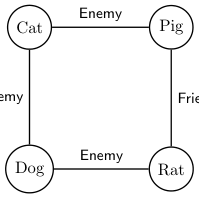

In the diagram above, Cat and Rat are enemies of enemies, because Cat is an enemy of Dog, and Dog 
is an enemy of Rat. 
Mark all of the queries that fetch all current enemy of enemy pairs. 
&emsp;&emsp;A.   `SELECT` `r1.pid1,` `r2.pid2` 
&emsp;&emsp;&emsp;&emsp;&emsp;`FROM` `Relationship` `r1,` `Relationship` `r2,` `Relationship` `r3,` `Relationship` `r4` 
&emsp;&emsp;&emsp;&emsp;&emsp;`WHERE` `r1.pid2` `=` `r2.pid1` `AND` `r1.type` `=` `r2.type` 
&emsp;&emsp;&emsp;&emsp;&emsp;`AND` `r1.pid1` `=` `r3.pid1` `AND` `r1.pid2` `=` `r3.pid2` `AND` `r1.type` `=` `r3.type` 
&emsp;&emsp;&emsp;&emsp;&emsp;`AND` `r2.pid1` `=` `r4.pid1` `AND` `r2.pid2` `=` `r4.pid2` `AND` `r1.type` `=` `r4.type` 
&emsp;&emsp;&emsp;&emsp;&emsp;`AND` `r1.pid1` `<>` `r2.pid2` `AND` `r1.type` `=` `‘Enemy’` 
&emsp;&emsp;&emsp;`GROUP` `BY` `r1.pid1,` `r2.pid2,` `r1.time,` `r2.time` 
&emsp;&emsp;&emsp;&emsp;`HAVING` `MAX(r3.time)` `<=` `r1.time` `AND` `MAX(r4.time)` `<=` `r2.time;` 
&emsp;&emsp;B.   `SELECT` `r1.pid1,` `r2.pid2` 
&emsp;&emsp;&emsp;&emsp;&emsp;&emsp;`FROM` `Relationship` `r1,` `Relationship` `r2,` `Relationship` `r3,` `Relationship` `r4` 
&emsp;&emsp;&emsp;&emsp;&emsp;&emsp;`WHERE` `r1.pid1` `=` `r3.pid1` `AND` `r1.pid2` `=` `r3.pid2` 
&emsp;&emsp;&emsp;&emsp;&emsp;&emsp;&emsp;`AND` `r2.pid1` `=` `r4.pid1` `AND` `r2.pid2` `=` `r4.pid2` 
&emsp;&emsp;&emsp;&emsp;&emsp;&emsp;&emsp;`AND` `r1.pid1` `<>` `r2.pid2` `AND` `r1.type` `=` `‘Enemy‘` `AND` `r2.type` `=` `‘Enemy‘` 
&emsp;&emsp;&emsp;&emsp;&emsp;&emsp;&emsp;`AND` `r1.pid1` `<>` `r2.pid2` `AND` `r1.type` `=` `‘Enemy’` 
&emsp;&emsp;&emsp;&emsp;&emsp;`GROUP` `BY` `r1.pid1,` `r2.pid2,` `r1.time,` `r2.time` 
&emsp;&emsp;&emsp;&emsp;&emsp;&emsp;`HAVING` `MAX(r3.time)` `<=` `r1.time` `AND` `MAX(r4.time)` `<=` `r2.time;` 
&emsp;&emsp;**C.**   `SELECT` `r1.pid1,` `r2.pid2` 
&emsp;&emsp;&emsp;&emsp;&emsp;`FROM` `Relationship` `r1,` `Relationship` `r2,` `Relationship` `r3,` `Relationship` `r4` 
&emsp;&emsp;&emsp;&emsp;&emsp;`WHERE` `r1.pid2` `=` `r2.pid1` 
&emsp;&emsp;&emsp;&emsp;&emsp;`AND` `r1.pid1` `=` `r3.pid1` `AND` `r1.pid2` `=` `r3.pid2` 
&emsp;&emsp;&emsp;&emsp;&emsp;`AND` `r2.pid1` `=` `r4.pid1` `AND` `r2.pid2` `=` `r4.pid2` 
&emsp;&emsp;&emsp;&emsp;&emsp;`AND` `r1.pid1` `<>` `r2.pid2` `AND` `r1.type` `=` `r2.type` 
&emsp;&emsp;&emsp;`GROUP` `BY` `r1.pid1,` `r2.pid2,` `r1.type,` `r1.time,` `r2.time` 
&emsp;&emsp;&emsp;&emsp;`HAVING` `MAX(r3.time)` `<=` `r1.time` `AND` `MAX(r4.time)` `<=` `r2.time` `AND` `r1.type` `=` `‘Enemy’;` 
&emsp;&emsp;D.   `SELECT` `r1.pid1,` `r2.pid1` 
&emsp;&emsp;&emsp;&emsp;&emsp;`FROM` `Relationship` `r1,` `Relationship` `r2,` `Relationship` `r3,` `Relationship` `r4` 
&emsp;&emsp;&emsp;&emsp;&emsp;`WHERE` `r1.pid2` `=` `r2.pid2` 
&emsp;&emsp;&emsp;&emsp;&emsp;`AND` `r1.pid1` `=` `r3.pid1` `AND` `r1.pid2` `=` `r3.pid2` 
&emsp;&emsp;&emsp;&emsp;&emsp;`AND` `r2.pid1` `=` `r4.pid1` `AND` `r2.pid2` `=` `r4.pid2` 
&emsp;&emsp;&emsp;&emsp;&emsp;`AND` `r1.pid1` `<>` `r2.pid1` `AND` `r3.type` `=` `r4.type` 
&emsp;&emsp;&emsp;`GROUP` `BY` `r1.pid1,` `r2.pid1,` `r3.type,` `r1.time,` `r2.time` 
&emsp;&emsp;&emsp;&emsp;`HAVING` `MAX(r3.time)` `<=` `r1.time` `AND` `MAX(r4.time)` `<=` `r2.time` `AND` `r3.type` `=` `‘Enemy’;`

&emsp;&emsp;&emsp;&emsp;&emsp;&emsp;&emsp;&emsp;Page 6 of 18

---

**Page 7**

**Solution:** A is incorrect: the comparison of `MAX(r3.time)` `<=` `r1.time` and `MAX(r4.time)` `<=` 
`r2.time` are only checking the maximum over records whose type is ‘Enemy’; if the newest record 
in a relationship is ‘Friend’, but it was once ‘Enemy’, it will still be treated as ‘Enemy’. 
B is incorrect: there is no constraint that `r1.pid2` `=` `r2.pid1`, and therefore fails in the case where 
A is an enemy of B, A is a friend of C, B is a friend of D, and C is an enemy of D (the query will 
match (A, B) with (C, D), and say that A and D are enemies of enemies). 
C is correct, and works by letting `r3` and `r4` join in every relationship between the row selected in 
`r1` and `r2`, so that we can use aggregates. 
D is incorrect, because the constraint on the two relationships being ‘Enemy’ is applied on the 
records that we’re calculating the latest timestamp of, and not on the records that we’re actually 
selecting. 
This question was graded as 4 independent true/false questions, each worth 1 point. That is, you 
got 1 point for every correct choice that you selected and 1 point for every incorrect choice that you 
did not select.

&emsp;&emsp;&emsp;&emsp;&emsp;&emsp;&emsp;&emsp;Page 7 of 18

---

**Page 8**

For the following problems, we use P to denote the Player table and R to denote the Relationship table. 
We additionally assume that for any pair of `pid`s (e.g. 1 and 2), there is at most one pair of rows in the 
Relationship table (with `pid1=1,` `pid2=2` and `pid1=2,` `pid2=1`). In other words, we are only storing the 
most current relationship. 
5\. (3 points) We wish to find the name of all players that are not enemies of enemies with any other player. 
&emsp;Mark all of the following relational algebra expressions that satisfy this query. 
&emsp;&emsp;&emsp;A. πname(σtype=‘Enemy′(P −πpid,name(P ▷◁πpid1,pid2,type(R) ▷◁ρpid1→pid(R))) 
&emsp;&emsp;&emsp;**B.** π**name**(P −π**pid**,**name**(σ**type**=‘Enemy′(P ▷◁π**pid1**,**pid2**,**type**(R) ▷◁ρ**pid1**→**pid**(R))) 
&emsp;&emsp;&emsp;C. πname(P) −πname(σtype=‘Enemy′(πpid1,pid2,type(P ▷◁R) ▷◁ρpid1→pid(R)))

&emsp;**Solution:** A is incorrect: the projection to `pid,` `name` means that the `type` column is already 
&emsp;filtered out by the time we process the selection. 
&emsp;B is correct: we match players with relationships of relationships containing them, where both 
&emsp;relationships are the same type (because we’re doing a natural join), and then filter to only enemy- 
&emsp;enemy relationships. This gets us all players that are in enemy of enemy relationships, so subtracting 
&emsp;this from `P` gets us all players that are not in such relationships. 
&emsp;C is incorrect: we perform the set difference on `name`s, not `pid`s, so we get the wrong output when 
&emsp;there are two players with the same name, one of whom is in an enemy of enemy relationship, and 
&emsp;the other of whom is not. 
&emsp;This question was graded as 3 independent true/false questions, each worth 0.5 points. That is, you 
&emsp;got 0.5 points for every correct choice that you selected and 0.5 points for every incorrect choice 
&emsp;that you did not select.

6\. (1 point) True or false: the two relational algebra expressions are equivalent (on all possible databases). 
&emsp;σtype=‘Enemy′(R) −(σtype=‘Enemy′(R) −σtime\<‘2018−01−01′(R)) 
&emsp;σtime\<‘2018−01−01′ AND type=‘Enemy′(R)

&emsp;**Solution:** True, these expressions are equivalent. 
&emsp;Let A = σtype=‘Enemy′(R) and B = σtime\<‘2018−01−01′(R). 
&emsp;The first expression is A −(A −B) which is equivalent to A ∩B, but the intersection of A and B is 
&emsp;just a selection over R with both predicates. 
&emsp;This question was graded all or nothing. The correct answer received 1 point; every other answer 
&emsp;received 0 points.

&emsp;&emsp;&emsp;&emsp;&emsp;&emsp;&emsp;&emsp;Page 8 of 18

---

**Page 9**

**2**   **File Organization (6.5 points)**

**2.1**   **True and False** 
1\. (2.5 points) Specify correct choice(s) by filling in the corresponding box on the answer sheet. 
&emsp;&emsp;&emsp;**A. In order to interact with all hard disks, computers use an explicit API.** 
&emsp;&emsp;&emsp;B. Hard drives need to constantly re-organize the data stored on them (wear-levelling) to prevent 
&emsp;&emsp;&emsp;&emsp;failure. 
&emsp;&emsp;&emsp;C. For flash drives, read and writes are both equally fast since these drive use NAND technology 
&emsp;&emsp;&emsp;&emsp;instead of traditional spinning magnetic disks. 
&emsp;&emsp;&emsp;**D. Heap files are preferable to Sorted files when fast writes are required.** 
&emsp;&emsp;&emsp;E. For pages holding variable length records, the size of the slot directory never changes.

&emsp;**Solution:** A is directly from the lecture slides. B is false since wear-levelling only applies to flash 
&emsp;drives. C is false since writes are slower than reads for flash drives. D is true since Heap files do 
&emsp;no require extra IOs to maintain sorted order after an insert. E is false since the slot directly can 
&emsp;expand to accommodate extra records.

**2.2**   **Records and Pages** 
Consider the following relation: 
`CREATE` `TABLE` `Universities{` 
&emsp;&emsp;`name` `TEXT` 
&emsp;&emsp;`abbrev` `CHAR(3)` 
&emsp;&emsp;`addr` `TEXT` 
&emsp;&emsp;`zip` `CHAR(5)` 
&emsp;&emsp;`phone` `TEXT` 
&emsp;&emsp;`enrolled` `INTEGER` 
`}` 
1\. (1 point) How big, in bytes is the smallest possible record? Assume the record header takes up 4 bytes 
&emsp;and integers are 4 bytes long.

&emsp;**Solution:** 16 bytes. 4 bytes for the record header, 3 bytes for abbrev, 5 bytes for zip, 4 bytes for 
&emsp;enrolled. The TEXT fields can be empty so 0 bytes.

2\. (3 points) Assuming each record is 22 bytes long and we have access to 5 pages each of size 4KB (1KB 
&emsp;= 1024B) where each page has a footer containing 6 bytes of metadata (including the free space pointer) 
&emsp;as well as a slot directory, how many records can we fit on the 5 pages? Assume integers are 4 bytes 
&emsp;long . Assume that records cannot span multiple pages.

&emsp;**Solution:** 680 records. We first calculate how much space we have on each page. We have 1024\*4 
&emsp;= 4096 bytes with 4096 - 6 = 4090 bytes available after the page footer metadata is accounted for. 
&emsp;We also have each record taking up 22 + 4 + 4 = 30 bytes, after accounting for the slot directory 
&emsp;pointer and size value for each record. We then find how many records fit per page: floor(4090/30) 
&emsp;= 136 records. Therefore, we can fit a total of 5 \* 136 = 680 records on all 5 pages.

&emsp;&emsp;&emsp;&emsp;&emsp;&emsp;&emsp;&emsp;Page 9 of 18

---

**Page 10**

**3**   **Indices (20.5 points)**

For this section, remember that **the height of a one level tree is defined to be 0, the height of a** 
**tree with two levels is defined to be 1, and so on.**

**3.1**   **True and False** 
1\. (2.5 points) Specify correct choice(s) by filling in the corresponding box on the answer sheet. 
&emsp;&emsp;&emsp;A. The maximum fanout of a B+ tree is equal to 2d where d is its order. 
&emsp;&emsp;&emsp;B. When an insertion into a B+ tree causes a node to split, the height of the tree always increases.

&emsp;&emsp;&emsp;**C. As the number of keys in a B+ tree increases, IO cost for searches grows logarith-** 
&emsp;&emsp;&emsp;&emsp;**mically with the number of keys.** 
&emsp;&emsp;&emsp;D. Clustered and unclustered B+ trees provide the same performance benefits for all queries. 
&emsp;&emsp;&emsp;E. Bulkloading for B+ trees is efficient because we only keep the left most branch in memory for 
&emsp;&emsp;&emsp;&emsp;insertions and can disregard the rest of the tree.

&emsp;**Solution:** A is false since we know the fanout is equal to 2d+1 from lecture. B is false since the 
&emsp;height of a B+ tree only increases when the root splits. C is true from lecture. D is false since we’ve 
&emsp;seen how clustered indices can help reduce IO cost in range searches. E is false because we only 
&emsp;keep the right branch in memory, not the left.

&emsp;&emsp;&emsp;&emsp;&emsp;&emsp;&emsp;&emsp;Page 10 of 18

---

**Page 11**

2\. (4 points) For the B+ trees below, determine which of the trees are valid B+ trees based on the invariants 
we learned in class, and fill in its corresponding box on the answer sheet. Assume that there were no 
deletes. Note, we follow the right branch when the split key equals the search key.

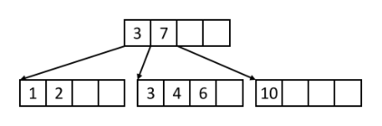

&emsp;&emsp;A.

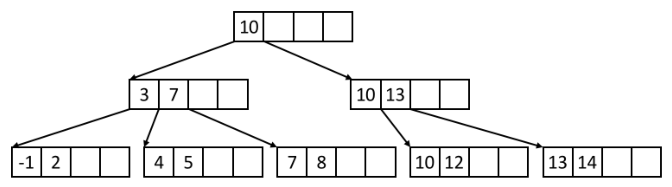

&emsp;&emsp;B.

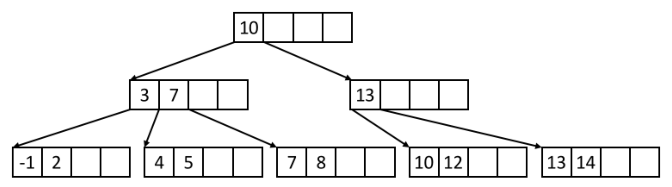

&emsp;&emsp;C.

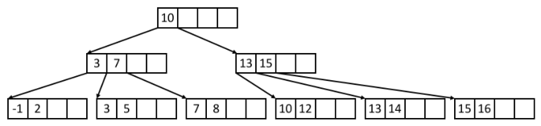

&emsp;&emsp;**D.**

&emsp;**Solution:** A is invalid because the right most leaf node is under-full. B is invalid because the 10 
&emsp;key is repeated in the root and the right inner node. C is invalid because the right inner node is 
&emsp;underfilled. D is the only valid tree since all invariants are fulfilled.

&emsp;&emsp;&emsp;&emsp;&emsp;&emsp;&emsp;&emsp;Page 11 of 18

---

**Page 12**

3\. (3 points) Suppose we have an initially empty, order d=1 B+ tree, and the following set of keys:

&emsp;&emsp;&emsp;&emsp;&emsp;&emsp;&emsp;&emsp;3, 9, 8, 7, 2, 1, 5, 10, 12

&emsp;Which of the following are possible B+ trees after inserting all of the above elements in some order? 
&emsp;Again, we follow the right branch when the split key equals the search key. When splitting a node with 
&emsp;an odd number of keys, assume the new right node receives one more key than the original left node.

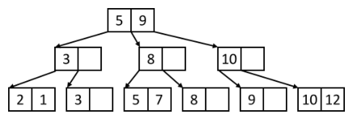

&emsp;&emsp;&emsp;**A.**

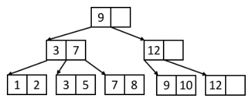

&emsp;&emsp;&emsp;B.

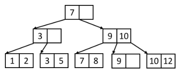

&emsp;&emsp;&emsp;**C.**

&emsp;**Solution:** A is an invalid B+ tree since the left most leaf node is not sorted. However this was 
&emsp;actually not intended on the staff’s part so either answer was accepted since all other invariants 
&emsp;hold. B is invalid because it is the result of a bulkload. Therefore, the right most node is not full 
&emsp;when it should be since the right leaf receives the extra key over the left node during a split. C is a 
&emsp;valid B+ tree.

**3.2**   **Short Answer** 
1\. (.5 points) What is the maximum fanout of an order x+1 B+ tree?

&emsp;**Solution:** 2x+3. This is a direct application of the fanout equation: F=2d+1 with d=x+1 value. 
&emsp;Here, F = 2(x+1)+1 = 2x+3

2\. (.5 points) What is the maximum number of keys an order 2 B+ tree with height 2 can store?

&emsp;&emsp;&emsp;&emsp;&emsp;&emsp;&emsp;&emsp;Page 12 of 18

---

**Page 13**

&emsp;**Solution:** 100. An order of 2 means the fanout is 5. At height 0, there is one node. At height 1, 
&emsp;there are 1\*5 = 5 nodes. At height 2, there are 5\*5 = 25 nodes. Each node can store 4 keys. So 
&emsp;25\*4 = 100 keys.

3\. (.5 points) For a height 3 alternative 2 B+ tree, how many IOs are required for an equality search on 
the index key given that the index key is a primary key?

&emsp;**Solution:** 5 IOs. We need 4 IOs to traverse to a leaf page and 1 IO to go to the actual page in the 
&emsp;file since this is an alternative 2 B+ tree.

&emsp;&emsp;&emsp;&emsp;&emsp;&emsp;&emsp;&emsp;Page 13 of 18

---

**Page 14**

**3.3**   **Bulk Loading** 
What is the resulting B+ tree after bulk loading the following keys? Assume we are building an order d=1 
index with a minimum leaf node fill factor of 2/3. When splitting an inner node, perform the split the same 
way we did in the homework – with an internal node fill factor of 1/2.

&emsp;&emsp;&emsp;&emsp;&emsp;&emsp;&emsp;&emsp;3, 8, 5, 19, 20, 11, 7 
&emsp;Answer the questions below: 
1\. (.5 points) What is the height of the resulting B+ tree?

&emsp;**Solution:** 2.

2\. (.5 points) How many inner nodes are there in the resulting B+ tree?

&emsp;**Solution:** 3.

3\. (.5 points) How many leaf nodes are there in the resulting B+ tree?

&emsp;**Solution:** 4, from the diagram. We end up with full leaf nodes due to how bulkloading first checks 
&emsp;the fill factor, then inserts a key into the leaf. When the leaf node is half full, the fill factor is not 
&emsp;fulfilled so the leaf is filled to full capacity.

4\. (.5 points) What key(s) are in the leftmost leaf node? Separate keys with commas.

&emsp;**Solution:** 3, 5. Since leaf nodes are filled to full capacity.

5\. (.5 points) What key(s) are in the rightmost leaf node? Separate keys with commas.

&emsp;**Solution:** 20.

6\. (1 point) Write out the contents of the resulting B+ tree in a level-order traversal. Remember that a 
&emsp;level-order tree traversal enumerates the nodes of a tree one level at a time, and from left to right on 
&emsp;each level. That is, first the root, then the children of the root from left to right, and so on. Separate 
&emsp;keys with commas.

&emsp;**Solution:** 11, 7, 20, 3, 5, 7, 8, 11, 19, 20.

&emsp;**Solution:** The number of keys per leaf node is ceil(2\*2/3) = 2. We bulk load from left to right and 
&emsp;when we split an inner node, we copy half the keys into the left node and half into the new right 
&emsp;node and push up the middle key.

&emsp;&emsp;&emsp;&emsp;&emsp;&emsp;&emsp;&emsp;Page 14 of 18

---

**Page 15**

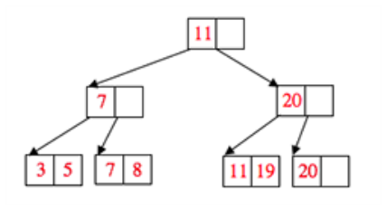

**Use the B+ tree below for the following questions:**

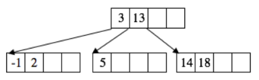

7\. (2 points) What is the maximum number of keys we can insert before changing the height of the tree?

&emsp;**Solution:** 15. We can insert 3, 4, 6, 7, 8, 19, 20, 21, 22, 23, 24, 25, 26, 27, 28.

8\. (2 points) What is the minimum number of keys that we can insert to change the height of the tree?

&emsp;**Solution:** 7. We can insert 13, 15, 16, 17, 19, 20, 21.

9\. (2 points) How many total IOs are required to insert the keys 15, 16, 17? Remember that reading in a 
page into memory and writing the page back to disk counts as 2 IOs (1 read and 1 write). Additionally, 
assume each insert starts with an empty buffer pool.

&emsp;**Solution:** Total IOs = 3+3+5 = 11. 3 IOs for 15 and 16: for both, we read the root (1), then we 
&emsp;read the right most leaf node (1), lastly we write the right most leaf node (1). 5 IOs for 17: we read 
&emsp;the root (1), then we read the right most leaf node (1). We must split so we write the 2 split leaf 
&emsp;nodes to disk (2), we push up a key to the root so we must write the root back to disk (1).

&emsp;&emsp;&emsp;&emsp;&emsp;&emsp;&emsp;&emsp;Page 15 of 18

---

**Page 16**

**4**   **Buffers/Sorting and Hashing (20 points)**

For any question that asks which pages are in the buffer pool at some point in time, please list the pages in 
**alphabetical order.** 
1\. (5 points) Assume we have 4 empty buffer frames and the following access pattern, in which pages are 
&emsp;immediately unpinned:

&emsp;A, C, D, F, D, C, B, C, A, E, C, D

&emsp;a) Which pages are in the buffer pool at the end if we use MRU cache policy? 
&emsp;b) How many cache hits will there be after MRU cache policy? 
&emsp;c) Which pages are in the buffer pool at the end if we use Clock cache policy? 
&emsp;d) How many cache hits will there be after Clock cache policy? 
&emsp;e) How many reference bits are set after Clock cache policy?

&emsp;**Solution:** 
&emsp;a) CDEF 
&emsp;b) 5 
&emsp;c) ACDE 
&emsp;d) 4 
&emsp;e) 1

2\. (3 points) Assume we have 4 empty buffer frames and the following access pattern, in which pages are 
&emsp;immediately unpinned:

&emsp;A, B, C, D, E, A, B, C, D, E, A, B, C, D, E

&emsp;a) Which pages are in the buffer pool at the end if we use LRU cache policy? 
&emsp;b) How many cache hits will occur if we use LRU cache policy? 
&emsp;c) True or False: For any sequential access pattern and buffer size, LRU will always have a cache hit 
&emsp;rate strictly less than MRU.

&emsp;**Solution:** 
&emsp;a) BCDE 
&emsp;b) 0 
&emsp;c) False; LRU and MRU can have the same hit rate if the length of the access pattern is less than 
&emsp;the buffer size.

&emsp;&emsp;&emsp;&emsp;&emsp;&emsp;&emsp;&emsp;Page 16 of 18

---

**Page 17**

3\. (3 points) True or False: 
a) To finish the final pass of external hashing (conquer), we use a coarse-grained hash function, hr, that 
is different from the hash functions used in the previous passes.

&emsp;**Solution:** False. To finish the final pass of external hashing (conquer), we use a FINE-GRAINED 
&emsp;hash function, hr. This is subtle but important, this is the reason why the full partition must fit 
&emsp;in memory, and its the only way we guarantee that when a partition exits the conquer pass, it is 
&emsp;hashed. We covered this point during discussion section.

b) De-duplicating a file using hashing is always more efficient than sorting in terms of I/O cost.

&emsp;**Solution:** False. The file could already be in sorted order, or the hash function could be bad.

c) Given any hashed file, there is some permutation of pages such that the resulting file is sorted.

&emsp;**Solution:** False. Proof: Consider a file with a single page that can fit 3 records: C, A, B. This file 
&emsp;is hashed, but there is no permutation of the 1 page that would sort it.

4\. (6 points) Suppose the size of a page is 4KB, and the size of the memory buffer is 320KB. We want to 
perform external sorting for a dataset. Answer the following questions given these configurations. 
a) What is the maximum size of the dataset (in KB) that can be sorted in one pass?

&emsp;**Solution:** In one pass, we can only sort the amount of memory we have, so 320 KB.

b) What is the maximum size of the dataset (in KB) that can be sorted in n passes for n \>= 1? (Use n 
in your solution)

&emsp;**Solution:** 320 ∗316n−1

c) If the size of the dataset is 800KB, how many disk I/O do we need to sort this dataset?

&emsp;**Solution:** 800 IOs. We can sort this in 2 passes since 800 KB is equal to 200 pages, and we can 
&emsp;sort up to B ∗(B −1) = 80 ∗79 pages in 2 passes. The total number of IOs is 2Np where N is the 
&emsp;size of the dataset (in pages) and p is the number of passes. 2 ∗(2 ∗N) = 4 ∗(200) = 800 IOs

&emsp;&emsp;&emsp;&emsp;&emsp;&emsp;&emsp;&emsp;Page 17 of 18

---

**Page 18**

5\. (3 points) We are given a table containing personal information of UC Berkeley students wish a size 
of 100,000 KB. Suppose we want to group students by their year of birth. We have 51 buffer pages 
available, and the size of each page is 100KB. 
a) How large will the average partition be as they enter the second phase of external hashing, in pages?

&emsp;**Solution:** a. N/(B-1) = (100,000KB/100KB)/50 = 20 pages

b) Assume that our table only contains information about undergraduates at UC Berkeley, and we would 
like to eliminate duplicate students using hashing. Rank the following hash functions from best to worst 
for accomplishing this task (in your answer, list the letters of the hash functions from left to right with 
the leftmost letter being the best hash function and the rightmost one being the worst). We consider a 
hash function with less collisions (different records ending up in the same bucket) to be “better”. 
&emsp;`CREATE` `TABLE` `Enrolled` `{` 
&emsp;&emsp;&emsp;`firstname` `TEXT,` 
&emsp;&emsp;&emsp;`lastname` `TEXT,` 
&emsp;&emsp;&emsp;`addr` `TEXT,` 
&emsp;&emsp;&emsp;`sid` `INTEGER,` 
&emsp;&emsp;&emsp;`gender` `CHAR(1),` 
&emsp;&emsp;&emsp;`year_of_birth` `INTEGER` 
&emsp;`}` 
&emsp;&emsp;A. h(record) = record.year of birth % 10 
&emsp;&emsp;B. h(record) = record.sid % 10 
&emsp;&emsp;C. h(record) = to int(record.gender) % 10 
&emsp;&emsp;D. h(record) = to int(record.firstname\[0\]) % 10

&emsp;**Solution:** h(record) = record.year of birth % 10: Rank 3, bad because most undergrads born in 
&emsp;4-5 year range 
&emsp;h(record) = record.sid % 10: Rank 1, best assuming SID are distributed evenly 
&emsp;h(record) = to int(record.gender) % 10: Rank 4, worst because most students are male or female 
&emsp;h(record) = to int(record.firstname\[0\]) % 10: Rank 2, slightly worse than SID because first letter 
&emsp;skewed. However, the first letter of first name is less skewed than year of birth 
&emsp;The correct answer (`BDAC`) received 2 points. Partial credit (of 1 point) was awarded to answers that 
&emsp;correctly identified the best hash function (B), or the worst hash function (C). Every other answer 
&emsp;received 0 points.

&emsp;&emsp;&emsp;&emsp;&emsp;&emsp;&emsp;&emsp;Page 18 of 18

