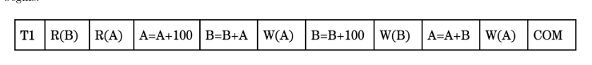
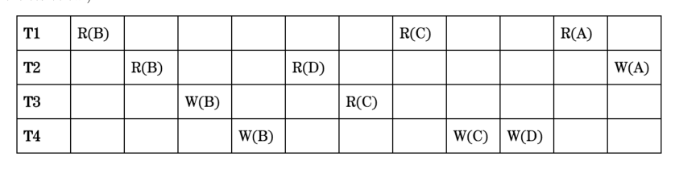

# Berkeley CS186 Spring 2018: Midterm 2: Questions

> Copied from the original: <https://hkn.eecs.berkeley.edu/exams/course/cs/186>. Text and figures are taken from the PDF as is; nothing was answered or rewritten. The original PDF is in this folder.

---

**Page 1**

&emsp;&emsp;&emsp;CS 186/286 Spring 2018 Midterm 2 
• Do not turn this page until instructed to start the exam. 
• You should receive 1 single-page answer sheet and a 11-page exam packet. 
• All answers should be written on the answer sheet. The exam packet will be collected but not graded. 
• You have 80 minutes to complete the midterm. 
• The midterm has 4 questions, each with multiple parts. 
• The midterm is worth a total of 60 points. 
• For each question, place only your final answer on the answer sheet; do not show work. 
• For multiple choice questions, please fill in the bubble or box completely, **do not mark the box with** 
**an X or checkmark**. 
• Use the blank spaces in your exam for scratch paper. 
• You are allowed **one** 8.5” × 11” double-sided page of notes. 
• No electronic devices are allowed.

---

**Page 2**

**1**   **Joins (20 points)**

Note: Assume that when we write X ▷◁Y , X (on the left) is the outer, and Y (on the right) is the inner for 
the remainder of these questions. 
1\. (1 point) Suppose we do a Page-oriented Nested Loop Join on two tables, P and Q. We are told that 
&emsp;the same amount of pages are required to store P and Q, but Q has three times more records per page 
&emsp;than P, on average. Which one of the following options is true: 
&emsp;&emsp;&emsp;A. P ▷◁Q does fewer I/Os than Q ▷◁P. 
&emsp;&emsp;&emsp;B. Q ▷◁P does fewer I/Os than P ▷◁Q. 
&emsp;&emsp;&emsp;C. P ▷◁Q does the same number of I/Os as Q ▷◁P. 
2\. (5 points) Next, we consider a Simple Nested Loop Join on three tables: P, Q, and S. 
&emsp;&emsp;• Please use \[X\] to denote the number of pages of X, and {X} to denote the number of records in 
&emsp;&emsp;X (note the curly braces rather than vertical bars, for legibility). 
&emsp;&emsp;• Do not materialize intermediary results into a temporary table. Assume the results of a subplan 
&emsp;&emsp;are pipelined to the next operator. 
&emsp;&emsp;• Assume P ▷◁Q is foreign key to primary key join, and the following join with S is also a foriegn 
&emsp;&emsp;key to primary key join. The (non null) foreign keys are in P, and primary keys are in Q and S.

&emsp;(a) (1 point) What is the I/O cost for P ▷◁Q? 
&emsp;(b) (1 point) What is the cardinality of P ▷◁Q? 
&emsp;(c) (2 points) What is the I/O cost for (P ▷◁Q) ▷◁S? 
&emsp;(d) (1 point) What is the cardinality of (P ▷◁Q) ▷◁S? 
3\. (1 point) Which one of the following options is true about the IO cost of a self join (i.e. joining a table 
&emsp;with itself)? Assume B ≫3 where B is the pages of memory available. 
&emsp;&emsp;&emsp;A. IO(SNLJ) \> IO(PNLJ) ≥IO(BNLJ) 
&emsp;&emsp;&emsp;B. IO(SNLJ) ≤IO(PNLJ) ≤IO(BNLJ) 
&emsp;&emsp;&emsp;C. IO(SNLJ) ≥IO(PNLJ) ≥IO(BNLJ) 
&emsp;&emsp;&emsp;D. IO(PNLJ) ≤IO(SNLJ) ≤IO(BNLJ) 
4\. (3 points) Suppose there are two tables: R with 40 pages and S with 75 pages. What is the cost of 
&emsp;sort-merge join between tables R and S? Assume the operator has 6 pages of RAM, and it is not writing 
&emsp;the output to disk. Use the optimization from lecture if possible. 
5\. (10 points) Suppose there are two tables: P and Q. Table P has 1,200 pages and 35 records per page. 
&emsp;Table Q has 100 pages and 50 records per page. In this question, we consider an equality join P ▷◁Q. 
&emsp;Assume that join key values are widely and uniformly distributed. That is, there is no skew. Also assume 
&emsp;that although the join operator allocates 1 buffer for the output, it does not write the output to disk.

&emsp;(a) (1 point) What is the I/O cost of a grace hash join? Assume the join has 11 buffer pages of memory 
&emsp;&emsp;available. 
&emsp;(b) (1 point) If we use a hybrid hash join, how many pages will be allocated for the hash table in 
&emsp;&emsp;the first phase assuming a fill factor of 0.9? Also assume the join has 32 buffer pages of memory 
&emsp;&emsp;available. 
&emsp;(c) (3 points) How many I/Os will the first pass of the hybrid hash join incur?

&emsp;&emsp;&emsp;&emsp;&emsp;&emsp;&emsp;&emsp;Page 2 of 11

---

**Page 3**

(d) (3 points) How many I/Os will the second pass of the hybrid hash join incur? 
(e) (2 points) Suppose we have an index on Q with a compound key whose prefix is the join key. It is 
&emsp;an alternative 2 clustered index with 40 leaf pages total. Assume that the upper levels of the tree 
&emsp;are cached with a few spare (extra) buffer pages in the cache. Also assume that the query needs no 
&emsp;additional columns from Q. Assume that the join key is a primary key in Q. 
&emsp;How many I/Os does INLJ take?

&emsp;&emsp;&emsp;&emsp;&emsp;&emsp;&emsp;&emsp;Page 3 of 11

---

**Page 4**

**2**   **Parallel Queries (8 points)**

The Jedi Order decides to create a database tracking all the Fighter Pilots, Sith Lords, and Jedi Masters 
throughout history. The order creates the following relations: 
&emsp;• `Jedi` (name, planet, padawan) 
&emsp;• `Sith` (name, planet, apprentice) 
&emsp;• `Pilot`(name, droid, plane, num fighters destroyed) 
And they are partitioned across 3 machines, each with B pages of memory in the following manner (note 
that the Jedi Order –mistakenly–assumes a uniform distribution for all values when partitioning): 
&emsp;• `Jedi`: Hash-partitioned on padawan over machines 1, 2, 3. 
&emsp;• `Sith`: Hash-partitioned on apprentice over machines 1, 2, 3. 
&emsp;• `Pilot`: Range-partitioned on num fighters destroyed over machines 1, 2, 3. 
1\. (1 point) The Jedi Order realizes its pilots are woefully inexperienced - 80% of them have 
&emsp;num fighters destroyed = 0, because they have never had any combat experience! Let us say that we 
&emsp;wish to do a parallel scan on this table. Let \[P\] denote the number of pages in `Pilot` and let T denote 
&emsp;the time taken for one I/O. How long will it take for a parallel scan to complete? 
&emsp;&emsp;&emsp;A. 1/3\*\[P\]\*T 
&emsp;&emsp;&emsp;B. \[P\]\*T 
&emsp;&emsp;&emsp;C. 0.8 \* \[P\] \* T 
&emsp;&emsp;&emsp;D. 0.2\*\[P\]\*T 
&emsp;The order knows that many of the Sith used to be Jedi, and so they decide to perform a hash-based join 
&emsp;on the `Jedi` and `Sith` tables to find who exactly is both Jedi and Sith. Assume that we join **only** on 
&emsp;the name field, that we are using perfect hash functions and that the distribution of name values is not 
&emsp;skewed for both `Jedi` and `Sith`. Let \[J\] be the number of pages in `Jedi` and \[S\] be the number of pages 
&emsp;in `Sith`, with \[S\] \< \[J\]. 
2\. (1.5 points) Suppose we first wanted to remove duplicate entries in `Sith` using hashing. What is the 
&emsp;number of passes required to re-partition `Sith` across all 3 machines and de-duplicate the Sith records? 
&emsp;Include the shuffle phase in your calculations. Assume we are using the optimized variant of parallel 
&emsp;hashing in which shuffling the records is pipelined into the hashing operator. Assume the operator has 
&emsp;B buffer pages of available memory. 
&emsp;&emsp;&emsp;A. 2 + ⌈logB−1(⌈\[S\] 
&emsp;&emsp;&emsp;&emsp;&emsp;&emsp;&emsp;&emsp;B ⌉)⌉ 
&emsp;&emsp;&emsp;B. 2 + ⌈logB−1(⌈\[S\] 
&emsp;&emsp;&emsp;&emsp;&emsp;&emsp;&emsp;&emsp;3B ⌉)⌉ 
&emsp;&emsp;&emsp;C. 1 + ⌈logB−1(⌈\[S\] 
&emsp;&emsp;&emsp;&emsp;&emsp;&emsp;&emsp;&emsp;B ⌉)⌉ 
&emsp;&emsp;&emsp;D. 1 + ⌈logB−1(⌈\[S\] 
&emsp;&emsp;&emsp;&emsp;&emsp;&emsp;&emsp;&emsp;3B ⌉)⌉

&emsp;Now assume that the order introduces a new table called `padawans`, which tracks apprentice Jedi who 
&emsp;aspire to (but are not yet) be Knights. Each Padawan has one master who trains them. The schema for 
&emsp;padawans is as follows:

&emsp;&emsp;&emsp;&emsp;&emsp;&emsp;&emsp;&emsp;`padawans` `(name,` `age,` `master)`

&emsp;&emsp;&emsp;&emsp;&emsp;&emsp;&emsp;&emsp;Page 4 of 11

---

**Page 5**

**Assume this table is round-robin partitioned across the 3 machines**. Now, assume that **60%** 
**of all padawans in the table have ”Yoda” as their master**. We wish to run the following query 
on the table:

&emsp;&emsp;&emsp;&emsp;&emsp;&emsp;&emsp;&emsp;`SELECT` `*` `FROM` `padawans` `WHERE` `master` `=` `"Yoda"`

3\. (1 point) What is the time taken for the above query to complete, if each machine has B buffer pages 
and `padawans` has \[P\] pages in total? Let T denote the time taken for 1 I/O. 
&emsp;&emsp;3\*\[P\]\*TA.1 
&emsp;&emsp;B. 0.6\*\[P\]\*T 
&emsp;&emsp;C. \[P\]\*T 
&emsp;&emsp;D. 0.6\* \[P \] 
&emsp;&emsp;&emsp;&emsp;&emsp;B \*T 
4\. (1 point) If we wanted to sort padawans by the age key, whose values are uniformly distributed, what 
partitioning scheme would result in the fewest I/Os? 
&emsp;&emsp;A. Hash Partitioning on age 
&emsp;&emsp;B. Hash Partitioning on name 
&emsp;&emsp;C. Range Partitioning on name 
&emsp;&emsp;D. Range Partitioning on age 
5\. (1.5 points) Suppose we have time series of all monitoring events from all our fighter ships for the last 
2 years:

&emsp;&emsp;&emsp;`events(event` `time,` `event` `type,` `duration,` `ship` `id,` `pilot` `name,` `pilot` `rating)`

These records tell us what is going on with our fighter fleet. To keep the fleet fighting aggressively, our 
engineers are constantly running queries over the latest data and for a specific event – the low fuel alert. 
Which partitioning scheme and physical design will achieve the best average latency if we have many 
engineers querying concurrently ? 
&emsp;&emsp;A. Hash partition on `event` `type` and clustered index on `event` `time` 
&emsp;&emsp;B. Range partition on `event` `time` and unclustered index on `event` `type` 
&emsp;&emsp;C. Hash partition on `(ship` `id,` `pilot` `name)` and clustered index on `(event` `time,` `event` `type)` 
&emsp;&emsp;D. Range partition on `duration` and unclustered index on `event` `time` 
6\. (2 points) True or False. Mark all of the true answers and leave all of the false ones blank. 
&emsp;&emsp;A. If we partition data using the round robin scheme and then perform some operations on the 
&emsp;&emsp;&emsp;data, every machine is guaranteed to have the same number of records ± 1 record. 
&emsp;&emsp;B. Range partitioning keeps data stored in sorted order on each machine. 
&emsp;&emsp;C. A join over two tables that requires an asymmetric shuffle will incur fewer network I/Os than 
&emsp;&emsp;&emsp;one that requires a symmetric shuffle. 
&emsp;&emsp;D. If data is partitioned using round robin, when searching for a record, we have to perform 
&emsp;&emsp;&emsp;broadcast lookup to only a subset of the machines.

&emsp;&emsp;&emsp;&emsp;&emsp;&emsp;&emsp;&emsp;Page 5 of 11

---

**Page 6**

**3**   **Query Optimization (20 points)**

For this section, remember that **the height of a one level tree is defined to be 0, the height of a** 
**tree with two levels is defined to be 1, and so on.**

&emsp;Suppose the System R assumptions about uniformity and independence from lecture hold.   Assume 
&emsp;that costs are estimated as a number of I/Os, without differentiating random and sequential I/O cost. 
&emsp;Consider the following relational schema: 
&emsp;`Item` `(iid,` `name,` `price,` `popularity)` 
&emsp;`Store` `(sid,` `zip,` `city)` 
&emsp;`Sales` `(iid,` `sid,` `quantity)`

&emsp;Consider the following query:

&emsp;`SELECT` `name` 
&emsp;`FROM` `Item` 
&emsp;`WHERE` `price` `>=` `100` `AND` `price` `<` `200`

&emsp;Suppose we have the following statistics on table Item: 
&emsp;&emsp;&emsp;&emsp;&emsp;**tuples:** 5000, **tuples/page:** 100, **total pages:** 50, **price range:** 0 −4999

1\. (1 point) What is the estimate for the number of records output from this query? 
2\. (1 point) If we build an unclustered alternative 2 B+-tree index of height 2 on Item.price and use an 
&emsp;index scan to process this query, what is the number of IOs incurred? Assume that that we only need 
&emsp;to read at most one leaf node and assume that we can cache the index. 
3\. (1 point) True or False: If we build a clustered alternative 2 B+-tree index of height 2 on Item.price 
&emsp;and use an index scan to process this query, the number of IOs is less than the number of IOs required 
&emsp;for a sequential scan. Assume that that we only need to read at most one leaf node and assume that we 
&emsp;can cache the index. 
&emsp;&emsp;&emsp;A. True 
&emsp;&emsp;&emsp;B. False

&emsp;&emsp;&emsp;&emsp;&emsp;&emsp;&emsp;&emsp;Page 6 of 11

---

**Page 7**

Consider the following query with a histogram on Sales.quantity: 
`SELECT` `name,` `price` 
`FROM` `Item,` `Store,` `Sales` 
`WHERE` `Item.iid` `=` `Sales.iid` `AND` `Store.sid` `=` `Sales.sid` `AND` `Sales.quantity` `>=` `100` 
`ORDER` `BY` `price`

&emsp;&emsp;&emsp;&emsp;&emsp;&emsp;&emsp;&emsp;0-100   100-200   200-300   300-400   400-500 
&emsp;&emsp;&emsp;&emsp;&emsp;&emsp;&emsp;&emsp;15%   20%   20%   15%   30% 
&emsp;&emsp;&emsp;&emsp;&emsp;&emsp;&emsp;&emsp;Figure 1: Histogram on Sales.quantity.

4\. (1 point) True or False: Assume a sale always has a corresponding item and store. Applying a filter 
using the histogram on Sales.quantity before joining always yields a cheaper plan for this query. 
&emsp;&emsp;A. True 
&emsp;&emsp;B. False 
5\. (1 point) Based on the histogram on Sales.quantity, what is the selectivity for Sales.quantity \>= 100 ? 
Assume that the histogram boundaries are left inclusive and right exclusive. 
6\. (1 point) True or False: The reason System R optimizer will not consider joining two tables with no 
join predicate (i.e. performing a Cartesian product) is because these plans will always be suboptimal. 
&emsp;&emsp;A. True 
&emsp;&emsp;B. False 
7\. (2 points) Suppose we have the following list of 2 table subplans and their costs. Mark the letters of 
the plans that will be chosen by the optimizer. Ignore interesting orders. 
&emsp;&emsp;A. Item ▷◁Sales (2,000 IO) 
&emsp;&emsp;B. Sales ▷◁Item (1,500 IO) 
&emsp;&emsp;C. Store ▷◁Sales (3,000 IO) 
&emsp;&emsp;D. Sales ▷◁Store (4,000 IO) 
8\. (4 points) Based on the plans that were retained in the last pass (the previous question), now suppose we 
have the following list of 3 table access plans and their costs. Mark the letters for all 3 table access plans 
that would be considered by the optimizer and write down the letter of the final query plan that will 
be chosen. (Cost given are cumulative for the full query. Again, ignore interesting orders in formulating 
your answer.) 
&emsp;&emsp;A. (Item ▷◁Sales) ▷◁Store (2,500,000 IO) 
&emsp;&emsp;B. (Sales ▷◁Item) ▷◁Store (2,000,000 IO) 
&emsp;&emsp;C. Store ▷◁(Item ▷◁Sales) (1,800,000 IO) 
&emsp;&emsp;D. Store ▷◁(Sales ▷◁Item) (1,500,000 IO) 
&emsp;&emsp;E. (Sales ▷◁Store) ▷◁Item (4,500,000 IO) 
&emsp;&emsp;F. (Store ▷◁Sales) ▷◁Item (3,500,000 IO) 
&emsp;&emsp;G. Item ▷◁(Sales ▷◁Store) (3,000,000 IO) 
&emsp;&emsp;H. Item ▷◁(Store ▷◁Sales) (2,800,000 IO) 
9\. (1 point) True or False: If we have an unclustered B+-tree index on Sales.quantity, the System R 
optimizer may consider the index scan due to interesting order even if a sequential scan is cheaper. 
&emsp;&emsp;A. True 
&emsp;&emsp;B. False

&emsp;&emsp;&emsp;&emsp;&emsp;&emsp;&emsp;&emsp;Page 7 of 11

---

**Page 8**

&emsp;Consider the above histogram for Sales.quantity and the additional histograms below on Item.price and 
&emsp;Item.popularity. Assume that all histogram boundaries are left inclusive and right exclusive. (Simplify 
&emsp;all your answers, and use 2 significant digits.)

&emsp;&emsp;&emsp;&emsp;&emsp;&emsp;&emsp;&emsp;0-100   100-300   300-900   900-2000   2000-4999 
&emsp;&emsp;&emsp;&emsp;&emsp;&emsp;&emsp;&emsp;50%   25%   15%   7%   3% 
&emsp;&emsp;&emsp;&emsp;&emsp;&emsp;&emsp;&emsp;Figure 2: Histogram on Item.price.

&emsp;&emsp;&emsp;&emsp;&emsp;&emsp;&emsp;&emsp;0-4   4-6   6-8   8-9   9-10 
&emsp;&emsp;&emsp;&emsp;&emsp;&emsp;&emsp;&emsp;10%   20%   40%   25%   5% 
&emsp;&emsp;&emsp;&emsp;&emsp;&emsp;&emsp;&emsp;Figure 3: Histogram on Item.popularity.

10\. (2 points) What is the selectivity for the predicate:

&emsp;&emsp;&emsp;&emsp;&emsp;Sales.quantity \>= 225 AND Item.popularity \>= 2 AND Item.popularity \< 6

11\. (2 points) What is the selectivity for the predicate:

&emsp;&emsp;&emsp;&emsp;&emsp;&emsp;(Item.price \>= 50 and Item.price \< 700) OR (Item.popularity \>= 7)

&emsp;&emsp;&emsp;&emsp;&emsp;&emsp;&emsp;&emsp;Page 8 of 11

---

**Page 9**

&emsp;Consider the same query above. Suppose the optimizer has narrowed the candidate plans to the following 
&emsp;two:

&emsp;Plan 1: (Item ▷◁Sales) ▷◁Store) Estimated total IO: 2,500,000

&emsp;Plan 2: (Sales ▷◁Store) ▷◁Item) Estimated total IO: 4,500,000

&emsp;In this case, the optimizer will choose plan 1 as its estimated IO is less than that of plan 2. In the 
&emsp;lecture, we have been making assumptions that the data distribution is uniform and the columns are 
&emsp;independent of each other. However, these assumptions rarely hold in real life. Consequently, the actual 
&emsp;IO might differ significantly from the estimated IO. 
&emsp;One way to potentially improve the plan selection is to incorporate feedback; after executing the query 
&emsp;using plan 1 and observing the actual IO of this plan, we can feed this information back to the optimizer 
&emsp;to let it better optimize executions of the same query in the future. 
12\. (1 point) Suppose we observe that the actual IO is 5,000,000 for plan 1. If we rerun the same query, 
&emsp;which plan will the optimizer choose this time? 
&emsp;&emsp;&emsp;A. Plan 1 
&emsp;&emsp;&emsp;B. Plan 2 
13\. (1 point) Suppose we observe that the actual IO is 2,000,000 for plan 1. If we rerun the same query, 
&emsp;which plan will the optimizer choose this time? 
&emsp;&emsp;&emsp;A. Plan 1 
&emsp;&emsp;&emsp;B. Plan 2 
14\. (1 point) True or False: With this feedback mechanism, the optimizer will eventually find the optimal 
&emsp;execution plan (in terms of the actual IO, not estimated IO) after running the same query over and over 
&emsp;again. 
&emsp;&emsp;&emsp;A. True 
&emsp;&emsp;&emsp;B. False

&emsp;&emsp;&emsp;&emsp;&emsp;&emsp;&emsp;&emsp;Page 9 of 11

---

**Page 10**

**4**   **Transactions and Concurrency Control (12 points)**

1\. (1.5 points) Fill in the corresponding box on the answer sheet if True. 
&emsp;&emsp;&emsp;A. If only the last two operations out of many in a committed transaction do not take effect, it is 
&emsp;&emsp;&emsp;&emsp;a violation of the Atomicity principle. 
&emsp;&emsp;&emsp;B. Interleaving transactions is always faster than doing them one at a time. 
&emsp;&emsp;&emsp;C. All conflict serializable are also serial schedules. 
&emsp;&emsp;&emsp;D. Transaction A reads from relation W, and Transaction B reads from relation W concurrently. 
&emsp;&emsp;&emsp;&emsp;They may possibly read any or all of W. This is considered a conflict. 
&emsp;&emsp;&emsp;E. Transaction A writes to relation W, and Transaction B writes to relation W concurrently. 
&emsp;&emsp;&emsp;&emsp;They may possibly write to any or all of W. This is considered a conflict. 
&emsp;Use the schedule below for the next two questions. Assume both A and B have a value of 100 before T1 
&emsp;begins.

2\. (1 point) Suppose T1 successfully commits. 
&emsp;(a) What is the final value of A? 
&emsp;(b) What is the final value of B? 
3\. (2 points) Suppose T1 starts and its execution is **not** atomic. (You may mark none or more than one 
&emsp;for the choices below.) 
&emsp;(a) Which of the following are possible final states of A? 
&emsp;&emsp;&emsp;&emsp;A. 100 
&emsp;&emsp;&emsp;&emsp;B. 200 
&emsp;&emsp;&emsp;&emsp;C. 600 
&emsp;(b) Which of the following are possible final states of B? 
&emsp;&emsp;&emsp;&emsp;A. 100 
&emsp;&emsp;&emsp;&emsp;B. 300 
&emsp;&emsp;&emsp;&emsp;C. 400

4\. (4.5 points) Use the schedule below for this question. (You may mark none or more than one for the 
&emsp;choices below.)

&emsp;(a) What transactions is T1 pointing to in the conflict graph for the schedule above?

&emsp;&emsp;&emsp;&emsp;&emsp;&emsp;&emsp;&emsp;Page 10 of 11

---

**Page 11**

&emsp;&emsp;&emsp;&emsp;A. T2 
&emsp;&emsp;&emsp;&emsp;B. T3 
&emsp;&emsp;&emsp;&emsp;C. T4 
&emsp;(b) What transactions is T2 pointing to in the dependency graph for the schedule above? 
&emsp;&emsp;&emsp;&emsp;A. T1 
&emsp;&emsp;&emsp;&emsp;B. T3 
&emsp;&emsp;&emsp;&emsp;C. T4 
&emsp;(c) What transactions is T3 pointing to in the dependency graph for the schedule above? 
&emsp;&emsp;&emsp;&emsp;A. T1 
&emsp;&emsp;&emsp;&emsp;B. T2 
&emsp;&emsp;&emsp;&emsp;C. T4 
&emsp;(d) What transactions is T4 pointing to in the dependency graph for the schedule above? 
&emsp;&emsp;&emsp;&emsp;A. T1 
&emsp;&emsp;&emsp;&emsp;B. T2 
&emsp;&emsp;&emsp;&emsp;C. T3 
&emsp;(e) True or False: The schedule above is conflict serializable. 
&emsp;(f) Which of the following schedules below are conflict equivalent to the schedule above? 
&emsp;&emsp;&emsp;&emsp;A. T2, T1, T4, T3 
&emsp;&emsp;&emsp;&emsp;B. T2, T1, T3, T4 
&emsp;&emsp;&emsp;&emsp;C. T1, T2, T3, T4 
&emsp;&emsp;&emsp;&emsp;D. T1, T2, T4, T3 
5\. (3 points) Consider the following schedule, with A = 90 and B = 90 at the start. Mark the statements 
below that are True. 
&emsp;&emsp;&emsp;&emsp;&emsp;&emsp;&emsp;T1   T2 
&emsp;&emsp;&emsp;&emsp;&emsp;&emsp;&emsp;&emsp;read(A) 
&emsp;&emsp;&emsp;&emsp;&emsp;&emsp;&emsp;&emsp;read(B) 
&emsp;&emsp;&emsp;&emsp;&emsp;&emsp;&emsp;&emsp;**if** (A\>100) **then** B=A+B 
&emsp;&emsp;&emsp;&emsp;&emsp;&emsp;&emsp;read(B) 
&emsp;&emsp;&emsp;&emsp;&emsp;&emsp;&emsp;read(A) 
&emsp;&emsp;&emsp;&emsp;&emsp;&emsp;&emsp;**if** (B\>100) **then** A=A+B 
&emsp;&emsp;&emsp;&emsp;&emsp;&emsp;&emsp;**else** A=A+10 
&emsp;&emsp;&emsp;&emsp;&emsp;&emsp;&emsp;write(A) 
&emsp;&emsp;&emsp;&emsp;&emsp;&emsp;&emsp;&emsp;**else** B=B+10 
&emsp;&emsp;&emsp;&emsp;&emsp;&emsp;&emsp;&emsp;write(B)

&emsp;&emsp;A. The schedule is serializable. 
&emsp;&emsp;B. The schedule is view serializable. 
&emsp;&emsp;C. The schedule is **not** conflict serializable

&emsp;&emsp;&emsp;&emsp;&emsp;&emsp;&emsp;&emsp;Page 11 of 11

